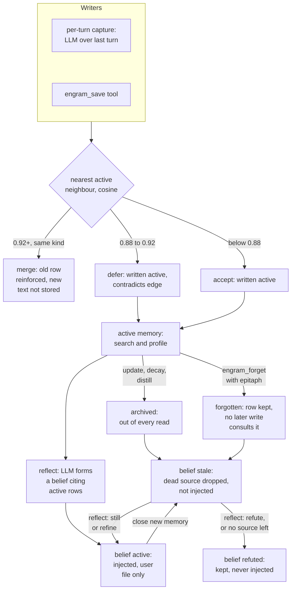

## 1. Executive Summary

dsh-engram is a [DeepSeek Harness](../deepseek-harness/) plugin that gives
a coding agent long-term memory across sessions. Memories live in SQLite files,
one per scope: a user file, a shared file, and one file per project keyed on the
normalized git origin. The agent reaches them through 23 narrow tools, and a
profile of the user's most important memories is injected at session start.
The design borrows the memory palace's layout, so every memory is pinned to a
room and slot and can be walked in a fixed route.

What is notable is the belief layer and the correction path. An auxiliary LLM
consolidates raw memories into one-sentence beliefs, each citing its source
rows. When a source is forgotten, archived or superseded, the belief drops it
and turns stale; with no source left it turns refuted. Only active beliefs are
injected. A correction writes a new revision under the same memory id and
leaves the old one out of every read path, and a test proves it against the
populated old row.

What is weak is the trust boundary around the curated profile. It is injected
in its own block, which tells the model these are *"the rules the user
maintains by hand"* and to treat them as authoritative. The only writer is
`engram_profile_edit`, a tool on the agent's own surface. A save whose nearest
neighbour is at cosine 0.92 or above is merged into it and its text is dropped,
so a high-similarity correction through `engram_save` is lost. A forgotten value
is never consulted again by any write.

**Licence.** MIT, in `LICENSE` and `package.json`, which agree, with no
contributor agreement in `CONTRIBUTING.md`. The grant is clean; the practical
limit sits outside it. `typecheck`, `test` and `bundle` resolve values from
`@deepseek-ai/*` peers that `.npmrc` records as not installable from npm, so the
suite runs only inside a sibling `deepseek-harness` checkout. The embedding
model and the WASM inference engine are fetched at install and run time under
their own terms and are not in the tree.

## 2. Mental Model

A **memory** is a typed row: `fact`, `preference`, `decision`, `episode` or
`skill` (`src/types.ts:51`). Its status is a lifecycle value, `active`,
`archived` or `forgotten` (`src/types.ts:54`), and nothing epistemic: a
captured inference and a user's statement are stored the same way, at the
confidence their writer gave. Every read path filters to `active`.

A memory enters by one of four dispositions decided against the nearest active
neighbour in the same file (`src/write-disposition.ts:216-244`). At cosine 0.92
or above with the same kind it **merges**: the old row is reinforced and the new
text is not stored. Between 0.88 and 0.92 it is **deferred**: written active,
with a `contradicts` edge to the neighbour. Below that it is **accepted**.
Empty or in-batch duplicate content is **dropped**. Without embeddings every
write is accepted.

A memory stops being believed in three ways. `engram_update` archives it and
writes a new revision with the same `memory_id` and a `supersedes` edge
(`src/store/sqlite.ts:1464-1497`). `engram_forget` sets `forgotten` and records
an epitaph of three answers in `op_log` (`:1509-1524`). Decay and distillation
archive in bulk. A restore reactivates a row and archives any active sibling
revision (`:1701-1716`).

A **belief** is a separate row in `observations`, formed by an auxiliary LLM
from active memories not yet cited as evidence
(`src/consolidation/reflect.ts:141-149`). It carries `active`, `stale` or
`refuted`. A new memory within cosine 0.86 of an active belief marks it stale
for review (`:153-172`), and the next reflection rules `still`, `refine` or
`refute` on it (`:257-266`). Independently, whenever a source row dies, the
belief loses that source: stale if any remain, refuted if none do
(`src/store/sqlite.ts:856-886`). Only active beliefs reach the prompt
(`src/index.ts:489`).

The **curated profile** is a third kind of thing: a versioned text block per
scope, injected ahead of everything else as the user's instructions, and
written by the agent's `engram_profile_edit` tool.

## 3. Architecture

The plugin runs inside the DeepSeek Harness host process: a Cordis plugin with a
Node half that owns the stores, tools and hooks, and a React panel served over a
loopback HTTP API (`/api/engram/*`). Storage is `node:sqlite` in WAL mode with a
five-second busy timeout, one file per scope under `~/.dsh/engram`
(`src/index.ts:1079-1081`). A project file is named by a hash of the normalized
git origin, so worktrees and the SSH and HTTPS forms of one remote share it.

Embeddings default to `Xenova/paraphrase-multilingual-MiniLM-L12-v2` at 384
dimensions, run locally by transformers.js on a WASM onnxruntime build that the
bundle step copies into `lib/engine/`. A remote OpenAI-compatible endpoint is the
alternative. A dimension that does not match the stored vectors is refused on
write and on comparison rather than truncated. Vector search is an in-process
scan of a packed matrix, with a streaming fallback above its size cap.

An auxiliary LLM call is made for capture, query rewriting, distillation, belief
consolidation, profile overflow compression and history backfill, on the
session's own provider unless `provider` and `model` override it. An optional
external judge, Jev, can rule on the 0.88–0.92 band and confirm contradiction
edges; when it fails, the rules apply.

### Deployment and ergonomics

Installing is one command into a harness profile, and nothing else needs to run:
no service, no API key for storage, no Docker. Offline, a failed model download
degrades retrieval to keywords and marks results `degraded`. Without an LLM,
capture, rewriting, distillation and reflection stop and saves still work. The
store is plain SQLite and readable by hand, and `engram_mirror` writes one
Markdown file per memory with YAML frontmatter. A schema upgrade takes a
`VACUUM INTO` snapshot first. Building from source needs the harness repository
checked out beside it.

## 4. Essential Implementation Paths

- **Save.** `engram_save` scrubs protocol tags and secrets, embeds, runs
  `decideWrite`, then writes or reinforces; on `defer` it links the new row to
  up to three neighbours at 0.88 or above (`src/tools/create.ts:370-418`,
  `:588-664`).
- **Capture.** With `ingest` on, the first step of each turn starts
  `ingestPreviousTurn` without awaiting it; an LLM extracts candidates from the
  previous turn's log, each candidate picks `user` or `project`, and each goes
  through the same `decideWrite` (`src/index.ts:375-395`,
  `src/ingest/hook.ts:620-707`). A `(session, turn)` key makes it idempotent and
  a failure leaves a pending key for the next session.
- **Search.** `engram_search` runs one `store.search` per scope file, per
  rewritten query, and fuses the results (`src/tools/create.ts:685-700`); the
  store fuses FTS and vector lanes by RRF (`src/store/sqlite.ts:1196-1331`).
- **Inject.** At step 1, or after a compaction, the pre-step hook reads the
  user file's curated profile, its top active memories by importance, and its
  top three active beliefs, and appends a profile packet, a directives packet
  and a memory packet (`src/index.ts:417-558`).
- **Correct and forget.** `update`, `forgetWithTombstone` and `restore`
  (`src/store/sqlite.ts:1464-1524`, `:1701-1716`); each calls
  `detachArchivedEvidence` except restore.
- **Consolidate.** `reflectObservations` (`src/consolidation/reflect.ts:134-330`)
  runs from the `engram_reflect` tool, or after a session through the job queue
  when `reflect` is `auto`.
- **Background.** A daily decay and `op_log` prune over the user file and every
  existing project file (`src/index.ts:1997-2036`), and a daily pairwise merge
  over the user file (`:2039-2063`, `src/consolidation/run.ts:58-223`).

## 5. Memory Data Model

`nodes` holds a row per revision: `id` is the revision, `memory_id` the stable
identity, plus scope, kind, content, importance, confidence, status, access
count, source session, round and event sequence, embedding blob, placard JSON,
room and slot, and SM-2 review fields (`src/store/sqlite.ts:491-499`).
`nodes_revisions` keeps the content of each superseded revision by `memory_id`.
`edges` carries `supports`, `contradicts`, `refines`, `related` and `supersedes`
(`src/types.ts:57`). `tour_routes` is the append-only palace route.

`entities` and `node_entities` hold an entity lexicon resolved by normalized
name. `facts` attach one-sentence facts to an entity with `valid_at`,
`invalid_at` and `replaced_by` (`src/store/sqlite.ts:526-529`). Both ends are
record time: `valid_at` is `input.validAt ?? now` and no caller passes it
(`:2233`), and `invalid_at` is the time a replacing fact was written. The
`asOf` filter is a point-in-time read over that one clock.

`observations` holds beliefs with `sources_json`, `proof_count`, status and an
embedding (`:530-533`). `profile_blocks` and `profile_block_versions` hold the
curated profile per scope, versioned and append-only, with an optimistic lock
(`:1656-1674`). `injection_snapshots` keep the exact packet each session
received. `op_log` is the operation log (`:503-505`).

Scope is a physical partition. Each scope has its own file, and a project file
per git origin; nothing in a row names a project. Each file's queries also
carry `scope IN (...)` (`:895`, `:907`), which matters only when a JSON import
writes rows of one scope into another's file: the import keeps the record's own
scope (`:1879-1880`), so those rows are invisible to search there.

## 6. Retrieval Mechanics

The keyword lane runs FTS5 `MATCH` over content pre-tokenized into Chinese
2-grams, restricted to active rows, the scope and optional rooms, ordered by
BM25 and capped at 64 (`src/store/sqlite.ts:893-896`). The vector lane scans
every active row with an embedding, keeps cosine 0.2 and above, and takes the
top 64. Both contribute `1/(60 + rank)`. A recency factor over
`last_accessed_at` and a log hit-count factor multiply the fused score. The
`supports`, `refines` and `related` neighbours of the top results enter at half
their source's score if active and in scope. Since 0.12.0 a search reinforces
nothing; it writes one `search-exposure` row with the hit ids and a
12-character hash of the query (`:1323-1329`).

`engram_search` defaults `queryRewrite` to on, so each search can cost an
auxiliary call that rewrites the query into up to three, fused across queries
with a per-query floor. Results are rendered with a `ref=` per row and a batch
id under a 1,200-character item and 4,800-character total budget.
`engram_assess` then accepts a verdict of *sufficient* only with a valid ref
from that batch and `nextStrategy=answer`. The batches live in process memory,
20 per session, and the gate is a reminder: nothing stops the model answering
without it.

The injected profile is the user file only: up to `profileTopN` (8) memories by
importance within `injectTokenBudget` (1,024), near-duplicates folded by stored
vectors, plus three active beliefs. It is appended after the turn's messages at
step 1 and again after a compaction, and skipped when its hash is unchanged, so
a session's earlier prefix is not disturbed. Project-file beliefs are formed
and never injected, since the injection opens `openStore('user')`
(`src/index.ts:429`).

## 7. Write Mechanics

`engram_save` is synchronous: one local embedding, about 90 ms per text on the
WASM engine by the README's account, one nearest-neighbour scan, and the insert
in one transaction with its FTS row and its `op_log` row. A saved memory is
searchable when the call returns. Capture is deferred: it starts at the next
turn's first step without blocking it, makes one LLM call, and its memories are
searchable a turn plus that call's latency after the words were said. The final
turn is captured at session end with a five-second timeout.

The merge threshold is the weak point. At cosine 0.92 or above with the same
kind, `decideWrite` returns `merge` with no further check
(`src/write-disposition.ts:225-227`), and `applyMerge` only bumps access count
and confidence and logs the first 40 characters (`:322-331`,
`src/store/sqlite.ts:666-667`). The numeric-token guard that keeps
"port 8080" from merging into "port 9090" applies only to the fallback merge in
the 0.90–0.92 band (`src/write-disposition.ts:236-242`). The tool tells the
model it merged, and a correction must go through `engram_update` to survive.

Inbound text is stripped of the plugin's protocol tags and scrubbed by regex for
API keys, bearer tokens, AWS and GitHub tokens, PEM keys, password assignments,
mainland-China phone numbers and national ID numbers. Recall tool output inside
captured slices is replaced with a placeholder so memory does not re-capture
itself.

Two background passes rewrite rows. A daily decay archives active memories below
importance 0.3 not accessed in 30 days, except those under review scheduling.
A daily merge over the user file's top 500 active memories supersedes
same-kind pairs at cosine 0.92 or above into a copy of the higher-ranked one
(`src/consolidation/run.ts:165-207`); it is quadratic within that bound and
needs no LLM. Reflection reads at most 300 active memories and 30 new
candidates per run, in slices of ten.

## 8. Agent Integration

The agent holds every verb: save, search, facts read and write, assess,
timeline, episode timeline, update, forget, report, review queue, review,
stats, export, import, distill, reflect, examine, neighbours, tour, forgotten
audit, history backfill, profile edit and language guide
(`src/tools/create.ts:2104`). `engram_forget` refuses without all three epitaph
answers (`:1182-1209`). Retrieval is tool-mediated apart from the session-start
profile.

The person's surface is the panel. Its routes list memories, show `op_log`,
resolve contradictions as `dismiss` or `forget-loser` (`src/routes.ts:914-941`),
set a belief's status (`:966-987`), clear the log, and run backfill. Requests
must come from a loopback peer, or a private LAN peer with `panelAccess: lan`,
and writes need a matching or absent `Origin` and a JSON content type
(`src/routes.ts:68-75`, `:153-164`). There is no token. The profile route is
read-only, and its comment says editing goes through the tool (`:1722-1724`).

Adapting it to another agent means replacing the Cordis host bindings in
`src/index.ts` and `src/tools/create.ts`; the store, the disposition rules and
the reflection module do not import the host.

## 9. Reliability, Safety, and Trust

### The profile block the agent writes and the model obeys

The injection puts the curated profile first, in its own packet, explicitly
outside the memory packet's warning not to follow embedded instructions
(`src/index.ts:520-529`). That packet's header reads *"This block holds the
rules the user maintains by hand (engram_profile_edit)... follow them and treat
them as authoritative"* (`src/i18n/catalog/store.ts:117`,
`src/security/sanitize.ts:101-108`). `saveProfileBlock` has two callers, both in
the `engram_profile_edit` tool (`src/tools/create.ts:2040`, `:2056`), and the
version row records `edit` or `rollback`, not who. Whatever the agent is
persuaded to save there, by a user or by text in a tool result, becomes the
user's standing orders for every later session.

### What forgetting stops

`engram_forget` keeps the row, its embedding, its FTS entry and its revisions,
and records why in `op_log`. Nothing hard-deletes a memory on a reachable path:
`purge` is called only from tests. The epitaph is keyed on the row id, and the
write paths consult only active rows (`src/store/sqlite.ts:2077-2102`), so the
same fact captured next week is accepted fresh. A comment above the epitaph
promises desensitizing, and the code trims and truncates to 200 characters
without calling the redactor (`:1513-1518`).

Facts extracted from a memory keep serving after it is forgotten. A fact
records its `source_node_id`, the only invalidation is a replacing fact
(`:2238`), and `factsOfEntity` reads the `facts` table without the source
row's status (`:2257-2274`), so `engram_facts` and the `asOf` tail of a search
still return it.

### Contradictions are detected, not held

A deferred write is active and searchable from the moment it lands. The
`contradicts` edge waits in the panel's governance list until a person dismisses
it or forgets one side; until then both claims serve. The daily merge does not
see the pair, since it acts only at 0.92.

### Marks

- **`trust_state`** — awarded on belief status. Only active beliefs are
  injected, and the producers are reachable: `engram_reflect` and post-session
  reflection rule `refute`, and every forget, archive and supersede strips the
  dead source. Raw memories carry lifecycle only.
- **`audit_log`** — awarded on `op_log`. Each node mutation appends a row, the
  update and restore rows in the same transaction as the change, and
  `engram_review` reads them per memory. The limits are real: a daily prune
  drops rows older than 366 days except ingest bookkeeping (`src/index.ts:1996`,
  `:2015`, `src/routes.ts:221`); `POST /api/engram/log-clear` deletes every
  other row and vacuums (`src/routes.ts:1143`); decay logs a count without ids;
  belief status changes, fact writes and the panel's belief override write no
  row. Clearing the log also erases every forget epitaph, since the forgotten
  audit joins on `op_log`.
- **`negative_eval`** — awarded; see section 10.
- **`tombstone`** — withheld. The epitaph is keyed on a row id, and a refuted
  belief is only excluded from the merge search, which lets the same sentence
  form a new active belief.
- **`bitemporal`** — withheld. `facts.valid_at` defaults to the write clock and
  no caller sets it.
- **`scope_enforced`** — withheld. The boundary is the file each scope opens, a
  physical partition; the in-file `scope` predicate separates nothing that a
  correct write path would have mixed.
- **`human_review`** — withheld. Nothing waits: deferred memories and new
  beliefs are active on write, and the panel's resolution acts afterwards.

### Other risks

- Any local process that reaches the loopback port, including the agent's own
  shell, can set belief status, resolve contradictions or clear the log.
- A JSON import writes rows with the record's own scope into the chosen file,
  where a different scope makes them unsearchable.

## 10. Tests, Evals, and Benchmarks

The suite has 959 vitest cases in 67 spec files over real SQLite files in
temporary directories. CI runs biome, the message-dictionary and
language-pattern checks, a CSS-class check, a headless panel-layout check and a
packaging smoke, and not vitest, because the suite imports the
`@deepseek-ai/*` peers (`.github/workflows/checks.yml:1-12`). I ran none of it.

`negative_eval` rests on one populated case.
`tests/store.spec.ts:164-171` writes "端口是 3000", updates it to
"端口改为 4000", and searches "端口", a bigram both rows contain; it asserts the
hits equal exactly the new revision's id. It exercises the keyword lane only.
`tests/observations.spec.ts:106-120` drives a belief through stale to refuted
by forgetting its two sources, and `:166-183` asserts a restore does not revive
it. No test asserts that a stale or refuted belief is absent from the injected
packet, or that a forgotten value is refused on a later save.

`tests/evaluation.spec.ts` is the committed retrieval baseline that
`docs/evaluation-baseline-v15.md` reports: three targets, one update chain and
twelve distractors, keyword lane only, Recall@5, Hit@5 and MRR of 1.0, and an
abstention case. The document calls it a regression smoke, not a benchmark. The
README roadmap's LoCoMo-zh gate is not in the tree. No paper is associated with
the project.

## 11. For Your Own Build

### Steal

- **Let a belief lose its sources.** Store the evidence ids on each derived
  belief, and in the same transaction as any forget, archive or supersede, drop
  the dead id: stale while some remain, refuted when none do. A belief then
  cannot outlive what it was built from.
- **Give a correction a stable identity.** A revision id per row plus a
  `memory_id` across revisions lets reads filter to the current revision while
  history, restore and evaluation key on one name.
- **Reinforce on feedback, not on exposure.** Log what a search returned with a
  hash of the query, and bump confidence only on an explicit outcome or a merge,
  so ranking does not feed on itself.
- **Make the dimension a hard constraint.** Refuse a vector whose dimension
  differs from the store's, on write and on query, naming both numbers.

### Avoid

- **A trusted block the agent can write.** If a packet tells the model to obey
  its contents, its only writer must be a person, through a surface the agent
  cannot reach.
- **A merge threshold with no value check.** Above the merge cut, a corrected
  number or name looks like a restatement; compare the distinguishing tokens at
  every threshold, or never discard the incoming text.
- **Forgetting by row.** A soft delete that no writer consults lets capture
  re-learn the forgotten fact; keep a key on the value if forgetting must hold.
- **An audit log the operator can empty.** A log that a route can clear and a
  timer prunes records history only until someone needs it.

### Fit

This suits one developer on DeepSeek Harness who wants memory that works with
nothing to run, follows them across repositories, and can be browsed and
repaired in a panel. The engineering is careful where it is local:
transactions, migration snapshots, dimension guards and per-candidate failure
isolation. Walk away if several people or agents share a machine and must not
shape each other's instructions, since the profile block is writable by the
agent and the panel needs no token. Walk away too if forgetting must stick.

## 12. Open Questions

- Whether `engram_profile_edit` is meant to stay on the agent's tool surface,
  given the packet header attributes the block to the user's own hand.
- What cosine the default MiniLM model gives same-kind sentences that differ in
  one number, which decides how often a correction through `engram_save` is
  merged away; I did not run the model.
- Whether project-file beliefs are meant to be injected for project sessions.

## Appendix: File Index

- Storage and schema: `src/store/sqlite.ts`, `src/store/interface.ts`,
  `src/types.ts`, `src/store/import.ts`
- Write path: `src/write-disposition.ts`, `src/tools/create.ts`,
  `src/ingest/hook.ts`, `src/security/redact.ts`, `src/security/sanitize.ts`
- Retrieval: `src/store/sqlite.ts` (`search`), `src/retrieve/rewrite.ts`,
  `src/retrieve/evidence.ts`, `src/retrieve/budget.ts`
- Context assembly: `src/index.ts` (pre-step hook), `src/security/sanitize.ts`
- Beliefs and consolidation: `src/consolidation/reflect.ts`,
  `src/consolidation/run.ts`, `src/jobs/host-reflect.ts`
- Panel API: `src/routes.ts`
- Tests: `tests/store.spec.ts`, `tests/store-v2.spec.ts`,
  `tests/observations.spec.ts`, `tests/reflect.spec.ts`,
  `tests/write-disposition.spec.ts`, `tests/evaluation.spec.ts`

### Recorded searches

Run from the repository root at the pinned commit with `/usr/bin/git grep`.

- **No caller sets a fact's valid time.**
  `git grep -n -E 'validAt[[:space:]]*:' -- src ':!src/client'` matches only the
  row mapper at `src/store/sqlite.ts:332`, the type at `src/types.ts:245` and a
  message parameter at `src/tools/create.ts:125`; the positive control
  `git grep -n 'input.validAt' -- src` matches `src/store/sqlite.ts:2233`.
- **The write paths do not consult forgotten rows.**
  `git grep -n -E 'forgotten|tombstone' -- src/write-disposition.ts src/ingest/hook.ts`
  returns nothing; `git grep -c 'forgotten' -- src/store/sqlite.ts` counts 13.
- **Nothing reachable hard-deletes.** `git grep -n -E '\.purge\(' -- src scripts`
  returns nothing; over `tests` it matches four lines.
- **What deletes from op_log.** `git grep -n 'DELETE FROM op_log' -- src`
  matches `src/store/sqlite.ts:671`, `:779`, `:1783` and `:2404`.
- **Belief and fact writers append no op_log row.**
  `git grep -n -E 'sqlLog\.run\(' -- src/store/sqlite.ts` lists 18 sites, none
  between lines 2229 and 2374, where `writeFacts` through `nearestObservation`
  sit.
- **The profile block has one writer, the agent's tool.**
  `git grep -n 'saveProfileBlock(' -- src` matches the interface, the store and
  `src/tools/create.ts:2040` and `:2056`.
- **Contradiction resolution is panel-only.**
  `git grep -n 'resolveContradiction(' -- src` matches the interface, the store
  and `src/routes.ts:935`.
- **CI runs no test suite.**
  `git grep -n -E 'run:.*(vitest|pnpm test|pnpm run test)' -- .github` returns
  nothing; `git grep -n -E 'run:.*pnpm lint' -- .github` matches
  `.github/workflows/checks.yml:41`.
- **Forgetting a memory does not invalidate its facts.**
  `git grep -n -E 'source_node_id|sqlFactInvalidate\.run' -- src` matches the
  schema, the row mapper, the insert and one invalidation, by `replaces`, at
  `src/store/sqlite.ts:2238`.
- **No LoCoMo harness.** `git grep -n -i 'locomo' -- src tests scripts .github`
  returns nothing; over `README.en.md` it matches the roadmap line.
- **No paper.** `git grep -n -I -i -E 'arxiv|bibtex|CITATION'` returns nothing,
  and no `CITATION.cff` is tracked; `git grep -c -i 'LongMemEval' -- docs`
  counts lines in three planning documents.

## History

**2026-11-20** — [`ad0fa89bdde0420e8a409455b45f023f08f743a2`](https://github.com/kenz1117/dsh-engram/commit/ad0fa89bdde0420e8a409455b45f023f08f743a2) — first reading, from a clone of `main` at release 0.13.15, scoped to the store, write disposition, capture, search, injection, belief consolidation, panel routes and their tests; the panel UI, i18n and history backfill were read only where they write what those paths read. Screened first: no auto-run surface; one build-time execution point, the npm `prepare` lifecycle running `scripts/link-peers.mjs` and `scripts/ensure-build.mjs`; `package.json` and `pnpm-lock.yaml` inside the seven-day cooldown; ten floating ranges under a lockfile. MIT, no rider. Nothing installed, built or run. Three marks: `trust_state`, `audit_log`, `negative_eval`.
