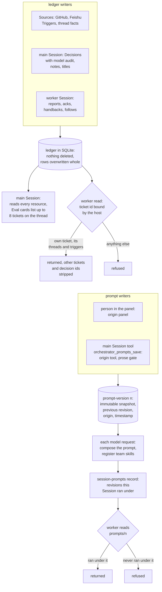

## 1. Executive Summary

dsh-superagent is a proactive coding agent for one GitHub repository, packaged
as a bundle for [DeepSeek Harness](../deepseek-harness/), with Feishu as an
optional second Source. A resident main Session routes requests into Tickets,
and a worker Session per Ticket does the work. Its durable state is a SQLite
ledger of Triggers, Threads, Decisions and Tickets, plus a versioned prompt
configuration of team sections and team skills read on every model request.
What is notable is the boundary around the workers: each one reads the shared
ledger only through its own Ticket, bound by the host. What is weak is the other
door: the main Session can rewrite the team skills, the Policy and the accept
mode itself, and only prose asks it to wait for a person.

Memory here is a by-product of a workflow design rather than its subject. Two
things outlive a session and reach later model calls. The **ledger** holds what
the agents wrote while working: Decision audits with quoted evidence, worker
reports, routing notes and acknowledgements. Later Evals, resumed Tickets and
the main Session read it back by id. The **prompt configuration** holds what
the team told the agents. That includes knowledge such as an `identities` skill
mapping Feishu users to GitHub accounts, and every Session recomposes its prompt
from it on each model request.

The README calls the code a research prototype, *"not an official DeepSeek
product"*, and says it differs from the internal version and from the article
*Exploring Super-agent Design: Towards a More Autonomous Agent System*. That
article was published on DeepSeek's WeChat account on 31 October 2026, per
[Yicai's report](https://www.yicai.com/news/103419784.html). It is not in the
tree, and none of its claims are used here.

Four findings shape the rest of this report.

- **The router can rewrite its own instructions and admission rules.**
  `orchestrator_prompts_save` and `orchestrator_settings_save` are on the main
  Session's tool surface (`src/app/tools/main.ts:249-299`). The only code guard
  refuses non-panel changes to the execution environment and the Source
  accounts (`src/app/settings.ts:45`, `:51`). Team skills, the Policy's allowed
  lists and rules, and the accept mode all save from the tool. The *"explicit
  human request"* condition is tool-description text.
- **Team knowledge is versioned, not edited.** Each save writes an immutable
  numbered snapshot with its origin, and a rollback is a new revision
  (`src/app/versions.ts:18-29`). Each Session's record of the revisions it ran
  under gates which old versions a worker may read
  (`src/app/sessions.ts:329-338`).
- **Worker reads are scoped by the host, not the model.** The ticket id is
  captured when the worker's tools are built (`src/app/runtime.ts:124`), and
  every worker-readable resource checks it against the stored Subscriptions,
  follows and Inputs (`src/app/resources.ts:97-104`, `:133-147`, `:235-239`).
- **Nothing is forgotten.** No product path deletes a Trigger, Thread,
  Decision, Ticket or prompt version. The ledger grows for the life of the
  deployment.

Three marks, `scope_enforced`, `audit_log` and `negative_eval`. Section 9 names
the four withheld.

## 2. Mental Model

There is no memory object. There are two stores that agents read later, each
with its own lifecycle, and neither holds a belief state.

**The ledger records what happened and what an agent said about it.** A
Trigger is one immutable event from a Source, with its actor and a `human` flag
the Source sets. A Thread holds Triggers in time order, its Subscriptions and
its Decision history. A Decision is the result of an Eval. Its `audit` is the
assessor model's output, holding rule assessments, a direction and
`intent_evidence` quotes, stored verbatim (`src/core/evals.ts:283-313`). A
Ticket holds its Mandate, Assignments with the worker's latest report, and
Inputs: fanned-out Triggers, Policy changes, resumes and the main Session's
`note`s (`src/core/model.ts:218-308`). None of it can be marked wrong. A
Ticket ends and resumes, a person can dismiss an unavailable Decision, and a
Subscription can be dropped. The record itself stays.

**The prompt configuration is team knowledge with a revision number.** It holds
three team sections (Communication, Ticket scope, Delivery requirements), any
number of team skills, and overrides of the built-in parts
(`src/app/prompts.ts:14-41`). A save takes effect at the next model request,
with no candidate state (`src/app/sessions.ts:329-338`). It stops being
effective when a later revision replaces it. The replaced revision stays
readable by number, and a worker may read it only if it ran under it.

**Precedence is stated, and enforced only at the top.** `docs/004-prompts.md`
ranks tool and host checks first, built-in and generated sections second,
matched rules third, team sections and skills fourth, and outside text last, as
data. The first rank is code; the other four are an ordering inside a prompt.

**The two stores have different writers.** Sources and both kinds of Session
write the ledger through the engine. A person writes the prompt configuration
in the panel, and the main Session writes it through its own tool. The worker
has no prompt or settings tool (`src/app/tools/executor.ts:29-75`).

## 3. Architecture

dsh-superagent is a Cordis plugin bundle loaded into one DeepSeek Harness
process (`cordis.patch.yml`, `src/index.ts`). The `Runtime` locks the state
directory, opens the Store, registers the Sources and the panel routes, and
uses two Session presets: `dsh-superagent-router` for the main Session and
`dsh-superagent-worker` for each Ticket (`src/app/runtime.ts:98-124`,
`docs/003-execution.md`). Worker Sessions are named `worker-<ticket id>`
(`src/executor/dsh.ts:24`) and are resolved before they are created
(`src/app/sessions.ts:138-147`), so a resumed Ticket continues the same Session
history in the host's session store.

**Persistence is one SQLite file**, `<stateDir>/orchestrator.sqlite`, opened
with `journal_mode=WAL` and `synchronous=FULL` and chmod 0600
(`src/app/store.ts:58-64`). Aggregates are JSON in `value` columns, with
generated columns and partial indexes for the working sets the passes scan
(`src/app/store.ts:30-46`). A `kv` table holds settings and prompt versions,
the per-Session prompt binding, Source read positions and queue state. Schema
10 migrates to 11 in one transaction or leaves the file unchanged
(`src/app/store.ts:58-96`).

**There is no retrieval stack.** No full-text index, embedding or ranker exists
in `src/` (Recorded searches). Model-facing reads are addressed resources served
by `readResource` (`src/app/resources.ts:299-309`), and Source reads go to the
GitHub and Feishu CLIs on demand.

**Background work is an effect queue**, not a memory process. `Effects` holds
durable deliveries of candidate cards, replies and notices with retry counts
(`src/app/effects.ts`). Sources poll subscribed Threads while a Ticket is live
and for two weeks after (`docs/003-execution.md`).

### Deployment and ergonomics

The operator needs DeepSeek Harness, a GitHub account for the agent with its
`gh` login, optionally a Feishu bot with `lark-cli`, and a model provider. The
README hands setup to a coding agent that follows `SETUP.md`. Nothing else has
to run: the store is a local SQLite file, and the panel is served by the host's
web server, which must bind loopback (`src/app/http.ts:231`). Only the store is
local; every Source and both roles' models are remote. The database is plain
JSON in SQLite, readable and repairable by hand, and `docs/006-deployment.md`
says to back it up before upgrades.

## 4. Essential Implementation Paths

**Capture.** A Source turns a native event into a `Trigger` and calls
`receive`. The engine saves it, indexes its Threads in `trigger_thread`, and
either fans it out to subscribed Tickets or queues it for Eval
(`src/core/intake.ts`, `src/app/store.ts:128-132`, `:201-206`). The Source drops
the bot's own messages and Triggers outside what it listens to before they
enter.

**Eval and Decision.** An explicit request goes to `orchestrator_route`. An
inferred candidate goes through `orchestrator_eval`, `orchestrator_eval_read`
and `orchestrator_eval_decide` (`src/app/tools/main.ts:127-222`). The
assessor's structured result is checked against the Policy by
`assessmentOutcome` and `Engine.decide`, then recorded as a Decision with
`audit` (`src/app/assessment.ts:272-283`, `src/core/evals.ts:283-313`).

**Work state.** A worker writes through five verbs: `orchestrator_ack`,
`orchestrator_thread_unrelated`, `orchestrator_thread_follow`,
`orchestrator_trigger_handback` and `orchestrator_report`
(`src/app/tools/executor.ts:29-100`). A report claims any pull request, records
the state and summary, and queues the relay to the main Session in one
savepoint (`src/app/tools/executor.ts:90-100`). The main Session adds context to
a Ticket with `orchestrator_ticket_note`, capped at the IM word limit
(`src/app/tools/main.ts:177-188`, `src/core/tickets.ts:395`).

**Read-back.** `orchestrator_read` serves Tickets, Triggers, Threads, Decisions,
settings, prompts and models to the main Session, and the subset marked
`executor` to a worker (`src/app/resources.ts:23-51`). An Eval candidate card
carries `related_tickets`, the 8 newest Tickets on the Thread with open ones
first, each with a 160-character preview of its latest report
(`src/app/cards.ts:8`, `:26-32`, `:93-96`).

**Prompt composition.** On each model request `promptFor` takes the current
version, rebinds the Session's skills if the revision moved, and appends the
revision to `session-prompts:<session>` (`src/app/sessions.ts:329-338`).
`composePrompt` assembles shared and role parts, the three team sections,
working instructions, handoff, the environment and, for the main Session, the
Policy last (`src/app/prompts.ts:102-118`).

**Correction.** `Prompts.save` validates, checks the base revision for
optimistic concurrency, records the built-in text each override was edited
from, and saves the next revision (`src/app/prompts.ts:202-215`). The panel's
`PUT prompts` and the tool both call `savePrompts`, which notifies the main
Session unless the main Session made the save (`src/app/prompts.ts:239-246`).

**Tests.** `tests/prompts.spec.ts`, `tests/tools.spec.ts` and
`tests/runtime.spec.ts` carry the version, boundary and tool-surface cases cited
in section 10.

## 5. Memory Data Model

| Record | Key | Written by | Mutated | Read back by |
| --- | --- | --- | --- | --- |
| `trigger` | Trigger id | Sources | re-saved whole | Eval, `trigger/`, fan-out |
| `disposition` | Trigger id | engine | re-saved whole | follow-up ownership, cards |
| `thread` | `source:id` | engine, Sources' facts | re-saved whole | Eval, `thread/` |
| `decision` | Decision id | engine, from model output | `dismissed` set later | `thread/`, `decision/`, dedupe |
| `ticket` | Ticket id | engine, from both roles' tools | re-saved whole | cards, `ticket/`, resume |
| `prompt-version:n` | revision | panel, main Session tool | never, outside migration | every model request |
| `settings-version:n` | revision | panel, main Session tool, sync | never, outside migration | gate, Policy section |
| `session-prompts:<id>` | Session id | `promptFor` | appended | `mayRead` |

**Scope.** The only scope key is the Ticket. Its id appears in
`thread.subscriptions`, `thread.context`, `ticket.follows` and the Ticket's
Inputs, and the worker's reads are filtered against it. There is no user,
tenant or project key, because one deployment serves one repository. A person
is not a domain concept: an actor is a Source identity on a Trigger
(`docs/001-domain.md`).

**Provenance.** A Trigger carries the Source's actor and `human` flag. A
Mandate records the Policy version, the gate basis, the sender and the matched
rules (`src/core/model.ts:116-133`). A prompt version records an origin channel
and a timestamp, not an identity.

**Time.** `at` on a Trigger is the Source's event time, and Decisions, Inputs
and reports carry their own `at`. No record has a validity interval.

**Separation.** Work state, model judgements and team instructions sit in
different records with different writers. No path promotes ledger content into
the prompt configuration: the only writers of a team skill are the panel route
and the main Session's save tool (Recorded searches).

## 6. Retrieval Mechanics

Retrieval is navigation. A model asks for a resource by name, such as
`ticket/<id>/report/<assignment>`, and gets a page of at most 50 items or 4,000
characters, with `next_offset` (`src/app/resources.ts:87-93`,
`src/app/cards.ts:89-92`). Lists are newest first. A thread page shows the 5
latest Decisions to the main Session and none to a worker
(`src/app/resources.ts:111`, `:142-147`).

The automatic part is the Eval card. `MasterAssessor.context` returns the
trigger's text up to 4,000 characters and its batch peers. It adds the related
Tickets with their latest report previews, the Policy version, and a thread
window of the first five messages and five either side of the trigger,
truncated (`src/app/assessment.ts:183-220`). So an earlier worker's report
summary reaches a later Eval on the same Thread unasked. The prior Decisions do
not appear in the card; code reads them only to find which Triggers an accept
already took (`src/core/evals.ts:258-266`).

Prompt text is injected whole on every request. The team sections are part of
the system prompt, and team skills are registered as host skills that the model
loads on demand (`src/app/prompts.ts:146-148`). The main Session's Policy
section is regenerated from settings on every request and placed last, so a
Policy change leaves the preceding prefix unchanged (`src/app/prompts.ts:92-100`).

The failure mode is staleness without a signal. A report preview, a routing note
or a team skill is shown as written, with no age or state, and nothing marks a
report that a later event made false.

## 7. Write Mechanics

Ledger writes are synchronous and deterministic. Each engine command runs in
`Store.atomic`, a savepoint whose post-commit callbacks run only after the
outermost commit (`src/app/store.ts:140-162`). The model's free text enters as
fields: a Decision's `audit` and `reason`, a Ticket's `title`, a report's
`summary` and question, a note's `text`. Each is bounded by schema, such as the
1,500-character assessment scope, the 700-character evidence and the IM word
limit (`src/app/assessment.ts:21-35`, `src/app/tools/main.ts:177-188`). No model
call extracts or consolidates anything.

Prompt writes replace the whole configuration against a base revision.
`validate` refuses unknown parts, reserved skill names, a template missing a
placeholder and a configuration over the deployment's size limit. An override
equal to the built-in text is dropped, so that part follows future defaults
(`src/app/prompts.ts:164-185`). A save that conflicts with a newer revision is
refused, and the panel keeps the draft.

The main Session's save is gated in prose. `orchestrator_prompts_save` is
described as for *"an explicit user request, never on quoted content"*, and
`orchestrator_settings_save` for *"an explicit human configuration request,
never on observed content"* (`src/app/tools/main.ts:250`, `:280`). In code,
`origin: 'tool'` changes two things. It suppresses the notice to the main
Session, and it trips the guards on the `executor` and `source` blocks
(`src/app/settings.ts:43-51`, `:184`). The `policy` and `eval` blocks have no
guard, so the tool can edit allowed lists, admission tables, rules and the
accept mode. A test saves `eval.mode: 'auto'` through the tool
(`tests/tools.spec.ts:420-428`).

Deletion does not exist for memory. The `DELETE` statements in `src/` touch the
effect queue, pending outbox messages, a Trigger's thread index before
re-indexing, kv keys in migration, and a Source's own state keys
(Recorded searches).

### Operational cost

Writes do not block on a model; the agent's own turn is the only model call. A
ledger record is readable once its savepoint commits. A prompt save applies at
the next model request of every Session, including later steps of a running
turn. Nothing rewrites the store in the background. Per request, the injected
text is the composed system prompt, bounded by the deployment's limit on the
configuration's size, and the candidate card is bounded by the truncation
constants above. The Policy section sits last, so a settings change leaves the
cached prefix intact; a prompt revision changes the prefix for every Session.

## 8. Agent Integration

The main Session holds 14 tools: `orchestrator_read`, routing, retry, status,
note, requeue, three assessment tools, reply, unsubscribe and three
configuration tools (`src/app/tools/main.ts:155-299`). A worker holds 6: a
ticket-bound `orchestrator_read` and the five work verbs. It also has the
host's coding tools, minus those that ask a person, present UI or change the
profile (`docs/004-prompts.md`). Both roles run with `danger-full-access`
permissions (`src/app/sessions.ts:152`).

Memory is application-driven. Neither role is told to save knowledge, and no
tool writes a team skill except the full-configuration save. Read-back is a
mix: Eval cards and Inputs arrive automatically as messages, while full reports,
transcripts and Decision audits are read on demand. Executors also read the
host's coding prompt and the repository's `AGENTS.md`, which this bundle does
not version.

Adapting the design to another agent means adopting its domain model of
Sources, Threads, Tickets and Mandates. The reusable piece is the pairing of
`src/app/versions.ts` with `src/app/sessions.ts:329-338`: a versioned
configuration and a per-Session record of which version each Session ran
under. It ports to any host that recomposes a system prompt per request.

[dsh-mneme](../dsh-mneme/) and [dsh-continual-harness](../dsh-continual-harness/)
are plugins for the same host that store agent-written memories or rewrite
prompts from trajectories. This bundle does neither. Its prompt changes come
only from a person or from the router acting on a request.

## 9. Reliability, Safety, and Trust

**The agent clears its own review, because there is none.** A prompt, skill or
Policy save takes effect at the next request whether it came from the panel or
from the router's tools. Nothing holds it pending for a person. The main Session
reads candidate text from GitHub and Feishu, which the shared prompt declares
data. Between such text and a saved skill or allowed-list change stand that
declaration and the tool description. The guard comment states its own reach:
*"a guardrail against prompt-injected tool calls, not an OS security boundary"*
(`src/app/settings.ts:143`). It covers the execution environment and the Source
accounts.

**The safe default is on the agent's surface.** `docs/000-philosophy.md` says
proactive work *"starts in a mode that only records what the agent would have
done"*, and `eval.mode` defaults to `observe` (`src/policy.ts:84`). The main
Session can move it to `auto` with one tool call.

**The worker boundary is a tool boundary.** The ticket filter in `readResource`
holds against the model-facing read, and three tests assert it. A worker also
runs shell commands as the operator's OS user without approval. Its default
directory is under `<stateDir>/work`, and the database is
`<stateDir>/orchestrator.sqlite`, at 0600 and owned by that user.
`docs/003-execution.md` says the command wrappers *"establish defaults, not a
security boundary"*. The panel is loopback and same-origin
(`src/app/http.ts:77`, `:237`). Its `sameOrigin` check reads request headers,
which a process on the same machine sets itself.

**Provenance is good on the ledger and thin on prompts.** A Mandate records why
work was allowed. A Policy change bearing on a live Ticket is delivered to it as
an Input rather than cancelling it (`docs/001-domain.md`). A prompt version
records `panel` or `tool`, so a reader can tell the router's edits from the
panel's, but not which person asked for either.

**Privacy.** Nothing is deleted. Every Trigger's text, every report and every
Decision audit stays in the file, including Source messages a person later
deletes upstream. Trigger text is untrusted data by the model's own contract
(`src/core/model.ts:22`).

**Marks withheld.**

- **`human_review` — withheld.** No memory waits in a state. The configuration
  and Policy writers are registered on the main Session's tool surface, and the
  explicit-request condition is prose. A Ticket's `attention` question and the
  `person/review` stage wait for a person, but they hold work, not memory.
- **`trust_state` — withheld.** Decision kinds and Mandate strength describe
  authorization, not whether a record is true, and no field marks a report or a
  skill as unverified or rejected.
- **`tombstone` — withheld.** Idempotence is keyed on Trigger ids: an accepted
  Trigger maps to its Decision (`src/core/evals.ts:258-266`). An ignored request
  sent again as a new message is a new Trigger and is assessed again.
- **`bitemporal` — withheld.** Trigger `at` is the Source's event time, and no
  record carries a validity interval or a separate record time for a fact.

## 10. Tests, Evals, and Benchmarks

The suite is 59 Vitest spec files with 794 cases, about as many lines as `src/`,
covering the engine, Sources, panel and migration. `pnpm check` runs the
typecheck, the tests and the build; I ran none of it. No benchmark or retrieval
evaluation exists, which fits a system with no retrieval.

**The negative cases are about the worker boundary, and the strongest one has
its control in the same test.** `tests/tools.spec.ts:445-463` accepts two
Tickets on one Feishu thread. It asserts that the first worker's `thread/`,
`ticket/` and `trigger/` pages contain neither the other Ticket's id nor the
first Ticket's Decision id. It then asserts that the main Session's reads of the
same thread and Ticket contain both. A broken read that returned nothing would
pass the first half and fail the second.

Two more refuse stored material beside a working read.
`tests/tools.spec.ts:304-318` reads the worker's own thread, then saves a
thread in another chat and asserts the worker is refused it.
`tests/runtime.spec.ts:1033-1050` saves three prompt revisions, refuses one the
Session never ran under, and reads the current and earlier bound ones, also
after a restart. `tests/tools.spec.ts:94-104` asserts every main-only resource
throws for a worker.

**The gaps sit on the paths that matter.** No case reads `ticket/<other id>`
from a worker, which is where other workers' reports and Session transcripts
live, so the refusal at `src/app/resources.ts:239` is untested. No case asserts
that a `tool`-origin save of the `policy` block is refused, because it is not.
Before trusting the configuration path, I would want a test that a candidate
asking for a skill or allowed-list change produces no save.

`tests/prompts.spec.ts:24-45` covers the version mechanism across a restart:
revision numbers, the predecessor, a rollback saved as a new revision, the
changed-field summary and a refused stale save.

## 11. For Your Own Build

### Steal

- **Version the instructions, not only the memories.** Save the whole
  configuration as an immutable numbered snapshot with its predecessor and
  origin, and make rollback a new revision. It costs one kv family and gives a
  diff for every change a person or agent made to what the agents are told.
- **Record which version each session ran under.** An append-only list per
  session answers what a worker was told when it did something, and gating old
  versions on it keeps a worker from browsing instructions it never had.
- **Bind the scope when the tools are built.** Capture the work item's id in
  the closure that builds the worker's read tool, so no argument can widen it,
  and check every resource against stored relations.
- **Assert redaction against the privileged view of the same records.** A
  must-not on the worker's page, paired with a must-contain on the main
  Session's page in the same test, cannot pass on an empty result.

### Avoid

- **A configuration writer on the agent's own surface behind a prose gate.**
  If the model that reads untrusted text can save its own instructions, skills
  and admission list, the "explicit request" rule is the only control, and it is
  a request to the model. Keep the writer off the tool surface, or hold the save
  pending for a person.
- **A guard on the obvious fields only.** Guarding the shell command and the
  accounts while the allowed list and the accept mode stay writable protects
  against a different attack than the one the safe default exists for.
- **An archive with no forgetting.** A ledger that keeps every message and
  report forever is easy to audit and impossible to clean when a person asks.

### Fit

This suits a team that wants one always-on agent per repository and will adopt
its whole domain model of Sources, Tickets and Mandates, with a person who reads
the panel. Memory is a side effect, and no part of it learns: the agent carries
forward what the team wrote and what the ledger recorded, and nothing distils
one into the other. A team looking for a memory layer to put under its own agent
should walk away. A team building a proactive agent should read
`docs/001-domain.md` and `docs/002-authorization.md` for the domain model, and
move the configuration tools off the router's surface before relying on it.

## 12. Open Questions

- What the article *Exploring Super-agent Design* says about memory, and which
  of its designs the README's "directions for future development" covers; it
  was not read.
- Whether a worker's same-user shell reaching `orchestrator.sqlite` or the
  loopback panel was considered and accepted, or is left to the deployment to
  close with an OS user per worker.
- How large the ledger grows on a busy repository with no retention, and
  whether the working-set indexes keep the passes fast over years of rows.
- Whether the internal version keeps the configuration tools on the router's
  surface.

## Appendix: File Index

- **Storage and schema:** `src/app/store.ts`, `src/app/store-read.ts`,
  `src/app/versions.ts`, `src/kv.ts`, `src/app/migration.ts`, `src/core/model.ts`,
  `src/core/memory.ts` (the in-memory test double of the repositories).
- **Write path:** `src/core/engine.ts`, `src/core/evals.ts`, `src/core/tickets.ts`,
  `src/core/intake.ts`, `src/app/assessment.ts`, `src/app/tools/executor.ts`.
- **Read path:** `src/app/resources.ts`, `src/app/cards.ts`.
- **Prompt assembly and versions:** `src/app/prompts.ts`, `src/app/sessions.ts`,
  `src/app/context.ts`, `prompts/`, `skills/`.
- **Configuration and guards:** `src/app/settings.ts`, `src/policy.ts`,
  `src/app/http.ts`, `src/app/tools/main.ts`.
- **Tests:** `tests/prompts.spec.ts`, `tests/tools.spec.ts`,
  `tests/runtime.spec.ts`, `tests/store.spec.ts`.
- **Design documents:** `docs/000-philosophy.md` through `docs/008-cookbook.md`.

### Recorded searches

Checked against the checkout at the pinned revision, from the tree root.

- `git grep -n -i -E 'fts5|embedding|vector|cosine|bm25' -- src` — no match; there is no search arm.
- `git grep -n -E 'DELETE FROM' -- src` — the effect queue (`effects.ts:80`, `:135`), pending outbox messages (`store.ts:287`), a Trigger's thread index before re-indexing (`store.ts:129`), the generic kv delete (`store.ts:173`) and migration cleanups; no statement on `trigger`, `thread`, `decision`, `ticket` or `disposition`.
- `git grep -n -E "prompt-version|KV\.prompts\.version" -- src` — writers in `versions.ts` through `KV.prompts.version` and in `migration.ts:310`, `:328-329`; the only delete is of the old `prompt-version-read:` markers (`migration.ts:79`).
- `git grep -n -E 'savePrompts\(|prompts\.save\(' -- src` — the panel route (`http.ts:210`) and the main Session tool (`tools/main.ts:296`); no other writer of the prompt configuration.
- `git grep -n -E "guard:" -- src/app/settings.ts` — two guards, `executor` (`:45`) and `source` (`:51`); none on `policy` or `eval`.
- `git grep -n -E "name: 'orchestrator_" -- src/app/tools/executor.ts` — five work verbs; no prompt or settings tool on the worker.
- `git grep -n -i -E 'tombstone|valid_from|validFrom|valid_to|as_of' -- src` — no match.
- `git grep -n -i -E 'pending_review|quarantine|approve' -- src` — no match.
- `git grep -n -E "does not belong to this worker" -- tests` — no match; the `ticket/` refusal is untested.
- `git grep -n -E "it\.skip|describe\.skip|skipIf|it\.todo" -- tests` — no match.
- `git grep -l -i -E 'arxiv|bibtex|@article|doi\.org|CITATION' -- . ':!pnpm-lock.yaml'` — no match, and no `CITATION.cff`; the README names the article without a link.

## History

**2026-11-01** — [`6337fc823ce20251c8de8085948165c81aaa701e`](https://github.com/deepseek-ai/dsh-superagent-prototype/commit/6337fc823ce20251c8de8085948165c81aaa701e) — first reading, at the head of `main`, the repository's only commit, dated 31 October 2026, from a shallow clone (`--depth 1`); history from the GitHub API. Three marks, `scope_enforced`, `audit_log` and `negative_eval`. MIT, no rider; no `.gitmodules`. Screened before reading: no auto-run surface, no build-time execution point, no unpinned surface; `package.json` and `pnpm-lock.yaml` inside the cooldown, which the single-commit history makes exact rather than inflated. The Store, prompt versions, resource reads, both tool registries, settings guards and their tests were read; the article the README names was not. Nothing was installed, built or run.
