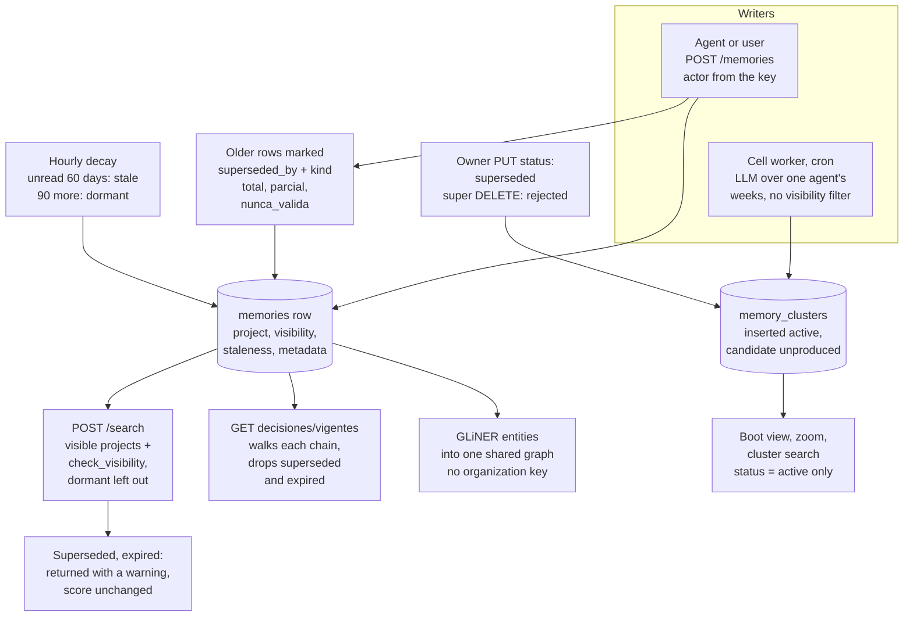

## 1. Executive Summary

EcoDB is a self-hosted memory server for a team of agents and people: one
PostgreSQL database with pgvector and Apache AGE behind a FastAPI service, an
MCP server of 41 tools, a LangChain package and an Electron dashboard, with
organizations, workspaces, projects and per-memory visibility. What is notable
is a correction path built for decisions: a new memory names the ones it
replaces, a dedicated route walks those chains to the decision in force on the day asked,
and the tests require the replaced and expired ones to stay out. What is weak is the
boundary around it. The documented MCP setup runs every agent as the super
user, entity names from private memories land in a graph every organization
reads, and the scheduled consolidation reads private memories and writes public
ones.

A memory is a typed row (`momento`, `decision`, `acuerdo`, `tecnico` and five
more) with a project, a visibility and a 512-dimension Jina v4 vector. Search
is cosine over the actor's visible rows followed by a stack of bonuses the
README calls GAMR. Graph expansion, one of those stages, is off by default at
this pin (`api/search.py:477`). Above the rows, a cron-scheduled *cell worker*
asks an LLM to cluster and narrate each agent's weeks, months, quarters and
years, and to extract predicted events, procedures and identity tensions.

Correction comes in two layers. A memory can be marked superseded by a later
one, with a kind of `total`, `parcial` or `nunca_valida`. Ordinary search
returns it with a warning and an unchanged score, by a decision recorded in
the code. A consolidated cluster carries a status column, and every cluster
read filters to `active`.

**Licence.** PolyForm Noncommercial 1.0.0 grants use only *"for any permitted
purpose"*, and the permitted purposes are noncommercial, so a company may not
run this server for its business; the README asks commercial deployers for a
separate licence from Eco Consulting, which the tree does not offer. It is
source-available, not open source. The weights the stack downloads carry terms
of their own. `THIRD_PARTY_LICENSES` lists Jina Embeddings v4 and Qwen 2.5 3B
Instruct as Apache 2.0. On 26 November 2026 the Hugging Face `LICENSE` file of
both `jinaai/jina-embeddings-v4` and `Qwen/Qwen2.5-3B-Instruct` was the *Qwen
Research License Agreement*, which covers research or evaluation only. A
commercial licence for EcoDB would still leave the default embedder and local
model under research-only terms.

Four marks are earned: `scope_enforced` and `negative_eval` on the memory
rows, `audit_log` on the REST mutations, and `trust_state` on the cluster
layer. Section 9 gives the reason for each of the three withheld.

## 2. Mental Model

A memory is believed, in the sense of being served, from the moment the insert
commits. Nothing gates a write beyond membership of the target project. Four
things can later change how it is served.

- **Supersession.** A save may list up to 20 earlier memories of the same user
  in `supersedes` (`api/memories.py:455-479`). The API writes `superseded_by`,
  `supersede_kind` and a `marked_by` stamp into the old row's metadata, and
  refuses to mark a row twice (`:591-607`). `nunca_valida` ("never valid") may
  be set only by the old memory's author or a person saving with no agent.
- **Expiry.** `valid_until` is a date the writer sets, stored in metadata with
  who set it (`:482-484`).
- **Staleness.** An hourly pass moves memories unread for 60 days to `stale`
  and stale ones unread for 90 more to `dormant`, never for `decision` or
  `acuerdo` (`api/background.py:44-77`). Search leaves out `dormant` and
  `archived` by default. A search hit wakes a decay-set memory but not one
  marked by hand, and the hand marks are read back from `audit_log`
  (`api/search.py:1258-1274`).
- **Deletion.** The row is copied to `trash` and deleted (`api/memories.py:1317-1355`).

The four reads treat these differently. Search warns on supersession and
expiry and filters staleness. The decisions-in-force route
(`GET /api/v1/decisiones/vigentes`) follows each chain to its end and drops
superseded and expired rows (`api/vigentes.py:51-114`). The consolidation
prompt's list of decisions in force leaves out superseded rows
(`api/cell_worker.py:1033-1065`). The injected context block keeps none of the
warnings (`mcp/server.py:1080-1082`).

Clusters are the second epistemic layer. The cell worker writes each one with
status `active` (`api/cell_worker.py:1327`, `:1882`, `:1920`, `:2285`). The
agent's owner may move it to `superseded`, and a super's delete sets
`rejected` (`api/clusters.py:1011-1041`). A cluster outside `active` disappears
from every cluster read, including the progressive view an agent loads at
boot. The schema's default `candidate` has no writer.

## 3. Architecture

`docker-compose.yml` defines PostgreSQL 16 with pgvector and AGE, the FastAPI
`api`, a GPU `embeddings` service running Jina v4, a GLiNER `ner` service, the
`mcp` server, and behind profiles a document `worker`, the `ecodb-cell`
metacognition worker and an optional llama.cpp `llm` with Qwen 2.5 3B. The
README sizes the images at about 35 GB with the models. Every port binds to
loopback unless `docker-compose.expose.yml` publishes the API.

The API is the only writer of memories over the network; the MCP server and
the LangChain package are HTTP clients of it. The MCP server exchanges one
configured `ECODB_API_KEY` for a JWT and acts as that key's user for every
tool call (`mcp/server.py:273-307`). Its SSE port asks clients for no
credential, which the README states.

The cell worker connects as a separate role, `ecodb_cell`, with column-level
grants (`sql/migrate_09_metacognition.sql:141`,
`sql/migrate_5.5.0_sync_text_embedding.sql:29`). It calls DeepSeek by default
in `api/cell_configs.py:56`, Anthropic or a local endpoint by configuration.
Provider keys are stored encrypted (`api/crypto.py`). With a hosted provider,
the content of an agent's memories leaves the machine on every scheduled run.

### Deployment and ergonomics

An operator runs six to nine containers and needs an NVIDIA GPU for usable
latency. Without one the README reports about 50 minutes to load the embedder
and 40 to 70 seconds per encoding. Nothing is stored without the embeddings
service: `create_memory` embeds before the insert and returns 503 when it
cannot (`api/embeddings_client.py:73-84`), and the MCP spools a save during an outage
and replays it later with the same client id (`mcp/server.py:429-541`). The
store is ordinary Postgres, so it can be inspected and repaired with `psql`,
and `scripts/backup.sh` and `scripts/restore.sh` are documented in
`docs/EcoDB_runbook_backup.md`. Migrations run at API start under an advisory
lock and are recorded by file hash (`api/migrations.py`).

## 4. Essential Implementation Paths

- **Schema.** `sql/init.sql`: `memories` `:319-347`, `trash` `:656-663`,
  `audit_log` `:665-676`, `check_visibility` `:696-748`; multimodal vectors in
  `sql/migrate_3_0h_multimodal.sql`; organizations in
  `sql/migrate_5.0.1_to_5.1.0.sql`; clusters and cell runs in
  `sql/migrate_09_metacognition.sql`; the embedding sync trigger in
  `sql/migrate_5.5.0_sync_text_embedding.sql`.
- **Write.** `api/memories.py`: `MemoryCreate` `:106-180`, `create_memory`
  `:381-857` (permissions `:397-428`, agent ownership `:436-452`, supersede
  validation `:455-479`, insert `:533-575`, supersede mark `:591-607`, entity
  linking `:673-693`); `update_memory` `:1170-1293`; `delete_memory`
  `:1296-1355`; `unarchive_memory` `:1391-1427`; `update_staleness`
  `:1434-1467`.
- **Read.** `api/search.py`: `search_memories` `:1289` onward (scope
  `:1332-1408`, filters `:1435-1481`, candidate SQL `:1500-1530`, warnings
  `:1676-1677`); `_avisos_vigencia` `:1119-1136`; `compute_composite_score`
  `:892-921`; `detect_contradictions` `:211-264`. `api/memories.py`
  `list_recent` `:858`, `get_memory` `:1094-1167`. `api/decisiones.py` and
  `api/vigentes.py` for decisions in force.
- **Scope.** `api/permissions.py`: `visible_project_ids` `:278`,
  `can_write_memory` `:418-436`, `resolve_agent_for_actor` `:439`,
  `resolve_cluster_for_actor` `:456-476`; `api/auth.py` `get_current_user`
  `:217`.
- **Graph.** `api/graph.py`: entity linking from content, co-occurrence
  triples `:363`, neighbours `:722-756`, triple delete `:852-892`, full graph
  `:1056`.
- **Background.** `api/background.py` `run_governance_cycle` `:14-37`;
  `api/cell_worker.py` memory fetch `:377-416`, clusters inserted `:1323`,
  `:1877`, `:1914`, `:2280`, tensions `:1505-1540`, generic cells
  `:2637-2720`.
- **Clusters.** `api/clusters.py`: search `:262`, telescopic `:342`,
  progressive `:447`, zoom `:600`, status `:1011-1030`, delete `:1033-1041`.
- **MCP.** `mcp/server.py`: `save_memory` `:545`, `search` `:701`,
  `get_relevant_context` `:1028-1118`, `review_alias_candidate` `:1770-1791`,
  `decisiones_vigentes` `:2170`.
- **Tests.** `api/tests/test_multitenant.py`, `test_decisiones_vigentes.py`,
  `test_search_vigencia.py`, `test_supersede.py`, `test_zoom_active_only.py`,
  `test_unarchive_audit.py`; `scripts/ci/tests_api.sh`; `.github/workflows/ci.yml`.

## 5. Memory Data Model

The scope keys live on the row: `workspace_id` and `project_id` are `NOT NULL`,
`user_id` is the authoring user, `agent_id` an optional agent the user owns,
and `visibility` is `public` or `private` (`sql/init.sql:319-347`). The row has
no organization column; the organization is the workspace's
(`sql/init.sql:172-182`). Projects flagged `is_common` are readable by every
member of the workspace.

`check_visibility` decides per row (`sql/init.sql:696-748`). A super sees
everything and an author sees their own. A public row is visible to anyone at
level 0 or above in its tree (project member, project lead, workspace lead,
CEO of the organization), to members of the workspace if the project is
common, and to members of a team holding the project. A private row is visible
to the organization's CEO when `expand_scope` is false, and, when it is true,
to an actor ranked above its creator in its tree. The README says a private
memory is visible only to its author; the function and the `get_memory`
docstring (`api/memories.py:1103-1108`) give the CEO every private memory in
the organization without the audited override.

Supersession, expiry and the decision's author live in `metadata` JSON rather
than in columns (`api/memories.py:480-487`, `:591-607`). `PUT` cannot set or
clear the mark, which `_metadata_sin_tocar_marca` preserves
(`api/memories.py:1587-1592`). A reader who cannot see the replacement sees
`superseded_by` as null with `sustituta_no_legible` (`:1571-1585`).

Times are `created_at` and `updated_at`. `occurred_at` replaces `created_at`
for a save replayed from the MCP spool, at most seven days back
(`api/memories.py:63`, `:493-500`). `foresight_start` and `foresight_end` date
a predicted event, not the validity of a fact.

Clusters belong to an agent and a workspace and list `member_ids` and
`source_ids`, a narrative, a centroid and a period (`sql/migrate_09_metacognition.sql:7-32`).
A cluster is readable only by the agent's owning user or a super
(`api/permissions.py:456-476`).

## 6. Retrieval Mechanics

Search computes cosine between the query and each row of `memory_embeddings`,
keeps the best modality per memory, joins `memories` under the scope filters,
and orders by cosine with a limit of `limit * deep_factor`
(`api/search.py:1500-1530`). The inner `DISTINCT ON (memory_id) ... ORDER BY
memory_id, distance` cannot use the HNSW index, so on a reading of the SQL the
distance is computed for every embedding row before the scope filter; no
`EXPLAIN` was run. The README's 44 ms p95 was measured on a corpus of about
1,400 memories.

The candidates then take a BM25 `ts_rank` bonus over a Spanish `tsvector`,
graph expansion when the request or `EXPAND_GRAPH` asks for it, a source score
from linked documents, freshness by query type, type decay and a staleness
penalty. They combine multiplicatively over cosine, so a bonus can raise and
never replace semantic similarity (`api/search.py:892-921`). A cross-encoder
blends in last when enabled. The query type comes from a keyword classifier
(`:186-209`). HyDE is off in the compose file.

"Contradiction detection" is a pairwise query over the results for rows in
the same project and of the same type, with cosine above 0.85, created more
than a day apart (`api/search.py:211-264`). That finds restatements and
near-duplicates; nothing reads their content for disagreement.

The decisions route runs its own candidate query: decisions and agreements
under `check_visibility` and the dormancy clause, vector and full-text ranks
fused by RRF at k 60, a cosine floor of 0.60 (`api/decisiones.py:55-99`).
`vigentes()` then follows `superseded_by` up to 20 hops, records cycles and
unreadable replacements as errors, and drops expired rows (`api/vigentes.py:51-114`).

Context injection is a tool, not a hook. `get_relevant_context` searches with
`limit = 2 * max_results`, keeps results scoring at least 0.6, and returns at
most five 150-character previews in an `<ecodb_context>` block
(`mcp/server.py:1028-1090`). The compose file enables it
(`docker-compose.yml:192`). The previews drop `trust_warnings`, so a
superseded decision is injected with no sign that it was replaced.

## 7. Write Mechanics

Writes are explicit: an agent calls `save_memory` or a client posts to
`/memories`. The handler checks that the project belongs to the workspace and
the actor may write there, resolves the agent and requires the actor to own
it, embeds the content, then inserts the row with its vector in one statement
(`api/memories.py:397-575`). Entity linking runs after the commit and does not
roll the memory back on failure. GLiNER extracts entities, dictionary entries
win over model spans, unknown names become alias candidates, and pairs that
co-occur in enough memories get `related_to` triples (`api/graph.py:363`).

No deduplication runs on save. A repeated `client_id` from the same owner
returns the existing memory, which makes the MCP spool replay idempotent.
Session transcripts are split into five-turn windows with one turn of overlap,
and the README attributes most of its LoCoMo gain to that.

The cell worker is the model-driven writer. For each configured agent and
period it fetches the agent's memories in a workspace by date
(`api/cell_worker.py:377-416`), asks the model to label and narrate clusters,
and inserts them active. It also writes `observacion` memories for identity
tensions into the workspace's common project (`:1505-1540`), and generic cell
output into the same project with `visibility` `'public'` (`:2704-2707`).

### Operational cost

A save blocks on the embedder, up to the client's 30-second timeout under a
saturated GPU, then on GLiNER after the commit. A memory is searchable as soon
as `create_memory` returns. The cell worker's passes are bounded by period:
a closed week is not re-read once it has an active weekly cluster
(`api/cell_worker.py:191-215`), and higher levels read the clusters below
them. The injected block is at most five 150-character previews and is
fetched by the agent when it calls the tool.

## 8. Agent Integration

The MCP server exposes 41 tools: search, recent, context, save, read, delete
and unarchive of memories; triples and graph traversal; identity fragments;
documents; governance verbs (alias review, merge, undo merge, dictionary
seeding, link validation, trust tier); and the cluster, briefing and
decisions views. The model chooses `agent_identifier` on save, and the API
checks that the key's user owns that agent.

Every MCP call carries the one configured key. The quick start generates
that key with `bootstrap_first_apikey.py`, which picks the super user when no
`--user-id` is given (`api/bootstrap_first_apikey.py:36-39`), and tells the
operator to put it in `.env` as `ECODB_API_KEY`. In that setup every agent on
the MCP server is the super user. `check_visibility` returns true for a super
and `/search` skips the project restriction (`api/search.py:1335-1336`). Two
agents sharing the server share one identity, and nothing in the audit row
says which agent acted. A per-agent key, or a read-only key, gives the scope
model something to enforce.

## 9. Reliability, Safety, and Trust

### Marks

**`scope_enforced` — earned, on the memory rows.** The actor is resolved from
the key or JWT. `/search` restricts candidates to the actor's visible projects
and applies `check_visibility` in the same `WHERE` clause
(`api/search.py:1437`, `:1474-1481`). `/memories/recent`, `GET /memories/{id}`
and the decisions route apply the same function
(`api/memories.py:1022-1030`, `:1117-1131`, `api/decisiones.py:28-37`).
Explicit workspace and project filters outside the actor's set return 403
before any query (`api/search.py:1386-1396`). The mark covers the memory read
path and nothing beside it:

- **The graph has no scope.** Nodes have no organization column, and the
  project's own design note calls the current state *"Phase 0"*, in which all
  authenticated users see all graph nodes (`docs/design/graph-org-scoping.md:77`).
  Entity linking runs on every memory whatever its visibility, so names from a
  private memory appear in `/graph/all`, `/graph/neighbors` and
  `/graph/search` for every organization.
- **Any user can delete any triple.** `delete_triple` checks that the triple
  exists and deletes it (`api/graph.py:852-892`).
- **Consolidation crosses visibility.** The cell worker selects an agent's
  memories by agent, workspace and date with no visibility or project
  predicate (`api/cell_worker.py:405-411`), and writes its tension and generic
  outputs as public rows in the common project (`:1514-1535`, `:2704-2707`).
- **The CEO reads private rows unaudited**, as section 5 describes.
- **The documented MCP key is super**, as section 8 describes.

**`negative_eval` — earned.** The decisions tests save rows under one fake
vector, so every row is a candidate, and assert exact lists:
`test_cadena_a_b_c_devuelve_c` requires `[c]` from a chain a, b, c, and
`test_caducada_fuera_y_superada_solo_con_incluir_superadas` requires the
replacement alone with the superseded and the expired row present as
candidates (`api/tests/test_decisiones_vigentes.py:128-145`).
`test_clave_sin_rol_elevado_ve_lo_que_ya_veia_y_no_escribe` requires a worker
to receive the public row and not its private replacement, and checks that
no memory or audit row changed (`:147-163`). In the isolation suite each
"cannot see" is paired with a "sees its own" on the same kind of search. Its
comment records that the earlier version passed because nothing had an
embedding (`api/tests/test_multitenant.py:168-171`, `:296-297`).
`test_ceo_a_sees_own_org_only` holds both in one case (`:315-318`). These
files have no skip path; CI starts the database and fails below 713 tests
(`.github/workflows/ci.yml:88-96`). The cluster active-only tests assert SQL
text from a fake connection and earn nothing (`api/tests/test_zoom_active_only.py:77-91`).

**`audit_log` — earned, with a narrow reach.** `audit_log` is appended by
`update_memory`, `delete_memory`, `update_staleness` and `unarchive` with the
actor, the action, the memory id and the organization
(`api/memories.py:1284-1292`, `:1343-1355`, `:1413-1421`, `:1453-1461`), and
by triple, merge, document, identity and membership routes. No code outside
tests updates or deletes a row. What it does not record:

- the creation of a memory, which `create_memory` does not log;
- the supersession mark the same call writes into older rows, which is the
  system's correction and carries its own `marked_by` stamp instead;
- the hourly decay, every cell-written memory and cluster, and cluster status
  changes, which broadcast an SSE event and write nothing
  (`api/clusters.py:1023-1029`);
- the agent: no insert names `agent_id`, so MCP actions are attributed to the
  key's user;
- old values: an update records the names of the fields changed.

No route reads the table. The README's *"CEOs query their org's audit"* has no
endpoint behind it; the one reader is the staleness wake-up rule.

**`trust_state` — earned, on clusters.** `memory_clusters.status` is one of
`candidate`, `active`, `rejected` and `superseded`
(`sql/migrate_09_metacognition.sql:29-30`). Every cluster read an agent
reaches filters `status = 'active'`: the telescopic and progressive views,
zoom and sources, the related clusters on `/search`, the briefing, and
cluster search by default (`api/clusters.py:126`, `:375`, `:498`, `:635`,
`api/search.py:1190`, `api/briefing.py:181`). A person retires a cluster
through `PUT /clusters/{id}/status`, which only the agent's owner or a super
reaches and which no MCP tool calls. A super's `DELETE` sets `rejected`.
The agent's tool surface holds the other cluster verb: `narrate_cluster`
rewrites an active cluster's narrative and leaves its status alone
(`mcp/server.py:2147-2167`, `api/clusters.py:992-1008`).
The README's *"every consolidation is reviewable before it's trusted"*
describes the unused state: the worker inserts every cluster `active`, so
`candidate` has no producer and the `candidate`-to-`active` transition is never
taken.

The memory layer has the nearer miss. `supersede_kind = 'nunca_valida'` says a
memory was never true, and only two reads act on it: the decisions route and
the consolidation prompt. `/search`, recent, read by id and context injection
serve it, the first three with a warning, by the decision recorded in
`api/tests/test_search_vigencia.py:1-4`.

**Withheld.**

- **`tombstone`.** A deleted memory goes to `trash` keyed on its id, and a
  superseded one is marked on its row. Saving the same content again creates a
  new live row; no save reads `trash` or the supersession marks for matching
  content (recorded searches).
- **`bitemporal`.** `valid_until` is a writer-set end date in metadata and
  nothing records a start of validity. `occurred_at` overwrites `created_at`
  rather than sitting beside it, and no query asks what was believed at a past
  time.
- **`human_review`.** Nothing waits. Clusters are written active. Alias
  candidates wait as `pending`, and `review_alias_candidate` is an MCP tool
  that calls the same route (`mcp/server.py:1770-1791`), which the quick-start
  super key clears. Document trust tiers and related-document confirmation are
  MCP tools too. Foresight and tension dismissal edit after the fact.

### Deletion

`delete_memory` copies the row without its vector into `trash`, deletes it,
and cascades `memory_embeddings`, entity links and document links
(`sql/init.sql:444`, `:522`, `sql/migrate_3_0h_multimodal.sql:17`). Three
copies of the content survive. The `trash` row has a `retention_until` of 90
days that no code reads, so it is never purged. Cluster narratives that
summarised the memory stay active, with its id still in `member_ids`. Entity
nodes and co-occurrence triples it produced stay in the shared graph.
`unarchive_memory`, which the README describes as restoring from the recycle
bin, flips `archived` to `active` and does not read `trash`
(`api/memories.py:1405-1409`).

### Prompt injection and model-written memory

Nothing distinguishes a memory a person wrote from one an agent wrote from
tool output, beyond the agent column. The cell worker's outputs are tagged
`cell_generated` and serve like any other public row. A model-written
`decidido_por` field records who decided, as the writer states it.

## 10. Tests, Evals, and Benchmarks

The suite is integration-heavy: most memory tests drive the FastAPI app
against a throwaway Postgres on port 5436 with fake embedding and NER
services that hash text into vectors (`api/tests/servicios_falsos.py`).
`conftest.py` aborts any connection to the live database's port
(`api/tests/conftest.py:87-111`). CI runs one pytest process per file and
fails if fewer than 713 tests ran (`scripts/ci/tests_api.sh`). Nothing was run
for this reading.

Coverage is strongest on permissions, organizations, supersession and the
decisions route. The `CEO` private-read clause is exercised as intended
behaviour, the graph has no cross-organization test, and no test deletes a
memory and checks cluster narratives or `trash`.

**LoCoMo.** Three committed result files from 21 May 2026 hold one row per
query (`eval/locomo/results/`). Recomputed with a script outside the tree:

| File | Rows | Errors | R@5 over all rows | R@5 over rows without errors |
| --- | ---: | ---: | ---: | ---: |
| `locomo_chunked_k20_results.jsonl` | 1,982 | 0 | 0.922 | 0.922 |
| `locomo_chunked_k10_results.jsonl` | 1,982 | 95 | 0.863 | 0.906 |
| `locomo_chunked_k5_results.jsonl` | 1,982 | 2 | 0.913 | 0.914 |

The K=20 headline and its category split recompute exactly. The K=10 column
(R@1 0.756, R@5 0.906, R@10 0.931) is computed over 1,887 queries: 95 failed
with *"Server disconnected"*, and the harness drops any row with an error
(`eval/locomo/run_benchmark_chunked.py:240`). Over all 1,982 the same file
gives 0.719, 0.863 and 0.886. The README says *"no exclusions"*.

The task is session retrieval within one conversation of roughly 19 to 35
sessions, each loaded into its own workspace. The results predate the
graph-off default, the supersession work and most of the commit history, so
they describe the search engine of 21 May. The internal golden set runs
against a private production corpus and is not in the tree. No paper describes
the system. The consolidation code cites
[arXiv:2610.36308](https://arxiv.org/abs/2610.36308), submitted 26 October
2026, on obsolete facts in agent memory, as the reason superseded decisions
are left out of the prompt.

## 11. For Your Own Build

### Steal

- **Supersession named by the writer, applied by the server.** The new memory
  lists what it replaces. The API writes the mark on the old row with who and
  when, refuses a second mark, and keeps `PUT` from setting or clearing it.
  An agent cannot forge the chain by editing metadata.
- **A view that answers "what is in force".** Following replacement chains to
  their end, dropping expired rows, and reporting cycles and unreadable links
  as errors gives an agent one call for current decisions. The search path can
  stay a plain index.
- **Hide the replacement, not the fact of replacement.** A reader who cannot
  read the newer memory is told the old one was replaced, without its id.
- **Pair every "cannot see" with a "sees its own".** An empty result passes an
  isolation test for the wrong reason, and the fixture comment here records
  the months it did.

### Avoid

- **One shared key for every agent.** An MCP server that exchanges a single
  key makes every connected agent one principal, and the default key is the
  most privileged one.
- **Derived structures outside the scope model.** A shared entity graph
  extracted from scoped rows publishes the scoped content's nouns. Key the
  derived row on its source's scope, or derive per tenant.
- **A background summariser that writes wider than it reads.** Consolidation
  that reads private rows must write private output.
- **A review state with no producer.** A `candidate` default the writer always
  overrides describes a gate that is not there.
- **A warning the context block drops.** If search keeps a superseded row and
  warns, the injected preview must carry the warning too.

### Fit

This suits a small organization that wants a shared, Postgres-backed memory
for several agents and people, has a GPU, and will run noncommercially under
the licence. It also suits anyone who reads Spanish code comments and wants a
worked supersession design. The multi-tenant claims need work before a
second organization shares the instance: the graph, the cell worker and the
MCP key are all outside the boundary at this pin, and the project's design note
says so of the graph. Walk away if the deployment is commercial, if deleted content must
be gone, or if memories must wait for a person before an agent reads them.

## 12. Open Questions

- Whether production runs the MCP server with a super key or with per-agent
  keys; the tree documents the first.
- Whether the HNSW index is used at all for `/search` on a larger corpus;
  `EXPLAIN` against a populated database would settle it.
- What the dashboard's cluster review shows, given that clusters arrive active.
- Whether the K=10 LoCoMo failures were rerun; only the committed file was read.
- Whether the noncommercial licence is meant to cover the models: the tree
  names Apache 2.0 for weights whose published licence is research-only.

## Appendix: File Index

| Path | Role |
| --- | --- |
| `sql/init.sql` | Base schema, `check_visibility`, `trash`, `audit_log` |
| `sql/migrate_09_metacognition.sql` | `memory_clusters` with status, `cell_runs`, the `ecodb_cell` role |
| `api/memories.py` | Create with supersession, update, delete to trash, staleness, unarchive, read by id, recent |
| `api/search.py` | `/search`, the GAMR stages, warnings, contradiction query, access flush |
| `api/decisiones.py`, `api/vigentes.py` | Decisions in force: candidates by RRF, chain walk |
| `api/permissions.py` | Visible projects, write permission, agent and cluster ownership |
| `api/auth.py` | API keys, JWT, read-only keys |
| `api/graph.py` | Entity linking, triples, traversal, the unscoped graph routes |
| `api/background.py` | Hourly governance cycle and decay |
| `api/cell_worker.py` | Consolidation, rollups, foresights, skills, tensions |
| `api/clusters.py` | Cluster reads, status transitions, delete |
| `mcp/server.py` | The 41 MCP tools, the spool, context injection |
| `docs/design/graph-org-scoping.md` | The deferred graph scoping plan |
| `api/tests/test_decisiones_vigentes.py` | Chain, expiry and visibility cases for decisions in force |
| `api/tests/test_multitenant.py` | Cross-organization isolation with present controls |
| `api/tests/test_search_vigencia.py` | Search warns on superseded rows and keeps the score |
| `eval/locomo/` | LoCoMo harness and committed results |

### Recorded searches

Run from the repository root at the pinned commit with `/usr/bin/git grep`.

- **Memory creation writes no audit row.**
  `git grep -n 'INSERT INTO audit_log' -- api/memories.py` returns seven
  inserts at `:944`, `:1059`, `:1149`, `:1285`, `:1343`, `:1415` and `:1455`,
  none inside `create_memory` (`:381-857`).
- **No audit insert names an agent.**
  `git grep -n -E 'INSERT INTO audit_log \([^)]*agent_id' -- '*.py'` returns
  nothing; the control `git grep -c -E 'INSERT INTO audit_log \(user_id' -- api/memories.py`
  returns 7.
- **Cluster status changes and the cell worker write no audit row.**
  `git grep -n 'audit_log' -- api/clusters.py api/cell_worker.py api/background.py`
  returns nothing.
- **No code mutates the audit log outside tests.**
  `git grep -n -i -E '(UPDATE|DELETE FROM|TRUNCATE) +audit_log'` returns six
  lines, all under `api/tests/`.
- **No route reads the audit log.**
  `git grep -n -E 'FROM audit_log' -- '*.py' ':!*tests*'` returns
  `api/search.py:1266`, the staleness wake-up;
  `git grep -n -i -E '@router\.(get|post|put|delete|patch)\(.*audit'` returns
  nothing.
- **Nothing purges or restores from trash.**
  `git grep -n -E 'FROM trash|retention_until' -- '*.py' '*.sql' '*.sh'`
  returns the replay check at `api/memories.py:1551`, the column and its index
  in `sql/init.sql`, and two test clean-ups.
- **The cell worker writes no candidate cluster.**
  `git grep -n -E "'candidate'" -- api/cell_worker.py` returns nothing; the
  four inserts end in `'active'`.
- **No value-keyed rejection record.**
  `git grep -n -i -E 'tombstone|rejected_value|blocklist|deny_list|never_again' -- '*.py' '*.sql'`
  returns nothing.
- **The graph routes carry no organization filter.**
  `git grep -n 'organization_id' -- api/graph.py` returns only audit inserts;
  `git grep -n 'ENABLE_GRAPH_ORG_SCOPING'` returns the design note alone.
- **The cell worker never filters on visibility.**
  `git grep -n -w 'visibility' -- api/cell_worker.py` returns the generic
  cell's insert at `:2704`.
- **No validity start time.**
  `git grep -n -E 'valid_from|valid_at|as_of|event_time|occurred_at' -- '*.py' '*.sql'`
  returns `occurred_at` in `api/memories.py` and `api/tests/test_mcp_spool.py`
  only.
- **No paper of the project's own.**
  `git grep -n -i -E 'arxiv|bibtex|@article|@misc|CITATION|doi\.org' -- . ':!*.jsonl' ':!dashboard/package-lock.json'`
  returns the LoCoMo and DRAGON benchmark links, arXiv 2610.36308 in
  `api/cell_worker.py:1037` and its test, and a dictionary entry.

## History

**2026-11-26** — [`fed8b8eae8e5cbeba67e91c6f1a3f98c97beee79`](https://github.com/josortmel/EcoDB/commit/fed8b8eae8e5cbeba67e91c6f1a3f98c97beee79). First reading, from a full clone at the head of `main` (release 1.4.0), 27 commits past `8b00d41`, the commit triage selected. Screened first: no auto-run surface; four manifests inside the seven-day cooldown (`api/requirements-test.txt`, `embeddings/requirements.txt`, `pyproject.toml`, `requirements-lint.txt`); one build-time execution point, `api/tests/conftest.py`; seven unpinned manifests; `CLAUDE.md` read as data. Nothing was installed, built or run, and the 652 api and mcp test functions were not run; the LoCoMo figures were recomputed from the committed results with a script outside the tree. Four marks: `trust_state`, `scope_enforced`, `audit_log` and `negative_eval` ([section 9](#9-reliability-safety-and-trust)).
