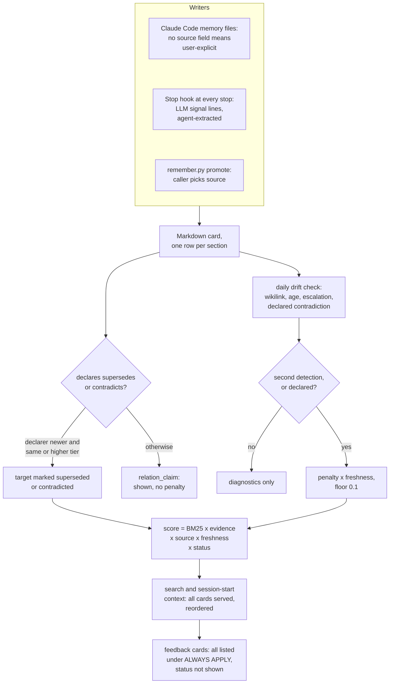

## 1. Executive Summary

Eidetic is a memory layer for Claude Code that indexes the Markdown memory
files Claude Code already keeps, adds an extractor and a promote command that
write more of them, and injects a ranked digest at every session start. Its
notable part is drift: broken wikilinks, age, repeated agent-only updates and
declared contradictions become findings that multiply into a card's rank,
mostly count from their second detection, and clear when the cause goes. Its weak
part is that staleness only ever ranks: no status, finding or confidence keeps
a card out of search or the injected context, and every `feedback` card is
injected under *ALWAYS APPLY*, superseded or not.

The store is the files. `~/.claude/projects/*/memory/`, `~/.claude/agent-memory/`
and every skill's `SKILL.md` are scanned into one SQLite FTS5 index, with an
optional brute-force cosine arm over multilingual-e5-large vectors and an
optional cross-encoder. Recall is cross-project by design. Topic bases, the
second kind of memory, are separate directories with their own index, served
by the same MCP server started against a different root.

The Stop hook runs at every assistant stop, not once per session as the README
says. Each time it sends the last 20 turns of the transcript, unredacted, to
Claude, Codex or a configured local model, and appends the prefixed signal
lines it gets back.

Most of the code by volume is dark. Contradiction detection (M1), multi-page
synthesis (M2), transcript-grounded auto-filing (M3) and the evidence-event
confidence lifecycle are all behind flags that default off.

**Licence.** The MIT grant in `LICENSE` covers the code, and the model the
search path downloads to rescue weak cross-lingual hits is not under it:
`bin/rerank.py:23` names `jinaai/jina-reranker-v2-base-multilingual`, whose
Hugging Face card on 27 November 2026 carried `cc-by-nc-4.0` and described the
weights as *licenced for research and evaluation purposes*. Nothing in the
tree states this; `doctor.sh` reports the model as a health item, and the
README's dependency table lists it under `fastembed` with no terms. An adopter
who installs `fastembed` for the semantic tier pulls non-commercial weights
the first time a query comes back with no confident result.

No mark is earned. Section 9 gives the reason for each.

## 2. Mental Model

A memory is a **card**: one Markdown file with frontmatter, split into one
indexed row per `##` section. `docs/MEMORY-SCHEMA.md` is the contract. The
fields that matter epistemically are `evidence` (validated, observed,
hypothesis), `source` (user-explicit, agent-extracted, system-generated,
imported), `last_verified`, `status`, and the declarations `supersedes`,
`superseded_by`, `contradicts` and `contradicted_by`. Missing fields default
in the parser: `type: reference`, `evidence: observed`, and
`source: user-explicit` (`bin/index_impl.py:271-288`).

A card enters by one of four writers.

- **Claude Code itself**, which keeps per-project memory files under
  `~/.claude/projects/<slug>/memory/`. Eidetic indexes them and does not
  write them. Such a file has no `source:` unless the agent wrote one, so it
  ranks as user-explicit.
- **The Stop hook**, through `bin/compound.py`. A signal line is appended as
  a dated `## History` bullet to a matching card in the session's own memory
  directory, or to `signals/<date>.md`, a card stamped `source:
  agent-extracted` (`bin/compound.py:595-637`).
- **`bin/remember.py`**, which files a whole answer as a typed card or
  appends an `## Update` to a same-slug one. Its `--source` defaults to
  `agent-extracted` and takes any value the caller passes
  (`bin/remember.py:245-253`).
- **A person**, editing files.

Nothing a card says is withheld. A card's standing is a product of weights
computed at read time:

- evidence 1.0, 0.7 or 0.4; source 1.0, 0.5 or 0.3, with an unknown source at
  0.5;
- freshness 1.0 under 30 days, else 0.5, times every penalized drift finding
  (broken wikilink 0.8, age 0.5, confidence escalation 0.3, declared
  contradiction 0.4), floored at 0.1;
- status 1.0 current, 0.75 resolved or fixed, 0.35 superseded, deprecated or
  obsolete, 0.25 archived (`bin/search_impl.py:21-31`, `:159-210`, `:842`).

**Status is derived, mostly from declarations.** `infer_status` takes an
explicit `status:` or, failing that, `superseded` when `superseded_by:` is
set (`bin/index_impl.py:670-686`). On every reindex `compute_relation_state`
pushes each `supersedes:` and `contradicts:` onto its target, resolved by
name or file stem within the declarer's own project or agent namespace. A
declaration applies only when the declarer is at least as new and of equal or
higher source tier; otherwise it is recorded as a non-penalizing
`relation_claim` (`bin/index_impl.py:1187-1205`, `:1207-1326`). Removing the
line clears the target on the next run.

**Drift is a second, separate ledger.** `bin/drift_check.py` runs at session
start at most once every 24 hours, writes findings to `drift_state.db`, bumps
`first_seen` on each repeat, and resolves findings whose cause is gone. A
finding penalizes from its second detection; a declared contradiction
penalizes at once (`bin/search_impl.py:159-210`). If more than half of the
active penalized findings would resolve in one run, the resolve is refused as
a likely detector regression (`bin/drift_check.py:511-543`).

**Nothing ends a card but deleting its file.** The rank floors exist so that a
card stays retrievable: `DRIFT_PENALTY_FLOOR = 0.1`, and the dark confidence
fold clamps at `CONF_MIN = 0.05`, commented *"a card is never made
unretrievable by the lifecycle"* (`bin/confidence.py:15`). The injected digest
tells the model to *"Treat penalized/stale memories as candidates to verify,
not as source-of-truth"* (`bin/assemble_context.py:284`), which is the only
place a down-ranked card is described as doubtful.

## 3. Architecture

Everything is local scripts; nothing runs between hooks. `install.sh` copies
the tree to `~/.claude/memory-system/`, registers four Claude Code hooks in
`~/.claude/settings.json` (`install.sh:238-322`), builds the index and runs
a health check.

- **Index.** `bin/index_impl.py` scans the personal roots and writes
  `db/index.db`: `memory_chunks` with an FTS5 external-content table and
  triggers, `index_meta`, `schema_meta` and the `card_events` projection
  (`bin/index_impl.py:64-146`). A full reindex builds a temporary database
  and swaps it in; an incremental one deletes the rows of files that are gone
  (`:1483-1489`). Writers are serialised by an `flock` sidecar with a
  timeout (`:193-225`).
- **Vectors.** `bin/embed.py` writes `db/vectors.db` with one float32 blob per
  chunk, stamped with model and dimension. The default profile is
  `intfloat/multilingual-e5-large` at 1024 dimensions; `english` selects
  `BAAI/bge-small-en-v1.5` (`bin/embed.py:35`, `:39`). Search computes cosine
  against every stored vector in numpy (`:548-575`).
- **Search.** `bin/search_impl.py`, wrapped by `bin/search.sh`, the MCP
  server and the recall skill. A lexical answer is computed first in process;
  vectors, translation and rerank run in a bounded worker with a 30-second
  deadline and fall back to the lexical answer with a `degraded_reason`
  (`docs/bounded-recall.md`).
- **Context assembly.** `bin/assemble_context.py` writes
  `~/.claude/rules/memory-context.md` at every session start.
- **Drift.** `bin/drift_check.py` and `db/drift_state.db`.
- **MCP.** `mcp_server.py`, a hand-written stdio JSON-RPC loop.
- **Topic bases.** `bin/base.py` scaffolds `<root>/<name>-base/` with a
  `.eidetic-base.json` manifest, `docs/`, `notes/` and a gitignored `db/`.

### Deployment and ergonomics

The core needs `bash`, `python3` and `sqlite3`, and no API key to store or
search. Vectors need `pip install fastembed` and a 2.2 GB model download;
without it search is FTS-only, which a CI leg exercises. Extraction needs a
`claude` or `codex` CLI on the path, or a local route the owner configures;
without one, the Stop hook logs a failed route and stores nothing. macOS and
Linux only, because of `fcntl`.

The store is human-readable and repairable by hand: delete `db/` and a full
reindex rebuilds it from the Markdown. `bin/rollback.sh` and `bin/doctor.sh`
cover the install. The repository's own `.claude/settings.json` holds only an
attribution block and registers no hook.

## 4. Essential Implementation Paths

- **Session start.** `hooks/smart-memory-inject.sh` runs an FTS-only
  incremental reindex, the drift check, code indexing when tree-sitter is
  present, an incremental embed with a logged warning on failure, and
  `assemble_context.py` (`hooks/smart-memory-inject.sh:116`, `:121`, `:191`).
- **Context assembly.** `main` builds four blocks inside a 24,000-character
  budget: drift diagnostics, every `feedback` card, project cards matched by
  slug, and non-feedback cards from other projects touched in the last 14
  days (`bin/assemble_context.py:645-708`).
- **Capture.** `hooks/session-signals.sh` reads up to 2 MB of the transcript
  tail, keeps the last 20 user and assistant text turns at 1,500 characters
  each, and asks the first working route for prefixed signal lines
  (`hooks/session-signals.sh:354`, `:399-402`, `:410-472`). A busy lock
  spools the result to disk for the next run.
- **Compounding.** `compound.main` searches FTS for the signal's salient
  keywords inside the session's memory directory, skips `feedback` and `user`
  cards, skips a signal already present, and appends a History line, or
  writes the signal to today's file (`bin/compound.py:640-735`). It appends
  one summary entry to `log.md`.
- **Promote.** `remember.promote` resolves the same directory, appends an
  update to a same-slug card or writes a new one with `## Related` links, and
  refuses to append into a `feedback` or `user` card (`bin/remember.py:176-240`).
- **Relations.** `propagate_declared_relations` after every index run
  (`bin/index_impl.py:1329-1371`).
- **Recall.** `search_impl.search` → `_bounded_results` → `_run_query`, which
  scores FTS rows, adds the vector arm when needed, fuses by RRF and labels
  confidence (`bin/search_impl.py:801-877`, `:1079-1110`, `:1225-1264`).
- **MCP.** `mcp_server.py` shells out to the same scripts for each tool
  (`mcp_server.py:265-299`, `:420-428`).
- **Curation.** `bin/curate.py` lists promote and archive candidates and, with
  `archive --apply --yes`, sets `status: archived` in frontmatter
  (`bin/curate.py:112-141`, `:213-223`). `bin/cleanup.py --archive` moves up
  to ten files into `<memory-system>/archive/` (`bin/cleanup.py:214-228`).

## 5. Memory Data Model

**The row.** `memory_chunks` holds `path`, `project`, `name`, `type`,
`evidence`, `source`, `confidence`, `last_verified`, `card_kind`, `status`,
`area`, the four relation columns, three `*_explicit` columns that preserve
the card's own frontmatter against propagation, `lifecycle`,
`section_heading`, `content`, `description` and `mtime`, unique on path and
heading (`bin/index_impl.py:64-91`).

**Project.** `detect_project` takes the `<slug>` of
`~/.claude/projects/<slug>/memory/`, `__agent__` for any agent-memory file,
and nothing otherwise (`bin/index_impl.py:587-594`). Relation resolution uses
a finer namespace per agent and per skill; the stored column does not.

**Kinds.** `card_kind` is explicit or inferred from `type` and words in the
name and description, and picks the age threshold: 30 days for project, 60
for status, todo and bug, 90 for most findings, 120 for synthesis, 365 for
concept and entity, none for feedback and code (`bin/drift_check.py:25-46`).

**Time.** `last_verified` is the only time a card asserts, and it means
verification, not validity: compounding never bumps it. `mtime` is the file's.
Nothing records when a fact held.

**History.** Compounding adds `- YYYY-MM-DD: <signal>` lines under
`## History` in the card body (`bin/compound.py:494-530`). That history is
part of the file and is edited or deleted with it.

**Evidence events.** `card_events` is a projection of a card's `## Evidence`
section, and `confidence` is a deterministic fold of it with an authority gate
by actor tier (`bin/confidence.py`). Writing events needs
`EIDETIC_CONFIDENCE_EVENTS`, and ranking by the result needs
`EIDETIC_CONFIDENCE_RANKING`; both default off (`bin/evidence.py:57-64`,
`bin/search_impl.py:112-120`). The project's own ADR says the low starting
confidence it gives auto-filed cards *"protects nothing until read-time
confidence weighting is real"* (`docs/adr/0001-transcript-grounded-acquisition.md`).

**Topic bases.** A base indexes only its manifest's `corpus_dirs`, refusing
any directory or file whose real path leaves the base root
(`bin/index_impl.py:887-936`). Its notes are written with `source: user`, a
value not in the weight table, so they rank at the unknown-source 0.5
(`bin/base.py:232-236`).

## 6. Retrieval Mechanics

**Three FTS passes, then maybe vectors.** The query is cut to eight
non-stopword terms and tried as a phrase, as an AND of prefixes and as an OR,
collecting up to three times the limit (`bin/search_impl.py:315-414`). Each
row's BM25 rank is multiplied by the weights in section 2 and by match
coverage (`:842`). The vector arm runs when FTS returned fewer than three
results, no strong keyword hit, or the query contains non-ASCII characters
(`:416-431`). Vector hits are checked back against `memory_chunks` by id, path
and heading, so a vector left from a deleted chunk is dropped
(`:1117-1222`). RRF uses k = 60 and weights the vector list 1.5 when no phrase
hit exists (`:1225-1264`).

**The only filter is `type`.** `_fetch_fts_rows` appends `AND c.type = ?` when
a type is given and nothing else (`bin/search_impl.py:366-395`). There is no
project, status or drift predicate.

**Confidence is a label beside the rank.** `_classify_confidence` grades each
hit low, medium or high from match strategy, coverage and cosine. A vector-only
hit in the e5 band from 0.80 to 0.86 needs two query tokens in its text, or a
cross-encoder logit of at least −1.2, to reach medium. Agent-extracted,
stale and inactive cards are capped at medium (`bin/search_impl.py:485-565`).
When no hit reaches medium, the JSON payload sets `no_confident_results` and
the CLI prints *"Weak candidates suppressed"* and nothing else
(`:628-641`, `:1104-1107`). That suppression is by query match, and a status
can never cause it, because inactive status caps at medium rather than low.

**Session-start context.** The *Behavioral Rules (type=feedback) — ALWAYS
APPLY* block lists every feedback card in the index, sorted by weight. The
top 40% get 500 characters of description, the next 30% 60 characters, the
rest a name. Over budget, the default lists every remaining name; the
`pointer` mode writes one line instead (`bin/assemble_context.py:327-430`).
The line carries no status, so a superseded rule reads like any other.
*Project Context* takes the lead section of each card whose `project` matches
the cwd's slug; *Recent Cross-Project* takes cards from other projects with an
mtime in the last 14 days, 30 at most (`:447-568`). Both show a non-current
status in parentheses.

**Cost.** The file sits in `~/.claude/rules/`, loaded once at session start,
so it does not change mid-session and does not disturb a prompt cache within
it. Its own telemetry comment records one install's context at 48,261
characters and 21,143 tokens (`bin/assemble_context.py:22-26`).

## 7. Write Mechanics

**Extraction runs at every assistant stop.** Claude Code fires `Stop` when the
agent finishes a reply. The hook is registered `async` with a 300-second
timeout (`install.sh:287-293`), skips transcripts under 1,000 bytes, and has
no throttle: `compound.already_recorded`'s docstring records 698 repeats in
one signals file before the dedup existed (`bin/compound.py:412-423`). The
README's *"signal extraction = 1 LLM call/session"* describes the intent, not
the hook.

**The prompt is the only filter on content.** Seven rules ask the model to
extract only events that happened, ignore *"remember that X"* phrasing, skip
pasted documents and personal data, and output prefixed lines or `EMPTY`
(`hooks/session-signals.sh:410-430`). Code keeps only lines matching
`^(Decision|Rule|Worked|Failed|Knowledge):` (`:156-160`). The excerpt is not
redacted: `bin/egress_redact.py` is imported only by the dark M3 judge.

**Compounding is lexical and scoped.** Salient keywords are ordered by
document frequency; a card matching three or more of them in the session's
memory directory absorbs the signal, exactly two flags a possible duplicate
in the op-log and creates a new line anyway (`bin/compound.py:47-48`,
`:276-340`). An optional vector gate can promote a borderline match and never
veto one. `in_scope` confines every write to the session's own memory
directory, after an incident the comment dates to 19 November 2026
(`:398-409`).

**Lag.** A compounded signal is searchable after the incremental FTS reindex
that runs under the same lock, within seconds of the extraction. It is
vector-searchable after the next embed, and it reaches the injected context
at the next session start.

**No background pass rewrites the store** while M2 is off. The drift check
reads every row once a day and writes only `drift_state.db`.

**Deletion is a file operation.** No MCP tool or script deletes a card.
Removing the file removes its rows and events on the next reindex and its
vectors on the next embed.
Nothing remembers the removed text, so a later Stop-hook run that extracts the
same statement writes it again.

## 8. Agent Integration

On Claude Code the integration is passive: hooks inject at start and extract
at each stop, and the model can search through the recall skill or MCP.

The personal MCP server registers `memory_search`, `memory_search_detail`,
`memory_serendipity`, `memory_health`, `memory_reindex`, `memory_lint` and
`export_vault` (`mcp_server.py:66-213`). None writes a card. `memory_search`
takes `query`, `limit` and `type_filter` and describes itself as searching
*"across all projects"*. `export_vault` takes a target directory from the
model, and its `force` and `all` flags allow writing into a directory Eidetic
did not create (`mcp_server.py:372-418`, `bin/export_vault.py:1205-1229`).

Pointed at a topic base through `EIDETIC_MEMORY_SYSTEM`, the server replaces
the tools with `<name>_search`, `<name>_search_detail`, `<name>_serendipity`
and `<name>_add` (`mcp_server.py:434-489`). The add tool's description says
*"Never call autonomously"*; nothing else enforces it, and the note is tagged
`source: user`. `base attach` prints the `claude mcp add -s project` line that
binds the server to one project's `.mcp.json` (`bin/base.py:249-263`).

Codex, Gemini, Cursor and other MCP clients get recall and no injection;
extraction also runs on the `codex` CLI.

## 9. Reliability, Safety, and Trust

### Staleness that ranks and never withholds

Every read that serves a model weighs status and drift and none excludes on
them. Search's SQL carries only the optional type predicate. The context
builder's three queries select by type, project and mtime. A card that
another card has superseded, that a person archived with `curate`, and that
three drift findings have penalized is still retrieved at a tenth of its
weight, and is still listed if it is a rule. The design is deliberate, and the
code says so in the floors and in the clamp comment. The cost is that a
corrected rule keeps arriving under *ALWAYS APPLY*, ordered lower, without its
status, until someone deletes the file or moves it with `cleanup.py
--archive`.

### Who counts as the user

The parser defaults `source` to `user-explicit` (`bin/index_impl.py:278`).
Claude Code's own memory files, which the agent writes, carry no `source:`
unless the agent adds one, so they rank at full weight, qualify for the
authority gate unconditionally, and are never counted by confidence escalation,
which reads only rows whose source is `agent-extracted`
(`bin/drift_check.py:400-431`). The self-referential 0.5 discount reaches the
Stop hook's signals files and `remember.py`'s default, and `remember.py` takes
`--source user-explicit` from any caller. A compounded History line on a card
with no `source:` inherits that card's full weight.

### The writer and the reader compute the project apart

`compound._project_memory_dir` maps a cwd to Claude Code's directory name by
turning every non-alphanumeric character into `-`, and follows a linked
worktree to its main checkout (`bin/compound.py:533-592`), with a test for
`my.app_v2` (`tests/test_compound_scope_history.py:259-271`).
`assemble_context.detect_project_slug` replaces only `/`
(`bin/assemble_context.py:296-300`), and the LIKE pattern escapes `_`. For a
cwd containing `_`, `.` or a space, the injected *Project Context* finds none
of the project's cards, *Recent Cross-Project* stops excluding them, and the
project's own rules take the 0.3 discount meant for other projects.

### Scope

The `project` key selects which cards fill the *Project Context* section and
discounts other projects' rules; it keeps nothing out. Search, the MCP tool
and `memory_serendipity` are cross-project by design, which the README states
as principle 2. Compounding is scoped on the write side by directory. Topic
bases are isolated by being separate directories and databases, with a
real-path containment check on every collected file.

### Egress

Each assistant stop sends up to 20 turns of 1,500 characters to the first
working route: `claude-batch`, `claude --print`, a local route if configured,
an Antigravity route if configured, then `codex-batch` or `codex exec`. The
excerpt drops tool output and keeps whatever the user pasted.

**The local-only switch does not stop the first cloud call.** The comment on
`EIDETIC_SIGNAL_LOCAL_ONLY` says that with the local route set it *"forbids
every cloud route"*, under an owner decision that conversations are processed
locally only (`hooks/session-signals.sh:49-53`). The Claude route runs before
the local one and checks only `EIDETIC_SIGNAL_SKIP_CLAUDE`; `LOCAL_ONLY` is read
after a failed local attempt and stops only the Antigravity and Codex routes
(`:440-455`). With both local variables set and `claude` on the path, the
excerpt goes to Claude first.

### Documents that disagree with the code

- The README says extraction happens *at every session end* and costs one call
  per session; the hook runs at every stop.
- The README's badge says 5.13.1; the pin is 143 commits past v5.13.2.
- `curate.py`'s docstring says archive moves a card to `MEMORY-ARCHIVE.md`;
  `--apply` sets `status: archived` and the card stays in place.

### Marks

- **`trust_state` — withheld.** `status` has discrete values and is derived
  from declarations with an authority gate, and every read spends it as a
  multiplier and a confidence cap. No read excludes a row on status, drift or
  confidence.
- **`scope_enforced` — withheld.** The stored `project` column chooses a
  context section and a discount; search has no project predicate, and the
  injected context includes other projects' cards. Topic bases are a physical
  partition.
- **`audit_log` — withheld.** `log.md` is append-only under `flock`, and its
  compound entries record a count per run, such as *"2 compounded, 1 new"*,
  without naming the cards changed, except for flagged duplicates
  (`bin/compound.py:724-748`). Claude Code's own writes, a person's edits,
  `curate --apply`, `cleanup --archive` and `base add` write nothing to it.
  The per-card History is part of the editable file.
- **`tombstone` — withheld.** Nothing records a removed or rejected value. The
  M3 seen cache keys judged candidates on a hash of the normalised claim,
  records rejections, is scoped to one session and ships dark
  (`bin/m3_seen_cache.py:1-23`).
- **`bitemporal` — withheld.** `last_verified` is a verification date and
  `mtime` a file time.
- **`human_review` — withheld.** Nothing waits for a person. `curate` lists
  candidates and writes on `--apply --yes`, a CLI flag an agent with a shell
  can pass, and after the fact. M2's supersession suggestions go to the
  op-log, behind two flags that default off.
- **`negative_eval` — withheld.** The populated must-not cases guard writes
  and indexing rather than a retrieval result: compounding's scoped candidate
  search returns exactly the one in-scope card among 206 sharing a word
  (`tests/test_compound_scope_history.py:232-244`), and a base's file
  collection excludes a file outside its root while keeping `HOME.md`
  (`tests/test_base.py:69-96`). The closest read-path case requires the
  injected Project and Recent blocks to carry a card's lead section and not
  its History line, which is a choice of chunk, not of material
  (`tests/test_assemble_one_entry_per_card.py:54-67`).

## 10. Tests, Evals, and Benchmarks

CI runs about 80 inline steps on Ubuntu and macOS with Python 3.9 and 3.12,
each building fixtures under a fake `~/.claude` and asserting with shell or
inline Python, then the full unittest suite in an FTS-only leg that proves
`fastembed` is absent and a vectored leg that installs `fastembed==0.8.0`,
with a gate job requiring both (`.github/workflows/test.yml:10-2100`). I ran
nothing from the repository.

What the suite covers for memory:

- declared relations: propagation, ranking below the replacement, the
  authority gate, removal clearing on incremental reindex, and same-slug cards
  in other projects or agents left alone (`tests/test_truth_maintenance.py`);
- drift: grace gate, compounding penalties, the bulk-resolve valve
  (`tests/test_drift_ranking.py`, `tests/test_truth_maintenance.py:555`);
- compounding: History-section placement, repeats recorded once across three
  stops, a card outside the scope never written, worktree and
  non-alphanumeric cwd mapping (`tests/test_compound_scope_history.py`,
  `tests/test_compound_dedup.py`);
- the vector confidence gate and progressive search contract
  (`tests/test_progressive_search.py`);
- bounded recall falling back to lexical with a reason
  (`tests/test_bounded_recall.py`);
- base containment against absolute and symlinked escapes
  (`tests/test_base.py`).

What is not covered:

- No test runs `assemble_context` from a cwd containing `_` or `.` against
  cards indexed under Claude Code's directory name.
- No test asserts what the injected context or search does with a superseded
  or archived card beyond its rank.
- No test deletes a card and re-runs extraction on the same statement.

The README's recall figures, 25% to 67% recall@3 from MiniLM to e5 and 5/8 to
7/8 with translation, come from probe batteries the operator keeps outside the
repository; `bin/recall_lab.py` says so and ships a two-probe skeleton. No
result file is committed, and the tree cites no paper.

## 11. For Your Own Build

### Steal

- **Drift findings with a grace run and a refusal to mass-resolve.** Penalize a
  detection only when it recurs, apply declared facts at once, multiply
  distinct findings, and treat a run that would clear most of them as a broken
  detector.
- **Relations resolved inside the declarer's namespace and gated on tier and
  recency.** A low-trust or older card can say it contradicts a canonical one
  and be shown doing so without moving its rank.
- **Explicit columns beside derived ones.** Keeping the card's own
  `superseded_by` apart from propagated values lets a recompute clear what a
  removed declaration set without erasing what the author wrote.
- **A lexical answer computed before any model loads**, returned with a reason
  when the vector path times out.
- **Write scope by directory for automatic capture.** A background extractor
  that may append only within the session's own store cannot contaminate
  another project's cards.

### Avoid

- **A default source of the highest tier.** An unlabeled card should rank as
  the least trusted writer, not the most.
- **A status that every reader multiplies and none filters.** If a card can
  be superseded, at least the always-on injection should drop it or say so.
- **Two derivations of one key.** Compute the project identity once and
  import it on both the write and the read side.
- **An extraction hook on every turn with no throttle.** Debounce by session
  or by transcript growth before paying for a model call and sending text off
  the machine.

### Fit

This suits one developer on Claude Code who already relies on its memory
files and wants them searched, ranked and surfaced at start, offline if need
be, with stale material pushed down rather than lost. It assumes the owner
reads drift diagnostics and edits files. Walk away if a superseded rule must
stop reaching the model, if transcripts may not leave the machine and no local
route is configured, or if memory must be separated by project on recall.
Expect the code to move: most of it is a flagged roadmap, and the pin is
143 commits past the last tag.

## 12. Open Questions

- Whether the project intends superseded and archived cards to stay in the
  *ALWAYS APPLY* block, or whether status tags were meant to reach it.
- Whether Claude Code's memory files are meant to rank as user-explicit.
- How often the Stop hook fires per session in practice, and what that costs
  on the Claude route.
- What the dark M3 lane's 20-session gate measured, if it has run.
- Whether installs that set `EIDETIC_SIGNAL_LOCAL_ONLY` also set
  `EIDETIC_SIGNAL_SKIP_CLAUDE`, which is the only variable that keeps the
  Claude route from running first.

## Appendix: File Index

- Index and schema: `bin/index_impl.py`, `bin/constants.py`, `bin/index.sh`
- Search: `bin/search_impl.py`, `bin/engine.py`, `bin/embed.py`,
  `bin/rerank.py`, `bin/translate.py`, `bin/bounded_worker.py`
- Context assembly: `bin/assemble_context.py`, `hooks/smart-memory-inject.sh`
- Capture and writes: `hooks/session-signals.sh`, `bin/compound.py`,
  `bin/remember.py`, `bin/oplog.py`
- Drift and curation: `bin/drift_check.py`, `bin/curate.py`, `bin/cleanup.py`
- Dark rails: `bin/confidence.py`, `bin/evidence.py`, `bin/m1_contradiction.py`,
  `bin/m2_synthesis.py`, `bin/m3_*.py`, `docs/adr/0001-transcript-grounded-acquisition.md`
- MCP and bases: `mcp_server.py`, `bin/base.py`, `docs/topic-bases.md`
- Install: `install.sh`, `bin/update.sh`, `bin/maintenance_hooks.py`,
  `bin/lifecycle_signals.py`
- Contract: `docs/MEMORY-SCHEMA.md`
- Tests: `tests/`, `.github/workflows/test.yml`

### Recorded searches

Run from the repository root at the pinned commit with `/usr/bin/git grep`.
A positive control is given where the pattern could fail silently.

- **No status or lifecycle predicate on a serving read.**
  `git grep -n -E "(status|lifecycle) *(=|!=|<>|NOT IN|IN) *[(']" -- bin/search_impl.py bin/assemble_context.py mcp_server.py bin/engine.py`
  returns only `bin/search_impl.py:508`, a Python assignment. Control: the
  same pattern over `bin` also matches the `UPDATE` at `bin/index_impl.py:853`.
- **No project predicate on search.**
  `git grep -n -E "project (=|LIKE|NOT LIKE|IN)" -- bin/search_impl.py bin/engine.py mcp_server.py`
  returns `mcp_server.py:377`, the vault export's parameter. Control: over
  `bin` it matches `bin/assemble_context.py:455` and `:512`.
- **No delete, forget or tombstone verb.**
  `git grep -n -i -E 'tombstone|blocklist|denylist|do_not_remember|forget' -- bin hooks mcp_server.py`
  returns nothing. Control: `git grep -n -i forget -- README.md` matches line
  34.
- **The MCP tool list.** `git grep -n -E '"name": "' -- mcp_server.py` returns
  the seven tools and the server name.
- **Redaction is applied only in the dark judge.**
  `git grep -n -E 'egress_redact' -- bin hooks | grep -v '^bin/egress_redact.py'`
  returns three lines of `bin/m3_judge.py`.
- **Op-log callers.**
  `git grep -n -E 'append_op\(' -- bin hooks mcp_server.py` returns
  `bin/compound.py:738`, `:744`, `bin/remember.py:237`, two lines of
  `bin/m2_synthesis.py`, one of `bin/m3_autofile.py`, and the definition.
- **No validity-time field.**
  `git grep -n -E 'valid_from|valid_to|valid_until|valid_at' -- bin mcp_server.py`
  returns nothing.
- **No pending or approval state on the live path.**
  `git grep -n -i -E 'pending|approv|awaiting' -- bin/compound.py bin/remember.py bin/index_impl.py bin/search_impl.py bin/assemble_context.py mcp_server.py`
  returns the index's pending-ingest and relation-propagation markers and one
  comment in `bin/compound.py:225`.
- **No throttle in the Stop hook.**
  `git grep -n -i -E 'throttle|once per|last_run|stop_hook_active|cooldown' -- hooks/session-signals.sh`
  returns nothing.
- **The reranker's licence is not stated.**
  `git grep -n -i -E 'cc-by|non-?commercial' -- .` returns nothing;
  `git grep -n -i jina -- bin` matches `bin/rerank.py:23`, `bin/doctor.sh` and
  comments in `bin/constants.py` and `bin/m1_contradiction.py`.
- **No paper reference.**
  `git grep -n -i -E 'arxiv|bibtex|@article|@misc|doi\.org|zenodo' -- .`
  returns nothing.

## History

**2026-11-27** — [`84fd1e5f59af346e98ab746572e7860656b9e472`](https://github.com/LARIkoz/eidetic/commit/84fd1e5f59af346e98ab746572e7860656b9e472). First reading, from a full clone at the head of `main`, the commit triage selected. Screened first: two auto-run surfaces, `.claude/settings.json` (an attribution block, no hooks) and `hooks/` with four scripts; nothing inside the seven-day cooldown; one build-time execution point, `tests/conftest.py`; nothing unpinned. `AGENTS.md` and `CLAUDE.md` were read as data. Nothing was installed, built or run, and the 878 test functions were not run. No marks ([section 9](#9-reliability-safety-and-trust)): status and drift only rank, project selects a context section, topic bases are a physical partition.
