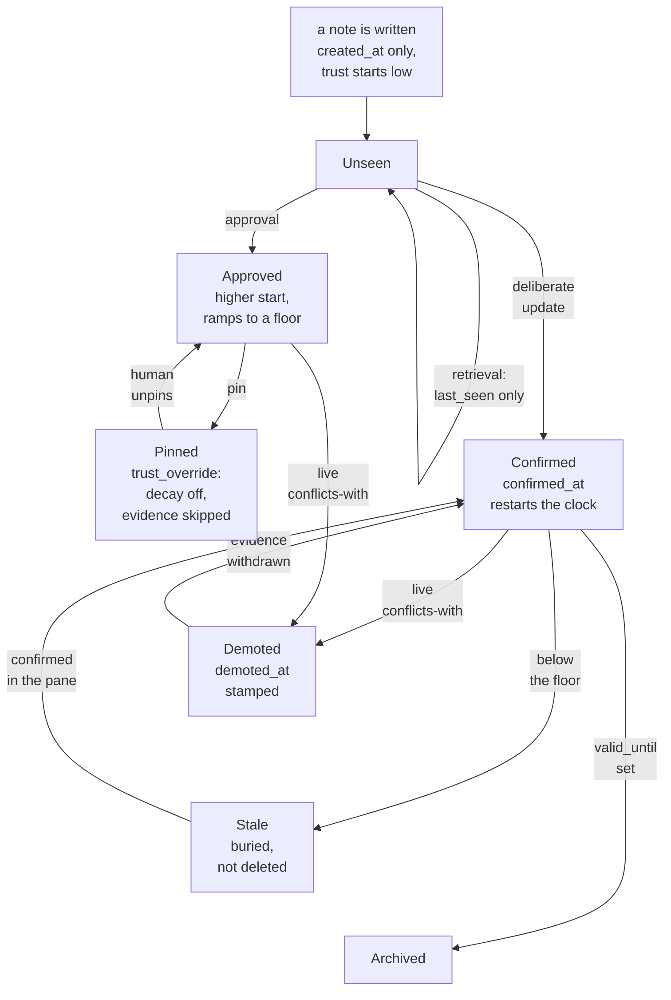

## 1. Executive Summary

Engram Alpha is graph memory for AI coding assistants at release v0.11.0:
four Rust crates and an evaluation crate, shipping as a JetBrains
plugin and a VS Code extension on three marketplaces with a browser demo of the
real pane. **Not to be confused with
[Engram](../engram/) — a different project of the same name, also in this
atlas.**

*Alpha* is part of the product's name, not a maturity label: the marketplace
identifier is `techtheist.engram-alpha`, the installed binary is
`engram-alpha`, and nothing in the README applies the word to the software's
state. The README makes no stability claim at all; what it leads with is a
benchmark table, and that is the claim this report can check.

A memory is a typed node joined by typed edges — but the vocabulary is
**per-graph configuration, not a closed enum**. `GraphConfig` (`config.rs`)
stores the ontology, the policy numbers and the brief shape as one document
inside the graph itself, travelling with `migrate` and riding along in exports.
The shipped preset is nine types — `Principle`, `Decision`, `Caution`,
`Problem`, `Resolution`, `Insight`, `Intent`, `Anchor`, `Tombstone` — over
seven verbs: `about`, `because`, `answers`, `builds-on`, `replaces`,
`conflicts-with`, `needs`. Three other presets ship beside it (`research`,
`minimal`, `general`) and a graph may define its own type set, its own verbs,
and its own custom fields.

The rule that makes that safe is stated at the top of the module and enforced
throughout: **roles, never names.** Engine logic keys on the role flags a type
or verb carries — `worklist`, `supersession`, `contradiction` — never on the
strings, so a renamed or wholly replaced ontology keeps every behaviour.
`hub.rs:104` is the shape of it: the contradiction gate tests
`edge.edge_type.as_str() == contradiction_verb`, where the verb comes from the
graph's config, not from a literal. Two hard invariants hold across any
configuration — edges stay sentence-shaped, and exactly one supersession verb
plus one contradiction verb must exist, *"they are what make the graph active"*
— with `graph_config_validation_guards_hard_invariants` and
`shipped_presets_are_valid_and_complete` asserting both. There is deliberately
**no MCP write surface** for the ontology: reshaping it is a pane gesture,
*"like pin and delete"*.

**Its trust model states two principles the rest of this corpus mostly violates**,
and `crates/engram-core/src/policy.rs` names both:

> **Time doesn't validate.** `stable` knowledge holds its trust flat until a live
> `conflicts-with` edge (the judged-evidence event) stamps `demoted_at`; only
> then does it ramp down, and withdrawing the evidence withdraws the demotion.

> **Exposure doesn't validate.** Retrieval stamps `last_seen` for observability
> only — it proves a note was *findable*, not that it is true. Trust anchors on
> `confirmed_at`, which only deliberate acts refresh. Otherwise a broad recurring
> query would keep an attractive but wrong note alive forever — **retrieval
> certifying its own outputs.**

That second sentence is the exact failure this atlas records in
[Core Memory](../core-memory/) ("recall raises the class… still a use signal
feeding a trust field"), in [NOOA](../nooa-memory/)'s myelination, and in the
decay curves of [Mnemopi](../mnemopi/) and [PowerMem](../powermem/). Engram names
it and refuses it. The header adds that both principles were *"learned from
external feedback on v0.4.1"* — a trust model changed by review rather than
defended.

Drift is treated the same way: surfaced for review, never demoting, because it is
*"environment-dependent (wrong cwd, feature branches) and a sticky stamp from a
bad scan would mass-bury the graph."* A system that knows which of its own
signals are too noisy to act on is rare.

**The write path resolves instead of queueing.** `WriteOutcome::Created` returns
the look-alike pairs the write just queued, with the reason in the type:
*"returned so the writer judges them in the same turn instead of leaving them for
the next session's brief (PLAN §7: detection is local, judgment is the
assistant's)."* Deterministic local detection, model judgment, in one turn — the
shape [resolve, don't just detect](../../patterns/resolve-not-just-detect/) asks
for.

**Deletion leaves a tombstone, and every write is checked against it.** A
hard delete from the pane or the HTTP surface mints a `Tombstone`-role note —
*"Removed: `<title>`"*, with the victim's type, id, the person's reason and, by
default, the removed text in the body — and an assistant can author one and
link it `replaces` a still-live victim. `write_warnings` then reports any
tombstone-role node within the warning similarity of a new note, across types —
or, at any similarity, one whose victim title matches the new note's title —
as `{reason: "tombstoned", note: <why it was removed>}`; `search` names its
tombstone hits, and `check_claim` files them under `retracted`. The write is
never refused — *"models nominate, people judge"* — which is where section 9
draws the line.

**The README's headline benchmark shares the system's author.**
[KnowledgeDrift](https://github.com/techtheist/knowledgedrift) is an offline,
judge-free benchmark the same author publishes in a separate repository: one
scripted world of software-project memory, rule-graded probes in families from
stale-sibling retrieval to deletion honesty, and an additive score out of
1,000. The README's table, at 1,883 notes and 9,008 tasks, puts Engram Alpha
0.9.6 at 801 against 580 for a TF-IDF baseline and 359 for vector top-k, LangMem
and Mem0 alike; on the success column alone the gap is 69% against 48%, with
71% for the whole file in context. Its receipts live in the benchmark's own
repository. The v1 runs against LangMem and Mem0 are committed here
(`knowledgedrift-*`, 14 September 2026), and the eval README records that the
bench's first run found the suspect queue raising 0 of 16 planted
contradictions, which is what moved the logic layer onto titles (section 2).

**And the benchmark data labels its own shipped row and publishes the columns
it loses.** Before KnowledgeDrift, the headline was the eval README's *Against
every baseline* table, measured on 22 August 2026 on the shipped 0.8.10 stack over the enriched
corpus, receipts `arms-0810-100-1500.json` and `posttune-0810-100-1500.json`.
At 1,500 notes with every fact questioned:

```text
arm                  R@1    R@5   oblique   focus   noise   tok/query   FP
rag (pure vectors)   0.66   0.79    0.45     0.10    0.91     2,721     1.00
engram (shipped)     0.69   0.79    0.39     0.52    0.55       297     0.01
```

Weighted for how often each phrasing occurs, engram reads 0.93 to rag's 0.91;
pure vectors keep the oblique column at both sizes (0.45 to 0.39 here, 0.87 to
0.85 at 100 notes) and tie or edge R@5, and the README prints those cells
beside the nine-fold token gap rather than instead of it. The habit is older
than the table: `bench-100.json`, the first committed run (3 August 2026, the
0.7.2 instrument on the pre-enrichment corpus), labels its shipped row *in the
data* — `"kw 0.15 · reranker VOTES   <- ships today"` — and records rag ahead of
it on weighted recall, 0.992 to 0.989. `contradictions-500.json` separates the two
ways contradiction detection fails — *"missed_by_retrieval": 0,
"missed_by_judgment": 3* out of 100 — which is a diagnostic decomposition almost
nobody reports, and `floor-500.json` sweeps twenty-one score floors with
unanswerable **controls** at each point, so the precision gained is priced
against the answerable questions declined.

**And it runs on a corpus it did not write.** `eval/LONGMEMEVAL.md` reports the
full 500 questions of [LongMemEval](https://github.com/xiaowu0162/LongMemEval)-S
— real multi-session chat, ~115k tokens of haystack per question, evidence
sessions labelled, 30 questions deliberately unanswerable — ingested *as-is*,
one verbatim note per chat turn, with no extraction and no model anywhere in the
ingestion or grading path. Five arms over identical haystacks; the receipt is
`eval/results/longmemeval-s-full.json`:

```text
arm            R@1    R@5    MRR    tok/query
engram         0.909  0.953  0.929      207.5
rag            0.909  0.974  0.937    2,654.4
grep           0.706  0.864  0.775    4,761.0
curated-file   0.919  0.919  0.919    2,999.0
whole-file     1.000  1.000  1.000  122,515.5
```

No row is an outright win, and that is the point of publishing all five. Engram
matches pure vectors at R@1, gives up 0.02 at R@5, loses R@1 to a blind
3,000-token file dump — and delivers an eighth of rag's tokens doing it, with
both of its recall figures computed over the set calibrated delivery left rather
than over a fixed ten. The 30 unanswerable questions draw **2 empty deliveries,
28 warned, 0 unwarned**, with the weak line auto-fitted per store on 27 of 30
graphs.

A second external run grades forgetting rather than recall.
[ForgetEval](https://arxiv.org/abs/2606.15903) inscribes facts, mutates them and
checks by substring whether the mutated fact left the top-k. Engram passes
supersession, purge and drift at 99–100%, and scores 0% on the two release
families until the reader skips tombstone-role hits. The marker carries the
removed text by default, so a reader that ignores roles counts the marker as the
leak (section 10).

**Consolidation nominates, and one of the links it writes also judges.** Release
0.11.0 adds a *sleep*: a crowding index over the stored vectors finds piles of
near-restatements, names them without a model, and hands each to the assistant
to fold into one state-of note. The index writes nothing. The links the sleep
writes do: since 0.11.0 any live link between two notes settles the pending
conflict suspect between them, so a `builds-on` link dismisses it as surely as a
judged `dismiss` would. Nothing on the suspect row records which one happened.
The conflict-floor fit, which the project fences carefully against its own logic
layer's verdicts, reads every dismissed row above its similarity fence as a
judgment (section 9).

The limits are real and the project states most of them itself: there is no
scope key of any kind, the external run grades retrieval at *session* level
(any turn from the right session counts, which flatters dumps), and the
harness never asks what the same warning line costs on the 470 answerable
questions — the offline suite, which does ask, answers 47% at both 100 and
1,500 notes.


## 2. Mental Model

A node is a claim of a kind the graph's ontology declares, and the kind carries
the epistemics: under the shipped preset a `Decision` is not a `Caution` is not
an `Insight`, and the roles each kind carries are what the engine reads.
Durability is separate —
`stable`, `episodic`, `volatile` — and decides whether time is allowed to erode
it at all.

Trust is **computed at read time** from durable anchors, so nothing depends on a
background pass having run. The anchor picks the starting value: `created_at`
alone starts at `TRUST_UNSEEN_START`; `confirmed_at` (a deliberate update, or
"Confirm still true") restarts the clock at `TRUST_CONFIRMED_START`;
`approved_at` starts higher and ramps to a floor. `trust_override` — the pane's
pin — short-circuits all of it: pinned nodes never decay, never auto-archive, and
evidence events skip them, because *"a human said 'forever', so only a human
unsays it"* — while contradictions still surface for review.

A node whose computed trust falls below `STALE_TRUST` is **stale**: still
searchable, buried by the multiplier, flagged to the assistant, and put in the
pane's review queue for a human decision. Nothing disappears silently.

The other half of the state machine is the `suspects` table: look-alike pairs
with a similarity, an optional local-NLI hint (`contradiction | entailment |
neutral`) and a score whose column comment reads *"models don't validate"*. A
suspect is `suspected`, then `confirmed` or `dismissed`, and the verdict
vocabulary is `conflict`, `replaces`, `dismiss`.

**There are two ways into that queue, and the second one reads titles because
the measurement said to.** Above the similarity floor a pair is a look-alike and
queues on similarity alone. Below it, down to a separate NLI floor, a logic
layer reads *"the two bare TITLES"*, and a confident contradiction between
titles that plausibly name the same subject queues too. The reason is stated as
a number rather than an intuition: similarity alone *"cannot tell a
contradiction from an agreeing restatement (MemStrata AUROC 0.59; the
KnowledgeDrift gate probe reproduced it)"*, and on that same probe the titles
separated the two *"far more sharply than the claim text (negation 0.99 vs
0.61)"* — so the below-floor path deliberately drops the first body sentence the
claim text appends, because it *"only dilutes what the titles say."* A
reproduced published result, and a feature choice justified against it.

The two dials are kept from contaminating each other. Only pairs the similarity
path could have raised are allowed to inform the similarity dial, because
letting the logic layer's verdicts into that fit *"would drag the floor toward
the NLI band it never reads."* A calibration that learns from decisions its own
mechanism could not have produced is a slow way to drift, and this one is fenced
against it on one axis. The fence filters by similarity, not by who settled the
pair, and `SuspectStatus` has three values and no settler. A dismissal by a
person, by the assistant's verdict, or by a `builds-on` link written during a
sleep all reach the fit as the same label (`engine.rs:1337-1357`, `:2537-2565`).

**A tombstone is identified by role rather than by name.** The flag saying a
node is a removal record *"rides on every surface"*, on the stated ground that
*"a custom ontology can call its tombstone anything, and a reader skimming for X
must not take \"Removed: X\" for a memory of X."* Making the meaning structural
rather than lexical is what stops a renamed type from turning a deletion marker
back into an assertion.

The constants in that machine are per-graph, and two of them are fitted rather
than chosen. `Engine::auto_tune` runs at every session boundary: dial one
refits the conflict-suspect floor from the graph's own judged suspects by
maximising balanced accuracy over midpoint candidates, and dial two refits the
"likely not in memory" line. Each move is damped to half the distance to the fit
(`AUTO_TUNE_DAMPING = 0.5`), clamped into a stated range, suppressed below
`AUTO_TUNE_MIN_DELTA`, gated behind minimum volumes — 200 notes and 20
judgments with at least 3 on each side for dial one — and journalled as an
`auto_tuned` row. `policy.auto_tune = false` opts a graph out entirely. The
field lesson behind it is written down in the project's own chronicle:
*"register-dependent score scales — absolute thresholds don't transfer between
graphs, relative mechanisms do."*



The self-loop on Unseen is the design. Retrieval touches the graph and
changes no trust, so a note cannot certify itself by being popular.


## 3. Architecture

**Runtime.** One binary, and at runtime one heavy process per machine with any
number of deliberately light ones around it. The **machine core** holds every
open store and its locks, the three local models, the pane's web server and every
MCP session; it binds `127.0.0.1:8787`, runs as a hidden `core` subcommand, is
spawned detached by whichever command first needs it, and ends only on
`engram-alpha stop`. `serve` is a launcher that registers the repository and
exits. `engram-alpha mcp` is *always a bridge* — it never opens a store on any
backend, proxying the client's stdio session to the core over streamable HTTP,
and failing with an error in `.engram/mcp.log` rather than *"silently opening the
store in-process"*. `status`, `doctor`, `stop` and the hooks are one-shot REST
clients. Discovery is two JSON advertisements plus a `GET /health` check, so a
stale file is harmless, and `~/.engram/registry.json` lists which repositories
have graphs.

That consolidation is the change a reader of the previous release has to notice,
because it moves a guarantee. When each project directory ran its own process
over its own file, reading the wrong project's graph was not expressible. One
core holding every store makes it a routing decision — see the binding ladder in
section 8.

`engram-core` carries the engine, `engram-mcp` the tool surface, `engram-http`
the REST and SSE API, `engram-cli` the process model and the per-client setup
writers, with a Vue frontend for the pane and editor integrations for JetBrains
and VS Code published to the JetBrains Marketplace, the VS Marketplace and Open
VSX. There is a standalone browser demo running the real pane over an invented
project, and the feature screenshots in the documentation are generated from
that demo by a headless-browser manifest (`frontend/scripts/shots/`), so every
image is one a reader can reproduce.

**Persistence.** TepinDB (`store_tepin.rs`) — a single self-describing
`graph.tepin` file holding documents, keyword index and vectors, from the
`tepindb` crate the same author publishes, inspectable with `npx tepindb` —
is where every new graph has been born since v0.6.2; SQLite (`store_sqlite.rs`)
sits behind the same `store.rs` trait and `docs/storage.md` calls it *"only a
migration source"*, with a `graph.db` migrating itself at the daemon's next
open. Four tables: `nodes`, `edges`, `suspects`, `audit`, plus a `meta` table
holding the embedding model identity and vector width so a store cannot be
silently read with the wrong embedder, and — since v0.9.0 — the store's own
`encryption_state`.

**At rest, two switches.** `~/.engram/settings.json` carries `encrypt_graph`
(off by default, because a sealed graph costs the `npx tepindb` inspection)
and `encrypt_history` (on by default, formalising what the harvester had done
since v0.8.4). Sealing is field-level in `seal.rs` — zstd then
XChaCha20-Poly1305 over titles, bodies, tags, code refs, custom-field values,
edge notes and the audit journal's before/after images, under a machine key in
the OS keystore — and the state lives in the store's own meta as `plaintext |
sealing | sealed | unsealing`, so a migration killed halfway resumes at the next
open and the settings file only ever carries intent. Structure, timestamps, ids
and embedding vectors stay open, and the module says why for the vectors:
*"documented inversion risk — vectors recover gist, not text."* The keyword
index is a blind index: one synthetic `_kw` token stream per node, identity
tokens on a plaintext store and keyed HMAC-SHA256 digests on a sealed one
(`seal.rs:216-224`), so term frequencies and document lengths are preserved and
a golden test asserts bit-identical BM25 rankings across the two states.

**Modules worth naming.** `config.rs` holds `GraphConfig` — the ontology, the
custom-field definitions, the policy numbers and the brief composition as one
stored document, with the four shipped presets and the validator for the hard
invariants; `seal.rs` the at-rest codec and the blind keyword tokens; `nli.rs` runs a local
natural-language-inference model for contradiction hints; `policy.rs` holds the
trust constants, the auto-tune bounds and their rationale; `onnx.rs` centralises
inference-session policy (arena, thread and batch-width knobs, read from
`ENGRAM_ONNX_*`); `redact.rs` exists at all; `cortex.rs`, `digest.rs`, `rag.rs`,
`hub.rs` carry retrieval and briefing; `migrate.rs` handles schema movement.
Release 0.10 and 0.11 add three: `tasks.rs`, a working list kept beside the
graph; `crowding.rs` and `naming.rs`, which find and name the piles a sleep
consolidates, read through `engine/review.rs`; and `laya.rs`, a second
selectable logic-layer model behind the same three-way judge interface.

**Background work.** Deliberately little, and none of it load-bearing for a
read. Trust is a read-time computation. The suspects queue is filled
synchronously by the write that created the look-alike. What does run is
`Engine::validate_graph`, one session-boundary pass — archive what decayed,
retire what a supersession superseded, refit the two auto-tune dials, rescan for
conflicts, count drifted `code_refs` — journalled as a `graph_validated` row
with its own summary note, and backed by a six-hourly sweep. Drift scans surface
for review without demoting.

Since v0.8.4 a second detached daemon runs alongside that sweep: the **history
harvester**, a 60-second loop (fs-notify-accelerated in v0.8.7) that tails
coding-assistant transcripts into a separate episodic store — so "deliberately
little background" understates a continuous transcript-tailing loop, even
though it feeds a sibling store and not the curated read.

### Deployment and ergonomics

One binary, one store file per project, one core process per machine, plus
optional local models. `install.sh` and `install.ps1` fetch the binary and stop;
wiring a repository is the explicit `engram-alpha setup --cli …`, and `serve`
names what it found and did not wire — *"found codex, gemini — installed but not
connected to Engram in this repo"* — rather than touching a config it did not
write. The models are an
embedder (`bge-small-en-v1.5`), a reranker (`jina-reranker-v1-turbo-en`) and an
NLI model (`deberta-v3-small-tasksource-nli`, a 172 MB quantised ONNX export the
project made itself) — all small enough to run on a developer machine, which is
the point. No service to stand up and no API key required to store anything.

The NLI slot has been swapped twice on measurement, and the module says what
each swap bought: MNLI-only models *"presuppose co-reference"* and call
unrelated same-register notes confident contradictions — *"Engram uses Rust"*
against *"TepinDB is on crates.io"* scored 0.99 — where the multi-task model
judges them neutral, halving false alarms at the shipped gate. Predecessors stay
selectable, and the swap contract is a directory holding `model.onnx`,
`tokenizer.json` and a `config.json` whose `id2label` covers the three classes.

The pane is the operating surface and it is unusually complete: a live graph, a
review queue, conflict judgement, retirement, pinning, an ontology editor, a
feed timeline and a theme menu. The browser demo means a reader can exercise the
correction flow without installing anything, which is the best documentation
decision in the repository.

The daemon's memory footprint is measured with a committed before/after pair.
`eval/results/mem-daemon-before.json` and `-after.json` walk the same six stages
— startup with three models, one search, ten searches, an NLI claim check, a
conflict scan, thirty seconds idle — under stock onnxruntime defaults and under
the shipped ones: 669,696 → 896,000 KB against 667,648 → 696,320 KB. The
difference is an inference batch width capped at 2 instead of fastembed's 256;
`scripts/mem-probe.sh` is the harness, and three other suspects (the ORT arena,
per-session thread pools, malloc free-list retention) are recorded as measured
and refuted.


## 4. Essential Implementation Paths

- **Schema:** `crates/engram-core/src/schema.rs` — `nodes` (`:6`), `edges`
  (`:29`), `suspects` (`:52`), the append-only `audit` journal (`:67`), `meta`
  (`:88`), `tasks` (`:95`).
- **Types and vocabularies:** `crates/engram-core/src/types.rs` — open
  string-backed name types, durability, statuses, `WriteOutcome::Created`
  returning `suspects`, `MergeOutcome`.
- **Ontology and per-graph config:** `crates/engram-core/src/config.rs` —
  `GraphConfig`, `OntologyConfig`, `TypeRoles` / `VerbRoles` (the `tombstone`
  role at `:316-326`), `FieldDef` / `FieldKind` (`:70-109`), the `engram`,
  `research`, `minimal` and `general` presets, `describe_ontology`.
- **Trust:** `crates/engram-core/src/policy.rs` — the two principles, the
  anchors, `STALE_TRUST`, `trust_override`, the `AUTO_TUNE_*` bounds.
- **Auto-tune:** `engine.rs` — `auto_tune` (`:1304`), `fit_conflict_floor`
  (`:1337`), `fit_weak_line` (`:1415`), called from `validate_graph` (`:1190`).
- **Contradiction:** `crates/engram-core/src/nli.rs`;
  `hub.rs:104` gates on a live edge carrying the graph's contradiction role
  with `valid_until` unset.
- **Consolidation:** `engine.rs` — `merge_nodes` (`:4078`),
  `settle_linked_suspects` (`:2537`); the sleep's reading side in
  `engine/review.rs`, `crowding.rs` and `naming.rs`.
- **Undo:** `engine.rs` — `undo_entry` (`:1683`), `undo_session` (`:1707`),
  served by `engram-http` at `POST /audit/{seq}/undo` and
  `/audit/sessions/{sid}/undo`, with no MCP route.
- **Tasks:** `crates/engram-core/src/tasks.rs`.
- **Deletion and tombstones:** `engine.rs` — `delete_node` (`:2382`),
  `delete_node_with_tombstone` (`:2427`), `write_warnings` (`:4307`),
  `is_tombstone` (`:7044`), `tombstone_note` (`:7071`); `check_claim`'s
  `retracted` bucket (`:4878`).
- **Stores:** `store.rs`, `store_sqlite.rs`, `store_tepin.rs`, `migrate.rs`;
  `seal.rs` for the at-rest codec.
- **Retrieval and delivery:** `rag.rs`, `cortex.rs`, `digest.rs`;
  `Engine::search` (`engine.rs:3223`) applies the delivery floor, the knee cut
  and the session-diverse selection (`:3282`), then attaches one-hop
  neighbours (`:3307`); `search_confidence` (`:3668`) returns
  `none | weak | strong`; `time_filter_clocked` (`:3609`) and `check_clock`
  (`:2210`) are the temporal grammar's boundary.
- **Redaction:** `redact.rs` — `scrub` and, for custom fields, `scrub_fields`.
- **Surfaces:** `crates/engram-mcp/`, `crates/engram-http/`, `frontend/`,
  `engram-vscode/`, the JetBrains plugin.
- **Evaluation:** `eval/src/` and `eval/results/` — 206 committed result
  files, 134 of them JSON — plus `eval/src/longmem.rs` (the LongMemEval
  adapter), `eval/src/chains.rs` (the supersession-chain bench) and
  `eval/src/sessions.rs` (the multi-session coverage bench).


## 5. Memory Data Model

`nodes` carries `id`, `type`, `title`, `body`, `durability`, `source`,
`session_id`, `created_at`, **`valid_from`, `valid_until`**, `status`,
`code_refs`, `tags`, `last_seen`, `confirmed_at`, `approved_at`, `demoted_at`,
`trust_override`, and `fields` — a JSON object of custom-field values. `edges`
carries the same temporal pair plus `confidence`, `strength`, `note` and a
`status`.

**Bi-temporality is real and used, on two axes.** `valid_from` / `valid_until`
are validity time and `created_at` is record time; `hub.rs:104` treats an edge
as live only when `valid_until.is_none()`, and `types.rs:469` documents a
neighbour as *"superseded/archived (`valid_until` set)"*. Archival is closing an
interval rather than deleting a row. The engine's axis says when a claim held
*as canon*; the second axis is the graph owner's and says when the thing
happened: a date-kind custom field, or a `from..to` pair of them, becomes the
*event clock* a search window can be aimed at (section 6), which is what a
historic import needs when everything is captured today and happened over
years.

**Custom fields are declared in the graph and validated at the write boundary.**
`FieldDef` (`config.rs:70-96`) names a field, a kind — `text`, `number`,
`bool`, `date`, `enum`, `url` — whether it is required, which types it applies
to, whether it is `indexed` (joins the note's embedding and the keyword channel,
with the indexed set fingerprinted so a change re-embeds exactly once) and
whether it is shown on brief lines. `check_fields_ext` (`engine.rs:2110`) is the
one gate every surface passes: unknown names fail, kinds must match, required
fields must be present, and reserved built-in names cannot be shadowed; a
refusal is a *teaching error* that names the whole roster and the exact call
shape, so an agent that has never seen this graph corrects itself in one step.
`update_node` merges the map and a `null` deletes a key; renaming a field moves
every stored value with the definition, as renaming a type does. The one
exception is engine-authored: the tombstone a delete mints skips required-field
enforcement, because *"field config must never veto a user's delete."*

**The trust anchors are three separate durable facts**, not one score:
`confirmed_at` (a deliberate act), `approved_at` (explicit approval), and
`demoted_at` (contradicting evidence landed). Keeping them apart is what lets the
policy say *withdrawing the evidence withdraws the demotion* — with one blended
number that operation is impossible.

**`code_refs` ties memory to the artifact it describes**, which is the property
[Magic Context](../magic-context/) is credited for here.

**There is no scope key.** No user, project or workspace column; isolation is one
graph per project directory. Coherent for an editor plugin, and it means the
schema cannot host two projects without a migration.

**Tasks sit beside the graph, never in it.** Release 0.10.0 adds a `tasks`
table holding one JSON document per task: five statuses, one level of groups,
and two optional rules, `wake` and `close`, each a version, a date or
`node:<id>`, settled at read time with no scheduler. The module states the
boundary: a task *"never enters search, the suspect scan, trust, decay or the
eval corpora"*, and it points at memory through one-way `refs`. Every task
change is journalled as `task_created`, `task_updated`, `task_deleted` or
`task_auto`, closed tasks are archived rather than deleted, and hard delete is
the pane's alone. A graph can turn tasks off, and the MCP tools then refuse with
`TASKS_OFF`.

### What a user may reshape, and the guard on each

The pane's ontology editor writes `GraphConfig` — types, verbs, the trust and
threshold constants, and the brief composition — and three of its rules are
worth naming because each closes a way the reshape could strand data.

- **A rename is the migration gesture, not a relabel.** `rename_type` and
  `rename_verb` (`engine.rs:3112`, `:3144`) move the stored rows along with the name, and
  the editor's card shows how many nodes will follow.
- **A save cannot drop a vocabulary that still holds data.** Removing a type
  that has nodes fails with *"type … still has N node(s) — rename it (bulk
  retype) or retype them first"* (`engine.rs:2959`), and the same for verbs on
  edges. There is no path where an edit orphans knowledge.
- **The hard invariants survive every configuration.** Exactly one supersession
  verb and one contradiction verb must exist, or validation refuses the
  document — the graph cannot be configured into inertness. A type carrying the
  `tombstone` role may not also carry `worklist` or `anchor`
  (`config.rs:1602-1607`), because *"a tombstone is a closed record of a
  removal — it can't be open."*

Two smaller per-graph features sit in the same document. **Version tracking**
(off by default) stamps every new node of a `versioned` type with the graph's
current working version, set by the `set_version` MCP tool, so a note records
which release it was captured under; `Principle` and `Anchor` carry the
`versioned: false` role in the shipped preset, because *"a value or a code
subject transcends any single release"*, and the stamp is provenance for
retrieval — nothing in trust or search ranking reads it — and since 0.11.0 the
sleep's review queue reads it, to rank subjects that span many releases first. And a reserved `handoff` tag
(`config.rs:633`) gives an open worklist note guaranteed top placement in the
next session brief, which is reactive session-to-session memory without a new
node type.


## 6. Retrieval Mechanics

Vectors from `bge-small-en-v1.5`, a keyword weight of 0.15, and a reranker
(`jina-reranker-v1-turbo-en`) that **votes rather than decides** — a distinction
the ablation measures rather than asserts. Across every keyword weight in
`bench-100.json` — the 3 August 2026 ablation on the first instrument's 100-note
corpus — `reranker VOTES` beats `reranker DECIDES` on weighted recall
(0.991 vs 0.980 at the shipped 0.15) and on oblique questions (0.91 vs 0.80). A
reranker allowed to overrule the retriever loses obliquely-phrased hits; one that
contributes a vote does not.

The score floor is a published tradeoff curve rather than a constant.
`floor-500.json` walks twenty-one floors and reports, at each, recall@5, oblique
recall, mean results returned, mean tokens, and two decline rates — for
answerable questions and for **unanswerable controls**. At floor 0 the system
returns 9.95 results and 512 tokens and declines nothing including the controls;
by floor ~0.62 it returns 1.03 results and 55 tokens, declines 62% of controls
and 38% of answerable questions. Every operating point is priced.

Trust multiplies the score, so a stale node is buried rather than filtered — it
stays findable, which is what makes the review queue meaningful.

**Every hit carries its standing, and near-identical hits are ordered by
endorsement.** Since 0.9.10 a hit holds a `standing` (`types.rs:434-453`): one of
*canon, confirmed, unverified, stale, contested, superseded, tombstone*, with a
sentence of reason and the id of the note that contests or replaces it, so the
assistant reads the graph's verdict rather than re-deriving it from trust
numbers. Among delivered hits whose vectors sit within a twin band of each
other, `order_twins` (`engine.rs:3450`) puts the endorsed one first: pinned,
then higher trust, then the one approved or confirmed most recently. It
re-sorts twins within the positions they already hold, so the delivered set
does not change. An endorsement here is any `approved_at` or `confirmed_at`
stamp, and both are reachable over MCP: through `approve_node`, and through any
deliberate `update_node`.

**Delivery is a second stage with two cuts, both reranker-gated.** `search`
(`engine.rs:3223`) fetches wide, reranks, drops everything under
`policy.delivery_floor`, truncates to the limit, then applies a *knee* cut: sort
the delivered score curve, find the largest relative drop over
`policy.knee_cliff`, and discard the tail below it. The reasoning for gating
both on the reranker is stated at the call site — the fused hybrid score is a
different scale, so a floor read against it would be read on the wrong ruler.
The consequence for every number in this report: engram's recall is measured
over a set the system has already trimmed, while the RAG arm it is compared
against keeps its full ten.

**A third cut is about provenance, not score.** When more candidates survive
the floor than fit the list, each additional hit from a session already holding
a slot is demoted `policy.session_diversity_demote` rank positions before the
final cut — two by default (`policy.rs:192`), a rank rather than a score on
purpose, because *"absolute score thresholds don't transfer between graphs
while relative mechanisms do."* It changes selection and order only; scores, the
floor, the knee and the verdict still read the cross-encoder's scale, and a
graph whose notes share one session is byte-identical to the cut without it.
Every hit carries its `session_id`, so the provenance the demotion acts on is
visible where it acts. The number was chosen from a committed sweep and its
cost is measured in section 10.

**The abstention line is fitted from probes the graph writes about itself.**
`fit_weak_line` (`engine.rs:1415`) synthesises questions that have no answer —
half question-shaped templates over vocabulary borrowed from the graph's own
node titles, half *ICT transplants*: real sentences from the store with their
subjects coined out — then measures how high the reranker's top score climbs
against each, and takes the **larger** of the two families' q90 as the fit — the
line must clear whichever register this graph's noise speaks loudest in. The fit
is then damped halfway and clamped, with the lower clamp *relative to the
delivery floor* rather than absolute, so a line that could never fire is
impossible and one noisy probe register cannot teleport it. Borrowed vocabulary
is the load-bearing part and the comment says why: generic probes under-read how
high *this* graph's scores can go, and the first live fit found in-register
questions reaching 0.32 against a 0.25 line fitted from generic wording. What
clears the line is answered; what falls below is delivered warned, never cut. **No other report in this corpus describes a
system calibrating its own "I don't know" threshold from synthesised
unanswerable queries** — [MetaClaw](../metaclaw/) is the nearest, and it replays
*real* past turns against candidate policies rather than manufacturing negatives.

**Search is time-scoped, and the window has two clocks.** A single temporal
grammar (`timespec.rs`) adds `after`, `before`, `during_version` and `order` to
the MCP `search`, applied *before* the reranker and every cut so "a scoped
verdict describes the scoped set," with ordering applied last so a time-ordered
read has the same membership as its relevance twin. `during_version` resolves a
window from the audit journal's `version_switched` rows with no new storage, and
`order: "recent"` folds a history restatement under its newest form. By default
the window reads `created_at` — *when the knowledge was captured*, and the
comment at `store.rs:598-603` explains why not `confirmed_at`: *"a node
reconfirmed last week is still July's decision."* A `date_field` selector
re-aims the same window at the **event clock** the graph's owner declared: one
date-kind custom field matches when its value falls inside the window, and a
`from..to` pair matches when the node's own validity span overlaps it, an absent
`from` reading *since forever* and an absent `to` *still valid*
(`timespec.rs:84-98`). Nodes without the field drop out, because they cannot
answer an event-time question. `check_clock` (`engine.rs:2210-2246`) refuses an
undeclared or non-date field, and a clock without a window, as loud errors —
*"an unaimed clock filters nothing and would silently return the default result
while looking like an event-time answer."* The history layer has no custom
fields, so `date_field` on `scope: "history"` is refused too.

Beneath the curated graph sits a second, sealed **episodic history store**
(`history.tepin`, one per project): the harvester tails chat transcripts from
seven assistants — Claude Code, Codex, Gemini CLI, opencode, Kilo, Antigravity,
IBM Bob — as Session/Message nodes cross-linked to curated memory by a `born-in`
provenance edge. Its isolation is physical, not a filter: curated search, brief,
drift and decay never see it (`history.rs:7-11`). Harvesting is opt-in
(`HistoryConfig.enabled` defaults to false) and the store is **sealed at rest**
by the `encrypt_history` switch, on by default — the sharper half of a
deliberate two-store split in which the curated graph is redacted and sealed
only if its owner turns the second switch. The blind keyword index gives the
history layer a BM25 channel of its own, fused with vector candidates under the
curated layer's weights. The MCP tools `expand_history` and `list_sessions`
read it on request.

## 7. Write Mechanics

A write is synchronous and returns more than an id. `WriteOutcome::Created`
carries the node, any `warnings`, and the `suspects` — look-alike pairs the write
just created — *"so the writer judges them in the same turn instead of leaving
them for the next session's brief."*

The division of labour is stated: **detection is local, judgment is the
assistant's.** Similarity and the NLI hint are computed by small local models;
the verdict — `conflict`, `replaces`, `dismiss` — is the assistant's, and the
column comment beside the NLI score says why: *"models don't validate."* A
probability is a hint, not a ruling.

Correction is a family of moves rather than a delete: a `replaces` edge, a
`conflicts-with` edge that stamps `demoted_at`, closing `valid_until` to archive,
approving, pinning, or dismissing a suspect. Every one but the last appends to
the audit journal. A `conflict` or `replaces` verdict is journalled because it
writes an edge; a `dismiss` sets the suspect's status and writes no row
(`engine.rs:5611-5686`), so which pairs were dismissed, and by whom, is not on
the tape.

**Since 0.11.0 a link settles a suspect too.** `add_edge` calls
`settle_linked_suspects` (`engine.rs:2537-2565`) on every live edge: a pending
suspect between the edge's two notes becomes `confirmed` when the verb carries
the supersession or contradiction role and `dismissed` for any other verb. The
committed test (`a_link_settles_the_pending_suspect_between_its_notes`) shows
the case that matters: a pair the model hinted as a contradiction at 0.91 is
dismissed by the assistant's `builds-on` link. The motive is stated: a
state-of note raises suspects against every note it summarises, and its
`builds-on` links clear them. The cost is that the edge row is the only trace,
and it does not say that it settled anything.

**Deletion leaves a trace, and the trace carries the text.**
`delete_node_with_tombstone` (`engine.rs:2427-2513`) is the pane's default
delete and the HTTP surface's `DELETE /nodes/{id}?tombstone=true&reason=…`: it
mints a note of the first type carrying the `tombstone` role — title
*"Removed: `<victim title>`"*, body *"Deleted `<type>` "`<title>`" (id …)"* with
the reason under **Why** and, with `keep_text` (the default), the victim's body
under **Removed text**, its tags and its code refs — and then cascades the
victim. The comment says why the text rides along: a mint that embedded *"only
the victim's title plus the reason"* meant *"a paraphrase of the buried CONTENT
landed nowhere near it"*, so the marker *"guarded the headline, not the
knowledge."* `keep_text=false` is the purge shape, identity and reason only.
The tombstone is `Source::User`, stable durability so it never decays, takes
over the victim's `about` edges to anchor nodes so the removal stays attached to
the code subject it happened under, carries no other edge — *"edges never
dangle"* — and skips required-field enforcement. When the ontology declares no
tombstone type the call degrades to a plain delete, *"the config decides, never
the caller"*. Hard delete has no MCP path; the assistant's version is to
`add_note` a `Tombstone` and `link` it `replaces` the victim, which archives the
victim behind the marker through the ordinary supersession machinery
(`an_authored_tombstone_that_replaces_its_victim_buries_it_traceably`).

**`merge_nodes` is the consolidation move**, and its edge cases are where the
design shows. Several notes stating one truth collapse into one survivor: tags
and `code_refs` union, live edges rehome onto the survivor, victims are archived
behind a supersession edge rather than deleted, and `MergeOutcome` reports per
victim how many edges moved and how many were deliberately left — already
present on the survivor, internal to the merged set, or an *incoming*
supersession, which is part of the victim's own story and does not travel. An
archived survivor is refused outright. And the assistant cannot merge away a
pinned node: with `source == Source::Agent` a pinned victim raises
`Error::Pinned` carrying the instruction to *"tell the user and let them merge
this pair in the pane"* — the same human-only boundary the pin draws everywhere
else. Four committed tests cover the union, the pin refusal, the
outgoing-but-not-incoming supersession rule, and a live conflict rehoming onto
the survivor.

The audit journal also carries events that are not node or edge mutations:
`audit_activity` writes rows against the entity type `session`, which is where
`graph_validated` and `auto_tuned` land — so a threshold the system moved on
itself is on the same tape as a human's approval.

**The audit journal is the richest in this corpus.** One row per node, edge or
task mutation, insert-only, carrying `before_json` and `after_json` in full; an
`action` the schema comment lists as eleven values (`created | updated |
approved | unapproved | pinned | unpinned | demoted | undemoted | archived |
deleted | imported`) and the engine extends through the same insert with
merges, auto-tune moves, config updates, session activity and the four `task_*`
actions. Each row also carries the `origin` surface (`pane | mcp | daemon | cli |
library`), the writing process's `session_id`, `cwd`, `pid` and `version`, and an
`op_id` that groups the rows of one operation, so a merge or a delete with its
cascade reads as one act. `title` is snapshotted so it *"survives deletion"*.

**Undo is written as more journal, not as an edit to it.** Since 0.9.10 the pane
can undo one row, the whole operation the row belongs to, or everything one
session wrote, each after a dry-run preview (`engine.rs:1683-1717`). The undo
appends `undone` rows carrying the reverted row's `seq`, and whether a row
stands is derived at read time: an undo stands until one of its own writes is
undone, so an undo can be undone. A row that changed afterwards in another
session is skipped and reported, not overwritten. Undo is served over HTTP to
the pane and has no MCP route, like hard delete. Undoing a hard delete restores
the note and its links and drops the tombstone the delete minted
(`undoing_a_hard_delete_brings_back_the_note_its_links_and_drops_the_tombstone`).

**The sleep consolidates through the ordinary write tools.** 0.11.0's
crowding index counts, for every note, the neighbours inside the cosine only
this graph's top 1% of pairs reach (never below a fixed floor), chains close
pairs into *subjects* of at least 2% of the notes, and re-cuts an oversized
subject at a stricter cosine until its pieces fit (`crowding.rs`). A class
TF-IDF over titles and tags names each subject without a model (`naming.rs`),
and the review queue ranks subjects by size, spread across releases and age, so
settled history comes first and this cycle's live work last.

The reading side says what it is: *"Nominations only — nothing here writes a node, an edge, or
trust"* (`engine/review.rs:1-8`). The one write is a reviewed mark, a content
fingerprint per note in the store's key-value meta, set through
`update_node(reviewed: true)`; it never moves trust and goes stale when the note
changes.

The consolidation itself is an `engram-sleep` skill the assistant runs,
one subagent per subject, writing a state-of note linked `builds-on` what stays
and `replaces` only what it fully covers, and merging restatements through
`merge_nodes`. Every one of those writes is journalled under the session, which
is what makes the pane's *Undo session* the sleep's rollback.

Knowing which surface made a change — a human in the pane, an assistant over MCP,
a daemon — is the distinction most audit logs here collapse, and it is exactly
what you need when a memory is wrong and you are deciding whether to distrust the
model or the person.


## 8. Agent Integration

An MCP server for the assistant, an HTTP surface, a JetBrains plugin, a VS Code
extension, and a standalone pane. The screenshots show the intended loop: the
graph fills in live while Claude Code works in the terminal below.

**Which project a session serves is a five-rung ladder, and the last rung is the
one to read carefully.** An explicit `--db` pins it; otherwise the bridge asks
the client for `roots/list` and binds the first `file://` root, re-resolving on
`roots/list_changed` so one db-less config entry follows a client across
workspaces; otherwise the bridge's working directory; otherwise a machine-level
**default agent project** setting; and otherwise **the home graph** — *"the
session binds the core's `/mcp` endpoint rather than dying."* Every rung is
logged, so `mcp.log` always names the one that bound.

Rung five is a deliberate trade, and it is guarded on the write side. A
session that cannot establish its workspace does not fail: it reads the home
graph. It cannot write there. Since 0.9.8 `write_engine_for`
(`crates/engram-mcp/src/lib.rs:484-492`) refuses every write addressed to "this
project" from a session bound by the `home` or `unwired` rung. The refusal is a
teaching error that names the client, the reason it landed there and the one
call that binds it. Reads keep working so the agent can find its workspace, and a write
that names a `project` explicitly is a deliberate target and passes. What stays
open is a read: an agent on rung five reads the home graph's memory as if it
were its project's.

The mitigation is `brief` called with a `project`: a name, an id or any
absolute path inside a registered root rebinds the running session and
returns that project's brief in one call
(`crates/engram-mcp/src/lib.rs:1227-1277`), refusing an unregistered
selector *with the known roster* and leaving the binding untouched when it
refuses, so a hallucinated path can never birth a graph. Since 0.9.12 a
scoped `brief` that moves a session off a real project leads with the warning
that the session's writes now go elsewhere and the call that goes back. The
field case behind it is recorded: a `brief(project: eval)` had silently sent
the next write to the eval graph.

Sessions stranded on rungs four or five get a one-line hint above their
brief pointing at it. Folding the rebind into `brief` is the field lesson
from the project's issue #4, where an injected *"call `brief` first"*
overruled a workspace rule that said `set_project` first; one tool means
there is no wrong first call left to make. The clients that need it are
named in the docs — Windsurf and Devin CLI advertise roots and never
answer them — and `setup` writes each client what it can consume: a
`SessionStart` brief hook for Claude Code, Codex, Devin CLI and Bob, a
`sessionStart` hook in `.cursor/hooks.json` for Cursor (Devin
and Codex only accept injected context inside a `hookSpecificOutput` JSON
envelope, so the two share one wrapper), an `always_on` rule for Windsurf,
and an `AGENTS.md` block for the rest.

The pane's Processes census shows each live session's current binding. Bridges
hold a 15-second-heartbeat lease that expires after 45 seconds, so a crashed
client leaves the list within three missed beats, and a failed registration never
blocks bridging: the census is observability, not control.

The assistant's authority is broad on judgment and bounded on trust in one
place by construction and in another by instruction. It writes nodes and edges,
and it judges the suspects the write hands back. Pinning is human-only in the
code: no MCP tool writes `trust_override`, retrieval moves nothing, and a pinned
node ignores the assistant's evidence entirely until a human unpins it.
Approval is not: `approve_node` is an MCP tool (`crates/engram-mcp/src/lib.rs:1497`)
that restarts trust at 100%, `Engine::approve` takes no source and
gates on nothing, and the whole restraint is the tool description — *"ONLY on
explicit user demand or after word-by-word verification against current
reality."* The audit row records `origin: mcp`, so an assistant's approval is
distinguishable after the fact; it is not preventable before it.

The pane is a genuine review surface: stale nodes queue for a decision, conflicts
are judged there, decisions are retired there, and the browser demo lets a reader
do all three without installing anything.


## 9. Reliability, Safety, and Trust

**`audit_log` — earned, and it sets the bar.** Insert-only, one row per node,
edge or task mutation, full before and after JSON, an action vocabulary the
engine extends beyond the schema's eleven, the originating surface, process
context, an operation id, and deletion-surviving titles. Undo appends rather
than edits. The gap is the suspect queue: a dismissal writes no row.

**`bitemporal` — earned.** `valid_from` / `valid_until` on nodes and edges
against `created_at`, used on the read path to decide what is live; and a
second, owner-declared validity axis — a date-kind custom field or a `from..to`
pair — that a search window can be aimed at instead of the capture clock, with
the boundary refusing an unaimed or undeclared clock rather than dropping it.

**`trust_state` — earned.** `suspects.status` is a persisted
`suspected | confirmed | dismissed`; nodes carry a `status` and three distinct
durable epistemic stamps, `confirmed_at`, `approved_at` and `demoted_at`, which
the policy reads separately and which the audit journal names as actions.

**`human_review` — withheld**, because approval is the one gesture that is not
reserved. Three gestures here really are human-only by construction, and they
are worth keeping: pinning, because no MCP tool writes `trust_override`;
reshaping the ontology — types, verbs, custom fields — which has no MCP write
surface at all; and `merge_nodes`, which refuses a pinned victim when the caller
is the assistant. But none of those is a memory waiting to be admitted. A pin
makes an existing node immune to contradicting evidence; it does not hold one
back. What would be the admission gate is approval, and approval is the gesture
that is not reserved: `approve_node` is an MCP tool (`crates/engram-mcp/src/lib.rs:1497`),
`Engine::approve` takes no source and gates on nothing, and the whole restraint
is the tool description — *"ONLY on explicit user demand or after word-by-word
verification against current reality."* A sentence in a description is a request
to the model. The suspects queue points the same way: the write hands the
look-alike pairs back so the *assistant* judges them in the same turn. The audit
row records `origin: mcp`, so an assistant's approval is distinguishable after
the fact; it is not preventable before it.

Release 0.11.0's Review panel adds
*Approve all* per subject for provisional notes, which is a person approving in
bulk; it does not take the MCP tool away.

**`negative_eval` — earned.** The floor sweep carries unanswerable **controls**
at every operating point and reports `controls_declined`, so the evaluation
asserts that material which should not be returned is not returned — and prices
the answerable questions lost at each threshold. The LongMemEval run extends the
same discipline onto a corpus the project did not write: 30 labelled
never-answerable questions, scored on whether an answer went out unwarned.

**`tombstone` — withheld, on one word of the definition, and the near-miss is
the narrowest in this report.** The `Tombstone` type is a durable record of a
removal that carries the removed text, tags and code refs, stable so it never
decays, and it is consulted on every write: `write_warnings`
(`engine.rs:4307-4361`) walks the new note's nearest neighbours above
`policy.warn_similarity` (0.70) and reports any tombstone-role node among them,
across types, as a `tombstoned` warning carrying the tombstone's own account of
why — the comment names the gap it closes, *"a Decision re-deriving a
tombstoned Decision sailed through"*. When no neighbour raised a `tombstoned`
warning, a second channel keyed on the value runs at any similarity: a tombstone
whose victim title, normalised, equals the new note's title warns the same way
(`:4338-4358`, since 0.9.6). `search` counts tombstone-role hits and
appends a `tombstone_note` so a compact scan cannot read *"Removed: X"* as a
memory of X; `check_claim` sorts tombstone hits out by role before the NLI runs
and files them under `retracted` (`:4878`); the write-time canon check and the
suspect recorder skip tombstones on both sides so a `replaces` verdict can never
archive the marker (`:3954`, `:5413`, `:5463`). Seven committed tests cover the 0.9.2 behaviour, and the one
that matters here asserts the boundary in its own words:
`writes_near_a_tombstone_warn_tombstoned_across_types` panics on anything but
`Created` — *"a tombstone never blocks a write — it warns."* The definition this
atlas applies asks for a record keyed on the value *"so later extraction cannot
re-assert it"*; here the re-assertion is created as live canon, ranked, briefed
and delivered like any other note, with a warning on the write result that the
writer may act on or not. The changelog states the choice as a principle —
*"The write is never blocked: models nominate, people judge"* — and it is
coherent with the rest of the trust model, where the assistant judges and a
person decides. It is not the mark. Two shapes the project already has would
earn it without touching that principle: the same-type near-duplicate
short-circuit, extended to a tombstone neighbour, would return `Matched` with
the tombstone's reason instead of creating — the collided form, a nomination
that leaves nothing live to judge later; or a note created with a `tombstoned`
warning could be held out of the brief and ranked as stale until a person
confirms it — the suppressed form. What is *not* a near-miss any more: the
brief never shows tombstones (`hidden_brief()`), and the keys are an embedding
neighbourhood and an exact title, so a paraphrase below 0.70 under a new title
lands with no warning — a threshold the purge shape (`keep_text=false`) makes
easier to fall under, because it embeds the headline alone. A dismissed suspect and a `replaces` edge remain
keyed on ids.

**`scope_enforced` — not found.** No scope key on either table.

Other observations:

- **`redact.rs` drives the write path.** `redact::scrub` runs on title and body
  in the node write paths (`engine.rs:310-311`, `:3818-3819`) and `scrub_fields`
  on every string-valued custom field: named patterns
  (PEM/AWS/JWT/GitHub/Slack/OpenAI/`key=value`) plus a high-entropy backstop
  judged per separator-delimited segment (segments under twelve chars abstain) so
  a compound identifier is not masked. Redaction runs before anything reaches
  either store; sealing is the separate, switchable layer described in section 3,
  and the curated graph ships with it off.
- **`meta` pins the embedding model identity and vector width**, so a store read
  with the wrong embedder is detectable rather than silently wrong, and records
  the store's own `encryption_state`, so a store read without its key renders
  *"[sealed — encryption key unavailable]"* in place of a value — a placeholder,
  *"never garbage, never an error"* — rather than failing or leaking.
- **The external dataset is SHA-256 pinned and re-verified on every open**, not
  only on download, and the reason is written at the function: *"a truncated
  download must never quietly grade as a small corpus."* Both digests live in
  `longmem.rs` with a committed test asserting they are well-formed. The data
  itself is never checked in — the repository carries the loader, the digests
  and the provenance note.
- **The system moves its own thresholds.** Two auto-tune dials rewrite
  `GraphConfig` at session boundaries. Every move is damped, clamped, gated on
  volume and journalled, and a graph can opt out — but a reader comparing two
  installations should expect their delivery and conflict thresholds to differ,
  because each was fitted to its own graph.
- **The loop is scored against the people in it.** `Engine::nli_agreement`
  joins each judged suspect's stored `nli_label` with the status the pair was
  settled to and reports the confusion matrix: hits, false alarms, misses, passes,
  and an agreement rate that is absent until a hinted pair has been judged.
  Surfaced as `GET /conflicts/agreement` and a Checkup panel block. Two
  properties make it worth naming. It counts **misses** — the judge confirmed a
  pair the model called entailment or neutral — so the measure is not only about
  the alarms the model raised. And it is **read-only, never a calibration
  input**: the auto-tune dials do not consume it, so the model cannot chase its
  own agreement score. The type's own comment scopes the claim to what the row
  can carry: conflict and replaces both land as confirmed, so agreement reads
  *"the hint said contradiction and the judge kept the pair"* and no finer.
  Almost nothing in this corpus measures whether its automatic nomination agreed
  with the human who adjudicated it, and the systems that do usually feed the
  answer straight back into a threshold.
- **Since 0.11.0 the judged set holds labels nobody judged.** Both the agreement
  matrix and dial one read `suspects.status`, and a `builds-on` link written
  during a sleep sets that status to `dismissed` exactly as a verdict does
  (section 7). `fit_conflict_floor` (`engine.rs:1337-1357`) keeps pairs at or
  above a 0.85 similarity and counts every confirmed or dismissed one as a
  labelled example, so a sleep that summarises a crowded subject adds a batch
  of high-similarity negatives in one session, and the next session boundary
  can move the conflict floor up on them. The damping, the clamp, the minimum
  delta and the volume gate all apply, and the move is journalled as
  `auto_tuned`. What is missing is a settler on the row, which is the one field
  that would let the fit, the matrix or a reader tell a judged dismissal from a
  link's side effect.
- **Most numbers are self-generated.** The offline suite's graphs,
  questions and controls are the project's own synthetic corpora. LongMemEval is
  the exception and it is one corpus, graded on the retrieval half only.


## 10. Tests, Evals, and Benchmarks

`eval/` is a first-class crate with 206 committed result files, 134 of them
JSON, each named with its run date. Among them are `bench-100.json`, `contradictions-500.json`,
`floor-100/500/1500.json`, `floor-dial3-*.json`, `longmemeval-s-*.json`,
`chains-200x20.json`, `budget-*.json`, `sessions-*.json`, `posttune-*.json`,
the `forgeteval-*` and `rake-*` runs, the `realgraph-*` judge comparison, the
`authority-*`, `knobs-*`, `writes-*` and `sleep` receipts, and their `.log`
companions — and this is the part of the project most worth copying.

**The ablation labels its own shipped row.** `bench-100.json` holds thirteen
configurations with a runtime stamp (`"embeddings_are_fake": false`, seed,
embedder, reranker), a corpus profile down to the verb mix and code-ref
distribution, and a phrasing mix of 45% lexical, 45% paraphrase, 10% oblique. One
row reads `"kw 0.15 · reranker VOTES   <- ships today"`, and pure RAG beats it on
recall. It is the first committed run, 3 August 2026, on the pre-enrichment
corpus; the current headline is the 22 August table in section 1, where the
shipped row wins the weighted headline and R@1 and pure vectors keep oblique
recall. Publishing the row you lose, beside the row you ship, in the machine-
readable artifact, is the strongest form of the discipline this atlas credits
[Perseus Vault](../perseus-vault/) and [memsem](../memsem/) for.

**Contradiction detection is decomposed, not scored.**
`contradictions-500.json`: 100 contradictions, 97 caught, `"missed_by_retrieval":
0`, `"missed_by_judgment": 3`; 100 entailments with 78 supported. Separating a
detector's retrieval failures from its judgment failures tells a maintainer which
half to fix, and almost nothing in this corpus reports it.

**The floor sweep has controls.** Unanswerable questions at every threshold, with
`controls_declined` rising as the floor rises — so precision is never claimed
without the recall it cost.

**The process model has its own test suites**, which is the shape the rest of
the repository has.
`crates/engram-cli/tests/` carries `process_model.rs`, `roots_binding.rs`,
`session_brief_hook.rs`, `setup_windsurf.rs`, `setup_devin.rs`,
`setup_cursor.rs` and `install_script.rs` — the binding
ladder, the convergence of concurrent launchers on exactly one core, and the
per-client setup writers, tested as integration rather than asserted in a doc.
One of them pins a case that is easy to get wrong under lazy opening: a resolved
store survives its project being unregistered. Beside them sit three end-to-end
journeys over the real binary — `e2e.rs` (*"every test is a story a user
actually lived"*, including a version update reproduced by running one binary
as two versions), `e2e_wiring.rs`, and `e2e_encryption.rs`, which encrypts,
proves the bytes went dark, searches and reads prose throughout, restarts,
decrypts and proves the bytes are back, with the sealing key in a file fallback
so nothing touches a real keychain. The store trait has a conformance battery
of its own: `store_battery` in `crates/engram-core/src/tests.rs` runs one
sequence — nodes, edges, tags, redaction, suspects, audit — against both
backends, on the stated contract that *"whatever passed on SQLite must pass
unchanged on TepinDB."*

### The external corpus

`eval/LONGMEMEVAL.md` and `eval/src/longmem.rs` run
[LongMemEval](https://github.com/xiaowu0162/LongMemEval)-S (Wu et al., ICLR
2025, MIT): 500 questions, each over its own multi-session chat haystack of
~115k tokens, evidence sessions labelled, 30 questions deliberately
unanswerable. The receipt is `longmemeval-s-full.json` — the whole population
run, `questions_run` equal to `questions_total`, mean 493 turn-notes per store,
and the table reproduced in §1 above.

**What the design gets right, and it is most of it.**

- **The population is not sampled.** Every question, with `questions_run` and
  `capped` in the receipt so a partial run cannot be mistaken for a full one.
- **No model in the ingestion or grading path.** One note per chat turn,
  verbatim, filler included; a question counts as answered when a note from a
  labelled evidence session lands in the delivered set. Deterministic and
  judge-free, which is the same standard the offline suite meets.
- **The unflattering register is chosen deliberately and labelled.** Engram
  ships no extractor — the deployed shape is typed notes an agent wrote — so
  as-is ingestion measures the *floor* for the product, not its intended
  operating point, and the page says exactly that.
- **One embedder, five arms, identical haystacks**, so what separates the rows
  is the retrieval stack.
- **The runtime swap is verified rather than asserted.** The full run used
  bge-small served by Ollama on GPU instead of onnxruntime on CPU, to bring
  ~16 h down to ~2 h. Both smoke receipts are committed —
  `longmemeval-s-smoke20.json` and `-gpu.json` — and every arm's R@1, R@5, MRR
  and token mean agrees to four decimal places. The claim of grade-identity is
  checkable from the repository, and it holds.
- **The rows that do not flatter are published.** `whole-file` scores a perfect
  1.00 and its column of interest is the 122,515 tokens per question it costs;
  the blind 3k `curated-file` beats engram on R@1 (0.919 vs 0.909); pure vectors
  beat it on R@5.

**Three things a reader has to hold while reading the table.**

1. **The token column compares two different delivery formats.** The engram arm
   is billed for a title plus a matched snippet per hit; the RAG arm is billed
   for a title plus the *whole* turn, for a fixed ten hits. Part of the 13× is
   calibrated delivery returning fewer notes — which is a real product
   behaviour, and it makes engram's recall harder-won, since its R@5 is computed
   over a set already trimmed — and part is snippet-versus-whole-note framing.
   A vector stack that also delivered snippets would close some of that gap.
2. **Session-level grading is generous to dumps**, which the page states
   plainly: any turn from the right session counts, so a blind selection that
   happens to keep one filler line from the evidence session scores as a hit.
   The token column is the only thing separating *present* from *readable* here;
   the focus/noise metrics that do that job in the offline suite are not run.
3. **This is the retrieval half.** The published benchmark grades a generated
   answer; these numbers grade a delivery, so they are not comparable with
   published LongMemEval scores and the page says so in its second paragraph.
   The reserved online half is named as the plan of record.

**The chat ontology is the interesting part of the adapter.** Rather than
forcing the software ontology onto chat — where every turn lands as `Insight`
and the type layer contributes nothing — the run defines a two-type ontology
*entirely as per-graph data*: `statement` (a user turn, `rank_prior` 0.05, so a
first-party source outranks a restatement at equal relevance) over `reply` (an
assistant turn, no prior, muted). Role is the one distinction an as-is ingester
can make without a classifier. `the_chat_ontology_validates_and_the_engine_accepts_its_types`
asserts the engine's write boundary accepts the fitted types and refuses the
stock one they replaced. Zero engine changes — which is the per-graph
`GraphConfig` machinery demonstrating itself on a register it was never written
for, and the strongest available evidence that the "roles, never names" rule is
real rather than aspirational.

**The gap in the external run is the warn rate on answerable questions.** The
abstention result is strong — 30 `_abs` questions, 2 empty deliveries, 28
warned, 0 unwarned, weak line auto-fitted on 27 of 30 stores. But
`weak_evidence_top` is read only in the abstention branch of `run_question`; the
answerable path computes rank and cost and never asks for a verdict. So the run
prices the false-positive side of the calibrated line and not its cost, and a
line that warns on everything would also score 0.00 here. The offline suite does
measure that cost and does not hide it: `posttune-0.9.0-100-1500.json` pairs
`controls_unwarned` 0.000 with `answerable_warned` **0.473** at 100 notes, and
0.016 with 0.472 over 375 controls at 1,500. So the warning line is well-behaved
at both graph sizes the project sweeps, and the price of it is that nearly half
of answerable questions come back carrying a "likely not in memory" flag. The
1,500-note figure reads 0.011 in `posttune-0810-100-1500.json` because the blind
keyword index normalises BM25 slightly differently than per-field scoring and
the weak line re-fitted from 0.898 to 0.878; the changelog counts it as
*"4 → 7"* unwarned controls, and the receipt's 0.016 over 375 is six. Running those same two counters over LongMemEval's
470 answerable questions is a small change to `run_question`, and it would turn
the abstention paragraph from a one-sided result into a priced one — on the
corpus where it would matter most, because it is the one nobody here wrote.

### Forgetting, on an external bench

`eval/forgeteval/` adapts engram to
[ForgetEval](https://arxiv.org/abs/2606.15903)'s adapter protocol over the
local HTTP API, and the receipts are dated 12 September 2026
(`forgeteval-template.json`, `-adversarial.json`). The bench inscribes short
facts, applies a mutation, and checks by exact substring on the system's own
top-k whether the mutated fact is gone and its neighbours survived; no model is
in the path. The eval README reports each family on its own and never sums them,
under two readers: *role-blind* returns every hit's text, *role-aware* asks for
non-tombstone hits through the REST `types` filter.

```text
family (200 each)   role-blind   role-aware   lethe (reference)
supersession          100%         100%          100%
drift                  99%          99%           99%
purge                 100%         100%          100%
decay                   0%         100%          100%
amnesia                 0%          92%           98%
```

The two zeros come from the marker described in section 7. The bench's *decay*
and *amnesia* are explicit releases, which the adapter maps to a tombstoned
delete, and the tombstone's title holds the released fact, so a reader that
ignores roles finds it and scores a leak. The README says so and keeps both
columns.

On the 385 adversarial cases, role-aware engram passes 240 and
the reference system 244, and both systems fail the compound,
obfuscated-identifier and cross-lingual categories alike. Two deviations are
disclosed in the README: the four delivery-floor knobs are zeroed on the
bench's six-note graphs, because the calibrated floor returns nothing for a
true only-match there, and the release target rule is ported verbatim from the
reference adapter.

The harness then adds what the bench lacks, three
never-inscribed control probes per case, and the MCP reader passes 98% of
3,000 of them with 0% false positives. The README reads its own result down: the
weak verdict also fires on 99.5% of real queries on graphs that small, so the
claim it makes instead is a threshold-free separation of 0.80–0.90 between real
and never-inscribed questions. ForgetEval mutates through the harness and never
writes the forgotten fact back, so it does not test the re-assertion a
tombstone exists to catch.

### What an agent does with the delivery

`eval/rake/` is the one bench that grades behaviour rather than retrieval. It
plants ten notes about an invented Python package, among them a retry-budget
decision, a deadlock caution, a tombstone for a removed fast path and a
superseded config decision. It then runs three coding tasks headless with
Sonnet under a turn and dollar cap, in three arms: no memory, the same notes in
a `CLAUDE.md`, and engram through its hook and tools. Executable oracles grade
the diff.

Phase 2 (`rake-phase2.json`, three seeds, 27 cells, $8.41) separates
the no-memory arm from both memory arms on the retry and sync-ordering rakes,
0/3 against 3/3 and 2/3. Engram's one miss is an oracle that could not bind a
method-shaped implementation the transcript shows was correct, and one T3 cell
asked a clarifying question instead of acting. Engram does not beat the curated
file anywhere. The tombstone task does not discriminate: every arm in every
seed left the removed path removed, and the README names it as the task that
needs a harder fork.

### The judge on a graph people judged

`realgraph-laya-en-int4.json` and `realgraph-deberta-v3-small-tasksource-nli.json`
(24 September 2026) replay both selectable logic-layer models over the
project's own 569-note dogfood graph and its 135 judged suspects: 129
dismissed, 3 confirmed as conflicts and 3 as `replaces`. At the shipped 0.80
gate the multi-task model flags 24 dismissed pairs as contradictions and Laya
flags 36; each catches 1 of the 3 conflicts. The shipped judge stays,
on that measurement. The receipt is the first committed number from a graph
anyone judged, and with three positives it prices false alarms, not recall.

### Sessions, measured against the recall they might cost

`sessions-100-500.json` plants multi-session *clusters* on top of the regular
crowd — one invented subject, one complementary aspect per session, four
entailed recaps beside each aspect in the same session — and asks one
aggregation question per subject, scoring **coverage**: how many of the
subject's sessions reach the delivered list. The regular single-gold questions
are re-asked under the same knob as the price. At 420 and 1,875 notes:

```text
demote   cov@5 (420)   cov@5 (1875)   full coverage   R@5 regular (1875)   oblique (1875)
0            0.625          0.707           0.625/0.76             0.772            0.325
2            0.792          0.827           1.000                  0.772            0.325
5            0.958          0.960           1.000                  0.770            0.322
8            1.000          0.987           1.000                  0.776            0.339
```

The single-gold columns are identical to three decimals at demote 0, 1 and 2,
and the recall cost appears only from 5 upward on the 420-note seed; the shipped
constant is *"the top of the measured free zone."* The real-data check found the
knob **inert** on the chat register: `longmemeval-s-turns50-demote0.json` and
`-demote2.json` are identical to the digit at 100 questions, because engram's
delivered list there is already trimmed to two or three hits, the pool never
exceeds the limit, and the selection never engages. The eval README says so and
says what owns the remaining gap — the delivery trims, not the cut.

### Two attacks on the delivery floor, both priced, neither shipped

The fixed `delivery_floor` of 0.22 was measured on the note register, and
on registers whose whole score scale sits lower it behaves like the hard
abstention gate the project had already refused three times.
`floor-dial3-snippet.json` and `floor-dial3-rerankfull.json` price two
fixes on one sweep.

*Dial three* fits the floor per graph as a quantile of the phantom
questions' score body; it is recall-free at 100 and 500 notes and costs
0.01 R@5 and 0.02 oblique at 1,500. *Full-note reranker input* lets the
cross-encoder judge title plus whole body and wins on the note register
uncut — oblique 0.34 to 0.41 at 1,500 — and collapses on chat:
`longmemeval-s-turns50-rerankfull.json` reads R@5 0.957 to 0.777 against
the same 100 questions, multi-session coverage 0.557 to 0.246, delivery
over-trimmed from 111 to 67 tokens per query.

The two are antagonistic — full-note input raises phantom scores with
answer scores, so the dial-three fit misfires on it — and the README's
verdict is that neither ships as a default: full-note input stays a
per-graph knob *"refuted as a default by the chat receipt"*, and the
auto-tune dial is not written until the fit is validated on the register
it exists for, which needs a chat-register floor sweep that does not exist
yet. The 0.22 stands, with both alternatives *"priced instead of
promised."*

The `--lme-turns 50` receipts that carry those numbers are labelled: `capped:
true`, `turns_cap: 50`, `questions_run: 100` of 500, and the README says they
are *"not comparable to full-haystack numbers"*. They are a tuning loop — about
seven minutes on the GPU embedder instead of hours — and the labelled answer
sessions are always kept so a cap can never grade retrieval on an unanswerable
world.

### Supersession, measured against an ablation

`chains-200x20.json` builds ADR-shaped history — 20 chains of 3 generations,
each `replaces`-ing the last, 40 supersessions over a 660-node graph — and runs
the identical store with and without them:

```text
                 R@1    R@5   pollution  head_first  tokens
superseded      0.75   0.85       0.00        1.00     219.6
flat            0.50   0.83       0.88        0.59     292.8
rag             0.30   0.97       0.97        0.41   2,144.2
grep            0.00   0.67       0.70        0.02   2,656.8
curated-file    0.00   0.00       0.00        0.00   3,000.0
whole-file      1.00   1.00       1.00        0.00 165,115.0
```

`pollution` is the share of questions where a retired generation was delivered,
`head_first` the share where the current one won the ranking. Pure vectors have
the best R@5 on the board and deliver a retired answer 97% of the time — which
is the clearest statement in this repository of what the graph is *for*. The
receipt also records `retired_searchable: 0.0`, `retired_fetchable: 1.0`,
`history_reachable: 1.0`: retired generations leave the search path and stay one
link away.

### The sleep bench

`--sleep` is a regression floor for the review queue's discrete mechanisms,
not a retrieval score (`sleep.json`, 31 October 2026). It plants six piles
about invented subjects in the generated background: half of each pile restates
one claim across releases, half moves other claims onto the subject's name. No
model writes and no judge reads, so a seed reproduces the run. Islands are found
exactly at every size. Where a pile's restated half reaches the subject minimum
it lands inside one subject, and names carry the subject at 500 notes (1.00)
and 1,500 (0.83).

The README leads with the number that does not flatter: a
strict *found*, at least 80% of a pile at 80% purity, is 0 of 6 at every size,
because a found subject also absorbs background notes about the same component,
and claims that share only a name are not found at all. Nothing in the bench
runs the sleep skill, so it measures what the queue nominates, not what a
consolidation leaves behind.

### Levers that were tried and refuted

`budget-500.json` is six configurations × four retrieval limits over a
1,500-node graph and 858 questions, and it refutes the obvious lever. Raising
the limit from 10 to 30 moves the RAG arm's weighted recall not at all —
0.9231 at every limit — while `tokens_mean` goes 2,673 → 4,069 → 5,428 → 8,070
and `noise` climbs 0.907 → 0.968. The shipped stack behaves the same way,
0.9330 → 0.9343 across a 2.7× token increase. **Spending more delivered tokens
buys nothing measurable, in either stack.**

The same file prices the two delivery trims directly. `engram open+no-trims`
reaches 0.9257 weighted recall with `noise` 0.919 and 536 tokens; the shipped
configuration reaches 0.9330 with `noise` 0.546 and 293 tokens. Removing the
floor and knee roughly doubles both the tokens and the noise without buying
recall — which is the ablation that turns "calibrated delivery" from a claim
into a measurement. And a row that does not flatter sits beside it: `engram kw0`,
the keyword channel switched off entirely, edges the shipped keyword weight of
0.15 on weighted recall at limits 20 and 30 (0.9355 vs 0.9346).

The README keeps a standing list of mechanisms that did not survive measurement
— graph spreading activation, a deciding cross-encoder, deeper reranking, and
**hard abstention**, which was measured, priced and rejected because refusing to
return candidates costs real answers. That last decision is why the budget rows
all read `false_positive_rate: 1.0`: that field counts unanswerable questions
that returned *anything at all*, and this system deliberately always returns
something and warns instead. The metric that judges the warning is the pair
`controls_unwarned` / `answerable_warned`, and it holds its shape with scale —
0.000 / 0.473 on a 100-node graph, 0.016 / 0.472 on a 1,500-node one with 375
controls. Between one and two controls in a hundred slip through unwarned, and
nearly half of answerable questions carry a warning they did not need.

**The encryption change ships with a regression receipt.**
`0.9.0-ladder-run.log` re-measures the full ladder, 10 to 1,500 notes with real
embeddings, on the blind `_kw` keyword path, and the changelog's claim is that
it reproduces the previous note-register baselines *"to the digit"* at every
rung — R@5 0.94 and 198 tokens at 100, 0.78 and 297 at 1,500 — with sealed-state
parity asserted separately by the bit-identical-BM25 golden test. The post-tune
receipt beside it is the one that moved, by the 0.005 in the weak-line fit
described above.

Every number in this section is read from committed receipts; the two
LongMemEval smoke receipts agree field by field.

What the evaluation does not establish: what a model answers from any of
these deliveries. The synthetic and external corpora are graded on retrieval,
and the rake test grades behaviour on three tasks with one fixture, so the
numbers price what reaches the context window and one small sample of what an
agent does with it. The answer-graded online half is specified in
`eval/README.md` and marked *not yet run*.


## 11. For Your Own Build

### Steal

- **"Exposure doesn't validate."** Stamp retrieval for observability and let it
  move nothing. A trust signal fed by recall is retrieval certifying its own
  outputs, and it keeps attractive wrong notes alive forever.
- **"Time doesn't validate" — for stable knowledge.** Decay episodic and volatile
  material; hold stable knowledge flat until judged evidence lands. Age is not
  disagreement.
- **Make demotion reversible.** `demoted_at` is set by a live `conflicts-with`
  edge and lifted when that edge is resolved, dismissed or deleted. A correction
  that cannot be withdrawn makes reviewers reluctant to correct.
- **Decide which of your own signals may not act.** Drift is surfaced and
  deliberately never demotes, because a bad scan would mass-bury the graph.
  Knowing a signal is too noisy to be trusted with a write is a design decision
  worth writing down.
- **Return the conflicts from the write that created them.** Detection local,
  judgment the model's, both in one turn — instead of a queue somebody reads
  next session.
- **Log the origin surface.** `pane | mcp | daemon | cli | library` on every
  audit row answers "was this the human or the assistant", which is the first
  question when a memory turns out wrong.
- **Label the shipped row in the benchmark file.** Not the README — the data.
- **Key your engine on roles, not on type names.** `worklist`, `supersession`,
  `contradiction` as flags a configured type or verb carries is what lets a user
  rename or replace the whole vocabulary without breaking a single behaviour —
  and it is what let the same engine run a two-type chat ontology on an external
  corpus with no code change. Declare the invariants that must survive any
  configuration (here: exactly one supersession verb, exactly one contradiction
  verb) and test them against every shipped preset.
- **Fit the "I don't know" line from probes your own store generates.** Coin a
  subject that cannot exist, phrase the question in vocabulary borrowed from
  your own titles, and see how high the ranker climbs with no answer present.
  That ceiling is your abstention threshold, it needs no labels, and it moves
  with the graph — a constant fitted on someone else's corpus will not transfer.
- **Damp, clamp and journal every self-tuning move.** Half the distance to the
  fit, a stated range, a minimum delta below which nothing moves, a volume gate,
  an audit row, and a per-graph off switch. Self-tuning without those five is a
  system that silently drifts away from the behaviour you tested.
- **Publish the before/after when you fix a resource bug.** Six named stages,
  two committed JSON files, and the refuted hypotheses beside the confirmed one.
- **Make a delete leave a record, and say what the record is not.** A
  tombstone note with the victim's type, title, id, reason and removed text is
  more than most systems here keep, and here the write path reads it by
  neighbourhood and by exact title. It warns and never refuses, and the project
  says so in its own words, which makes the remaining step a decision rather
  than a discovery.
- **Write undo as more journal.** An `undone` row that names the row it
  reverts, with standing derived at read time, makes undo auditable and lets an
  undo be undone.
- **Ship a knob at the top of its measured free zone.** The session-diversity
  demotion was swept from 0 to 8 with the recall columns beside the gain, the
  default sits at the last value where recall did not move, and the real-data
  check that found it inert is committed next to the synthetic one that found it
  useful.

### Avoid

- **Letting a reranker decide.** Measured here across every keyword weight:
  DECIDES loses oblique recall against VOTES. If you rerank, fuse.
- **A single blended trust number.** Three separate anchors are what make
  "withdraw the evidence, withdraw the demotion" expressible at all.
- **Treating an NLI score as a verdict.** The column comment is *"models don't
  validate"*; the score is a hint and the judgment is elsewhere.
- **Reading a retrieval-graded benchmark as a benchmark score.** The offline
  suite's corpus is the project's own, and the LongMemEval run grades deliveries
  rather than answers. Both are labelled as such in the repository; a reader
  quoting the numbers elsewhere is the one who drops the label.
- **Pricing an abstention mechanism on the abstention questions alone.** A line
  that warns on everything scores a perfect false-positive rate. The warn rate
  on *answerable* questions is the other half, and where this project does
  measure it, it is 47% at both 100 and 1,500 notes.
- **Drawing a human-only line in a tool description.** Pinning here is
  human-only because no tool sets it; approval is "human-only" because a
  sentence asks the model not to. Only the first survives a model that does not
  read the sentence.
- **Letting a side effect write a calibration label.** A link that settles a
  suspect is a sensible ergonomic, but a status written by it is the same row
  a threshold fit learns from. Record who or what settled a pair, or keep
  settled-by-side-effect rows out of the fit.
- **Comparing delivered-token counts across different delivery formats.** A
  snippet-per-hit stack against a whole-document stack is measuring two things
  at once. Say which part of the gap is fewer results and which is shorter ones.

### Fit

This suits a developer who wants project memory inside the editor, with a graph
they can see and correct, and small local models rather than an API key. The
editor integrations and the browser demo make it unusually easy to evaluate
before adopting. The configurable ontology widens that fit: the shipped preset
is software-decision shaped, but `research` and `minimal` ship beside it and a
graph can define its own type and verb set, which is the mechanism the external
run exercises.

It is single-project and has no scope key, so it is not a fit for a team store
or anything multi-tenant.

Take the policy module even if you take nothing else. It is a few hundred lines
of constants and rationale, and it is the clearest statement in this corpus of
which signals are allowed to change what an agent believes.


## 12. Open Questions

- **What does the calibrated warning cost on LongMemEval's answerable half?**
  The harness computes the verdict only for the 30 `_abs` questions. Two
  counters over the other 470 would price it.
- **What does a model answer from these deliveries?** Every corpus arm is
  graded on retrieval, so the comparison between a 208-token focused delivery
  and a 2,654-token whole-turn one is a comparison of inputs, not of answers.
  The rake test grades agent behaviour on three tasks and one fixture; the
  answer-graded online half is specified and not yet run.
- **How much of the LongMemEval result is the fitted chat ontology?**
  `--lme-ontology default` runs the stock types beside it and the page lists
  that pair as reserved, so the type layer's contribution on this corpus is
  named but not yet a number.
- **How much does the encrypted history store get used in practice?** The
  transcript-harvest layer is opt-in and physically isolated from curated recall;
  whether teams enable it, and how much it grows, is not observable from the tree.
- **What does the judge's recall read on a real graph?** The real-graph
  receipts price false alarms on 129 dismissed pairs; with 3 confirmed
  conflicts, recall is not yet measurable from them.
- **How many link-settled dismissals reach the conflict-floor fit?** Nothing
  on the suspect row says how a pair was settled, so a live graph cannot tell,
  and no committed run measures how far a sleep moves the floor.
- **How often does a session read the home graph as its own?** Rung five is
  logged per session in `mcp.log`, the pane census shows the current binding,
  and writes from that rung are refused, but nothing counts the fallback, so how
  often an agent reads the wrong project's memory is not observable from the
  tree.
- **What does the dial-three floor fit read on the chat register?** The project
  names the missing artifact itself — a LongMemEval floor sweep with raw score
  curves — and has said the auto-tune dial waits for it.
- **How often does a `tombstoned` warning stop a re-assertion?** The write
  lands either way; whether the writer then deletes, rewrites or ignores it is
  the model's decision and nothing in the tree counts it. The audit journal has
  the material — a `created` row with a `tombstoned` warning followed by a
  `deleted` row or not — so the number is computable from a live graph.
- **What fraction of resurrections fall under the warning line?** The keys are
  cosine similarity to the tombstone at 0.70 and an exact victim title, and a
  rewrite that keeps the claim and changes the words is exactly the case a value
  key exists for. ForgetEval never writes a forgotten fact back and the rake
  test's tombstone task does not discriminate, so no committed probe measures
  the miss rate.
- **What happens to a pinned node that is genuinely wrong?** Evidence events skip
  it by design; contradictions surface for review, and nothing forces the review.


## Appendix: File Index

**Schema and types**
- `crates/engram-core/src/schema.rs`, `types.rs`, `id.rs`

**Tasks, sleep and undo**
- `crates/engram-core/src/tasks.rs` — the working list beside the graph
- `crowding.rs`, `naming.rs`, `engine/review.rs` — the sleep's subjects, names
  and review queue
- `engine.rs` — `undo_entry`, `undo_session`, `settle_linked_suspects`,
  `order_twins`, `node_standing`
- `skills/engram/sleep/SKILL.md` — the consolidation the assistant runs

**Ontology and per-graph configuration**
- `config.rs` — `GraphConfig`, `OntologyConfig`, `TypeRoles` (including the
  `tombstone` role), `VerbRoles`, `FieldDef`, `FieldKind`, `presets()`,
  `describe_ontology`

**Trust, judgment and calibration**
- `crates/engram-core/src/policy.rs`, `nli.rs`, `laya.rs`, `hub.rs`; `engine.rs` —
  `auto_tune`, `fit_conflict_floor`, `fit_weak_line`, `validate_graph`

**Stores**
- `store.rs`, `store_sqlite.rs`, `store_tepin.rs`, `migrate.rs`, `registry.rs`
- `seal.rs` — the at-rest codec, the machine key, `EncryptionState`, the blind
  keyword tokens
- `timespec.rs` — the temporal grammar and `TimeClock`

**Retrieval and briefing**
- `rag.rs`, `cortex.rs`, `digest.rs`, `engine.rs`, `harness.rs`

**Inference runtime**
- `onnx.rs` — session policy, batch width, thread and arena knobs

**Safety**
- `redact.rs`, `error.rs`

**Surfaces**
- `crates/engram-mcp/`, `crates/engram-http/`, `frontend/`, `engram-vscode/`

**Runtime and process model**
- `crates/engram-cli/src/lazy.rs`, `main.rs`, `setup.rs`, `doctor.rs` — the core
  spawn, the bridge, the one-shot REST clients and the per-client setup writers
- `crates/engram-core/src/settings.rs` — the machine-level default agent project
- `crates/engram-core/src/store.rs` — `resolve_db_path`, the `graph.db`/`.tepin`
  resolution every registry consumer has to go through
- `docs/runtime.md`, `docs/multi-project.md` — the process map and the binding
  ladder
- `crates/engram-cli/tests/` — `process_model.rs`, `roots_binding.rs`,
  `session_brief_hook.rs`, `setup_windsurf.rs`, `setup_devin.rs`,
  `setup_cursor.rs`, `install_script.rs`, `e2e.rs`,
  `e2e_wiring.rs`, `e2e_encryption.rs`
- `install.sh`, `install.ps1`, `hooks/` — the fetch-and-stop installers and
  the portable brief hook scripts

**Evaluation**
- `eval/src/` — `longmem.rs` (LongMemEval adapter), `chains.rs` (supersession
  chains), `sessions.rs` (multi-session coverage), `sleep.rs` (the sleep
  bench), `authority.rs`, `shapes.rs`, `writes.rs`, `generate.rs`, `arms.rs`,
  `run.rs`, `ollama.rs`
- `eval/forgeteval/`, `eval/rake/`, `eval/CONTRADICTIONS.md` — the forgetting
  adapter, the behaviour bench and the logic layer's measurement history
- `eval/LONGMEMEVAL.md`, `eval/README.md`
- `eval/results/` — `bench-100.json`, `contradictions-500.json`,
  `floor-100/500/1500.json`, `longmemeval-s-full.json`,
  `longmemeval-s-smoke20.json` and `-gpu.json`, `chains-200x20.json`,
  `budget-50/100/500.json`, `posttune-0.9.0-100-1500.json`,
  `posttune-0810-100-1500.json`, `sessions-100-500.json`,
  `sessions-100-seed2/3.json`, `floor-dial3-snippet/rerankfull.json`,
  `longmemeval-s-turns50-demote0/demote2/rerankfull.json`,
  `0.9.0-ladder-run.log`, `ladder-100/1500-enriched.json`,
  `mem-daemon-before/after.json` and logs
- `scripts/mem-probe.sh`, `scripts/screenshots.sh`

**Searches that ground the absence claims above** (run at the pinned commit,
from the repository root):
- `git grep -n -E 'is_tombstone|roles\.tombstone' -- crates/engram-core/src/engine.rs crates/engram-core/src/engine/review.rs`
  — fourteen hits in `engine.rs` and two in `review.rs`: `write_warnings`
  (`:4323`, and the title channel at `:4338-4344`), the canon candidates
  (`:3954`), `check_claim` (`:4878`), the suspect recorder (`:5413`, `:5463`),
  the edge propagation skips (`:2601`, `:2633`), the search and standing
  labels (`:3316`, `:3335`), the two Checkup sweeps (`:5056`, `:5150`) and
  the helper (`:7044`). No site refuses, collides or hides a write on a
  tombstone match — every consumer warns, labels, or skips.
- `git grep -n -E 'trust_override|set_trust_override' -- crates/engram-mcp/src/lib.rs`
  — one hit, the read-only `pinned` filter in `list_nodes` (`:1745`); no tool
  sets it.
- `git grep -n 'async fn approve_node' -- crates/engram-mcp/src/lib.rs` — one
  hit (`:1497`).
- `git grep -n -E 'set_graph_config|rename_field|rename_type|PUT /config' -- crates/engram-mcp/src/lib.rs`
  — four hits, all inside the test module that opens at `:4466`; no ontology
  or field-definition write tool.
- `git grep -n -E 'async fn (undo|audit_undo)|/audit/.*undo' -- crates/engram-mcp/src/lib.rs`
  — empty; undo has no MCP route.
- `git grep -n 'set_suspect_status' -- crates/engram-core/src ':!*tests.rs'` —
  the trait and its two stores, and two engine callers: `settle_linked_suspects`
  (`engine.rs:2557`) and `resolve_suspect` (`:5683`); neither writes an audit
  row beside the status.
- `git grep -n -E 'settled_by|settler|SuspectSource' -- crates` — empty; no
  suspect row records who or what settled it.
- `git grep -l -E 'nli_agreement|agreement_rate' -- eval/results` — empty; the
  real-graph receipts carry flag counts per gate, not the agreement matrix.
- `git grep -n -i -E 'arxiv|bibtex|@article|doi\.org' -- README.md docs/ eval/ ':!eval/results'`
  — five arXiv ids in all: the TAA-k and Adaptive-k citations in the eval
  README and `run.rs`, ForgetEval
  ([arXiv:2606.15903](https://arxiv.org/abs/2606.15903)) in the eval README and
  `eval/forgeteval/`, a similarity finding the eval README reproduces, and one
  citation in `eval/CONTRADICTIONS.md`; no paper for engram itself, and no
  `CITATION.cff`.
- `git grep -c -E '^fn .*tombston' -- crates/engram-core/src/tests.rs` —
  sixteen cases; the two that write a claim after its tombstone
  (`writes_near_a_tombstone_warn_tombstoned_across_types`,
  `an_authored_tombstone_that_replaces_its_victim_buries_it_traceably`) assert
  `Created` with a `tombstoned` warning, never a refusal.

## History

**2026-11-01** — re-pinned to [`ed4fe24d97f16f1c362d0c4d6b74bfe4d2caf0c3`](https://github.com/techtheist/engram/commit/ed4fe24d97f16f1c362d0c4d6b74bfe4d2caf0c3), release v0.11.0. No mark moves. New upstream: tasks beside the graph, audit undo written as `undone` rows, a standing verdict on every hit, and the sleep, whose links settle pending suspects that the conflict-floor fit then reads as judgments ([section 9](#9-reliability-safety-and-trust)). Six claims were wrong at the previous pin and are corrected. A home-bound session has refused writes since 0.9.8. A suspect dismissal writes no audit row. The tombstone check also matches an exact victim title. The quoted README status line had been removed. The README's headline is KnowledgeDrift, the author's own bench, and ForgetEval was missing ([sections 1](#1-executive-summary) and [10](#10-tests-evals-and-benchmarks)). Line anchors are re-verified. The archive fork was not synced. Screened again first; nothing was installed or run.

**2026-09-19** — re-pinned to [`cb7a3944def40e3a39ee58f31a9b59c9f2e7171c`](https://github.com/techtheist/engram/commit/cb7a3944def40e3a39ee58f31a9b59c9f2e7171c). `human_review` is **withdrawn**, on the evidence the awarding paragraph already set out beside it. What the code reserves to a person is real and stays in the report: no MCP tool writes `trust_override`, the ontology has no MCP write surface, and `merge_nodes` refuses a pinned victim from the assistant. None of those holds a memory back pending a decision — a pin makes an existing node immune to contradiction. The gesture that would be the gate is approval, and `approve_node` is an MCP tool whose entire restraint is a sentence in its own description, re-verified at this pin at `crates/engram-mcp/src/lib.rs:1356`; the suspects queue is handed back for the assistant to judge in the same turn. The previous record's `lib.rs:1102-1109` anchor no longer resolves and has been corrected. The other four marks stand. Screened again first; nothing was installed and no suite was run.

**2026-09-16** — [`7fa2e462a4ecd4d13737630ebd0b58ce4cf8c330`](https://github.com/techtheist/engram/commit/7fa2e462a4ecd4d13737630ebd0b58ce4cf8c330) — re-read at a commit dated 16 September 2026, eleven commits past the previous pin. All five marks re-tested and held. Release 0.9.4 adds a second route into the suspects queue and justifies it with a measurement rather than an intuition: below the similarity floor a logic layer reads the two bare titles, because similarity alone *"cannot tell a contradiction from an agreeing restatement (MemStrata AUROC 0.59; the KnowledgeDrift gate probe reproduced it)"*, and on that probe titles separated the two at 0.99 against 0.61 for the claim text. The two auto-tuned dials are fenced from each other — only pairs the similarity path could have raised may inform the similarity dial, since the logic layer's verdicts *"would drag the floor toward the NLI band it never reads."* And the removal flag is now carried as a role on every surface rather than as a type name, so a custom ontology renaming its tombstone cannot let a reader *"take \"Removed: X\" for a memory of X."* Screened before reading, from a full clone: three auto-run surfaces, no build-time execution point, three unpinned dependency surfaces and three dependency files inside the seven-day cooldown; an agent-addressed instruction file was recorded as data. Nothing was installed, built or run.

**2026-09-04** — [`9a24db99dc140d6d9b8a22f4bf25b7c1d2f55357`](https://github.com/techtheist/engram/commit/9a24db99dc140d6d9b8a22f4bf25b7c1d2f55357) — re-pinned the same day at release v0.9.2, three commits on. Screened again: three auto-run surfaces, five files inside the seven-day cooldown, two unpinned surfaces; nothing installed or run. v0.9.2 is the write-path half of the tombstone role: `write_warnings` reports any tombstone-role neighbour of a new note, across types, as `tombstoned` with the removal's reason; the delete mint carries the victim's body, tags and code refs by default and rehomes its `about` edges; `search` names its tombstone hits; `check_claim` gains a `retracted` bucket; the suspect recorder skips tombstones on both sides; and the assistant's bury gesture — author a `Tombstone`, `link` it `replaces` the victim — is documented and tested. `tombstone` stays withheld on the one clause the project declines by design: the write is created and never refused, so the record is consulted and the re-assertion is not prevented. The section 9 paragraph now names the two shapes already in the engine that would earn it. The benchmark paragraph in section 1 is rewritten around the eval README's *Against every baseline* table and its 22 August receipts; `bench-100.json` is kept as the 3 August first run where the shipped-row label appears, dated as such, and the corpus superlative is dropped. Sections 6 and 10 date the same file.

**2026-09-04** — [`f13d45a90391aa0d7a8986cfd79f8246ac607f9c`](https://github.com/techtheist/engram/commit/f13d45a90391aa0d7a8986cfd79f8246ac607f9c) — re-pinned at release v0.9.1 (142 commits, ~31,000 lines of Rust across four crates, ~45,000 with their test modules). Screened again first: three auto-run surfaces (`.claude-plugin/`, `.claude/settings.json`, `hooks/`), four files inside the seven-day cooldown, two unpinned surfaces, a `CLAUDE.md` addressed to a reading agent; nothing was installed, built or run. No capability mark moves. What moved upstream: a `tombstone` type role and a delete that mints one, custom fields with a graph-declared event clock on search (`date_field`), at-rest encryption as two machine switches with a blind keyword index that keeps BM25 identical, session-diverse delivery at the cut, `brief` absorbing `set_project`, installers that stop after fetching the binary, setup writers for Devin CLI, Codex, Windsurf and Bob, three end-to-end suites over the real binary, and the sessions bench, the delivery-floor bake-off and the 0.9.0 regression receipts under `eval/results/`. The `bitemporal` evidence gains the second axis; `tombstone` is withheld with the near-miss named — the record exists and the write path does not read it. Three published claims were wrong at every earlier pin and are corrected in the body: approval was described as an act the assistant cannot perform, and `approve_node` has been an MCP tool since the first reading with no source gate behind it; storage was described as SQLite with a TepinDB backend beside it, and every new graph has been born on TepinDB since v0.6.2 (21 July 2026), with the SQLite driver a migration source — the project's own docs said `graph.db` until the v0.9.1 sweep, which is where the reading took it from; and the open question *"does the TepinDB backend match the SQLite one … no parity comparison found"* named a `store_battery` conformance test that has run both backends since v0.6.0. The stack row is promoted from seeded to reviewed with a graph arm for the one-hop neighbours every hit carries.

**2026-08-22** — [`2605d84246c44c258b0d0f12a555980eb6a7456f`](https://github.com/techtheist/engram/commit/2605d84246c44c258b0d0f12a555980eb6a7456f) — re-pinned at release v0.8.9 (112 commits, ~27,800 lines of Rust across the crates, 38,700 with their test modules). Screened again first: three auto-run surfaces, two files inside the seven-day cooldown, two unpinned surfaces, and a `CLAUDE.md` addressed to a reading agent; nothing was installed and no test was run. The trust engine did not move — `policy.rs`, `nli.rs`, `rag.rs`, `cortex.rs` and `digest.rs` are unchanged — and no capability mark changes. The release is a process model: one machine core holding every store, an MCP server that is always a bridge, a five-rung project-binding ladder whose last rung is the home graph, a `set_project` tool for clients that advertise roots and never answer them, and four new integration test files under `engram-cli`. `Engine::nli_agreement` adds a read-only confusion matrix of the model's hint against the human's verdict, deliberately excluded from the auto-tune inputs. `resolve_db_path` now mediates every registry read, after stale `graph.db` entries made live TepinDB stores report as missing. Section 3 gains the runtime topology and section 8 the binding ladder, which is where the consolidation costs something: separation between projects was a property of the process layout and is now a property of routing.

**2026-08-15** — [`15fbe809ddfd744c161cb49a4b0014d96693cceb`](https://github.com/techtheist/engram/commit/15fbe809ddfd744c161cb49a4b0014d96693cceb) — re-pinned at release v0.8.7 (98 commits, ~30,200 lines across the three core crates / 33,500 with `engram-cli`; `engram-mcp` 3,046→3,778). Screened again; the `.claude/settings.json` auto-run surface is still present, nothing installed or run. No capability mark changed: all five hold, and time-scoped search — the headline addition ([`719f7b56d03940b959a843131e6455a6ee9894fc`](https://github.com/techtheist/engram/commit/719f7b56d03940b959a843131e6455a6ee9894fc)) — filters the record-time (`created_at`) axis with recency ordering, not a new validity axis, so `bitemporal` is not upgraded. Two additions are new context: a sealed, opt-in, XChaCha20-encrypted **episodic history store** that harvests seven assistants' transcripts ([`40b919bfc20373951337273aff7a2452391c4324`](https://github.com/techtheist/engram/commit/40b919bfc20373951337273aff7a2452391c4324) accelerates its sweep with fs-notify), physically isolated from curated recall; and a **time-scoped search grammar** over both layers. Two prior claims are corrected: `redact.rs` is now traced to the node write paths (with a per-segment-entropy fix), and "deliberately little background" is qualified by the new harvester daemon. The `engram-cli` crate was added. No paper for engram itself; the only external citation remains LongMemEval.

**2026-08-09** — [`cbc6f0b867d8858ba6795b516bf9baf7f852426d`](https://github.com/techtheist/engram/commit/cbc6f0b867d8858ba6795b516bf9baf7f852426d) — ten commits past the previous pin, covering releases 0.8.2 and a drafted 0.8.3. Two published claims were wrong in the same direction and are corrected here. **The ontology was described as a fixed set of eight node kinds; it is per-graph configuration** — `config.rs`, unchanged since the previous pin, stores types and verbs as a document inside the graph, engine logic keys on roles rather than names, three presets ship, and the hard invariants are asserted by test. The same document carries version stamping and the reserved `handoff` tag, a rename bulk-retypes the rows it renames, and `docs/customization.md` described all of it at the previous pin. **Auto-tune was not described at all**, though both dials predate the previous pin: dial one fits the conflict floor from judged suspects, dial two fits the abstention line from synthesised unanswerable probes, and both run at session boundaries under damping, clamps, volume gates and an audit row. The report also read *Alpha* as a maturity label; it is part of the product's name — the marketplace id is `techtheist.engram-alpha` and the binary is `engram-alpha` — and the stability statement the repository actually makes is its README status line. What moved upstream: LongMemEval-S at full population, the first external corpus, under a chat ontology defined purely as per-graph data; `merge_nodes` with four committed tests; a supersession-chain bench with a no-supersession ablation; budget sweeps that refute the spend-more-tokens lever; and an inference batch-width cap with a before/after daemon-memory receipt. The open question "how does any of it perform on a corpus the project did not generate" is answered and removed; the criticism replacing it is narrower — the external run prices the false-positive side of the calibrated warning line and not its cost on the 470 answerable questions. Screened before reading: 1 auto-run surface (`.claude/settings.json` hooks), 0 build-time exec paths, 2 unpinned dependency surfaces and 4 inside the seven-day cooldown. Nothing was installed, built or run; the committed receipts were read, and the CPU and GPU smoke runs compared field by field.

**2026-08-06** — [`5721848af9fe4adc28ff08dce5bda6cfc3f24a37`](https://github.com/techtheist/engram/commit/5721848af9fe4adc28ff08dce5bda6cfc3f24a37) — first reading. The slug is `engram-alpha` because `engram` is taken by [a different project of the same name](../engram/); the two are unrelated. Screened before reading: 1 auto-run surface, 0 build-time exec paths, 2 unpinned dependency surfaces and three inside the seven-day cooldown. Nothing was installed, built or run; the committed evaluation artifacts were read, not regenerated.
