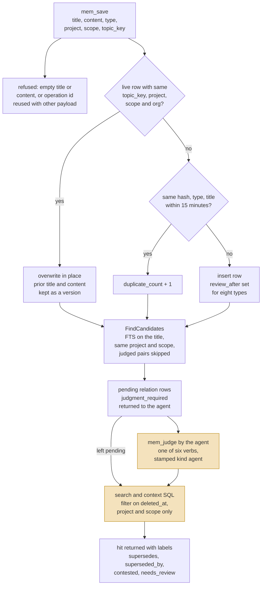

## 1. Executive Summary

Engram is a local-first memory for coding agents: one Go binary that stores
structured observations, user prompts and session summaries in SQLite with
FTS5, and serves them over MCP, HTTP, a CLI and a TUI. What is notable is the
write discipline around a plain store. A topic key turns a save into an upsert
with the prior text kept as a version, a post-save conflict search hands the
agent a judgment to make, and saves are safe to replay. What is weak is that
every judgment belongs to the agent that wrote the memory. A judgment changes
what a search hit is labelled with, never whether it is returned.

Retrieval is lexical only. The agent is expected to call `mem_save` with a
title, a type and a What/Why/Where/Learned body, and to search before it
answers. There is no LLM on the write or read path: the one model call in the
tree is an opt-in CLI conflict scan that shells out to an agent CLI.

It carries three capability marks: `scope_enforced` on project and scope
predicates, `negative_eval` on committed isolation tests, and `audit_log` on
the cloud server's mutation journal, which a local-only install does not have.

## 2. Mental Model

**A memory is an observation the agent chose to write.** It has a type
(`decision`, `bugfix`, `discovery`, `config` and others), a project, a scope of
`project` or `personal`, and optionally a `topic_key` naming the subject it
is the current word on. Nothing is extracted from conversation by a model. A
second, narrower intake parses a `## Key Learnings` section out of text handed
to `mem_capture_passive` and stores each bullet as an observation
(`internal/store/store.go:14203`, `:14261`).

**An observation has two stored fates and one label.** It is live until
`deleted_at` is set, by `mem_delete` or by `mem_consolidate` merging it into a
survivor. A live row whose `review_after` date has passed is reported as
`needs_review`; that state is computed at read time from the date and filters
nothing (`internal/store/store.go:207-219`). Eight types, among them
`decision`, `policy`, `architecture` and `bugfix`, get the date on insert;
other types never do (`:455-464`).

**A belief is revised by overwriting it.** A save whose `topic_key`, project,
scope and org match a live row replaces that row's title and content and
increments `revision_count`. The prior title and content are copied to
`observation_versions` first, so the earlier wording is recoverable while the
row exists (`internal/store/store.go:4462-4518`, `:12889`).

**A conflict is a row between two observations, and the agent rules on it.**
After a save commits, `FindCandidates` runs the title through FTS within the
same project and scope and inserts a `pending` relation for each of up to three
hits. The save response carries `judgment_required` and the candidate list, and
the tool description tells the agent to call `mem_judge` once per candidate
with one of six verbs: `related`, `compatible`, `scoped`, `conflicts_with`,
`supersedes`, `not_conflict`. A judged pair is not raised again. The verdict
is recorded and shown beside later search hits; a row judged superseded is
returned by search exactly as before.

Memory is agent-controlled throughout. A person can read the store in the TUI,
the CLI and the cloud dashboard, and can delete a session in the TUI. No
surface gives a person a verdict to record.

## 3. Architecture

One binary, `cmd/engram`, with the store as the only component that touches
the database. The MCP server (`internal/mcp`), the HTTP server
(`internal/server`), the TUI (`internal/tui`) and the CLI verbs all call
`internal/store`. Sync (`internal/sync`, `internal/cloud/autosync`) reads the
store's mutation journal and talks to an optional cloud server
(`internal/cloud/cloudserver`), which keeps its own Postgres database
(`internal/cloud/cloudstore`) and serves a read-mostly dashboard
(`internal/cloud/dashboard`).

- **Persistence.** SQLite through `modernc.org/sqlite`, a pure-Go driver, one
  open connection, WAL mode, a five-second busy timeout and foreign keys on
  (`internal/store/store.go:1152`, `:1215-1218`).
- **Search.** Two FTS5 tables with the trigram tokenizer, one over
  observations and one over prompts (`internal/store/store.go:1688-1706`).
- **Processes.** `engram mcp` over stdio per agent, `engram serve` for HTTP and
  the hook scripts, and an optional cloud server. No worker is required for a
  local install.
- **Model calls.** None on the save or search path. `engram conflicts scan
  --semantic` shells out to the `claude` or `opencode` CLI named by
  `ENGRAM_AGENT_CLI` (`cmd/engram/llm.go:70-72`).

### Deployment and ergonomics

A local install needs the binary and a writable `~/.engram`; no API key, no
network and no second service. Everything except sync works offline. The store
is a single SQLite file a person can open with any SQLite client, and
`engram doctor` carries repair verbs for the sync state.

Cloud sync is opt-in per project and needs a cloud server with Postgres; a
compose file ships in the tree (`docker-compose.cloud.yml`). The local HTTP
API takes a bearer token from `ENGRAM_HTTP_TOKEN` and is open when the
variable is unset (`internal/server/server.go:200-204`).

## 4. Essential Implementation Paths

### Save

`handleSave` (`internal/mcp/mcp.go:1615`) resolves the project, binds or
creates a session, and calls `Store.AddObservationWithResult`
(`internal/store/store.go:4390`). The store replaces every
`<private>…</private>` span with `[REDACTED]`, truncates content to the
configured maximum, validates the title, and then takes one of four branches
inside a single transaction:

- **Replay.** A caller-supplied operation id found in
  `observation_save_operations` returns the original result when the payload
  fingerprint matches and `ErrObservationOperationConflict` when it does not
  (`:4425-4452`).
- **Topic-key upsert.** A live row with the same key, project, scope and org
  is versioned and overwritten (`:4462-4518`).
- **Duplicate.** A live row with the same normalized hash, project, scope,
  org, type and title inside the dedupe window has `duplicate_count`
  incremented (`:4524-4558`). The window defaults to 15 minutes (`:893`).
- **Insert.** `insertObservationTx` writes the row and sets `review_after` for
  the eight decaying types (`internal/store/session_finalize.go:101-121`).

All MCP writes pass through one in-process queue of 32 slots, so two tool
calls cannot interleave (`internal/mcp/write_queue.go:12`, `:40`).

### Conflict candidates and judgment

After the save commits, `handleSave` calls `FindCandidates` with the resolved
project and scope (`internal/mcp/mcp.go:1785`). The query joins the FTS table
to `observations`, excludes the saved row, deleted rows and any pair that
holds a `judged` relation, and requires the same project and scope
(`internal/store/relations.go:1123-1145`). Each surviving candidate gets a
`pending` row in `memory_relations` unless a row for the pair exists
(`:508-517`). A detection failure leaves the save committed and marks the
response `candidate_detection_status: incomplete`.

`mem_judge` reaches `JudgeRelation` (`internal/mcp/mcp.go:2836-2842`,
`internal/store/relations.go:634`). It validates the verb, refuses a
cross-project pair, and overwrites the relation row with the verdict and
`judgment_status = 'judged'` (`:690-702`). A later judgment on the same id
overwrites the earlier one. The parameters are built with
`MarkedByActor: "agent", MarkedByKind: "agent"` as constants
(`internal/agentops/judgments.go:51`), and the HTTP twin does the same
(`internal/server/server.go:2277-2278`). `mem_compare` writes a verdict for any
two observation ids through `JudgeBySemantic`, which stamps actor `engram` and
kind `system` on a verdict the calling agent supplied
(`internal/store/relations.go:843-845`).

### Who can judge

**The adjudicator is the agent, which is why `human_review` is withheld.**
`mem_judge`, `mem_judge_many` and `mem_compare` are registered tools in the
default agent profile (`internal/mcp/mcp.go:1149`, `:1201`, `:1220`). The HTTP
routes `POST /conflicts/judge` and `POST /conflicts/compare` are registered
without the auth wrapper (`internal/server/runtime_contract.go:78-79`), and the
Pi plugin calls them from agent tools (`plugin/pi/index.ts:2849-2863`).

The surfaces a person has are read-only on this axis. `engram conflicts` offers
`list`, `show`, `stats`, `scan`, `deferred` and `prune`
(`cmd/engram/conflicts.go:23-33`). The TUI source contains no judge action. The
cloud dashboard's POST routes cover login, users, tokens, grants and a
per-project sync toggle. The tool description asks the agent to consult the
user when confidence is under 0.7 or the verdict is `supersedes` or
`conflicts_with` on an architecture, policy or decision row; that is prose
addressed to the model.

### Search

`handleSearch` (`internal/mcp/mcp.go:1355`) resolves a project unless
`all_projects` is true, clears it for `scope=personal`, and calls
`SearchPreviewsContext`. The store runs up to two queries
(`internal/store/store.go:5878-6037`):

- A query containing `/` is first tried as an exact `topic_key`, with rank
  fixed at -1000 so it sorts first (`:5907-5957`).
- Otherwise the query is sanitized and matched against `observations_fts`,
  ordered by weighted BM25 times a bounded boost for pinned rows, recency and
  revision or duplicate counts (`:6205-6254`).
- A query with a term under three characters cannot use the trigram index and
  falls back to escaped `LIKE` over six columns (`:6259-6335`).

Every branch requires `deleted_at IS NULL` and adds type, project, scope and
org predicates when the caller supplied them. Relations for the hits are
loaded afterwards and rendered as `supersedes:`, `superseded_by:` and
`conflict: contested by` lines (`internal/mcp/mcp.go:1491-1530`).

### Context assembly

`mem_context` renders recent sessions, pinned observations, recent unpinned
observations and recent prompts for the resolved project and scope, bounded
to 16 KiB and 20 pinned rows by default (`internal/mcp/mcp.go:2137-2142`,
`:2228`; `internal/store/store.go:6550`). `FormatCompactionContext` builds a
narrower block for one session after a host compaction, keyed on session id
and the session's project (`:6718`).

### Update, delete, consolidate

`mem_update` edits fields or applies a literal find-and-replace, versions the
row when title or content change, and refuses to move a row to another project
(`internal/store/store.go:5483-5608`). `mem_delete` sets `deleted_at`; with
`hard_delete=true` it removes the row, cascades its versions, marks its
relations `orphaned` and records a delete marker for sync (`:5663-5758`).
`mem_consolidate` plans a merge of two or more live rows from one project,
returns a fingerprint, and on confirmation inserts a survivor and soft-deletes
the sources with `superseded_by_sync_id` set
(`internal/store/consolidate.go:122-180`, `:341-416`).

### Sync

`enqueueSyncMutationTx` writes a `sync_mutations` row only when the project is
enrolled for cloud sync (`internal/store/store.go:11921-11932`). Enrolment
backfills current state. Pulled mutations are applied through
`ApplyPulledMutation` (`:8670`). A hard delete records the entity key in
`sync_delete_tombstones` (`:5697`), and a later local upsert of the same key
deactivates the marker (`:10885-10889`).

## 5. Memory Data Model

The schema is created in `Store.migrate` (`internal/store/store.go:1460`).

- **`observations`** (`:1503-1530`): id, `sync_id`, session, type, title,
  content, tool name, `project`, `scope`, `org`, `topic_key`,
  `normalized_hash`, `revision_count`, `duplicate_count`, `last_seen_at`,
  `pinned`, `created_at`, `updated_at`, `deleted_at`, `review_after`,
  `superseded_by_sync_id`.
- **`observation_versions`** (`:1537-1545`): prior title and content per
  overwrite, numbered per observation, with a foreign key that cascades on
  delete.
- **`memory_relations`** (`:1849-1867`): source and target sync ids, relation
  verb, reason, evidence, confidence, `judgment_status` of `pending`,
  `judged`, `orphaned` or `ignored`, and three `marked_by_*` columns.
- **`user_prompts`** and **`prompt_tombstones`** (`:1547-1570`): saved prompts
  and a record of deleted ones keyed on sync id and source inbox id.
- **`sessions`**, **`session_finalizations`**, **`project_aliases`**.
- **`observation_save_operations`** (`:2061-2067`): operation id, payload
  fingerprint and the observation it produced.
- **Sync tables**: `sync_mutations`, `sync_state`, `sync_chunks`,
  `sync_delete_tombstones`, `sync_apply_deferred`, `sync_enrolled_projects`.

**Declared and unwritten.** `expires_at`, `embedding`, `embedding_model` and
`embedding_created_at` are columns on `observations` with no writer in the
tree; a comment calls the last three an *"embedding reservation"*
(`:1829`). `marked_by_kind` is documented as `agent`, `human` or `system`
(`internal/store/relations.go:359`) and only `agent` and `system` are ever
written.

**Time.** Every timestamp is record time: `created_at`, `updated_at`,
`last_seen_at`, `deleted_at`. `review_after` is a future prompt to re-check.
No column records when a fact held, so `bitemporal` is withheld.

**Scope.** `project` is normalized to lower case on write. `scope` defaults to
`project`; `personal` is the other value. `org` is an optional third axis read
from the project's configuration. Pin state stays local: it is left out of the
sync payload (`internal/store/store.go:761`).

## 6. Retrieval Mechanics

Retrieval is tool-mediated and lexical. The agent calls `mem_search`, reads
300-character previews, and fetches full bodies with `mem_get_observation` or
the session neighbourhood with `mem_timeline`.

**Ranking.** BM25 over `observations_fts` with title weighted 5, content 1 and
topic key 3. The order multiplies that by one plus three bounded terms
(`internal/store/store.go:440-447`, `:6205-6254`). A pinned row adds 0.10.
Recency adds up to 0.06, decaying over a 30-day scale since the row was last
seen. Revision and duplicate counts add up to 0.04. The limit defaults to 10
and is capped at 20.

**What recall filters on.** `deleted_at`, and the type, project, scope and org
the caller supplied. No read consults `memory_relations` to drop a row, and
none consults `review_after`. A row the agent judged superseded by another is
returned with a `superseded_by:` line and ranks on the same terms as its
successor. Only `mem_consolidate` and the deletes take a row out of recall.

**Failure modes.** Paraphrase misses are structural: trigram FTS matches
substrings, and the default `match_mode` requires every term. `match_mode=any`
widens to OR. Project-name drift splits recall across two keys; the save path
warns on a similar existing project name and `mem_merge_projects` repairs it.
Prompt search has its own tool, `mem_search_prompts`, over `prompts_fts`.

## 7. Write Mechanics

Writes are explicit tool calls. The agent supplies the whole observation;
the store normalizes, redacts, deduplicates and versions.

- **Redaction.** `<private>` spans are replaced before anything is stored,
  in titles, content and judgment reasons
  (`internal/store/store.go:14127-14137`, `internal/store/relations.go:651-659`).
- **Length.** Content over 50,000 bytes is truncated with a marker, and the
  save response reports the truncation.
- **Update in place.** A topic-key match or `mem_update` overwrites the row.
  The prior text survives as a version only while the row does.
- **Dedupe.** Exact normalized-hash match within the window. A deleted row is
  outside the match, so re-saving deleted text inserts a fresh row
  (`:4534`). No table is keyed on rejected content, and `tombstone` is
  withheld. `prompt_tombstones` and `sync_delete_tombstones` are keyed on
  record identity. They stop the same record returning through sync or inbox
  replay, and leave the same value free to be written again.
- **Session summaries.** `mem_session_summary` and `mem_session_finalize`
  store an end-of-session observation. The tool list handed to the agent
  reserves it for *"significant explicit closure or handoff"* and says ordinary
  completion does not require it (`internal/mcp/mcp.go:351`).

### Operational cost

The save is synchronous and local: one transaction, then one FTS query for
candidates and up to three inserts. No model is called, so a new memory is
retrievable when the tool returns. No background pass rewrites the store. On
the read side `mem_context` is bounded to 16 KiB by default and search to 20
previews of 300 characters. The Claude Code plugin injects context at session
start and after compaction through hook scripts, which places it at the head
of a fresh context.

## 8. Agent Integration

The MCP server registers 27 tools. A profile mechanism narrows the set:
`agent` holds 23 names, `admin` holds `mem_delete`, `mem_stats`,
`mem_timeline`, `mem_merge_projects` and two shared ones, and an empty
selection registers everything (`internal/mcp/mcp.go:260-295`, `:306-311`).

- **Write:** `mem_save`, `mem_update`, `mem_delete`, `mem_save_prompt`,
  `mem_capture_passive`, `mem_session_summary`, `mem_session_finalize`,
  `mem_consolidate`, `mem_pin`, `mem_unpin`.
- **Read:** `mem_search`, `mem_search_prompts`, `mem_context`,
  `mem_get_observation`, `mem_timeline`, `mem_stats`, `mem_review`.
- **Conflict:** `mem_judge`, `mem_judge_many`, `mem_compare`.
- **Project and session:** `mem_current_project`, `mem_list_projects`,
  `mem_merge_projects`, `mem_suggest_topic_key`, `mem_session_start`,
  `mem_session_end`, `mem_doctor`.

The Claude Code plugin registers hooks on `PreToolUse`, `SessionStart`,
`UserPromptSubmit`, `PostToolUse`, `SubagentStop` and `SessionEnd`
(`plugin/claude-code/hooks/hooks.json`). The `PreToolUse` hook matches the
mutating Engram tools and blocks on failure. `engram hook
claude-pre-tool-use` confirms the host's session id against the server and
rewrites the tool input, so the model cannot write under a session it names
itself (`cmd/engram/hook_claude.go:121-170`). Plugins for Codex, OpenCode and
Pi and an Obsidian exporter sit beside it.

[QualityLayer](../qualitylayer/) bundles a build of Engram at v3.6.2 as a
private per-project search index and exposes seven of these tools.

## 9. Reliability, Safety, and Trust

**No stored trust state.** The status-like fields are `deleted_at`, `pinned`,
the derived `needs_review`, and a relation's `judgment_status`. Search and
context filter on the first only. `trust_state` is withheld: nothing stored
says "on record and not believed", and the one verdict that would mean it,
`supersedes`, is a label on the hit.

**Provenance is partly constant.** Every judgment through `mem_judge` is
stamped `agent`; a verdict the agent submits through `mem_compare` is stamped
`system`. A reader of `marked_by_kind` cannot tell the scan's verdicts from
the agent's own.

**The audit record lives in the cloud.** `cloud_mutations` is insert-only: a
sequence number, project, entity, key, op, payload and timestamp per pushed
mutation, read by pull and by the dashboard
(`internal/cloud/cloudstore/cloudstore.go:862-870`, `:964-1003`). Locally,
`sync_mutations` is written only for enrolled projects and a pending session
upsert is deleted when a later one replaces it
(`internal/store/store.go:11921-11940`). `observation_versions` holds
overwritten text with no actor and no record of creates, deletes, pins or
verdicts.

**Deletion is uneven across copies.** A hard delete removes the local row and
its versions and enqueues a delete mutation. Nothing in the tree deletes a
`cloud_mutations` row, so an upsert payload pushed before the delete, content
included, remains in the cloud journal.

**Access.** The local HTTP API is unauthenticated unless `ENGRAM_HTTP_TOKEN`
is set, and the single-observation judge and compare routes skip the auth
wrapper even then. The cloud server authenticates principals with tokens,
authorizes each pull against per-project grants, and logs rejected requests
to `cloud_auth_audit_log`.

**Prompt capture.** The `UserPromptSubmit` hook stores user prompts. Private
tags are honoured; anything else a user types is kept until deleted.

**Concurrency.** One SQLite connection, WAL, and a serialized MCP write queue.
Saves carry an optional operation id so a retried call returns the first
result.

## 10. Tests, Evals, and Benchmarks

I ran nothing: no build, no test, no hook. I counted 3,990 `func Test`
declarations in 518 `_test.go` files, 200,609 lines, against 81,851 lines of
non-test Go.

**CI.** `.github/workflows/ci.yml` runs `go test -race ./...` on Ubuntu, the
plain suite on macOS and Windows, `go test -tags e2e ./internal/server/...`,
a PostgreSQL job over the cloud packages, plugin adapter tests, `govulncheck`,
lint and a performance ratchet. `pr-check.yml` gates a pull request on a
linked, approved issue. Fifteen further workflows handle releases, issue
triage and staging.

**Negative assertions.** `TestFormatCompactionContextIsSessionScoped` checks
included and excluded strings on the same rendered context, including a
foreign-project row seeded into the session under test
(`internal/store/store_test.go:3572-3653`).
`TestHandleSearchWithoutAllProjectsStillScopesToCurrentProject` and its
`all_projects` sibling pair an exclusion with the case that returns the
excluded row (`internal/mcp/mcp_test.go:11243-11337`).
`TestProjectScopedHTTPReadFamiliesUseCurrentAndExplicitAll` does the same
across ten HTTP routes, without asserting the default result is non-empty
(`internal/server/server_test.go:593`). `TestMutationPullCrossTenantLeak`
covers the cloud pull against a fake store
(`internal/cloud/cloudserver/mutations_test.go:797`).

**What the suite does not hold.** No committed case asserts that a row judged
superseded is absent from search, which matches the code: it is present. The
Postgres-backed cloudstore tests skip when `CLOUDSTORE_TEST_DSN` is unset, so
a local run without Postgres reports them as skipped.

**Benchmarks.** The committed ones measure the system's own queries:
candidate-rank materialization over 15,000 observations (`DOCS.md:870-902`),
a dashboard read model and a mutation-pause path against Postgres. `DOCS.md`
states they *"do not establish latency or memory"* guarantees. No retrieval
quality benchmark, recall dataset or LoCoMo or LongMemEval harness is in the
tree, and the README claims none. No paper is cited in `README.md`, `DOCS.md`
or `docs/`.

## 11. For Your Own Build

### Steal

- **A subject key that turns a save into an upsert, with the overwritten text
  kept.** One column and one version table give "the current word on X"
  without a merge step.
- **An operation id on the write.** A ledger row binding the id to a payload
  fingerprint makes a retried tool call return the first result and refuses a
  reused id with different content.
- **Conflict search after the commit, never inside it.** A failed detection
  is reported and the save stands.
- **A plan fingerprint on destructive merges.** The confirm call must carry
  the hash of the sources it previewed, so a merge cannot land on rows that
  changed.
- **Session identity taken from the host.** A pre-tool hook that rewrites the
  session argument removes one field the model could otherwise invent.
- **Widening as an explicit argument.** The default read is project-scoped
  and the caller must ask for `all_projects`.

### Avoid

- **A verdict that only annotates.** If `supersedes` does not demote or hide
  the older row, stale and current text reach the prompt together and the
  model arbitrates again on every read.
- **The writer as its own judge.** A conflict queue the saving agent clears
  is a self-check; give the verb to a surface the agent cannot reach, or do
  not call it review.
- **Provenance written as a constant.** An actor column every caller fills
  with the same literal records nothing.
- **A journal that outlives the delete.** If mutations are replicated as
  payloads, decide what a hard delete does to the earlier payloads.
- **Columns reserved for a feature.** Unwritten `embedding` and `expires_at`
  columns read as capabilities to anyone inspecting the schema.

### Fit

This suits one developer, or a small team sharing projects through the cloud
server, who wants agent memory with no model bill and a store they can open.
The maintenance budget is small locally and real with sync: enrolment,
deferred relations, tombstone floors and repair verbs are a subsystem larger
than the memory logic. Walk away if recall must survive paraphrase, if stale
facts must stop being served without the agent deleting them, or if a person
has to approve what the agent remembers.

## 12. Open Questions

- How often does an agent act on `judgment_required`, and what share of
  pending relations are ever judged? `engram conflicts stats` would answer it
  on a live store.
- Does any deployment prune `cloud_mutations` outside the code, for retention
  or after a hard delete?
- What fills the reserved embedding columns, and will a vector arm share the
  project and scope predicates?
- Does the hosted Engram Cloud run the cloud server in this tree unmodified?

## Appendix: File Index

- **Schema and store:** `internal/store/store.go`.
- **Relations and conflict scan:** `internal/store/relations.go`,
  `internal/store/relations_scan_batch.go`,
  `internal/store/candidate_relevance.go`.
- **Consolidation:** `internal/store/consolidate.go`,
  `internal/mcp/consolidate.go`.
- **MCP tools:** `internal/mcp/mcp.go`, `internal/mcp/write_queue.go`,
  `internal/agentops/judgments.go`.
- **HTTP:** `internal/server/server.go`,
  `internal/server/runtime_contract.go`,
  `internal/server/agent_workflows.go`.
- **CLI and hooks:** `cmd/engram/conflicts.go`, `cmd/engram/hook_claude.go`,
  `cmd/engram/llm.go`, `plugin/claude-code/hooks/hooks.json`,
  `plugin/pi/index.ts`.
- **Cloud:** `internal/cloud/cloudstore/cloudstore.go`,
  `internal/cloud/cloudstore/audit_log.go`,
  `internal/cloud/cloudserver/mutations.go`,
  `internal/cloud/dashboard/dashboard.go`.
- **Tests read:** `internal/store/store_test.go`,
  `internal/mcp/mcp_test.go`, `internal/server/server_test.go`,
  `internal/cloud/cloudserver/mutations_test.go`.
- **Licence and process:** `LICENSE`, `TRADEMARKS.md`, `CONTRIBUTING.md`,
  `.gitattributes`.

### Recorded searches

Run with `/usr/bin/git grep` from the root of a checkout at
`140bbedd85af25324be31c41ccbb71666c7bd60e`.

- `git grep -n -i 'embedding' -- '*.go' ':!*_test.go'` — the three column definitions at `internal/store/store.go:1525-1527` and `:1836-1838`, two comments, and an unrelated comment in `internal/setup/generate.go:4`; no statement writes or reads the columns.
- `git grep -n -w 'expires_at' -- '*.go' ':!*_test.go'` — the column at `internal/store/store.go:1524` and `:1835` and two comments; no writer.
- `git grep -n 'superseded_by_sync_id IS' -- '*.go'` — no match; control `git grep -c 'deleted_at IS NULL' -- internal/store/store.go` returns 62. No read predicate tests the supersession column.
- `git grep -n 'judgment_status' -- internal/store/store.go` — schema, export, import, doctor and orphaning statements; none inside `buildSearchFTSQueryWithColumns`, `buildSearchLIKEQueryWithColumns` or the context queries.
- `git grep -n -E 'case "(list|show|stats|scan|deferred|prune|judge)":' -- cmd/engram/conflicts.go` — six verbs at lines 23-33; no `judge`.
- `git grep -n -i 'judge' -- internal/tui ':!*_test.go'` — no match; control `git grep -c -i 'delete' -- internal/tui/update.go` returns 24.
- `git grep -n -E '"(POST|PUT|PATCH|DELETE) /dashboard' -- internal/cloud ':!*_test.go'` — eleven routes: bootstrap, login, logout, users, tokens, grants and one project sync toggle; none names an observation or a relation.
- `git grep -n -E 'MarkedByKind: *"|kind := "' -- internal ':!*_test.go'` — `agent` at `internal/agentops/judgments.go:51` and `internal/server/server.go:2278`, `system` at `internal/store/relations.go:845`; nothing writes `human`.
- `git grep -n -i -E 'isatty|IsTerminal' -- '*.go' ':!*_test.go'` — no match; control `git grep -c -i 'isatty' -- go.sum` returns 3.
- `git grep -n -i -E 'valid_from|valid_at|valid_until|valid_to|event_time|invalid_at' -- internal cmd ':!*_test.go'` — one hit, the string `invalid_token` in `internal/cloud/cloudserver/dashboard_session.go:28`; no validity-time column.
- `git grep -n -i -E '(DELETE FROM|UPDATE|TRUNCATE( TABLE)?|DROP TABLE( IF EXISTS)?) +cloud_mutations' -- . ':!*_test.go'` — one hit, the blank-project backfill at `internal/cloud/cloudstore/cloudstore.go:872`.
- `git grep -n -E 'DELETE FROM (observation_versions|memory_relations|observation_save_operations)' -- '*.go' ':!*_test.go'` — no match; control `git grep -c 'DELETE FROM sync_mutations' -- internal/store/store.go` returns 1.
- `git grep -n -E 'conflicts/judge' -- . ':!*_test.go' ':!docs' ':!CHANGELOG.md'` — the route table, `DOCS.md`, the Pi runtime contract and its JavaScript tests, and the callers in `plugin/pi/index.ts:2849` and `:2861`.
- `git grep -n -i -E 'arxiv|bibtex|@article|@misc|CITATION\.cff|doi\.org' -- README.md DOCS.md docs` — no match; control `git grep -c -i 'license' -- README.md` returns 3.
- `git grep -n -i -E 'LoCoMo|LongMemEval|recall@' -- . ':!CHANGELOG.md'` — no match; control `git grep -c -i 'benchmark' -- DOCS.md` returns a non-zero count.
- `git ls-files | /usr/bin/grep -i -E '(^|/)(licen[sc]e|copying|notice|contributing|third.party)'` — `CONTRIBUTING.md` and `LICENSE`. `git grep -n -i -E 'contributor licen[sc]e|licen[sc]e agreement|sign-off|signed-off|copyright assign' -- CONTRIBUTING.md` — no match; control `git grep -c -i 'issue' -- CONTRIBUTING.md` returns 69.

## History

**2026-11-14** — [`140bbedd85af25324be31c41ccbb71666c7bd60e`](https://github.com/Gentleman-Programming/engram/commit/140bbedd85af25324be31c41ccbb71666c7bd60e) — 521 commits on. Upstream added `mem_consolidate`, `mem_judge_many`, version history, a replay ledger and host-confirmed session binding. `negative_eval` and `audit_log` are awarded; both mechanisms existed at the old pin and had not been read ([section 10](#10-tests-evals-and-benchmarks), [section 9](#9-reliability-safety-and-trust)). Five marks are withheld with searches recorded. Wrong at the old pin: every mutation journaled (the journal is per enrolled project), no web UI in the tree (a cloud dashboard), and the judge endpoint called only by tests (the Pi plugin calls it). Stale: the session summary is not mandatory. Licence MIT; file and manifests agree, no contributor agreement. Screen: five auto-run surfaces on the same paths, three dependency surfaces inside the cooldown, two build-time execution points, one unpinned manifest. Nothing was installed or run.

**2026-11-02** — [`fa222a060a34668048222d18011fe12c7d9140ab`](https://github.com/Gentleman-Programming/engram/commit/fa222a060a34668048222d18011fe12c7d9140ab) — re-screened at the same pin with plugins below the checkout root followed. The screen had not counted 3 auto-run surfaces, 5 in all: hooks registered in `plugin/claude-code/hooks/hooks.json` on SessionStart, UserPromptSubmit, SubagentStop and SessionEnd. The hook files were read at the pin as data; nothing was installed or run, and no mark changes.

**2026-09-14** — [`fa222a060a34668048222d18011fe12c7d9140ab`](https://github.com/Gentleman-Programming/engram/commit/fa222a060a34668048222d18011fe12c7d9140ab) — re-read, 428 commits past the previous pin across 493 files. **`human_review` is withdrawn.** The mark had been carried through two readings on the existence of a judgment step rather than on a producer check against the approver, which is the test it asks for. `JudgeRelation` is real and reachable two ways — the `mem_judge` MCP tool and `POST /conflicts/judge` — but no shipped surface lets a person use either: the TUI renders review date, pinned flag and state with no verdict, pin or delete action on an observation; `engram conflicts` offers `list`, `show`, `stats`, `scan` and `deferred` and no `judge`; there is no web UI in the tree; and the HTTP endpoint's only callers are its own tests. The MCP instructions name the adjudicator directly — after `mem_save`, the agent iterates the candidates and calls `mem_judge`. A person can watch the queue and cannot act on it, which is the display-only case the mark excludes. `scope_enforced` stands and now carries an evidence record: project and scope are columns on the observation and predicates in the candidate query rather than filters applied to results. Screened again first; nothing was installed and no suite was run.

**2026-08-06** — [`509e6762fdd9417ff7a39d30f426a9566220eaf0`](https://github.com/Gentleman-Programming/engram/commit/509e6762fdd9417ff7a39d30f426a9566220eaf0) — 39 commits on, and retrieval moved. `#526` replaces the FTS5 default ranking with weighted BM25; `#586` escapes interior double-quotes in `sanitizeFTS` after they crashed FTS5, which is the kind of input a note containing a quoted string produces routinely; `#616` stops duplicate observations on import; `#600` materialises relation mutations on chunk-ingest. Beside them a cloud settings screen, an MCP project override for `mem_session_summary`, and a session delete confirmation in the TUI. The write and correction semantics this report describes are unchanged and no published claim is stale; the ranking function under them is not the one that was read. Both marks re-checked and neither moves. Screened again: 1 auto-run surface (`.devcontainer/devcontainer.json`), 2 build-time exec paths, nothing inside the cooldown.

**2026-07-26** — [`44faeee1fb4fabdee4ba9619df55af485f3d06eb`](https://github.com/Gentleman-Programming/engram/commit/44faeee1fb4fabdee4ba9619df55af485f3d06eb) — first reading.
