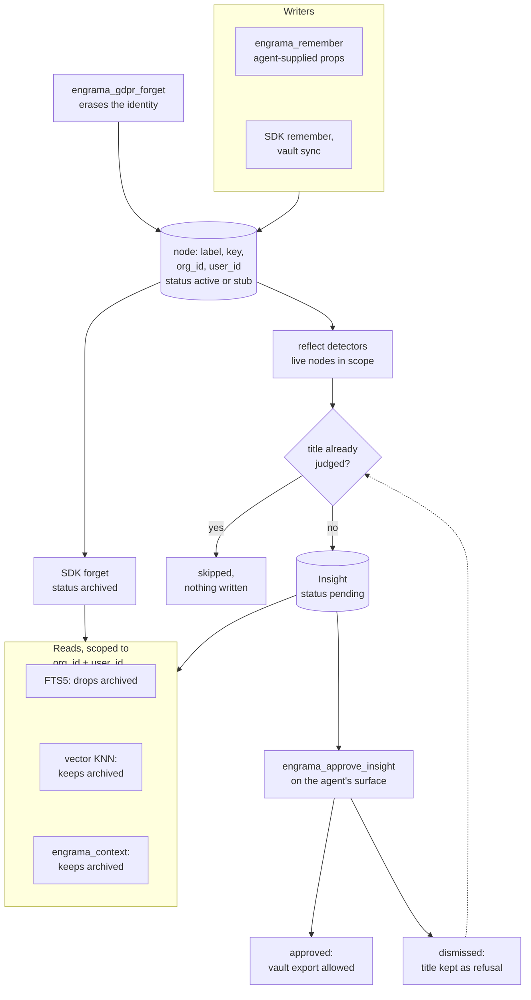

## 1. Executive Summary

Engrama is a Python memory framework whose unit is a node in a typed knowledge
graph: entities, the observations written onto them as properties, and typed
relations between them, held in one SQLite file or in Neo4j and served to an
agent through a 14-tool MCP server, a Python SDK and a CLI. What is notable is
the tenancy: every node and edge is owned by an `(org_id, user_id)` pair the
server resolves from transport headers, every tenant-facing read applies a
predicate that matches nothing when either half is missing, and CI fails on a backend
query that does not route through it. What is weak is what the default backend
can find: SQLite indexes no `details` field for search and embeds neither
`summary` nor `details`, the two fields the remember tool's own description
asks an agent to fill.

The second mechanism is reflect. Nine deterministic detectors look for patterns
across the caller's graph (a decision in one project that fits an open problem
in another, a technology shared by several entities, stale knowledge linked to
an active project) and write each as an `Insight` node with status `pending`.
Titles are built from the entities and carry no counts, so a title the user
dismissed is skipped by every later reflect. That is a value-keyed refusal, and
it earns the `tombstone` mark for Insights.

The rest of the lifecycle is thinner. No model runs in the server: the agent
extracts, decides and writes through `engrama_remember`, and nothing gates a
write. The agent cannot forget one node over MCP; the SDK's `forget` archives
it, which removes it from fulltext search and leaves it on the vector arm and
in `engrama_context`. The only MCP deletion is `engrama_gdpr_forget`, which
erases the caller's whole identity. Approving or dismissing an Insight is a
tool on the agent's own surface, and a dismissed Insight stays an ordinary
search hit.

**Licence.** Apache-2.0, stated the same way in `LICENSE`, `pyproject.toml`,
`mcp.json` and `server.json`, with no rider and no component under other
terms. The README advertises an invitation-only hosted deployment and says it
runs the same code; this report reads only the tree.

Three marks are earned: `scope_enforced` and `negative_eval` on the graph
store, and `tombstone` on reflect Insights. Section 9 gives the reason for each
of the four withheld.

## 2. Mental Model

A memory is **a node the agent decided to write**. Its identity is
`(label, name or title, org_id, user_id)`; its content is a free property bag
in which the remember tool asks for `summary`, `details`, `tags`, `source` and
`status` (`engrama/adapters/mcp/server.py:586-598`). There is no candidate
stage. A node is served from the moment `engrama_remember` returns, ranked
partly by a `trust_level` the server derives from the write's source, never
from the caller (`engrama/core/security.py:35-58`).

Three things can stop a node being served, and none of them is a judgement
about whether it is true:

- **Archived.** The SDK's `forget` sets `status: archived`. Fulltext search
  drops it (`engrama/backends/sqlite/store.py:959`); the vector arm and the
  neighbourhood read do not.
- **Erased.** `engrama_gdpr_forget` with `mode: apply` deletes every row the
  identity owns.
- **Expired.** A `valid_to` property exists, nothing reachable writes it except
  the agent passing it as an ordinary property, and nothing reachable reads it
  (section 5).

`status` is otherwise free text. `stub` marks a relation target created
because it did not exist yet, and an enriching write promotes it to `active`
(`store.py:333-334`). `superseded` is a value the tool description suggests and
only the reflect detectors honour (`store.py:1518-1529`).

The one state machine with a judgement in it belongs to Insights, the nodes
reflect writes:

- `pending` on creation, served by `engrama_surface_insights` and hinted after
  a related search;
- `approved` or `dismissed` when `engrama_approve_insight` (or the SDK) is
  called; an approved Insight may be appended to a vault note, a pending or
  dismissed one may not (`server.py:3219`);
- a dismissed or approved title is skipped by every later reflect in the same
  scope (`server.py:2853-2895`).

## 3. Architecture

A library with three front ends. `engrama/core` holds the engine, the scope
model, the sanitiser, hybrid search, reflect and temporal helpers. Two
backends implement one protocol: `engrama/backends/sqlite` (graph, FTS5 and
sqlite-vec in one file) and `engrama/backends/neo4j` (Cypher, a fulltext index
named `memory_search` and a vector index). `engrama/adapters` holds the MCP
server, the SDK and the Obsidian sync. The MCP server talks to the async store
directly rather than through the engine, and applies the same sanitiser and
scope at its own boundary (`server.py:165-169`).

The schema is profile-driven. `engrama init --profile developer` reads
`profiles/*.yaml` and their modules for the node labels and relation types the
sanitiser will accept; a label outside the set is refused on write.

The MCP server runs over stdio by default and over Streamable HTTP with
`ENGRAMA_TRANSPORT=http`, bound to `127.0.0.1` unless `ENGRAMA_HTTP_HOST` says
otherwise (`engrama/adapters/mcp/__init__.py:89-100`). The HTTP transport
validates `Origin` and `Host` against a loopback allow-list and has no
authentication; `/.well-known/oauth-protected-resource` is a stub
(`engrama/adapters/mcp/http.py:1-18`). `server.json` also lists a remote
endpoint for the hosted beta, which was not contacted.

### Deployment and ergonomics

The default needs nothing running: `pip install engrama`, `engrama init`, and
the store is `~/.engrama/engrama.db` in WAL mode. No API key is needed to store
or search anything, because the default embedding provider is `none`
(`engrama/embeddings/__init__.py:40`), and with it search is FTS5 only. An
Ollama or OpenAI-compatible endpoint turns on the vector arm. Neo4j needs the
`neo4j` extra and the bundled `docker-compose.yml`, and the README positions it
for multi-process writers.

The store is readable with any SQLite client: one row per node with its
properties as JSON. With `VAULT_PATH` set, `engrama_remember` also writes a
Markdown note with YAML frontmatter, and `engrama_sync_vault` reads a vault
back into the graph, so a person can edit memory in Obsidian. A multi-tenant
deployment puts a gateway in front that authenticates the caller and injects
the identity headers; `ENGRAMA_REQUIRE_IDENTITY=1` makes a header-less request
fail instead of falling back to the local identity (`server.py:202-214`).

## 4. Essential Implementation Paths

- **Identity.** `resolve_scope` in `engrama/adapters/mcp/server.py:261-287`
  reads both headers; neither gives the standalone identity from
  `resolve_local_sub` (`engrama/core/identity.py:39-64`), exactly one raises
  `ScopeUnresolved`. `_with_mcp_provenance` sanitises the caller's properties
  and stamps provenance and scope over them (`server.py:290-301`).
  `EngramaEngine.merge_node` raises `ScopeIncomplete` for an SDK write without
  both keys (`engrama/core/engine.py:150-160`).
- **Scope predicates.** `scope_filter_sql`, `scope_filter_cypher`,
  `owner_filter_sql` and `node_visible` in `engrama/core/scope.py:159-317`.
- **Write.** `engrama_remember` at `server.py:1389`: label check, merge key
  canonicalised, tag-anchor and duplicate checks (`:1491-1531`), optional vault
  note (`:1544-1604`), `store.merge_node` (`:1612`), embedding through
  `_reembed_node` (`:395-427`) and the sweep (`:429-455`), then inline
  relations with stub creation (`:1705-1880`). SQLite `merge_node` at
  `engrama/backends/sqlite/store.py:260-360`.
- **Search.** `engrama_search` at `server.py:1234`, through
  `HybridSearchEngine.asearch` (`engrama/core/search.py:480-533`) with a
  fallback to `fulltext_search`; SQLite fulltext at `store.py:913-997`, vector
  at `engrama/backends/sqlite/vector.py:210-289`; Neo4j at
  `engrama/backends/neo4j/async_store.py:604-660` and `:1275-1300`.
- **Context.** `engrama_context` at `server.py:2211` calls
  `get_node_with_neighbours`; SQLite's recursive walk is `store.py:700-870`.
- **Reflect.** `engrama_reflect` at `server.py:2810-2942`; detectors, title
  builders and `select` in `engrama/core/reflection.py`; the SQLite detector
  queries from `store.py:1531`, each with `_live_and` (`:1518-1529`); the SDK
  entry in `engrama/skills/reflect.py:53-77`.
- **Insight review.** `engrama_surface_insights`, `engrama_approve_insight`
  (`server.py:3064`) and `engrama_write_insight_to_vault` (`:3159`);
  `update_insight_status`, `get_dismissed_insight_titles` and
  `get_approved_insight_titles` at `store.py:1347-1450`.
- **Forget.** `ForgetSkill` in `engrama/skills/forget.py` (SDK only) over
  `archive_node_by_name` and `archive_nodes_older_than`
  (`store.py:429-475`, `:1187-1236`); `engrama_gdpr_forget` at
  `server.py:3554` over `gdpr_forget` in `engrama/migrate.py:688-827`.
- **Schema.** `engrama/backends/sqlite/schema.sql`;
  `engrama/backends/neo4j/schema.cypher`.

## 5. Memory Data Model

The SQLite `nodes` table has `label`, `key_field`, `key_value`, a `props` JSON
blob and the two timestamps (`schema.sql:11-19`). The owner lives inside
`props`, and a unique expression index over label, key and the two
`json_extract` owner values makes the owner part of identity
(`schema.sql:26-31`). Two tenants writing `roadmap` get two rows. A pre-v3
database with the older `UNIQUE(label, key_value)` is rebuilt on connect
(`store.py:182-237`). `edges` carry their own `org_id` and `user_id` columns
and a unique `(from_id, rel_type, to_id)` (`schema.sql:41-50`). `nodes_fts`
indexes ten text fields (`store.py:43-54`), and a vec0 table holds one vector
per node id.

Every node gets an `engrama_id` UUID that a later write cannot change, plus
`valid_from` and `confidence` on create (`store.py:304-311`, `:337-340`).
Provenance is four flat properties: `source`, `source_agent`,
`source_session` and `trust_level`. Scope adds `org_id`, `user_id` and, when
set, `agent_id` and `session_id`. All eight are reserved: the sanitiser drops
them from a caller's bag (`security.py:46-58`), so an agent cannot raise its
own trust or move a write into another identity. `status`, `confidence`,
`valid_from` and `valid_to` are not reserved.

Temporal fields are declared and mostly inert. `valid_from` defaults to the
write time and is passed explicitly only by the benchmark runner
(`engrama/bench/runner.py:293-304`). `valid_to` is set by `expire_node`, which
has no caller, and cleared by any re-merge that does not name it
(`store.py:329-331`, `:1014-1042`). The one read of both, `query_at_date`, has
no caller either (`store.py:1149-1185`). Ranking measures recency from
`last_activity_at`, which a write or a new edge refreshes
(`engrama/core/temporal.py:99-130`).

Separation between kinds of memory is by label: `Decision` and `Problem` are
title-keyed, `Insight` is the derived kind, `Domain` and `Concept` seed the
taxonomy. There is no separate episodic store and no raw conversation log.

## 6. Retrieval Mechanics

`engrama_search` runs two channels when an embedder is configured. Fulltext
takes the top 20 from FTS5 or the Neo4j index; the vector arm takes the top 20
by cosine (`search.py:190-191`). Results are merged by name, ranked by
reciprocal rank fusion at k 60, and adjusted as
`rrf + 0.1 × temporal + 0.1 × trust` plus `0.15 ×` a graph-distance score
(`search.py:177-198`, `:854`, `:659-662`).

The graph term rewards candidates
that are neighbours of other candidates and of an anchor node the query names,
fetched one hop at a time through the scoped neighbour read
(`search.py:535-662`). Temporal is stored confidence times a recency decay with
a 180-day half-life, 30 days for reflect Insights, stretched for well-connected
nodes and waived for project, client, course and domain anchors
(`temporal.py:99-130`). Trust is the source's `trust_level`, so a CLI or sync
write outranks an agent's MCP write by 0.05 at equal relevance. `confidence` is not
reserved, so the agent can set its own, and it multiplies the temporal term
(`search.py:816-831`).

What the channels can see differs by backend, and the default is the narrow
one:

- **SQLite fulltext** indexes `name`, `title`, `description`, `notes`,
  `rationale`, `solution`, `context`, `body`, `summary` and `tags`
  (`store.py:43-54`). The Neo4j index covers those, `details` and 41 more
  profile fields (`schema.cypher:110-112`).
- **Embedding text** is the label, the name or title, and `description`,
  `notes`, `rationale`, `solution`, `context` and `body`
  (`engrama/embeddings/text.py:15-22`, `:45-57`). Neither `summary` nor
  `details` is embedded.

The remember tool's example of a good node carries `summary`, `details` and
`tags` and no `description` (`server.py:586-598`). On SQLite its `details` is
reachable by no search arm, and with an embedder its vector is built from the
label and the name alone.

Every channel is scoped (section 9). Not every channel drops what was
archived: the fulltext SQL excludes `status = 'archived'` on both backends
(`store.py:959`, `async_store.py:631`), and the SQLite and Neo4j vector
queries and the SQLite neighbour walk filter on scope only
(`vector.py:226-253`, `async_store.py:1291-1300`, `store.py:700-870`). The
merge is keyed on name alone (`search.py:696-783`), so two nodes of different
labels sharing a name collapse into one result. The vector query asks vec0 for
`k` neighbours and applies the scope predicate to the joined rows, so in a
shared database a tenant can receive fewer than `k` vector hits; read from the
query, not run.

Search responses carry name, label, scores, `summary` and `tags`, never
`details` and never `status`. A dismissed Insight comes back the same way a
fact does. `engrama_context` returns the root node with all its properties
except the vector, and neighbours up to three hops without `details`
(`store.py:855-868`).

When the vector channel ran, the search response also lists pending Insights
whose stored vector is close to the query, with a hint to surface them
(`server.py:1344-1375`).

## 7. Write Mechanics

**The agent writes.** `engrama_remember` takes a label and a property bag and
merges it under the caller's identity. A merge overwrites every property the
caller names and keeps the rest. Two refusals are opt-in: with
`ENGRAMA_REQUIRE_RELATIONS` set it refuses a node that would have no relation
unless an anchor tag can link it automatically, and with
`ENGRAMA_REMEMBER_DEDUPE=block` it refuses a name that resembles an existing
one unless `force_new` is set. By default it only reports possible duplicates
(`server.py:1488-1531`, `engrama/core/resolve.py:66-69`).

**Relations in the same call.** An inline `relations` map names targets by
name. A target the resolver cannot connect becomes a `stub` node whose label
is inferred from the relation type unless the caller pins it, and the
response says which relations landed on a new stub (`server.py:1705-1880`,
`:1990-1996`).

**Extraction is the client's.** `engrama_ingest` reads a vault note or takes
raw text and returns it with an extraction prompt; the model then calls
`engrama_remember` per entity. No LLM is called anywhere in the package; the
only outbound calls are to embedding endpoints.

**Vault sync** reads Obsidian notes into nodes with source `sync` and trust
1.0, injecting an `engrama_id` into each note's frontmatter unless run as a
dry run. The pass that archived nodes whose notes had disappeared,
`archive_missing`, has no caller; the roadmap records it as superseded by
`ForgetSkill` (`engrama/adapters/obsidian/sync.py:130-145`,
`docs/roadmap.md:53`).

**Reflect** writes Insights only within the caller's scope, at most 25 per
detector, and links each to the entities it is about with `ABOUT` edges
(`reflection.py:82-93`, `server.py:2895-2917`). The remember tool suggests a
reflect after every ten writes, counted in a module-level dictionary that all
callers of one process share (`server.py:462-466`, `:2002-2010`).

**Correction and deletion.** A correction is a re-merge with the new value; the
old one is overwritten with no record. `ForgetSkill.forget_by_name` archives
or purges the caller's own node, and `forget_by_ttl` archives or purges every
node of a label older than a threshold across all identities, the store
method carrying a `scope-exempt` comment for an admin sweep
(`store.py:1197-1200`). Neither is reachable from MCP or the CLI.
`engrama_gdpr_forget` deletes embeddings, FTS rows, edges and nodes of the
exact `(org_id, user_id)` and the identity's vault notes, defaulting to a dry
run (`migrate.py:773-827`).

### Operational cost

A write blocks on one SQLite or Neo4j merge, one embedding call when an
embedder is configured, up to three more embedding calls for nodes left
without a vector, and one merge per inline relation. A node is retrievable when
the call returns. No background pass reads or rewrites the store:
`engrama decay` prints a deprecation notice and changes nothing
(`engrama/cli.py:432-449`). A search makes one embedding call and one neighbour
read per fused candidate for the graph term, bounded at 64 neighbours each. The
injection is whatever the client puts in its prompt; the server returns up to
50 results with summaries and no `details`.

## 8. Agent Integration

The MCP surface is 14 tools: status, search, remember, relate, context, sync
note, sync vault, ingest, reflect, surface insights, approve insight, write
insight to vault, reindex and GDPR forget. The model holds every verb on its
own surface, including approval and whole-identity erasure. `engrama_status`
and `engrama_reindex` are listed in the status payload as tools a gateway
should consider restricting, because status counts are deployment-wide and a
bulk re-embed is costly (`server.py:185-196`).

The tool descriptions tell the model to search at the start of every session,
to call `engrama_relate` right after `engrama_remember`, and to present each
Insight and never act on one without the user's approval. The last is prose
to the model: the approve tool takes a title and an action and checks only
that the Insight belongs to the caller's scope (`server.py:3064-3130`).

The SDK exposes `remember`, `recall`, `search`, `hybrid_search`, `associate`,
`forget`, `forget_by_ttl`, `reflect`, `approve_insight` and `dismiss_insight`
under an identity given to the constructor, from environment variables, or the
standalone identity (`engrama/adapters/sdk/__init__.py:180-500`). There is no
session-start injection and no hook: retrieval happens when the model calls a
tool. `examples/claude_desktop/system-prompt.md` is a prompt that asks for it.

## 9. Reliability, Safety, and Trust

### Scope

Every node and edge stores its owner, and every read that reaches a caller
applies it. `scope_filter_sql` returns
`org_id = :org AND user_id IN (:user, '__entity__')` over the JSON properties,
and `(1 = 0)` when the scope is `None` or either half is empty
(`scope.py:186-205`); the Cypher twin returns `(false)` (`:208-233`). The
fulltext, vector and neighbour reads append it in SQL; the context root is
checked with the same rule; the Insight queue, the dismissed and approved
title reads, every reflect detector and the reindex scan take it too. The
`__entity__` user is the only sharing: a node written under it is visible to
everyone in the org, and a node with an org and no user is visible to no one.

The pair comes from outside the tool call. `resolve_scope` reads two request
headers and never a tool argument, a partial identity is refused, and under
stdio there are no headers, so every call runs as the install's own UUID
(`server.py:261-287`). The read path returns zero results for an unresolved
scope rather than an error, and write and reflect paths refuse.

`scripts/check_scoped_queries.py` walks the backend modules' syntax trees for
query literals (`MATCH (`, `FROM nodes`, `FROM edges`) and fails when the
enclosing function neither calls a scope helper nor carries a
`# scope-exempt:` comment; `ci.yml` runs it as a blocking job. The exempt
functions are the admin and maintenance paths. `archive_nodes_older_than`,
behind the SDK's `forget_by_ttl`, archives across identities.
`delete_node`, `expire_node` and `archive_node_for_missing_note` match by
label and key without the owner, and none of the three has a caller. The
embedding sweep after a write lists unembedded nodes of every identity and
embeds them under their own owners (`server.py:439`), so one tenant's write
sends other tenants' text to the embedder.

The boundary is only as good as what sets the headers. The OSS HTTP transport
authenticates nothing; whoever can reach the port can name any identity, which
the README states and answers with a gateway or the hosted service.
`ENGRAMA_REQUIRE_IDENTITY` stops a header-less request from falling into the
standalone identity, not a forged one.

### What leaves the read path, and what does not

An archived node is excluded by one arm of three. With an embedder configured,
a node the user asked the SDK to forget still comes back from `engrama_search`
through its vector, and from `engrama_context` as a root or a neighbour.
`tests/backends/test_sqlite.py:383-389` covers the fulltext arm only.

A dismissed Insight is not excluded by any read. Its `body` is indexed by
FTS5, the search response does not carry its status, and the agent reading it
cannot tell it from an approved one without a second call.

### Insights and review

Reflect is deterministic: SQL or Cypher over live nodes in the caller's scope,
with `archived`, `superseded` and reflect-generated Insights excluded from the
evidence (`store.py:1518-1529`). An Insight is a claim that could be wrong (a
decision that may transfer, knowledge that may be stale), and its review
state is real: pending in the queue, approved before it can be written to a
vault note, dismissed so reflect does not propose it again. Who resolves it is
the producer's side: the same model that called reflect calls
`engrama_approve_insight`, and the status is also writable through
`engrama_remember` with label `Insight`, because `status` is not reserved.

### Marks

- **`scope_enforced` — earned.** A stored `(org_id, user_id)` on every node
  and edge, applied as a predicate on every tenant-facing read, from an identity the
  transport supplies. The predicate is the same function on both backends and
  a CI job refuses a backend query that bypasses it.
- **`negative_eval` — earned.** `test_alice_sees_only_her_own` requires a
  populated fulltext result to equal one node of four that match
  (`tests/test_scope_reads.py:161-169`); the SDK cases in
  `tests/test_scope_e2e.py:156-195` require a tenant's own node present and
  another's, an org-only and an unscoped node absent in the same search;
  `test_same_name_gives_each_owner_its_own_node` requires one row without the
  other owner's details (`tests/test_tenancy_same_name.py:56-74`). All run
  with no embedder.
- **`tombstone` — earned, for Insights.** A dismissed Insight's title is a
  function of the pattern's entities, `select` drops any draft whose title is
  dismissed or approved before the merge, and both reflect entry points apply
  it; the MCP test seeds a dismissed under-connected Insight under a legacy
  title and requires reflect to produce other Insights and not that one
  (`tests/test_reflect_detectors.py:238-268`). The refusal is the dismissed
  row itself, so it shares the row's fate, and it covers nothing the agent
  writes through remember. Ordinary facts have none: a fact re-asserted after
  `forget` is a new merge.
- **`trust_state` — withheld.** Insight status is a pending, approved and
  dismissed triple whose reads gate the review queue, the vault export and
  re-proposal, while search and context return a dismissed Insight as an
  ordinary hit. `status: superseded` is honoured by the reflect detectors and
  read by no search, the same shape the
  [Agent Memory Forest](../agent-memory-forest/) report withholds on.
  `trust_level` is a number spent in the score.
- **`bitemporal` — withheld.** `valid_from` defaults to the write time, the
  only caller passing one is the benchmark runner, and the only read of
  `valid_from` and `valid_to` has no caller.
- **`audit_log` — withheld.** The schema has nodes, edges, the FTS table and
  the vector table; a merge overwrites properties in place, and GDPR erasure
  returns a report and writes no record of it.
- **`human_review` — withheld.** `engrama_approve_insight` is on the agent's
  tool surface, and a node written by `engrama_remember` waits for nothing.

## 10. Tests, Evals, and Benchmarks

I ran none of the suites. The counts are from reading: 929 test functions in
78 files. `ci.yml` runs ruff, the scope guard, an import smoke test of the
base install on Python 3.11 to 3.13, every test without the `neo4j` marker on
SQLite, and the marked tests against a Neo4j 5.26.4 service container.

Tenancy is the best-covered behaviour: 14 files on scope resolution, the
fail-closed helpers, the context root, same-name identity, write identity,
migration and GDPR erasure. The erasure tests count rows, vectors, FTS rows and
vault notes for the target and a bystander identity
(`tests/test_tenancy_gdpr_forget.py:121-267`). Not every isolation test can
fail: `test_search_does_not_leak_across_tenants` and
`test_same_user_string_isolated_by_org` search as a tenant that stored
nothing, and `test_context_traversal_does_not_cross_tenants` walks from a node
whose only edge is the cross-tenant one, so each passes on an empty result
(`tests/test_tenancy_isolation.py:31-47`, `:76-95`).
`test_mcp_remember_same_name_does_not_cross_tenants` asserts a string is
absent from Bob's context response with no check of what the response holds
(`tests/test_tenancy_same_name.py:222-256`).

Reflect has pure tests of activation, `select` and stable titles, store tests
of each detector on SQLite and Neo4j, and two entry-point tests: an approval
survives a second SDK reflect, and a dismissed under-connected Insight
suppresses that detector through MCP (`tests/test_reflect_detectors.py:27-268`).
No test dismisses an ordinary title and runs reflect again.

No test asserts that an archived node is absent from vector search or from
context, and no test runs a negative scope case with an embedder configured.
No test covers the fields each arm can search.

`engrama/bench` loads LoCoMo and LongMemEval, replays each conversation into a
fresh SQLite file, and scores recall@k of evidence ids against fulltext search
only; an LLM judge is stubbed (`engrama/bench/scoring.py:1-11`,
`engrama/bench/runner.py:1-24`). Only two mini fixtures are committed under
`tests/data`, and no result file is. `docs/ddr-003.md:600-630` states target
ranges, not results. There is no paper; the design records cite Zep's
temporal paper as background.

## 11. For Your Own Build

### Steal

- **Make the scope helper fail closed and refuse the build around it.** One
  function returns a match-nothing clause for a missing or partial identity,
  every backend query calls it or says in a comment why not, and an AST check
  in CI holds that rule over every query literal.
- **Take identity from the transport, not the tool call.** The model never
  sees an argument it could set to someone else's id; a gateway sets two
  headers, and a single-user install gets a stable local UUID.
- **Put the owner in the identity.** A unique index over label, key and owner
  means two tenants' `roadmap` are two rows, and every key-addressed write
  targets the caller's own.
- **Make derived titles stable and check them before writing.** A proposal
  whose title is a function of its evidence, with no counts in it, lets one
  dismissal hold for every later run, and a test pins the stability.
- **Reserve provenance keys in the sanitiser.** Source, trust and identity are
  stamped after the caller's bag is cleaned, so none can be forged.

### Avoid

- **Exclusion on one retrieval arm.** A status filter written into the
  fulltext SQL and not the vector query or the graph walk is a forget that
  holds until an embedder is configured.
- **Asking the writer for fields no arm indexes.** A tool description that
  steers the model's richest text into a field the default index and the
  embedding both skip makes the best-written memories the hardest to find.
- **A review verb beside the producing verb.** An approve tool on the same
  surface as reflect makes the human step a convention in the prompt.
- **Isolation tests that search as an empty tenant.** A negative assertion
  needs the searcher's own row present in the same result.

### Fit

Engrama suits a single developer or a small team that wants an agent to build
and walk a typed graph of projects, decisions and technologies, keep it in one
local file, and see it in Obsidian. The schema profiles, deterministic reflect
and the English and Spanish docs make it reasonable to adopt as written for
that use. It also suits a builder putting a tenancy gateway in front of an MCP
memory server: the scope layer is the most complete part of the code and is
designed for exactly that front door.

It does not suit a reader who needs memory to be corrected and to stay
corrected. A forgotten fact can still be retrieved, a correction leaves no
trace, a contradiction is resolved by whichever write came last, and the only
refusal of a value covers reflect's own proposals. Nor does it suit a reader
who wants extraction done for them: here the model does all of it through
tool calls, and the server stores what it is told.

## 12. Open Questions

- Does the hosted beta run this tree unmodified, as the README says, and does
  its gateway restrict `engrama_gdpr_forget` and `engrama_approve_insight`?
- Is the SQLite FTS field list meant to omit `details`, given the Neo4j index
  includes it and the README calls the data model identical?
- Will forget reach the MCP surface, and will archived nodes be excluded from
  the vector and context reads when it does?
- What recall@k does `engrama bench run` report on full LoCoMo and
  LongMemEval? Nothing is committed.

## Appendix: File Index

| Path | Role |
| --- | --- |
| `engrama/core/scope.py` | `MemoryScope`, the fail-closed read predicates, owner predicates, `node_visible` |
| `engrama/core/identity.py` | The per-install standalone identity |
| `engrama/core/security.py` | Provenance, default trust by source, reserved keys, the sanitiser |
| `engrama/core/engine.py` | The sync engine: sanitise, provenance, scope guard, embed on write |
| `engrama/core/search.py` | Hybrid search: RRF, graph distance, temporal and trust terms |
| `engrama/core/temporal.py` | Read-time recency |
| `engrama/core/reflection.py` | Detectors, stable Insight titles, `select` |
| `engrama/backends/sqlite/schema.sql` | Nodes, edges, owner identity index, FTS5 |
| `engrama/backends/sqlite/store.py` | SQLite graph store: merge, fulltext, neighbours, archive, Insights, detectors |
| `engrama/backends/sqlite/vector.py` | sqlite-vec KNN with the scope predicate |
| `engrama/backends/neo4j/async_store.py` | Neo4j async store, fulltext and vector reads |
| `engrama/backends/neo4j/schema.cypher` | Neo4j constraints and the `memory_search` index |
| `engrama/embeddings/text.py` | The text embedded per node |
| `engrama/adapters/mcp/server.py` | The 14 MCP tools, identity resolution, reflect and review |
| `engrama/adapters/mcp/http.py` | Streamable HTTP origin and host checks |
| `engrama/adapters/sdk/__init__.py` | The `Engrama` SDK |
| `engrama/adapters/obsidian/sync.py` | Vault sync and note erasure |
| `engrama/skills/forget.py`, `engrama/skills/reflect.py` | SDK forget and reflect |
| `engrama/migrate.py` | Export, import, tenancy migration, GDPR erasure |
| `engrama/bench/` | LoCoMo and LongMemEval loaders, runner, recall@k scorer |
| `scripts/check_scoped_queries.py` | The CI scope guard |
| `tests/test_scope_reads.py`, `tests/test_scope_e2e.py`, `tests/test_tenancy_*.py` | Tenancy tests |
| `tests/test_reflect_detectors.py` | Reflect detectors and judged-title tests |

### Recorded searches

Run from the repository root at the pinned commit with `/usr/bin/git grep`.

- **No vector query mentions archived.**
  `git grep -n archived -- engrama/backends/sqlite/vector.py engrama/backends/neo4j/vector.py`
  returns nothing; `git grep -n archived -- engrama/backends/sqlite/store.py`
  matches the fulltext predicate at `:959`, the archive writers, the decay
  and TTL sweeps and `_live_and` at `:1519-1524`, and nothing between `:700`
  and `:870`, the neighbour walk.
- **No MCP tool forgets one node.**
  `git grep -n -E 'name="engrama_' -- engrama/adapters/mcp/server.py`
  returns 14 tool names, of which `engrama_gdpr_forget` is the only deletion.
- **Forget and archive helpers are reached only from the SDK.**
  `git grep -n -E 'delete_embedding|delete_vectors|archive_node_by_name|delete_node\(|expire_node\(' -- engrama`
  returns definitions, the GDPR delete at `engrama/migrate.py:813`, and
  `ForgetSkill` at `engrama/skills/forget.py:51`.
- **The temporal reads and the missing-note archive have no caller.**
  `git grep -n -E 'query_at_date|expire_node|archive_missing\(' -- engrama`
  returns definitions, the async wrapper at
  `engrama/backends/sqlite/async_store.py:600`, comments and docstrings.
- **No audit table.**
  `git grep -n -i -E 'CREATE (VIRTUAL )?TABLE' -- engrama` returns `nodes`,
  `edges`, `nodes_fts`, the migration's `nodes_v3` and the vec0 table;
  `git grep -n -i -E 'audit|event' -- engrama/backends/neo4j/schema.cypher engrama/backends/sqlite/schema.sql`
  returns nothing.
- **No LLM call in the package.**
  `git grep -n -i -E 'chat/completions|chat\.completions|/api/generate|/api/chat|messages\.create' -- engrama`
  returns nothing; `git grep -n '/api/embed' -- engrama` matches the Ollama
  embedder.
- **Ranking reads no status and no validity time.**
  `git grep -n -E 'status' -- engrama/core/search.py engrama/core/rerank.py`
  returns nothing;
  `git grep -n valid_from -- engrama/core/search.py engrama/core/rerank.py engrama/core/temporal.py`
  returns nothing, and `git grep -n last_activity_at -- engrama/core/temporal.py`
  matches the recency read at `:109` and `:119`.
- **`details` is in the Neo4j index and not the SQLite FTS or the embedding.**
  `git grep -n -E 'details' -- engrama/backends/neo4j/schema.cypher engrama/backends/sqlite/schema.sql engrama/backends/sqlite/store.py engrama/embeddings/text.py`
  returns the Neo4j index at `schema.cypher:112` and the neighbour property
  filter at `store.py:863`.
- **Status is not reserved.**
  `git grep -n -E 'RESERVED_PROVENANCE_KEYS: |RESERVED_SCOPE_KEYS: ' -- engrama/core/security.py`
  returns `:46` and `:54`, whose sets name `source`, `source_agent`,
  `source_session`, `trust_level`, `org_id`, `user_id`, `agent_id` and
  `session_id`.
- **No benchmark result committed.**
  `git ls-files | grep -i -E 'result|\.jsonl$|leaderboard'` returns nothing;
  `git ls-files | grep -i bench` matches `engrama/bench/` and
  `tests/test_bench.py`.
- **No paper.**
  `git grep -n -i -E 'arxiv|bibtex|@article|@misc|citation|doi\.org' -- .`
  returns the Zep reference in `docs/ddr-003.md:834` and its Spanish copy, a
  profile field named `citation`, and two matches inside the word
  "elicitation" in the HTTP docs.

## History

**2026-11-26** — [`dcf3557d9f36765c2494d85151f2fd2de67624f1`](https://github.com/scops/engrama/commit/dcf3557d9f36765c2494d85151f2fd2de67624f1). First reading, from a full clone at the head of `main`, the commit triage selected. Screened first: two auto-run surfaces (`mcp.json`, and `server.json` launching through `uvx`), one build-time execution point (`tests/conftest.py`), `uv.lock` present, nothing inside the seven-day cooldown, no unpinned surfaces. Docs, prompts and the onboarding skill were read as data. Nothing was installed, built or run, and the 929 test functions were not run. Three marks: `tombstone`, `scope_enforced` and `negative_eval` ([section 9](#9-reliability-safety-and-trust)). The default backend searches no `details` and embeds no `summary`, and an archived node leaves only the fulltext arm.
