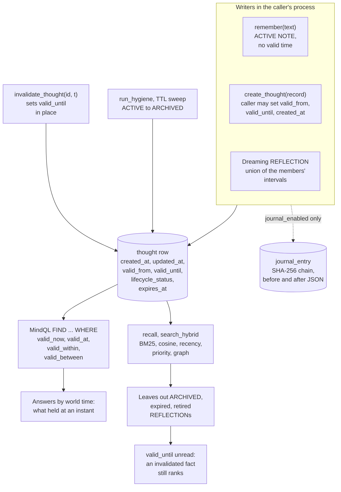

## 1. Executive Summary

Engrava calls itself *"The memory database for AI agents"*: an MIT, async,
in-process Python library that keeps agent memory as typed **thoughts** and
weighted **edges** in one SQLite file. A hybrid of FTS5, vector cosine,
recency, priority and graph signals searches it, a deterministic Dreaming pass
consolidates it, and an opt-in Memory Hygiene pass prunes it. What is notable
is the second clock: `valid_from` and `valid_until` sit beside the store's
`created_at`, NULL means an open bound, and MindQL queries the world-time
interval with four predicates. `invalidate_thought` closes it without deleting
the row. What is weak is that this axis stops at the query language. `recall`
and `search_hybrid`, the read path an agent loop uses, never read
`valid_until`, so an invalidated fact keeps ranking. Nothing shipped in this
tree, the CLI, the examples or the benchmark runner, sets valid time at all.

Nothing is extracted. The application decides what to store and when: `remember`
writes a string as an ACTIVE `NOTE`, `create_thought` writes a full record, and
the store's only judgement on the way in is an optional content-hash dedup that
bumps a confirmation count. No model is called in the core write path. An
embedding provider is called after the insert when one is configured.

Consolidation and forgetting are also the caller's to run. `consolidate`
promotes high-scoring thoughts to priority `P1` and builds REFLECTION thoughts
from embedding clusters with keyphrase text and a centroid vector.
`run_hygiene` archives cold rows reversibly and, if `auto_gc_enabled`, deletes
them after a cycle window and a 30-day wall-clock window. The project's own
benchmark page reports Dreaming lowering recall@5 on its frozen synthetic set
from 0.800 to 0.700 and says it is not an accuracy-lift claim.

An optional SHA-256 hash chain journals thought and edge mutations with full
before and after images, in the same savepoint as each change. It is off by
default and enabled per connection handle, not per database.

**Licence.** MIT in `LICENSE`, agreeing with `license = {text = "MIT"}` in
`pyproject.toml` and the classifier; `CONTRIBUTING.md` asks for contributions
under the same licence and nothing more. The code calls itself the free tier:
the schema header reads *"free-tier boundary"*, and the scoping docstrings
send shared-corpus access control to *"the commercial RBAC tier"*, which is
not in this tree and has no licence here. The LongMemEval runner downloads its
dataset at run time and bundles no upstream content.

Three marks are earned: `bitemporal` on thoughts and edges, `audit_log` on the
journal and `negative_eval` on hybrid retrieval. Section 9 gives the reason
for each of the four withheld.

## 2. Mental Model

A memory is a **thought row the caller wrote**, believed from the moment it is
stored. There is no candidate state and no verification step. The store keeps
three clocks and says so in a table (`docs/bitemporal.md:17-21`):

- **Record time**, `created_at` and `updated_at`, stamped by the store when the
  caller omits them (`engrava_core.py:6989-7006`). The caller may set both.
- **Valid time**, `valid_from` and `valid_until`, NULL by default, set only by
  the caller or derived by Dreaming (`src/engrava/domain/models/thought.py:216-250`).
- **The cycle**, `created_cycle` and `updated_cycle`, an integer the caller
  advances per agent turn, which drives recency and Dreaming.

A thought stops being served in one of four ways, and they are different
mechanisms on different read paths:

- **Archived.** `lifecycle_status = ARCHIVED`, set by a hygiene pass, a TTL
  sweep in `archive` mode or the caller. Every hybrid arm leaves it out unless
  `include_archived` is passed, and `restore_thought` brings it back.
- **Expired.** `expires_at` in the past. Every hybrid arm leaves it out; the
  cleanup sweep archives or deletes it.
- **Invalidated.** `valid_until` set. MindQL's `valid_now` leaves it out;
  hybrid recall does not.
- **Deleted.** The row is gone, with its edges, embeddings and actions by
  cascade.

Lifecycle has a state machine, `CREATED -> ACTIVE -> DONE -> ARCHIVED` and
`ARCHIVED -> ACTIVE` (`src/engrava/domain/enums.py:107-126`). It answers "is
this still in the working set", not "is this true". Nothing marks a thought as
doubted or rejected. A contradiction is a `CONTESTED_BY` edge the caller
creates, which ranking treats like any other edge
(`docs/evidence-and-conflicts.md:86-96`).

## 3. Architecture

A library, not a service. `SqliteEngravaCore` wraps an `aiosqlite` connection
the caller opens, or opens and owns one through `from_config` and a YAML file
(`src/engrava/infrastructure/sqlite/engrava_core.py:2501`). The schema is
created and migrated in place on first connection, now at `user_version = 21`
(`src/engrava/infrastructure/sqlite/schema_core.sql:381-385`). An upgrade suite
in CI installs the last released wheel, populates a database and upgrades it.

One file holds everything: `thought`, `edge`, `embedding`, `action`,
`journal_entry`, `_metadata`, an external-content FTS5 table synchronised by
three triggers (`schema_core.sql:197-223`), and with `engrava[vec]` a
sqlite-vec `vec0` table. Without the extra, the vector arm is a NumPy matrix
product over every stored embedding (`engrava_core.py:11500-11550`).
`EngravaManager` keeps one file per service name under a data directory
(`src/engrava/infrastructure/service_manager.py:86`, `:244`, `:682`).

Embedding providers are pluggable: sentence-transformers locally, any
OpenAI-compatible endpoint, Ollama, the Hugging Face Inference API, or a
callback. None is configured by default, and `auto_embed` defaults to false
(`engrava_core.py:1713-1720`), so the two-line quick start runs on FTS5,
recency and priority alone.

Writes serialise on an in-process lock and SQLite's single writer. Most
mutations run as one savepoint holding the write, a read-back of the stored row
and the journal entry, so a failed journal append unwinds the write
(`engrava_core.py:9657-9759` for the delete). Rows carry a `revision` column
that every guarded update checks and increments in one statement
(`schema_core.sql:110-116`).

### Deployment and ergonomics

`pip install engrava` needs nothing running and no API key. It stores, searches
by keyword, builds the graph and runs MindQL. `engrava[embeddings-local]` pulls
`torch` and a model on first use, which the README warns can mean gigabytes of
CUDA libraries on Linux. The store is a SQLite file, readable with any SQLite
client, and `engrava snapshot` and `engrava export` write JSONL and JSON. The
CLI installs as `engrava`. The MCP server, `engrava-mcp`, is a separate
package in a separate repository and was not read.

## 4. Essential Implementation Paths

- **Schema.** `src/engrava/infrastructure/sqlite/schema_core.sql`: `thought`
  `:45-117`, `edge` `:119-143`, `embedding` `:152-161`, `action` `:163-176`,
  FTS5 and triggers `:197-223`, `journal_entry` `:231-244`, valid-time indexes
  `:302-310`, provenance indexes `:376-379`.
- **Models.** `src/engrava/domain/models/thought.py` (`valid_from` and
  `valid_until` `:216-217`, interval validator `:235-250`),
  `domain/models/edge.py`, `domain/models/_temporal.py` (canonical UTC form and
  ordering), `domain/enums.py` (lifecycle `:107-126`, edge types `:157-172`,
  visibility `:270-288`).
- **Write.** `SqliteEngravaCore` in `infrastructure/sqlite/engrava_core.py`:
  `create_thought` `:6989`, the dedup probe `:6433-6461` and its hit branch
  `:6518`, `_finish_create_thought` with auto-embedding and `on_store`
  `:7249-7299`, `get_or_create` `:7314`, `upsert_by_hash` `:7481`,
  `bulk_store` `:7699`, `remember` `:8755`.
- **Update and delete.** `update_thought` `:9196`, `restore_thought` `:9339`,
  `invalidate_thought` `:9453-9501`, `delete_thought` `:9657`, `create_edge`
  `:9794`, `update_edge` `:9894`, `invalidate_edge` `:10076-10125`,
  `delete_edge` `:10183`, `cleanup_expired` `:8947`.
- **Retrieval.** `search_similar` `:11235`, `search_fts` `:11564` with its SQL
  at `:11646-11660`, `execute_mindql` `:11744`, `_load_graph_signal` `:12124`,
  `_expand_via_consolidated_from` `:12243`, `search_hybrid` `:12786`,
  `recall` `:8803`, access buffering `:13638-13689`.
- **MindQL.** `src/engrava/mindql/parser.py` and `executor.py`, the temporal
  clause at `executor.py:1041-1100`.
- **Background, caller-run.** `run_hygiene` `engrava_core.py:13773`,
  `_hygiene_archive` `:14159`, `_hygiene_gc` `:14319`, `consolidate` `:14760`;
  `src/engrava/extensions/dreaming.py` (`run_consolidation` `:204`,
  `_sweep_orphan_reflections` `:358`, `_create_reflections` `:1102`, the
  reflection interval `:1467-1492`), `dreaming_reflection_extent.py:49`.
- **Journal.** `src/engrava/infrastructure/sqlite/journal_writer.py`
  (`compute_hash` `:109`, `append` `:156`, `verify_integrity` `:238`,
  `get_entries` `:315`); `verify_journal` at `engrava_core.py:2049`.
- **CLI.** `src/engrava/cli/main.py` (`query` `:1043`, `gc` `:3930`, the gc
  journal entries `:3726-3748`, the restore clear `:3130`) and
  `cli/memory_commands.py` (`remember`, `recall`, `link`).
- **Tests.** `tests/search_contract/` (ranking goldens, archived exclusion),
  `tests/test_scoped_retrieval.py`, `tests/test_mindql.py`,
  `tests/test_invalidate.py`, `tests/test_journal_verification.py`,
  `tests/test_memory_hygiene.py`, `tests/benchmarks/`.

## 5. Memory Data Model

The `thought` row carries content and its classification (`thought_type`,
`essence`, `content`, `priority`, `lifecycle_status`) and where it came from:
`source`, a `source_type` of `EXPERIENCE`, `SEEDED_LLM`, `DISTILLED_LLM` or
`DREAMING`, `confidence`, and an opt-in `provenance` JSON of session, actor,
retrieval query and context ids. It also carries its use (`access_count`,
`last_accessed_at`, `confirmation_count`), its lifetime (`expires_at`,
`pinned`, `archived_at_cycle`, `archived_at`), the valid-time pair, and a free
`metadata_json` (`schema_core.sql:45-117`).

`content_hash` is the SHA-256 of `content`, indexed for dedup. An edge carries
a type, a weight, a `decay_multiplier`, its own valid-time pair and metadata,
and is unique on `(from, to, type)`. Actions are a side table of things the
agent did, with `status` and `verification_status`. An action's terminal
outcome feeds `thought.action_outcome_score`, which the hygiene pass reads as
a keep signal.

**Two different things are called visibility.** The `visibility` column holds
`private`, `selective` or `public` for an inner and outer speech boundary, and
`list_thoughts` filters on it (`engrava_core.py:9579-9584`). The
`VisibilityQueryFilter` that `recall` and `search_hybrid` accept reads
`$.visibility` and `$.owner` out of `metadata_json` instead
(`src/engrava/domain/models/filters.py:381-398`). Recall therefore never
consults the column.

There is no scope key. The docstring of `create_thought` says `actor_id` *"is
not a tenant boundary"*, and the filter's docstring that it *"must not be used
to protect tenant data"*.

Valid time is stored in one canonical UTC ISO-8601 form so that TEXT
comparison orders instants. An inverted interval is refused on construction,
on update, on invalidate, and on read
(`src/engrava/domain/models/_temporal.py:14-48`, `:164-205`). The migration
that added the columns seeded `valid_from = created_at` for rows that existed
then (`engrava_core.py:4095-4096`); rows written since start open.

## 6. Retrieval Mechanics

`search_hybrid` runs the FTS5 arm and the vector arm independently, each with
its own top 50, min-max normalises BM25, and adds recency, priority and an
optional graph signal (`engrava_core.py:12786-12830`). Default weights are FTS
0.30, vector 0.55, recency 0.10, priority 0.05 and graph 0.00
(`src/engrava/config.py:1239-1241`). Weights of signals that cannot run for
a query, such as the vector arm with no provider, are redistributed.
`recall` is the same call with fewer parameters.

A bare query is tokenised and OR-joined, so a question matches any document
sharing a content word. A query with quotes or upper-case operators passes
through as FTS5 syntax (`engrava_core.py:15373-15410`). Recency uses either
the cycle or a wall-clock reference, never both. After fusion,
`graph_expansion_enabled`, on by default (`config.py:1253`), pulls the
`CONSOLIDATED_FROM` sources of top-ranked REFLECTIONs into the result with a
propagated score. The graph signal, when weighted, reads every edge type in
both directions.

Every arm applies the same exclusions: not expired, not ARCHIVED unless
asked, and no REFLECTION outside ACTIVE. The FTS arm and the NumPy vector scan
apply them in SQL before their limit (`engrava_core.py:11646-11660`,
`:11423`). The sqlite-vec arm fetches four times `top_k`, capped at 500, and
keeps only rows that resolve to a live thought (`:11327-11360`,
`:11364-11416`). A metadata filter always sends the vector arm to the NumPy
scan, so a narrow filter is not starved by the overfetch cap. The expansion
stage re-applies the exclusions and the caller's filter to the sources it
pulls in. A filter that would admit nothing is refused at construction.

None of the arms reads valid time. `search_fts`, `search_similar`,
`_load_graph_signal`, `_expand_via_consolidated_from` and `search_hybrid`
contain no reference to `valid_from` or `valid_until`, and neither `recall` nor
`search_hybrid` takes a temporal argument (recorded search in the appendix).
An invalidated belief is ranked exactly as before its invalidation, and an
invalidated edge still boosts its neighbours. To ask "what is true now" the
caller has to run a MindQL `FIND ... WHERE valid_now` and intersect the ids
itself.

Reads write. `get_thought` and every hybrid search buffer an access for each
returned id, flushed to `access_count` and `last_accessed_at` on close or by
`flush_access_buffer` (`engrava_core.py:9193`, `:13638-13689`). The hygiene
pass and Dreaming read those counts as the frequency signal, and
`consolidate` suppresses tracking for its own reads.

No context assembly ships. The library returns `(thought_id, score)` pairs and
the caller fetches, formats and budgets the text (`examples/agent_loop.py`).

## 7. Write Mechanics

The caller writes; nothing listens to a conversation. `remember(text)` builds a
`NOTE` with `essence = text[:200]`, priority `P3`, status ACTIVE and source
`remember`, and calls `create_thought` (`engrava_core.py:8755-8801`). It
accepts metadata and a dedup flag, not valid time. To set valid time the
caller builds a `ThoughtRecord`.

With `deduplicate=True` a write whose content hash matches an existing row
bumps that row's `confirmation_count` and `updated_at` and returns it. The
probe is `SELECT * FROM thought WHERE content_hash = ? LIMIT 1`, with no
lifecycle predicate (`engrava_core.py:6455`), and the hit branch updates only
those two columns (`:6518`). Remembering again a fact that hygiene archived
returns the archived row, still ARCHIVED and still out of default recall.
`upsert_by_hash` instead overwrites the matched row's mutable fields,
lifecycle included (`:7464-7479`).

Updates overwrite in place. `update_thought` changes any mutable field under
the revision guard, `invalidate_thought` is `update_thought(valid_until=...)`
after an ordering check, and the previous value survives only in the journal
if one is enabled. `delete_thought` removes the row, purges its vector and
cascades to its edges, embeddings and actions.

The **Dreaming** pass scores ACTIVE thoughts with a library of signals
(frequency, confirmation, recency span, action outcome and others) and
promotes those above a threshold to `P1`, under a cap on the `P1` fraction. It
can link each promoted thought to similar earlier ones, clusters embeddings
into REFLECTIONs whose content is built from keyphrases and whose vector is
the centroid, and archives any REFLECTION whose sources have all left ACTIVE
(`src/engrava/extensions/dreaming.py:204-351`, `:358`). A REFLECTION's
interval is the union of its members': open on a side if any member is open
there (`dreaming.py:1467-1492`).

The **Hygiene** pass is off by default (`config.py:916`). It scores eligible
thoughts with the same signals under hygiene weights, multiplies by the
`decay_function` hook, and archives up to `max_evictions_per_run` below an
eviction threshold of 0.20. It never archives a pinned or `P1` thought, and
archives nothing when no usage signal is active across the pool. With
`auto_gc_enabled` it deletes hygiene-archived rows once 10 cycles and
2,592,000 seconds have passed (`config.py:916-928`,
`engrava_core.py:13773-13870`).

### Operational cost

- **The write blocks on the caller's await, briefly.** An insert is one
  SQLite transaction. With `auto_embed` the embedding call runs after the
  insert and before `create_thought` returns (`engrava_core.py:7290-7299`),
  so a remote provider's latency lands on every write. The row is
  keyword-searchable as soon as the insert commits.
- **No lag otherwise.** There is no queue and no extraction.
- **Dreaming and hygiene read the pool, not the corpus.** Dreaming lists up to
  `candidates_limit` ACTIVE thoughts per run and skips clustering when too few
  new candidates have arrived. Both run only when the caller calls them, or
  every `schedule_every_n_cycles` cycles (default 100) through the helper. No
  model is called by the default signals.
- **The read is bounded by `top_k`.** Nothing is injected anywhere: the caller
  chooses what to put in a prompt and where.

## 8. Agent Integration

The library exposes a protocol API split into read and write halves
(`src/engrava/domain/protocols/engrava_read.py`, `engrava_core.py`), a
`ReadOnlyEngrava` wrapper that refuses every write
(`src/engrava/infrastructure/read_only_store.py:77`), hooks for `on_store`,
`on_retrieve` and `decay_function`, and an extension manifest for MindQL
commands and extension migrations. The agent has no memory agency of its own
in this tree. The application decides every write and every read, and
`examples/agent_loop.py` shows the intended loop: create an observation,
`search_hybrid` with the current cycle, generate, store the output, consolidate
periodically.

The CLI's `remember`, `recall` and `link` reach the same store from a shell.
None of its options sets valid time, and there is no `invalidate` command
(recorded search). A model can reach memory only through a host the
application builds, or through `engrava-mcp`, which is outside this tree.

## 9. Reliability, Safety, and Trust

### Valid time stops at the query language

The schema, the model, the migration and four predicates treat valid time
carefully, and the docs explain the half-open interval with worked boundary
cases (`docs/bitemporal.md:91-128`). Three things limit what that buys an
agent built on this library.

- **Recall ignores it.** The default read path ranks a closed fact beside an
  open one. `docs/bitemporal.md` describes invalidation through MindQL only and
  does not mention recall.
- **No surface in this tree fills it.** `remember` takes no interval, the CLI
  has no option for one, and the benchmark harness in a sibling repository
  stores each turn's session date as `metadata["date"]` rather than
  `valid_from` (`adapters/engrava_adapter.py:397` in `sovantica/engrava-benchmark`
  at `65e3e59`). The only producers are an application building
  `ThoughtRecord`s by hand, `invalidate`, and Dreaming propagating intervals it
  was given.
- **Record time is not guaranteed.** `created_at` and `updated_at` are
  caller-settable, and *"an explicit update is not checked against the
  previous value"* (`docs/bitemporal.md:24-26`). There is no as-of read on
  record time. "What did the store hold on 1 March" is answerable only by
  replaying the journal, if it was on.

### The journal records what its handle saw

`journal_enabled` is a constructor argument and a YAML key, not a property of
the database (`engrava_core.py:1719`, `:1841-1843`). A second process, a
script or a CLI command opened without the flag mutates the same file and
writes no entry. The chain still verifies, because a missing entry is not a
gap in a sequence that was never assigned. The CLI's `gc` journals its deletes
only when `--config` names a journal-enabled YAML (`cli/main.py:3595-3602`,
`:3664-3681`, `:3726-3748`).

The hash binds sequence, type, target, delta and parent hash. It does not bind
`created_at` or `entry_id`, so a journal with every timestamp rewritten still
verifies (`journal_writer.py:109-154`). A removed tail leaves a verifying
prefix, and `restore --clear` empties the table (`cli/main.py:3130`). Tests
pin the first two limits as passing behaviour
(`tests/test_journal_verification.py:192-270`). Embeddings, action creation
and access counts are outside the journal, and a thought delete records no
`DELETE_EDGE` for the edges its cascade removes (`docs/audit-trail.md:84-117`).

### Deletion keeps the text

A deleted or garbage-collected thought's full row survives in the journal's
`before` image and in every earlier insert and update entry. The docs say a
true erasure must purge those and re-baseline the chain
(`docs/data-lifecycle.md:220-263`). A REFLECTION built from a deleted source
keeps its keyphrases until the orphan sweep archives it, and archiving keeps
the text.

### Correction does not hold

A fact the caller deletes or hygiene collects can be written again with the
same content, and becomes a new live thought. Dedup looks only at rows that
still exist. A fact that hygiene archived is the opposite case: dedup finds it
and returns it, confirmed once more and still archived.

### Scope is the file

`EngravaManager` gives each service its own file, which isolates absolutely and
is the boundary the docs name. Inside one file, metadata filters are applied
consistently on every arm and on graph expansion, and tested on each. They are
filters the caller chooses to pass, with values the caller writes, and the
code says so in every docstring that mentions them.

### Concurrency

Writes are serialised by an in-process lock and `BEGIN IMMEDIATE`, dedup takes
a cross-connection write lock and retries on contention, and each update
checks a row revision. A connection whose compensating rollback fails is
quarantined, and every later call on it raises
(`engrava_core.py:5963`). That defence accounts for much of the 16,297 lines
of `engrava_core.py`.

### Marks

- **`bitemporal` — earned.** `valid_from` and `valid_until` on thoughts and
  edges are separate from `created_at` and `updated_at`, start NULL, and are
  set from the caller's record, `update_thought`, `invalidate_*` and Dreaming's
  member union. MindQL reads them on both tables from the API and the CLI.
  Hybrid recall does not, and no shipped surface in this tree writes them.
- **`audit_log` — earned.** `journal_entry` is appended by every thought and
  edge mutation path, including hygiene, TTL, dedup, restore and the CLI's
  `gc`, inside the savepoint of the change, and nothing in `src` updates a row.
  It is off by default, per handle, and emptied by `restore --clear`.
- **`negative_eval` — earned.** Populated cases require an archived source,
  an expired source and an out-of-filter row to be absent while a control is
  present, on each arm and through graph expansion, and a monkeypatched gate
  must leak.
- **`trust_state` — withheld.** Lifecycle filters retrieval, and it is a
  working-set state; nothing records doubt or rejection. Confidence,
  confirmation count and source type are stored and filter nothing.
- **`scope_enforced` — withheld.** No scope key exists on a record. Tenant
  isolation is one file per service, a physical partition, and the metadata
  filters are caller-chosen refinements.
- **`tombstone` — withheld.** No record of a rejected value exists. A deleted
  value can be written again, and the journal's before images have no reader
  on the write path.
- **`human_review` — withheld.** No memory waits for anyone. A thought is
  served from the insert.

## 10. Tests, Evals, and Benchmarks

I ran none of the suites, and I installed nothing. The counts come from reading.
CI runs `pytest --cov --cov-fail-under=90` on Python 3.11, 3.12, 3.13 and 3.14
offline after warming a Hugging Face cache, plus lint, `mypy --strict`, a
ranking-goldens drift check, `pip-audit --strict` and an upgrade suite from the
previous release (`.github/workflows/ci.yml:204`, `:210-252`).

The memory tests that bear on the marks are strong, and several state in their
docstrings what a case proves:

- `tests/search_contract/test_archived_retrieval_exclusion.py` builds a seed
  REFLECTION that matches the query and a source that does not, archives the
  source, and requires the REFLECTION present and the source absent from the
  default result, then present with `include_archived` (`:215-283`).
  `test_reverting_expansion_gate_leaks_archived_via_expansion_only`
  monkeypatches the expansion filter and requires the leak (`:317-356`), a
  negative control on the test itself. The same pair exists for expired
  sources (`:410-509`).
- `tests/test_scoped_retrieval.py` stores two rows matching the same text or
  the same vector under two project values and requires exactly the in-filter
  one. It also requires an out-of-filter expansion source absent beside an
  in-filter one that is present (`:150-222`).
- `tests/test_mindql.py` runs each temporal predicate on both tables against
  five shaped rows and asserts exact id sets (`:913-944`).
  `tests/test_invalidate.py` checks that an invalidated thought leaves
  `valid_now` and stays fetchable (`:93-107`).
- `tests/test_journal_verification.py` requires a tampered entry detected and
  pins tail truncation and backdating as undetected (`:178-270`).

No test asserts anything about valid time on `recall` or `search_hybrid`, and
none dedups against an archived row (recorded searches).

The in-package synthetic benchmark generates a frozen 50-conversation dataset
from a fixed seed, and a test requires the committed JSON to equal
regeneration (`tests/benchmarks/test_synthetic_frozen.py`). Its observed
recall@5 values are in `docs/benchmarks.md:114-127`, and no per-question
result is committed beside them.

The README links benchmark results reproducible from a separate repository. I
read four files of `sovantica/engrava-benchmark` at
[`65e3e59689f8b62b5a66e1276901402e3c062e31`](https://github.com/sovantica/engrava-benchmark/commit/65e3e59689f8b62b5a66e1276901402e3c062e31)
through the GitHub API, without cloning or running it. The newest Engrava row,
`lme-s_engrava_0.7.0_2026-10-03`, reports LongMemEval-S overall 0.828 and macro
0.836 over 500 questions. Both recompute exactly from its committed
`judge_labels.jsonl`: 414 judged correct, and each of the six category
accuracies matches. The run measured Engrava 0.7.0, not the 0.7.2 pin, with
OpenAI `text-embedding-3-small`, `gpt-4o-2024-08-06` as reader and as judge,
`top_k` 20 and one thought per user turn. Its `verification_status` reads
`verified` and its `provenance` `sovantica-run`, so the project ran and
labelled it. The `engrava.ai` site was not used as evidence.

There is no paper. The LongMemEval runner cites the LongMemEval paper
([arXiv:2410.10813](https://arxiv.org/abs/2410.10813)) as the benchmark's source.

## 11. For Your Own Build

### Steal

- **Make NULL an open bound, not an unknown.** Facts nobody annotated stay
  visible to every point-in-time predicate, so valid time can be adopted one
  row at a time, and the one predicate that needs real bounds says so.
- **Invalidate as an update to one column, with an ordering check on the
  mutation path as well as the model.** The row and its history stay, and a
  past instant still finds it.
- **Re-apply the read filter after graph expansion, and test that path
  alone.** A filter on the arm `WHERE` clauses misses rows expansion brings in;
  a fixture whose source cannot match any arm proves where a leak came from.
- **Put the write, its read-back and its journal entry in one savepoint.** A
  failed append then unwinds the change instead of leaving it unlogged.
- **Write a test for each limit you document.** Tail truncation and timestamp
  backdating pass verification here on purpose, and the test says so.

### Avoid

- **A second clock that only the query language reads.** If recall is how an
  agent sees memory, recall is where invalidation has to take effect, or the
  feature is a reporting tool.
- **Audit on per-handle configuration.** Store the setting in the database and
  refuse an unjournalled write to a journalled file, or every forgotten flag is
  a silent gap.
- **A dedup probe that ignores lifecycle.** Restating an archived fact should
  restore it or create a new row, not confirm a row nobody can see.
- **Two fields with one name.** A `visibility` column and a `$.visibility`
  metadata key that different APIs filter on will be confused.

### Fit

This suits a developer who wants an embedded, dependency-light store under an
agent loop they write themselves, who will decide what to store, and who needs
a schema and write path that do not lose data under concurrency or upgrade.
It is a database with memory-shaped columns, and the README's own word for it
is a database. For a single-user agent, or one file per tenant, it carries
very little operational cost for that care.

It does not suit a reader who wants memory to decide anything: there is no
extraction, no correction semantics and no belief state, and the one temporal
feature that would make an agent stop citing an old fact does not reach the
recall path. A multi-tenant service on one file should walk away, as the docs
themselves say.

## 12. Open Questions

- Does `engrava-mcp` expose `invalidate_thought` or a valid-time argument to a
  model, and does it apply `valid_now` to its search tool? It is the only place
  a model could fill or use valid time, and it is outside this tree.
- Is recall's indifference to valid time intended? The docs present
  invalidation as the way to retire a fact that stopped being true, and
  describe its effect only on MindQL.
- What does the commercial tier add? The code reserves RBAC and cognitive-layer
  methods for it, and nothing here shows their shape.
- Is the dedup hit on an archived row meant to count as a sighting that keeps
  the row archived?

## Appendix: File Index

| Path | Role |
| --- | --- |
| `src/engrava/infrastructure/sqlite/schema_core.sql` | Head schema: thought, edge, embedding, action, journal, FTS5, indexes |
| `src/engrava/infrastructure/sqlite/engrava_core.py` | `SqliteEngravaCore`: writes, dedup, updates, invalidate, delete, every search arm, fusion, hygiene, consolidate, migrations |
| `src/engrava/infrastructure/sqlite/journal_writer.py` | The hash-chained journal: hash, append, verify, read |
| `src/engrava/domain/models/thought.py` | `ThoughtRecord`, including the valid-time pair and its validator |
| `src/engrava/domain/models/_temporal.py` | Canonical UTC timestamps and interval ordering |
| `src/engrava/domain/models/filters.py` | `MetadataFilter`, `FieldPredicate`, `VisibilityQueryFilter` |
| `src/engrava/domain/enums.py` | Lifecycle state machine, edge types, sources, visibility |
| `src/engrava/mindql/parser.py`, `executor.py` | MindQL and the four temporal predicates |
| `src/engrava/extensions/dreaming.py` | Promotion, dream edges, reflections, orphan sweep |
| `src/engrava/extensions/dreaming_reflection_extent.py` | A reflection's valid-time interval from its members |
| `src/engrava/infrastructure/service_manager.py` | `EngravaManager`, one file per service |
| `src/engrava/config.py` | Search weights, Dreaming, Hygiene and Journal configuration |
| `src/engrava/cli/main.py`, `cli/memory_commands.py` | The `engrava` CLI |
| `docs/bitemporal.md`, `docs/audit-trail.md`, `docs/data-lifecycle.md`, `docs/evidence-and-conflicts.md` | The project's own statements of each mechanism's limits |
| `tests/search_contract/test_archived_retrieval_exclusion.py` | Archived and expired exclusion on every arm, with negative controls |
| `tests/test_scoped_retrieval.py` | Metadata filters per arm and through expansion |
| `tests/test_mindql.py`, `tests/test_invalidate.py` | Temporal predicates and invalidation |
| `tests/test_journal_verification.py` | Tamper detection and its pinned limits |

### Recorded searches

Run from the repository root at the pinned commit with `/usr/bin/git grep`.

- **No hybrid arm reads valid time.**
  `git grep -n -E 'valid_(from|until)' -- src/engrava/infrastructure/sqlite/engrava_core.py`
  returns the timestamp canonicalisation list at `:225-230`, the migration at
  `:4055-4120`, row mapping at `:6166-6375` and `:15208-15261`, the edge
  inserts at `:8664-8677` and `:9831-9844`, and the two invalidate methods at
  `:9453-9501` and `:10076-10125`. Nothing matches between `:10125` and
  `:15208`, which holds `search_similar`, `search_fts`, `_load_graph_signal`,
  `_expand_via_consolidated_from` and `search_hybrid`.
- **Valid time has no writer in the CLI, examples, scripts or benchmark
  runners.**
  `git grep -n -E 'valid_from|invalidate_(thought|edge)|valid_until' -- src/engrava/benchmarks src/engrava/cli examples scripts`
  returns only the snapshot column lists at `src/engrava/cli/snapshot_records.py:434-435`
  and `:457-458`.
- **Only MindQL compiles a temporal predicate.**
  `git grep -n -i -E 'valid_at|VALID AT|AS OF|as_of|valid_time|ValidTime' -- src`
  returns the MindQL parser and executor and three unrelated lines in
  `cycle_providers.py`, `domain/exceptions.py` and
  `extensions/dreaming_cluster_quality.py`.
- **No test puts valid time on recall.**
  `git grep -n -l -E 'valid_at|valid_now' -- tests` returns
  `tests/test_invalidate.py`, `tests/test_mindql.py`,
  `tests/test_temporal_query_performance.py` and
  `tests/test_timestamp_canonical_form.py`. None calls `recall` or
  `search_hybrid` with an interval, since neither takes one.
- **One delete of journal rows, no update.**
  `git grep -n -E 'DELETE FROM journal_entry|UPDATE journal_entry' -- src`
  returns `src/engrava/cli/main.py:3130`.
- **The journal flag is not stored in the database.**
  `git grep -n -E 'journal_enabled' -- src` returns the constructor, the config
  path and the CLI's `gc`; `git grep -n -E 'INSERT (OR [A-Z]+ )?INTO _metadata' -- src`
  matches only the embedding model name and dimension lock.
- **The dedup probe has no lifecycle predicate.**
  `git grep -n -E 'WHERE content_hash = \?' -- src` returns
  `engrava_core.py:6455`, the one probe, which every dedup path calls.
- **Nothing documents or tests dedup against an archived row.**
  `git grep -n -i -E 'dedup.*archiv|archiv.*dedup' -- src docs tests` returns
  nothing; `git grep -n -i -E 'dedup' -- docs` returns 144 lines.
- **No tombstone or rejection record.**
  `git grep -n -i -E 'tombstone|blocklist|denylist|suppress(ed|ion)_|rejected_(value|fact|content)|forbidden_content' -- src`
  returns only the keyphrase sentence-starter blocklist in Dreaming.
- **No review or approval surface.**
  `git grep -n -i -E 'approve|approval|pending_review|human.review|review_queue' -- src`
  returns nothing; `git grep -n -i review -- src` returns 20 lines.
- **No status filter beyond lifecycle.**
  `git grep -n -E "(source_type|confidence|lifecycle_status) *(=|!=|IN|NOT IN|<|>)" -- src/engrava/infrastructure src/engrava/extensions`
  returns lifecycle predicates, keyword assignments and one local variable in
  Dreaming.
- **Clarification is documentation only.**
  `git grep -n -i clarification -- src` returns nothing;
  `git grep -n -i clarification -- docs/evidence-and-conflicts.md` matches.
- **No context assembly.**
  `git grep -n -i -E 'def (format_context|build_context|render_context|to_prompt|context_pack)|token_budget|max_tokens' -- src`
  returns nothing; `git grep -n default_fts_weight -- src/engrava/config.py`
  matches.
- **No paper of its own.**
  `git grep -n -i -E 'arxiv|bibtex|@article|@misc|CITATION|doi\.org' -- .`
  returns the LongMemEval citation in `src/engrava/benchmarks/longmemeval/`, a
  docs test about commit citations, and one line of prose in
  `docs/evidence-and-conflicts.md`.
- **No submodules.** `git ls-files .gitmodules` returns nothing.

## History

**2026-11-27** — [`f6a8b739d2f17a5ede18597bcaa1b2dfc509bfa6`](https://github.com/sovantica/engrava/commit/f6a8b739d2f17a5ede18597bcaa1b2dfc509bfa6). First reading, read only, from a blobless clone with full history at the head of `dev`, the default branch, tagged v0.7.2; `main` contains the pin. Screened first: three auto-run surfaces (`.cursorrules`, `.githooks/`, `.github/copilot-instructions.md`), nothing inside the cooldown, three build-time execution points (`Makefile`, `tests/conftest.py`, `tests/search_contract/conftest.py`), and `pyproject.toml` unpinned with no lockfile; `.cursorrules`, `AGENTS.md` and `CLAUDE.md` read as data. Nothing was installed, built or run, and the 4,508 test functions were not run. Three marks: `bitemporal`, `audit_log`, `negative_eval` ([section 9](#9-reliability-safety-and-trust)).
