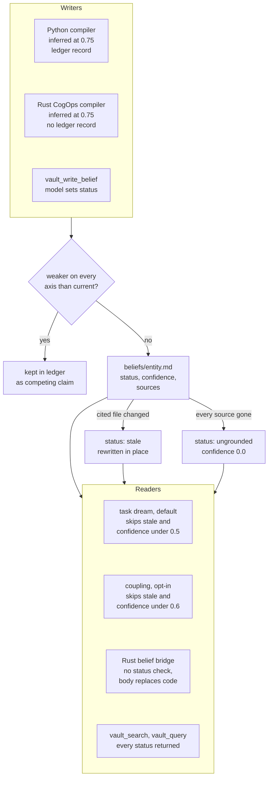

## 1. Executive Summary

Entroly is a local context layer for coding agents. It picks code and tool
output to fit a token budget, records what it left out, and can recover the
exact bytes, as its README lead says. Most of the tree is that context
machinery and is not memory in this atlas's sense. The memory is a vault of
*beliefs*: one Markdown file per code entity, compiled from the source by AST
or written by the model, which a file change marks `stale` and a deleted
source marks `ungrounded`. The strongest part is that lifecycle and the
refusal to let a weaker claim overwrite a stronger one. The weakest part is
that the injection path loaded by default ignores it: a Rust bridge attaches
belief bodies to code fragments by file name and can put a stale summary where
the current code would have gone.

Beside the vault sit three smaller stores. MemoryOS is a JSON file of agent
memories with tiers, decay, supersession and authority levels. The MCP server
writes one episode to it each time the model reports a test, command, CI or
edit success. A cross-agent shared memory is a JSONL file deduplicated by
SimHash. A work-graph `MemoryRecord` contract computes admissibility at write
time. No reader in the tree consumes it, and only tests build a record.

Four marks are earned, on two subsystems. `trust_state` and `audit_log` belong
to the vault: the status filter on the task-dream and coupling reads, and the
hash-chained ledger of belief writes. `scope_enforced` and `negative_eval`
belong to MemoryOS: the `agent_id` predicate on recall, and populated cases
asserting that a superseded or role-filtered memory stays out. Section 9 gives
the reason for each of the three withheld.

How much of this runs depends on how the server was started. `entroly init`
and `entroly go` register the full tool surface with background work on: an
index pass, a belief autoseed and a workspace listener that recompiles changed
files every 120 seconds. Every marketplace and plugin config in the tree sets
`ENTROLY_MCP_PROFILE=public` and `ENTROLY_MCP_PASSIVE=1`, which hide the vault,
MemoryOS-recall and shared-memory tools and stop the listener. There, the live
memory loop is MemoryOS: `record_test_result` stores an episode and the next
`optimize_context` recalls it.

The defects that matter most are path disagreements. With neither
`ENTROLY_DIR` nor `ENTROLY_VAULT` set, the MCP server keeps its vault under a
hashed directory in `~/.entroly/checkpoints/`. The startup autoseed and
`entroly compile` write `./.entroly/vault`, and the opt-in coupling reads
`./.entroly/vault` whatever the environment says. `memory_recall` reads a
MemoryOS instance that the server constructs empty and never loads from disk.
On a default install, which pulls the native `entroly-core` wheel,
`compile_beliefs` and `refresh_beliefs` run in Rust and write belief files with
no ledger record.

**Licence.** Apache-2.0, in the root `LICENSE` and in every package
directory, agreeing with each manifest; there is no contributor agreement.
`long_term_memory.py` imports `hippocampus_sharp_memory`, a package that no
dependency group declares and whose terms the tree does not state.

## 2. Mental Model

A **belief** is the vault's claim about what a piece of code is. Its file
carries a `claim_id`, an `entity`, a `status`, a `confidence` from 0 to 1, a
list of `sources` such as `src/auth.rs:142`, a `last_checked` timestamp, a
`derived_from` list and a Markdown body (`entroly/vault.py:285-308`).
`write_belief` accepts seven statuses: `hypothesis`, `unsupported`, `stale`,
`inferred`, `observed`, `verified` and `ungrounded` (`entroly/vault.py:455-457`).

A belief comes into being by one of two routes.

- **Compilation.** `BeliefCompiler` parses a module's classes, functions and
  imports and writes one belief per module as `inferred` at 0.75, with the
  lines it read as sources (`entroly/belief_compiler.py:745-750`). The Rust
  `CogOpsEngine` compiler does the same with its own writer
  (`entroly-core/src/cogops.rs:980-989`).
- **The model.** `vault_write_belief` takes the status, confidence and sources
  as arguments (`entroly/server.py:3022-3057`). A `verified` belief citing
  nothing is stored as `unsupported` (`entroly/vault.py:681-682`). Any cited
  string counts as a source, since the source policy that resolves citations
  against a trusted root is never configured by the server or the CLI.

A belief is weakened in three ways, all in place.

- **A source file changes.** `mark_beliefs_stale_for_files` rewrites the
  status line to `stale` for every belief citing a changed path or stem
  (`entroly/vault.py:945-1021`). The workspace listener, `sync_workspace_changes`
  and `refresh_beliefs` call it (`entroly/change_listener.py:155`,
  `entroly/server.py:3660-3677`). The listener then recompiles each changed
  file in the same pass, which replaces that module's compiled belief with a
  fresh `inferred` one (`entroly/change_listener.py:153-176`). The mark
  persists on beliefs about deleted files, on beliefs the model wrote that cite
  the file, and after `refresh_beliefs`, which recompiles nothing.
- **Every source is gone.** `mark_beliefs_ungrounded` sets `ungrounded` and
  confidence 0.0, and is called by `entroly compile` unless `--no-retract` is
  given (`entroly/vault.py:1109-1236`, `entroly/cli.py:6703-6704`).
- **An outcome is observed.** With `ENTROLY_VAULT_COUPLING=1`, a reported
  outcome moves the confidence of the beliefs injected into that request by a
  Bayesian update, and a failure marks them `stale`
  (`entroly/coupling.py:353-457`).

A belief becomes stronger only by being overwritten with a higher rank or
confidence. `_weaker_than_current` refuses an update that is lower in status
rank, lower in confidence and cites no new source, and appends the refused
claim to the ledger as a competing claim (`entroly/vault.py:556-611`,
`:695-731`). The path that promotes `inferred` to `verified` on a `confirmed`
verification has no producer: the verification engine and change pipeline
write `contradictions_found`, `staleness_detected`, `pass`, `issues_found` and
`change_detected` (`entroly/vault.py:871-875`, `entroly/verification_engine.py:491-540`).
Outside the model's own write, nothing in the tree produces `verified`.

Nothing deletes a belief. A **MemoryOS entry** has a different life: it decays
by retention unless it is semantic, can be superseded by a memory of equal or
higher authority, and is removed by `forget` or by the capacity pruner
(`entroly/memory.py:700-711`, `:1192-1216`).



## 3. Architecture

Everything runs in one Python process per agent session, the MCP server
started by `entroly go` or a host's MCP config, with the native `entroly-core`
extension loaded when its wheel is present. `pyproject.toml` declares that
wheel a required dependency (`pyproject.toml:42-61`), so a default install runs
the Rust `CogOpsEngine` for compilation, refresh, search and change processing
(`entroly/server.py:3251-3258`).

State is files:

| Store | Location | Writer |
| --- | --- | --- |
| Vault beliefs, verification, actions, skills | `ENTROLY_VAULT`, else `<checkpoint_dir>/vault` for the server (`entroly/server.py:2956-2960`); `ENTROLY_VAULT`, else `(ENTROLY_DIR or ./.entroly)/vault` for the CLI and the startup autoseed (`entroly/cli.py:6655-6659`, `entroly/belief_autoseed.py:56-61`) | compilers, model tools, listener, autoseed |
| Belief ledger | `<vault>/ledger/` JSONL, head file, `objects/<sha256>.md` (`entroly/vault_time.py:1-41`) | Python `write_belief`, `redact`, `seed` |
| MemoryOS | `ENTROLY_MEMORY`, else `<checkpoint_dir>/memory.json` for the server (`entroly/server.py:3382-3384`) and `./.entroly/memory.json` for `entroly-memory` (`entroly/memory_cli.py:35-36`) | outcome tools, CLI |
| Shared memory | `(ENTROLY_DIR or .entroly)/shared_memory/entries.jsonl` (`entroly/shared_memory.py:144-151`) | `shared_memory_write` |
| Work graph | repo-keyed JSON under an exclusive-create lock (`entroly/work_graph_store.py:1-40`) | `work_*` tools |

`checkpoint_dir` is `ENTROLY_DIR` or `~/.entroly/checkpoints/<first 12 hex of
sha256(cwd)>` (`entroly/config.py:15-35`). The coupling path constructs
`VaultConfig()` with no base, which resolves to `./.entroly/vault` and reads
neither variable (`entroly/vault.py:62-65`, `entroly/server.py:1245-1248`,
`entroly/proxy.py:920-923`). With no variables set, the server's tools,
listener, task dream and belief bridge use one vault, while the autoseed, the
CLI and coupling use another. With `ENTROLY_DIR` set, as `entroly attach` does
(`entroly/session_attach.py:597`), the server, CLI and autoseed agree and
coupling still reads the working directory's. The config that `entroly init`
writes sets `ENTROLY_SOURCE` and the working directory, not either variable
(`entroly/cli.py:548-558`).

The server runs in one of two shapes. `_mcp_profile_name` defaults to `full`,
and `public` cuts the surface to an allowlist of 22 tools
(`entroly/server.py:151-179`, `:534-557`). Passive mode skips the evolution
daemon, the index pass, the autoseed and the listener (`entroly/server.py:3296`,
`:5094-5099`). The Claude Code plugin, the Codex and Gemini packages, `.mcp.json`,
`mcp.json` and `smithery.yaml` all set both
(`.claude-plugin/plugin.json:17-22`); `entroly init` and `.vscode/mcp.json`
start the full, active server.

### Deployment and ergonomics

Nothing has to be running beyond the MCP server; no database, no vector
service and no API key are needed to store anything. `pip install entroly`
installs the native wheel from PyPI, and without a wheel for the platform the
pure-Python fallback runs every vault tool in Python. The vault is human-readable Markdown and can be edited or
deleted by hand, and the ledger's `verify_chain` reports an edited record. A
hand edit to a belief file is not recorded anywhere.

## 4. Essential Implementation Paths

**Belief write (Python).** `vault_write_belief` builds a `BeliefArtifact` and
calls `VaultManager.write_belief` (`entroly/server.py:3022-3057`), which
validates entity, confidence and status, downgrades an unsourced `verified`,
runs `_weaker_than_current`, picks a collision-safe file name, writes
atomically and appends to the ledger (`entroly/vault.py:639-770`). The Python
compiler reaches the same function (`entroly/belief_compiler.py:608`, `:621`).

**Belief write (Rust).** `compile_beliefs` on a default install calls
`_cogops.compile_beliefs` (`entroly/server.py:3432-3460`). Its
`write_belief_artifact` names the file `<entity>_<first 8 hex of claim_id>.md`
and writes it with `fs::write` (`entroly-core/src/cogops.rs:669-699`). The
claim id is the hex of the current nanosecond time
(`entroly-core/src/cogops.rs:662-667`), so the first eight digits change about
every four seconds. Each compile more than a few seconds after the last
therefore adds a second file for the same entity rather than replacing the
first. This is an inference from the format string; no run checked it.

**Staleness.** `WorkspaceChangeListener.scan_once` calls
`ChangePipeline.refresh_docs`, which calls `mark_beliefs_stale_for_files`
(`entroly/change_listener.py:155`, `entroly/change_pipeline.py:348-354`). The
Rust `refresh_beliefs` replaces the literal strings `status: verified` and
`status: inferred` with `status: stale`, leaving `observed` and `hypothesis`
untouched (`entroly-core/src/cogops.rs:1955-2002`).

**Task dream read.** `optimize_context` calls `_task_dreamer.prepare` with
`agent_id="default"` whenever a query is given, the budget is at least 1,024
tokens and `ENTROLY_TASK_DREAM` is not `0` (`entroly/server.py:1361-1380`).
`_related_beliefs` lists beliefs, skips `stale` and confidence under 0.5,
matches the remaining entities to the task terms and loads the top five
(`entroly/task_dream.py:608-640`). `_recall_memories` recalls MemoryOS under
the same agent id (`entroly/task_dream.py:444-470`).

**Belief bridge read.** On the first `optimize_context` of a process,
`engine._rust.load_vault_beliefs(<vault>/beliefs)` reads every top-level `.md`
file not prefixed `arch_` or `doc_`, strips the frontmatter without parsing
it, and attaches the body to each fragment whose source file stem matches the
belief's file name (`entroly/server.py:1219-1233`,
`entroly-core/src/lib.rs:4688-4788`). When the selector picks the belief
resolution, the belief body is returned in place of the fragment's code
(`entroly-core/src/lib.rs:3349-3360`).

**Coupling.** With `ENTROLY_VAULT_COUPLING=1`, `project_beliefs` filters and
ranks beliefs by confidence, recency and Jaccard overlap, and
`inject_vault_beliefs` ingests them as engine fragments
(`entroly/coupling.py:134-294`, `:460-462`).

**MemoryOS.** `MemoryOS.remember` scans for secrets and injection, infers
authority from the source label, clamps it to the minimum of any parents,
deduplicates exact repeats, and records supersession only when the new
authority is at least the old one (`entroly/memory.py:559-713`). `recall`
applies the agent, tier, retention, authority, role, supersession and temporal
filters and fills the budget by score per token (`entroly/memory.py:715-889`).
The server's verified-outcome write is `remember_verified_outcome`, reached
from `record_test_result`, `record_command_exit`, `record_ci_result` and
`record_edit_outcome` when the request id matches the last optimization
(`entroly/server.py:1994-2015`, `entroly/task_dream.py:309-395`).

**Ledger.** `BeliefLedger.record` writes the body object, then under an
exclusive lock reads the tail, builds a record with `prev_sha256` and appends
it with the head (`entroly/vault_time.py:530-617`). `redact` deletes body
objects and appends a redaction record (`entroly/vault_time.py:694-783`).

**Work-graph memory.** `work_record_memory` parses a commitment-verified
`MemoryRecord` and records it as a graph event with its admissibility
(`entroly/work_graph_mcp.py:811-837`, `entroly-engine/src/work_graph.rs:1363-1399`).

## 5. Memory Data Model

**Beliefs** are flat frontmatter parsed line by line. Every scalar is flattened
to one line before writing, after an entity containing a newline was able to
rewrite the `claim_id` (`entroly/vault.py:310-359`). The Rust writer formats
the same keys without that flattening (`entroly-core/src/cogops.rs:693-697`).
`trust_class` (trusted, untrusted, mixed, unknown) is written only when it is
not `unknown`, and is computed only when `trusted_source_root` is configured
(`entroly/vault.py:613-637`); no `VaultConfig` in `server.py` or `cli.py`
passes it, so every belief reads as eligible.

**Ledger records** carry `seq`, `tx_time`, `valid_time` (the belief's
`last_checked`), `claim_id`, `entity`, `status`, `confidence`, `sources`,
`title`, `body_sha256`, `backfilled`, `prev_sha256`, a writer digest and a
`serialized` flag (`entroly/vault_time.py:579-603`).

**MemoryOS entries** carry `agent_id`, `tier` (working, episodic, semantic),
`importance`, `salience`, `temporal_class`, `valid_from`, `valid_until`,
`supersedes`, `superseded_by`, `entities`, `authority` (six levels from
`untrusted` to `host_attested`), `memory_role`, `derived_from`,
`origin_digest` and `blocked_supersedes` (`entroly/memory.py:370-398`).
`valid_from` is `time.time()` at write and `valid_until` is the time of
supersession (`entroly/memory.py:691`, `:706`), so both are record times.

**Work-graph `MemoryRecord`** has no text: a `content_reference` and
`content_commitment`, `evidence_ids`, a `trust_state`, `created_at_ms`,
`observed_at_ms`, `valid_until_ms`, `supersedes` and `contradicted_by`
(`entroly-engine/src/engine_contracts.rs:1019-1046`). `admissibility` returns
`Contradicted`, `Expired`, `Unsupported` or `Admissible`, treating an
`Inferred` or `Verified` record with no evidence as unsupported
(`entroly-engine/src/engine_contracts.rs:1195-1234`).

**Scoping.** MemoryOS has `agent_id` plus a `shared` pseudo-agent. The vault
has no scope key and is partitioned by directory. Shared memory has an
`agent_id` field filtered only when a caller passes one. The work graph
refuses a record whose `repository_id` differs from the graph's
(`entroly-engine/src/work_graph.rs:1369-1374`).

## 6. Retrieval Mechanics

The vault is read five ways, with three different answers to "is this belief
current".

- `vault_search` runs a TF-IDF over entity (3x), title (2x) and body in Rust,
  or a substring match in Python, and returns status with each hit, filtering
  none (`entroly-core/src/cogops.rs:2484-2560`, `entroly/server.py:3805-3843`).
- `vault_query` returns one belief by entity or lists all
  (`entroly/server.py:3060-3085`).
- The task dream skips `stale` and confidence under 0.5.
- Coupling skips `stale`, `retracted` and `refuted` and confidence under 0.6;
  `retracted` and `refuted` are not writable statuses, and `ungrounded` is
  excluded by its 0.0 confidence (`entroly/coupling.py:168-173`).
- The Rust bridge reads no frontmatter.

MemoryOS ranking is term overlap scaled from 0.2 to 1.0, times retention
`exp(-age/salience)` in ticks, a recall-frequency factor, a tier bonus, a
temporal boost of 1.3 or 0.7, and `0.5 + importance`. Candidates are sorted by
score per token and packed under the budget, each omission recorded with a
reason (`entroly/memory.py:785-889`). A superseded memory is dropped only when
the query matches the current-state regex (`entroly/memory.py:779-781`,
`:124-140`). `memory_recall` adds optional BM25 and entity-graph fusion by
reciprocal rank; the fabric constructs `HybridRetriever` with no encoder, so
the neural arm is off (`entroly/memory_fabric.py:103-131`,
`entroly/hybrid_retriever.py:162-215`).

`memory_recall` and `memory_graph_query` read `_task_memory`, the
`MemoryFabric` constructed empty at server start (`entroly/server.py:3385-3389`,
`:4779`, `:4817`). The task dreamer reloads `memory.json` when its modification
time changes and assigns the result to its own `memory_fabric` attribute
(`entroly/task_dream.py:282-307`). `_task_memory` is never reassigned, so after
a restart these two tools see nothing persisted by an earlier session.

Shared memory search is BM25 over every agent's entries
(`entroly/shared_memory.py:203-216`).

## 7. Write Mechanics

Belief writes are synchronous file writes on the tool call and retrievable
immediately; the Python path also takes the ledger lock, with a 30-second
timeout (`entroly/vault_time.py:64`). On an active server the listener polls
every 120 seconds, up to 100 changed files a pass, marks matching beliefs
stale and recompiles them, so a stale mark can lag an edit by two minutes
(`entroly/server.py:5143-5152`). No pass rewrites the whole vault,
though `mark_beliefs_stale_for_files` and `mark_beliefs_ungrounded` read every
belief file on each call.

MemoryOS writes from the server are one episode per model-reported success.
`remember_verified_outcome` accepts `test_result passed`, `command_exit
success`, `ci_result passed` and `edit_outcome accepted`, stores the task,
evidence and related fragments as an episodic memory at importance 0.9 tagged
`verified`, and saves the file atomically (`entroly/task_dream.py:309-395`).
The tools that trigger it take the outcome as an argument: `record_test_result`
takes `passed: bool` from the caller (`entroly/server.py:2023-2047`). Its
docstring calls agent self-reports *"intentionally excluded"*; the exclusion
covers `record_outcome`, and the four strong-signal tools are the agent's own
report under another name.

`entroly-memory remember` defaults `--source` to `manual`
(`entroly/memory_cli.py:183`), which `infer_authority` maps to `user_direct`
(`entroly/memory.py:246`). Anything that shells out to the CLI, an agent
included, writes at the second-highest authority unless it names a source.

Shared memory refuses a write whose SimHash is within Hamming distance 6 of
any existing entry, from any agent, and returns `deduplicated`
(`entroly/shared_memory.py:142`, `:170-177`, `:295-304`). A restatement that
changes one token of a long entry can be refused that way; this is inferred
from the threshold and was not run.

### Operational cost

No write calls a model. The task dream adds up to 1,600 tokens to an
`optimize_context` call and subtracts them from the budget
(`entroly/server.py:1368-1380`). Belief bodies replace fragments inside the
selected context rather than being prepended, so they do not sit in a stable
prefix.

## 8. Agent Integration

The MCP server registers 74 tools in `server.py`, the work-graph
tools and, optionally, `brain_execute_script` (`entroly/server.py:1096-1149`,
`:4686-4688`). The memory surface is `vault_status`, `vault_write_belief`,
`vault_query`, `vault_search`, `vault_write_action`, `vault_time_travel`,
`vault_hygiene_scan`, `compile_beliefs`, `verify_beliefs`, `refresh_beliefs`,
`sync_workspace_changes`, `start_workspace_listener`, `prepare_task_dream`,
`memory_recall`, `memory_graph_query`, the five `shared_memory_*` tools and
`work_record_memory`. Under the full profile every one is on the model's
tool list, including `vault_time_travel` with `action="redact"`. Under the
public profile none of them is; the model keeps `optimize_context`,
`record_test_result`, `remember_fragment`, `recall_relevant`,
`checkpoint_state`, `resume_state` and the work-graph tools
(`entroly/server.py:154-179`).

Injection is automatic only through `optimize_context`, which the tool
description calls *"the core tool"*. The Claude Code plugin's
`UserPromptSubmit` hook runs `activation hook`, which indexes and selects
context and touches no vault or MemoryOS code (`hooks/hooks.json:1-17`,
`entroly/agent_activation.py:216`).

## 9. Reliability, Safety, and Trust

**trust_state — earned on the vault.** The status is a discrete field. On an
active full-profile server a changed file moves it to `stale` through the
listener and through two tools, and the task dream that `optimize_context`
builds by default leaves a stale belief out. Coupling does too, behind a flag
that is off by default. A passive public-profile server has no producer of
`stale`, since the listener is off and both tools are hidden. The mark carries
three limits. The Rust bridge, the injection path that replaces code, does not read
the status at all. `hypothesis` and `unsupported` pass every filter given
enough confidence. `verified` is whatever the model says it is.

**audit_log — earned on the ledger.** Every Python belief write and every
refused weaker claim appends a chained record, and redaction appends rather
than rewrites. The record misses most mutations that matter for trust:
staleness, retraction and confidence updates are in-place rewrites, and the
Rust compile and refresh paths that a default install runs write no record.

**scope_enforced — earned on MemoryOS, weakly.** `agent_id` is a stored key
and `recall` applies it. The value is a caller's string, and the server writes
and reads everything as `default`.

**negative_eval — earned on MemoryOS.** Two populated cases, named in the
frontmatter, assert that a superseded memory and a role-filtered memory stay
out of the selection while their neighbours are selected.

**tombstone — withheld.** The ledger's redaction record is keyed on a claim id
or entity and deletes bodies; it does not stop the compiler writing the same
claim again on the next pass, and the current belief file is not touched by
`redact` (`entroly/vault_time.py:694-783`). A redaction requested as
`user_requested_erasure` therefore leaves the operative copy of the content in
`beliefs/`. MemoryOS `blocked_supersedes` records a refused supersession, not a
rejected value.

**bitemporal — withheld.** The ledger names `valid_time` and `tx_time` as two
axes, and `as_of` can query either (`entroly/vault_time.py:9-14`). `valid_time`
is `last_checked`, which every product writer stamps with the current time, so
the two axes differ only for records `seed_from_current` backfills from
existing files (`entroly/vault_time.py:619-648`). MemoryOS `valid_from` and
`valid_until` are write and supersession times. The work-graph record's
`observed_at_ms` and `valid_until_ms` are caller-supplied, but no shipped code
builds such a record outside tests and nothing reads it back.

**human_review — withheld.** Nothing waits for a person.
`work_acknowledge_recovery` and `work_record_review` are model tools that
record an agent's acceptance or review (`entroly/work_graph_mcp_server.py:293-314`).

**Provenance and injection.** `remember_fragment` runs the context firewall
and rejects high-risk content before storage (`entroly/server.py:1117-1138`).
MemoryOS scans for six secret shapes, email addresses, phone numbers and three
injection phrasings, and refuses any match under its default policy
(`entroly/memory.py:90-105`, `:537-557`). The task dream rejects recalled text that reads
as an instruction (`tests/test_task_dream.py:173-208`). Beliefs from the model
are not scanned on write; the compiler derives them from source the user
already has.

**Work-graph admissibility, declared and unread.** The contract's design is
the most careful in the tree: no similarity score can enter admissibility, and
a caller's `verified` label without evidence is unsupported. The verdict is
computed once at write and stored as a node attribute, so an `Expired` horizon
passing later does not change it. `NodeKind::Memory` appears only where the
record and its superseded predecessors are written
(`entroly-engine/src/work_graph.rs:2896`, `:2970`, `:3002-3006`). The builder
`memory_record_build_json` is called from tests only.

**Concurrency.** The ledger lock records whether each append was serialized
and classifies chain breaks as lost races or alterations
(`entroly/vault_time.py:104-175`, `:861-920`). Belief files are written
atomically with retries (`entroly/vault.py:75-118`); stale and confidence
rewrites read and write with no lock, so two processes can interleave them.

## 10. Tests, Evals, and Benchmarks

I ran no tests. The memory cases read for this report are in
`tests/test_memory_os.py`, `tests/test_memory_graph_retrieval.py`,
`tests/test_memory_provenance_firewall.py`, `tests/test_vault_time.py`,
`tests/test_coupling.py` and `tests/test_task_dream.py`, 105 functions
together, and `ci.yml` runs `pytest tests/` (`.github/workflows/ci.yml:420`).

- **Supersession and roles.** Both negative cases are populated, with the
  replacement or the other two memories required present
  (`tests/test_memory_graph_retrieval.py:97-113`,
  `tests/test_memory_provenance_firewall.py:134-147`).
- **Ledger.** Version history, as-of on both axes, tamper and parse-failure
  detection, redaction that keeps the chain verifiable, and shared-body
  retention (`tests/test_vault_time.py:32-180`). The valid-axis case injects
  `last_checked` by hand.
- **Coupling.** A 0.30 hypothesis is absent beside a selected belief, and a
  failure marks a verified belief stale (`tests/test_coupling.py:97-101`,
  `:226-231`). No case writes a stale belief and asserts that projection
  leaves it out.
- **Task dream.** The fixture vault lists a stale `auth::obsolete` at 0.99,
  but the fake `read_belief` returns nothing for it and no assertion names it,
  so the stale filter is not exercised (`tests/test_task_dream.py:30-52`).

There is no memory benchmark. `benchmarks/memory_stress_test.py` and
`benchmarks/memory_fabric_stress_test.py` are load tests, and the published
results in `benchmarks/results/` measure context selection and compression.
No paper describes Entroly; `CITATION.cff` cites the software, and the
literature map under `docs/research/` cites other work.

Tests I would want first: a stale belief must not reach the selected context
through the Rust bridge; the server, CLI and coupling must resolve one vault;
`memory_recall` must return a memory written by an earlier process.

## 11. For Your Own Build

### Steal

- **Mark a derived summary stale when its source changes, and retract it when
  its source is gone.** A belief that cites files can be invalidated
  mechanically; the cost is a scan over citations on every change.
- **Refuse an update that is weaker on every axis, and keep it.** Lower status,
  lower confidence and no new source together mean regression, not
  correction; storing the loser as a competing claim keeps the disagreement
  inspectable.
- **Clamp authority across derivation.** A memory derived from an external
  observation cannot rise above it, a missing parent fails to `untrusted`, and
  a lower-authority write cannot supersede a higher one.
- **Make admissibility a function that cannot take a score.** The work-graph
  contract's signature enforces the rule that similarity does not imply truth.

### Avoid

- **A second injection path that reads the body and not the header.** The
  status filter sits on the two Python read paths; the Rust path that
  replaces code parses no frontmatter.
- **Resolving the store's location separately in each entry point.** Three
  defaults for one vault, one of which ignores the environment, make the
  lifecycle invisible to the reader that is meant to honour it.
- **Calling a model-reported outcome verified.** A boolean argument on an
  agent's tool is the agent's claim.
- **An audit record on the write function and not on the mutations.** The
  rewrites that change what a belief is trusted to mean are the ones the
  ledger never sees.

### Fit

Entroly is a context-efficiency product with a belief vault attached, and it
is maintained at a pace of about four hundred commits a month. A reader who
wants agent memory should take the vault's lifecycle ideas and leave the
system. The memory surfaces overlap without sharing a store or a path
convention, and the default install routes compilation, refresh and search
through a Rust implementation that skips the ledger and the weaker-claim
guard. A reader who
wants budgeted, receipted context selection over a repository is the intended
user, and can treat the vault as an optional cache of summaries.

## 12. Open Questions

- Does the Rust compiler in practice leave several files per entity, and which
  does `read_belief` return when both a Python and a Rust file exist for one
  entity? Running two compiles and listing `beliefs/` would answer it.
- Do the Python compiler's file names match the Rust bridge's stem rule, so
  that Python-compiled beliefs attach to fragments at all? The bridge strips
  an eight-hex suffix and compares the rest with a fragment's file stem.
- How often does a model call `record_test_result` unprompted? The public
  profile's live memory loop depends on it, and only a run would say.
- Is `hippocampus_sharp_memory` published, and under what terms?

## Appendix: File Index

- Storage and schema: `entroly/vault.py`, `entroly/vault_time.py`,
  `entroly/memory.py`, `entroly/shared_memory.py`,
  `entroly/work_graph_store.py`, `entroly-engine/src/engine_contracts.rs`.
- Write path: `entroly/belief_compiler.py`, `entroly-core/src/cogops.rs`,
  `entroly/task_dream.py`, `entroly/memory_cli.py`.
- Retrieval: `entroly/coupling.py`, `entroly/task_dream.py`,
  `entroly-core/src/lib.rs`, `entroly/memory_fabric.py`,
  `entroly/hybrid_retriever.py`.
- Lifecycle and background: `entroly/change_listener.py`,
  `entroly/change_pipeline.py`, `entroly/verification_engine.py`,
  `entroly/vault_hygiene.py`.
- MCP and CLI: `entroly/server.py`, `entroly/work_graph_mcp.py`,
  `entroly/work_graph_mcp_server.py`, `entroly/cli.py`, `entroly/config.py`.
- Tests: `tests/test_memory_os.py`, `tests/test_memory_graph_retrieval.py`,
  `tests/test_memory_provenance_firewall.py`, `tests/test_vault_time.py`,
  `tests/test_coupling.py`, `tests/test_task_dream.py`.

### Recorded searches

Run from the clone root at the pinned commit.

```sh
# Positive control for the pattern style below: hits vault_time.py's redaction record
git grep -n -i -E 'tombstone' -- entroly/vault_time.py
# Value-keyed rejection records: only the ledger redaction record, plus unrelated comments in request_attribution.py and session_journal.py
git grep -n -i -E 'tombstone|rejected_value|never_relearn|do_not_store' -- entroly entroly-core/src entroly-engine/src
# Nothing deletes a belief file: only the temp-file cleanup, the lock and the body objects
git grep -n -E 'unlink|\.remove\(|rmtree' -- entroly/vault.py entroly/vault_time.py entroly/vault_hygiene.py
# Every ledger writer: vault.py write_belief twice, server.py vault_time_travel, vault_hygiene.py
git grep -n -E 'BeliefLedger\(' -- 'entroly/*.py'
# No ledger in the Rust CogOps writer
git grep -n -i 'ledger' -- entroly-core/src/cogops.rs
# No shipped producer of a confirmed verification
git grep -n -E 'result="confirmed"' -- 'entroly/*.py'
# Only status literals the compilers write
git grep -n -E 'status:[[:space:]]*"(inferred|verified|observed)' -- 'entroly-core/src/*.rs'
git grep -n -E 'status="(verified|observed)"' -- 'entroly/*.py'
# The Rust bridge parses no status: the only hit in load_vault_beliefs is the comment that strips the frontmatter
sed -n '4688,4788p' entroly-core/src/lib.rs | grep -n -i -E 'status|frontmatter'
# Coupling is opt-in
git grep -n 'ENTROLY_VAULT_COUPLING' -- entroly
# trusted_source_root is never passed in the product package
git grep -n -E 'trusted_source_root=' -- entroly
# _task_memory is assigned once
git grep -n -E '_task_memory[[:space:]]*=' -- entroly
# Readers of work-graph memory nodes and admissibility: writers only in Rust; the Python hits are e_value.py and ravs/router.py, unrelated
git grep -n -E 'NodeKind::Memory' -- entroly-engine/src
git grep -n -i 'admissib' -- entroly ':!*.md'
git grep -n -E 'memory_record_build_json' -- entroly tests entroly-core/src
# No approve or promote verb for memory content
git grep -n -i -E 'def [a-z_]*(approve|promote)[a-z_]*\(' -- 'entroly/*.py'
# No MemoryOS case recalls as a second agent
git grep -h -o -E 'agent_id="[a-z_-]+"' -- tests/test_memory_os.py tests/test_memory_graph_retrieval.py tests/test_memory_provenance_firewall.py tests/test_memory_fabric.py | sort | uniq -c
# The vault paths each entry point resolves
git grep -n -E 'VaultConfig\(' -- entroly/server.py entroly/cli.py entroly/proxy.py
# No submodules
git ls-files .gitmodules
```

## History

**2026-11-27** — [`42324c50c3520e0e239220383014b41c54b805b9`](https://github.com/juyterman1000/entroly/commit/42324c50c3520e0e239220383014b41c54b805b9). First reading, read only, from a full clone at the head of `main`, the commit triage selected. Screened first: thirteen auto-run surfaces (`.claude-plugin/` and its `plugin.json`, `.claude/settings.json` hooks, `.devcontainer/devcontainer.json` postCreateCommand, `.githooks/`, `.mcp.json` launching an npx package, `.vscode/mcp.json`, `.vscode/settings.json`, `hooks/` and `hooks/hooks.json` with a UserPromptSubmit hook, `mcp.json`, `server.json` and `smithery.yaml` launching npx or uvx packages), all read as data, as were `AGENTS.md`, `CLAUDE.md` and `GEMINI.md`. It also found 21 manifests and lockfiles inside the seven-day cooldown, three build-time execution points (`conftest.py`, `entroly-core/tests/conftest.py`, `ui/desktop/build.rs`) and three floating manifests. Nothing was installed, built or run, and the 6,201 Python and 878 Rust test functions were not run. Four marks: `trust_state`, `scope_enforced`, `audit_log`, `negative_eval` ([section 9](#9-reliability-safety-and-trust)).
