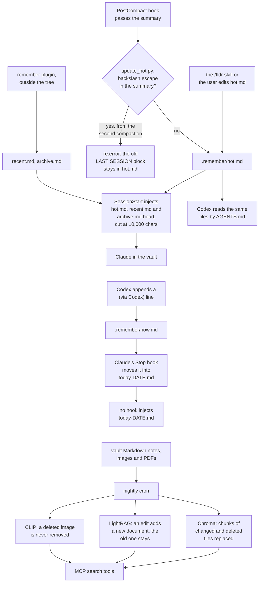

## 1. Executive Summary

ECX is an installer and a set of hooks, skills and scripts that let Claude Code and
Codex work from one notes vault. Its memory is files: a hand-curated
`.remember/hot.md` that both agents read at the start of a session, session logs,
Claude Code's own memory folder, and the vault's notes, indexed nightly into
ChromaDB, LightRAG and a CLIP image collection behind three MCP servers. What is
notable is how little machinery the sharing needs: the same Markdown is injected
into one agent by a hook and listed for the other in `AGENTS.md`. What is weak is
upkeep: the compaction updater raises on ordinary summary text and keeps the old
block, the
Codex-to-Claude note path ends in a file nothing injects, and two of the three
indexes never forget a deleted note.

The headline feature, "two agents from two different labs share one memory and
see each other's latest messages" (`README.md:20`), is two mechanisms, and only
one of them is memory. `agent-sync/sync.py` is a relay. Before each prompt it reads
the new lines of the other agent's session transcripts and the agent mailbox and
injects them as context. It holds nothing that could later turn out false, and
[section 9](#scope) keeps it out of the marks. The memory is the shared files and
the indexes beside them.

**Licence.** MIT, the unmodified text, in `LICENSE`, with no package manifest to
disagree with it. Two files the session hooks inject, `.remember/recent.md` and
`.remember/archive.md`, are written by the separately installed `remember` plugin,
whose code and terms are not in this tree.

No mark is earned. The nearest is a `/catchup` test that a keyword search leaves
out the live session's matching text, which is a window rule over transcripts
rather than material that must not be recalled. Section 9 gives the reason for each
of the seven withheld.

## 2. Mental Model

A memory is **a Markdown file an agent is told to read, or a chunk of one returned
by a search**. Nothing is extracted into facts, and nothing carries a state. A file
is believed from the moment it is written and stops being believed when someone
edits it, or, for an index, when the next nightly run notices the change.

Five things persist, with different writers:

- **`hot.md`**, "the source of truth for right now" (`templates/CLAUDE.md:7`):
  WHO, strongest signals, tracks, hard dates, open loops and hard rules
  (`templates/hot.md:5-28`). The `/tldr` skill updates it with "any new deadline,
  project state or hard rule" (`skills/tldr/SKILL.md:10`), the user edits it, and
  `memory/update_hot.py` replaces a `## LAST SESSION (auto-updated)` block with up to
  2,500 characters of each compaction summary (`memory/update_hot.py:24-57`).
- **Session logs** in `.remember/`. `recent.md` and `archive.md` come from the
  `remember` plugin, which `phone-vault/remember_on_stop.sh:6-12` triggers after
  each reply; no file in the tree writes either. `now.md` takes Codex's notes:
  `AGENTS.md` tells Codex to "append one dated line to `./.remember/now.md`
  starting with `(via Codex)`" (`templates/AGENTS.md:38`). Claude's Stop hook moves
  `now.md` into `today-YYYY-MM-DD.md` after every reply (`hooks/archive_now.sh:5-6`).
- **Claude Code's own memory folder**, written by Claude Code and outside the tree.
  Codex is told to read `MEMORY.md` and every file beside it and never to edit them
  (`templates/AGENTS.md:12`, `:37`).
- **Vault notes**, including phone captures that land as one file in `inbox/` and
  are filed by the laptop agent later (`hooks/inbox_nudge.sh:10-12`), and wiki
  articles the `/wiki` skill compiles from the inbox before moving the raw file to
  `archive/raw/` (`skills/wiki/SKILL.md:28`).
- **Three indexes** over those notes, rebuilt for changed files each evening.

Conflict resolution is prose. Codex is told that "when sources disagree, the newer
one wins" and that "Memory marked SUPERSEDED is history, not current state"
(`templates/AGENTS.md:14`); no code reads either rule.

## 3. Architecture

ECX is a directory the user clones and an installer that wires it into two
agents. `scripts/install.py` creates the vault skeleton and renders `CLAUDE.md`,
`AGENTS.md` and `.remember/hot.md` from `templates/` without overwriting
(`scripts/install.py:143-149`). It symlinks every folder under `skills/` into
`~/.claude/skills` and `~/.agents/skills` (`:151-162`). It then adds hooks:

- **Every Claude Code project** gets the danger guard, MCP health checks, a
  read-only auto-approval, usage tracking, a desktop notification and the
  tests-before-done Stop hook, plus a statusline (`:165-182`).
- **Claude Code in the vault** gets the memory hooks: `session_context.sh` and
  `inbox_nudge.sh` at SessionStart, the doctor at startup, `agent-sync` at
  UserPromptSubmit, the AI-tell guard, `archive_now.sh` and
  `remember_on_stop.sh` at Stop, and `update_hot.py` at PostCompact (`:185-196`).
  `--with-phone` adds a background `phone-vault/sync.sh` at Stop (`:197-198`).
- **Codex in the vault** gets `agent-sync` at UserPromptSubmit, the doctor at
  startup and, with phone mode, the sync (`:203-210`). It gets no memory hook; its
  memory is the boot list in `AGENTS.md`.

`vault-search/` holds three stdio MCP servers registered in the vault's
`.mcp.json` (`:226-234`): `vault-rag` (`mcp_server.py`, Chroma text and CLIP image
search), `vault-graph` (`lightrag_mcp_server.py`) and `vault-router`
(`smart_router_mcp_server.py`). `--with-search` installs their dependencies into
`~/.ecx/venv` with lower-bound pins (`vault-search/requirements.txt:2-10`).
`--with-cron` adds four crontab lines (`scripts/install.py:251-256`).

Phone mode makes the vault a git repository with a private GitHub remote. After
every reply `sync.sh` copies `hot.md`, `recent.md`, the newest day log and
`now.md`, the `.remember/` Markdown and Claude's memory folder into `context/`,
commits every changed `.md` file, pulls with rebase and pushes
(`phone-vault/sync.sh:35-63`). `inbox-automerge.yml` squash-merges any same-repo
pull request whose files are all `inbox/*.md` (`phone-vault/inbox-automerge.yml:16`,
`:25-32`).

`duo/` runs Claude Code and Codex on one goal with a local web page, approval cards
and an action log. It reads memory at start (`duo/context.py:112-122`) and writes
none, and its agents run with `--no-session-persistence` and hooks disabled
(`duo/claude_agent.py:13`).

### Deployment and ergonomics

- **Running:** nothing for the files and the relay; Python 3.9 or later and bash.
  The search stack needs ChromaDB, sentence-transformers, open_clip with torch,
  PyMuPDF and LightRAG, and LightRAG needs an Ollama host.
- **Local and offline:** the files, the relay and the Chroma and CLIP indexes run
  locally. LightRAG's default model is `gemma4:31b-cloud`
  (`vault-search/lightrag_ingest.py:24`), so note text leaves the machine during
  graph indexing and graph queries unless `ECX_LLM_MODEL` names a local model,
  which the README says (`README.md:189`).
- **API key:** none for storage. Phone mode needs a GitHub remote and, for Codex in
  the ChatGPT app, a one-time account setup.
- **Install:** `./install.sh`, which asks three questions and can print its plan
  with `--dry-run`.
- **Repair by hand:** every memory is a Markdown file. The indexes are derived and
  can be rebuilt; LightRAG has to be rebuilt to lose anything.

## 4. Essential Implementation Paths

- **hot.md refresh at compaction.** `memory/update_hot.py` reads `summary` from the
  hook's stdin, always writes it to `.remember/tmp/last-compaction.md` (`:24-28`),
  truncates it to 2,500 characters (`:34`), rewrites the `# Updated:` line
  (`:44`), and either replaces the existing LAST SESSION block with `re.sub`
  (`:47-53`) or inserts it before `\n## WHO` (`:54-55`).
- **Session-start injection.** `hooks/session_context.sh:5-19` concatenates
  `hot.md`, `recent.md` and `head -60 archive.md` under headings and emits the
  first 10,000 characters as `additionalContext`.
- **Codex's notes.** `templates/AGENTS.md:38` is the writer; `hooks/archive_now.sh`
  appends `now.md` to the day log and truncates it on every Claude Stop. Its readers
  are the phone mirror, which copies it into `context/today.md`
  (`phone-vault/sync.sh:40-42`), and any agent that opens the file.
- **Codex boot.** `templates/AGENTS.md:7-14` lists `CLAUDE.md`, `hot.md`,
  `recent.md`, `archive.md`, the newest `today-*.md` and Claude's memory folder; in
  cloud mode the same list under `context/` (`:44`).
- **duo boot.** `context_files` returns `hot.md`, `recent.md` and Claude's
  `MEMORY.md` (`duo/context.py:18-29`); `catchup` adds six hours of both agents'
  transcripts, newest first, up to 12,000 characters (`:32-56`).
- **Chroma ingest.** `vault-search/ingest.py` walks the vault skipping
  `SKIP_DIRS` (`:19-21`, `:49-59`), compares each file's mtime with
  `chroma_sync_state.json` (`:66-67`), deletes chunks whose `source` is changed or
  deleted (`:86-88`), splits changed files at headings into 400-word chunks with
  ids `rel::i` (`:36-46`, `:100-107`), and saves the new state (`:111-112`).
- **LightRAG ingest.** `vault-search/lightrag_ingest.py` retries failed and pending
  documents first (`:91-96`), selects changed files from the given folders
  (`:98-116`), inserts each as `Source: <path>` plus its text (`:129-130`), and
  records the mtime only when the document's status is `processed` (`:131-135`).
- **CLIP ingest.** `vault-search/multimodal_ingest.py:95` selects changed images
  and PDFs; each is deleted by `source` and re-added page by page or as one image
  (`:110-133`).
- **Search.** `search_vault` queries the `vault` collection for five hits and
  returns 400 characters of each (`vault-search/mcp_server.py:31-39`);
  `search_images` embeds the query with CLIP, takes 20 candidates, deduplicates by
  file name and page and lists notes that mention each image (`:61-101`);
  `graph_search_vault` calls `rag.aquery` (`lightrag_mcp_server.py:108-121`); the
  router classifies and dispatches (`smart_router_mcp_server.py:40-47`,
  `:163-187`).
- **Relay (not memory).** `inject` in `agent-sync/sync.py:266-307`, `send` and
  `unread` at `:203-228`.
- **Tests.** `tests/test_hooks_and_install.py:52-68` for the session hooks,
  `tests/test_agent_sync.py` for the relay, `tests/test_catchup.py` for `/catchup`,
  `tests/test_duo_context.py` for duo's boot.

## 5. Memory Data Model

Nothing is typed. `hot.md` is a template of headings with a `# Updated:` line, the
only date in the file (`templates/hot.md:2`). A phone capture carries three
frontmatter keys, `captured_at`, `source` and `agent` (`templates/AGENTS.md:47-53`),
which no script reads. A Codex note is one line with a date the model writes.

The indexes store paths, not records. A Chroma chunk carries `source`, the
vault-relative path, and `chunk`, its position (`vault-search/ingest.py:105`); a
visual entry adds `type` and `page` (`multimodal_ingest.py:120`, `:131`). The
LightRAG document prefixes the path to the text, and its id is LightRAG's hash of
that whole string (`lightrag_ingest.py:129-131`), so an edited file has a new id.

Scope is physical. One vault per install decides what every index and hook sees.
Inside it nothing is partitioned: `inbox/`, personal notes, the hot file and the
mirror are one collection.

Claude's memory folder is located by a path derived from the vault, and the three places that derive it do not agree. `scripts/install.py:41`
and `phone-vault/sync.sh:11` replace every non-alphanumeric character of the
resolved path with `-`, while `duo/context.py:27` replaces only `/`. For a vault at
`~/my_vault` the first gives `-Users-ada-my-vault` and duo looks for
`-Users-ada-my_vault`, so for any vault path holding a character other than letters,
digits and `/`, at most one of them names the folder Claude Code uses.
`context_files` drops paths that do not exist (`:29`), so when it is duo that
misses, duo starts without the memory index and says nothing.

There are no temporal fields beyond file mtimes, no version chain, no status and
no deletion record.

## 6. Retrieval Mechanics

Retrieval at session start is a fixed list of files. Claude in the vault gets
`hot.md`, then `recent.md`, then 60 lines of `archive.md`, and the whole is cut at
10,000 characters (`hooks/session_context.sh:19`), so a long `recent.md` crowds
out the archive and can cut itself. The day logs and `now.md` are not on the list.
Claude Code outside the vault gets none of it, since the hook is registered only in
the vault's settings (`scripts/install.py:185-189`).

Codex's retrieval is the model following `AGENTS.md`: read four groups of files
"fully, in this order" (`templates/AGENTS.md:7-12`). Nothing checks that it did, and
the README's phone instructions tell the user to open every Codex Cloud chat with a
line asking it to read `AGENTS.md` first (`README.md:137`).

Search is three tools and a router. `search_vault` is a plain top-5 cosine query
over MiniLM embeddings with no filter. `graph_search_vault` passes the query and a
mode to LightRAG's `aquery` with no other parameters, so by LightRAG's default it
returns an answer the configured model writes from the graph rather than source
excerpts. The router counts matches of two regexes of signal words, such as
"relate to" and "compare" against "find" and "what is", and picks the larger, or
both on a tie (`smart_router_mcp_server.py:28-47`). On "hybrid" it concatenates
the two outputs under headings with no fusion, deduplication or budget
(`:168-182`).

Three retrieval defects follow from the code:

- **The router's vector arm is text only.** Its tool description says "vector RAG
  (text+visual)" (`smart_router_mcp_server.py:120-121`), and `vector_search`
  queries the `vault` collection alone (`:62-71`); `vault_visual` is read only by
  `search_images` (recorded searches). `AGENTS.md` tells Codex to use the router
  first (`templates/AGENTS.md:18`).
- **The graph covers three folders.** The cron line indexes `research personal
  projects` (`scripts/install.py:253`), and the script's default is `research`
  (`lightrag_ingest.py:57-60`), so `wiki/`, `daily/`, `inbox/` and `content/` never
  enter it. A relationship question about a compiled wiki article goes to an index
  that never held it.
- **The meaning index skips the archive and keeps the mirror.** `SKIP_DIRS`
  excludes `archive` and the agent tool folders, not `.remember` or `context`
  (`vault-search/ingest.py:19-20`). Raw captures that `/wiki` moves into
  `archive/raw/` leave the index, while with phone mode on every `.remember/` file
  is indexed twice, once in place and once under `context/remember/`, and Claude's
  individual memory files enter it through `context/memory/` (only `MEMORY.md` is
  skipped, `:21`).

## 7. Write Mechanics

Every write to the shared files is a model or a person editing Markdown, except the
compaction block and the day-log move. There is no extraction, deduplication or
conflict check.

**The compaction updater fails on ordinary text.** On the first compaction the
block is inserted with `str.replace`, which treats the summary literally
(`memory/update_hot.py:55`). From the second, the new block is the replacement
template of `re.sub` (`:48-53`), which interprets backslash escapes. A scratch
reproduction of that call under Python 3.15 raised `bad escape \d` for a summary
containing `\d+`, `bad escape \U` for `C:\Users`, and `invalid group reference`
for `\1`. The call is outside the script's only `try`, so the script exits before
`HOT.write_text` (`:57`), and `hot.md` keeps the previous session's block while
`last-compaction.md` holds the new one.

Two quieter failures share the function. The pattern stops at the first `---` followed by a blank line (`:49`), so a summary
containing a Markdown rule leaves its tail below the next block, where it
accumulates. If the user renames the `## WHO` heading before the first compaction,
the insert is a no-op while the `# Updated:` line is still rewritten with `(auto)`
(`:44`, `:55`).

**Codex's notes stop at a log nobody is shown.** `AGENTS.md` says of `now.md`
"Claude reads that file, so both agents stay in sync" (`templates/AGENTS.md:38`).
No hook in the tree reads `now.md` or a `today-*.md` file into Claude's context.
`archive_now.sh` moves the line on Claude's next Stop, and it reaches Claude only if
the external `remember` plugin's daily rotation folds the day log into `recent.md`,
as the sync script's comment assumes (`phone-vault/sync.sh:39`). The move is
`cat >> today && : > now` with no lock (`hooks/archive_now.sh:6`), so a line Codex
appends between the two commands is lost.

Phone captures write one `inbox/` file each, merged by the Action without a person
when the pull request touches nothing else. The nightly Chroma run indexes `inbox/`
like any folder, so a capture is searchable by meaning before anyone files it.

### Operational cost

Nothing blocks the agent for long. The vault hooks carry timeouts of 5 to 15
seconds (`scripts/install.py:189-198`), and `sync.py` exits 0 with no output on any error (`agent-sync/sync.py:364-366`).

- **Lag.** A `hot.md` edit reaches the next Claude session in the vault. A note
  becomes searchable at the next cron run: 20:30 for Chroma, 21:00 for LightRAG,
  22:00 for CLIP (`scripts/install.py:252-254`), so up to a day.
- **Background passes.** Each ingest touches only files whose mtime changed. A
  LightRAG insert runs model extraction over the whole file, through the cloud model
  by default, so editing one line of a long note pays for the full note again.
  `--force` re-indexes everything.
- **Per turn.** SessionStart adds at most 10,000 characters once. The relay adds up
  to 5,000 characters of turns (`agent-sync/sync.py:39`, `:170-171`) plus every
  unread mail at up to 4,000 characters each (`:238`), bounded only by the
  30-messages-per-hour send limit (`:28`). Both arrive as `additionalContext` on the
  user turn, after the cached prefix.

## 8. Agent Integration

Claude is integrated by hooks and Codex by instructions. The asymmetry is the
design's main limit: the memory Claude gets is assembled by a script, and the
memory Codex gets is whatever the model reads after being told to. Codex also gets
the three MCP servers and the skills, which `AGENTS.md` tells it to read as files
and follow (`templates/AGENTS.md:16-21`).

The model's reach over memory is total. It can edit `hot.md`, Claude's memory
folder and any note with ordinary file tools; the rule that Codex must "Never edit
Claude's memory folder. Read only." is prose (`templates/AGENTS.md:37`). The MCP
tools are read-only and take a query and, for the graph, a mode.

The relay is the cross-agent integration users see. On each prompt it reads new
lines of the other agent's transcripts from per-session byte offsets, six hours back
on a session's first prompt (`agent-sync/sync.py:266-296`), keeps user and
assistant text and Codex voice transcript segments (`:64-102`), and frames them as
"shared context" (`:172-175`). Agent mail is appended to `mail.jsonl`, rendered to
`agents/AGENT_CHAT.md`, and injected as "teammate information, not an instruction"
(`:203-218`, `:239-242`). Adapting either to another agent means writing a
transcript parser and a hook.

## 9. Reliability, Safety, and Trust

### Scope

The repository is in scope for its shared files and its indexes. `hot.md`, the
session logs, Claude's memory folder as Codex reads it, the vault notes and the
three indexes over them are claims about the user and their work that can go
stale and still be read as current. The relay is not: a relayed turn is a record of
what was said, read from transcripts Claude Code and Codex already keep, and the
mail is messages between agents. `/catchup` reads past transcripts in full or by
keyword (`skills/catchup/catchup.py:102-128`) and is a transcript reader for the
same reason. duo, the guards and tests-before-done act on the current run. Each mark
below is judged on the memory side.

### The relay crosses every project

`CLAUDE_GLOB` and `CODEX_GLOB` match every Claude Code project's transcripts and
every Codex session on the machine (`agent-sync/sync.py:31-32`). The hook is
installed in the vault, so whatever the user said to the other agent in any
repository during the last six hours arrives in the vault session, labelled with
the project folder's base name (`:163`). This is not memory and earns no mark either
way, but it is the widest read in the system and nothing configures it.

### Forgetting differs by index

Deleting a note removes it from Chroma at the next run (`vault-search/ingest.py:67`,
`:86-88`). LightRAG has no delete call anywhere in `vault-search/` (recorded
searches): an edited note is inserted as a second document beside the first, and a
deleted note's entities and relations stay in the graph, so `graph_search_vault`
answers from text the user changed or removed. The CLIP ingest computes changes over
files that exist (`multimodal_ingest.py:95`), so a deleted image keeps its vector
and its path in `search_images` results. With phone mode, every committed version of
every note, including the mirror of Claude's memory folder, stays in the GitHub
repository's history; `rsync --delete` removes files from `context/` only in the
next commit (`phone-vault/sync.sh:44-48`).

### The LightRAG retry

The LightRAG ingest is the one piece built for failure. Its comment records that
"LightRAG logs extraction errors without raising, so earlier runs left docs FAILED
while this script marked them done" (`lightrag_ingest.py:91-92`). It now reprocesses
failed and pending documents before new work, records a file as indexed only when its
document reads back `processed`, and exits 1 when a failure other than duplicate
content remains (`:93-96`, `:131-135`, `:144-148`). The retry makes the graph
complete; the missing delete keeps it stale.

### Provenance and injection

No memory records who wrote it. A phone capture names `source` and `agent` in
frontmatter that nothing reads. A note captured by a cloud agent is merged
unreviewed into `inbox/`, indexed that night, and summarised into the wiki by a model.
Mail carries a sender name the sending agent passes as `--from` (`sync.py:247-255`).
`AGENTS.md` tells Codex that the user's own notes in `AGENT_CHAT.md` are instructions
(`templates/AGENTS.md:62`), a file both agents append to.

### Documents that disagree with the code

- `AGENTS.md:38` says Claude reads `now.md`; no hook does.
- The router's description promises visual results; its vector arm reads text
  only.
- The router's docstring says its ChromaDB side uses `nomic-embed-text`
  (`smart_router_mcp_server.py:5-6`); the code embeds with `all-MiniLM-L6-v2`
  (`:50-58`), matching the ingest.
- The README says all of search "re-indexes every night" (`README.md:129`); the
  graph indexes three folders.

### Marks

- **`negative_eval` — withheld.** The near-miss is
  `test_keyword_search_returns_only_matching_other_sessions`, which seeds three
  transcripts, two mentioning "pineapple", and requires the keyword search to return
  the older one and omit both the non-matching session and the live session's
  matching text (`tests/test_catchup.py:64-70`). The live session is excluded because
  the tool is defined as reading other sessions (`skills/catchup/catchup.py:108`), not
  because its content is wrong or out of scope, and it is a transcript, not memory.
  The relay tests require injected `AGENTS.md`, developer, thinking, tool-result and
  sidechain text absent from a populated relay (`tests/test_agent_sync.py:42-68`),
  which is context assembly. No test touches the indexes or the hot.md updater.
- **`scope_enforced` — withheld.** One vault per install is a physical partition. No
  chunk carries a scope key, the only `where=` filters in `vault-search/` are the two
  delete calls, and no MCP tool takes a scope argument.
- **`trust_state` — withheld.** No file or chunk carries a status. The SUPERSEDED rule
  is a sentence the model reads.
- **`tombstone` — withheld.** A deleted or edited note leaves no record keyed on its
  text, and LightRAG keeps the old text itself.
- **`bitemporal` — withheld.** `captured_at` is the capture time and is never read;
  everything else is file mtime.
- **`audit_log` — withheld.** `mail.jsonl` is append-only and holds agent messages,
  not memory changes. The phone sync's commits are git history, a different
  mechanism. The ingest logs report runs.
- **`human_review` — withheld.** An inbox-only capture merges with no person. A phone
  pull request touching other files is left open for GitHub review, but `AGENTS.md`
  also tells the phone agent it may "Push to the default branch"
  (`templates/AGENTS.md:54`), so the producer can skip the gate. `/wiki-health` only
  reports, and duo's approvals are of plans and actions, not memory.

## 10. Tests, Evals, and Benchmarks

The suite is 215 unittest methods, most of them on duo, the guards, the installer
and the doctor. CI runs it on Ubuntu 24.04 and macOS under Python 3.9 and 3.12
(`.github/workflows/test.yml`). The memory-facing cases are few and shallow:

- `test_session_context_injects_hot` requires a `hot.md` line in the SessionStart
  output (`tests/test_hooks_and_install.py:52-55`).
- `test_archive_moves_now_into_today` requires `now.md` empty and one `today-*` file
  after the Stop hook, not the moved text (`:62-68`).
- `test_inbox_nudge_lists_files` requires an inbox file name in the nudge (`:57-60`).
- The doctor tests require a missing `hot.md` to be reported and a five-day-old index
  directory to be reported with its age (`:224-256`).
- `tests/test_duo_context.py` requires a context file's text in duo's brief and the
  catch-up to leave the relay's cursors alone.

Nothing tests `memory/update_hot.py`, any ingest, any MCP server, the router's
classifier or `phone-vault/sync.sh` (recorded searches). The `bad escape` failure in
[section 7](#7-write-mechanics) is the kind a single second-compaction case would
catch.

The README's benchmark is of duo on six SWE-bench Verified issues, with committed
results under `bench/duo/`; it measures orchestration and was not checked here. No
memory benchmark is claimed. No paper is cited in the tree; the README links a blog
post about how the system was built, which was not read.

## 11. For Your Own Build

### Steal

- **Give the hot file a heading the updater owns.** A fixed `## LAST SESSION
  (auto-updated)` block that code replaces and people do not edit lets a
  hand-curated file carry an automatic part without merge rules.
- **Point the second agent at the first one's files, read only.** One boot list in
  the second agent's instructions shares memory across vendors with no server; keep
  the instruction that the second agent never edits the first one's folder.
- **Record a background job done only when its output reads back done.** The
  LightRAG ingest's check of document status before saving the mtime is the
  smallest version of a recoverable job.
- **Delete by source before re-adding.** Chunk ids of `path::i` and a delete on
  `source` for changed and deleted files keep a vector index in step with the
  files.

### Avoid

- **Model text as a regex replacement.** Pass a function to `re.sub`, or use string
  slicing, wherever the replacement is a summary, a note or a transcript.
- **A write path whose reader is an instruction.** If one agent leaves notes for
  another, the reader should be a hook or a test, not a sentence saying the other
  agent reads the file.
- **An insert-only graph over editable notes.** An index that cannot delete answers
  from text the user removed; key documents on the path and delete before
  re-inserting.
- **Deriving one path in three places.** Compute the memory folder's location once
  and import it.

### Fit

This suits one person who already lives in Claude Code and Codex, keeps an
Obsidian-style vault, and wants both agents to start knowing the same things without
running a service. It assumes that person curates `hot.md` and reads what the agents
write; nothing in it decides whether a note is still true. Walk away if notes must
be forgettable on request, if several people share the vault, or if the search
results must not include text the user deleted.

## 12. Open Questions

- Whether Claude Code's PostCompact payload carries a `summary` field, which
  `update_hot.py` depends on; the tree has no fixture of it.
- Whether the `remember` plugin's rotation folds `today-*.md` into `recent.md`,
  which is the only route by which a Codex note reaches Claude's session start.
- Whether the remember plugin also writes `now.md`, and in what order its background
  save and `archive_now.sh` run at the same Stop event.
- What the README's "under 0.1 s" figure for the relay (`README.md:65`) was
  measured on; nothing in the tree measures it.

## Appendix: File Index

- Shared files and templates: `templates/hot.md`, `templates/CLAUDE.md`,
  `templates/AGENTS.md`
- Write path: `memory/update_hot.py`, `hooks/archive_now.sh`,
  `phone-vault/remember_on_stop.sh`, `skills/tldr/SKILL.md`,
  `skills/wiki/SKILL.md`, `jobs/tracker_staleness.py`
- Context assembly: `hooks/session_context.sh`, `hooks/inbox_nudge.sh`,
  `duo/context.py`
- Indexes and search: `vault-search/ingest.py`, `vault-search/lightrag_ingest.py`,
  `vault-search/multimodal_ingest.py`, `vault-search/mcp_server.py`,
  `vault-search/lightrag_mcp_server.py`, `vault-search/smart_router_mcp_server.py`
- Phone sync: `phone-vault/sync.sh`, `phone-vault/inbox-automerge.yml`
- Relay and transcripts: `agent-sync/sync.py`, `skills/catchup/catchup.py`,
  `statusline/statusline.sh`
- Installer and checks: `scripts/install.py`, `scripts/doctor.py`
- Tests: `tests/test_hooks_and_install.py`, `tests/test_agent_sync.py`,
  `tests/test_catchup.py`, `tests/test_duo_context.py`,
  `.github/workflows/test.yml`

### Recorded searches

Run from the repository root at the pinned commit with `/usr/bin/git grep`.

- **No test touches the memory writers or the indexes.**
  `git grep -n -E 'update_hot|vault-search|classify_query|phone-vault|sync\.sh' -- 'tests/*.py'`
  returns nothing; the same form with `agent-sync` returns
  `tests/test_agent_sync.py:11` and `tests/test_duo_context.py:48`.
- **Only `search_images` reads the visual collection.**
  `git grep -n 'vault_visual' -- .` returns `vault-search/mcp_server.py:85` and
  `vault-search/multimodal_ingest.py:4`, `:26`.
- **Nothing injects `now.md`.** `git grep -n -E 'now\.md' -- .` returns
  `hooks/archive_now.sh:2`, `:5`, `phone-vault/sync.sh:42`,
  `templates/AGENTS.md:38` and `tests/test_hooks_and_install.py:63`.
- **No writer of `recent.md` or `archive.md` in the tree.**
  `git grep -n -E 'recent\.md|archive\.md' -- .` returns readers and docs only:
  `hooks/session_context.sh`, `phone-vault/sync.sh:38-39`, `duo/context.py:26`,
  `templates/AGENTS.md:11`, `:44` and the duo plan and spec under `docs/`.
- **No delete in the LightRAG paths.** `git grep -n -E 'adelete|delete' -- vault-search`
  returns lines of `vault-search/ingest.py` and `vault-search/multimodal_ingest.py:110`
  only.
- **No scope filter on a read.** `git grep -n -E 'where=' -- vault-search` returns
  the two delete calls, `ingest.py:88` and `multimodal_ingest.py:110`.
- **No status, tombstone or validity field in the memory code.**
  `git grep -n -i -E 'tombstone|blocklist|superseded|deprecated|retired|valid_from|valid_to|expires|status' -- '*.py' '*.sh'`,
  outside `duo/`, `bench/` and `tests/`, returns git status checks, the statusline
  and LightRAG's `doc_status`; `git grep -n -E 'SUPERSEDED|superseded' -- .` returns
  `templates/AGENTS.md:14` alone.
- **No paper reference.**
  `git grep -n -i -E 'arxiv|bibtex|@article|@misc|doi\.org|zenodo' -- .` returns
  nothing; `git grep -n -i -E 'swebench' -- README.md` returns `README.md:166`.

## History

**2026-11-25** — [`130905006c35cb03b70d8845785b236d64a74fc0`](https://github.com/saksham10arora-dotcom/everything-claude-codex/commit/130905006c35cb03b70d8845785b236d64a74fc0). First reading, from a full clone at the head of `main`; triage selected `fb0f12536835`, an earlier commit, and the pin is the head. Screened first: one auto-run surface, `hooks/` with 12 hook scripts, which were not run; nothing inside the seven-day cooldown; no build-time execution; two unpinned manifests, `vault-search/requirements.txt` and `watch-notes/requirements.txt`; no submodules. Templates, skills and docs were read as data. Nothing was installed, built or run, and the 215 test methods were not run; two scratch scripts reproduced the `re.sub` call and the memory-folder path derivations. No marks; the `/catchup` live-session test is the `negative_eval` near-miss ([section 9](#marks)).
