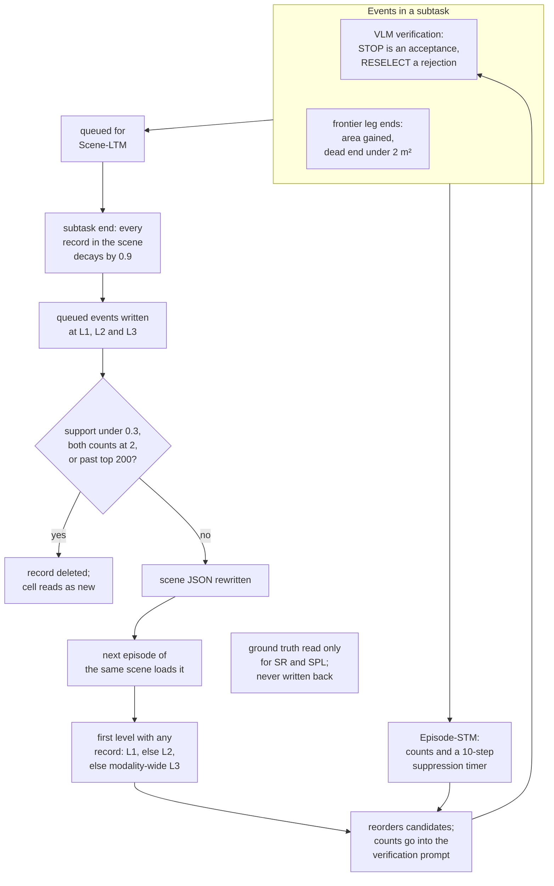

## 1. Executive Summary

EvoMemNav is the evaluation code for a training-free embodied navigation paper:
an agent that finds objects in HM3D scenes on GOAT-Bench, given a category, a
description or an image, and asks Qwen3-VL to choose among candidate views and
to verify a stop. What outlives an episode is Scene-LTM, a JSON file per scene
that scores grid cells per goal by the agent's earlier stop verdicts and
exploration gains. It is decayed each subtask, pruned on contradiction, and
read back to reorder candidates and to brief the verifier. What is weak is the
signal: an acceptance is the agent's own `STOP`, never the outcome, so a wrong
stop is recorded as a reliable place to stop for that goal and handed to the
next verification as prior evidence.

The view graph, the object instances and the raw images are rebuilt for every
episode. The paper's ablation of the experience memory was run on the first
episode of each scene, where the per-scene store can hold only that episode's
subtasks.

**Licence.** The repository is MIT, but running it is not: `agent.py:90`
imports `YOLOWorld` and `SAM` from `ultralytics`, which `requirements.txt`
names without a version and PyPI distributes under AGPL-3.0, so the
perception path carries terms the MIT file does not mention. The six files
under `evomemnav/third_party/conceptgraph/` open with *"Adapted from
ConceptGraphs (…), MIT License"*, and ConceptGraphs' own copyright notice
appears nowhere in the tree. The second line of `LICENSE`, *"Copyright (c)
Meta Platforms, Inc. and affiliates"*, is the line 3D-Mem's licence carries;
`planner.py`, `geom.py` and `scene.py`, from the codebase the README says this
is built upon, carry no header of their own.

## 2. Mental Model

The memory that persists is a set of **priors attached to places**. A place is
a 0.5 m grid cell of the scene frame (`evomemnav/experience/keys.py:46-49`),
and a prior is filed under a goal key at three levels: modality, category and
a SHA-1 digest of the description or goal image (L1), modality and category
(L2), and modality alone (L3) (`keys.py:26-28`, `:35-43`). An object goal has
no content digest, so its L1 and L2 differ only in name.

Two kinds of record exist (`evomemnav/experience/memory.py:22-40`):

- **Anchor records** count acceptances and rejections from goal verification.
  Reliability is `accept / (accept + reject)`.
- **Frontier records** keep moving averages of the area newly explored after a
  frontier leg and of whether that leg was a dead end (under 2 m², per
  `cfg/evomemnav_goatbench.yaml:113`), with a decayed support count.

An acceptance is `decision == "STOP"` (`memory.py:280`), and the decision is
the VLM's verification answer thresholded at 0.62 (`evomemnav/vlm/prompts.py:390-396`).
Ground truth is read only after the subtask, to compute success and SPL
(`evomemnav/agent.py:256-266`). Nothing writes the outcome back, so the store
cannot distinguish a correct stop from a confident wrong one. The README
states this as a property: the memory is updated *"only from the agent's own
verification decisions and trajectory"*.

A record stops being believed in one way only: it is deleted. `_prune` removes
a record whose decayed support falls under 0.3, an anchor record whose decayed
acceptances and rejections are both at least 2, and any record past the top
200 by support for its key (`memory.py:192-209`). After deletion the cell
reads as having no record, which ranks it level with an unvisited cell, and
the next verdict at that cell starts a new record from zero.

Episode-STM sits beside it with the same counts keyed by goal L1 and view id,
plus a suppression timer: a rejected anchor view is left out of the candidate
set for 10 steps (`memory.py:73-82`, `evomemnav/policy/coarse.py:79`). It is
cleared at the start and end of every episode (`memory.py:234-240`).

## 3. Architecture

`run_goatbench.py` is the only entry point. It loads a YAML config, builds
the agent once (YOLO-World, SAM and OpenCLIP models, and an OpenAI-compatible
client for a Qwen3-VL server), then walks the GOAT-Bench scenes in sorted
order. For each scene it builds one `ExperienceMemory` whose Scene-LTM path is
`<output_dir>/scene_ltm/<scene_id>.json` (`run_goatbench.py:83`). For each
episode it builds a fresh Habitat `Scene` (`:92`), which owns the object
instances, the anchor views and every raw image of that episode
(`evomemnav/env/scene.py:104`). The VSMGraph is reset at the start and end of
every episode (`agent.py:131`, `:166`; `evomemnav/memory/vsmgraph.py:71-78`).

Scene-LTM is the only state written to disk apart from logs, per-subtask
result lines and the summary. `save` writes the whole dictionary to a
temporary file and replaces the target (`memory.py:122-129`) after every
subtask (`:242-246`). `--start_ratio` and `--end_ratio` shard the scene list
across processes, so two shards write disjoint files unless their ranges
overlap.

### Deployment and ergonomics

It needs a GPU for the perception models, Habitat-Sim, HM3D v0.2 scenes and
the GOAT-Bench episode files, which the README points to and the tree does
not include, and a Qwen3-VL server; the README gives a vLLM command for the
8B instruct model. `requirements.txt` lists 20 packages with no versions and
says habitat-sim and pytorch3d are *"installed separately (see README)"*; the
README has no install section. The store itself is human-readable JSON and can
be inspected or deleted per scene. A new output directory starts every scene
empty.

## 4. Essential Implementation Paths

- **Episode lifecycle.** `ExperienceMemory.start_episode` clears Episode-STM
  and reloads Scene-LTM from disk; `end_subtask` writes the queued events and
  saves; `end_episode` clears Episode-STM (`memory.py:234-246`). The agent
  calls them at `agent.py:132`, `:146` and `:165`.
- **Verification write.** On arriving at a selected anchor view, `_verify`
  builds the manifest, the VLM returns STOP or RESELECT, and
  `on_verification` records it in Episode-STM, suppresses a rejected view and
  queues `(cell, accepted)` (`agent.py:237-252`, `memory.py:277-284`). A STOP
  ends the subtask (`agent.py:243-245`), so a subtask yields at most one
  acceptance.
- **Frontier write.** `_close_frontier_leg` takes the explored area gained
  since the leg began and calls `on_frontier_explored`, which updates the
  moving average in Episode-STM and queues `(cell, gain, dead_end)`
  (`agent.py:519-528`, `memory.py:286-289`).
- **Scene-LTM update.** `SceneLTM.update` decays every record in the scene,
  averages the subtask's frontier outcomes per cell into one moving-average
  step, adds anchor events one by one, writes both at all three goal-key
  levels, and prunes (`memory.py:150-181`).
- **Read.** `_candidates` asks `anchor_score` for each anchor view's
  reliability and `frontier_score` for each frontier, both keyed by the
  view's cell (`agent.py:359-405`). `anchor_score` sums the Episode-STM entry
  and the Scene-LTM record; `frontier_score` averages them
  (`memory.py:252-271`).
- **Ranking.** `rank_anchors` drops suppressed views and sorts by target hit,
  hinted room, reliability minus 0.5, then recency; `rank_frontiers` sorts by
  hinted room, then experience, then the area and distance heuristic
  (`coarse.py:63-116`).
- **Verification prior.** `_verify` puts an anchor's acceptances, rejections
  and reliability into the manifest as `experience_policy` when any count
  exists (`agent.py:547-554`, `prompts.py:369-370`).

## 5. Memory Data Model

`SceneLTM.data` is `{"anchors": {...}, "frontiers": {...}}`, each mapping a
level key such as `L2|object|bed` to a dictionary from cell string to a record
(`memory.py:85-110`). Anchor records hold `accept` and `reject` as floats,
since decay multiplies them; frontier records hold `gain`, `dead_end` and
`support` (`:22-40`). A record carries no timestamp, episode id, view id or
provenance, and `evomemnav/experience/` has no time field.

The goal key's three levels are all written on every update (`memory.py:162`).
The scene is the only boundary, and it is a file. The episode store's keys
carry view ids, which are unique across episodes because they include the
agent's global step (`agent.py:299`), and it is discarded at episode end.

The paper describes priors attached to room nodes, anchor views and frontier
views, including *"room support"*, and trajectory events such as revisits and
loop indicators. The code attaches priors to grid cells only, and
`evomemnav/experience/` has no reference to rooms, revisits or loops.

## 6. Retrieval Mechanics

Retrieval is a dictionary lookup per candidate. `_level` returns the first of
L1, L2 and L3 whose dictionary for that record kind holds at least
`fallback_min_records` records, set to 1 (`memory.py:132-137`,
`cfg/evomemnav_goatbench.yaml:120`). The test counts records under the level,
not whether the candidate's cell has one. Two consequences follow:

- **Once a goal has any L1 record, its other cells never fall back.** A cell
  with an L2 record and no L1 record reads as having none.
- **A goal with no L1 or L2 records reads the modality-wide level.** A new
  object goal reads acceptances written for every earlier object goal in the
  scene, and if the candidate's cell has one, the verifier is told that cell's
  reliability for this goal.

The prompt sets the weight: experience is listed among *"soft priors"*, and
*"Experience hints must not override visual evidence"* (`prompts.py:124`,
`:130`). In the coarse stage, reliability is a tie-breaker inside the target-
hit and hinted-room buckets (`coarse.py:73-77`). The only filter on the read
path is Episode-STM suppression (`coarse.py:79`).

Within an episode, a goal whose L1 key recurs reads its earlier verdicts
twice. Episode-STM still holds them, the Scene-LTM dictionary in memory
absorbed them at the earlier subtask's end, and `anchor_score` adds the two
(`memory.py:252-259`).

## 7. Write Mechanics

All writes are synchronous and local. Events are queued during the subtask
and applied at its end, before the result record is logged
(`agent.py:146`, `run_goatbench.py:101`), so a new prior is readable from the
next subtask on. No model call is involved in writing; the VLM only produces
the verdict. Each update rewrites the scene's whole JSON file, which the
200-per-key cap bounds.

Decay is scene-wide and counted in subtasks, not time. A record touched once
and never again is deleted at the twelfth later subtask in that scene, since
0.9¹¹ is 0.314 and 0.9¹² is 0.282 against the 0.3 floor
(`cfg/evomemnav_goatbench.yaml:116-117`; the arithmetic is mine). The paper
puts 5–10 subtasks in an episode, so an unreinforced prior lasts into one or
two later episodes. The frontier moving averages themselves do not decay;
only their support does (`memory.py:183-190`).

The contradiction rule needs both decayed counts at 2 or above
(`memory.py:202`). Acceptances accrue at most one per subtask, and three in
consecutive subtasks reach 2.71 where two reach 1.9, so an anchor record is
pruned as contradicted only after at least three stops at that cell under
that key. A cell where the agent stopped wrongly once and was rejected five
times is kept, at reliability 1/6.

**Resume replays subtasks into the store.** An episode counts as finished only
when every subtask has a result line (`run_goatbench.py:89`,
`evomemnav/eval/recorder.py:22-27`). An interrupted episode is re-run from its
first subtask against a Scene-LTM that already holds the subtasks it
completed, so their verdicts are counted twice. The result file keeps the
latest record per subtask (`recorder.py:34-44`); the store has no such
deduplication.

## 8. Agent Integration

The memory is internal to the navigation loop; there is no API, tool or
command for it beyond the config block (`cfg/evomemnav_goatbench.yaml:110-120`).
The VLM never reads or writes the store directly. It sees an anchor's counts
as a manifest field during verification and is otherwise given candidate
images, room labels and a topological summary built from the episode's graph
(`agent.py:418-437`, `vsmgraph.py:153-170`). Adapting it to another agent
means lifting `experience/` and supplying a cell function and a verdict.

## 9. Reliability, Safety, and Trust

### What the store learns from

The verdict is the model's own. Across a scene, the store converges on where
the agent tends to stop, not on where the goals are. A systematic false
positive becomes a prior that ranks the same cell's anchor views up for later
goals of that key and tells the verifier the place is reliable. The two
correctives are the prompt's instruction to the VLM and the contradiction
prune, which needs at least three stops at the cell. GOAT-Bench scenes are
static, so a wrong prior here comes from a wrong verdict, never from a changed
world.

### Marks

- **`trust_state`** — withheld. Reliability is a float used for ordering
  (`coarse.py:76-77`) and as a prompt hint. Suppression is the one exclusion
  on the read path, and it is a 10-step timer in the episode store, keyed by
  view, that never reaches disk.
- **`tombstone`** — withheld. A contradicted record is deleted, and the next
  verdict at that cell writes a new one.
- **`scope_enforced`** — withheld. The scene boundary is one file per scene,
  a physical partition. The goal key indexes records within it, and the L3
  fallback shows it is not a boundary.
- **`bitemporal`** — withheld. Records carry no time field of any kind.
- **`audit_log`** — withheld. The file is overwritten whole; the per-subtask
  result lines record outcomes and verification counts, not mutations of the
  store.
- **`human_review`** — withheld. No surface exists; a person can edit or
  delete the JSON, which is authoring.
- **`negative_eval`** — withheld. There are no tests.

### Other risks

- **Episode order is part of the result.** The run docstring says *"The
  episodes of a scene run in order, so that Scene-LTM accumulates over them"*
  (`run_goatbench.py:12`). Selecting episodes with `--episodes`, or reusing an
  output directory, changes what every later episode reads.
- **The store is learned on the evaluation split.** Scene-LTM accumulates over
  the val-unseen episodes it is scored on. That is the lifelong setting the
  benchmark defines, and it means the memory never meets a held-out scene.

## 10. Tests, Evals, and Benchmarks

The tree has no test file, and I ran nothing. No result, log or Scene-LTM
file is committed; `results/` is in `.gitignore`.

The paper is *EvoMemNav: Efficient Self-Evolving Fine-Grained Memory for
Zero-Shot Embodied Navigation* by Ge, Jia, Wu, Zhou, Wu and Jiang of Fudan
University ([arXiv:2606.03509](https://arxiv.org/abs/2606.03509), v1
submitted 2 June 2026). It reports 59.6 SR and 38.9 SPL on GOAT-Bench val
unseen, and HM3D object-goal results; this repository holds only the
GOAT-Bench evaluation, and no HM3D object-goal code is in the tree.

Its ablation (Table 3) adds the experience memory, which it calls RDCMA, last:
60.8 to 64.8 SR and 40.8 to 43.1 SPL. It was run on *"episode index=1 for each
of the 36 scenes"*. Run that way into a fresh output directory, Scene-LTM can
hold only the subtasks of that one episode, so the row measures carry-over
between subtasks of an episode, not persistence across episodes. Figure 5's
caption places the gains *"where in-episode experience accumulation yields
maximal gains"*.

The README's three-row component table (43.7, 55.4 and 59.6 SR) does not
appear in the v1 paper; only its last row matches the paper's headline. No
experiment in the paper or the tree isolates Scene-LTM's cross-episode reuse
from Episode-STM.

The code cites a supplementary file throughout, for Algorithms S1 and S2,
Appendices A and C and the parameter Table S2 (`agent.py:3`,
`keys.py:3`, `cfg/evomemnav_goatbench.yaml:2`). The arXiv v1 PDF ends at its
references and contains none of them, and the tree has no copy. The decay,
contradiction and fallback constants are therefore checkable against the code
only.

Tests to want first: a fixture that writes a wrong STOP and asserts what the
next goal of the same modality reads; a resume test asserting an interrupted
episode leaves the store as one full run would; and an assertion that L1
fallback is decided per cell.

## 11. For Your Own Build

### Steal

- **Key a prior by place, at several goal granularities.** A cell key
  survives the per-episode graph rebuild, and the three-level goal key lets a
  new goal borrow from a broader one.
- **Decay in units of work, not time.** Decaying per subtask ties a prior's
  life to how much the agent has done in the scene, which suits a benchmark
  with no wall clock.
- **Prune on disagreement.** A record with enough evidence on both sides is
  removed rather than averaged into a middling score that still ranks.

### Avoid

- **Learning from your own verdict alone.** Without an outcome signal or an
  independent check, a memory of where the agent stopped reinforces its false
  positives. Record the verdict and the outcome separately, or weight a
  verdict by later evidence.
- **A fallback decided per key and applied per item.** Decide the fallback
  for each item you score, or a broad level is either never consulted or
  consulted for everything.
- **A resume that replays into an accumulating store.** Make the update
  idempotent per subtask id, or roll the store back with the result file.

### Fit

This is a research artifact for reproducing one benchmark, and a clean one to
read: 338 lines hold the whole memory, and its rules fit on a page. It suits a
reader studying test-time adaptation in a static, simulated scene, where a
prior about a place can only be wrong because the verdict was. Walk away if
the world changes, if the agent's verdicts are not trustworthy enough to learn
from, or if you need memory that someone other than the decay constant can
inspect, correct or scope.

## 12. Open Questions

- Whether the ablation in Table 3 ran with a fresh output directory, and what
  the experience-memory row is on the full ten-episode protocol.
- Where the README's three-row component table was measured.
- What the supplementary file says about the contradiction threshold and the
  fallback rule, and whether the per-key fallback is intended.
- Whether the double count of a recurring goal within an episode is intended
  as a stronger in-episode prior.

## Appendix: File Index

- Experience memory: `evomemnav/experience/memory.py`,
  `evomemnav/experience/keys.py`
- Agent loop and memory calls: `evomemnav/agent.py`, `run_goatbench.py`
- Ranking and verification: `evomemnav/policy/coarse.py`,
  `evomemnav/policy/fine.py`, `evomemnav/vlm/prompts.py`
- Per-episode observation memory: `evomemnav/memory/vsmgraph.py`,
  `evomemnav/memory/views.py`, `evomemnav/memory/view_clustering.py`,
  `evomemnav/env/scene.py`
- Configuration and results: `cfg/evomemnav_goatbench.yaml`,
  `evomemnav/eval/recorder.py`
- Benchmark goals: `evomemnav/env/goatbench.py`

### Recorded searches

Run from the repository root at the pinned commit with `/usr/bin/git grep`.

- **Scene-LTM is the only store written to disk.**
  `git grep -n -E 'json\.dump|pickle|np\.save|torch\.save|open\(|sqlite|os\.replace|gzip'`
  matches `evomemnav/experience/memory.py:116` and `:127-129`, the result
  writer and reader in `evomemnav/eval/recorder.py:30-38`, the summary at
  `run_goatbench.py:106-107`, two readers of input files, and prompt
  serialisation in `evomemnav/vlm/prompts.py`.
- **No room, revisit or loop prior.**
  `git grep -n -i 'room' -- evomemnav/experience` returns nothing, and
  `git grep -c -i 'room' -- evomemnav/memory/vsmgraph.py` counts 30;
  `git grep -n -i -E 'revisit|loop|suppress' -- evomemnav/experience` matches
  only `suppress` lines in `memory.py`.
- **No time field on a record.**
  `git grep -n -E 'time\.time|datetime|timestamp|created_at' -- evomemnav/experience run_goatbench.py`
  returns nothing; the same pattern over the whole tree matches
  `evomemnav/vlm/client.py:57` and `:65`.
- **Ground truth does not reach the memory.**
  `git grep -n -E 'goal_eval|viewpoints' -- evomemnav/agent.py evomemnav/policy evomemnav/experience`
  matches only `evomemnav/agent.py`, at lines 21, 32, 135-136, 145, 171 and
  256-266.
- **No test file.**
  `git ls-files | grep -i -E '(^|/)tests?/|test_|_test\.py|conftest'` returns
  nothing; the same pattern matches `tests/x.py` given on stdin.
- **No HM3D object-goal evaluation.**
  `git grep -n -i -E 'objectnav|objnav|hm3dv1|hm3d_v0\.1' -- '*.py' '*.yaml'`
  returns nothing; `git grep -c -i 'goat' -- evomemnav/env/goatbench.py`
  counts 10.
- **No supplementary file in the tree.** `git ls-files | grep -i -E 'supp|\.pdf$'`
  returns nothing; `git grep -n -E 'Algorithm S[0-9]|Table S2|supplementary' -- '*.py' '*.yaml'`
  matches five citations of it. Over `pdftotext` output of the v1 PDF,
  `grep -c -E 'Algorithm S|Table S'` counts 0.
- **The README's component table is not in the paper.** Over the same text,
  `grep -c -E '43\.7|55\.4'` counts 0 and `grep -c '59\.6'` counts 2.
- **ConceptGraphs' copyright notice is absent.**
  `git grep -c -i 'Copyright (c) 2023 concept-graphs'` returns nothing;
  `git grep -n -i 'Copyright (c) 2018 Andy Zeng'` matches
  `evomemnav/mapping/tsdf.py:2`. The notice text is from ConceptGraphs'
  `LICENSE` at `93277a02bd89171f8121e84203121cf7af9ebb5d`.

## History

**2026-11-20** — [`5770e8cc31763f11374a74483c6e4b1ca982513f`](https://github.com/caicaiya123/EvoMemNav/commit/5770e8cc31763f11374a74483c6e4b1ca982513f) — first reading, from a full clone of `main`, a single root commit dated 26 October 2026; the *"Code coming soon"* commit `e85ee0e` is not in its history. Read in full: `experience/`, `agent.py`, `run_goatbench.py`, the policy, prompts, recorder and config; the VSMGraph and scene read for what persists. Paper v1 read in full. Screened first: no auto-run surface and no build-time execution; `requirements.txt` has 20 unpinned requirements. MIT, no rider. Nothing installed, built or run. No mark.
