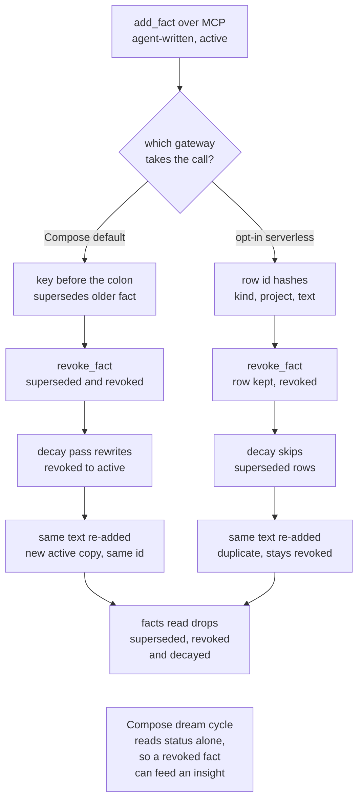

## 1. Executive Summary

Friday is a FastAPI server and stdio MCP bridge that gives coding agents a
project-scoped facts ledger, an episodic memory and an entity graph. The
Compose deployment keeps facts in one JSON file, sends memories to the hosted
Mem0 platform and extracts graph edges through DeepSeek; an opt-in gateway puts
everything in one SQLite or libSQL table. The facts ledger is the real
mechanism: key-based supersession, a revoked state every facts read filters,
and on the opt-in gateway a dedup lookup that keeps a revoked text revoked. The
default gateway re-admits that text as active, the blast-radius query cannot
execute, and the published benchmark is a dictionary of constants.

Several README layers have no code behind them at this commit. ChromaDB is
never imported, recall potentiation has no caller, the Compose deployment
schedules no nightly dream cycle, nothing commits to git, and the prompt-based
mood detector is called only by a test. The opt-in gateway is the careful half
of the repository: required project keys, `BEGIN IMMEDIATE` transactions,
fail-closed authentication and a decay that does not compound on retries.

Four marks are carried. Three rest on the opt-in gateway or on the facts ledger
both gateways share, not on the default deployment as a whole, and the
`tombstone` is an exact-string lookup that reports a rejection as a duplicate.
Section 9 says what each mark covers and what it leaves out.

## 2. Mental Model

Friday holds three kinds of thing, and only one of them has a lifecycle.

A **fact** is one string in a project, written by the agent through `add_fact`
and treated as ground truth: the persona export lists active facts under
*"Verified Architectural Facts"* (`gateway/main.py:886`), and the generated
rule files tell the agent to record *"atomic, high-confidence constraints"*
there (`friday/rules.py:137`). A fact enters `active` and leaves it four ways:

- **superseded** — a new fact in the same project whose text before the first
  `:` or `=` matches, lower-cased and at least three characters, marks the
  older one `superseded` (`gateway/main.py:415-435`), or an explicit
  `supersedes` id does (`:405-413`);
- **revoked** — `revoke_fact` or a soft delete sets `superseded: true` and
  `status: revoked` with a reason (`:503-506`, `:551-555`);
- **decayed** — the decay pass halves energy every 14 days from
  `last_recalled_at` and sets `decayed` below 0.25 (`layers/decay.py:147-163`);
- **deleted** — a hard delete removes the entry (`gateway/main.py:541-543`).

Every facts read drops all three withheld states (`gateway/main.py:469-474`,
`:856-860`; `gateway/serverless.py:148-149`). No path the agent reaches moves a
fact back to `active`: `record_memory_recall`, the reinforcer that would revive
a decayed fact, has no caller.

A **memory** is free text the agent sends to `add_memory`. On Compose it goes
to Mem0's hosted platform, which owns whatever processing happens to it; Friday
attaches a project label in metadata and keeps no copy. On the opt-in gateway
it is a row that can be updated, superseded or deleted, with a `superseded`
flag and no other state.

A **graph entity** is a name a DeepSeek call extracted from a memory. Nodes
merge on name alone across projects and are not withdrawn when the memory that
produced them is deleted.

## 3. Architecture

Two gateways implement one HTTP surface, and the MCP bridge talks to whichever
one `FRIDAY_URL` names.

**Compose gateway** (`gateway/main.py`, the `Dockerfile` CMD). FastAPI with
module-level handlers. Facts are a JSON document read and rewritten whole on
every call (`_load_facts`, `_save_facts`, `:168-191`). Memories go through
`mem0.MemoryClient` (`:100-107`), the mem0ai package's client for the hosted
platform, and `.env.example:14-16` says to get a key at mem0.ai. Every memory
is stored under `user_id="friday_user"` (`:291`). Neo4j 5.15 runs beside it in
`docker-compose.yml`. Graph extraction is an OpenAI-compatible call to DeepSeek
in a FastAPI background task (`:299-312`). Cognitive state is one JSON file
(`orchestrator/cognitive_state.py:30-46`).

**Opt-in serverless gateway** (`gateway/serverless.py`, `Dockerfile.serverless`).
A factory app over a `Storage` protocol with two implementations: SQLite with a
connection per operation and `BEGIN IMMEDIATE` for writes
(`storage/local.py:31-47`), and remote libSQL through the same SQL
(`storage/turso.py`). One `records` table holds facts, memories, entities,
edges, blueprints and state, keyed `(kind, project, id)`, with an FTS5 Porter
index over memories kept by triggers (`migrations/0001_initial.sql`,
`0002_fts.sql`). `docs/serverless-migration.md` describes Cloud Run with IAM and
a Cloud Scheduler job, and states that graph extraction, graph rename and
delete, and the Studio are not covered.

**MCP bridge** (`mcp/server.py`). A hand-rolled JSON-RPC loop over stdin that
forwards seven tools to HTTP with the shared key in two headers.

**Studio** (`studio/index.html`). A Three.js page the Compose gateway serves at
`/`. Its write calls send no key, except add-fact, which falls back to a
hard-coded `friday_brain_secret_key_2026` (`:1464`). Its consolidation and
reinforce buttons post to `/api/dream/trigger` and `/api/synapse/reinforce`
(`:2240`, `:2565`), routes neither gateway defines.

### Deployment and ergonomics

Compose needs Docker, Neo4j, a Mem0 platform key for memories to persist, and a
DeepSeek-compatible key for the graph. Without `MEM0_API_KEY`, `/add` stores
nothing and answers `{"status": "added"}` all the same (`gateway/main.py:286-315`).
Facts work offline. `install.sh` is a `curl | bash` that clones `main` unpinned
and generates secrets. The opt-in gateway needs only a SQLite path, or a libSQL
URL and token, and refuses to start on a missing or default key
(`gateway/serverless.py:108-110`). The facts file and the SQLite table are both
readable and repairable by hand.

## 4. Essential Implementation Paths

- **MCP tool to HTTP.** `TOOL_HANDLERS` (`mcp/server.py:341-349`) maps
  `add_memory` to `POST /add`, `add_fact` to `POST /facts`, `memory_search` to
  `POST /search`, and `get_context` to `GET /context`, falling back to
  `GET /facts` on 404 (`:293-305`); the other three map to blast radius,
  delete and revoke. A loop rewrites every tool's `project` schema to default
  `"default"` (`:226-233`), but `add_fact` and `revoke_fact` forward `project`
  only when the model passes one (`:254-255`, `:328-329`).
- **Fact write, Compose.** `add_fact` (`gateway/main.py:386-457`): the id is the
  first 12 hex characters of the text's SHA-256 (`:390`); an exact active
  duplicate in the project returns `duplicate` (`:395-401`); explicit and
  key-based supersession follow (`:405-435`); then append and rewrite the file
  (`:437-452`). An omitted project lands in `global` (`:131-133`), which every
  project's facts read includes (`:477`).
- **Fact write, opt-in.** `LocalStorage.add` (`storage/local.py:136-155`)
  selects any row of that kind, project and text, and returns `duplicate` if
  one exists; otherwise it inserts with id
  `sha256(canonical([kind, project, content]))` (`storage/models.py:19-21`).
  This gateway has no key-based or explicit supersession of facts, and its
  request model drops an MCP `supersedes` argument (`gateway/serverless.py:19-24`).
- **Memory write.** Compose: `mem0.add(content, user_id="friday_user",
  metadata={source, project})` (`gateway/main.py:289-293`) and the background
  extraction (`pipelines/auto_graph.py:18-40`). Opt-in: `db.add("memories", ...)`
  (`gateway/serverless.py:169-172`).
- **Context.** Compose defines no `/context` route, so `get_context` returns
  `GET /facts?project=` (`gateway/main.py:460-481`). The opt-in `/context`
  returns facts and the 50 newest unsuperseded memories
  (`gateway/serverless.py:248-253`).
- **Search.** Compose: Mem0 search with a metadata filter and a post-filter
  (`gateway/main.py:566-590`). Opt-in: FTS5 `MATCH` over the query's tokens
  joined by `OR`, with `project = ?` and `superseded = 0`
  (`storage/local.py:157-173`).
- **Correction.** `revoke_fact_endpoint` and `delete_fact_endpoint`
  (`gateway/main.py:484-562`); `revoke_fact`, `delete_fact` and
  `mutate_memory` (`storage/local.py:281-358`). A Compose memory delete first
  checks the stored project label (`_verify_memory_project`,
  `gateway/main.py:238-275`).
- **Decay and dream.** Compose: `apply_system_decay` (`layers/decay.py:98-177`)
  and `run_dream_cycle` (`pipelines/dream_cycle.py:79-161`), both behind
  authenticated POSTs. Opt-in: `LocalStorage.decay` (`storage/local.py:252-279`)
  and `scripts/deploy/consolidate.py:7-16`, scheduled at `0 3 * * *` UTC by
  `scripts/deploy/cloud-scheduler.sh:23`.
- **Graph read.** `get_blast_radius` (`gateway/main.py:674-745`) and the
  Studio's `/api/graph-data` (`:629-671`).

## 5. Memory Data Model

A Compose fact is a dict in `facts.json`: `id`, `content`, `project`,
`created_at`, `superseded`, `superseded_by`, `superseded_at`, `energy_score`,
`decay_immune`, `recall_count`, `last_recalled_at` and `status`
(`gateway/main.py:437-450`), with `revoked_at`, `revoked_reason` and
`decayed_at` added by later passes. The id hashes the text alone, so the same
sentence in two projects shares an id, and a re-added revoked text appends a
second entry with the same id. `recall_count` and `last_recalled_at` have one
writer after creation, `record_memory_recall`, which nothing calls.

The opt-in `records` table is `(rowid, kind, project, id, data, content,
source, superseded)` with `UNIQUE(kind, project, id)`. `data` is the whole JSON
payload and the other columns are projections for indexing
(`migrations/0001_initial.sql`). Imported legacy rows without a project are
enveloped under `__legacy_unscoped__` (`storage/models.py:9`).

Temporal fields are `created_at`, `superseded_at`, `revoked_at`, `decayed_at`
and `decay_applied_at`, all record time. There is no validity interval.

Scope is a free-text `project` string the caller chooses. One API key covers
every project, and `docs/serverless-migration.md` states that *"the shared API
key is not a multi-tenant authorization boundary"*. A fact in `global` is read
by every project.

The cognitive state is a separate record: mode, urgency, stress, valence and a
response calibration (`orchestrator/cognitive_state.py:14-27`). It is one file on
Compose and one row per project on the opt-in gateway, and `POST /state/update`
is its only writer.

## 6. Retrieval Mechanics

**Facts are listed, not searched.** `get_context` returns every fact passing
the status filter for the project plus `global`, sorted by energy, with no cap
(`gateway/main.py:466-481`). On the opt-in gateway the 50 newest memories come
with them. Energy orders the list and could cut it through `min_energy`, which
the MCP path never passes.

**Memory search** on Compose is Mem0's hosted search for user `friday_user`
with `filters={"AND": [{"metadata": {"project": p}}]}`, then a post-filter that
keeps rows whose project matches or is absent (`gateway/main.py:574-587`). A
memory with no project label therefore reaches every project's results when
the backend returns it. On the opt-in gateway each `\w+` token of the query is
quoted and joined with `OR`, so a five-word question matches any memory holding
any one of its words, ranked by FTS5 `rank` (`storage/local.py:159-172`). The
FTS5 table indexes `source` and `project` beside `content`, and the `MATCH`
names no column (`migrations/0002_fts.sql:1`). A query word equal to a source
label such as `agent`, or to the project's own name, matches every memory that
carries it.

**The blast-radius query cannot execute.** Its Cypher reads
`WHERE toLower(start.name) = toLower()`, and the string never references the
`entity` the call passes (`gateway/main.py:699`, `:707`). Neo4j rejects
`toLower()` with no argument, and the `except` returns
`status: "neo4j_unavailable"` with zero impacted nodes (`:733-743`). The tool
the benchmark script credits with *"96% Blast-Radius Accuracy"*
(`benchmarks/benchmark_deepeval.py:164`) returns that on every call. The string
has had this form since `a0b7bd9`, the commit that added the endpoint. The
`project` parameter is accepted and unused, and the test that covers the
endpoint accepts `neo4j_unavailable` as a pass (section 10).

No path fuses the layers. `orchestrator/router.py:13-32` defines a cross-layer
merge with no caller.

## 7. Write Mechanics

Writes are explicit tool calls by the agent; there is no capture hook. The
generated rule files tell it to write *"whenever you complete a task, resolve a
bug, introduce a schema change"*, without being asked (`friday/rules.py:135`).

**Fact conflict detection is a string prefix.** Text before the first `:` or `=`
is the key, so `Payment Gateway: Stripe` is superseded by
`Payment Gateway: DodoPayments`, as the README shows. Two facts sharing a
generic prefix such as `Note:` supersede each other. The README's own
`Production database endpoint is db.internal.net:5432` keys on everything up to
the port, so a changed host does not supersede the old one. The opt-in gateway
detects no conflict between facts.

**Re-assertion differs by gateway.** Compose's duplicate check skips superseded
entries (`gateway/main.py:399`), so a revoked text re-added appends a new
`active` entry carrying the same id. A later `revoke_fact` on that id stops at
the first match (`:493-498`), which is the revoked entry, re-marks it and
reports `revoked`; the new copy stays active. On the opt-in gateway the dedup
lookup has no status predicate (`storage/local.py:139-144`), so the same text
returns `duplicate` with the revoked row's id, and the row stays revoked.

**Graph extraction** sends the first 3,000 characters of a memory to DeepSeek
with a JSON-only prompt and upserts up to 10 entities and 15 links
(`pipelines/auto_graph.py:43-131`). A node merges on `name` alone and keeps the
first writer's project (`:105-111`). The model's relationship label is
upper-cased, its spaces replaced, and concatenated into the Cypher text
(`:124-131`), so model output reaches query syntax.

**The dream cycle writes templates.** `synthesize_recent_insights` buckets
active facts by keyword lists that include `razorpay`, `dodo`, `gstin`,
`jhalka` and `ec2`. It emits fixed sentences such as *"Infrastructure
Consolidation: Verified N active server directives with automated GitHub backup
& deploy key auth"* (`pipelines/dream_cycle.py:49-70`). When no bucket matches,
it emits `Crystallized Learning:` plus the first 120 characters of one fact
(`:72-74`). On the opt-in gateway these become memories with
`source="dream_cycle"` (`scripts/deploy/consolidate.py:13-15`), searchable and
returned by `/context`.

### Operational cost

A Compose `/add` blocks on one HTTPS call to Mem0; extraction runs after the
response in the same process, one model call capped at 600 tokens. When a Mem0
memory becomes searchable depends on the platform and is not visible from this
tree. A fact is readable as soon as the file is rewritten. An opt-in write is
one SQLite transaction and is searchable on commit.

The Compose decay pass rewrites the whole facts file on each request, and
nothing schedules it. The opt-in scheduler visits every project nightly, reads
and rewrites every fact row, and inserts up to two template memories per
project. `get_context` injects every active fact with no budget, so its size
grows with the ledger.

## 8. Agent Integration

The MCP bridge registers seven tools (`mcp/server.py:74-223`). The agent holds
every verb, `revoke_fact` and `delete_memory` included, and names the project
on every call. `friday rules generate` writes the same Two-Way Zero-Amnesia
directives into `AGENTS.md`, `CLAUDE.md`, `.cursorrules`, `GEMINI.md`,
`.github/copilot-instructions.md`, `.windsurfrules`, `.continue/rules.md` and
`CONVENTIONS.md` (`friday/rules.py`), and the repository carries all eight.
There is no hook, so reading memory at session start and writing it at the end
depend on the model following those files.

The SDK (`friday/client.py`) wraps the REST routes synchronously and
asynchronously. Its `get_context` returns the Markdown persona export rather
than the payload the MCP tool reads (`:238-248`). A LangChain retriever wraps
`search` (`friday/integrations/langchain.py`), and `smithery.yaml` starts the
bridge with `python -m mcp.server`. With `FRIDAY_GCP_IAM=true` the bridge
shells out to `gcloud auth print-identity-token` on every request
(`mcp/server.py:60-70`).

The cognitive-state endpoints are on the HTTP surface and not on MCP.
`detect_state_from_prompt`, the heuristic that would set mode and urgency from
a prompt, is called only by `tests/test_sdk.py:447`.

## 9. Reliability, Safety, and Trust

### The revoked state does not survive the Compose decay pass

`apply_system_decay` skips facts whose status is `superseded` or `archived`
(`layers/decay.py:144`). A revoked fact has status `revoked`, so it is decayed
like an active one and its status rewritten to `active` or `decayed`
(`:136-142`, `:158-167`). The `superseded: true` flag set at revocation keeps
it out of every facts read. The dream cycle filters on `status == "active"`
alone (`pipelines/dream_cycle.py:105`), so after one decay pass a revoked fact
is an input to synthesis and can be copied into a `CrystallizedInsight` node.
No writer produces `archived`. The opt-in decay skips any row carrying the
`superseded` flag (`storage/local.py:262`).

### Compose decay compounds

Each pass multiplies the stored `energy_score` by the decay factor for the full
time since `last_recalled_at`, and that timestamp never moves after the write
(`layers/decay.py:147-158`). Two passes on one day apply a fact's whole age
twice. Every SDK or HTTP call to `/dream/run` or `/decay/apply` moves facts
toward `decayed`, and no reachable path moves them back. The opt-in `decay`
starts from `decay_applied_at`, and its docstring says retries must not
compound (`storage/local.py:253`, `:269`).

### A derived copy escapes revocation

On the opt-in gateway the scheduled consolidation can write
`Crystallized Learning:` plus a fact's text as a memory. Revoking the fact
later leaves that memory searchable, since nothing links the two. The dedup
that keeps the fact revoked does not reach a copy with a prefix.

### Authentication and exposure on Compose

The facts list, graph dump, entity quick search and cognitive state are served
without a key (`gateway/main.py:460-465`, `:629-630`, `:826-827`, `:910-913`),
and `tests/test_health.py:47-53` pins `GET /facts` as public. With no `project`,
the facts read returns every project's facts. CORS allows any origin with
credentials (`:66-72`), and the key is accepted as `?key=` (`:82`).

`/ingest` writes `Path("/app/blueprints") / filename` with the caller's
filename (`:606-608`), so an absolute or `../` name escapes that directory. Two
graph routes concatenate a caller's relation label into Cypher (`:761-765`,
`:808`, `:817`). The opt-in gateway closes each of these. Every route but
`/health` needs the key in a header, compared with `hmac.compare_digest`, and
blueprints are rows (`gateway/serverless.py:116-128`, `:192-195`).

### Cross-project mutation on Compose

Memory delete and update compare the stored project label first, a fix dated
4 October 2026 (`gateway/main.py:238-275`). Facts have no equivalent.
`supersedes` matches an id in any project (`:406-408`). A revoke or delete
without `project` takes the first id match anywhere (`:493-498`, `:531-536`).
With a project, a `global` fact can be revoked from any project, and an
`add_fact` that omits `project` writes to `global`.

### Data loss on Compose

`_save_facts` writes in place with `write_text`, and `_load_facts` returns an
empty ledger on any parse error (`gateway/main.py:174-191`). A truncated file
reads as empty, and the next fact written replaces the whole ledger. A failed
save is logged, and the endpoint reports `added` regardless.

### Where the memories go

On Compose every episodic memory is sent to the Mem0 platform under one user
id, which contradicts *"100% Self-Hosted Docker Compose"* (`README.md:150`) for
the layer that holds decisions and rationale. Graph extraction sends each
memory's first 3,000 characters to the configured DeepSeek-compatible endpoint.

### Marks

- **`tombstone`** — awarded on the opt-in gateway. A revoked fact keeps its row
  and text, and `add` looks the text up across every row of that kind and
  project before inserting, so re-adding it returns `duplicate` and the row
  stays revoked (`storage/local.py:139-144`, `:332-344`). The key is the value
  and the add path consults it. It is the exact string, so a change of case or
  wording is a new fact. The answer says `duplicate`, so the agent is told the
  fact is stored. No committed case asserts it, and Compose does the opposite.
- **`trust_state`** — awarded on the facts ledger. `status` is `active`,
  `superseded`, `revoked` or `decayed`, with a `superseded` flag beside it.
  Producers are on the agent's surface, and every facts read filters on both.
  It is not a review state: everything enters `active`, and Compose's decay
  overwrites `revoked`.
- **`scope_enforced`** — awarded on the opt-in gateway, where every route
  requires a non-empty `project` and every `SELECT` filters on it. Compose
  carries the same key with an optional, unauthenticated facts read,
  unlabelled memories shared across projects, and an unscoped graph.
- **`bitemporal`** — withheld; every timestamp is record time.
- **`audit_log`** — withheld; a mutation overwrites the fact or row, and a
  revocation's reason is a field on it.
- **`human_review`** — withheld; nothing waits for a person, and the Studio's
  write calls are edits after the fact, most of them sent without the key.
- **`negative_eval`** — awarded; see section 10.

## 10. Tests, Evals, and Benchmarks

The suite has 67 pytest functions. CI runs all of them against the Compose
gateway and the SDK with Neo4j and Mem0 absent, then `test_storage.py` alone
against SQLite and libSQL. I did not run them.

**The exclusion cases that hold.** `test_gateway_fact_auto_supersede` writes
`Primary DB: MySQL 8.0` and `Primary DB: PostgreSQL 16` to project `alpha`,
`Primary DB: SQLite` to `beta`, and one global fact. One list must then hold
the current value and the global fact and must not hold the superseded value or
`beta`'s (`tests/test_blast_and_conflict.py:171-178`), and the persona export
repeats the project check (`:186-190`). The cross-project isolation case
asserts `mem_oss` present and `mem_prod` absent in one search result
(`tests/test_hygiene.py:222-232`), against a Mem0 mock that applies the filter
itself. `test_records_dedup_isolation_and_reopen` writes two memories in two
projects that both stem-match `deployments`, and asserts exactly one result for
project `one` (`tests/test_storage.py:31-33`).

**The cases that cannot fail as written.** The blast-radius test accepts
`status in ["neo4j_unavailable", "ok"]` with zero impacted nodes
(`tests/test_blast_and_conflict.py:193-202`), so it passes against the broken
Cypher, which raises into that branch every time. The unscoped search case
asserts two ids absent from a result the mock guarantees is empty
(`tests/test_hygiene.py:235-238`). Two opt-in checks assert empty lists for a
project nothing was written to (`tests/test_storage.py:117`, `:134`).

**Missing.** No case re-adds a revoked text on either gateway, decays a revoked
fact, runs decay twice on Compose, or calls blast radius against a populated
graph.

**The benchmark is a constant.** `benchmarks/benchmark_deepeval.py` prints
*"Evaluated ✓"* for five scenario names after a `time.sleep(0.1)` each, then
prints `BENCHMARK_RESULTS`, a dictionary literal holding every figure in the
README's table (`:96-121`, `:134-136`). No system is called and no DeepEval
metric is computed, and `deepeval` is in no dependency file. The README's 95%
precision, 99% faithfulness and 280 tokens per turn reproduce exactly, as
constants. No paper is associated with the project.

## 11. For Your Own Build

### Steal

- **Make the dedup lookup status-blind on purpose.** If a fact's id hashes its
  scope and text and the insert first looks the text up across every state, a
  revoked value cannot be re-added by the same writer. Return `rejected`
  rather than `duplicate`, and test it.
- **Decay from the last application, not from creation.** Store when decay was
  last applied and multiply only by the elapsed interval, so a retried or
  repeated pass is idempotent.
- **Require the scope key in the request model.** `project: str =
  Field(min_length=1)` on every route makes an unscoped read a validation error
  rather than a full listing.
- **Fail closed on a default secret.** Refusing to start when the key is unset
  or equals a known placeholder costs one line.

### Avoid

- **Two implementations of one state machine.** One decay skips rows by status
  and the other by flag, and that is how a revoked fact became active on one
  side. Share the transition function.
- **Accepting a failure value as a pass.** A test whose allowed outcomes include
  the error branch cannot detect that the success branch never runs.
- **Conflict detection by string prefix.** A key derived from punctuation in
  free text supersedes on coincidence and misses on rephrasing; ask the writer
  for the key.
- **A benchmark script that prints its results.** Commit the per-case outputs a
  table is computed from, or label the table a target.

### Fit

Friday suits one developer who wants a list of project constants that every
agent reads at session start, and who will run the opt-in gateway against a
local SQLite file. That path is small, transactional and tested for isolation.
Walk away from the Compose deployment if memories must stay on your machine, if
the graph's blast radius is the reason you came, or if a revoked fact must stay
revoked. Do not serve more than one person from it, since one key reads and
revokes every project.

## 12. Open Questions

- What the Mem0 platform does to a memory between `add` and `search`, whether
  it stores the text or facts extracted from it, and whether
  `MemoryClient.search` in mem0ai 0.1.29 honours the `filters` argument.
- Whether the maintainers treat the opt-in gateway as the successor; the
  migration guide says it does not replace the existing one.
- Whether DeepSeek ever returns a relationship label that changes the Cypher
  statement it is concatenated into.
- How large `get_context` grows on a ledger used for months, with no budget and
  an energy that only declines.

## Appendix: File Index

- Compose gateway: `gateway/main.py`
- Opt-in gateway and storage: `gateway/serverless.py`, `storage/local.py`,
  `storage/turso.py`, `storage/models.py`, `migrations/*.sql`
- Decay and consolidation: `layers/decay.py`, `pipelines/dream_cycle.py`,
  `scripts/deploy/consolidate.py`, `scripts/deploy/cloud-scheduler.sh`
- Graph extraction: `pipelines/auto_graph.py`
- MCP, SDK and rule files: `mcp/server.py`, `friday/client.py`,
  `friday/rules.py`, `friday/integrations/langchain.py`, `smithery.yaml`
- State and routing: `orchestrator/cognitive_state.py`, `orchestrator/router.py`
- Studio: `studio/index.html`
- Tests and benchmark: `tests/*.py`, `benchmarks/benchmark_deepeval.py`

### Recorded searches

Run from the repository root at the pinned commit with `/usr/bin/git grep`.

- **ChromaDB is never imported.**
  `git grep -n -i -E 'import chromadb|from chromadb|chromadb\.' -- '*.py'`
  returns nothing; `git grep -n -i chroma -- '*.py'` matches the `/add`
  docstring and an SDK type field.
- **No embedding library is used.**
  `git grep -n -E 'sentence_transformers|SentenceTransformer' -- '*.py'`
  returns nothing.
- **Mem0 is reached only through the hosted client.**
  `git grep -n -E 'from mem0 import'` returns `gateway/main.py:102`,
  `MemoryClient`.
- **Unwired functions.** `git grep -n record_memory_recall`,
  `git grep -n route_query` and `git grep -n detect_state_from_prompt` return
  each definition, plus `tests/test_sdk.py` for the last.
- **No `/context` route on Compose.** `git grep -n -E '"/context"' -- gateway`
  returns `gateway/serverless.py:248` only.
- **The Studio's consolidation and reinforce routes do not exist.**
  `git grep -n -E 'dream/trigger|synapse/reinforce' -- '*.py'` returns nothing;
  the same pattern over `studio/index.html` returns three calls.
- **Nothing commits to git.**
  `git grep -n -E '"(commit|push)"|git (commit|push)' -- '*.py' '*.sh'` returns
  nothing; with `rev-parse` in place of `commit` it matches
  `scripts/deploy/gcp_candidate.py:150`.
- **Compose schedules nothing.**
  `git grep -n -i -E 'schedule|cron|apscheduler' -- gateway docker-compose.yml Dockerfile`
  returns nothing; the same pattern matches `scripts/deploy/cloud-scheduler.sh`.
- **No validity time.**
  `git grep -n -i -E 'valid_(from|to|until)|validfrom|event_time|occurred_at|as_of' -- '*.py' '*.sql'`
  returns nothing; adding `created_at` matches `gateway/main.py:441`.
- **No mutation log.** `git grep -n -i -E 'audit|event_log|journal' -- '*.py' '*.sql'`
  returns one tool description, `mcp/server.py:210`.
- **No review state.**
  `git grep -n -i -E 'pending|approv|candidate' -- gateway storage mcp layers pipelines`
  returns the opt-in app's title only.
- **The MCP bridge never passes `min_energy`.** `git grep -n min_energy -- mcp`
  returns nothing; the same search over `friday` matches the SDK's `get_facts`.
- **The blast-radius Cypher names neither the entity nor a project.**
  `sed -n 698,706p gateway/main.py | grep -c -E 'entity|project'` prints 0;
  `grep -c start` over the same lines prints 4.
- **`last_recalled_at` is written at creation and by the uncalled reinforcer.**
  `git grep -n last_recalled_at -- '*.py' ':!tests'` returns
  `gateway/main.py:448` and `layers/decay.py:86` as writers; every other hit
  reads it.
- **No revoke case re-adds the revoked text.** `git grep -n -E 'revoke' -- tests`
  returns `tests/test_hygiene.py` only, whose revoke cases at `:31-117` and
  `:298-330` add no fact with the revoked content afterwards.
- **No test decays twice on Compose.**
  `git grep -n -E 'apply_system_decay|decay/apply|dream/run|run_dream_cycle|\.decay\(' -- tests`
  returns auth-only posts at `tests/test_health.py:150` and `:156`, mocked
  routes in `tests/test_sdk.py`, and the opt-in double decay at
  `tests/test_storage.py:82-84`.
- **Blast radius is tested against mocks and an absent Neo4j only.**
  `git grep -n -E 'blast' -- tests` returns the two SDK mock cases, the MCP
  forwarding case and `test_gateway_blast_radius_offline_fallback`.
- **No capture hook.** `git ls-files | grep -i -E 'hook'` and
  `git grep -n -i -E 'SessionStart|UserPromptSubmit|"hooks"'` return nothing;
  `git ls-files | grep -i -E 'hook|rules'` matches the rule files.
- **The opt-in store supersedes no fact.** `git grep -n -E 'supersed' -- storage/local.py`
  returns the column projection, the search predicate, the decay skip,
  `mutate_memory` and `revoke_fact`, and nothing in `add`.
- **Decay and dream never name the revoked state.**
  `git grep -n -E revoked -- layers pipelines` returns nothing.
- **`archived` has no writer.** `git grep -n -E archived -- '*.py'` returns the
  two skip lists, `layers/decay.py:144` and `storage/local.py:262`.
- **DeepEval is not a dependency.**
  `git grep -n -i deepeval -- pyproject.toml 'requirements*.txt' uv.lock`
  returns nothing.
- **No paper.** `git grep -n -i -E 'arxiv|bibtex|@article|@misc|doi\.org'`
  returns nothing.
- **The blast-radius string has one origin.**
  `git log -S'toLower() ' --oneline -- gateway/main.py` returns `a0b7bd9` alone.

## History

**2026-11-05** — [`fad2a61c38eb77058e4ecb71a558fd579e671dce`](https://github.com/friday-memory/friday/commit/fad2a61c38eb77058e4ecb71a558fd579e671dce). First reading, from a full clone at the head of `main`; the other branches are Dependabot's. Screened first: three auto-run surfaces (`.cursorrules`, `.github/copilot-instructions.md`, and `smithery.yaml` declaring a start command), two build-time execution points (`Makefile`, `tests/conftest.py`), nothing inside the seven-day cooldown. MIT, no rider. Nothing installed, built or run. Four marks: `tombstone` and `scope_enforced` on the opt-in serverless gateway, `trust_state` on the facts ledger, `negative_eval` on controlled exclusion cases ([section 9](#9-reliability-safety-and-trust)).
