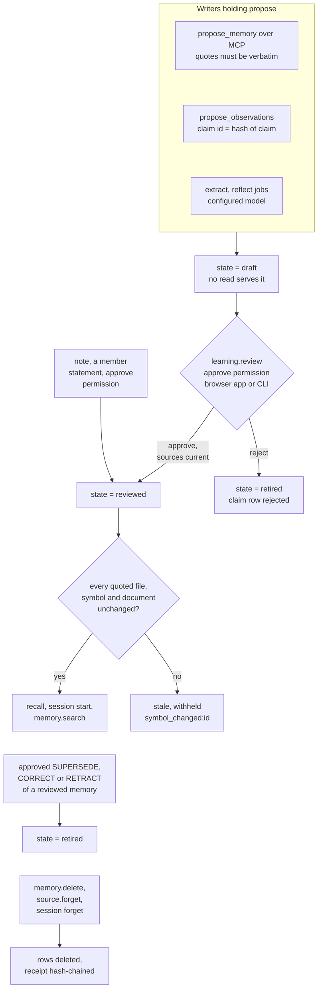

## 1. Executive Summary

Graphicle is one Rust program for coding agents: it indexes a repository into
a code graph, a port of Graphify, and keeps a project memory beside it in one
SQLite file, both served over one MCP server. A memory must quote its sources
verbatim. Whatever an agent or a model writes is a draft that no read path
serves until a credential holding `approve` accepts it, and a reviewed memory
is withheld once a file, document or code symbol it quotes changes.

Two mechanisms stand out. Staleness follows the code symbol a quote sits in,
so an edit outside that symbol leaves the memory current. Forgetting deletes
a source and everything derived from it, checks the result in the same
transaction, appends a hash-chained receipt, and is tested against a fork that
never ingested the source. The weak points sit beside that core. A rejection is
keyed on the whole claim record, so a reworded claim returns as a fresh draft.
The revision journal is rewritten in place on two paths. An agent with a shell
can run the same `graphicle call learning.review` a person uses.

## 2. Mental Model

A memory is a `repo_memories` row: a kind (decision, preference, procedure,
task_state, note, observation, reflection), a title and body, a state, and a
`data` object holding the evidence (`schema.sql:102-110`). Every producer
passes through `dependencies`, which refuses a quote absent from a source the
caller may read and records the sha256 of each source it rests on
(`memory.rs:203-237`). A quote inside one code symbol is also anchored to that
symbol's `stable_id` and revision.

The stored state is one of three (`save`, `memory.rs:487-503`):

- **draft** — written by `memory.propose`, an extraction or interpretation
  job, a refresh proposal, `reflect --retain`, `memory.import` or
  `memory.import_pack` (`operations.rs:169-232`, `claims.rs:106-116`,
  `workflows.rs:955-965`, `packs.rs:549-551`). Never recalled.
- **reviewed** — written only by `note`, a member statement, and by
  `apply_review` approving a draft (`memory.rs:591-655`, `:668-760`).
- **retired** — a rejected draft, a fact a later claim superseded, corrected
  or retracted, or a memory retired by `memory.state` (`claims.rs:182-216`,
  `operations.rs:150-155`).

A fourth condition is derived on every read, not stored. `list_of` recomputes
each memory's dependencies against the current sources and sets `stale` with
reasons such as `symbol_changed:<id>`, `source_changed_or_unavailable:<id>` or
`projection_pending` (`memory.rs:319-356`, `:399-452`). Every read path skips
a memory that is not reviewed or is stale. A memory dies by retirement or by
deletion; nothing decays or expires.

The model-interpretation path adds claims. `propose_observations` validates a
claim's quotes and stores it with an `ADD`, `KEEP`, `CONFIRM`, `SUPERSEDE`,
`CORRECT` or `RETRACT` action as a draft memory plus an `am_claims` row
(`claims.rs:32-136`). Approving a `SUPERSEDE` retires the target memory and
stamps `invalid_at` from the new claim's `valid_at` (`claims.rs:139-262`).

## 3. Architecture

Three Cargo workspaces under `crates/`. `graphicle-graph` is the engine, a Rust
port of Graphify 0.9.95 with vendored tree-sitter grammars. `graphicle-memory`
is a library with no network or model calls: passage ingestion, BM25, packing,
temporal rules, recall selection and document deltas, reachable as Rust calls,
JSON lines or a C ABI. `graphicle` is the program: the SQLite store, the
permission model, MCP over stdio and HTTP, the browser app, the job worker,
connectors and every CLI command.

All state is one SQLite file in the data folder
(`~/Library/Application Support/Graphicle` or `$XDG_DATA_HOME/graphicle`).
The schema files are `schema.sql`, `workflow_schema.sql`, `temporal_schema.sql`
and `product_schema.sql`. Several tables in them have no writer in Core
(`gf_observations`, `gf_mental_models`, `gf_hints`, `gf_served`), kept so a
store a commercial edition opened stays readable (`store_compat.rs`). An
extension registry (`extension.rs`) is how other editions add operations.

Optional backends: a Qdrant index the worker can query for the dense arm
(`vector.rs:252`), a Neo4j projection of the graph (`graph.rs`), and answer
models over Ollama, OpenAI-compatible, Anthropic, Gemini or Azure endpoints.
Recall itself calls no model.

### Deployment and ergonomics

Nothing has to run beyond the binary. Install is a Homebrew tap, a release
archive or `install.sh` piped from the latest release. `graphicle setup` syncs
the folder, builds the graph, connects the agents it finds, installs capture
hooks and git hooks, and backs up every file it changes; `graphicle
disconnect` reverses it. No API key is needed to store or recall. The store is
SQLite, inspectable with any client. A memory's `data` carries hashes the next
read re-checks, so a hand edit to a cited source makes the memory stale rather
than corrupting it. The only automatic network request is a daily release
check.

## 4. Essential Implementation Paths

- **Agent proposal.** MCP `propose_memory` maps to `memory.propose`
  (`api.rs:1768-1773`), which requires `propose`, checks kind, sizes and 1–20
  quotes of at least 8 characters, replays an idempotency key only for an
  identical proposal fingerprint, validates every quote through
  `dependencies`, anchors symbols, and saves a draft with authority
  `agent_proposed_draft` (`operations.rs:169-217`).
- **Member statement.** `note` requires `approve`, validates evidence the same
  way, attaches recall metadata, handles `supersedes`, and saves as reviewed
  with authority `member_reviewed_statement` (`memory.rs:591-655`).
- **Review.** `learning.review` → `review_memory` → `apply_review`. The draft's
  current revision must be given and a stale draft cannot be approved.
  Approval writes reviewed and rejection retired; a refresh draft is applied
  onto its target; `claims::apply_memory_review` moves the claim row
  (`memory.rs:657-760`, `claims.rs:139-262`).
- **Save and journal.** `save` upserts the row under an optimistic revision
  check scoped to the repository, inserts a `repo_memory_revisions` row,
  invalidates caches, records dependencies and symbol pins, and appends a
  `memory_saved` event (`memory.rs:487-551`).
- **Recall.** `context` and MCP `recall_project` build a snapshot of the
  sources and memories the principal may read, add each reviewed, non-stale
  memory as a candidate row (`query.rs:795-840`), rank with BM25 and optional
  arms, and pack.
- **Session start.** The SessionStart hook prints open work state, the titles
  of current reviewed memories and the latest captured turns within 8,000
  characters (`capture.rs:47`, `:1237-1300`).
- **Structured search.** `memory.search` (MCP `search_project_memory`) applies
  the reviewed and fresh gate, selects a revision by `known_at`, then
  `recall::eligibility` on scope, validity and recall state
  (`structured_memory.rs:140-239`, `recall.rs:142-172`).
- **Forgetting.** `memory.delete` deletes a memory with its dependents and
  historical versions and writes a receipt (`operations.rs:156-167`).
  `source.forget`, connector delete and project delete go through
  `deletion::forget` (`deletion.rs:1142`). Session forget installs a block on
  the session's later turns, then forgets its documents
  (`capture.rs:1099-1140`).

## 5. Memory Data Model

`repo_memories` has `id`, `repository_id`, `kind`, `revision`, `state`,
`title`, `body`, `data`, `created_at`, `updated_at`;
`repo_memory_revisions` keeps one row per `(memory_id, revision)` with the
full record (`schema.sql:102-110`). Inside `data`: `dependencies` (file path
→ sha256), `evidence_links`, `native_sources` (connector documents), `evidence`
(the quotes), symbol links, `notes` (parent memories), `authority`, and for a
reviewed draft a `review` object with maintainer, reason, decision, time and
method.

`authority` labels where a memory came from: `agent_proposed_draft`,
`unreviewed_model_interpretation`, `unreviewed_ai_draft`,
`unreviewed_model_reflection`, `unreviewed_import`,
`member_reviewed_statement` or `member_reviewed_ai_interpretation`. It is a
label; the gate is `state`.

**Validity.** A structured note's `recall` object holds `name`, `aliases`,
`scopes`, a recall `state` (`active`, `historical`, `resolved`,
`open_question`), `valid_from`, `valid_to` and `superseded_by`
(`recall.rs:12-18`). Record time is the journal's `created_at`. Claims hold
`valid_at` and `invalid_at` from the source, `knowledge_at` from the proposal
clock, and a `retirement` stamp when a later claim retires them
(`claims.rs:118`, `:185`, `:200`). An ordinary note has only `created_at` and
`updated_at`.

**Scope.** Every memory carries `repository_id`. The upsert's `WHERE
repo_memories.repository_id=excluded.repository_id` refuses an id from another
repository (`memory.rs:531-536`). Captured sessions are connector documents
under an owner-only ACL, and `acl_allows` checks every connector document's
ACL per credential (`memory.rs:74-160`).

**Graph history.** `gf_nodes` and `gf_edges` carry `valid_from_episode` and
`valid_to_episode`, and `gf_timeline` holds `valid_us` beside `recorded_us`
(`temporal_schema.sql:1-8`). The only producer in Core is the projection, which
passes the recording time as both clocks (`graph_projection.rs:424-433`), so
the graph's two axes are equal for every row Core writes.

## 6. Retrieval Mechanics

Recall is lexical first and calls no model. Passages and reviewed memories are
ranked by Porter-stemmed BM25, with a speaker-scoped arm and focused evidence
windows on by default. `query_variants` add further BM25 arms, and a configured
local embedding profile adds a dense arm over `am_vectors` at weight 0.5
(`query.rs:2465-2500`). A code-graph arm and document-to-code links contribute
for code questions. Arms are fused by weighted reciprocal rank
(`graphicle-memory/src/retrieval.rs:183-188`). Packing enforces a token ceiling
counted with cl100k_base and cites every excerpt by path and lines.

A memory enters recall as one more candidate, after the same eligibility gate
structured search uses, up to `MAX_RECALL_MEMORIES` (`query.rs:806-825`). The
packet's coverage reports stale, unapproved and omitted memory counts, so a
caller can see what was withheld.

`memory.search` is a separate selector over structured notes only.
`match_mode: "identity"` matches declared names and aliases with no fuzzy
fallback; `as_of` filters by validity; `known_at` picks the revision recorded
by then; `include_history` admits historical states. The response states
`semantic_entailment_verified: false`.

Failure modes the code admits: a memory whose quotes span two symbols, sit in
a module header or cite prose keeps the whole-file rule, so any edit to the
file withholds it. A paraphrased question with no lexical overlap and no dense
arm configured finds nothing.

## 7. Write Mechanics

Four write channels. An agent proposes over MCP (`propose_memory`,
`propose_observations`, `propose_memory_refresh`, published with
`--allow-learning`). A configured model writes drafts through `extract`,
`refresh` and `reflect --retain` jobs. Observer jobs write dated notes per
source unit into `am_observer_notes`, derived evidence deleted with its source
and not a memory row. A person writes reviewed notes directly or approves
drafts.

Every channel must quote. A quote that is not a substring of a current
authorized source fails the write (`memory.rs:212-222`). Claims are validated
in the library: speaker, modality, conditions, time basis, and a cited anchor
for source-relative dates (`graphicle-memory/src/semantic.rs:36-196`).

**Deduplication** is by key, not content. `memory.propose` replays an
idempotency key whose proposal fingerprint matches and refuses a mismatched
one (`operations.rs:194-196`). A claim's id is the sha256 of its scope and
whole claim object (`semantic.rs:183`), so an identical claim proposed again
returns its prior row, rejected or not (`claims.rs:58-66`). Two contradictory
member notes are both served. Supersession is explicit and needs the target's
revision and a `valid_from` (`structured_memory.rs:41-94`).

Captured sessions are sources, not memories. The Stop hook spawns a detached
import of the completed turns into the agent-sessions connector, dropping
`<private>` spans, redacting credentials and replacing tool payloads over
16 KiB with their size and hash (`capture.rs:41`).

### Operational cost

Proposals are synchronous and model-free: quote validation, an upsert and a
journal row. A draft is never retrievable; a reviewed note is retrievable on
commit. Session capture runs detached after each answer and never blocks the
client. Extraction, refresh and reflection run only when asked, under
`--max-calls` and token budgets. The opt-in observer queues a model round once
uncovered connector text reaches `threshold_tokens`, 30,000 by default
(`auto_observe.rs:35`). No pass rewrites the store. Staleness is recomputed for
every memory on every listing, linear in the memory count, which is bounded by
`lifecycle::MAX_MEMORIES`. Session-start injection is at most 8,000
characters, ahead of the first prompt.

## 8. Agent Integration

`graphicle setup` writes an MCP entry for each client it finds and, for Claude
Code and Codex, capture hooks: SessionStart, Stop, PreCompact and SessionEnd
for Claude Code, SessionStart, Stop and SessionEnd for Codex
(`agent_setup.rs:1230-1246`). Optional guard hooks on PreToolUse redirect Bash,
Grep, Read and Glob to the graph tools, and an optional UserPromptSubmit hook
adds a context packet.

Claude Code gets an essentials set of five tools. Other clients get the whole
server, whose entry carries `--allow-learning` and therefore the three propose
tools (`agent_setup.rs:365-388`). The agent can read, search, browse sessions
and propose. It cannot approve, retire, delete or forget through a tool: the
registry holds no such tool, and `tools/call` dispatches only registered names
(`api.rs:2359-2365`). It cannot name a repository either, because the handler
refuses a `repository_id` or `workspace_id` argument (`api.rs:2384-2386`). On a
workspace connection it chooses among the projects the credential may read
with `repo`.

`work_state_write` gives the agent append-only to-do state, shown at session
start labelled as not reviewed and never used by recall or answers.

## 9. Reliability, Safety, and Trust

### Who can approve

The gate is the `approve` permission on a credential. The owner and the
`reviewer` role hold it; `agent`, `collector`, `runner` and `reader` do not
(`store.rs:118-132`). No MCP tool reaches `learning.review`, `note`,
`memory.state` or `memory.delete`. The one model-review path in
`apply_review`, a `model_review` argument stamped internally, has no caller in
Core (`memory.rs:660`).

A person approves in the browser app, whose form
appears only for a draft and a credential with `approve` (`web/app.js:66`), or
with `graphicle call learning.review`. That command and `graphicle mcp` both
run with the saved local session, the workspace owner's capability unless
`graphicle login` stored another key (`cli.rs:1665`, `local.rs:78-103`). An
agent with a general shell in the same account can therefore run it; the
committed test approves exactly that way (`easy_setup.rs:1458-1466`). The
`maintainer` field is a supplied string.

### Staleness as a trust decision

A reviewed memory is not sent back for review when its source changes; it is
withheld.
Staleness covers a changed file, a changed or missing symbol, a moved file
followed by content, a pending graph projection, an inaccessible source and an
inaccessible parent memory (`memory.rs:319-356`, `:455-484`). A memory
derived from a source the reader cannot read is invisible to that reader.

### Forgetting

`deletion.rs` states its own contract: the store after forgetting should equal
one that never ingested the documents. It deletes originals and versions,
single-source derivatives (observer notes, vectors, extraction drafts) and
every multi-source artifact computed since the documents first became visible
(caches, jobs, events, model drafts). It verifies in the same transaction and
records residue it does not own rather than deleting it (`deletion.rs:1-31`,
`:139-156`). Forgotten connector documents leave a one-way hash keyed on
connector and document id in `am_forgotten_sources`, which imports consult
(`deletion.rs:242-276`). Backups, provider retention and exports taken before
the deletion are listed as not covered.

### Journal integrity

`repo_memory_revisions` is the history `memory.history` and `known_at` read.
Two paths rewrite the latest row's `data` in place: approving a superseding
claim removes the target from `notes` and adds `historical_target`
(`claims.rs:219-240`), and a workflow's visibility inheritance
(`workflows.rs:408-426`). The text and state of a revision are not touched.

### Access

In Core, `repo_readable` lets every non-owner credential read every project in
its workspace unless a `revoked` row names it (`graph_projection.rs:1583-1612`).
Narrower repository scopes come from an installed extension. Connector
documents carry their own ACL and default to owner-only.

### Marks

- **`trust_state`** — earned. `draft`, `reviewed` and `retired` are a stored
  field, every agent and model writer produces `draft`, and every read path
  filters to `reviewed` and not stale: recall (`query.rs:806-815`), the indexed
  query (`indexed_query.rs:503-508`), session start (`capture.rs:1252-1260`),
  structured search and claim reads (`claims.rs:11-30`).
- **`bitemporal`** — earned on structured notes and claims. `valid_from` and
  `valid_to` are set by `note` and `propose_memory` callers, and `known_at`
  selects by the journal's record time (`structured_memory.rs:144-185`). The
  code graph's two clocks are equal for every row Core writes.
- **`scope_enforced`** — earned. `list_of` filters on `repository_id`
  (`memory.rs:405-409`), resolved by `repo()` against workspace and revocation
  (`store.rs:1214-1226`); the model cannot supply the key over MCP.
- **`audit_log`** — earned on `am_deletion_receipts`: an append-only,
  hash-chained receipt per deletion with sequence, previous digest, operation
  and requesting credential, never updated or deleted outside a tamper test
  (`deletion.rs:1880-1930`). Saves and reviews are journalled in
  `repo_memory_revisions`, with the in-place rewrites above.
- **`human_review`** — earned on reach. Drafts are never served, the approve
  verb is on no tool the agent holds, and real producers fill the queue that
  the app drains. The limit is the shell, as stated above.
- **`negative_eval`** — earned; see section 10.
- **`tombstone`** — withheld. `am_forgotten_sources` is keyed on a hash of
  connector and document id, so the same text under another document id is
  imported. A rejected claim's row is keyed on the hash of the whole claim
  object, evidence, conditions and dates included, so only an identical
  proposal is refused. A reworded claim, or one citing another quote, is a new
  draft.

## 10. Tests, Evals, and Benchmarks

CI builds, lints and tests each crate on macOS and Linux, with a Windows job
and an MSRV job (`.github/workflows/ci.yml`). I did not run any test.

The memory tests are integration tests in `crates/graphicle/tests/it/`.
`memory_symbols.rs` holds the staleness matrix: a quote in a symbol, an edit
inside it, beside it, above it, a move, a rename, and the expected served or
withheld outcome (`:294-380`). `forgetting.rs` forks a store, ingests two
private documents into one copy, runs embedding, observer, extraction and four
answer probes in both, forgets the documents, reruns, and asserts equal state
digests, equal answers and a verified receipt (`:422-513`). `deletion.rs`
rewrites a stored receipt and asserts the chain reports broken (`:276-283`).

`negative_eval` rests on two cases with populated controls.
`project_identity.rs:378-379` asserts that `context` run inside folder `a`
contains `Notes of a.` and not `Notes of b.`, in one output. `forgetting.rs`
asserts the cardiologist fact reached an answer before forgetting
(`:440-444`) and reaches none after (`:492-497`), against a fork whose derived
tables are asserted non-empty (`:474-490`). The answer is the first retrieved
excerpt echoed by a stub model, so the case tests retrieval, not a model. A
third, `workspace_scope.rs:721-800`, asserts a revoked project absent from
recall, listing and MCP calls; its `all()` over cited projects would also pass
on an empty list.

The README's memory comparison, LoCoMo-10 87.7 against seven systems with
call counts, is documentation only. `docs/benchmarks.md:1352-1353` states that
the protocol, per-question verdicts and analysis scripts are not in the
repository, so no memory figure recomputes from the tree. The code-graph speed
and parity figures have committed JSON under `docs/evidence/` and
`docs/benchmarks/`, which this reading did not recompute. No paper is
associated with the project.

## 11. For Your Own Build

### Steal

- **Make every non-human write a draft and keep the approve verb off the
  agent's tool list.** A permission name per verb (`propose` against
  `approve`) and a registry that maps tool names to operations make the
  boundary a table you can read.
- **Quote, then hash what the quote sits on.** A memory that records the
  sha256 of each cited source can be withheld exactly when its ground moves,
  with no sweep.
- **Anchor a quote to the smallest enclosing symbol.** It turns "any edit to
  the file" into "an edit to the function", which is what makes code-tied
  memory usable on an active repository.
- **Test forgetting against a fork that never saw the data.** A state digest
  over every table, with minted ids masked, is a deletion claim a reader can
  check.
- **Chain deletion receipts and name deleted things by one-way hash.** The
  receipt then proves a deletion without keeping what was deleted.

### Avoid

- **A rejection keyed on the whole proposal.** Hashing evidence and wording
  into the key lets the next paraphrase walk past the rejection. Key the
  refusal on the normalised statement and its subject.
- **A journal rewritten for convenience.** Two in-place updates of the latest
  revision are enough to make `known_at` answer with data never recorded at
  that time.
- **An approval command reachable by the session the agent runs under.** A
  separate reviewer credential, or a terminal check on the approve path, is
  what makes "a person approved" mean it.

### Fit

This suits a team or a single developer who wants a coding agent to accumulate
decisions about a codebase and will review what it proposes. The review step
is the product: without someone approving drafts in the app, recall serves
only what a member wrote as a note. It is a large, young, single-vendor binary
with a commercial edition beside it, so adopting it means trusting a release
channel rather than reading the code you run. Walk away if you want unattended
memory, conversational personal memory with no code behind it, or a library to
embed rather than a program to run.

## 12. Open Questions

- How often reviewed memories go stale on a busy repository, and whether
  reviewers approve refresh drafts or let memories lapse.
- Whether the commercial edition's extension narrows `repo_readable` and
  separates the reviewer credential from the session the agent runs under.
- What the unpublished memory-benchmark records show per question, and which
  retrieval switches the LoCoMo-10 arm used.
- How the per-read staleness pass performs at the memory-count bound.

## Appendix: File Index

- Storage and schema: `crates/graphicle/src/schema.sql`, `workflow_schema.sql`,
  `temporal_schema.sql`, `store.rs`, `store_compat.rs`
- Memory lifecycle: `memory.rs`, `operations.rs`, `claims.rs`,
  `structured_memory.rs`, `symbols.rs`, `symbol_links.rs`, `packs.rs`
- Retrieval: `query.rs`, `indexed_query.rs`, `memory_evidence.rs`,
  `crates/graphicle-memory/src/retrieval.rs`, `recall.rs`, `packing.rs`
- Capture and context: `capture.rs`, `prompt_hook.rs`, `work_state.rs`,
  `agent_setup.rs`
- Background: `jobs.rs`, `workflows.rs`, `observer.rs`, `auto_observe.rs`
- Forgetting: `deletion.rs`
- MCP, API, CLI, app: `api.rs`, `cli.rs`, `web/app.js`
- Tests: `crates/graphicle/tests/it/forgetting.rs`, `deletion.rs`,
  `memory_symbols.rs`, `project_identity.rs`, `workspace_scope.rs`,
  `easy_setup.rs`, `structured_memory.rs`

### Recorded searches

Run from the repository root at the pinned commit with `/usr/bin/git grep`.

- **No MCP tool maps to an approve-level memory verb.**
  `git grep -n -E '"(learning\.review|note|memory\.state|memory\.delete)", *(true|false)\)' -- crates/graphicle/src/api.rs`
  returns nothing; the same pattern with `memory\.propose` matches
  `api.rs:1773`.
- **The model-review path has no caller.**
  `git grep -n 'apply_review(' -- crates` returns the definition and the
  member call at `memory.rs:660`, which passes `None`.
- **Only two writers set a memory reviewed.**
  `git grep -n -E 'memory::save\(' -- crates/graphicle/src` lists the callers
  outside `memory.rs`; every one passes `draft` or `retired` except
  `structured_memory.rs:113`, which re-saves a reviewed memory unchanged in
  state, and
  the in-file callers at `memory.rs:642` and `:706` are `note` and
  `apply_review`.
- **Receipts are never rewritten outside a test.**
  `git grep -n -E '(DELETE FROM|UPDATE) am_deletion_receipts' -- crates`
  returns `tests/it/deletion.rs:278` only.
- **The journal is rewritten on two paths.**
  `git grep -n 'UPDATE repo_memory_revisions' -- crates` returns
  `claims.rs:237`, `workflows.rs:423` and two test fixtures.
- **The graph timeline has one producer.**
  `git grep -n -E 'temporal_graph::observe\(|^ *observe\($' -- crates/graphicle/src`
  returns `graph_projection.rs:425` and the migration baseline at
  `temporal_graph.rs:34`.
- **Edition tables with no Core writer.**
  `git grep -n -E 'INTO (gf_observations|gf_mental_models|gf_hints|gf_served|gf_outcomes|am_alias_proposals|gf_alias_proposals|am_entities|am_entity_links)' -- crates/graphicle/src crates/graphicle-memory/src`
  returns the two entity writes in `claims.rs` only.
- **No value-keyed rejection.**
  `git grep -n -E 'am_forgotten_sources|state=.rejected.' -- crates/graphicle/src`
  returns the id-hash tombstone in `deletion.rs` and the claim rejection at
  `claims.rs:158`.
- **Agent instructions name no approval command.**
  `git grep -n -i -E 'learning\.review' -- crates/graphicle/src/agent_instructions.rs crates/graphicle/src/muse_code_skill.md packaging`
  returns nothing.
- **No memory-benchmark records.**
  `git ls-files | /usr/bin/grep -i -E 'locomo|longmemeval|beam|verdict'`
  returns one qualification script and licence texts.
- **No paper.**
  `git grep -n -i -E 'arxiv|bibtex|@article|@misc|doi\.org' -- README.md docs crates/graphicle/README.md crates/graphicle-memory/README.md`
  returns two lines of `docs/code-signing.md` describing a fetcher.

## History

**2026-11-05** — [`7b8e41b7f12f63ccd5185b59bf363994148820e0`](https://github.com/Graphicle-AI/graphicle/commit/7b8e41b7f12f63ccd5185b59bf363994148820e0). First reading, from a full clone at tag v0.1.12. Screened first: one auto-run surface (`server.json`, an MCP Registry manifest naming release `.mcpb` archives by sha256), sixteen cargo `build.rs` files, nine manifests and lockfiles inside the seven-day cooldown, and `sdk/python/pyproject.toml` with no lockfile. Apache-2.0, no rider in any of the four licence files. Nothing installed, built or run. Six marks: drafts gate recall and only `approve` clears them, structured notes carry validity beside journal time, deletion receipts are hash-chained; the tombstone is withheld because rejection is keyed on the record ([section 9](#9-reliability-safety-and-trust)).
