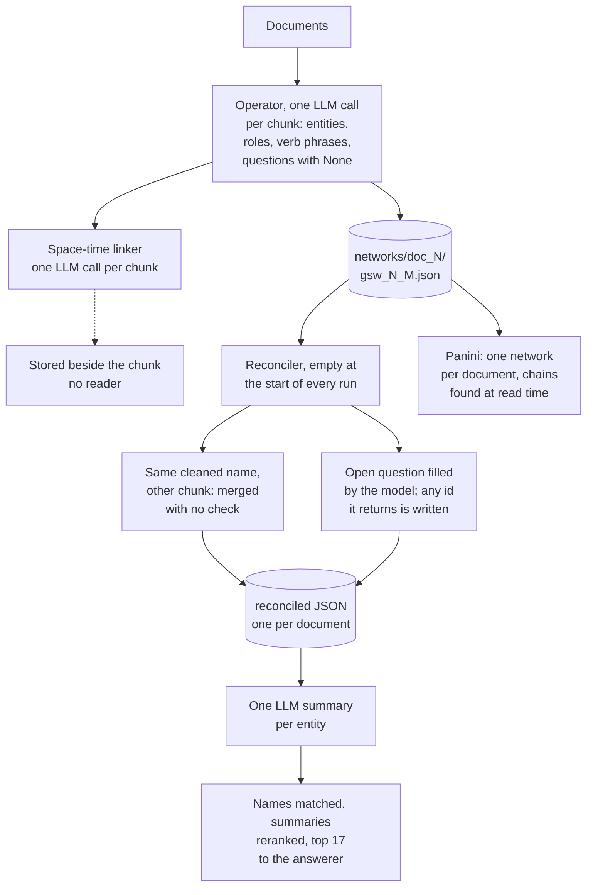

## 1. Executive Summary

GSW Memory is the code for two papers from UCLA's Roychowdhury group: Generative
Semantic Workspaces, which turns a narrative into a network of actors, roles,
states and verb-phrase questions, and Panini, which answers multi-hop questions
by chaining those question-answer pairs. The idea worth taking is the
**unanswered question as a stored object**: the extractor writes `None` for a
role the text has not filled, and the reconciler asks a later chunk to fill it.
The weakness is the reconciler around that idea. Its default strategy merges
any two entities with the same cleaned name from different chunks without a
check, and the space-time step the paper credits is computed and never applied.

It is a corpus index, not an agent's running memory. A run builds the workspace
from a list of documents and writes it to JSON. The loaders reload it so later
runs can skip the expensive stages, and no path adds a document to a saved
workspace. It is in scope on the same terms as [HippoRAG](../hipporag/): the
workspace outlives the process, its entities have identities, and the
reconciler revises what it holds.

The reconciler revises in three ways, each unguarded. It merges entities by
name. It fills an unanswered question with whatever the model returns, and the
write accepts any question id in the response, answered ones included. It
keeps a contradicting later answer as a second question with the same text,
with nothing marking the pair.

Panini, the second paper, lives in `playground/` and skips the reconciler: one
workspace per document, cross-document links found at read time by beam
search over question-answer pairs. The code matches the paper's description of
its read path, including the geometric-mean chain score.

**Licence.** The MIT grant arrived on 10 November 2026, nine months after the
first public commit on 13 February 2026: every checkout before `9f34cec` has no
licence file, and `pyproject.toml` still names none. The 20-chapter Tulving
Bench book and its questions ship inside the package under
`src/gsw_memory/benchmarks/tulvingbench/` with no statement of where they come
from or on what terms.

No capability mark is earned. Section 9 gives the reason for each.

## 2. Mental Model

A memory is **a semantic role filled by an entity, a literal, or nothing yet**.
The operator reads one chunk and writes entities, each with roles and states,
and verb phrases, each with questions such as *"Who apprehended the suspect?"*
whose answers are entity ids, `TEXT:` literals or `None`
(`src/gsw_memory/prompts/operator_prompts.py:282-312`). Every role and question
carries the `chunk_id` it came from (`src/gsw_memory/memory/models.py:13-66`).

A chunk's network becomes part of the workspace when the reconciler folds it in.
`Reconciler.reconcile` is the paper's *GSW_new = Reconciler(GSW_old,
new_context)*, applied chunk by chunk in one process
(`src/gsw_memory/memory/reconciler.py:68-138`):

- **An entity is merged** into an earlier one when the strategy pairs them. The
  newer roles join the older entity and answers are rewritten to the older id
  (`src/gsw_memory/memory/models.py:272-302`).
- **A verb phrase is merged** when its phrase text matches and one question
  pair shares an answer. A `None` answer is filled from the newer copy; a
  different answer to the same question text is appended as another question
  (`src/gsw_memory/memory/reconciler_utils/matching.py:241-369`).
- **An unanswered question is resolved** when the new chunk mentions an entity
  it links to. The model reads the chunk and returns question ids with answers
  (`matching.py:371-547`).

Nothing leaves the workspace. A wrong merge, a wrong fill or a stale answer
stays until the next run rebuilds the workspace from the operator outputs.
There is no status, confidence or validity time on any node; the only
temporal signal is the chunk order the summaries are sorted by.

## 3. Architecture

A Python library over JSON files, with no service. `GSWProcessor`,
`reconcile_gsw_outputs`, `EntitySummaryAggregator` and `GSWQuestionAnswerer`
are the public surface (`src/gsw_memory/__init__.py:72-82`). Every LLM call
goes through `bespokelabs-curator`, which batches and caches requests. Voyage
`voyage-3` embeddings rerank summaries and back the embedding matcher; FAISS
holds entity vectors for the agentic tools.

Persistence is a directory tree written when an `output_dir` is passed:
`networks/doc_N/gsw_N_M.json` per chunk, `gsw_results_combined.json` for the
whole run, and under `reconciled/` either `doc_N_reconciled.json` per document
or one `global_reconciled.json` (`src/gsw_memory/memory/operator.py:531-600`,
`src/gsw_memory/memory/reconciler.py:553-674`). `utils/loaders.py` reads these
back, and its docstring states the purpose: *"enabling iteration on downstream
components without re-running expensive LLM operations"*
(`src/gsw_memory/utils/loaders.py:1-7`).

The Panini path is a set of playground scripts with hard-coded data paths,
such as `/mnt/SSD1/shreyas/SM_GSW/2wiki/networks`
(`playground/multi_hop_qa_chains.py:126-129`). It embeds entities and
question-answer pairs with Qwen3-Embedding through vLLM and reranks chains with
Voyage. The GSW networks it reads for five datasets are published on
HuggingFace, not in the tree.

### Deployment and ergonomics

`uv sync`, an `OPENAI_API_KEY` and a `VOYAGE_API_KEY`. Nothing can be stored
without the OpenAI key, since extraction is the write. A vLLM endpoint can
replace OpenAI for extraction; the code then forces the factual prompt set
whatever `prompt_type` was asked for (`operator.py:282-305`). The Panini scripts
also need vLLM and a GPU for Qwen3 embeddings.

The store is human-readable JSON and can be repaired by hand, which is the
only correction path there is. The README's package map names files that are
not in the tree (`processors.py`, `reconciliation.py`, `entity_matcher.py`,
`summary_reranker.py`), and its `pip install gsw-memory` was not checked
against a registry.

## 4. Essential Implementation Paths

- **Extraction.** `GSWProcessor.process_documents`
  (`src/gsw_memory/memory/operator.py:71-450`): coreference per document
  (`:123-153`), three-sentence chunks with one sentence of overlap
  (`:155-191`), a context paragraph per chunk (`:193-229`), the operator under
  constrained decoding to `GSWStructure` (`:282-347`), and the space-time
  linker (`:384-437`). A chunk whose output fails to parse is dropped with a
  print (`:349-363`).
- **Reconciliation.** `reconcile_gsw_outputs`
  (`src/gsw_memory/memory/reconciler.py:742-866`) creates a fresh
  `Reconciler` per document for `local` or one for `global`; `reconcile`
  (`:68-138`) prefixes ids with the chunk id (`:140-217`), merges entities
  (`:219-266`), adds space and time nodes (`:280-336`), merges verb phrases and
  resolves questions (`:121-136`).
- **Matching.** `ExactMatchStrategy` and `EmbeddingMatchStrategy`
  (`src/gsw_memory/memory/reconciler_utils/matching.py:199-547`, `:686-784`),
  chosen by `create_matching_components` (`:790-831`); the verification prompt
  is in `src/gsw_memory/prompts/reconciler_prompts.py:44-64`.
- **Summaries.** `EntitySummaryAggregator.precompute_summaries`
  (`src/gsw_memory/memory/aggregators/entity_summary.py:141-176`) gathers each
  entity's roles and verb-phrase involvement by chunk (`:309-372`) and makes
  one LLM call per entity.
- **Query.** `GSWQuestionAnswerer.ask_batch`
  (`src/gsw_memory/qa/qa_system.py:103-167`) with `EntityMatcher`
  (`src/gsw_memory/qa/matcher.py:24-92`), `SummaryReranker`
  (`src/gsw_memory/qa/reranker.py:32-138`) and `AnsweringAgent`
  (`src/gsw_memory/qa/answering_agent.py:14-99`).
- **Agentic query.** `AgenticAnsweringAgent`
  (`src/gsw_memory/qa/agentic_agent.py:59-306`) over `GSWTools`
  (`src/gsw_memory/qa/gsw_tools.py`).
- **Panini.** `playground/generate_gsws_multihop.py` builds the per-document
  networks, `playground/simple_entity_search.py` indexes entities and
  question-answer pairs, `playground/multi_hop_qa_chains.py` runs the chain
  search, `playground/evaluate_panini.py` drives it.

## 5. Memory Data Model

Pydantic models in `src/gsw_memory/memory/models.py`:

- **`EntityNode`** (`:26-40`): id, name, a list of `Role` (role, states,
  chunk id), the chunk id it first appeared in, and a `summary` field nothing
  in the pipeline writes (the aggregator keeps summaries in its own dict).
- **`VerbPhraseNode`** (`:56-66`): id, phrase, and `Question` objects (`:43-53`)
  each holding answers as a list of strings.
- **`SpaceNode` and `TimeNode`** (`:69-112`): a `name_history` keyed by chunk
  id and a `current_name`.
- **`GSWStructure`** (`:115-145`): the four node lists and three edge lists
  (similarity, entity-space, entity-time).

An answer string is one of three things by convention: an entity id, a
`TEXT:` literal or `"None"`. Ids become `<chunk_id>::<local id>` on
reconciliation (`reconciler.py:140-217`), where a chunk id is
`<doc index>_<chunk index>` (`operator.py:177`).

Scope is the file. The `local` strategy writes one workspace per document and
`GSWQuestionAnswerer` searches all of the workspaces it is handed
(`qa_system.py:193-201`). No record carries a user, agent, session or tenant
key.

Time is chunk order. There is no wall-clock or validity field anywhere in the
model; `name_history` on a space or time node is keyed by chunk id.

### Space and time nodes have no producer

The reconciler merges space and time nodes, redirects their edges and keeps a
history of names (`models.py:305-376`, `reconciler.py:280-336`), and the
aggregator can put them in a summary (`entity_summary.py:374-408`). Nothing in
the tree creates one. The operator prompts name only `entity_nodes` and
`verb_phrase_nodes` in their output schema (`operator_prompts.py:282-312`). The
space-time linker's result is stored under the chunk's `spacetime` key and
saved to `spacetime/doc_N/` (`operator.py:434-437`, `:520-529`), and no code
reads that key back. Space and time nodes exist only if the extraction model
fills the optional schema fields its prompt never asks for.

## 6. Retrieval Mechanics

**The default path is name matching, then embedding rerank.** An LLM extracts
entity names from the question. `EntityMatcher` keeps every entity whose name
contains a question entity, is contained in one, or shares any word with one,
with no stop-word list (`matcher.py:49-75`). So a question entity containing
*"the"* matches every entity name containing *"the"*. The matched entities'
precomputed summaries are embedded with the question on every call, ranked by
cosine and cut to `max_summaries`, 17 by default (`reranker.py:69-136`,
`qa_system.py:87`, `:106`). The answering prompt calls them *"chapter by chapter
narrative summaries"* (`answering_agent.py:17-30`).

`include_connected=True` adds every entity that appears in any verb phrase with
a matched entity (`matcher.py:94-144`). It is off by default.

**Summaries carry a chronology that drops the document.** `_sort_chunk_key`
was written for ids of the form `chunk_X_Y` and skips the first part
(`entity_summary.py:410-437`). A reconciled id is `X_Y`, so the key is the chunk
index alone. Within one document that is the right order. In a `global`
workspace chunk 2 of the first document sorts after chunk 0 of the tenth. A
question resolved by the model has its chunk id rewritten to
`chunk_<doc>_<chunk>` (`reconciler.py:369`) and sorts by a different key from
its siblings. This follows from the code and was not run.

**The agentic tools search entities, not summaries.** `GSWTools` offers BM25
over entity names, FAISS over Voyage embeddings of entity names, and a context
call that returns every question an entity answers with the other entities in
it (`gsw_tools.py:416-582`). The FAISS index is cached as
`gsw_embeddings_gpu.faiss` and `gsw_metadata.json` in the working directory and
reused when the stored entity count equals the current one
(`gsw_tools.py:172-193`). A different corpus with the same entity count loads
the old vectors against the new names. The `.gsw_cache` directory the
constructor creates is never used (`:67-69`). The Panini searcher checks its
cache entry by entry against the current texts
(`playground/simple_entity_search.py:602-623`).

**Panini decomposes, then follows chains.** One LLM call splits the question
into sub-questions, each later one taking the previous answer as its argument.
Each hop retrieves question-answer pairs by entity search and dense search,
reranks them, and keeps five chains (`playground/evaluate_panini.py:543-553`).
The mode named `cumulative` scores a chain by the geometric mean of its
normalised hop scores (`playground/multi_hop_qa_chains.py:207-242`), which is
what the paper's equation 1 describes.

## 7. Write Mechanics

The write is the batch. `process_documents` runs coreference, chunking,
context, extraction and space-time linking for all documents at once, and
`reconcile_gsw_outputs` folds the results. An agent never writes.

**Entity reconciliation, exact strategy.** The default. Names are lowercased
and stripped of anything but letters, digits and spaces, and every earlier
entity with the same cleaned name from another chunk becomes a merge pair
(`matching.py:218-239`). The class docstring says *"exact name and verifying
roles/states"* (`:200`); nothing verifies. Two people called John in different
chunks of a chapter become one entity, and under `global` that holds across
the whole corpus.

**Entity reconciliation, embedding strategy.** The top five neighbours by
Voyage embedding go to an LLM verifier, whose prompt accepts pairs that are
*"the same or strongly related"* and gives *"person and their role"* as an
example of the second (`reconciler_prompts.py:49-64`). A related pair is merged
like an identical one. This strategy reconciles no verb phrases and resolves no
questions (`matching.py:766-784`).

**Question resolution.** For each chunk whose entities matched earlier ones,
the reconciler collects that entity's verb phrases with an unanswered question
and asks the model which ones the chunk answers (`matching.py:371-476`). The
response is applied by question id, looked up across the whole workspace
(`:501-507`). An answered question whose id the model returns is overwritten,
and an entry with neither answer text nor entity id sets the answer back to
`None` (`:518-536`). The chunk text in that prompt is document content, so an
instruction inside a document reaches the step that chooses which ids to
overwrite.

**Contradiction.** When a newer verb phrase merges into an older one and a
question with the same text has a different answer, the newer question is
appended beside the older (`matching.py:326-354`). Both are summarised and both
are served. Nothing records that they disagree.

**Failure handling.** A chunk whose operator output fails to parse is dropped
(`operator.py:359-363`). Under `local`, a document whose reconciliation raises
is skipped (`reconciler.py:819-821`), and the saved files are numbered by
position in the result list (`:561-565`), so every later document is saved
under the previous document's number. An empty summary is replaced by
*"Summary generation failed."* and served like any other
(`entity_summary.py:282-290`). Each question resolution writes its prompt and
parsed response to `logs/prompt_log_chunk_<id>.txt` under the working directory
(`matching.py:386`, `:479-485`).

### Operational cost

Extraction is up to three LLM calls per chunk (context, operator, space-time)
plus one coreference call per document, in parallel batches. Reconciliation is sequential, with one question-resolution call per
chunk that matched an earlier entity and, under the embedding strategy, one
verification call and a set of embedding calls per chunk. Summaries are one
call per entity. The AAAI paper puts indexing 200 chapters at about $15 with
GPT-4o. Nothing is retrievable until the whole batch finishes, and adding a
document means running reconciliation and summaries again over the corpus
(`reconciler.py:46`, `:65`, `:94` are the only assignments to the in-process
workspace).

A query costs one entity-extraction call, one Voyage call embedding every
candidate summary, and one answer call over up to 17 summaries.

## 8. Agent Integration

There is no agent-facing write. `AgenticAnsweringAgent` drives the OpenAI
Responses API with two read tools, `search_gsw_entity_embeddings` and
`get_multiple_entity_contexts`, and a caller-supplied dict mapping their names
to `GSWTools` methods (`agentic_agent.py:59-117`, `:236-251`). The system
prompt teaches the model to look for inverse relations because the workspace
may store one direction only (`:149-158`).

`get_multiple_entity_contexts` takes ids of the form `<file path>::<entity
id>`, splits off the path and opens it (`gsw_tools.py:598-627`). The path comes
from the model's tool arguments and is not checked against the files the tools
were built over. A path to a non-GSW file returns an error string.

The package's console script prints *"Hello from gsw-memory!"*
(`src/gsw_memory/__init__.py:120-121`). There is no MCP server, HTTP route or
framework adapter.

## 9. Reliability, Safety, and Trust

### The reconciler trusts names and the model

The exact strategy's merge is the largest risk, because it is the default and
nothing downstream can undo it: a merged entity has one id, one summary and
the union of two people's roles. The embedding strategy is the alternative and
its verifier is told to merge related entities too.

Question resolution is the second. The candidate list the model sees is
restricted to unanswered questions; the write is not. An answer the
operator extracted directly from the text can be replaced by one the model
inferred from a later chunk, and the summary shows only the replacement.

### Paper and code

The AAAI paper ([arXiv:2511.07587](https://arxiv.org/abs/2511.07587), submitted
10 November 2025, revised 16 February 2026) describes space-time coupling as a
separate step whose result updates space and time nodes and propagates to
coupled entities. The code runs that step and discards its result into a
sidecar (section 5). The paper's appendix ablation on the 200-chapter EpBench
corpus reports overall F1 of 0.850 for the full system and 0.811 *"w/o
Space/Time Linking"*. The released pipeline is, as wired, closer to the second
configuration. That is an inference from the code; nothing here was run.

The rest of the read path matches: chapter-scoped reconciliation is the
`local` strategy, query entities are matched by string, and the 17-chapter cap
is `max_summaries`.

Panini ([arXiv:2602.15156](https://arxiv.org/abs/2602.15156), submitted
16 February 2026) states in its body that cross-document connections *"are not
precomputed"* and that it *"does not yet perform latent-link caching or
experience-driven reconciliation"*. The code agrees:
`generate_gsws_multihop.py` imports `reconcile_gsw_outputs` and never calls it
(`playground/generate_gsws_multihop.py:27`). The abstract's memory that
*"accumulates and consolidates"* describes the direction, not this tree. The
same script disables space-time linking (`:113`) and prints that it is enabled
(`:123`).

### Marks

- **`scope_enforced` — withheld.** No record carries a scope key. The local
  strategy's per-document files are a physical partition, and the question
  answerer searches all of them.
- **`trust_state` — withheld.** No status field exists. `None` on an answer
  means unfilled, not doubted.
- **`tombstone` — withheld.** Nothing is rejected or deleted; a rebuild
  re-derives everything from the operator outputs.
- **`bitemporal` — withheld.** The only time is chunk order.
- **`audit_log` — withheld.** The per-chunk prompt logs record question
  resolutions only, are overwritten by the next run with the same chunk ids,
  and say nothing about merges.
- **`human_review` — withheld.** No surface; hand-editing the JSON is
  authoring.
- **`negative_eval` — withheld.** Section 10.

## 10. Tests, Evals, and Benchmarks

I ran none of the suites. The counts are from reading.

There are 56 test functions in four files: 20 on the models, 13 on chunking
and output parsing, 10 on `EntityMatcher`, 13 on `GSWTools` with embeddings
patched out. CI runs them with ruff on pushes and pull requests to `main`
(`.github/workflows/ci.yml`).
No test constructs a `Reconciler`, an aggregator or the question answerer, so
merging, question resolution and contradiction handling are untested.

Three tests assert an absence, and none earns `negative_eval`.
`test_search_bm25_no_results` searches a term no entity has
(`tests/test_gsw_tools.py:35-39`). `test_no_match` asserts that a name no
entity carries is not returned, which cannot fail since the matcher returns
only stored entities (`tests/test_matcher.py:36-44`). `test_exact_match`
requires exactly one result for *"John Smith"* from three entities
(`tests/test_matcher.py:10-13`), an ordinary precision check.

The evaluation code is a Tulving Bench evaluator with an LLM judge
(`src/gsw_memory/evaluation/benchmarks/tulving_bench/`) and HippoRAG-style EM
and F1 (`src/gsw_memory/evaluation/hipporag_eval.py`). The tree holds a
20-chapter book and its questions; the paper's 200- and 2,000-chapter EpBench
corpora are not committed, and no result file is. The paper reports overall F1
of 0.850 against 0.771 for the best baseline at 200 chapters, 0.773 against
0.675 at 2,000, and about 3,587 context tokens per query.

Panini's networks and evaluation splits are on HuggingFace. Its paper reports
an average F1 of 56.06 against 53.3 for HippoRAG 2 over six benchmarks and
319.79 average answer-context tokens. None of it recomputes from this tree,
whose Panini scripts point at `/mnt/SSD1/...` and `/home/yigit/...` paths.

## 11. For Your Own Build

### Steal

- **Store the unanswered question.** A slot the text has not filled is a
  record with an id, so a later document can fill it and a reader can see it
  is open.
- **Questions as the index unit.** A verb phrase with typed who, what, where,
  when questions gives both a retrieval key and an answer, and Panini's short
  chains of them reach an answer with far less context than passages.
- **Chunk provenance on every role and question.** It is what makes a
  chronological per-entity summary possible.
- **Check a cache entry by its content.** The Panini searcher compares cached
  texts one by one before reusing vectors; the packaged tools compare a count.

### Avoid

- **Merging on an exact name with no second signal.** A name is the weakest
  identity a narrative has.
- **A verifier prompt that accepts "strongly related"** as a merge.
- **Applying a model's write by the id it returns** rather than the ids it was
  offered.
- **Running a stage and discarding its output.** The space-time call costs one
  LLM request per chunk and changes nothing the reader sees.
- **A sort key written for another id format.** It degrades silently into a
  plausible order.

### Fit

This suits a researcher who wants a structured episodic index over a fixed
corpus of narratives, rebuilt when the corpus changes, and who will read the
JSON. For that reader the operator prompts and the question-filling idea are
the assets.

It does not suit an agent that learns as it goes. There is no incremental
write, no correction other than a rebuild, and no record of what was merged or
overwritten. Anyone whose corpus has two people with one name should expect
them to be one person.

## 12. Open Questions

- Did the original research code apply the space-time linker's output to the
  workspace? The paper says so; this tree does not.
- What do the unmerged branches hold? `sleep-time-gsw` (tip 30 April 2026)
  changes 309 files and `Sleep-Time-Panini` 93; the pyproject's `training`
  extra mentions sleep-time agent research. Neither was read.
- Was `global` reconciliation used for any published result, given the
  timeline key drops the document index?
- Is `gsw-memory` published on a package index, and with which licence
  metadata?

## Appendix: File Index

| Path | Role |
| --- | --- |
| `src/gsw_memory/memory/models.py` | Entity, role, verb phrase, question, space and time nodes; merges |
| `src/gsw_memory/memory/operator.py` | The extraction pipeline and its file layout |
| `src/gsw_memory/memory/reconciler.py` | Chunk-by-chunk reconciliation, local and global strategies, saving |
| `src/gsw_memory/memory/reconciler_utils/matching.py` | Exact and embedding matching, verb-phrase merge, question resolution |
| `src/gsw_memory/prompts/operator_prompts.py` | Episodic and factual extraction prompts, space-time prompt |
| `src/gsw_memory/prompts/reconciler_prompts.py` | Question-resolution and entity-verification prompts |
| `src/gsw_memory/memory/aggregators/entity_summary.py` | Per-entity chronological summaries |
| `src/gsw_memory/qa/qa_system.py`, `matcher.py`, `reranker.py`, `answering_agent.py` | The default query path |
| `src/gsw_memory/qa/gsw_tools.py`, `agentic_agent.py` | Agentic read tools |
| `src/gsw_memory/utils/loaders.py` | Reloading a saved run |
| `playground/generate_gsws_multihop.py`, `simple_entity_search.py`, `multi_hop_qa_chains.py`, `evaluate_panini.py` | The Panini path |
| `tests/` | The 56 unit tests |

### Recorded searches

Run from the repository root at the pinned commit with `git grep`.

- **Nothing constructs a space or time node.**
  `git grep -n -E 'SpaceNode\(|TimeNode\(' -- src playground ':!*.ipynb'`
  returns the two class definitions in `models.py:69` and `:92`.
- **The operator prompts name no space or time fields.**
  `git grep -n -E 'space_nodes|time_nodes|space_edges|time_edges' -- src/gsw_memory/prompts`
  returns nothing; `git grep -c 'entity_nodes' -- src/gsw_memory/prompts`
  returns 15.
- **The space-time result has no reader.**
  `git grep -n -E '"spacetime"' -- src playground ':!*.ipynb'` returns
  `operator.py:188`, `:434`, `:481`, `:520` and `:529`, all initialising,
  setting or saving it.
- **No path loads a saved workspace into the reconciler.**
  `git grep -n -E 'global_memory *=' -- src playground ':!*.ipynb'` returns
  `reconciler.py:46`, `:65` and `:94`, and the keyword argument at `:367`.
- **Panini generation never reconciles.**
  `git grep -n 'reconcile_gsw_outputs' -- playground/generate_gsws_multihop.py`
  returns only the import at `:27`.
- **Only the embedding strategy verifies.**
  `git grep -n -E 'EntityVerifier\(|verify_pairs\(' -- src` returns
  `matching.py:129`, `:707`, `:724` and `:755`, all in or above
  `EmbeddingMatchStrategy`.
- **No test reaches the reconciler, aggregator or answerer.**
  `git grep -n -E 'Reconciler|reconcile|EntitySummaryAggregator|GSWQuestionAnswerer|resolve_questions' -- tests`
  returns nothing; `git grep -n 'GSWTools' -- tests` matches.
- **No deletion or expiry in the package.**
  `git grep -n -i -E 'delete|forget|tombstone|expire|ttl' -- src ':!src/gsw_memory/benchmarks'`
  returns nothing; `git grep -n -i 'remove' -- src/gsw_memory/evaluation/hipporag_eval.py`
  matches.
- **No scope key.**
  `git grep -n -i -E 'user_id|tenant|session_id|agent_id|namespace' -- src ':!src/gsw_memory/benchmarks'`
  returns nothing; `git grep -n 'doc_idx' -- src/gsw_memory/memory/reconciler.py`
  matches.
- **No service surface.**
  `git grep -n -i -E 'mcp|fastapi|flask|uvicorn' -- src` returns nothing;
  `git grep -n -i 'openai' -- src/gsw_memory/qa/agentic_agent.py` matches.
- **The cache directory is unused.** `git grep -n 'cache_dir' -- src` returns
  `gsw_tools.py:68` and `:69`.
- **Files the playground README lists are absent.**
  `git ls-files playground | grep -E 'hypernode|evaluate_multi_hop|generate_hypernode|process_full_2wiki_corpus\.py'`
  returns nothing; `git ls-files playground | grep process_full_2wiki` returns
  the `_backup.py` file.

## History

**2026-11-24** — [`eb2ef0df8030dca2acb1d6ef61377194c0b5ff69`](https://github.com/roychowdhuryresearch/gsw-memory/commit/eb2ef0df8030dca2acb1d6ef61377194c0b5ff69). First reading, from a full clone at the head of `main`. Screened first: one auto-run surface, `.claude/settings.json`, a harness permission list; one collection-time execution point, `tests/conftest.py`; `uv.lock` last changed on 13 February 2026, outside the seven-day cooldown. Docs and prompts were read as data. Nothing was installed, built or run, and the 56 test functions were not run. Both arXiv ids were checked against their titles. No marks ([section 9](#9-reliability-safety-and-trust)). The space-time linker's output is never applied, and the default reconciler merges entities on name alone.
