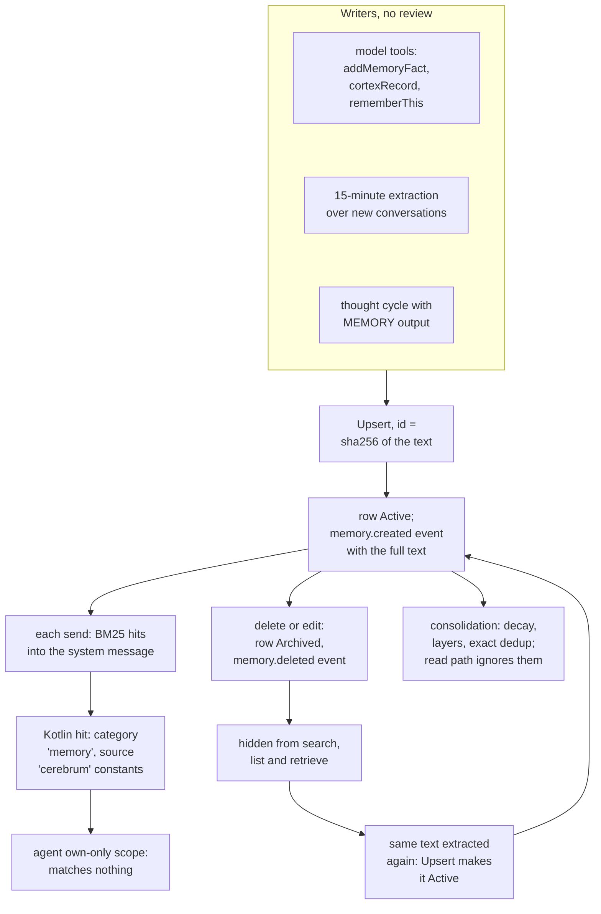

## 1. Executive Summary

GURU is an Android app that gives a language model a Linux userland and
several hundred device and network tools. Its memory, Cerebrum, is a Rust
engine linked into the app over JNI. Facts are prose rows filed under a
domain, topic and subtopic and keyed by the SHA-256 of their text, held in one
in-process state that is sealed into an encrypted vault file on each save. The
model writes facts through tools, a background pass extracts more from
conversations, and every send injects BM25 hits into the system message.

What is notable is the read path's handling of retirement. A deleted or
merged-away memory keeps its bytes, and one predicate hides it from search,
listing and retrieval alike, with a populated test that proves it for merges.
The event trail keeps the text of every write. The search code records, in a
committed eval and the comments beside the fusion, that the paper's binary
signatures could not separate relevant from unrelated text, and demotes them to
a booster.

What is weak is nearly everything the README calls biological. Strength, decay
and the buffer, episodic and semantic layers are computed and never read by
ranking or filtering. The Kotlin conversion of a search hit hard-codes the
category and source, so an agent reading its own facts gets nothing and the
category filter on text search for facts matches nothing. Deleted text comes back the
next time extraction finds it. The brain the app ships is a committed `.so`
that no Gradle file builds, and it predates the Rust source at this pin.

**Licence.** The brain that ships is object code committed at
`GURUbeta-FULL/app/src/main/jniLibs/arm64-v8a/libcerebrum_android.so`, and no
Gradle file builds it (section 3). Three commits touch `cerebrum/` after that
file last changed, and the JSON key `superseded`, which one of them added, does
not occur in the binary, so the source beside the binary at this pin is not the
source it was built from. `LICENSE` is the unmodified GNU AGPL 3.0 text, with
no section 7 additions; `NOTICE.md` reserves the names and logo and lists each
bundled binary's licence. The prompts that decide what extraction keeps are
fetched from `api.unuslumen.com`, which the README calls closed source.

## 2. Mental Model

A memory is a sentence the brain was told to keep. There is no candidate
state: whatever a tool, the extraction pass or a thought cycle sends is live
the moment the curate frame returns. Its identity is its text, so the same
sentence written twice is one row, and an edited sentence is a different row.

The row has a lifecycle of `Active`, `Hibernated` or `Archived`
(`GURUbeta-FULL/cerebrum/cerebrum-curate/src/lib.rs:53-57`). `Hibernated` has no
producer outside a unit test. `Archived` is what a delete writes (`lib.rs:640`),
and `is_retired` is the single read-side test for it
(`GURUbeta-FULL/cerebrum/cerebrum-server/src/handler.rs:116-121`). A belief
stops being served only when someone deletes it, an edit archives its old
wording, or consolidation folds it into an exact duplicate.

Beside the lifecycle sits a decay record per memory: a layer, a strength, an
access count and an `archived` flag of its own
(`GURUbeta-FULL/cerebrum/cerebrum-decay/src/lib.rs:62-73`). Search strengthens
every hit by 0.1 and consolidation promotes on access counts. Nothing that
decides what is retrieved reads any of it (section 6), so a memory's layer
describes its history and has no bearing on whether it is believed.

A deletion is not a refusal. A later Upsert of the same text lands on the same
id and replaces the archived row with an active one (`lib.rs:560-570`). The
deletion record is keyed on the value, and the writer never consults it.

## 3. Architecture

The app is a Gradle multi-module Kotlin build. `cerebrum-android` is a `cdylib`
that holds one `CerebrumState` per process behind a Tokio mutex and exposes six
JNI functions; Kotlin sends hex-encoded frames through `cerebrumExecute`
(`GURUbeta-FULL/cerebrum/cerebrum-android/src/lib.rs:1-20`). The protocol has
eight request types and the app dispatches six: CURATE, RETRIEVE, SEARCH,
GRAPH_TRAVERSE, CONSOLIDATE and LIST
(`GURUbeta-FULL/portal/data/src/main/java/com/unuslumen/app/data/brain/cerebrum/CerebrumBrainApi.kt:686-692`).
QUERY and PREFETCH are defined and never sent.

Every engine lives in that struct: the context tree, a BM25 index, a
256-bit signature index, a dynamic wavelet matrix, decay, a four-view graph,
dream, episodic, prefetch, a TF-IDF embedding fallback, an experience index and
the event store among them (`GURUbeta-FULL/cerebrum/cerebrum-server/src/state.rs:34-94`).
Every save rewrites all of it as a new vault generation: Argon2id at 256 MiB
for the key, XChaCha20-Poly1305 per record, temp file, fsync and rename
(`GURUbeta-FULL/cerebrum/cerebrum-crypto/src/header.rs:33-36`,
`GURUbeta-FULL/cerebrum/cerebrum-crypto/src/vault.rs:192-229`). A curate or
consolidate frame arms a save 10 seconds after the last write, and a 5-minute
tick catches the rest (`cerebrum-android/src/lib.rs:336-339`, `:665`).

Room holds the rest: conversations, messages, tool results, project facts,
notes to self and an injection ledger. A one-shot migration moved four Room
memory tables into the brain. A second Kotlin memory stack sits beside it, with
its own decay, dream and query engines and a seven-day half-life
(`GURUbeta-FULL/portal/data/src/main/java/com/unuslumen/app/data/brain/DecayEngine.kt:34`).
Nothing constructs those engines; the only brain class the DI graph builds is
`BrainService`.

### Deployment and ergonomics

Nothing external is needed to store or recall: no network, no key, no model for
search. Extraction needs a model, and the app expects Ollama on the LAN or a
cloud key. The store is not repairable by hand; it is ciphertext under a
passphrase sealed in the Android Keystore.

The brain binary is not built from this tree. No Gradle file names Cargo or
Cerebrum, and `cerebrum-android/README.md` gives the step as a manual `cp` of a
release build into `jniLibs/arm64-v8a`. Only that ABI carries it, so an x86_64
emulator build has no brain. The binary last changed in commit `971848e`, dated
1 November 2026; `4a11883`, `3ea8aa0` and `a847e65`, dated 18 and 19 November,
change `cerebrum/` afterwards. The JSON key `superseded` that `a847e65` added
to the update event does not occur in the binary, while `memory.deleted` and
`total_live` do. I read that as the shipped brain predating at least that
commit.

## 4. Essential Implementation Paths

- **Tool write.** `addMemoryFact` normalises the category against a fixed
  vocabulary; `CerebrumBrainApi.storeFact` refuses JSON-shaped bodies and sends
  one Upsert whose id is SHA-256 over the text and its length
  (`GURUbeta-FULL/portal/data/src/main/java/com/unuslumen/app/data/tools/MemoryToolExecutor.kt:82-117`,
  `CerebrumBrainApi.kt:79-85`, `:271-304`). `cortexRecord` sends the same op
  with the caller's hierarchy, rationale and relation ids (`:331-369`).
- **Edit.** `updateMemoryFact` upserts the new text under its new id, then
  deletes the old id best-effort (`MemoryToolExecutor.kt:217-258`). The brain's
  Update op, which records the superseded text, is never sent.
- **Curate.** `handle_curate` validates and applies the batch to the tree
  atomically, writes a WAL record per op, then runs a pipeline per op:
  tokenise, signature, wavelet matrix, BM25, decay `Buffer`, event,
  cross-references, temporal and semantic edges, episode, embeddings, hot
  cache (`handler.rs:249-359`, `:509-671`).
- **Delete.** The executor re-inserts the row as `Archived`
  (`cerebrum-curate/src/lib.rs:636-648`); `retire_memory` removes it from the
  indexes and the graph and archives its decay row (`handler.rs:798-804`).
- **Recall.** `ContextBuilder.buildPreamble` runs a 20-hit brain search plus
  Room LIKE lanes for messages and tool results and records what it injected;
  the send path appends the preamble to the system message
  (`GURUbeta-FULL/portal/data/src/main/java/com/unuslumen/app/data/memory/ContextBuilder.kt:94-186`,
  `GURUbeta-FULL/portal/data/src/main/java/com/unuslumen/app/data/repository/AiRepositoryImpl.kt:1008-1014`).
- **Extraction.** `HiveMindWorker` runs every 15 minutes over conversations
  created after the newest marker, keeps facts the model scores at 0.7 or
  above, drops literal and model-judged duplicates, and persists the rest
  (`GURUbeta-FULL/portal/data/src/main/java/com/unuslumen/app/data/memory/HiveMindWorker.kt:123`,
  `:187`, `:332`).
- **Consolidation.** `DreamWorker` daily and `DecayWorker` every 12 hours both
  send CONSOLIDATE (`brain/BrainScheduler.kt:39`, `:54`), which runs
  `handle_consolidate` (`handler.rs:1576-1815`).

## 5. Memory Data Model

The brain's row is a `ContextEntry`: id, domain, topic, subtopic, content,
relations, a `Provenance` of source string, confidence and timestamp, a
rationale, `created_at`, `updated_at` and the lifecycle. The wire has no
confidence field, so the client packs it into the provenance string as
`source|confidence=0.9000` and the server parses it back out
(`handler.rs:375-395`). `storeFact` files a fact's category as its domain and
records `guru storeFact:` plus the category as its rationale.

There is no scope key. An agent's own facts go under the domain
`agent.` plus its slug, with provenance `agent=` plus the slug
(`GURUbeta-FULL/portal/data/src/main/java/com/unuslumen/app/data/agents/AgentMemoryService.kt:177-192`,
`:219`). Bookkeeping lives beside ordinary facts: thread summaries and the
extraction pass's "hive processed conversation marker" rows are facts, and the
pass finds the latest marker by a top-1 BM25 search that nothing orders by time
(`GURUbeta-FULL/portal/data/src/main/java/com/unuslumen/app/data/memory/MemoryRepositoryImpl.kt:338-365`).

Project facts are a separate store: a Room `project_facts` table with a
`project_id` column, written by the `add_project_fact` tool and read by
project id (`GURUbeta-FULL/core/database/src/main/java/com/unuslumen/app/database/dao/ProjectFactDao.kt:20`).
Notes to self are a Room table with an `enabled` flag and keyword triggers,
hard-deleted on request.

Time is record time only: `created_at` and `modified_at` on the core entry and
a timestamp on each event. No field says when a fact held.

## 6. Retrieval Mechanics

Search is BM25 first. `handle_search` takes three times the limit from the
lexical index, then a signature lane at Hamming radius 110 over both the
signature index and the wavelet matrix, and fuses them by reciprocal rank with
k = 60 (`handler.rs:1397-1455`). The signature lane may only promote what BM25
found; `fused.retain` drops anything it proposed alone. The comments give the
reason: in `cerebrum-signatures/tests/radius_eval.rs` unrelated pairs reached
82 bits and relevant ones 134, so no radius separated them.

A retired id is skipped before the body is built (`handler.rs:1482`). When
nothing matches, a substring scan over non-archived rows is the fallback. The
returned score is the fused score divided by the top hit's.

Nothing in `handle_search` reads decay strength, layer, confidence or the
decay `archived` flag. Its only decay call is `access`, which strengthens each
hit (`handler.rs:1492`). A memory that decay archives for being weak and
unvisited for 90 days is still returned by every search, because its tree row
is still `Active`.

The Kotlin side then discards what the brain knows. `BrainService.search`
builds each hit with `category = "memory"`, `layer = "BUFFER"` and
`source = "cerebrum"` as constants, and `confidence` set to the search score
(`GURUbeta-FULL/portal/data/src/main/java/com/unuslumen/app/data/brain/BrainService.kt:43-65`,
`:329`). The preamble prints those fields, so every injected line reads
`Memory [memory] (confidence: N%, layer: BUFFER)` whatever the row holds
(`ContextBuilder.kt:146`).

Two filters downstream break on those constants. `searchMemoryFacts` with a
query and a category keeps hits whose category matches it, and `memory` is not
in the vocabulary, so every valid category returns nothing
(`MemoryRepositoryImpl.kt:222-225`). The agent filter is in section 8.

## 7. Write Mechanics

Writes are synchronous frames under the brain's mutex. A tool call returns once
the curate pipeline has run, and the row is searchable at once; it reaches disk
within about 10 seconds. No write asks a model except extraction, which runs
off the turn. Every save re-encrypts the whole state, so its cost grows with
the store rather than with the change.

An Upsert of existing text resets the row's decay to a fresh `Buffer` entry
with strength 1.0 and no accesses, because the add pipeline inserts a new decay
record (`handler.rs:539-542`, `cerebrum-decay/src/lib.rs:76-88`). A repeat save
undoes any promotion the fact had earned.

Consolidation decays strength by layer, with a one-hour half-life for `Buffer`,
30 days for `Episodic` and none for `Semantic`
(`cerebrum-decay/src/lib.rs:48-49`, `:154`). It promotes a buffer entry with any
access and an episodic entry with three, and archives entries below 0.01 that
nobody touched for 90 days (`:180`, `:197`, `:206-219`). Duplicate detection is
exact text after whitespace and case folding (`handler.rs:1067-1069`, `:1620`).
The dream engine's prune and semantic-upgrade results are not applied
(`handler.rs:1793`). The README's seven-day half-life is the constant of the
unconstructed Kotlin engine.

Extraction writes whatever the model returns at confidence 0.7 or above. Its
duplicate check reads the brain's live listing, which excludes archived rows,
so a fact a person deleted is new to it. When the model words it the same way,
it is upserted back to active under the same id.

## 8. Agent Integration

The main conversation holds nine memory tools — search, add, update, delete
and list facts, search conversations, read a thread, search everything and walk
the graph — plus `cortexRecord`
(`GURUbeta-FULL/portal/data/src/main/java/com/unuslumen/app/data/tools/MemoryToolDefinitions.kt:52-89`).
The model also gets a preamble on every send without asking. Notes to self are
a second injection lane: the model writes keyword-triggered notes, and each
send injects every enabled note whose keyword appears as a whole word in the
user's message (`GURUbeta-FULL/portal/data/src/main/java/com/unuslumen/app/data/notestoself/NotesToSelfEngine.kt:22-48`).

Sub-agents read memory once, before their first prompt: `AgentRuntime` calls
`AgentMemoryService.search` with the job text and appends the permitted hits
(`GURUbeta-FULL/portal/data/src/main/java/com/unuslumen/app/data/agents/AgentRuntime.kt:658-669`).
The filter keeps a hit when its category is in the agent's set, or the set is
empty, and either shared reads are granted or the hit's source names the agent
(`AgentMemoryService.kt:115-119`). The source is always `cerebrum` and the
category always `memory`, so an agent on the default own-only scope is handed
nothing, and one with shared reads is handed everything. `rememberThis` tells
the agent its next job will be given the fact; under the default scope it will
not be.

`ownFacts`, which lists the agent's domain through the LIST frame's working
domain filter, has no caller (`AgentMemoryService.kt:204-216`). The unit test of
the scope filter passes because its fixture supplies
`source = "agent=researcher"`, a value the production conversion never emits
(`GURUbeta-FULL/portal/data/src/test/java/com/unuslumen/app/data/agents/AgentMemoryServiceTest.kt:135-162`).

## 9. Reliability, Safety, and Trust

### What a delete does

A delete hides the row from search, list, retrieve and, through the Kotlin
resolver, from graph walks. The text stays in three places: the archived tree
row, the archived decay row and the `memory.created` event, which has no
removal path. Nothing in the tree erases a memory from the vault.

The "brain backup" tools snapshot, verify and restore the Room database file
(`GURUbeta-FULL/core/database/src/main/java/com/unuslumen/app/database/snapshot/DatabaseSnapshotEngine.kt:59`).
The facts live in the Cerebrum vault, which the snapshot path does not name, so
a snapshot restored onto a new phone carries chat history and no facts.

### What reaches the model

Every send injects up to 20 brain hits, 15 message matches and 3 tool results
into the system message, ahead of the notes to self. The block varies with the
query, so it sits where a provider's prefix cache cannot reuse it. Nothing
filters by confidence, and the confidence printed is the search score.
Extraction trusts the model's score of its own output, and a fact taken from a
web page the model read lands like any other.

### Marks

- **`audit_log`** — awarded on the event store. Every Upsert appends
  `memory.created` with the full text, every Delete appends `memory.deleted`,
  and consolidation appends `memory.consolidated` (`handler.rs:545-554`,
  `:885-887`, `:1112-1119`). The store is a `Vec` with no removal and is sealed
  into each vault generation
  (`GURUbeta-FULL/cerebrum/cerebrum-events/src/lib.rs:59-76`,
  `GURUbeta-FULL/cerebrum/cerebrum-server/src/persistence.rs:215-220`). The
  app's edit is a create plus a delete with no link between them, the delete
  event carries no text or reason, a consolidation event names a count rather
  than the ids it consumed, and no app surface reads the trail.
- **`scope_enforced`** — awarded on project facts, which a project agent reads
  by `project_id` (`ProjectFactDao.kt:20`,
  `GURUbeta-FULL/portal/data/src/main/java/com/unuslumen/app/data/ProjectAgentRepositoryImpl.kt:237`,
  `:395`). The write takes `projectId` from the model's arguments. The brain
  has no scope at all.
- **`negative_eval`** — awarded; see section 10.
- **`tombstone`** — withheld. The archived row is keyed on the hash of the
  deleted text, which is the right key, and Upsert replaces it without reading
  its lifecycle.
- **`trust_state`** — withheld. `Archived` is deletion, `Hibernated` has no
  producer, and confidence is a float no read filters on.
- **`human_review`** — withheld. Every writer lands live. Thought-cycle
  proposals wait as insights a person can acknowledge, but acknowledging
  writes a timestamp and promotes nothing, and `acknowledgeInsight` is also a
  model tool. `writeOwn` is a permission on an agent, not a review of what it
  writes.
- **`bitemporal`** — withheld; record time only.

## 10. Tests, Evals, and Benchmarks

The Rust workspace has 545 test functions and the Kotlin modules 2,308 `@Test`
methods. There is no CI; `ARCHITECTURE.md` says a merge is gated on a local
build. I ran none of it.

`negative_eval` rests on
`GURUbeta-FULL/cerebrum/cerebrum-server/tests/merge_retirement.rs:113-213`. Two
memories are added and found by search and by a graph walk, and a Merge folds
them. The test then asserts neither source comes back from search or the walk,
that the merged record does come back from a search on the same terms, and
that both sources' content survives in archived decay rows. It drives the real
SEARCH and GRAPH_TRAVERSE frames, so a decoder returning nothing would fail the
positive half. The Android app never sends a Merge, and whether the shipped
binary contains commit `3ea8aa0`, which added this test and its fix, is not
settled by its strings.

Other suites are thinner where it matters. `fact_identity.rs` asserts a deleted
memory is absent from search over a store holding only that memory, which
passes on an empty result. `retrieval_quality.rs` asserts unrelated queries
return no hits from a seeded corpus. `version_history.rs` covers the
superseded text on an Update the app does not send. The agent scope test is
green on a fixture the producer never makes (section 8).

The signature code cites *Hippocampus: An Efficient and Scalable Memory Module
for Agentic AI* ([arXiv:2602.13594](https://arxiv.org/abs/2602.13594), 14
February 2026). Its abstract proposes binary signatures for semantic search and
a Dynamic Wavelet Matrix co-indexing them with token streams, evaluated on
LoCoMo and LongMemEval. The tree implements both structures, and
`radius_eval.rs` is a committed measurement that the signatures alone do not
separate relevant text. No LoCoMo or LongMemEval harness or result is committed.

## 11. For Your Own Build

### Steal

- **A shared retirement predicate.** Decide "is this memory gone" in a single
  function and call it from search, list and retrieve, so they cannot disagree
  about a delete.
- **Measure the cheap semantic lane before trusting it.** A committed eval of
  relevant against unrelated distances is what justified demoting the
  signatures to a booster, and the comment beside the fusion cites it.
- **Put the replaced text in the update event.** An event carrying `superseded`
  beside `text` lets the trail rebuild both the present and the history.

### Avoid

- **Mapping a rich reply onto constants at the boundary.** A conversion that
  writes `category = "memory"` and `source = "cerebrum"` turns every downstream
  filter on those fields into a constant answer.
- **Decay that nothing reads.** Strength and layers that never reach ranking
  or filtering cost a background pass and change nothing the user sees.
- **A content-addressed id without a tombstone check.** Keying rows on the
  text is half of a tombstone; the writer has to consult the archived row too.
- **Shipping a hand-copied binary beside its source.** If the build does not
  produce the artefact, the source in the tree stops describing the product.

### Fit

This is a single-user phone companion whose memory is an encrypted file the
owner never sees, and it suits someone who wants that and accepts that the
model decides what is kept. It does not suit anyone who needs a delete to
stick, agents with private memory, or a backup that carries facts. Read it for
the retirement predicate and the signature measurement; reuse neither the
decay engine nor the agent-scope layer without rewiring the conversion that
feeds them.

## 12. Open Questions

- Which commit the shipped `libcerebrum_android.so` was built from, and whether
  it contains the merge-retirement fix the negative test covers.
- Whether the server-authored extraction and dedup prompts differ from the
  offline fallback in `HivePromptFetcher`, since they decide what becomes a
  fact.
- Whether the agent tool picker can grant `searchMemoryFacts` to a sub-agent,
  which would read the whole brain past its memory scope.

## Appendix: File Index

- Brain state and frames: `GURUbeta-FULL/cerebrum/cerebrum-server/src/state.rs`,
  `GURUbeta-FULL/cerebrum/cerebrum-server/src/lib.rs`,
  `GURUbeta-FULL/cerebrum/cerebrum-server/src/handler.rs`
- Tree, lifecycle and curate executor: `GURUbeta-FULL/cerebrum/cerebrum-curate/src/lib.rs`
- Decay: `GURUbeta-FULL/cerebrum/cerebrum-decay/src/lib.rs`
- Events: `GURUbeta-FULL/cerebrum/cerebrum-events/src/lib.rs`
- Vault and persistence: `GURUbeta-FULL/cerebrum/cerebrum-crypto/src/vault.rs`,
  `GURUbeta-FULL/cerebrum/cerebrum-crypto/src/header.rs`,
  `GURUbeta-FULL/cerebrum/cerebrum-server/src/persistence.rs`
- JNI host: `GURUbeta-FULL/cerebrum/cerebrum-android/src/lib.rs`,
  `GURUbeta-FULL/portal/data/src/main/java/com/unuslumen/app/data/brain/cerebrum/CerebrumHost.kt`,
  `GURUbeta-FULL/portal/data/src/main/java/com/unuslumen/app/data/brain/cerebrum/CerebrumBrainApi.kt`
- Kotlin memory: `GURUbeta-FULL/portal/data/src/main/java/com/unuslumen/app/data/brain/BrainService.kt`,
  `GURUbeta-FULL/portal/data/src/main/java/com/unuslumen/app/data/memory/MemoryRepositoryImpl.kt`,
  `GURUbeta-FULL/portal/data/src/main/java/com/unuslumen/app/data/memory/ContextBuilder.kt`,
  `GURUbeta-FULL/portal/data/src/main/java/com/unuslumen/app/data/memory/HiveMindWorker.kt`,
  `GURUbeta-FULL/portal/data/src/main/java/com/unuslumen/app/data/agents/AgentMemoryService.kt`
- Tools: `GURUbeta-FULL/portal/data/src/main/java/com/unuslumen/app/data/tools/MemoryToolDefinitions.kt`,
  `GURUbeta-FULL/portal/data/src/main/java/com/unuslumen/app/data/tools/MemoryToolExecutor.kt`,
  `GURUbeta-FULL/portal/data/src/main/java/com/unuslumen/app/data/tools/MemoryWriteToolDefinitions.kt`,
  `GURUbeta-FULL/portal/data/src/main/java/com/unuslumen/app/data/tools/ProjectToolExecutor.kt`
- Tests: `GURUbeta-FULL/cerebrum/cerebrum-server/tests/merge_retirement.rs`,
  `GURUbeta-FULL/cerebrum/cerebrum-server/tests/fact_identity.rs`,
  `GURUbeta-FULL/cerebrum/cerebrum-server/tests/version_history.rs`,
  `GURUbeta-FULL/cerebrum/cerebrum-signatures/tests/radius_eval.rs`,
  `GURUbeta-FULL/portal/data/src/test/java/com/unuslumen/app/data/agents/AgentMemoryServiceTest.kt`

### Recorded searches

Run from the repository root at the pinned commit with `/usr/bin/git grep`.

- **The app sends only Upsert and Delete.**
  `git grep -n -E '\\"(Update|Merge|Add)\\"' -- '*.kt'` returns nothing;
  `git grep -n -E '\\"(Upsert|Delete)\\"' -- '*.kt'` matches four lines
  outside tests.
- **QUERY and PREFETCH are never dispatched.**
  `git grep -n -E 'FRAME_QUERY|FRAME_PREFETCH' -- '*.kt'` matches only the
  `const val` lines; `git grep -n 'dispatchOrNull(FRAME_SEARCH' -- '*.kt'`
  matches one call.
- **The Kotlin decay, dream and curation engines are never constructed.**
  `git grep -n -E '(DecayEngine|DreamEngine|CurationEngine|BrainService)\(' -- '*.kt'`
  outside tests and class headers matches only
  `single { BrainService(get(), get<Context>()) }` at `AiDataModule.kt:236`.
- **`ownFacts` has no production caller.**
  `git grep -n '\.ownFacts(' -- '*.kt'` matches one line, in
  `AgentMemoryServiceTest.kt`.
- **`memory` is not a category.**
  `git grep -n '"memory"' -- GURUbeta-FULL/portal/domain/src/main/java/com/unuslumen/app/domain/memory/MemoryCategories.kt`
  returns nothing; `git grep -c '"knowledge"'` on the same file counts 3.
- **No app surface reads the event trail.**
  `git grep -n -E 'history_for|previous_content' -- '*.rs' '*.kt'` outside
  `cerebrum-events/src/lib.rs` and `tests/` returns nothing; the same pattern
  counts 3 in `cerebrum-server/tests/version_history.rs`.
- **`Hibernated` has no producer.**
  `git grep -n 'EntryLifecycle::Hibernated' -- '*.rs'` matches two lines inside
  the unit-test module of `cerebrum-curate/src/lib.rs` and the restore parser
  at `cerebrum-server/src/persistence.rs:1168`.
- **The snapshot path does not name the vault.**
  `git grep -n -i -E 'vault|cerebrum' -- GURUbeta-FULL/core/database/src/main/java/com/unuslumen/app/database/snapshot GURUbeta-FULL/portal/data/src/main/java/com/unuslumen/app/data/tools/backup`
  matches only a comment about `CredentialVault` at
  `DatabaseSnapshotFormat.kt:30`; `git grep -c -i 'vault'` on
  `brain/cerebrum/CerebrumBoot.kt` counts 5.
- **No Gradle file builds the brain.**
  `git grep -n -i -E 'cargo|cerebrum' -- '*.gradle.kts' '*.gradle'` returns
  nothing; `git grep -c -i -E 'jniLibs|ndk' -- '*.gradle.kts'` counts 5 in
  `GURUbeta-FULL/app/build.gradle.kts`.
- **The shipped binary lacks a later key.**
  `LC_ALL=C grep -c -a -F 'superseded' GURUbeta-FULL/app/src/main/jniLibs/arm64-v8a/libcerebrum_android.so`
  counts 0; the same command counts 1 for `memory.deleted` and for
  `total_live`. `git log --since=2026-11-01T10:07 -- GURUbeta-FULL/cerebrum/`
  lists `a847e65`, `3ea8aa0`, `4a11883` and `971848e`, the last being the
  binary's own commit.
- **No validity-time field.**
  `git grep -n -i -E 'valid_from|valid_to|valid_until|valid_at|occurred_at|event_time' -- '*.rs'`
  returns nothing; `git grep -n -E 'created_at|modified_at' -- GURUbeta-FULL/cerebrum/cerebrum-core/src/lib.rs`
  matches lines 210 and 211.
- **No LoCoMo or LongMemEval harness.**
  `git grep -n -i -E 'locomo|longmemeval' -- '*.rs' '*.kt' '*.ts' '*.md'`
  returns nothing; `git grep -n -i 'arxiv' -- '*.rs'` matches five lines.
- **Acknowledging an insight writes no fact.**
  `git grep -n -E 'persistFacts|storeFact|storeRecord' -- GURUbeta-FULL/thoughts/data/src/main/java/com/unuslumen/app/thoughts/data/thoughts/ThoughtCycleRepositoryImpl.kt`
  matches only line 534, in the `MEMORY` output branch; `acknowledgeInsight`
  at line 273 calls `insightDao.acknowledge` alone.
- **No CI.** `git ls-files .github` lists only `.github/FUNDING.yml`.

## History

**2026-11-21** — [`366208c8799d39cd5ec3921dd85a3d418e93810b`](https://github.com/GuruProduction/GURUbyUnusLumen/commit/366208c8799d39cd5ec3921dd85a3d418e93810b) — first reading, from a full clone of `main`, scoped to the Cerebrum server, curate, decay, events and vault crates, the JNI host, and the Kotlin memory, agent-memory, extraction, project-fact, notes-to-self and thought-cycle paths with their tests; the other Rust crates and the founder documents were not read for the mechanism. Screened first: one auto-run surface, an LFS filter on `*.tflite` in `.gitattributes`; one unpinned surface, `factory/package.json`, with three floating ranges and a lockfile; an inert `scripts/hooks/pre-commit`; nothing inside the cooldown. No LFS object was fetched. AGPL-3.0-or-later, no rider. Nothing installed, built or run. Three marks: `scope_enforced`, `audit_log`, `negative_eval`.
