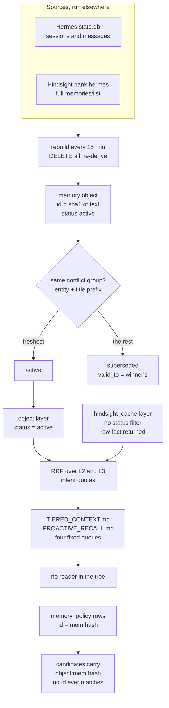

## 1. Executive Summary

Hermes Memory Installer copies a set of Python maintenance scripts into a
[Hermes Agent](../hermes-agent/) home and schedules them beside two services the
operator runs, [Hindsight](../hindsight/) and [GBrain](../gbrain/). Its own
memory is one derived SQLite file that a cron job deletes and rebuilds every
15 minutes from the agent's sessions and the full Hindsight list. Its notable
part is retrieval engineering: five governance layers, an intent router, and a
live Hindsight call behind a need test, a timeout and a circuit breaker. Its
weak part is the last step. The fused recall is written to two Markdown files
that nothing in the repository reads into a prompt.

The rest of the sidecar is optional and mostly inert. A `governance/` package
adds a policy table with validity columns and a superseded pointer, a temporal
lookup and a mid-term buffer, all off by default. The only writer of policy rows
keys them by object id; the only read-path caller passes ids with an `object:`
prefix, so no candidate ever matches a policy. No capability mark is earned:
the package's two exact-list negative tests exercise functions the recall path
never engages. The ranking rules name one
deployment's topics, and the evaluation harness's synthetic backend scores each
case's fixture hits against that case's own expected field.

## 2. Mental Model

The sidecar holds no belief of its own. A memory is a **memory object**, built
fresh on every rebuild by `build_memory_object_rows`
(`scripts/memory_governance_rebuild.py:1615-1838`). Each Hindsight fact and each
session's title, summary and first user message is normalized to lowercase
ASCII and CJK words. The object id is the first 16 hex characters of the SHA-1
of that text (`:557-567`), so two sources with identical normalized text merge
into one object.

Every object enters `active` (`:1644`, `:1711`). Confidence is a constant per
source: 0.72 for a Hindsight fact, raised to 0.82 for an `observation` and 0.78
for a `world` fact, and about 0.64 for a session. Freshness is 0.60 or 0.72 for
Hindsight, and for a session falls linearly from 0.9 by 1/120 a day to a floor of 0.35 (`:591-599`).

The one state transition is supersession inside a **conflict group**. The group
key is the entity type plus the first 40 characters of the normalized title,
stripped of years, small numbers and hex strings (`:807-816`). In each group of
two or more, the object ranked highest by version tag, freshness, confidence and
source mix stays `active`. The others are marked `superseded`, with `valid_to`
set to the winner's `valid_from` (`:1811-1836`). Nothing compares what the
objects say. Two objects titled "Provider Config: x" are resolved the same way
whether they agree or disagree.

An object dies when its source does. The rebuild begins with
`DELETE FROM memory_objects` (`:1910`), so a fact deleted from Hindsight or a
session deleted from `state.db` leaves the index at the next run. There is no
forget verb, no rejection and no record of what was dropped.

## 3. Architecture

The repository is an installer plus everything it installs. `install.sh`
installs PyYAML with pip if the import fails, then runs `installer/install.py`
(`install.sh:13-18`). The installer copies 43 scripts from `scripts/` into
`$AGENT_HOME/scripts/` through a staging directory with per-file rollback
(`installer/install.py:99-143`, `:708-758`). It backs up and patches the agent's
`config.yaml`, `config.json` or `claude_config.json`. It sets
`memory.provider: hindsight` only when no provider is set, and records the
sidecar version and scripts path (`:657-705`). Three flags deploy the
memory-quality packages to `$AGENT_HOME/memory-sidecar/`, create the
`memory_policy` table, and write a cron block whose every line is commented
`# REMEDIATION-PAUSED` (`:43-54`, `:1012-1020`).

At run time there are three stores. The agent's own `state.db` is read for
sessions and messages, and `auto_archive_sessions.py` also writes to it. The
sidecar's `memory_governance.db` holds every index. Markdown output lands under
`$AGENT_HOME/memories/`. Hindsight is read over HTTP at `127.0.0.1:8890`, bank
`hermes` (`memory_governance_rebuild.py:57-63`). GBrain is written over its MCP
endpoint at `localhost:8787/mcp`, with a bearer token taken from the
environment or scraped from the agent's `config.yaml`
(`session_to_gbrain.py:30-57`). An embedding endpoint is optional and used only
when `EMBEDDING_API_URL` is set (`memory_governance_rebuild.py:2884-2909`).

Everything is cron. `docs/ops/server-root.cron` is the author's own crontab,
committed: a governance rebuild under `flock` every 15 minutes, gbrain
archiving every six hours, a live-recall refresh worker every ten minutes,
weekly session retirement, and a set of observability jobs.
`memory_maintenance_cycle.py` runs session archiving, the rebuild, a Hindsight
consolidation drain, recall generation and a health snapshot in order
(`:152-216`).

### Deployment and ergonomics

An operator needs Python 3.9 or later, PostgreSQL 16, a running Hindsight, a
running GBrain, and an agent home with `state.db`. The installer's default mode
3 runs `sudo apt-get install … postgresql postgresql-contrib` or the dnf and yum
equivalent through `subprocess.run(command, shell=True)` when any of the three
services is missing (`installer/install.py:884-899`, `:964-968`). It installs
distribution packages only.

It never fetches Hindsight or GBrain, and the two
project links it prints for them, `HindsightTechnologySolutions/hindsight` and
`hi-ogawa/gbrain`, both returned 404 from the GitHub API on 5 November 2026
(`:902-907`, `README.md:80-81`). The API paths the scripts call are those of
[Hindsight](../hindsight/), and the MCP tool names those of [GBrain](../gbrain/).
Without Hindsight the rebuild retries each page 24 times five seconds apart and
then raises (`memory_governance_rebuild.py:1176-1205`), so the index never
builds. Nothing works offline beyond the agent's own session search. The
governance database is plain SQLite and disposable, since a forced rebuild
recreates it.

## 4. Essential Implementation Paths

- **Install.** `main` (`installer/install.py:972-1041`) runs environment checks,
  optional package bootstrap, `install_sidecar` (`:810-850`) and the optional
  memory-quality deploy and cron.
- **Rebuild.** `rebuild_index` (`memory_governance_rebuild.py:1840-2200`) skips
  when the governance file's mtime is later than `state.db`'s and under 900
  seconds old
  (`:1534-1541`). It deletes nine tables, reads every session with its first
  user and last assistant message, fetches the whole Hindsight list, builds
  hubs and objects, refreshes the knowledge-note index, and embeds active
  objects. One commit closes it, so a failure mid-way leaves the previous index.
- **Knowledge notes.** `knowledge_notes.py` indexes Markdown under
  `$AGENT_HOME/knowledge/notes`, skipped when a signature of the directory is
  unchanged.
- **Recall.** `generate` (`tiered_context_injector.py:1803-1883`) builds L1
  (recent sessions), and per query L2 (`get_l2`, FTS5 and LIKE over `state.db`,
  `:1238-1355`) and L3 (`get_l3`, `:1358-1686`). It fuses them with `rrf_fuse`
  (`:1165-1182`), applies feedback, routes, and writes both files atomically.
- **gbrain archive.** `session_to_gbrain.py` writes one page per session file
  with tags, a timeline entry, regex-extracted Chinese relation wikilinks and
  links to topic hubs (`:535-600`, `:603-656`), checkpointed by processed file
  name.
- **Session retirement.** `auto_archive_sessions.py` copies sessions older than
  30 days into an `archives` table and deletes them from `sessions`
  (`:39-50`); no file in the tree creates `archives`.
- **Policy, temporal, MTM.** `governance/inject_policy.py`,
  `governance/policy.py`, `governance/temporal.py`, `mtm/consolidator.py`,
  each a CLI or library behind a flag.
- **Live refresh.** `live_hindsight_refresh_worker.py` drains
  `recall_refresh_queue` oldest-first and writes results into `hindsight_index`.

## 5. Memory Data Model

`memory_objects` (`memory_governance_rebuild.py:1391-1413`) carries `object_id`,
`object_type`, `entity_type`, `source_kind` (`session`, `hindsight` or `mixed`),
`title`, `summary` (up to four distinct parts, 1,600 characters), `entities`,
`hub_ids`, `source_refs` as JSON, `status`, `confidence`, `freshness`,
`valid_from`, `valid_to`, `version_tag`, `conflict_group`, `last_seen_at` and
`indexed_at`. `version_tag` is `current` when freshness reaches 0.82 and a
year-month otherwise (`:794-804`).

`valid_from` is Hindsight's `mentioned_at` or the session's `started_at`, the
time the source was said, and `valid_to` is empty unless the object lost its
conflict group (`:1647-1648`, `:1714-1715`, `:1835`). `hindsight_index` copies
Hindsight's `occurred_start` and `occurred_end` (`:2049-2050`), and no read in
the tree selects them.

Six tables are declared and never written: `orphan_messages`,
`session_repair_map`, `session_lineage_repair`, `recovered_fragments`,
`memory_aliases` and `memory_relations` (`:1253-1324`). Two views over them are
created at `:1496-1519`, one joining the session index to `session_lineage_repair`.

`memory_policy` (`governance/policy.py:27-34`) holds importance, a tier CHECKed
to `core`, `mtm` or `archive`, policy confidence, source layer, sanitized
provenance, an eviction flag, `fact_key`, `conflict_group`, `valid_from`,
`valid_to`, `superseded_by`, and `created_at` and `updated_at`. It lives in the
governance file and is not among the tables a rebuild deletes, so its rows
outlive the objects they name.

**Scope** is the directory. Every path derives from `AGENT_HOME`, then
`HERMES_HOME`, then `~/.hermes` (`runtime_paths.py:10`), and no row carries a
user, agent or project key. The Hindsight bank is a separate default, `hermes`,
in three scripts (`memory_governance_rebuild.py:60`,
`tiered_context_injector.py:62`, `memory_guardian.py:24`). Two profiles with
different homes and no `HINDSIGHT_BANK` override therefore index the same
facts. `profile_isolation_check.py` runs the acceptance check under two homes
with only `AGENT_HOME` and `PATH` in the environment and checks that each
passes, not that either is missing the other's data (`:12-40`).

## 6. Retrieval Mechanics

L3 asks five governance layers in a fixed order: hubs, objects, knowledge notes,
indexed sessions and the Hindsight cache (`tiered_context_injector.py:1470-1533`).
Each layer runs FTS5 `bm25` with a LIKE fallback, then a stack of keyword
predicates. Of the five, the object layer filters `status = 'active'`
(`memory_governance_rebuild.py:2609`, `:2629`, `:2651`, `:2682`). The hub,
session and Hindsight-cache layers filter on no status. A superseded object's
source fact is returned through `hindsight_cache`, so supersession
removes the derived row and not the text.

Candidates pass `add_candidate` (`tiered_context_injector.py:1375-1467`),
which drops cron sessions, applies per-intent coverage rules and keeps the
higher-priority layer when two rows share a normalized title and snippet. The
intent classifier returns `dossier`, `knowledge`, `system`, `relationship`,
`recent`, `project` or `general` from marker tuples (`:247-262`). Each intent
has a layer quota plan (`:265-287`). The markers and hub keywords are one
deployment's subjects. `BASE_MEMORY_HUB_DEFS` defines hubs for the Hermes
system, coding, A-share stocks and social media, and the injector's
`RELATIONSHIP_MARKERS` names a partner relationship
(`memory_governance_rebuild.py:289-310`, `tiered_context_injector.py:157-164`).

Three expensive paths sit behind gates. Live Hindsight recall runs only when
`should_use_live_hindsight` finds too few direct hits, the operator set
`MEMORY_LIVE_HINDSIGHT_ENABLED`, and the circuit file is closed
(`tiered_context_injector.py:425-443`, `:1536`). A failure opens the circuit for
600 seconds and queues the query for the background worker (`:1588-1591`,
`:488-502`, `:546-579`). `should_use_expensive_fallbacks` (`:446-462`) gates a
LIKE scan of `semantics.db`, FTS over `archives_fts` in `state.db`, and the
object embeddings. The embedding path prefilters with FTS or LIKE over active
objects, keeps only rows with the best term coverage, and ranks those by
cosine (`memory_governance_rebuild.py:2830-2874`, `:2951-2995`). Despite its
name, the `semantics` layer reads `semantics.db` with `content LIKE`, and its
only writer, `sync_embeddings.py`, is not installed.

Fusion adds `1/(60 + rank)` and 0.05 times the layer score per list, then
`rerank_fused` applies intent rules (`tiered_context_injector.py:1165-1182`,
`:783-895`). Feedback moves a candidate by at most 0.012 (`:1756-1769`).
`route_context` labels the result `inject_all`, `inject_one` or
`fallback_session_search` by score bands (`:1772-1779`). The label is printed
into the file; nothing acts on it.

## 7. Write Mechanics

The sidecar never writes a fact of its own. Its writes are re-derivations:
the governance rebuild, a gbrain page per session file, and the two Markdown
files. The rebuild is extractive and model-free. It takes text as Hindsight and
the agent stored it, filters cron sessions and short rows, and assigns hubs and
entity types by keyword (`memory_governance_rebuild.py:1615-1735`).
`add_specialized_provider_object` adds a second object for text about model
providers and gateways (`:713-779`).

Correction is supersession by freshness inside a title-prefix group, recomputed
from scratch on every rebuild. Deduplication is the text hash; a fact restated
in different words is a different object. `recall_feedback`, written by
`--feedback-key` and `--rating` from the CLI, keys on a hash of slug, title and
snippet and only nudges rank (`tiered_context_injector.py:1706-1730`).

`governance/inject_policy.py --apply` scores every object by a keyword
heuristic and upserts a policy row whose `valid_to` is the object's: an empty
string for an active object (`inject_policy.py:44-74`). `current_policies`
admits a row only when `valid_to` is NULL or later than the current time,
and `inactive_policy_ids` treats any other `valid_to` as expired (`policy.py:106-137`).
An empty string sorts below every timestamp. So every policy row this writer
produces for an active object is classed expired. The installer schedules the
decay pass, paused, and nothing schedules the injection
(`installer/install.py:52`). `superseded_by` is in the upsert and in both
filters, and no caller passes it.

`MidTermMemory.retain` appends to a JSONL buffer that `consolidate` promotes,
merges or evicts by keyword score under `MTM_ENABLED`
(`mtm/consolidator.py:24-90`). `retain` has no caller outside tests, so in an
installation the buffer stays empty.

### Operational cost

Nothing blocks the agent, because nothing runs in its process. The lag before
a new session or Hindsight fact is retrievable is the rebuild interval, 15
minutes under the committed cron, plus Hindsight's own extraction lag. The lag
before it reaches the Markdown files is the maintenance cycle's schedule.

Every
rebuild reads every session row with two correlated subqueries and pages
through the entire Hindsight bank 200 at a time
(`memory_governance_rebuild.py:1860-1898`, `:1176-1205`). With an embedding
endpoint it re-embeds every active object on every rebuild. The write lock is
held from the first `DELETE` to the final commit, across the Hindsight fetch
and its retries. The Markdown output is bounded: L1 is a recent-sessions
table, and each recall section holds five fused rows of about 200 characters.

## 8. Agent Integration

The sidecar has no MCP server, tool or hook of its own. It reaches the agent in
three ways. It sets the agent's memory provider to Hindsight when none is
configured, so per-turn recall is whatever the agent's Hindsight provider does.
It adds three skills, `memory-starter-kit`, `memory-archivist` and
`memory-proactive`, as Markdown under `skills/`. And it writes
`$AGENT_HOME/memories/TIERED_CONTEXT.md` and `PROACTIVE_RECALL.md`
(`tiered_context_injector.py:59-60`).

Nothing in the tree reads those two files. The [Hermes Agent](../hermes-agent/)
report, at its own pin, finds Hermes injecting `MEMORY.md` and `USER.md` from
that directory. A file beside them is unread unless the agent opens it. The
maintenance cycle generates recall for four fixed queries, `memory`, `stock`
and two Chinese system queries (`memory_maintenance_cycle.py:29-34`). The
output does not depend on what the agent is working on.

The `memory-proactive` skill tells the agent to run
`tiered_context_injector.py --query`, with `--min-score`, `--max-results` and
`--domains` as knobs (`skills/memory-proactive/SKILL.md:25-33`). The script's
parser defines `--recall`, `--test`, `--feedback-key`, `--rating` and `--note`
only (`tiered_context_injector.py:1890-1894`), so the documented example exits
with a usage error. The `--test` path does print fused JSON for one query,
which an agent with a shell could use.

## 9. Reliability, Safety, and Trust

### The policy layer cannot reach the read path

With `MEMORY_POLICY_RANKING_ENABLED=true`, `trim_l3_candidates` passes every L3
candidate to `apply_policy_to_candidates` (`tiered_context_injector.py:302-307`).
That function looks each candidate up by `session_id`, stripping a `hindsight:`
prefix (`governance/policy.py:149-155`). The candidates' ids are session ids,
`hindsight:<id>`, `hub:<id>`, note ids, `object:mem:<hash>` and
`semantic:mem:<hash>` (`memory_governance_rebuild.py:2340`, `:2435`, `:2786`,
`:2984`). Policy rows are keyed `mem:<hash>` or `mtm:<n>:<time>`. No id matches,
so the boost and the expiry filter are both no-ops, and the shadow log built on
the same function reports no change (`memory_ops/shadow_log.py:54`). Were the
prefix stripped, the empty `valid_to` would drop every governed object instead.

### Supersession is recency inside a title prefix

The conflict group is lexical. Objects whose titles share 40 normalized
characters, once digits and hex runs are removed, compete, and the freshest
wins. Different facts with similar titles collide, and the same fact under two
titles never meets itself. The loser is withheld on one of five layers only.
`version_tag` and `freshness` drive the outcome, and both come from timestamps,
so the latest mention wins whether or not it is right.

### Deletion and what survives it

Deletion is the sources' job. A Hindsight fact removed upstream, or a session
removed from `state.db`, is gone from every governance index within one rebuild
interval, including the embeddings, which are joined to live objects
(`memory_governance_rebuild.py:2838-2839`). Four things survive it: the gbrain
page written for the session, which no script deletes; the `memory_policy` row;
`recall_feedback` rows; and the last Markdown files until the next cycle. When
the embedding endpoint fails, `replace_canonical_semantic_index` returns before
its `DELETE`, so the previous vectors stay (`:2911-2944`). The join to
`memory_objects` keeps them from being returned once their object is gone.

`auto_archive_sessions.py` deletes session rows older than 30 days from the
agent's own `sessions` table. The architecture document's first goal is that
the sidecar does not delete source data (`ARCHITECTURE.md:21`). The deleted
sessions' messages stay in `messages`, which L2 reaches only through a join on
`sessions`.

### Hardcoded deployment in a public package

The README calls the repository clean of server-specific paths. The
`hermes-memory audit-repo` step in CI scans `.py`, `.md`, `.sh`, `.yaml`,
`.yml`, `.json` and `.j2` files for `/root/.hermes` (`bin/hermes-memory:82`,
`:92-95`). `docs/ops/server-root.cron` is the one `.cron` file, so the scan
skips it. It names `/root/.hermes` on 23 of its 30 entries and a public IPv4
address for a security-audit job. `compact_memory.py`, not installed, lists a
person's name among its protected keywords. The hub and marker tuples encode
one person's subjects into the public ranking code.

### Trust and injection

No path asks whether a stored text is true. Hindsight facts and session text
are indexed and copied into gbrain as they are, and snippets reach the
Markdown files with no framing as untrusted data. The gbrain token falls back to
the first `Authorization: Bearer` string in the agent's `config.yaml`
(`session_to_gbrain.py:37-49`). `memory_guardian.py` restarts
`hindsight.service` through `systemctl` when a consolidation operation looks
stuck, behind a cooldown (`:366-393`).

The live-recall circuit is guarded more closely than any other path in the
sidecar. The project's own
optimization report records that client timeouts did not cancel server work
and that 19 abandoned recall requests had accumulated, which is why live recall
is opt-in (`docs/memory-quality-optimization-report.md:399-422`).

### Marks

None is carried.

- **`tombstone`** — nothing records a rejected value; a source deletion is
  forgotten by re-derivation and a restated fact is a new object.
- **`trust_state`** — `status` is `active` or `superseded`, and the object
  layer filters on it. Every object enters `active`, the status is recomputed
  from freshness on every rebuild, and there is no candidate state.
  `superseded_by` and the MTM statuses have no product writer.
- **`bitemporal`** — `valid_from` is the time the source said it, and `valid_to`
  is another object's mention time. Hindsight's `occurred_*` columns are copied
  and never read. `temporal_retrieve` reads policy rows only, from no caller.
- **`scope_enforced`** — no row has a scope key; the home directory is a
  physical partition, and the Hindsight bank is shared by default.
- **`audit_log`** — `repair_runs` records rebuild runs, and recall metrics,
  feedback and the shadow log record reads. Nothing records a mutation of a
  memory.
- **`human_review`** — `--feedback-key` rates a candidate and changes rank;
  nothing waits for a person.
- **`negative_eval`** — withheld. Two exact-list cases in the governance
  package are populated and can fail, but neither can fire on the product's
  recall path; [section 10](#10-tests-evals-and-benchmarks) gives the reasons.

## 10. Tests, Evals, and Benchmarks

The suite is 289 pytest functions in 26 files. The release-check workflow runs
`pytest -q`, the repository audit, an installer dry run, a two-iteration
isolation soak, the synthetic recall benchmark and a checksum verify
(`.github/workflows/release-check.yml`). I did not run any of it.

The near-miss for `negative_eval` is two cases. In
`tests/test_policy_injection_and_ranking.py:45-58`, three policy rows are
injected, `m2` with an expired `valid_to`. The test requires the ranked list to
equal exactly `['m1', 'm3']` although `m2` entered with the highest score. In
`tests/test_gbrain_feeder_and_temporal_mtm.py:47-64`, current mode must return
exactly `['current']` and historical mode over the same two rows must return
both states. Both are populated and both can fail.

Neither reaches the system's retrieval: the fixtures write `valid_to` as NULL where the producer writes an empty string,
`temporal_retrieve` has no product caller, and the policy filter never matches
a live candidate ([section 9](#the-policy-layer-cannot-reach-the-read-path)).
They test two functions, not recall, so the mark is withheld. No case asserts that a superseded object stays out of a recall result.

The evaluation harness cannot fail on its default backend.
`memory_eval/registry_default.py` builds 40 cases, each carrying one
`synthetic_hit` whose content contains its own expected field.
`SyntheticAdapter.recall` returns those hits (`memory_eval/adapters.py:42-57`),
so recall@k is 1.0 by construction. The live adapter queries Hindsight's
`/v1/recall` with bank `default` (`:60-84`), a different route and bank from
the injector's. Neither adapter calls the sidecar's own retrieval.

`scripts/synthetic_recall_benchmark.py` seeds five sessions and runs only
`get_l2`. It sets `l3_count` to the L2 count and fills `top_sources` from a
table keyed on the expected titles (`:94-118`). The acceptance check that
requires source `knowledge` for the architecture query is therefore met by that
table, not by a knowledge-layer hit (`scripts/recall_samples.py:93-122`).

There is no paper, no committed result file beyond release notes, and no
retrieval-quality benchmark against a labelled set.

## 11. For Your Own Build

### Steal

- **Make the derived index disposable.** Delete and rebuild from sources in
  one transaction, and keep nothing in it that a rebuild cannot recreate. A
  failure leaves the previous index; a source deletion propagates by itself.
- **Gate a slow remote recall three ways.** A need test on local hits, an
  operator flag, and a file-backed circuit with a cooldown, with a queue that
  lets a background worker make the call the foreground skipped.
- **Join embeddings to the live rows on every read**, so a stale vector table
  left by a failed re-embed returns nothing whose row is gone.

### Avoid

- **Writing recall where nothing reads it.** Generating context for fixed
  queries into a file beside the agent's memory looks like injection in a demo
  and changes no answer.
- **Keying one table by the bare id and the reader by a prefixed one.** Make
  one function build the id, use it on both sides, and test with ids produced
  by the real writer.
- **A sentinel the comparison misreads.** An empty string for "no end" passes
  `IS NOT NULL` and sorts before every time; write NULL or test the writer's
  output.
- **An eval backend that returns its own expected answer.** Recall@k on
  fixtures that contain the expected field measures the metric code.
- **Topic markers in the ranking code.** They make the system fit one person's
  history and silently mis-rank everyone else's.

### Fit

This is one operator's production tooling around Hermes, Hindsight and GBrain,
published with the deployment in it. It suits someone who runs that exact
stack on a Linux host with root, who wants rebuild, health and
alerting cron jobs and a recall diagnostic CLI. It does not suit anyone looking
for a memory layer. The sidecar stores nothing of its own, and per-turn recall
is the Hindsight provider's. The policy and temporal additions do not take
effect. Expect to rewrite the hub definitions, intent markers and fixed queries
before its ranking means anything for another user.

## 12. Open Questions

- Whether the author's agent reads `TIERED_CONTEXT.md` through a prompt or
  skill outside this tree; the gray-deploy runbook checks that a title appears
  in the file, not in an answer.
- Whether Hermes's `state.db` has an `archives` table with the same columns as
  `sessions`, without which `auto_archive_sessions.py` fails each batch and
  stops after four errors.
- Where the history before 16 June 2026 went; tags v0.1.0 to v3.1.1 point at
  commits with no common ancestor with the pin.
- How often a conflict group joins two unrelated objects, which only a run
  against a real bank would show.

## Appendix: File Index

- Installer: `install.sh`, `install_cli.sh`, `installer/install.py`,
  `installer/config_patch.py`, `installer/check_env.py`
- Governance index and queries: `scripts/memory_governance_rebuild.py`,
  `scripts/knowledge_notes.py`, `scripts/state_db_schema.py`,
  `scripts/memory_family_registry.py`, `scripts/query_expansion.py`
- Recall and output: `scripts/tiered_context_injector.py`,
  `scripts/live_hindsight_refresh_worker.py`, `scripts/recall_samples.py`
- Archiving: `scripts/session_to_gbrain.py`, `scripts/archive_sessions.py`,
  `scripts/auto_archive_sessions.py`, `scripts/auto_session_summary.py`
- Background and health: `scripts/memory_maintenance_cycle.py`,
  `scripts/memory_guardian.py`, `docs/ops/server-root.cron`, `bin/hermes-memory`
- Memory-quality packages: `governance/`, `mtm/`, `gbrain_edges/`,
  `memory_eval/`, `memory_ops/`, `runtime_paths.py`
- Skills: `skills/memory-starter-kit/`, `skills/memory-archivist/`,
  `skills/memory-proactive/`
- Tests and CI: `tests/`, `.github/workflows/release-check.yml`,
  `scripts/synthetic_recall_benchmark.py`

### Recorded searches

Run from the repository root at the pinned commit with `/usr/bin/git grep`.

- **Nothing reads the Markdown output.**
  `git grep -n -E 'TIERED_CONTEXT|PROACTIVE_RECALL' -- . ':!tests' ':!*.md'`
  returns the writer, the maintenance cycle's script path and the CLI's
  gray-deploy file names only.
- **No caller passes `superseded_by`.**
  `git grep -n 'superseded_by=' -- . ':!tests'` returns the upsert's
  `excluded.superseded_by` and the row reader in `governance/policy.py`.
- **`temporal_retrieve` has no caller.**
  `git grep -n 'temporal_retrieve' -- . ':!tests' ':!*.md'` returns its
  definition.
- **`MidTermMemory.retain` has no caller.**
  `git grep -n -E '\.retain\(' -- . ':!tests'` returns nothing; the same
  pattern matches twice in `tests/`.
- **Nothing schedules the policy injection.**
  `git grep -n 'inject_policy' -- . ':!tests'` returns the paused `--decay`
  cron line in `installer/install.py:52` and documentation.
- **Declared tables with no writer.**
  `git grep -n -i -E 'INTO[[:space:]]+(memory_relations|memory_aliases|orphan_messages|session_repair_map|session_lineage_repair|recovered_fragments)' -- .`
  returns nothing; `INTO[[:space:]]+(memory_objects|memory_relations)` matches
  in the rebuild and four test files.
- **Nothing creates `archives`.**
  `git grep -n -i -E 'CREATE (VIRTUAL )?TABLE[^(]*archives' -- .` returns
  nothing.
- **`occurred_*` is written, never read.**
  `git grep -n -E 'occurred_(start|end)' -- . ':!tests' ':!*.md'` returns the
  schema and the two insert paths.
- **No tombstone or forget verb.**
  `git grep -n -i -E 'tombstone|blocklist|denylist|forget|forgotten' -- . ':!tests' ':!*.md'`
  returns nothing; adding `superseded` to the alternation matches in four files.
- **No scope key on the read path.**
  `git grep -n -i -E 'user_id|tenant|scope_id|bank_id' -- scripts/memory_governance_rebuild.py scripts/tiered_context_injector.py governance`
  returns nothing; across the tree `bank_id` appears in the eval adapter and
  the uninstalled `memory_reflect.py`.
- **The skill's flags are not defined.**
  `git grep -n -E 'add_argument\("--(query|min-score|max-results|domains)' -- scripts/tiered_context_injector.py`
  returns nothing; `--(recall|test)` returns two lines.
- **No paper.**
  `git grep -n -i -E 'arxiv|bibtex|@article|@misc|doi\.org|citation' -- .`
  returns nothing.

## History

**2026-11-05** — [`049d9ac628e516da2462cf7bada5460aec3d62a3`](https://github.com/mage0535/hermes-memory-installer/commit/049d9ac628e516da2462cf7bada5460aec3d62a3). First reading, from a depth-1 clone at the head of `main`, with history from the GitHub API. Screened first: no auto-run or build-time surface, nothing inside the seven-day cooldown, and one unpinned surface, `requirements.txt` with `PyYAML>=6.0` and `langsmith>=0.1.0`. The installer runs distribution package installs through a shell when services are missing, and `install.sh` pip-installs PyYAML unpinned. MIT, no rider. Nothing installed, built or run. No marks: the governance package's two exact-list negative cases test `temporal_retrieve`, which has no caller, and a policy filter the read path never engages, and `trust_state`'s active and superseded status is recomputed by freshness on every rebuild with no candidate state ([section 9](#marks)).
