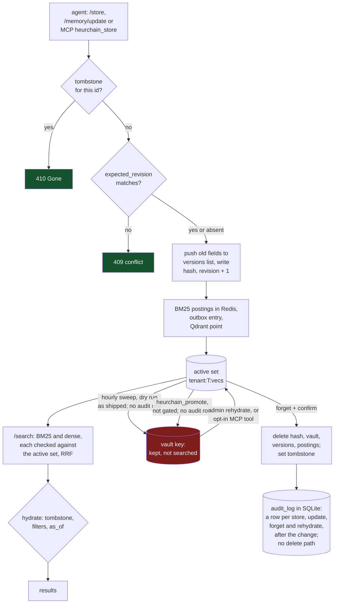

## 1. Executive Summary

HeurChain is a self-hosted memory broker: one Go binary that agents reach over
MCP or HTTP to store short texts and recall them by hybrid search. Records live
in Redis under a tenant id; a BM25 index in Redis and a Qdrant collection are
projections of them, fused by reciprocal rank fusion. What is notable is the
lifecycle around a record: corrections carry the revision the caller read,
forgetting leaves a tombstone that each read path checks for itself, a store,
correction or forget leaves an audit row the tenant's key cannot delete, and an
outbox repairs the vector index. What is weak sits inside a tenant: agents share one
store, the per-agent isolation trusts the agent id the requester declares, and
the audit row is written best-effort after the change, with none for the two
operations that move a record out of search.

It carries `bitemporal`, `scope_enforced`, `audit_log` and `negative_eval`.

**Licence.** MIT, and the tree agrees with itself: `LICENSE` and `npm/LICENSE`
are byte-identical, `npm/package.json:26` declares `MIT`, and the copyright line
names *HeurChain contributors*. No rider, no NOTICE file, no contributor
agreement. The grant covers this edition only. `CHANGELOG.md:21-22` says the
release *omits features that are incompatible with the self-hosted version*
without naming them; the tree shows their outline as two config sections
accepted and ignored (`broker/config.go:116-129`) and seven empty schema
migrations (`broker/migrate.go:59-70`).

**A forgotten id is refused on write and hidden on read, separately.** Forget
runs one Lua script that deletes the active hash, the vault copy, the version
list and the BM25 entries, and sets a tombstone key with no expiry
(`broker/memory_forget.go:13-48`). The store script refuses a tombstoned id
(`broker/memory_records.go:83`). Search hydration, the cosine scan, the
manifest, the per-agent listing, session context, export and stats each test
the tombstone themselves, so content restored from an older backup stays
hidden.

**Corrections are revision-checked and keep history.** An update names the
revision it read; the same script compares it, pushes the previous fields onto
a version list and writes the new hash (`broker/memory_records.go:82-126`). Two
racing corrections produce one success and one conflict.

**The tool named promote archives.** `heurchain_promote` moves a record whose
activation is below the threshold into the vault, out of search, without the
dry-run gate the sweep has and without an audit row. Its description says
exactly that and warns that it is not a retrieval boost; the name is the one
thing left pointing the other way.

## 2. Mental Model

A record is one mutable Redis hash per id per tenant. It is *active* while its
id is in the tenant's active set, *archived* once moved to the vault key, and
*forgotten* once a tombstone exists. Only active records are searched. Nothing
in the model says whether a record is believed.

## 3. Architecture

Four services, all on the operator's machine (`deploy/compose.yaml`):

| Service | Holds |
| --- | --- |
| Redis 7.4, AOF on | Records, vault copies, version lists, tombstones, sessions, a small key-value cache, the BM25 index, the index outbox, the auth cache and rate counters |
| Qdrant 1.12.4 | One collection per tenant, one point per active record |
| SQLite, inside the broker | `tenants`, `api_keys` (bcrypt), `usage_events`, `audit_log` |
| Ollama 0.5.7 or an OpenAI-compatible endpoint | Embeddings; a store without one returns 503 |

Redis is the source of truth. A Qdrant point carries a hash of the source
fields it was built from, and a dense hit whose hash no longer matches the
Redis record is dropped (`broker/qdrant.go:444-457`). The reconciler re-queues a
record whose stored acknowledgement no longer matches its fields
(`broker/semantic_index.go:229-231`); it does not look for a point missing from
Qdrant.

The broker is one process with two Redis pools, a single SQLite connection and
a 256-way in-process lock keyed by tenant hash that serialises a tenant's
writes (`broker/recall.go:17-25`). The lock is per process; nothing coordinates
two brokers on one Redis beyond the Lua scripts and a per-document index lease.

### Deployment and ergonomics

`docker compose up`, pull the embedding model, create a tenant with admin basic
auth, and paste two headers into the agent's MCP configuration. Every port is
published on loopback. The config loader is strict: an unknown key stops
startup and names it (`broker/config.go:167-168`). The vault is Redis keys; a
legacy `vault.path` key is accepted so older configurations load and is read by
nothing, which the install guide states (`broker/config.go:33-37`,
`docs/install.md:131-135`).

## 4. Essential Implementation Paths

| Path | Location |
| --- | --- |
| Key validated against the named tenant | `broker/auth.go:59-120` |
| Store handler and its audit row | `broker/handlers.go:172-351` |
| Admission script: tombstone, revision, history | `broker/memory_records.go:65-144` |
| Atomic read of active or archived record | `broker/memory_records.go:183-207` |
| Get, list, update and their audit row | `broker/memory_api.go:55-293` |
| Forget script and handler | `broker/memory_forget.go:13-101` |
| Hybrid search | `broker/recall.go:196-397`, `broker/qdrant.go:306-442` |
| Dense hit resolution against the active set | `broker/recall.go:150-194` |
| BM25 candidate filter | `broker/bm25.go:723-818` |
| Validity and kind checks | `broker/recall_options.go:65-125` |
| Cosine scan behind /query, with the isolation predicate | `broker/vectors.go:208-313` |
| Index outbox and reconciler | `broker/semantic_index.go:78-348` |
| Activation, sweep and the promote handler | `broker/consolidation.go:123-464` |
| Rank-cut selector and vault move | `broker/demote.go:223-322`, `broker/bm25.go:403-431` |
| Sessions | `broker/sessions.go:43-189` |
| Export, import, rehydrate | `broker/vault.go:169-332`, `:856-1149` |
| Agent usage deletion and its audit row | `broker/vault.go:1478-1554` |
| Audit writer for vault actions | `broker/http_helpers.go:75-91` |
| MCP dispatch and tool text | `broker/mcp.go:330-681`, `broker/mcp_memory_tools.go:9-43`, `broker/mcp_vault_rehydrate.go:21-43` |
| Agent guide served at the root path | `broker/discovery.go:23-404` |

## 5. Memory Data Model

A record is the hash `tenant:<tenant>:vec:<id>` (`broker/vectors.go:75-77`).

- **`id`**: caller-supplied, up to 128 characters from letters, digits, `-`,
  `_` and `.`, or a generated UUID (`broker/handlers.go:47`, `:219-224`).
- **`text`**, **`tags`** (up to 16, lower case), **`agent_id`**, **`metadata`**
  (a JSON object the caller owns).
- **`namespace`**: `ops`, `notes` or `self`, the decay tier. An unknown value is
  refused (`broker/handlers.go:85-93`).
- **`embedding`** and **`embedding_model`**.
- **`revision`**, **`created_at`**, **`updated_at`**, **`change_reason`**.
- **`access_count`**: seeded at 1 and incremented for each returned result.
- **`record_kind`**: empty, or `checkpoint` for an immutable handoff snapshot.

Beside it: `tenant:<tenant>:memory:versions:<id>`, a list of prior field sets
without embeddings; `tenant:<tenant>:vault:<id>`, the archived copy; and
`tenant:<tenant>:memory:forgotten:<id>`, a tombstone holding the id, the
revision and a timestamp and none of the content.

Three metadata keys are read by the broker. `valid_from` and `valid_until` are
RFC 3339 instants checked at write (`broker/recall_options.go:65-93`).
`memory_kind` is `factual` or `creative`. All three are copied into the Qdrant
payload so filters can be pushed down (`broker/recall_options.go:131-141`).

**`bitemporal` is earned on those two keys.** They are the caller's statement
of when a fact holds, stored apart from `created_at` and `updated_at`, and
`as_of` on a search excludes a record whose interval does not contain the
instant. The limits are plain: the OpenAPI document describes `as_of`
(`broker/openapi.go:188`) and no document tells an agent to set the two keys;
`/query` has no `as_of`; and a search without `as_of` returns a record whose
`valid_until` has passed.

**`trust_state` is withheld.** `active`, `archived` and `forgotten` are
lifecycle positions, set by decay and by deletion. A prior version is labelled
`superseded` when read back (`broker/memory_api.go:89`), which is a label on
history, not a state a record waits in. `memory_kind` is a genre fixed by the
writer.

## 6. Retrieval Mechanics

`POST /search` is the main path (`broker/recall.go:196-397`).

1. **Eligibility.** Read the tenant's active set. If an agent, tag, structured
   filter, `as_of` or kind was given, read six filter fields per active record
   and keep the eligible ids.
2. **Two arms in parallel.** BM25 walks term postings; each candidate page is
   checked for active-set membership, an existing hash and the filters before
   scoring (`broker/bm25.go:723-818`). The dense arm queries the tenant's
   Qdrant collection with agent, tag, kind, validity and embedding-model
   filters pushed down.
3. **Resolve.** A dense hit is kept only if its id is in the active set and the
   eligible set, and if its point's source hash matches the Redis record.
4. **Fuse.** Reciprocal rank fusion, `k` 60 and unit weights unless the request
   overrides them.
5. **Hydrate.** In rank order, read each hash and its tombstone, apply every
   filter again, cap results per source document if asked, and stop at the
   limit, 10 by default and 50 at most.

The response carries a `retrieval` block reporting each arm's status and
counts. One arm failing degrades to the other; both failing is a 503.

`POST /query` is older and different: it loads every active record's hash,
embedding included, and scores cosine in the broker
(`broker/vectors.go:208-313`). Its tag filter matches any listed tag.

Returning a result increments its `access_count` on both paths, so retrieval
feeds the decay model.

**`scope_enforced` is earned on the tenant.** The tenant id comes from a header,
and `validateAPIKey` looks the key up only among the rows stored for that
tenant (`broker/auth.go:76-78`), so a key cannot name another tenant. Every
read composes its Redis keys from that id, the dense arm addresses the
collection named by it, and candidates on both arms are tested for membership
in that tenant's active set. This is a key namespace over one Redis, in the
code's own words (`broker/main.go:87-89`), with a membership check on the two
search arms; there is no tenant column to forget in a query. In
[Redis Agent Memory Server](../redis-agent-memory-server/) the equivalent keys
are optional filters the caller supplies and the authenticated user never
constrains a query.

Inside a tenant, `agent_id` is an optional exact-match filter and nothing more.
The per-agent isolation feature is covered in section 9.

## 7. Write Mechanics

Every write is the agent's explicit call. Nothing extracts memories from
conversation and no model is called except the embedder.

`POST /store` validates, embeds the text unless a vector was supplied, and runs
the admission script (`broker/memory_records.go:82-126`):

- A tombstone for the id returns 410.
- A supplied `expected_revision` that differs returns 409, and `0` means
  create-only.
- A checkpoint record refuses any change of text or author.
- Identical content is a no-op that returns the current revision.
- Otherwise the previous fields are pushed onto the version list and the new
  hash is written with `revision + 1`.

A store without `expected_revision` on an existing id is an unconditional
overwrite that still keeps the old version. The store then updates BM25 and
Qdrant synchronously. If either fails the answer is 202 with `indexed: false`.

**Writes block the agent** for one embedding call, the script and two index
writes. A record is retrievable when the call returns. An index failure is
retried by the worker: the admission script itself adds the record to
`broker:semantic-index:pending`, and a one-second loop drains sixteen entries
per tick and re-queues failures a minute later
(`broker/semantic_index.go:249-306`).

`POST /memory/update` requires the id, the revision read, and a reason; it
re-embeds only if the text changed. Updating an archived record writes it back
into the active set, because the script reads the vault copy as the previous
version and deletes it.

### Forgetting

- **Explicit forget.** Requires the current revision and `confirm: true`.
  Deletes active hash, vault copy, versions, BM25 entries and the Qdrant point,
  and reports `cleanup_complete`. If Qdrant is down the answer is 202 and the
  outbox deletes the point later.
- **Decay.** Activation is `ln(access_count) - d * ln(age_seconds + 1)` with
  `d` 3.0, 1.0 and 0.1 for the three namespaces
  (`broker/consolidation.go:123-133`). An hourly sweep moves records below a
  threshold to the vault, or the lowest fraction if `demote_fraction` is set.
  As shipped it logs and moves nothing (`deploy/broker.yaml:40-45`).
- **Version cap.** 100 versions and 1 MiB per record, oldest dropped.
- **Sessions.** A session is a list holding at most 50 record ids, an hour by
  default, with each linked store extending it and re-adding the session to
  the agent's list (`broker/sessions.go:99-123`). Session recall lists only
  sessions whose metadata exists and prunes the rest (`:160-189`). Ending a
  session deletes its list (`:72-91`), and a summary stored after that is not
  linked, since the append is a no-op once the metadata is gone (`:104`); the
  guide tells the agent to store the summary first and leave the session open
  if it wants replay (`broker/discovery.go:60-62`). Any key in the tenant can
  use any session in it, and the guide says so.

### Operational cost

No model call beyond embeddings. `/search` reads the whole active set of ids
per request and, when filtered, six fields per active record. `/query` reads
every embedding. The sweep and the reconciler page through all records.

## 8. Agent Integration

The MCP server registers 24 tools and dispatches each to the same HTTP handler
through an in-process request carrying the session's key and tenant
(`broker/mcp.go:330-500`). A 25th, `heurchain_vault_rehydrate`, is listed and
dispatched only when the operator sets `features.mcp_vault_rehydrate`
(`broker/mcp_vault_rehydrate.go:21-43`, `broker/mcp.go:460-464`); shipped off.
`GET /` serves a 381-line onboarding document without authentication, and
`npm/AGENT_ONBOARDING.md`, `npm/AGENT_CONFIG.json` and
`skills/heurchain-memory/SKILL.md` repeat it for agents to read at setup.
`mcp/README.md` and `mcp/server.json` also describe a hosted service at a
separate endpoint with separate credentials; nothing in this tree says what
that service runs.

That text instructs the agent to write memory: read the manifest first, open a
session, store decisions, user-stated facts and a session summary, tag them
from a seven-word taxonomy, and never store secret values
(`broker/discovery.go:314-345`). It is prose; the broker enforces the tag
syntax and nothing about content.

Checkpoints are the handoff primitive. `heurchain_checkpoint` stores a
structured summary as an immutable record in the `self` namespace, and
`heurchain_resume` reads it by id from the active set or the vault and attaches
an instruction to treat it as saved context
(`broker/memory_checkpoint.go:30-130`).

**`human_review` is withheld.** Store, update and forget are tools the writing
agent holds. Forget's `confirm: true` is a boolean in the call
(`broker/memory_forget.go:74`, `:80`), and the tool text asking for an explicit
user instruction is a request to the model. Importing an archive and
rehydrating over HTTP need admin basic auth, which separates operator from
agent on those two verbs; with the MCP restore switched on, any tenant key
rehydrates, recorded as `apikey:<id>`. None of them decides whether a memory is
admitted.

## 9. Reliability, Safety, and Trust

### The tool named promote archives

`heurchain_promote` reads: *"Conditionally archive one active memory below the
activation threshold. An archived item leaves active retrieval. This is not a
retrieval boost"* (`broker/mcp.go:558`, with the same text in the guide and the
npm configuration). The handler computes the record's activation and, if it is
below the threshold, moves the record to the vault
(`broker/consolidation.go:352-398`). A comment states that this endpoint is
deliberately not gated on the dry-run flag (`:386-390`), and it writes no audit
row. `TestMCPPromoteArchivesWithoutEnablingRestore` sets the threshold to 100
and asserts the record is in the vault afterwards
(`broker/mcp_vault_rehydrate_test.go:130-151`).

With the shipped threshold, -20, an `ops` record that was never retrieved
crosses it about thirteen minutes after it was stored, so one call removes it
from search. A `notes` record does not cross it for years. With the code's
default, -2, which applies when the config omits the key, a `notes` record
crosses it after about six seconds. Those figures come from the formula,
recomputed in a separate script.

`heurchain_vault_flush` runs one consolidation pass and its description says
so; under the shipped dry run it moves nothing and reports `promoted: 0`, which
`TestMCPVaultFlushReportsDryRunWithoutArchiving` asserts (`:153-173`).

### The audit table is insert-only and best-effort

`audit_log` receives a row for each store, update, forget, export, import,
flush and rehydrate, and also for each search and query. Update and forget rows
carry the revision and the author of the record they changed: the forget script
reads `agent_id` before it deletes the hash and returns it with the revision
(`broker/memory_forget.go:23`, `broker/memory_api.go:286-293`). No statement in
the broker deletes or updates a row. `DELETE /agents` removes `usage_events`
rows for one agent and inserts an `agent.usage_delete` row in the same
transaction, so the deletion is refused when its own row cannot be written
(`broker/vault.go:1520-1541`).

**`audit_log` is earned** on that table: a named record of mutations in the
broker's own store, written by store, update, forget, import and rehydrate,
with no delete path, read back per record by `heurchain_memory_history`. The
limits are three. Memory rows are written after the Redis change, in another
store, and a failed insert is logged and dropped (`broker/handlers.go:332-336`),
so a mutation can land unrecorded. A record moved to the vault by the sweep or
by the promote handler writes no row, so the two ways a record leaves search
leave no trace in the table. And a store row carries no revision.

### Per-agent isolation trusts the declared agent id

With `features.cross_agent_visibility` on, `/query` replaces the exact agent
match with `visibleToRequester`, which takes the author from `created_by` and
falls back to `agent_id` (`broker/vectors.go:255-258`,
`broker/agent_settings.go:146-153`). No write path sets `created_by`, so the
author is the `agent_id` the writer supplied. An agent marked isolated through
`PUT /agent-settings` is hidden from every other requesting agent, which
`TestQueryUsesStoredAgentForVisibility` asserts on a populated store
(`broker/agent_settings_test.go:83-127`).

The boundary is cooperative, and the startup log says so
(`broker/main.go:140-144`). The requester is the `agent_id` in the request
body; a query without one sees the whole tenant; any tenant key can mark any
agent isolated or not; and `/search`, the main path, never calls the
predicate. The flag is off by default.

### Tombstones are keyed on the id

**`tombstone` is withheld.** The forget tombstone blocks the *id*: a store, an
import or a rehydrate of that id is refused and every read hides residue under
it. It holds no content and no hash of it, by design
(`broker/memory_forget.go:103-104`). The same text stored under a new id, which
is what a store without an id produces, is accepted. Import skips ids already
active and fails on tombstoned ones, so a re-imported archive cannot restore a
forgotten record under its old id.

### What holds up

- The auth cache is keyed by a hash of the key and stamped with a per-tenant
  epoch, bumped on revocation (`broker/auth.go:27-54`).
- The rate limiter authenticates before counting, so a tenant id alone cannot
  exhaust a tenant's budget (`broker/admin.go:236-255`).
- Export checks the tombstone per entry and fails closed on a Redis error.
- Index writes compare a fingerprint of the source fields before
  acknowledging, and retry three times if the record changed underneath
  (`broker/vault.go:825-853`).
- The MCP restore takes no tenant argument and refuses an unknown field, so a
  key restores only into its own tenant
  (`broker/mcp_vault_rehydrate_test.go:57-111`).

## 10. Tests, Evals, and Benchmarks

182 test functions in 39 files. They run against miniredis, in-memory SQLite
and `httptest` servers standing in for Qdrant and the embedder, so they need no
services and do not skip. One case skips on a host file
(`broker/buildinfo_test.go:27`). No workflow runs `go test`; the one workflow
that touches the broker builds the Compose stack and exercises store, search,
session recall and its clearing on end, MCP and a restart with `curl`
(`.github/workflows/selfhost-smoke.yml`). I ran none of it.

**`negative_eval` is earned on the tombstone.**
`TestReadsHideResurrectedForgottenMemory` stores two records sharing a phrase,
writes a tombstone for one while leaving its hash, set membership, postings and
vector in place, and asserts that residue is present. It then requires every
read surface to return exactly the other record: three search modes, both MCP
search tools, the cosine scan, the manifest, the per-agent listing, the export
and the stats (`broker/memory_read_tombstone_test.go:35-181`). The surviving
record is the positive control on each.

Others worth naming: a correction must leave one search result carrying the new
text (`broker/memory_lifecycle_test.go:61-63`); session context must follow a
correction and drop a forgotten record
(`broker/session_memory_context_test.go:10-50`). A record under another tenant
must be absent from a populated listing (`broker/memory_lifecycle_test.go:179`,
`:198-203`), and a forget racing the index worker must not leave a point
(`broker/retrieval_integration_test.go:143-226`). An isolated author's records
must be absent from another agent's populated query
(`broker/agent_settings_test.go:83-127`), and an archived record must be absent
from search until it is restored (`broker/mcp_vault_rehydrate_test.go:92-110`).
`TestDeleteAgentPreservesAuditHistory` checks the audit rows survive an agent
deletion and that the deletion is refused when its own row cannot be written
(`broker/agents_delete_test.go:10-78`).

Not covered: a populated cross-tenant search, an `as_of` after a
`valid_until` through the HTTP path, a memory write whose audit insert fails,
and an audit row for a vault move, which the code does not write.

No paper, DOI or benchmark result is cited or committed.
`broker/combined_baseline_test.go` writes a local comparison file when an
environment variable is set.

## 11. For Your Own Build

### Steal

**Check the tombstone on every read, not only on write.** The read-side checks
exist because a rollback to an older binary put deleted content back beside its
tombstone. Each path tests the key itself and fails closed on a storage error.

**Put admission in one script.** Tombstone, revision comparison, history push
and the new write are one atomic step, so there is no window between the check
and the write.

**Make the index a projection with a fingerprint.** The vector point carries a
hash of the source fields; a hit whose hash differs from the record is dropped,
and an acknowledgement is refused if the record changed during the write.

**Queue index work in the same script as the record write.** The outbox entry
cannot be lost between the store and the index call.

**Refuse a maintenance delete whose audit row cannot be written.** `DELETE
/agents` puts the deletion and its own row in one transaction, and a test
proves the deletion rolls back when the row is refused.

**Refuse an unknown decay tier.** A typo returns 400 instead of silently
choosing a rate.

### Avoid

**Do not name an archiving verb promote.** A description that says *"this is
not a retrieval boost"* is a patch on the name, and the agent reads both.

**Do not write the memory audit row after the change, in another store, and
drop it on failure.** The one transactional row here is the one for deleting
usage counters.

**Do not leave the moves out of search unaudited.** The sweep and the promote
handler are the operations whose effect a reader cannot see in results.

**Do not key a visibility filter on an identity the requester declares.** It
organises cooperating agents and nothing more.

### Fit

It fits one operator running several cooperative agents on a private network
who wants explicit, agent-written notes with correction and deletion that
reach both indexes, and an audit trail the agents cannot prune. The cost is
four services and an embedding call per write.

It does not fit where agents under one tenant must be kept apart, where every
mutation must be on the audit record, or where memory should be extracted
without the agent deciding to store. The edition is declared frozen at
0.6.1-oss.1 and carries an Unreleased changelog section; the mainline broker it
is cut from is not in the repository.

## 12. Open Questions

- **Should a vault move write an audit row?** The sweep and the promote handler
  are the only mutations without one.
- **Which features were omitted?** The changelog does not name them; the config
  sections `ontology` and `graph` and migrations 4 to 10 are the only trace.
- **What does the hosted service run?** `mcp/server.json` names version 0.6.1
  for it; nothing in the tree ties it to this broker or to the mainline.

## Appendix: File Index

| File | Role |
| --- | --- |
| `broker/memory_records.go` | Admission script, tombstone helpers, atomic read |
| `broker/memory_api.go`, `broker/memory_forget.go`, `broker/memory_checkpoint.go` | Get, list, update, forget, checkpoint, resume, memory audit rows |
| `broker/recall.go`, `broker/recall_options.go`, `broker/rrf.go` | Hybrid search, validity and kind, fusion |
| `broker/bm25.go` | Lexical index, candidate filter, vault move script |
| `broker/qdrant.go`, `broker/semantic_index.go` | Vector client, search handler, outbox and reconciler |
| `broker/vectors.go` | Record write, key names, cosine scan |
| `broker/consolidation.go`, `broker/demote.go` | Activation, sweep, promote handler, rank cut |
| `broker/sessions.go` | Sessions and context list |
| `broker/vault.go`, `broker/http_helpers.go` | Export, import, rehydrate, stats, agent listing and usage deletion, vault audit rows |
| `broker/auth.go`, `broker/admin.go` | Key validation, tenants, rate limit |
| `broker/agent_settings.go` | Isolation settings and the visibility predicate |
| `broker/mcp.go`, `broker/mcp_memory_tools.go`, `broker/mcp_vault_rehydrate.go`, `broker/discovery.go` | MCP tools, the opt-in restore tool and the agent guide |
| `broker/schema.sql`, `broker/migrate.go` | SQLite schema and migrations |
| `npm/AGENT_CONFIG.json`, `npm/AGENT_ONBOARDING.md`, `skills/heurchain-memory/SKILL.md` | The published agent configuration and skill |
| `mcp/README.md`, `mcp/server.json` | Hosted and self-hosted MCP connection guide |
| `deploy/compose.yaml`, `deploy/broker.yaml`, `docs/install.md` | The stack, its shipped settings and the install guide |

### Recorded searches

Run with `/usr/bin/git` in a full clone at the pinned commit.

- `git ls-files 'broker/*.go' | grep -v _test.go | xargs wc -l` — 12,662 lines in 42 files.
- `git grep -c -E '^func Test' -- broker`, summed — 182 in 39 files.
- `git grep -n -E 'created_by|visibility_agents|"visibility"' -- .` — one read each in `broker/agent_settings.go:149` and `broker/vectors.go:257`, and test lines; no assignment. Control: `git grep -n -E 'fields\["agent_id"\]' -- broker` finds the writers at `memory_records.go:68` and `vectors.go:109`.
- `git grep -n -E 'visibleToRequester\(' -- 'broker/*.go' ':!broker/*_test.go'` — the definition and one caller, `vectors.go:257`; none in `recall.go`.
- `git grep -n -E 'Vault\.Path|cfg\.Vault|config\.Vault' -- broker` — nothing. Control: `git grep -n -E 'vault\.path|vault:' -- deploy docs/install.md broker/config.go` finds `docs/install.md:135`.
- `git grep -n -E 'DELETE FROM|INSERT INTO|UPDATE [a-z_]+ SET' -- 'broker/*.go' ':!broker/*_test.go'` — one delete, `usage_events` at `vault.go:1525`; the updates touch `api_keys` only.
- `git grep -n -i -E 'DELETE FROM audit_log|UPDATE audit_log|DROP TABLE audit_log' -- broker` — nothing. Control: `git grep -n -c -i -E 'INSERT INTO audit_log' -- broker` matches in seven files.
- `git grep -n -i -E 'DELETE FROM tenants|UPDATE tenants' -- broker` — two test fixtures only, so the `ON DELETE SET NULL` on `audit_log.tenant_id` has no trigger in the broker.
- `git grep -n -E 'auditAction\(|auditMemoryChange\(' -- 'broker/*.go' ':!broker/*_test.go'` — update, forget, flush, export, rehydrate, import.
- `git grep -n -E 'auditAction|auditMemoryChange|audit_log' -- broker/consolidation.go broker/demote.go broker/bm25.go` — nothing.
- `git grep -n -E 'RAISE' -- 'broker/*_test.go'` — `agents_delete_test.go:71` only, a trigger refusing the `agent.usage_delete` row; no test makes a memory write's audit insert fail.
- `git grep -n 'api.heurchain.com' -- .` — `mcp/README.md:14` and `mcp/server.json:18` only.
- `git grep -n -E 'heurchain_promote|/promote' -- 'broker/*_test.go'` — `mcp_vault_rehydrate_test.go:139`. Control: `git grep -n -E 'handlePromote' -- broker` finds the handler and two callers.
- `git grep -n -E 'handleDeleteAgent|MethodDelete' -- 'broker/*_test.go'` — `agents_delete_test.go:42`.
- `git grep -n -E 'as_of|valid_from|valid_until' -- npm docs README.md broker/discovery.go broker/mcp.go broker/mcp_memory_tools.go skills mcp` — nothing. Control: `git grep -n -E 'as_of' -- broker/openapi.go` finds line 188.
- `git grep -n -E 'go test' -- .github deploy docs README.md` — `README.md:174` only.
- `git grep -n -E 't\.Skip' -- 'broker/*_test.go'` — `buildinfo_test.go:27` only.
- `git grep -n -i -E 'arxiv|doi\.org|bibtex|@article|@misc|CITATION|LoCoMo|LongMemEval' -- .` — nothing. Control: `git grep -n -i -c 'license' -- README.md` matches.
- `git ls-files | grep -i -E '(^|/)(licen[sc]e|copying|notice|contributing|third.party)'` — `LICENSE` and `npm/LICENSE`; `cmp` reports them identical.
- `git tag` — `npm-v2.0.2`, `npm-v2.0.3` and `v0.6.1`.

## History

**2026-11-18** — [`82fa9f6cd2e6c10c46597dd6dd3988ccab5702df`](https://github.com/peterjohannmedina/heurchain/commit/82fa9f6cd2e6c10c46597dd6dd3988ccab5702df) — four commits on. Screened before reading: no auto-run or build-time surface, `npm/package.json` inside the cooldown; nothing installed, built or run. **`audit_log` earned**: `DELETE /agents` no longer deletes audit rows and records its own, update and forget rows carry the author, and no statement deletes a row ([section 9](#the-audit-table-is-insert-only-and-best-effort)). Five criticisms went stale, all closed upstream: the promote, flush, session and retry descriptions match the code; the session shutdown stores the summary first; the isolation predicate reads `agent_id`; the vault directory and the missing documents are gone; promote and agent deletion are tested. Added: the opt-in MCP restore tool, the hosted-service guide and the skill file. Activation thresholds recomputed in a separate script. Marks: `bitemporal`, `scope_enforced`, `audit_log`, `negative_eval`.

**2026-11-17** — [`a2feeb414f491cf57afab01854078278cc50167e`](https://github.com/peterjohannmedina/heurchain/commit/a2feeb414f491cf57afab01854078278cc50167e) — first reading, from a full clone holding 45 commits. Screened before reading: no auto-run or build-time surface; `broker/go.mod`, `broker/go.sum` and `npm/package.json` changed inside the seven-day cooldown; nothing was installed, built or run. The audit-row deletion was re-derived on lifted SQL in a scratch SQLite database, and the activation thresholds were recomputed from the formula in a separate script. Marks: `bitemporal`, `scope_enforced` and `negative_eval`.
