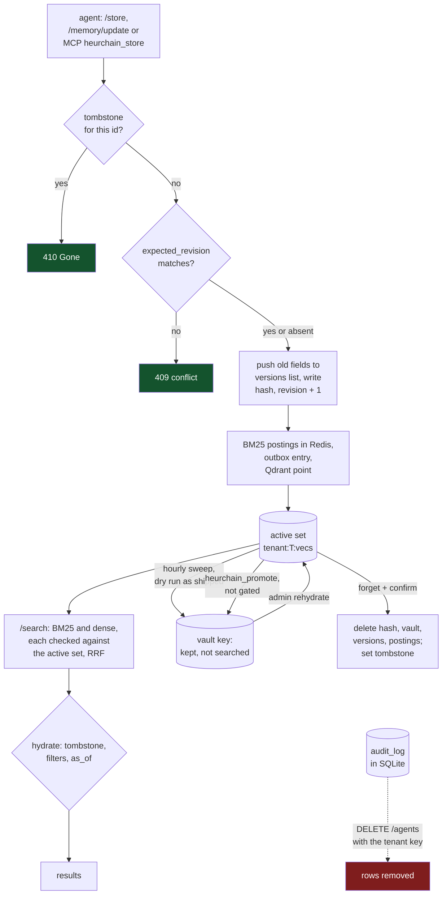

## 1. Executive Summary

HeurChain is a self-hosted memory broker: one Go binary that agents reach over
MCP or HTTP to store short texts and recall them by hybrid search. Records live
in Redis under a tenant id; a BM25 index in Redis and a Qdrant collection are
projections of them, fused by reciprocal rank fusion. What is notable is the
lifecycle around a record: corrections carry the revision the caller read,
forgetting leaves a tombstone that each read path checks for itself, and an
outbox repairs the vector index. What is weak is the text addressed to agents,
which describes three operations as something other than what the code does,
and an audit table the tenant's own key can delete from.

It carries `bitemporal`, `scope_enforced` and `negative_eval`.

**Licence.** MIT, and the tree agrees with itself: `LICENSE` and `npm/LICENSE`
are byte-identical, `npm/package.json:26` declares `MIT`, and the copyright line
names *HeurChain contributors*. No rider, no NOTICE file, no contributor
agreement. The grant covers this edition only. `CHANGELOG.md:14-15` says the
release *omits features that are incompatible with the self-hosted version*
without naming them; the tree shows their outline as two config sections
accepted and ignored (`broker/config.go:115-128`) and seven empty schema
migrations (`broker/migrate.go:59-70`).

**A forgotten id is refused on write and hidden on read, separately.** Forget
runs one Lua script that deletes the active hash, the vault copy, the version
list and the BM25 entries, and sets a tombstone key with no expiry
(`broker/memory_forget.go:13-59`). The store script refuses a tombstoned id
(`broker/memory_records.go:83`). Search hydration, the cosine scan, the
manifest, the per-agent listing, session context, export and stats each test
the tombstone themselves, so content restored from an older backup stays
hidden.

**Corrections are revision-checked and keep history.** An update names the
revision it read; the same script compares it, pushes the previous fields onto
a version list and writes the new hash (`broker/memory_records.go:82-126`). Two
racing corrections produce one success and one conflict.

**The agent-facing text disagrees with the code in three places.** The tool
`heurchain_promote` is described as raising a memory's retrieval weight after a
human confirms it; its handler moves the record to the vault, out of search,
when its activation is below the threshold. The documented session shutdown
deletes the list the replay tool reads. The guide says there is no background
retry queue; there is one.

## 2. Mental Model

A record is one mutable Redis hash per id per tenant. It is *active* while its
id is in the tenant's active set, *archived* once moved to the vault key, and
*forgotten* once a tombstone exists. Only active records are searched. Nothing
in the model says whether a record is believed.

## 3. Architecture

Four services, all on the operator's machine (`deploy/compose.yaml`):

| Service | Holds |
| --- | --- |
| Redis 7.4, AOF on | Records, vault copies, version lists, tombstones, sessions, a small key-value cache, the BM25 index, the index outbox, the auth cache and rate counters |
| Qdrant 1.12.4 | One collection per tenant, one point per active record |
| SQLite, inside the broker | `tenants`, `api_keys` (bcrypt), `usage_events`, `audit_log` |
| Ollama 0.5.7 or an OpenAI-compatible endpoint | Embeddings; a store without one returns 503 |

Redis is the source of truth. A Qdrant point carries a hash of the source
fields it was built from, and a dense hit whose hash no longer matches the
Redis record is dropped (`broker/qdrant.go:444-457`). The reconciler re-queues a
record whose stored acknowledgement no longer matches its fields
(`broker/semantic_index.go:229-231`); it does not look for a point missing from
Qdrant.

The broker is one process with two Redis pools, a single SQLite connection and
a 256-way in-process lock keyed by tenant hash that serialises a tenant's
writes (`broker/recall.go:17-25`). The lock is per process; nothing coordinates
two brokers on one Redis beyond the Lua scripts and a per-document index lease.

### Deployment and ergonomics

`docker compose up`, pull the embedding model, create a tenant with admin basic
auth, and paste two headers into the agent's MCP configuration. Every port is
published on loopback. The config loader is strict: an unknown key stops
startup and names it (`broker/config.go:166-167`).

Two things an operator is told do not match the tree. The documentation lists a
vault *directory* to back up (`docs/install.md:105`) and the config sets
`vault.path`, which is given a default and read by nothing
(`broker/config.go:201-202`); the vault is Redis keys. And source comments
point at `docs/architecture/archive-vs-working-set.md` and
`docs/memory-lifecycle.md`, neither of which is in the repository.

## 4. Essential Implementation Paths

| Path | Location |
| --- | --- |
| Key validated against the named tenant | `broker/auth.go:59-120` |
| Store handler | `broker/handlers.go:172-351` |
| Admission script: tombstone, revision, history | `broker/memory_records.go:65-144` |
| Atomic read of active or archived record | `broker/memory_records.go:183-207` |
| Get, list, update and their audit row | `broker/memory_api.go:55-291` |
| Forget script and handler | `broker/memory_forget.go:13-92` |
| Hybrid search | `broker/recall.go:196-397`, `broker/qdrant.go:306-442` |
| Dense hit resolution against the active set | `broker/recall.go:150-194` |
| BM25 candidate filter | `broker/bm25.go:723-818` |
| Validity and kind checks | `broker/recall_options.go:65-125` |
| Cosine scan behind /query | `broker/vectors.go:208-313` |
| Index outbox and reconciler | `broker/semantic_index.go:78-348` |
| Activation, sweep and the promote handler | `broker/consolidation.go:123-464` |
| Rank-cut selector and vault move | `broker/demote.go:224-323`, `broker/bm25.go:403-431` |
| Sessions | `broker/sessions.go:49-159` |
| Export, import, rehydrate | `broker/vault.go:170-333`, `:856-1136` |
| Audit row deletion | `broker/vault.go:1464-1556` |
| MCP dispatch and tool text | `broker/mcp.go:330-675`, `broker/mcp_memory_tools.go:9-43` |
| Agent guide served at the root path | `broker/discovery.go:22-387` |

## 5. Memory Data Model

A record is the hash `tenant:<tenant>:vec:<id>` (`broker/vectors.go:75-77`).

- **`id`**: caller-supplied, up to 128 characters from letters, digits, `-`,
  `_` and `.`, or a generated UUID (`broker/handlers.go:47`, `:219-224`).
- **`text`**, **`tags`** (up to 16, lower case), **`agent_id`**, **`metadata`**
  (a JSON object the caller owns).
- **`namespace`**: `ops`, `notes` or `self`, the decay tier. An unknown value is
  refused (`broker/handlers.go:85-93`).
- **`embedding`** and **`embedding_model`**.
- **`revision`**, **`created_at`**, **`updated_at`**, **`change_reason`**.
- **`access_count`**: seeded at 1 and incremented for each returned result.
- **`record_kind`**: empty, or `checkpoint` for an immutable handoff snapshot.

Beside it: `tenant:<tenant>:memory:versions:<id>`, a list of prior field sets
without embeddings; `tenant:<tenant>:vault:<id>`, the archived copy; and
`tenant:<tenant>:memory:forgotten:<id>`, a tombstone holding the id, the
revision and a timestamp and none of the content.

Three metadata keys are read by the broker. `valid_from` and `valid_until` are
RFC 3339 instants checked at write (`broker/recall_options.go:65-93`).
`memory_kind` is `factual` or `creative`. All three are copied into the Qdrant
payload so filters can be pushed down (`broker/recall_options.go:131-141`).

**`bitemporal` is earned on those two keys.** They are the caller's statement
of when a fact holds, stored apart from `created_at` and `updated_at`, and
`as_of` on a search excludes a record whose interval does not contain the
instant. The limits are plain: the OpenAPI document describes `as_of`
(`broker/openapi.go:188`) and no document tells an agent to set the two keys;
`/query` has no `as_of`; and a search without `as_of` returns a record whose
`valid_until` has passed.

**`trust_state` is withheld.** `active`, `archived` and `forgotten` are
lifecycle positions, set by decay and by deletion. A prior version is labelled
`superseded` when read back (`broker/memory_api.go:89`), which is a label on
history, not a state a record waits in. `memory_kind` is a genre fixed by the
writer.

## 6. Retrieval Mechanics

`POST /search` is the main path (`broker/recall.go:196-397`).

1. **Eligibility.** Read the tenant's active set. If an agent, tag, structured
   filter, `as_of` or kind was given, read six filter fields per active record
   and keep the eligible ids.
2. **Two arms in parallel.** BM25 walks term postings; each candidate page is
   checked for active-set membership, an existing hash and the filters before
   scoring (`broker/bm25.go:723-818`). The dense arm queries the tenant's
   Qdrant collection with agent, tag, kind, validity and embedding-model
   filters pushed down.
3. **Resolve.** A dense hit is kept only if its id is in the active set and the
   eligible set, and if its point's source hash matches the Redis record.
4. **Fuse.** Reciprocal rank fusion, `k` 60 and unit weights unless the request
   overrides them.
5. **Hydrate.** In rank order, read each hash and its tombstone, apply every
   filter again, cap results per source document if asked, and stop at the
   limit, 10 by default and 50 at most.

The response carries a `retrieval` block reporting each arm's status and
counts. One arm failing degrades to the other; both failing is a 503.

`POST /query` is older and different: it loads every active record's hash,
embedding included, and scores cosine in the broker
(`broker/vectors.go:208-313`). Its tag filter matches any listed tag; the guide
says all must match (`broker/discovery.go:139`).

Returning a result increments its `access_count` on both paths, so retrieval
feeds the decay model.

**`scope_enforced` is earned on the tenant.** The tenant id comes from a header,
and `validateAPIKey` looks the key up only among the rows stored for that
tenant (`broker/auth.go:76-78`), so a key cannot name another tenant. Every
read composes its Redis keys from that id, the dense arm addresses the
collection named by it, and candidates on both arms are tested for membership
in that tenant's active set. This is a key namespace over one Redis, in the
code's own words (`broker/main.go:87-89`), with a membership check on the two
search arms; there is no tenant column to forget in a query. In
[Redis Agent Memory Server](../redis-agent-memory-server/) the equivalent keys
are optional filters the caller supplies and the authenticated user never
constrains a query.

Inside a tenant, `agent_id` is an optional exact-match filter and nothing more.
The per-agent isolation feature is covered in section 9.

## 7. Write Mechanics

Every write is the agent's explicit call. Nothing extracts memories from
conversation and no model is called except the embedder.

`POST /store` validates, embeds the text unless a vector was supplied, and runs
the admission script (`broker/memory_records.go:82-126`):

- A tombstone for the id returns 410.
- A supplied `expected_revision` that differs returns 409, and `0` means
  create-only.
- A checkpoint record refuses any change of text or author.
- Identical content is a no-op that returns the current revision.
- Otherwise the previous fields are pushed onto the version list and the new
  hash is written with `revision + 1`.

A store without `expected_revision` on an existing id is an unconditional
overwrite that still keeps the old version. The store then updates BM25 and
Qdrant synchronously. If either fails the answer is 202 with `indexed: false`.

**Writes block the agent** for one embedding call, the script and two index
writes. A record is retrievable when the call returns. An index failure is
retried by the worker: the admission script itself adds the record to
`broker:semantic-index:pending`, and a one-second loop drains sixteen entries
per tick and re-queues failures a minute later
(`broker/semantic_index.go:249-306`). The guide tells the agent the opposite
and asks it to retry (`broker/discovery.go:178`).

`POST /memory/update` requires the id, the revision read, and a reason; it
re-embeds only if the text changed. Updating an archived record writes it back
into the active set, because the script reads the vault copy as the previous
version and deletes it.

### Forgetting

- **Explicit forget.** Requires the current revision and `confirm: true`.
  Deletes active hash, vault copy, versions, BM25 entries and the Qdrant point,
  and reports `cleanup_complete`. If Qdrant is down the answer is 202 and the
  outbox deletes the point later.
- **Decay.** Activation is `ln(access_count) - d * ln(age_seconds + 1)` with
  `d` 3.0, 1.0 and 0.1 for the three namespaces
  (`broker/consolidation.go:123-133`). An hourly sweep moves records below a
  threshold to the vault, or the lowest fraction if `demote_fraction` is set.
  As shipped it logs and moves nothing (`deploy/broker.yaml:41-45`).
- **Version cap.** 100 versions and 1 MiB per record, oldest dropped.
- **Sessions.** A session is a list holding at most 50 record ids with a
  sliding expiry.

### Operational cost

No model call beyond embeddings. `/search` reads the whole active set of ids
per request and, when filtered, six fields per active record. `/query` reads
every embedding. The sweep and the reconciler page through all records.

## 8. Agent Integration

The MCP server registers 24 tools and dispatches each to the same HTTP handler
through an in-process request carrying the session's key and tenant
(`broker/mcp.go:330-494`). `GET /` serves a 365-line onboarding document
without authentication, and `npm/AGENT_ONBOARDING.md` and
`npm/AGENT_CONFIG.json` repeat it for agents to read at setup.

That text instructs the agent to write memory: read the manifest first, open a
session, store decisions, user-stated facts and a session summary, tag them
from a seven-word taxonomy, and never store secret values
(`broker/discovery.go:295-326`). It is prose; the broker enforces the tag
syntax and nothing about content.

Checkpoints are the handoff primitive. `heurchain_checkpoint` stores a
structured summary as an immutable record in the `self` namespace, and
`heurchain_resume` reads it by id from the active set or the vault and attaches
an instruction to treat it as saved context
(`broker/memory_checkpoint.go:30-130`).

**`human_review` is withheld.** Store, update and forget are tools the writing
agent holds. Forget's `confirm: true` is a boolean in the call
(`broker/memory_forget.go:71`), and the tool text asking for an explicit user
instruction is a request to the model. Rehydrating from the vault and importing
an archive need admin basic auth, which separates operator from agent on those
two verbs, but neither decides whether a memory is admitted.

## 9. Reliability, Safety, and Trust

### The promote tool archives

`heurchain_promote` reads: *"Increment a memory item's retrieval weight. Call
after a human confirms a stored fact is correct."* (`broker/mcp.go:552`, and
`broker/discovery.go:374` in the guide). The handler computes the record's
activation and, if it is below the threshold, moves the record to the vault
(`broker/consolidation.go:352-398`). The handler increments nothing. A
comment states that this endpoint is deliberately not gated on the dry-run
flag (`:386-390`).

With the shipped threshold, -20, an `ops` record that was never retrieved
crosses it about thirteen minutes after it was stored, so confirming it removes
it from search. A `notes` record does not cross it for years. With the code's
default, -2, which applies when the config omits the key, a `notes` record
crosses it after about six seconds. Those figures come from the formula,
recomputed in a separate script. No committed test calls the handler.

`heurchain_vault_flush` has the same shape. Its description says it persists
accumulated memories into a durable vault (`broker/mcp.go:636`), and the guide
says it deletes items tagged `conversation` (`broker/discovery.go:276`). The
handler runs one consolidation pass, which under the shipped dry run moves
nothing and answers `flushed: true`.

### The audit table can be deleted from with the tenant key

`audit_log` receives a row for each store, update, forget, export, import,
flush and rehydrate, and also for each search and query. `DELETE /agents`
removes every `audit_log` and `usage_events` row for one agent id in a tenant
(`broker/vault.go:1516-1529`). It authenticates with the tenant's API key or
admin auth, and writes no row of its own.

The update and forget rows are inserted without an agent id
(`broker/memory_api.go:288`), as are the vault rows
(`broker/http_helpers.go:84`). The handler maps the value `unspecified` to
`agent_id IS NULL`. One request with that value therefore deletes every
correction, deletion and export record the tenant has. Re-derived on the
lifted statements: four rows in, three deleted, the store row left.

**`audit_log` is withheld** on that. The producers are real and
`heurchain_memory_history` reads them back per record; the table is not
append-only for the party it describes. Two gaps sit beside it: a record moved
to the vault by the sweep or by the promote handler writes no row, and a store
row carries no revision.

### Ending a session erases what its replay reads

The shutdown sequence in `npm/AGENT_CONFIG.json:65-74` is: end the session,
then store a summary. `endSession` deletes the session's metadata and its
context list and removes it from the agent's session set
(`broker/sessions.go:83-102`). The tools for the next conversation are
described as listing an agent's session ids *"to discover prior sessions"* and
as replaying a prior session. A session ended as instructed is in neither. A
committed test asserts the erasure as intended
(`broker/session_memory_context_test.go:62-95`).

The summary stored after the end is not linked either: the append is a no-op
when the session's metadata is gone (`broker/sessions.go:114-124`). The
records themselves survive and are findable by search or by a
`metadata.session_id` filter. A session started without a TTL lasts one hour
(`broker/sessions.go:50-52`) where the tool text says 24
(`broker/mcp.go:571`).

A session also stores the id of the key that created it, under a comment that
sessions are usable only by that key (`broker/sessions.go:43-47`, `:64`). No
read compares it.

### The isolation flag removes the filter it is meant to add

With `features.cross_agent_visibility` on, `/query` replaces the exact agent
match with `visibleToRequester`, which takes the author from a `created_by`
field (`broker/vectors.go:255-258`, `broker/agent_settings.go:149-154`). No
write path sets `created_by`, `visibility` or `visibility_agents`. Every record
therefore reads as legacy and visible to all, so with the flag on an agent
filter on `/query` returns every agent's records, and marking an agent isolated
through `PUT /agent-settings` is stored and changes no read. The flag is off by
default and the startup log calls the feature an organisation control, not a
security boundary.

### Tombstones are keyed on the id

**`tombstone` is withheld.** The forget tombstone blocks the *id*: a store, an
import or a rehydrate of that id is refused and every read hides residue under
it. It holds no content and no hash of it, by design
(`broker/memory_forget.go:94-95`). The same text stored under a new id, which
is what a store without an id produces, is accepted. Import skips ids already
active and fails on tombstoned ones, so a re-imported archive cannot restore a
forgotten record under its old id.

### What holds up

- The auth cache is keyed by a hash of the key and stamped with a per-tenant
  epoch, bumped on revocation (`broker/auth.go:27-54`).
- The rate limiter authenticates before counting, so a tenant id alone cannot
  exhaust a tenant's budget (`broker/admin.go:236-255`).
- Export checks the tombstone per entry and fails closed on a Redis error.
- Index writes compare a fingerprint of the source fields before
  acknowledging, and retry three times if the record changed underneath
  (`broker/vault.go:825-853`).

## 10. Tests, Evals, and Benchmarks

176 test functions in 37 files. They run against miniredis, in-memory SQLite
and `httptest` servers standing in for Qdrant and the embedder, so they need no
services and do not skip. One case skips on a host file
(`broker/buildinfo_test.go:27`). No workflow runs `go test`; the one workflow
that touches the broker builds the Compose stack and exercises store, search,
sessions, MCP and a restart with `curl`
(`.github/workflows/selfhost-smoke.yml`). I ran none of it.

**`negative_eval` is earned on the tombstone.**
`TestReadsHideResurrectedForgottenMemory` stores two records sharing a phrase,
writes a tombstone for one while leaving its hash, set membership, postings and
vector in place, and asserts that residue is present. It then requires every
read surface to return exactly the other record: three search modes, both MCP
search tools, the cosine scan, the manifest, the per-agent listing, the export
and the stats (`broker/memory_read_tombstone_test.go:35-181`). The surviving
record is the positive control on each.

Others worth naming: a correction must leave one search result carrying the new
text (`broker/memory_lifecycle_test.go:61-63`); session context must follow a
correction and drop a forgotten record
(`broker/session_memory_context_test.go:9-49`). A record under another tenant
must be absent from a populated listing (`broker/memory_lifecycle_test.go:179`,
`:198-203`), and a forget racing the index worker must not leave a point
(`broker/retrieval_integration_test.go:143-226`).

Not covered: the promote handler, `DELETE /agents`, a populated cross-tenant
search, an `as_of` after a `valid_until` through the HTTP path, and the
isolation flag end to end. The isolation tests call `visibleToRequester` with
an author no stored record can have (`broker/agent_settings_test.go:77-89`).

No paper, DOI or benchmark result is cited or committed.
`broker/combined_baseline_test.go` writes a local comparison file when an
environment variable is set.

## 11. For Your Own Build

### Steal

**Check the tombstone on every read, not only on write.** The read-side checks
exist because a rollback to an older binary put deleted content back beside its
tombstone. Each path tests the key itself and fails closed on a storage error.

**Put admission in one script.** Tombstone, revision comparison, history push
and the new write are one atomic step, so there is no window between the check
and the write.

**Make the index a projection with a fingerprint.** The vector point carries a
hash of the source fields; a hit whose hash differs from the record is dropped,
and an acknowledgement is refused if the record changed during the write.

**Queue index work in the same script as the record write.** The outbox entry
cannot be lost between the store and the index call.

**Refuse an unknown decay tier.** A typo returns 400 instead of silently
choosing a rate.

### Avoid

**Do not name an archiving verb promote and describe it as a reward.** The
agent acts on the description.

**Do not give the audited party a delete on the audit table.** If per-agent
cleanup is needed, scope it to usage counters.

**Do not write audit rows for mutations without the actor field the cleanup
keys on.**

**Do not tell an agent to end a session if ending erases what the next session
is told to read.**

**Do not ship a filter that reads a field no writer sets.** With the flag on it
is weaker than the filter it replaced.

**Do not keep a config key and a backup instruction for a directory nothing
writes.**

### Fit

It fits one operator running several cooperative agents on a private network
who wants explicit, agent-written notes with correction and deletion that
reach both indexes. The cost is four services and an embedding call per write.

It does not fit where agents under one tenant must be kept apart, where the
audit trail must survive the tenant's own credential, or where memory should be
extracted without the agent deciding to store. The edition is declared frozen,
so the three description mismatches are for the adopter to patch.

## 12. Open Questions

- **Was promote meant to reinforce?** The description, the name and the
  handler disagree, and no test covers the handler.
- **Is `DELETE /agents` meant to reach `audit_log`?** Its comment says so; the
  effect on correction and deletion rows through `unspecified` may be
  unintended.
- **What writes `created_by` in the mainline broker?** The reader is here and
  the writer is not.
- **Which features were omitted?** The changelog does not name them; the config
  sections `ontology` and `graph` and migrations 4 to 10 are the only trace.
- **Is the git tag for this release published?** The changelog names
  `v0.6.1-oss.1`; the clone holds `v0.6.1` and `npm-v2.0.2`.

## Appendix: File Index

| File | Role |
| --- | --- |
| `broker/memory_records.go` | Admission script, tombstone helpers, atomic read |
| `broker/memory_api.go`, `broker/memory_forget.go`, `broker/memory_checkpoint.go` | Get, list, update, forget, checkpoint, resume |
| `broker/recall.go`, `broker/recall_options.go`, `broker/rrf.go` | Hybrid search, validity and kind, fusion |
| `broker/bm25.go` | Lexical index, candidate filter, vault move script |
| `broker/qdrant.go`, `broker/semantic_index.go` | Vector client, search handler, outbox and reconciler |
| `broker/vectors.go` | Record write, key names, cosine scan |
| `broker/consolidation.go`, `broker/demote.go` | Activation, sweep, promote handler, rank cut |
| `broker/sessions.go` | Sessions and context list |
| `broker/vault.go` | Export, import, rehydrate, stats, agent listing and deletion |
| `broker/auth.go`, `broker/admin.go` | Key validation, tenants, rate limit |
| `broker/agent_settings.go` | Isolation settings and the visibility predicate |
| `broker/mcp.go`, `broker/mcp_memory_tools.go`, `broker/discovery.go` | MCP tools and the agent guide |
| `broker/schema.sql`, `broker/migrate.go` | SQLite schema and migrations |
| `npm/AGENT_CONFIG.json`, `npm/AGENT_ONBOARDING.md` | The published agent configuration |
| `deploy/compose.yaml`, `deploy/broker.yaml` | The stack and its shipped settings |

### Recorded searches

Run with `/usr/bin/git` in a full clone at the pinned commit.

- `git ls-files 'broker/*.go' | grep -v _test.go | xargs wc -l` — 12,564 lines in 41 files.
- `git grep -c -E '^func Test' -- broker`, summed — 176 in 37 files.
- `git grep -n -E 'created_by|visibility_agents|"visibility"' -- .` — two readers in `broker/agent_settings.go` and `broker/vectors.go`, comments and test lines; no assignment. Control: `git grep -n -E 'fields\["agent_id"\]' -- broker` finds the writers at `memory_records.go:68` and `vectors.go:109`.
- `git grep -n -E 'key_id|KeyID' -- 'broker/*.go' ':!broker/*_test.go'` — outside `auth.go` and `admin.go`, the struct, one write at `sessions.go:64` and its construction at `:278`; no read.
- `git grep -n -E 'Vault\.Path|cfg\.Vault|config\.Vault' -- broker` — the default at `config.go:201-202` only.
- `git grep -n -E 'DELETE FROM|INSERT INTO|UPDATE [a-z_]+ SET' -- 'broker/*.go' ':!broker/*_test.go'` — the four deletes are all in `vault.go:1516-1529`.
- `git grep -n -E 'auditAction\(|auditMemoryChange\(' -- 'broker/*.go' ':!broker/*_test.go'` — update, forget, flush, export, rehydrate, import; none in `consolidation.go` or `demote.go`.
- `git grep -n -E 'heurchain_promote|/promote' -- 'broker/*_test.go'` — nothing. Control: `git grep -n -E 'handlePromote' -- broker` finds the handler and two callers.
- `git grep -n -E 'handleDeleteAgent|MethodDelete' -- 'broker/*_test.go'` — nothing.
- `git grep -n -E 'as_of|valid_from|valid_until' -- npm docs README.md broker/discovery.go broker/mcp.go broker/mcp_memory_tools.go` — nothing. Control: the same pattern over `broker/openapi.go` finds line 188.
- `git grep -n -E 'go test' -- .github deploy docs README.md` — `README.md:172` only.
- `git grep -n -E 'docs/[a-z/-]+\.md' -- broker` with `git ls-files docs` — two documents named, neither tracked.
- `git grep -n -E 't\.Skip' -- 'broker/*_test.go'` — `buildinfo_test.go:27` only.
- `git grep -n -i -E 'arxiv|doi\.org|bibtex|@article|@misc|CITATION|LoCoMo|LongMemEval' -- .` — nothing. Control: `git grep -n -i -c 'license' -- README.md` matches.
- `git ls-files | grep -i -E '(^|/)(licen[sc]e|copying|notice|contributing|third.party)'` — `LICENSE` and `npm/LICENSE`; `cmp` reports them identical.
- `git tag` — `npm-v2.0.2` and `v0.6.1`.

## History

**2026-11-17** — [`a2feeb414f491cf57afab01854078278cc50167e`](https://github.com/peterjohannmedina/heurchain/commit/a2feeb414f491cf57afab01854078278cc50167e) — first reading, from a full clone holding 45 commits. Screened before reading: no auto-run or build-time surface; `broker/go.mod`, `broker/go.sum` and `npm/package.json` changed inside the seven-day cooldown; nothing was installed, built or run. The audit-row deletion was re-derived on lifted SQL in a scratch SQLite database, and the activation thresholds were recomputed from the formula in a separate script. Marks: `bitemporal`, `scope_enforced` and `negative_eval`.
