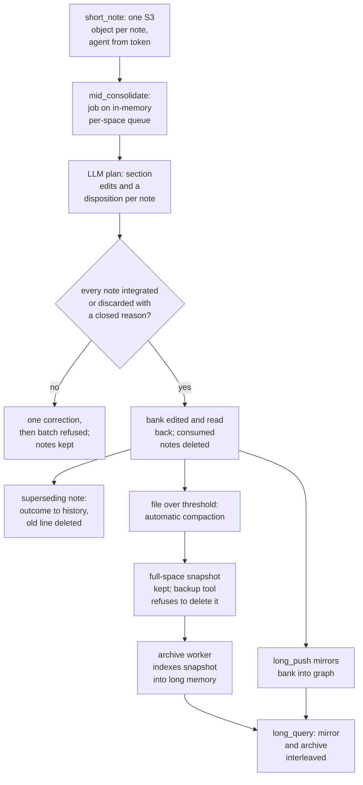

## 1. Executive Summary

Hivemind, from Lesur-ai, is a self-hosted MCP service that gives several coding
agents one project memory per `space_id`, in three tiers. `short` is append-only
Markdown notes in S3, one object per note, with the author taken from the
token. `mid` is a set of Markdown bank files that an LLM edits from those notes,
section by section, deleting each note it consumes. `long` is a vendored Graph
Memory service on Neo4j and Qdrant that indexes the bank, uploaded documents and
pre-compaction bank snapshots.

What is notable is the consolidation contract. Every note in a batch must be
attributed to an edit or discarded with one of four closed reasons, or the batch
is refused. Destructive bank operations take a verified snapshot and read their
writes back. Long memory filters its graph and vector reads by the space's
memory id, and its vector search admits only documents whose ingestion
succeeded, which a populated test checks.

What is weak is correction. There is no status and no tombstone: a fact leaves
the bank when the model deletes its line, while the compaction snapshot that
held it is kept, cannot be deleted through the backup tool, and is returned by
`long_query` as archive evidence. In a space prepared for Project Mesh, every
ordinary write refuses, because nothing outside unsafe recovery acquires the
write lease.

**Licence.** Apache-2.0, in `LICENSE` and in the vendored
`services/graph-memory/LICENSE`, which agree; `pyproject.toml` carries no
licence field. The grant is clean, and what the public tree withholds is its
history and its design record. ADR-0023 in `docs/ARCHITECTURE_CONTRACTS.md`
makes this repository *"a fresh-history release artifact staged from an exact
source SHA"* of a private canonical one, so each commit is a squashed release.
ADR-0001 names `docs/adr/README.md` as the canonical ADR registry, and no
`docs/adr/` directory is in the tree. The seven bundled WOFF2 fonts are OFL-1.1,
and `THIRD_PARTY_NOTICES.md` points to each upstream `OFL.txt` rather than
including it.

## 2. Mental Model

A memory starts as a **note**: an agent's claim, in one of seven categories
(`observation`, `decision`, `todo`, `insight`, `question`, `progress`, `issue`),
written under the token's `client_name` (`src/live_mem/core/live.py:43-51`,
`:120`). A note is pending until a consolidation job reads it. The job hands the
rules, the previous synthesis, the notes and the current bank to a chat model.
The model returns edit operations per file, each citing the notes it represents,
and a `discarded_notes` list with a reason from `already_in_bank`,
`superseded`, `obsolete` or `no_bank_value`
(`src/live_mem/core/consolidator.py:268-270`). After the edits land, every
consumed note is deleted, integrated or discarded alike (`:6508-6545`).

The **bank line** is then the belief. It carries no status, no source pointer
and no confidence; it is prose in a Markdown section. The prompt asks the model
to end any deduction with `[inferred]` and to write *"DEPRECATED — verify"* where
a replacement is uncertain (`:3821-3842`). Nothing reads either marker outside
the optional validation pass described in section 9.

A bank line stops being believed in two ways. When a note supersedes it, the
prompt has the model write the dated outcome into the history file, cite the
note, and delete the old line in the same plan (`:3821-3828`). When a file grows
past its threshold, compaction summarises it. Both leave the earlier text
somewhere: in the history file by instruction, and in the full-space snapshot
compaction takes first, which a worker indexes into long memory.

Long memory holds no beliefs of its own. Its contract, ADR-0010, calls it derived
and non-authoritative. It answers search with the current bank mirror, uploaded
documents and those archived snapshots interleaved, each passage labelled with
its capture time and source.

## 3. Architecture

The Compose file runs five long-lived containers: a Caddy WAF with the OWASP
CRS, the Hivemind server, the vendored Graph Memory service, Neo4j 5.26
community and Qdrant 1.16.2, plus MinIO under the `dev` profile
(`docker-compose.yml:37-304`). Hivemind is Python 3.14 on the MCP Python SDK
2.3.0, serving Streamable HTTP at `/mcp`; it keeps every byte of short and mid
memory in an S3-compatible bucket through boto3. Graph Memory is vendored from
`cloud-temple/graph-memory` at `ae9afb0b`, with Hivemind's modifications listed
in `THIRD_PARTY_NOTICES.md`, and Hivemind calls it as an MCP client.

`short` needs no model. `mid` needs a chat model, and `long` needs a chat model
for extraction and an embedding model, both configured as provider profiles in
`src/hivemind_inference/`. Project Mesh pairs two instances, each with its own
Ed25519 identity and public HTTPS URL, through a signed one-time invitation.

### Deployment and ergonomics

An operator stands up the five containers, an S3 bucket and two model endpoints;
`scripts/configure_dev_env.py` writes a local `.env` and the development profile
brings up MinIO. Short notes work offline with no key. Consolidation and long
memory stop without a reachable provider, and nothing is stored to them in that
case. The store is human-readable: notes and bank files are Markdown objects
under `{space}/live/` and `{space}/bank/`, and the admin portal at `/admin`
shows them. The long tier is not repairable by hand in the same way, since its
state is spread across Neo4j, Qdrant and retained S3 text.

## 4. Essential Implementation Paths

- **Capture.** `live_note`, aliased `short_note`, checks the token's space
  allowlist and write permission, refuses unless the space routes direct-local,
  and `LiveService.write_note` builds
  `{timestamp}_{agent}_{category}_{uuid8}.md` and issues one PUT
  (`src/live_mem/tools/live.py:90-123`, `src/live_mem/core/live.py:134`,
  `:178-179`).
- **Consolidate.** `bank_consolidate` defaults the agent to the caller, needs
  `manage` for all agents or another agent, refuses a shared route, and
  enqueues (`src/live_mem/tools/bank.py:451-504`). The worker runs
  `ConsolidatorService.consolidate` (`src/live_mem/core/consolidator.py:4125`),
  validates the plan's form and dispositions (`:1038-1090`, `:1239`), applies
  it, deletes the consumed notes (`:5101`) and overwrites `_synthesis.md`
  (`:6685`).
- **Compact.** After a successful consolidation, `compact_after_consolidation`
  calls the compactor for files above `bank_file_max_size`, 35,000 bytes by
  default (`src/live_mem/core/mid_automation.py:26`,
  `src/live_mem/config.py:252-258`).
- **Project to long.** `long_push` deletes and re-ingests each bank file as a
  Graph Memory document, skipping `activeContext.md` and `progress.md` unless
  `include_volatile` is set with `manage`
  (`src/live_mem/core/graph_bridge.py:1426-1440`, `src/live_mem/config.py:274`).
  Compaction snapshots become pending records the archive worker ingests
  (`src/live_mem/core/mid_archive.py:18-24`).
- **Query long.** `long_query` checks access and calls `_query_with_archives`,
  which queries the space's memory and then its archive memory and interleaves
  the two (`src/live_mem/core/graph_bridge.py:2345-2409`).

## 5. Memory Data Model

Everything for a space lives under one S3 prefix: `_meta.json`, `_rules.md`,
`_synthesis.md`, `live/` for notes, `bank/` for bank files,
`_mid_archive_pending/` for archive work, and `_hivemind/` for Mesh state.
Full-space backups, compaction snapshots included, sit outside it under
`_backups/{space_id}/{timestamp}/`; tokens are SHA-256 hashes in
`_system/tokens.json` (`src/live_mem/core/tokens.py:41`).

A note's front matter holds `timestamp`, `agent`, `category`, `tags` and
`space_id`, followed by up to 100,000 characters of body
(`src/live_mem/core/live.py:39`, `:140-147`). A bank file is free Markdown whose
structure is set by the space's rules; the standard template names six files,
`projectbrief.md`, `productContext.md`, `activeContext.md`, `systemPatterns.md`,
`techContext.md` and `progress.md`.

In Graph Memory, `Document`, `Entity` and `TemporalOccurrence` nodes carry
`memory_id`, derived from the space as `hm-` plus a sanitised prefix and a
BLAKE2b digest (`src/live_mem/core/memory_id.py:68`). A document's
`ingestion_status` runs `running`, `succeeded`, `deprecated`; a replacement is
ingested beside the old version and swapped in one transaction
(`services/graph-memory/src/mcp_memory/core/graph.py:1223-1262`). Archive
passages carry `preimage_id`, `bank_path`, `captured_at`, the source SHA and
`ingested_at`.

The `_hivemind/` subtree is a protocol store: membership, term, write token,
bank version pointer, queue, acks, staged commits, per-note tombstones, origin
sidecars, watermarks and an append-only event journal
(`src/live_mem/core/hivemind/layout.py`).

## 6. Retrieval Mechanics

Retrieval is tool-mediated; nothing is injected automatically. `short_read`
lists every object under `live/`, parses them, filters by category, agent and a
`since` timestamp, and returns the newest first, at most 500
(`src/live_mem/core/live.py:231`, `:40`). `short_search` is a case-insensitive
substring test over note bodies (`:311`). Both scan the whole prefix on every
call. `mid_read_all` returns every bank file; the templates have the agent call
it at session start, so a fresh session reads up to six files at an advisory
35,000 bytes each.

`long_query` runs Graph Memory's `memory_query`. It tokenises the query, drops
French stop words, and searches entities through a Lucene full-text index
filtered by `memory_id`, falling back to `CONTAINS`
(`services/graph-memory/src/mcp_memory/core/graph.py:2132-2307`). It expands
each hit to its documents, relations and neighbours, then runs Qdrant chunk
search restricted to the memory's succeeded documents
(`services/graph-memory/src/mcp_memory/server.py:1614-1625`). A query naming an
issue reference such as `#17` also runs an exact-text search under the same
filters, so the reference survives a dense top eight that misses it.

The vector arm filters on `ingestion_status`; the entity arm does not. An entity
mentioned only by a running or cleanup-pending document is returned with that
document listed and its status labelled (`graph.py:2330-2385`).

## 7. Write Mechanics

A note write is one synchronous PUT, retrievable at once. Consolidation is
caller-triggered and deferred: a write token queues it, about once a minute per
space at most, on an in-memory queue whose acknowledgement says
`in_memory_best_effort`, so a restart loses queued jobs but not notes
(`src/live_mem/config.py:229`, `src/live_mem/core/consolidation_queue.py:3-10`,
`:33`). One job takes up to 200 notes in batches. The lag before a fact is in
the bank is the time until someone calls `mid_consolidate`, plus the job.

The model never returns a whole existing file; it returns
`replace_section`, `append_to_section`, `prepend_to_section`, `add_section` and
`delete_section` operations, or a justified `rewrite`. The code holds the form:
H1 headings and file paths are owned by the code, a duplicate heading is
refused, and a plan whose dispositions leave a note unclassified gets one
corrective completion and then fails closed with its notes kept
(`src/live_mem/core/consolidator.py:1038-1090`, `:1650`). Nothing deterministic
checks content against the notes unless validation is turned on.

A storage failure mid-batch can leave earlier writes applied; normal
consolidation has no batch-wide rollback. Compaction is the exception: it
prepares every candidate, persists a verified full-space backup, writes, reads
back and rolls back within bounds. The archive worker resumes after restarts and
pauses a capture after three `invalid_output` cycles
(`src/live_mem/core/mid_archive.py:18-24`). No pass rewrites the whole store;
compaction touches only files above the threshold.

## 8. Agent Integration

Discovery advertises 17 tools to a read token, 20 to write and 24 to manage.
Operator tools such as `mid_write`, `mid_delete`, `bank_compact` and
`backup_restore` stay registered and callable by exact name, with their own
permission checks (`docs/TOOL_EXPOSURE.md`). A routine agent holds `read,write`:
it can note, read, consolidate its own notes and push to long memory. `manage`
adds direct bank writes and deletes, compaction apply and document ingestion.

The integration is instructions, not hooks. `CLAUDE_CODE_INTEGRATION.md` and
`docs/AGENT_MEMORY_SETUP.md` give a `CLAUDE.md` or `AGENTS.md` block telling the
agent to read the bank at session start, write notes during work, and call
`mid_consolidate` at most once after the user validates, without polling. Any
MCP client that holds a token can use it, and one token per agent is what keeps
note authorship meaningful.

## 9. Reliability, Safety, and Trust

### What a correction leaves behind

A superseded fact is removed from the current-context file by the model, on the
strength of a note. It survives in the history file by instruction, and in every
compaction snapshot taken while it stood. `backup_delete` refuses a compaction
snapshot by its namespace alone (`src/live_mem/core/backup.py:1447-1470`), the
README states that snapshots have no automatic purge, and the archive worker
keeps the raw source after indexing it. `long_query` then returns those passages
beside current ones, labelled with `captured_at`. The README tells consumers to
read current MID for current state (`README.md:430`); the read path does not.

`space_delete` removes the `{space}/` prefix (`src/live_mem/core/space.py:1436`).
The backups under `_backups/{space_id}/` and the space's Graph Memory namespaces
are outside it, and no Hivemind path calls Graph Memory's `memory_delete`.

### Project Mesh at this commit

Once a space is prepared for Mesh, its route is `STAGED`. `short_note` and
`mid_consolidate` then refuse with `StagedWriteNotImplemented`
(`src/live_mem/tools/live.py:120-123`, `src/live_mem/tools/bank.py:488-493`),
and a test pins the note refusal (`tests/test_writesink_routing.py:229-241`).
The staged bank sink is built only when the local node already holds the write
token, and the registry says so: *"the chosen fail-closed deferral of the lease
ACQUISITION ceremony"* (`src/live_mem/core/engines/__init__.py:288-329`).
`LeaseRuntime.acquire` has no caller outside its own module and the tests, and
the only other writer of a held token is unsafe-recovery restore
(`src/live_mem/core/backup.py:848-858`). A paired space is therefore readable
and, for agents, not writable.

### Marks

- **`scope_enforced`** — awarded on long memory. Neo4j entity, context and
  document reads match `memory_id`; Qdrant search adds a `memory_id` payload
  filter and refuses a returned payload carrying another id
  (`services/graph-memory/src/mcp_memory/core/vector_store.py:341-353`,
  `:700-704`). The id comes from the space binding, not the caller. Short and
  mid memory are an S3 prefix per space, a physical partition.
- **`negative_eval`** — awarded; see section 10.
- **`tombstone`** — withheld. Mesh tombstones are keyed on `note_id` so a
  consumed note is not replicated back, a record key
  (`src/live_mem/core/hivemind/layout.py:213-216`); a discarded note is deleted
  and its reason logged.
- **`trust_state`** — withheld. A bank line has no status. `[inferred]` and
  *"DEPRECATED — verify"* are prose the prompt requests, and no read excludes
  on them. `ingestion_status` is pipeline progress, not belief.
- **`bitemporal`** — withheld. Temporal occurrences extracted from documents
  are off by default (`TEMPORAL_OCCURRENCE_EXTRACTION`), describe events in a
  source's text, and no read filters on them.
- **`audit_log`** — withheld. The append-only journal under `_hivemind/events/`
  records `BANK_COMMITTED` only on the Mesh commit path, which no agent reaches;
  direct-local writes record counters in `_meta.json`, and the admin audit is an
  in-memory ring of console and auth events
  (`src/live_mem/core/audit_ring.py:1-14`).
- **`human_review`** — withheld. Consolidation writes the bank with no queue,
  and automatic compaction applies without review by default
  (`src/live_mem/config.py:252`). A `manage` holder editing a bank file is
  authoring after the fact, and `bank_compact`'s dry run is a flag the caller
  clears.

### Other risks

- **Validation is opt-in and advisory.** With `consolidation_validation_enabled`
  set, a regex pass counts added lines carrying a number, date, version or
  status word that appears in no batch note; it logs and reports the count and
  does not block (`src/live_mem/config.py:243`,
  `src/live_mem/core/consolidator.py:4972-4979`).
- **Notes are prompt input.** Note bodies enter the consolidation prompt with
  their metadata; the anti-invention rules are requests to the model, and the
  deterministic checks are on structure.

## 10. Tests, Evals, and Benchmarks

The tree has 4,641 Python test functions across 220 files, 110 Go tests, and
Playwright and Node suites for the portal. CI installs the locked development
dependencies, including `qdrant-client` and `neo4j`, and runs the whole Python
collection in eight shards on push and pull request
(`.github/workflows/ci.yml`). I ran none of it. Most cases use fakes from
`tests/fakes/`; the Qdrant suite uses `qdrant-client` against a local on-disk
collection.

`negative_eval` rests on two cases in `tests/test_p13_qdrant_vector_store.py`:

- `:1092-1111` stores nine similar passages and one answering `#17`, shows the
  query ranks the answer first with its document active, then repeats the query
  with that document left out of the active set and asserts eight results, none
  of them the answer.
- `:1078-1089` stores one passage, asserts the unrestricted search returns it,
  and asserts an empty active set returns nothing.

Both test the vector store's admission filter. No case drives `long_query` with
two spaces' material and asserts the other space's passage absent, and none
asserts that a deprecated document's entities stay out of entity search.

The consolidation suite is extensive on form: disposition accounting, H1
preservation, structured output, compaction rollback and the staged refusals.
No committed evaluation measures whether a consolidated bank is faithful to its
notes, and no benchmark result is in the tree. No paper describes the system;
the French README cites a 2025 survey of multi-agent collaboration as framing.

## 11. For Your Own Build

### Steal

- **Make the model account for every input.** Require each note to appear in an
  edit's source list or in a discard list with a closed reason, refuse any plan
  that leaves one out, and delete only what was accounted for.
- **Edit by section, own the skeleton in code.** Let the model return section
  operations against headings, keep titles and file paths out of its reach, and
  read every write back.
- **Snapshot before a lossy rewrite.** Compaction persists a verified copy of the
  space before it summarises, which makes a bad summary recoverable.
- **Carry the scope key on both stores.** A graph predicate and a vector payload
  filter on the same id, with a returned-payload ownership check, close the gap
  a single-store filter leaves.

### Avoid

- **Correction by deletion beside a permanent archive.** If superseded text is
  kept for recovery, keep it out of the default read path or mark it superseded
  there; a capture date is not a status.
- **A filter on one retrieval arm.** Admission by document status belongs on the
  entity arm as well as the vector arm.
- **A shared mode whose write path has no lease producer.** Ship the acquisition
  with the commit gate, or do not let a space enter the mode.

### Fit

This fits a small team running several coding agents against one project, who
want a shared handbook the agents keep current and can afford five containers
and two model endpoints. The bank stays legible and editable, and its quality is
the consolidation model's. Walk away if you need to say *"forget this"* and mean
it, since snapshots and long-memory archives keep what the bank dropped. Walk
away too if you came for Project Mesh, which at this commit replicates a space
that agents then cannot write.

## 12. Open Questions

- Whether lease acquisition for shared spaces exists in the private canonical
  repository and is withheld from this release, or is not yet built.
- What retention the maintainers intend for compaction snapshots and archive
  passages, since the README names direct storage maintenance as the only route.
- How faithful consolidated banks are in practice; this needs runs against a
  real provider, which the repository does not publish.

## Appendix: File Index

- Short tier: `src/live_mem/core/live.py`, `src/live_mem/tools/live.py`,
  `src/live_mem/core/gc.py`
- Mid tier: `src/live_mem/core/consolidator.py`,
  `src/live_mem/core/consolidation_queue.py`,
  `src/live_mem/core/consolidation_schema.py`,
  `src/live_mem/core/mid_automation.py`, `src/live_mem/tools/bank.py`,
  `RULES/live-mem.standard.memory.bank.md`
- Long tier: `src/live_mem/core/graph_bridge.py`,
  `src/live_mem/core/mid_archive.py`, `src/live_mem/core/memory_id.py`,
  `src/live_mem/tools/graph.py`,
  `services/graph-memory/src/mcp_memory/server.py`,
  `services/graph-memory/src/mcp_memory/core/graph.py`,
  `services/graph-memory/src/mcp_memory/core/vector_store.py`,
  `services/graph-memory/src/mcp_memory/core/ingest_pipeline.py`
- Routing and Mesh: `src/live_mem/core/write_sink.py`,
  `src/live_mem/core/engines/__init__.py`,
  `src/live_mem/core/hivemind/lifecycle.py`,
  `src/live_mem/core/hivemind/lease_runtime.py`,
  `src/live_mem/core/hivemind/commit_runtime.py`,
  `src/live_mem/core/hivemind/layout.py`
- Backup and deletion: `src/live_mem/core/backup.py`,
  `src/live_mem/core/space.py`
- Access and audit: `src/live_mem/auth/context.py`,
  `src/live_mem/core/tokens.py`, `src/live_mem/core/audit_ring.py`
- Tests: `tests/test_p13_qdrant_vector_store.py`,
  `tests/test_writesink_routing.py`, `tests/test_normal_consolidation_safety.py`,
  `tests/test_note_disposition.py`

### Recorded searches

Run from the repository root at the pinned commit with `/usr/bin/git grep`.

- **No benchmark result.** `git ls-files | grep -i -E 'bench|result|eval|score' | grep -v '^tests/'`
  lists only `tools/hivemind-ingest/internal/ontology/evaluator.go` and its test,
  an ontology evaluator in the ingestion CLI, which also shows the pattern can
  match; `git ls-files | grep -i -E '[.](csv|jsonl)$'` returns nothing.
- **Nothing outside the lease module acquires the write token.**
  `git grep -n -E '\.acquire\(' -- src` matches only
  `src/live_mem/mesh/replay.py:700`, a file lock's own `__enter__`, and
  `src/live_mem/server.py:401`, a process lock. The definition is at
  `src/live_mem/core/hivemind/lease_runtime.py:642`, and the same pattern counts
  34 lines in `tests/test_hivemind_lease.py`.
- **Two writers of a held token.**
  `git grep -n -E 'state=TokenState\.HELD' -- src` matches
  `src/live_mem/core/backup.py:849`, the unsafe-recovery restore, and
  `src/live_mem/core/hivemind/lease_runtime.py:920`, inside acquisition.
- **Hivemind never deletes a Graph Memory namespace.**
  `git grep -n 'memory_delete' -- src` returns nothing;
  `git grep -n 'async def memory_delete' -- services/graph-memory/src` matches
  `server.py:392`.
- **Space deletion does not reach backups.**
  `git grep -n '_backups' -- src/live_mem/core/space.py` matches only line 762,
  a comment in `list_spaces`; `git grep -c '_backups/' -- src/live_mem/core/backup.py`
  counts 9.
- **No validity-time field.**
  `git grep -n -i -w -E 'valid_from|valid_to|valid_until|valid_at|as_of' -- src services`
  returns nothing; `git grep -c 'TemporalOccurrence' -- services/graph-memory/src/mcp_memory/core/graph.py`
  counts 12.
- **The entity arm labels document status and does not filter on it.**
  `git grep -n 'ingestion_status' -- services/graph-memory/src/mcp_memory/core/graph.py`
  lists the `'succeeded'` predicates at lines 1313, 1706 and 2045 and, between
  `_search_fulltext` at 2132 and the end of `get_entity_context`, only line
  2385, a returned field.
- **The admin audit never touches storage.**
  `git grep -n -E 'storage|put_json|\.put\(' -- src/live_mem/core/audit_ring.py`
  returns nothing; `git grep -n 'deque' -- src/live_mem/core/audit_ring.py`
  matches lines 22, 68 and 71.
- **Nothing reads the inferred marker outside the consolidator.**
  `git grep -n -E 'inferred' -- src/live_mem/core/live.py src/live_mem/tools src/live_mem/core/graph_bridge.py services/graph-memory/src`
  matches only a prompt line in
  `services/graph-memory/src/mcp_memory/core/ontology_construction.py:72`;
  `git grep -c 'inferred' -- src/live_mem/core/consolidator.py` counts 17.
- **No paper.** `git grep -n -i -E 'arxiv|bibtex|citation' -- README.md docs`
  matches only a citation-header sentence in
  `docs/MIGRATION_LIVE_GRAPH_TO_HIVEMIND.md:542`; `git grep -n -i 'arxiv' -- README.fr.md`
  matches the survey link at line 199, and the tree has no `CITATION.cff`.

## History

**2026-11-21** — [`6b05533bdf71bf2dfeb6a50281050608e6630df3`](https://github.com/Lesur-ai/hivemind/commit/6b05533bdf71bf2dfeb6a50281050608e6630df3) — first reading, from a clone of `main` at release 1.6.6, scoped to the short, mid and long tiers, consolidation and compaction, the Graph Memory read and ingest paths, write routing, backup and deletion, and their tests; Project Mesh pairing and transport were read only where they write the token and route the tiers read. Screened first: no auto-run surface; one build-time execution point, `tests/conftest.py`; no unpinned surface and nothing inside the cooldown. Apache-2.0, no rider. Nothing installed, built or run. Two marks: `scope_enforced`, `negative_eval`.
