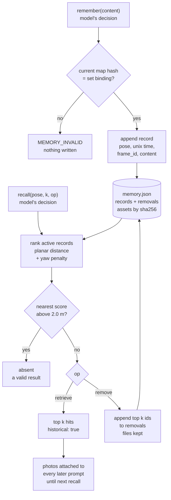

## 1. Executive Summary

HomeBody is the Stanford Movement Lab's framework for driving a Unitree G1
humanoid with a frontier vision-language model, one registered skill per
decision. Its persistent memory is a small, named photo store. On the
physical robot the model can `remember` the current calibrated camera frame
with a description, and `recall` stored views near a map pose. The scan of the
room enters the prompt separately, as a fixed list of labelled objects.

What is notable is how carefully a stored view is tied to the frame it is
valid in. A named set is bound to the hash of the deployment map, and opening
it against any other map is refused. Every stored image and depth array is
content-addressed and re-hashed on every read. Writes are atomic with a
directory `fsync`. Every recalled view is labelled `historical`, and the prompt
tells the model to check the live camera before acting on it.

What is weak is correction. The only correction is `recall` with
`op="remove"`, which hides whichever records rank nearest a pose rather than a
record the model names. The 2.0 m absence gate checks only the nearest of
them. A removed photo keeps its record and its files. No test exercises
removal.

**Licence.** The three AMO walking-policy weight files committed under
`assets/models/` are listed in `THIRD_PARTY_NOTICES.md:10` as Apache-2.0 while
*"the original project releases the weights for research use only"*. The
walking controller loads them in SIM and on the robot
(`src/homebody/backends/controller.py:109`, `src/homebody/backends/g1/assets.py:56`),
and `homebody check` reports them missing otherwise (`src/homebody/__main__.py:66-67`). The repository's own code is Apache-2.0
in `LICENSE`, `NOTICE` and `pyproject.toml`, which agree. SuperOdometry,
which `hardware/g1/superodom/` builds into the localization image, is GPLv3 by
the same notices table; it is built from source and not vendored.

## 2. Mental Model

There are two stored things the model treats as memory, and only one can be
corrected.

**The initial-scene memory** is the scan's entity list from `semantics.json`:
a label, a map anchor, a visual and a location description, and a `portable`
flag (`src/homebody/vlm/observations.py:117-127`). REAL2SIM reconstruction
writes it once per scene package. Every decision's prompt carries it as
*"Initial-scene memory"* (`src/homebody/session/session.py:267`), and the agent
prompt says it *"describes the environment as it was when it was scanned; it
is not a live inventory"* (`src/homebody/vlm/agent_prompt.md:16-19`). Nothing
on the task path writes it, so it can be wrong and stay wrong. The README's
hardest suggested test is exactly that: move an object before the run and see
whether the model notices (`README.md:143-146`).

**The photo memory** is a list of remembered views. A record is born when the
model calls `remember`. It holds the photograph, optional metric depth with
intrinsics and the camera pose, the robot's map pose `[x, y, yaw]`, the
capture time, the frame identity and a free-text `content`
(`src/homebody/memory/store.py:264-267`). It has two states, active and
removed. A record becomes removed only when its id is appended to the set's
`removals` list (`src/homebody/memory/store.py:311-314`), and every read
subtracts that list (`src/homebody/memory/store.py:274-277`). Nothing else
moves a record. There is no expiry, no supersession and no edit.

The store makes no claim that a record is still true. Every hit carries
`"historical": True` (`src/homebody/memory/store.py:283`), a non-empty result
carries the reason *"Historical photos; verify current presence"*
(`src/homebody/memory/store.py:315`), and the skill prompt says *"this
observation does not certify future presence"*
(`src/homebody/skills/remember.py:11-13`). A recalled photo is evidence of
where the robot once saw something, which is what it is. The label is the
same on every record, so it describes the store rather than distinguishing
one memory from another.

Memory is agent-controlled. The model decides what to remember, what to
recall and what to remove. The operator console shows the set's counts and
the recalled photos and has no memory verb.

## 3. Architecture

HomeBody is a Python package with a CLI, `homebody`, and three workflows. SIM
runs the G1 in a MuJoCo reconstruction of a kitchen. REAL2SIM explores a room
on the robot and reconstructs it into a scene package with a coding agent.
REAL runs the task skills on the physical robot through a local web console.
The model is reached through the Codex or Claude Code CLIs, or the OpenAI or
Anthropic APIs (`src/homebody/vlm/catalog.py`).

The photo memory exists only in REAL. `homebody run --backend real` requires
`--memory NAME` (`src/homebody/__main__.py:346-347`), and the memory flags are
rejected for SIM (`src/homebody/__main__.py:348-349`). The SIM `Session` is
built with no memory and the default registry of navigate, pick and place
(`src/homebody/__main__.py:145-150`, `src/homebody/skills/registry.py:8`).
`session/real_sim.py` composes the REAL task policy, memory included, on
MuJoCo, and only tests call it.

The store is `NamedMemory` in `src/homebody/memory/store.py`, 342 lines over
the standard library, NumPy and Pillow. A set is a directory
`<memory_root>/<name>`, and the root defaults to
`$XDG_STATE_HOME/homebody/memory` (`src/homebody/__main__.py:269`). It holds
`memory.json`, a `.lock` file and an `assets/` directory of
`<sha256>.png` and `<sha256>.npy` files. Each operation takes a thread
`RLock` and an exclusive `fcntl.flock` (`src/homebody/memory/store.py:113-123`).
Each state write goes through a temporary file, `fsync`, `os.replace` and an
`fsync` of the directory (`src/homebody/memory/store.py:42-58`).

### Deployment and ergonomics

The memory itself needs nothing running: no database, no embedding model, no
network. It is a JSON file and image files a person can open. The system
around it needs a great deal: a G1 with Dex3 hands and a MID-360 LiDAR, a
Linux workstation with an NVIDIA GPU and Docker, SuperOdometry localization,
a calibrated head RGB-D camera, SAM2.1 tracking weights fetched separately,
and a model login or API key for every decision (`README.md`,
`guides/real-long-horizon.md`). A model is required to store anything,
because only the model calls `remember`. Repair by hand is possible and
constrained: a record's text fields can be edited, but a missing or altered
asset makes the whole set refuse to open (section 9).

## 4. Essential Implementation Paths

- **Composition.** `run_real` resolves the memory root and calls
  `session.real.compose` (`src/homebody/__main__.py:269-271`). That builds a
  `MapBinding` from the deployment map's frame id, file hash and navigation
  raster (`src/homebody/session/real.py:11-13`). `session/task.py` opens the
  set with the map's diagonal and registers `remember` and `recall`
  (`src/homebody/session/task.py:24-31`, `src/homebody/skills/registry.py:30-39`).
- **Open.** `NamedMemory.open` validates the name, refuses symlinks, creates
  the state on first use with `radius_m` 2.0 and `yaw_weight` 0.30, and reads
  it back (`src/homebody/memory/store.py:84-111`). A directory with assets and
  no `memory.json` is refused, *"existing files retained for recovery"*
  (`src/homebody/memory/store.py:98-100`).
- **Write.** `remember.execute` observes a fresh frame and calls
  `NamedMemory.remember` (`src/homebody/skills/remember.py:37-46`). The store
  checks the frame's navigation against the binding and encodes the PNG and
  the depth. Under the lock it re-reads the state, writes both assets, appends
  the record and writes the state (`src/homebody/memory/store.py:234-272`).
- **Read.** `recall.prepare` checks the binding against the current map and
  validates `pose`, `k` in 1..8 and `op` (`src/homebody/skills/recall.py:29-45`).
  `NamedMemory.recall` ranks the active records and applies the gate
  (`src/homebody/memory/store.py:288-316`).
- **Injection.** After a successful retrieve, `Session.run_task` keeps the
  hits in `self.recalled` (`src/homebody/session/session.py:410-411`).
  `Session.images` loads each through `load_image`, copies the pixels into the
  run's evidence with `Recorder.historical_image`, and appends them after the
  current images (`src/homebody/session/session.py:287-310`,
  `src/homebody/session/recorder.py:130-154`). `Session.prompt` adds their
  metadata under a fixed instruction (`src/homebody/session/session.py:272-278`).
- **Remove.** The same `recall` call with `op="remove"` extends `removals`
  with `{"record_id", "query_pose"}` for each hit and writes the state
  (`src/homebody/memory/store.py:311-314`). The session then clears its
  attached photos (`src/homebody/session/session.py:411`).
- **Display.** The console prints the set name, active count and removed
  count (`src/homebody/ui/console.py:95-101`), and a gallery of recalled photos
  captioned as not the live camera (`src/homebody/ui/console.py:544-564`).
- **Tests.** `tests/test_real_memory.py`, `tests/test_real_memory_skills.py`,
  and the session runs in `tests/test_real_composition.py:19-88` and
  `tests/test_real_navigation_sim.py:11-45`.

## 5. Memory Data Model

`memory.json` has five keys: `schema` (`homebody-photo-memory/v1`), `binding`,
`retrieval`, `records` and `removals` (`src/homebody/memory/store.py:106-109`).

A record is `id` (a `uuid4` hex), `pose`, `time`, `frame_id`, `content`,
`image`, `depth` and `camera` (`src/homebody/memory/store.py:264-267`). `image`
and `depth` are references of path, SHA-256, size and media type
(`src/homebody/memory/store.py:225-226`). `camera` holds the 3×3 intrinsics
and the 4×4 world-camera transform when depth was captured.

The scope is the set. `MapBinding` carries `scene_id`, `scene_hash`,
`frame_id`, `navigation_hash` and an optional `geometry_hash`
(`src/homebody/memory/binding.py:44-63`), stored once per set and not per
record. `_validate` refuses a state whose binding differs from the one the
deployment supplied (`src/homebody/memory/store.py:160-161`), and
`check_navigation` refuses a frame from a map whose hashes differ
(`src/homebody/memory/binding.py:73-80`). Records carry no scope key; a hit
is stamped with the set's binding when it is returned
(`src/homebody/memory/store.py:286`).

Provenance is the capture time and the frame identity, and both are narrower
than they look. On the robot, `time` is the capture's Unix time
(`src/homebody/backends/real.py:227`, `:247`). `frame_id` is `(epoch,
sequence)` (`src/homebody/primitives/observations.py:130-132`), and the REAL
backend starts its epoch at 1 in every process (`src/homebody/backends/real.py:95`),
so the same `frame_id` recurs across sessions. The record names no session and
no run directory. Linking a record back to the run that wrote it means
matching its time against a session's `events.jsonl`.

There is one clock. `time` is when the frame was captured; nothing records
when the record was written or when it stopped being believed. A removal entry
holds a record id and the query pose and no time
(`src/homebody/memory/store.py:312-313`).

## 6. Retrieval Mechanics

Retrieval is spatial and nothing else. The score of a record is the planar
distance between the query pose and the record's pose, plus a yaw term: 0.30
times the map diagonal times the yaw error over π
(`src/homebody/memory/store.py:303-306`). `session/task.py` passes the map's
own diagonal, the raster's shape times its resolution
(`src/homebody/session/task.py:24`), so on a larger map a heading difference
costs more metres. Ties break by insertion order
(`src/homebody/memory/store.py:307`).

The absence gate looks only at the nearest record. If no record is active, or
the best score exceeds `radius_m`, the result is `absent` with a reason, and
the prompt says an empty result is valid (`src/homebody/memory/store.py:308-309`,
`src/homebody/session/session.py:276`). Otherwise the top `k` are returned
(`src/homebody/memory/store.py:310`), and the second through eighth are not
compared with the radius. A `recall` with `k=8` from a well-covered spot can
return views from the far side of the room.

`content` is never searched. A query with no pose is answered *"Spatial photo
recall requires a map pose; text search is unavailable"*
(`src/homebody/memory/store.py:299-301`), and the skill supplies the current
pose when the model gives none (`src/homebody/skills/recall.py:35`). To find
where it saw the cups, the model must already have a pose in mind; the scan's
anchors in the initial-scene memory are what give it one.

Injection is bounded and sticky. At most eight photos are attached, after the
four current images, with record id, pose, time, frame id, content and image
number in the prompt (`src/homebody/session/session.py:302-306`).
`self.recalled` is set only after a successful recall and is not cleared when
a new task starts (`src/homebody/session/session.py:134`, `:411`). The last
recalled photos therefore ride along on every decision of every later task in
the session until the model recalls again. The full recall result, with camera
matrices and binding hashes for every hit, also sits in the recent-step
history the prompt replays for 24 steps (`src/homebody/session/session.py:262-263`).

## 7. Write Mechanics

A memory is created only by the model's `remember` call on a REAL task, from
a frame observed at execution time (`src/homebody/skills/remember.py:37-41`).
Exploration does not write the photo store, since `NamedMemory` is opened only
in `session/task.py`. The exploration run keeps its own pose-tagged views in
`VisualHistory`, which starts a new epoch on construction and leaves earlier
epochs on disk *"their poses unused"*
(`src/homebody/real2sim/exploration/visual_history.py:271-289`). That is
working memory for one exploration run.

The write validates shape and finiteness, not meaning. The image must be RGB
`uint8`, depth must match the image grid and use NaN for invalid readings,
and the camera geometry must be finite (`src/homebody/memory/store.py:238-259`).
`content` must be a string and is otherwise unbounded and unchecked
(`src/homebody/skills/remember.py:31-33`). There is no deduplication. Two
remembers from the same pose write two records; identical pixels share one
content-addressed asset (`src/homebody/memory/store.py:227-231`).

Nothing updates a record and nothing deletes one. The only state change after
creation is the removal append; the files of a removed record stay in
`assets/` and its entry stays in `records`.

### Operational cost

The write is synchronous. It blocks the decision loop for a PNG encode, a
depth serialisation and two hashes, with no model call, and the record is
retrievable at the next decision. There is no background pass.

Every operation pays for the whole store. `_read` runs `_validate`, which
re-hashes every asset of every record, removed ones included, opens each PNG
with Pillow and loads each depth array (`src/homebody/memory/store.py:146-216`).
That cost grows with the number of views ever remembered. It is paid on
`remember`, on `recall`, on each attached photo through `load_image`, and on
every console status refresh (`src/homebody/memory/store.py:322-342`). For the
set sizes one room produces it is probably small; nothing in the tree
measures it.

On the read side, up to eight full-resolution historical images go to the
model on every decision while they stay attached, with their metadata at the
end of the prompt.

## 8. Agent Integration

The model holds the whole surface. `remember` and `recall` are skills in the
REAL registry beside navigate, pick and place, each with a one-line prompt
(`src/homebody/skills/remember.py:11-13`, `src/homebody/skills/recall.py:14-18`).
Both are `PASSIVE` and declare no robot commands, and a test asserts that
remember and recall issue not even a hold (`tests/test_real_memory_skills.py:43-52`).

Retrieval is tool-mediated, and injection is automatic once the model has
recalled. Nothing recalls on the model's behalf and nothing prompts it to
remember. The session block says what each verb does and that recalled views
are *"not live evidence"* (`src/homebody/session/session.py:272-278`).

The lifecycle is per console session and per named set. STOP keeps the
session and its memory (`guides/real-long-horizon.md:35-36`), and a new
console on the same `--memory` name reopens the set. Two consoles on one set
serialise through the file lock.

Adapting this to another agent is easy at the store and hard at the binding.
`NamedMemory` is self-contained, but it needs a `MapBinding` and frames that
carry a localized pose and a navigation raster.

## 9. Reliability, Safety, and Trust

### What a removal does

`op="remove"` ranks exactly as retrieve does and removes the top `k`
(`src/homebody/memory/store.py:310-314`). The model sees record ids in a
retrieve result but cannot remove by id. Removing one stale view means
choosing a pose and a `k` that rank it, and everything ranked above it goes
too. Because only the nearest record is gated, `k=8` removes the eight
nearest records once one lies within 2.0 m, wherever the other seven are. The
skill prompt offers `remove` with no further guidance
(`src/homebody/skills/recall.py:14-18`).

A removal hides; it does not erase. The record stays in `records`, its PNG and
depth stay in `assets/`, and copies made while it was attached stay in the
run's `memory/` evidence directory (`src/homebody/session/recorder.py:132-134`).
The ledger's only consumers are `_active` and the counts. For a camera in a
home, nothing short of deleting files by hand makes a photograph
unrecoverable.

### What the binding buys

The binding is the strongest part of the design. Poses are meaningless off
their map, and the set refuses to open against a different scene id, scene
hash or frame id, with a parametrised test for each
(`tests/test_real_memory.py:59-66`). It cuts both ways: a re-mapped room
leaves its set unusable, with no migration of poses into the new frame, so a
new map means a new name.

### Integrity, and its blast radius

Every asset is content-addressed and verified by size and SHA-256 on every
read (`src/homebody/memory/store.py:128-144`). Symlinks are refused at the
directory, lock, state and asset, and tampering is refused on reopen and on a
live query (`tests/test_real_memory.py:69-76`). The check covers removed
records too. One damaged photo the model removed long ago makes the whole set
refuse to open, and every later `remember` and `recall` fails with
`MEMORY_INVALID` until someone repairs it by hand.

### Injection risk

`content` is free text the model wrote, returned verbatim into later prompts
as JSON (`src/homebody/session/session.py:302`). The model is the only writer
and the console has no login (`README.md:107`), so the exposure is the
model's own words and whoever can reach the console's port. A view of a
printed note carries that note's text into a later prompt as pixels.

### Marks

- **`trust_state`** — withheld. `historical` is the constant `True` on every
  hit (`src/homebody/memory/store.py:283`). Active versus removed is a deletion
  state, and nothing marks a view doubtful while keeping it readable.
- **`tombstone`** — withheld. The ledger is keyed on `record_id`; a later
  `remember` of the same scene from the same pose writes a new id that no
  removal covers.
- **`bitemporal`** — withheld. One timestamp, the capture time.
- **`scope_enforced`** — withheld. The binding is a per-set refusal over a
  directory per name, a physical partition with a guard; no record carries a
  key and no read filters on one.
- **`audit_log`** — withheld, the closest call. Nothing in the store removes
  a record or a removal, so `memory.json` only grows, and the docstring calls
  the ledger *"persistent removal history"* (`src/homebody/memory/store.py:1`).
  But a removal entry has no time, actor or reason, a creation is the record
  itself rather than an event, and the ledger is the set `_active` subtracts.
  The run's `events.jsonl` records each skill result
  (`src/homebody/session/session.py:407`), but it lives per session under the
  evidence root, and no record points to it.
- **`human_review`** — withheld. The console displays counts and recalled
  photos and has no approve, reject or remove control; removal is the model's
  verb.
- **`negative_eval`** — withheld. No test calls `op="remove"`, and the binding
  tests assert an exception, not an exclusion from a populated result
  (section 10).

## 10. Tests, Evals, and Benchmarks

The suite has 416 pytest functions in `tests/`, and the tree has no CI
configuration. I ran none of it.

The store has three test functions and five cases:

- `test_two_distinct_views_survive_restart_with_original_pixels_and_geometry`
  writes two views, reopens the set with `create=False`, and asserts the
  ranking, the provenance fields, the original pixels, the NaN-bearing depth
  and the camera transform (`tests/test_real_memory.py:40-56`).
- `test_map_or_frame_mismatch_refused_before_recall`, over three binding
  changes (`tests/test_real_memory.py:59-66`).
- `test_image_tampering_is_refused_on_reopen_and_live_query`
  (`tests/test_real_memory.py:69-76`).

Three more run the skills. One goes through the production `Runner` with no
actuator command (`tests/test_real_memory_skills.py:43-52`). One goes through
the public REAL command and asserts that the last decision received five
images, the recalled one included, and that `memory.json` exists
(`tests/test_real_composition.py:40-41`, `:84-85`). One runs the REAL policy
on MuJoCo (`tests/test_real_navigation_sim.py:24-38`).

The correction path is untested. No test calls `op="remove"`, so nothing
asserts that a removed view stays out of a later recall while its neighbour is
returned. No test covers the absence gate, the yaw term, or `k` above 2.
`tests/test_real_provenance.py` covers sensor metadata in the run recording,
not the memory store.

The `evaluation/` scorer and `tools/score_session.py` score SIM object
placement against simulator state; neither reads the photo memory. The README
reports that in its wrong-memory demonstration Opus found the moved carton in
both runs, once after 29 minutes (`README.md:143-146`); no run artifact for it
is committed. No paper is released. The README's BibTeX entry is a `@misc`
pointing at the project page (`README.md:330-336`), the project page in
`docs/index.html` shows its Paper button as *"coming soon"*, and an arXiv
title search for `HomeBody` on 20 November 2026 returned no entries.

## 11. For Your Own Build

### Steal

- **Bind a spatial memory to the map it was recorded on.** Store the hash of
  the occupancy raster, its transform and the scene asset with the set, and
  refuse to open it on anything else. A pose recalled into the wrong frame is
  a confident wrong answer.
- **Say in the data that a recalled observation is history.** A field on
  every hit, a reason on every non-empty result and a prompt line telling the
  model to verify before acting cost nothing and frame the photo correctly.
- **Content-address the evidence and check it on read.** A view whose pixels
  changed is refused, not served.
- **Make an empty recall a valid answer.** The gate returns a reason, the
  prompt says absence is normal, and the model is told never to move just to
  recall.

### Avoid

- **Removal by query rank.** If a delete takes a query and a `k`, it deletes
  neighbours. Take the record id the model was shown.
- **A radius gate on the first hit only.** Gate every returned hit, or a `k`
  above one reaches outside the radius the gate advertises.
- **Integrity checks that include retired records.** Verify what you serve;
  a damaged removed record should not take the live set down with it.
- **Provenance that restarts per process.** A per-process `(epoch, sequence)`
  is not an identity across sessions; store the session or run id.

### Fit

This is a research platform for one humanoid in one mapped room, and its
memory is sized to match: a few hundred photos a VLM can be shown, in a
directory a person can read. Take it if you are building an embodied agent
that needs to know what a spot looked like, and you already localize on a
fixed map. Walk away if you need to find things by description, to correct a
belief without losing its neighbours, or to erase what a camera in someone's
home recorded; none of those is in the design. The rest of the system is the
expensive part: a G1, a GPU workstation and a model call per decision.

## 12. Open Questions

- Whether removal by pose rank is intended, or a `record_id` argument was
  planned; the result already returns ids.
- Whether the absence gate was meant to apply to every hit; the module
  docstring says *"a nearest-score absence gate"*.
- How large a set grows in the long-horizon runs, and what the per-operation
  re-hash costs at that size.
- Whether the internal localization stack the README mentions changes the map
  hash between runs, which would retire a set each time.
- What the paper, when released, reports about recall in the long-horizon
  runs, and whether its memory matches this store.

## Appendix: File Index

- Store and binding: `src/homebody/memory/store.py`,
  `src/homebody/memory/binding.py`, `src/homebody/memory/__init__.py`
- Skills: `src/homebody/skills/remember.py`, `src/homebody/skills/recall.py`,
  `src/homebody/skills/registry.py`
- Composition: `src/homebody/__main__.py`, `src/homebody/session/real.py`,
  `src/homebody/session/task.py`, `src/homebody/session/real_sim.py`
- Injection and evidence: `src/homebody/session/session.py`,
  `src/homebody/session/recorder.py`, `src/homebody/ui/console.py`
- Scan prior: `src/homebody/vlm/observations.py`,
  `src/homebody/vlm/agent_prompt.md`
- Exploration views: `src/homebody/real2sim/exploration/visual_history.py`
- Tests: `tests/test_real_memory.py`, `tests/test_real_memory_skills.py`,
  `tests/test_real_composition.py`, `tests/test_real_navigation_sim.py`

### Recorded searches

Run from the repository root at the pinned commit with `/usr/bin/git grep`.

- **No path deletes a record, a removal or an asset.**
  `git grep -n -E 'unlink|rmtree|\.pop\(|\.remove\(|del ' -- src/homebody/memory`
  matches only `src/homebody/memory/store.py:58`, the temporary file in
  `_atomic_write`.
- **No test exercises removal.** `git grep -n -E '"remove"' -- tests` returns
  nothing; the same pattern over `src` matches `src/homebody/memory/store.py:291`,
  `:311` and `src/homebody/skills/recall.py:15`.
- **Only the two skills reach the store's verbs.**
  `git grep -n -E '\.remember\(|\.recall\(|removals' -- src tools evaluation`
  matches `src/homebody/memory/store.py` and the calls at
  `src/homebody/skills/remember.py:41` and `src/homebody/skills/recall.py:52`.
- **The store is opened in one place.**
  `git grep -n -w NamedMemory -- src tools evaluation hardware` matches the
  memory package and `src/homebody/session/task.py:6`, `:25`.
- **No caller sets the radius.**
  `git grep -n -E 'radius_m=' -- src/homebody/session src/homebody/memory src/homebody/__main__.py tests`
  matches the default at `src/homebody/memory/store.py:86` and navigation
  fixtures in three test files that are not memory calls.
- **No expiry or pruning in the memory code.**
  `git grep -n -i -E 'expire|ttl|max_records|prune|evict' -- src/homebody/memory src/homebody/skills/recall.py src/homebody/skills/remember.py`
  returns nothing; the same pattern over `src` matches
  `src/homebody/backends/g1/real.py:900`.
- **`NamedMemory.records()` has no caller.** `git grep -n -E 'records\(\)' -- src tests`
  returns nothing; `git grep -n -E 'def records\(' -- src` matches
  `src/homebody/memory/store.py:318`.
- **The console has no memory verb.**
  `git grep -n -i -E 'memory|recall|remove' -- src/homebody/ui/console.py`
  matches the status rows at 95-101, the recall gallery at 432-564 and the
  handover confirmation at 255.
- **The attached photos are reset in one place.** `git grep -n -w 'self.recalled' -- src`
  matches `src/homebody/session/session.py:134`, `:294` and `:411`.
- **No CI.** `git ls-files | grep -E '^\.github/|gitlab-ci|\.circleci'`
  returns nothing; `git ls-files | grep -E '^tests/test_real_memory'` lists
  the two memory test files.
- **No paper in the tree.**
  `git grep -n -i -E 'arxiv|doi\.org|CITATION' -- ':!vendor' ':!docs'`
  matches only the word *citation* in
  `src/homebody/real2sim/exploration/visual_history.py`; the BibTeX entry at
  `README.md:331` cites the project page.

## History

**2026-11-20** — [`d7eb20834024f0fdbf2b8357fb55e8bbd01610cf`](https://github.com/Stanford-TML/homebody/commit/d7eb20834024f0fdbf2b8357fb55e8bbd01610cf) — first reading, from a `--depth 1` clone of `main`; commit counts and dates are from the GitHub API. Scoped to the photo store, its binding, the two memory skills, their session injection and tests, the scan prior and the exploration view history; `vendor/` read only as a dependency list. Screened first: no auto-run surface and no build-time execution; `pyproject.toml` declares ranged dependencies with no lockfile, and its cooldown hits are inflated by the shallow clone; `CLAUDE.md` addresses agents and was read as data. Apache-2.0, no rider. Nothing installed, built or run. No marks.

**2026-09-28** — [`77d2c333fe0adc12ed35172fe086b382bcd5772b`](https://github.com/Stanford-TML/homebody/commit/77d2c333fe0adc12ed35172fe086b382bcd5772b) — examined when the repository was the project page alone: six commits on 26 September 2026, a README reading *"Code coming soon."*, and 22 scripts under `docs/` for the page's viewer; no report, and an exclusion bullet in the appendix's Known Limitations that this reading replaces.
