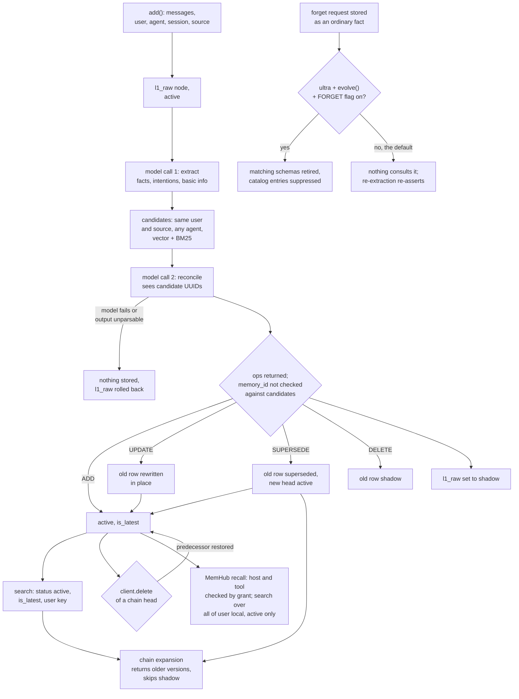

## 1. Executive Summary

Hy-Memory is Tencent Hunyuan's Python memory SDK, `hy-memory` 2.0.13, plus
MemHub, a local desktop and CLI product built on it in the same repository. The
SDK turns conversations into an eight-layer store and tool traces into fact and
experience records. One configured LLM extracts and then reconciles every write
against the user's existing memories. MemHub imports transcripts from coding
agents, sends them through the SDK, and serves recall to hosts through
grant-checked MCP tools.

MemHub moved its memory authority into the SDK in
[`6d1d29e16d9ea9d6172e44a6b768e71f444e7ba9`](https://github.com/Tencent-Hunyuan/Hy-Memory/commit/6d1d29e16d9ea9d6172e44a6b768e71f444e7ba9)
(22 October 2026). Its own ledger of evidence, governed memories and versions
is dropped at cutover, and a serving Core refuses a home that has not migrated.
What is notable is the broker: it builds the host's grant into a header
envelope that a model cannot widen. What is weak is what the envelope guards.
Recall searches the whole library, so the scope it checks is never applied.

The repository is also where the Hugging Face model
[Hy-Memory-30B-A3B](https://huggingface.co/tencent/Hy-Memory-30B-A3B) points
for "Framework Code & Evaluation Utilities". The framework code is here. The
evaluation utilities are not: no harness for LoCoMo, LongMemEval, PersonaMem-v2,
the travel and shopping sets or the coding benchmark is committed, and no Mem0,
MemOS or EverMemOS adapter is either. The model is not named anywhere in the
code. It replaces the SDK's write path only through `MEMORY_LLM_MODEL`, which
also drives the read-side calls.

Five findings shape the rest of this report.

- **The chat writer's target ids are trusted.** The reconcile prompt shows the
  model real memory UUIDs, and `_parse_ops` copies whatever `memory_id` comes
  back (`hy_memory/agent/reconciler.py:1456-1530`). No step checks it against
  the candidate set before `update_payload` shadows or supersedes that row
  (`hy_memory/pipelines/writer.py:1631-1665`). The coding reconciler drops any
  UPDATE or DELETE whose target it did not offer for that draft
  (`hy_memory/coding/reconciler.py:528-532`, `:557-561`, `:603-612`).
- **Deleting a correction restores the value it replaced.** When the deleted
  node heads a supersession chain, `_repair_evolution_chain_on_delete` sets its
  predecessor back to `active` and `is_latest`
  (`hy_memory/client.py:2584-2672`). Removing "the user drinks tea" brings back
  "the user drinks coffee", and MemHub's person delete reaches the same code.
- **The SDK's agent surfaces do not hold a scope.** The HTTP server answers any
  origin with no credential (`hy_memory/server.py:128`, `:152-159`). The
  OpenClaw tools take a model-supplied `userId` that replaces the configured
  one (`plugins/openclaw/tools/memory-search.ts:17-31`). The Hermes provider
  takes its user and agent from configuration.
- **MemHub's recall checks a scope and does not apply it.** Core refuses a
  requested scope outside the grant, then searches every memory of user
  `local` and attaches no scope to a hit
  (`memhub/apps/core/src/one_memory/api.py:5061-5093`,
  `recall.py:228-319`). Revoking a source stops its imports and leaves its
  memories recallable.
- **Nothing is held for review.** Every SDK memory is `active` on arrival.
  `MemHub_write` files a host's text as a hand-added memory that goes straight
  to the SDK's `add` (`memhub/packages/host-bridge/src/recall-broker.ts:1030-1050`).

Two marks: `audit_log`, held by the SDK's history table, and `negative_eval`.
Section 9 names the five withheld, `scope_enforced` among them: the SDK's
OpenClaw tools lift the scope the library filters on.

## 2. Mental Model

A chat memory starts as the raw turn. `add()` writes it as an `l1_raw` node,
`active`, and a model call extracts facts, intentions with a deadline, and
basic profile fields from it. The extraction prompt is one of eleven language
files under `hy_memory/prompts/` (`en.py:12`). A second model call compares
each extracted fact with candidates from the same user and source and returns
operations. The writer applies them and then shadows the raw turn, whether or
not anything was extracted (`hy_memory/pipelines/writer.py:3594-3613`).

**A belief is a row that is `active` and `is_latest`.** `MemoryStatus` has six
values (`hy_memory/models/memory.py:121-130`), and the read filters admit
`active` by default, with `superseded` admitted where a reader expands a chain.
Four operations move a fact:

| Op from the model | Effect on the old fact | New row |
| --- | --- | --- |
| `ADD` with no target | none | `active`, new chain |
| `UPDATE` with content | rewritten in place, re-embedded, original `memory_at` kept | none |
| `SUPERSEDE` | `superseded`, `is_latest=False`, linked by `superseded_by` | `active` head with `supersedes` |
| `DELETE`, or `UPDATE` with no content | `shadow`, `is_latest=False` | none |

`enforce_time_order` turns a SUPERSEDE or UPDATE aimed at a memory whose
`memory_at` is later than the incoming one into an ADD, so an imported old
conversation cannot replace a more recent fact
(`hy_memory/agent/reconciler.py:201-259`).

`shadow` is also where dedup, replaced topic summaries and stale episode
capsules go. It is a logical delete, not a doubt. The field comment also calls
it a low-confidence inference state, and no writer in `hy_memory/` sets it for
that reason. `negated` and `conflicted` have no writer at all.

**Supersession keeps history; deletion can undo it.** A recalled fact whose
chain holds older versions is returned with the chain, oldest first, minus any
`shadow` member (`hy_memory/pipelines/_retrieval/evolution.py:204`). An API
delete of the chain head restores its predecessor as the current belief
(`hy_memory/client.py:2584-2672`). Nothing records that the deleted value was
rejected, so the next extraction can re-assert it.

**Forgetting is a fact that a later pass may honour.** A request such as "forget
that I like hiking" is extracted as an ordinary fact. In ultra mode, with
`MEMORY_EVOLING_FORGET_ENABLED`, System 2 retires schemas matching it, and the
balanced catalog and specific-supplement builders suppress entries matching its
terms (`hy_memory/pipelines/system2_agent.py:1081-1100`, `:1800-1875`,
`hy_memory/pipelines/balanced_catalog.py:76-237`). All three flags default to
`false`, MemHub sets none of them (search 14), and the System 1 extractor and
reconciler never consult a marker (search 16).

MemHub keeps no memory state of its own. Recall re-reads each SDK hit and drops
one whose status is not `active`
(`memhub/apps/core/src/one_memory/recall.py:276-277`).

## 3. Architecture

`HyMemoryClient` (`hy_memory/client.py`, 7,807 lines) is the entry point. It
runs its own event loops on threads, so the sync API blocks the caller while
async work runs inside (`client.py:382-424`). A `PipelineRegistry` builds a
`MemoryWriter`, a `MemoryReader` that dispatches to the legacy vector reader or
the hybrid vector-and-BM25 one, and in ultra mode a `System2Writer`
(`hy_memory/pipelines/registry.py:96-201`, `reader.py:32-55`).

Three modes set the depth. `lite` stores raw turns with embeddings and calls no
model. `pro` adds extraction and reconcile and can project into a graph. `ultra`
always runs the graph and enables `evolve()`, which runs System 2 schema
induction and a cross-domain sweeper. Working and Coding writes go through a
separate pipeline in `hy_memory/coding/`, with a model call choosing the scene
when the caller does not. `hy_memory/reembed.py` re-embeds every store into a
new embedding space, and `hy_memory/snapshot.py` copies and restores a quiesced
local data root.

Storage is several files. Chroma is the default vector store, with Qdrant and
FAISS as alternatives; Kuzu or Neo4j hold schemas and intentions. SQLite holds
history, a cache of pipeline logs and operations, coding experiences and facts,
recent coding traces capped at 100 per user and agent, and the diff-chain
threads (`hy_memory/data/history_store.py`, `cache_sqlite.py`,
`hy_memory/coding/store.py:73-133`, `chain_store.py:148-170`). MySQL can replace
the cache.

MemHub (`memhub/`) is a Python Core on FastAPI. It builds the SDK client itself,
with every store under `<data_dir>/hy-memory/governed-v2`, in `pro` by default
and `lite` or `ultra` by setting
(`memhub/apps/core/src/one_memory/hy_sdk_runtime.py:387-495`). Its own SQLite
database holds grants, sources, the durable write queue and call events. A
fresh home is created at SDK authority without the legacy tables, and a
migrated one drops them (`target_schema.py:12-64`, `sdk_migration_runner.py:471`).
Under SDK authority the evidence and governance stores are fail-closed facades
(`api.py:1181-1191`, `retired_authority.py`). A TypeScript host bridge runs the
MCP server, a loopback recall broker and host installers; an Electron desktop
app, a web UI and a CLI sit on top.

### Deployment and ergonomics

The SDK needs an OpenAI-compatible chat endpoint and an embedding endpoint for
anything above `lite`; the defaults are `gpt-4.1-nano` and
`text-embedding-3-small` (`hy_memory/config.py:179-181`, `:273`). Everything
else is local files: `pip install hy-memory` brings Chroma and Kuzu as
dependencies. The stores are not hand-repairable in practice, since a fact lives
as a Chroma payload with a chain of UUID links, and Kuzu and Chroma files must
stay consistent with each other.

`python -m hy_memory.server` serves the SDK on `127.0.0.1:19527` with
`ThreadingHTTPServer`, for the OpenClaw plugin and the unmanaged Hermes
provider. MemHub is a desktop install that runs Core, the broker and a scanner
as local processes; a model profile is required before memory processing does
anything above `lite`. Nothing was installed or run for this report, and 13 of
the 17 dependency surfaces changed inside the seven-day cooldown.

## 4. Essential Implementation Paths

**Chat write.** `HyMemoryClient.async_add` routes by scene and calls
`MemoryWriter.write` (`hy_memory/pipelines/writer.py:2570`). `_run_agent`
stores the raw node and calls `MemAgent.process_add`, which makes the extraction
call (`writer.py:3265`, `hy_memory/agent/mem_agent.py:134`).
`_reconcile_and_store_locked` takes a per-user `asyncio.Lock`, calls
`MemoryReconciler.reconcile`, embeds the op contents in one batch and applies
each op (`writer.py:89-97`, `:1259-2142`). Intentions are stored as
`l7_intention` nodes with the extracted `valid_until` (`writer.py:597-755`).

**Reconcile.** `reconcile` gathers candidates for each new fact by vector and
BM25 search across all of the user's agents within the write's source, folds
chains to their heads, and builds one prompt listing each head's `memory_id`,
content, owner and time (`hy_memory/agent/reconciler.py:397-1000`, `:559-584`,
`:971`). If the model is unreachable, answers empty, or returns unparseable
JSON after retries, reconcile returns a failure with a stable code and no ops
(`reconciler.py:1083-1142`). The writer stores no new memory, deletes the
request's provisional raw turn, and reports `RECONCILE_FAILED` with the cause
(`writer.py:1297-1316`, `:3118-3180`).

**Chat read.** `async_search` requires `user_ids`, picks a scene, and calls the
reader (`hy_memory/client.py:3842-4017`). `_build_isolation_params` turns the
user, agent and session lists into an exact isolation key, a key list, or user
and agent filters (`hy_memory/pipelines/reader_base.py:3643-3693`). The Chroma
adapter adds `status = active` unless a status list is passed, and
`is_latest = True` unless `only_latest` is false
(`hy_memory/data/vector_store_chroma.py:242-309`).

**Update and delete.** `get`, `update` and `delete` take an id and an optional
namespace, and fail closed when the id exists in more than one of chat,
experience and fact (`client.py:4598-4670`). `_update_chat` re-embeds, upserts
and writes a history row (`client.py:4956-5033`). `_delete_chat` repairs the
chain, deletes the vector, clause and graph rows, cleans orphan tags and writes
a history row (`client.py:5196-5357`). `async_delete_all` purges by user, agent
or session across the vector store and the graph.

**Coding.** `hy_memory/coding/writer.py` extracts one fact and zero or more
experiences per traced session; `coding/reconciler.py` applies ADD, UPDATE,
DELETE or SKIP per draft. A model failure fails the write with nothing
half-applied. `coding/chain_store.py` records each replace or Git diff as a
round under a thread keyed by file, function block and branch, with no model
call. Search attaches the chain to returned facts.

**MemHub.** Source adapters under `memhub/apps/core/src/one_memory/imports/sources/`
read transcripts, and the durable queue hands each window to
`SdkWriteProcessor`, which calls the SDK's `add` or `add_extracted` with
`agent_id="all-apps"`, the source and the workspace
(`sdk_write_processor.py:33`, `:130-185`). Recall goes MCP tool, broker
`authorizeHost`, Core `/api/v1/recall`, then `SdkRecallTarget`
(`api.py:4522-4575`, `:1268-1276`).

## 5. Memory Data Model

`MemoryNode` carries identity (`node_id`, `user_id`, `agent_id`, `session_id`),
a `source` naming the calling application, an `owner` of `user` or `agent`, a
layer, content, four time fields, chain links and status. It also holds a
confidence float and `source_type`, emotional valence, access counters, tags
with NER labels, an `episode_id` and free-form `custom`
(`hy_memory/models/memory.py:223-330`). `SchemaNode` adds a proposition,
evidence and a `schema_status` that nothing sets past its default;
`IntentionNode` adds trigger fields and an expiry.

**Time.** `gmt_created` and `gmt_modified` are the write clock. `memory_at` is
when the conversation happened, supplied by the caller and defaulting to the write clock.
`valid_from` defaults to the write clock in `__post_init__`
(`memory.py:330-345`). `valid_until` is the extracted deadline on intentions and
the retirement time on retired schemas and catalog nodes
(`hy_memory/pipelines/system2_tools.py:181`, `:844`).

**Scope keys.** The isolation key is `user::agent::session`, with
`default_session` when none is given; topics use `user::agent` so a topic spans
sessions (`memory.py:356-398`). Chat search filters on the key or on user and
agent ids. Coding records carry `workspace_id` and `branch` columns, and a
branch filter tolerates rows with a null branch
(`hy_memory/coding/store.py:97-120`, `tests/coding/test_search_scope_filter.py:152-155`).

**Provenance.** A fact keeps `source_raw_memory_id`, merged source raw ids in
`custom`, an evidence chain and the caller's `meta` list. A reconciled fact is
written with `source_type = inferred`; basic-profile fields with `explicit`.
No read filters on either.

MemHub adds no field to a memory. Its users are a `user_id` on every memory
route, `local` by default, with other users reachable through per-user Hermes
grants; `source_grants` carries `revoked_at` per user and source.

## 6. Retrieval Mechanics

Default chat search embeds the query, runs a vector search per layer with the
isolation filter, and optionally fuses BM25 through reciprocal rank in the
hybrid reader. Tag and entity matches boost scores, a local cross-encoder can
rerank, and episode membership can pull in neighbours
(`hy_memory/pipelines/reader_base.py`, `_retrieval/`). Results come back in
three channels: `profile`, `normal` and `proactive`.

`search_mode="agentic"` adds a model call that classifies the scene, rewrites
the query and extracts a time range (`client.py:4046-4105`). That call uses the
same `LLMProvider` and the same `MEMORY_LLM_MODEL` as the write path. A swap of
the writer model therefore also swaps the read-side model, unless the caller
holds `search_mode` at `default` with a single query.

Chain expansion returns the whole supersession chain under a hit, oldest to
newest. A user's search under agent A can surface the current head that lives
under agent B, because reconcile is user-wide and the chain is followed by id
(`tests/test_reconcile_candidate_user_scope.py:1-18`). `include_sources` and
`exclude_sources` are honoured by the expansion
(`tests/test_source_filtering.py:161-180`).

The by-id fetch, `async_get`, reads the vector and graph stores by primary key
with no user check and returns rows in any status and layer, `l1_raw` included
(`client.py:4672-4825`). `list_memories` requires a user and filters `active`
(`client.py:6267-6310`, `vector_store_chroma.py:455-479`).

**MemHub recall.** `SdkRecallTarget` calls the SDK's `search` with
`user_ids=["local"]` and every agent, re-reads each hit by id, keeps it only if
`active`, and returns it with an empty scope list
(`memhub/apps/core/src/one_memory/recall.py:228-319`, `api.py:6491-6522`). The
requested scope and workspace are not passed to the search, and neither is a
source filter (search 15). Only the raw-conversation fallback is narrowed to
the host's granted, unrevoked sources (`api.py:6064-6102`).

## 7. Write Mechanics

Writes are explicit `add()` calls. In the OpenClaw plugin an auto-capture hook
sends each turn, and in MemHub the scanner sends imported transcript windows.
There is no ingestion filter for injected content beyond the extraction prompt's
own instructions. Reconcile is serialised per user inside one process by the
lock; two processes writing the same store are not coordinated.

A model failure during reconcile stores nothing. The raw turn is deleted again,
the response carries `RECONCILE_FAILED` with a cause code, and the caller is
expected to retry under a new request id. `tests/test_reconcile_failure.py`
asserts that no ADD-all fallback is left and that a failed write stores nothing
and rolls the raw turn back.

### Operational cost

`add()` blocks the caller on at least two model calls, extraction and
reconcile, plus an optional search-query generation call
(`reconciler.py:360-396`). A fact is retrievable when `add()` returns. Episode
summaries and graph projection are scheduled as tasks afterwards
(`writer.py:990-1158`). No pass rewrites the whole store on its own;
`evolve()` reads a user's active facts in batches of up to 24 when called
(`system2_agent.py:57`). MemHub in `ultra` calls `evolve` once a night per user
with memories, under that user's write exclusivity
(`memhub/apps/core/src/one_memory/memory_evolution.py:1-19`, `:323-330`).
Read-side injection in the OpenClaw plugin is a `<relevant-memories>` block
prepended to the prompt each turn, bounded by `topK`
(`plugins/openclaw/index.ts:600-660`).

## 8. Agent Integration

The OpenClaw plugin registers `memory_search`, `memory_add`, `memory_get`,
`memory_update`, `memory_delete` and `memory_list`, and adds auto-recall and
auto-capture hooks (`plugins/openclaw/tools/index.ts:20-25`). `memory_delete`
takes `all` and `confirm` together, so the model can bulk-delete any user it
names. The tool descriptions tell the model to search before deleting.

The Hermes provider (`plugins/hermes/hy_memory/provider.py`) exposes
`hy_memory_search`, plus `hy_memory_add` when it talks to the SDK server
directly. Its tools take only a query, a limit or a text; the user and agent
come from configuration (`provider.py:602-675`). Under a MemHub install it is
read-only and searches through the broker's context route.

MemHub's MCP server exposes `MemHub_recall`, `MemHub_write` and
`MemHub_diagnostic_trace`, with `om_` aliases for existing grants
(`memhub/packages/host-bridge/src/mcp-session.ts:242-386`). No tool deletes,
corrects or approves. `MemHub_write` takes a text and an idempotency key; the
broker forwards exactly those two fields to Core's hand-added-memory route as
`all-apps`, outside the grant check (`recall-broker.ts:1014-1050`). A Claude
Code adapter adapted from [memmy-agent](../memmy-agent/) installs hooks in
sync-only mode, and the host bridge also installs into Cursor, Codex, Hermes,
WorkBuddy and other harnesses.

## 9. Reliability, Safety, and Trust

**The SDK server.** `hy_memory/server.py` sets
`Access-Control-Allow-Origin: *` on every response and answers preflight for
GET, POST, PUT and DELETE, with no credential check on any route. It binds to
loopback by default. Whether a web page can reach it then depends on the
browser's private-network policy, not on the server.

**Model-chosen ids.** The chat reconciler applies the returned `memory_id`
without a membership check (search 8). A hallucinated id that does not exist is
harmless. An id copied from injected text into the model's output would shadow
or supersede that row for whichever user owns it. The coding reconciler
refuses the same op with `outside authority scope`, added in
[`0afe787c95b64fd0f25f0eb9ba012fde3472f213`](https://github.com/Tencent-Hunyuan/Hy-Memory/commit/0afe787c95b64fd0f25f0eb9ba012fde3472f213).

**MemHub's broker** is the strongest mechanism here. `authorizeHost` verifies
a per-installation secret, checks the requested scope against the grant, and
writes the grant's own scopes and tools into the envelope. Core parses it
strictly, refuses partial envelopes and any route off its allow-list, and takes
the workspace from the host process, never from a tool argument
(`recall-broker.ts:1079-1150`, `external_memory_access.py:24-29`, `:66-142`,
`mcp-session.ts:72-79`). The broker's recall body is an allow-list without
`user_id`, so a host reads only `local` (`recall-broker.ts:1290-1327`).

**What the envelope guards.** A host paired with a one-time code is granted
`all-apps` (`host-grants.ts:315`). A person can narrow it to a workspace scope, and Core
then answers that host from the same library-wide search, since recall
applies no scope. Revoking a source cancels its jobs, parks its extraction and
leaves its memories in recall (`api.py:2989-3033`). A committed test asserts
that SDK recall attaches no per-memory scope
(`memhub/apps/core/tests/test_recall.py:35-77`).

**Withheld marks.**

- **`scope_enforced`.** The repository ships an agent surface that lifts the
  scope. The OpenClaw plugin's `memory_search`, `memory_list`, `memory_add` and
  `memory_delete` take a model-supplied `userId` that replaces the configured
  user (`plugins/openclaw/tools/memory-search.ts:17-31`,
  `memory-delete.ts:15-39`). Its `memory_get`, `memory_update` and
  `memory_delete` by id reach `async_get`, `async_update` and `async_delete`,
  which take no user (`hy_memory/client.py:4672`, `:4827`, `:5102`). MemHub's
  person routes read first and answer another user's id as 404, a boundary
  held in the app and not on the SDK's agent surface.
- **`trust_state`.** `shadow` and `superseded` filter, and both are lifecycle:
  one is a logical delete, the other a replaced version. No path marks a fact
  as doubted, and MemHub keeps no state of its own.
- **`tombstone`.** The forget marker is keyed on the value's terms and
  consulted by two derived-artifact builders, behind flags that default off and
  outside the System 1 path that would re-assert the value.
- **`bitemporal`.** Valid-time start is the write clock and the caller's
  `memory_at` is observation time. `valid_until` is an intention's deadline in
  one place and a retirement timestamp in another.
- **`human_review`.** Nothing waits. `MemHub_write` hands a host's text to the
  SDK's `add`, and MemHub's person routes are edits after the write, behind a
  bearer token or UI session.

**`audit_log` scope.** `memory_history` records the client's add, update and
delete, which are the person- and API-driven mutations. The reconciler's own
mutations reach it only as the parent `ADD` row. Their detail lives in
`pipeline_logs_v2` and the off-by-default `memory_operations_v2`, and MemHub
turns both off (`memhub/apps/core/src/one_memory/hy_runtime_config.py:124-157`).
The SDK's public restore swaps the whole data root, history file included, for
a snapshot and moves the replaced root aside (`hy_memory/snapshot.py:106-150`).

## 10. Tests, Evals, and Benchmarks

The SDK suite runs in CI with `uv run pytest tests/` and the faiss and qdrant
extras (`.github/workflows/ci.yml:39-40`). Most cases use real Chroma, Qdrant
or FAISS in a temp directory with a mock embedder. The negative cases cited in
the frontmatter are exact-list assertions beside a positive control in the same
test. Two integration files, `tests/test_vector_search_isolation.py` and
`tests/test_vector_search_adversarial.py`, are marked `integration` and
excluded by the default `-m 'not integration'`. They never insert their
fixtures. The isolation file defines `graph_store_neo4j_fixture` against a
hard-coded local Neo4j, and the adversarial file uses it with no conftest to
supply it (search 17).

MemHub's Core suite runs the FastAPI app through `ASGITransport` over a
stand-in SDK that keeps memories per user. It asserts that one user's library,
search, context, profile and graph return only that user's memories, and that
another user's id answers 404 on read, update and delete while the owner's
succeed (`memhub/apps/core/tests/test_multi_user_runtime.py:271-354`).
`test_recall_scope_control.py` asserts that `*`, `private` and unrelated scopes
are refused with 403. The suite keeps tests for the retired governance ledger,
which a serving Core never opens.

**The model and its numbers.** The technical report,
[arXiv:2610.22196](https://arxiv.org/abs/2610.22196) (15 October 2026), trains
a 30B mixture-of-experts writer with about 3B active parameters in two stages.
On-policy distillation runs inside the deployed harnesses; reinforcement
learning then scores each chunk's bank by downstream answerability. The model
card reports a 55.49 macro average across four harnesses against 54.62 for
Claude Opus 5. Each harness score averages six benchmarks, every benchmark on a
fixed 20% subsample, with the answer model, judge, retrieval and prompts held
fixed, and EverMemOS held out of training.

What that measures is narrow. It changes only the writer, so it says nothing
about this repository's retrieval. Several per-benchmark gaps are within a few
points on a 20% subsample, and no interval is reported. The Hy-Memory column is
the harness in this tree; the [Mem0](../mem0/), [MemOS](../memos/) and
[EverMemOS](../everos/) columns ran against code that is not here. None of it
can be recomputed from the repository, which holds no harness, configuration or
result file for any of the six benchmarks. The CMB paper ships as a PDF under
`docs/papers/`. The chat architecture is described in
[arXiv:2606.09483](https://arxiv.org/abs/2606.09483) (8 June 2026).

Missing tests worth having: a chat reconcile op naming an id outside the
candidate set; deleting a superseding fact and asserting the replaced value
stays out (search 13); MemHub recall under a workspace-only grant; and the SDK
server refusing a cross-origin request.

## 11. For Your Own Build

### Steal

- **Build the scope envelope in the broker, from the grant.** The model may name
  a narrower scope; the headers carry what the grant allows, and the server
  checks the request against them. A scope argument is then a request, never a
  grant. It protects only what the read path then filters on, and here recall
  filters on nothing but the user.
- **Take the working directory from the host process.** MemHub's comment says
  why: a model can name a directory it is not in.
- **Offer candidates, then refuse any target outside them.** The coding
  reconciler freezes each draft's candidate set and drops an UPDATE or DELETE
  aimed elsewhere; the chat reconciler shows why the check is needed.
- **Fail a write cleanly when the model fails.** No ADD-all fallback, the raw
  turn rolled back, and a stable cause code, so a retry cannot duplicate.
- **Record code versions without a model.** A diff chain keyed by file, block
  and branch keeps reverted versions that a summary drops.

### Avoid

- **Applying model-returned ids without a membership check.** Map candidates to
  short local indices, or reject any id not in the set the prompt showed.
- **Restoring a predecessor when its replacement is deleted.** A delete of a
  correction is usually a request to forget both; if not, ask.
- **One model setting for writing and reading.** It makes a writer comparison
  also a query-rewriter comparison unless the harness pins the read side.
- **A local HTTP API with `Access-Control-Allow-Origin: *` and no token.**
- **Checking a scope the search never receives.** Pass the granted scope to
  the query, or the grant decides only who may ask.

### Fit

The SDK suits a team that wants a layered, model-curated personal memory and can
pay two synchronous model calls per write. It assumes a trusted caller: it is a
library whose scope is whatever the application passes, and its bundled server
and OpenClaw tools hold no boundary of their own. MemHub is a different
proposition, a single-user desktop memory shared across coding agents, which
authenticates each host and treats every memory as cross-app. Anyone choosing
a long-term memory writer from the published table needs their own harness;
this repository does not hold one.

## 12. Open Questions

- Was the model card's Hy-Memory harness this tree at this commit, in which
  mode, and with `search_mode` and query rewrite off?
- Is a workspace-scoped grant meant to narrow what a host reads once memories
  live in the SDK, or is every memory deliberately cross-app?
- Which harness configuration produced the 20% subsamples, and are their ids
  published anywhere?

## Appendix: File Index

- **Model and storage:** `hy_memory/models/memory.py`,
  `hy_memory/data/vector_store_chroma.py`, `vector_store_qdrant.py`,
  `graph_store_kuzu.py`, `history_store.py`, `cache_sqlite.py`,
  `hy_memory/coding/store.py`, `coding/chain_store.py`, `hy_memory/snapshot.py`,
  `hy_memory/reembed.py`.
- **Write path:** `hy_memory/pipelines/writer.py`, `hy_memory/agent/extractor.py`,
  `hy_memory/prompts/en.py`, `agent/reconciler.py`, `agent/mem_agent.py`,
  `hy_memory/coding/writer.py`, `coding/reconciler.py`.
- **Read path:** `hy_memory/pipelines/reader_base.py`, `reader_hybrid.py`,
  `reader_legacy.py`, `pipelines/_retrieval/evolution.py`.
- **Background:** `hy_memory/pipelines/system2_agent.py`, `system2_tools.py`,
  `balanced_catalog.py`, `specific_supplement.py`, `agent/episode_summary.py`.
- **API and integration:** `hy_memory/client.py`, `hy_memory/server.py`,
  `plugins/openclaw/tools/`, `plugins/openclaw/index.ts`,
  `plugins/hermes/hy_memory/provider.py`.
- **MemHub:** `memhub/apps/core/src/one_memory/api.py`, `recall.py`,
  `external_memory_access.py`, `hy_sdk_runtime.py`, `hy_runtime_config.py`,
  `sdk_write_processor.py`, `memory_additions.py`, `memory_evolution.py`,
  `retired_authority.py`, `target_schema.py`,
  `memhub/packages/host-bridge/src/recall-broker.ts`, `mcp-session.ts`,
  `host-grants.ts`.
- **Tests:** `tests/coding/test_search_scope_filter.py`,
  `tests/test_evolution_chain_shadow_filter.py`, `tests/test_source_filtering.py`,
  `tests/test_reconcile_failure.py`, `tests/test_vector_search_isolation.py`,
  `memhub/apps/core/tests/test_multi_user_runtime.py`, `test_recall.py`,
  `test_recall_scope_control.py`.

### Recorded searches

Run from the clone root with `PIN=d2e9cdaf069925a710664a215ee0d40750333714`
checked out. Each returned nothing unless a result is stated.

1. `git grep -n -E '(UPDATE|DELETE FROM)[[:space:]]+memory_history' $PIN` —
   no statement mutates a history row.
2. `git grep -n -E 'os\.remove|\.unlink\(|rmtree' $PIN -- hy_memory` — five
   hits: `reembed.py:1256` and `:1258` remove Kuzu graph files, and
   `snapshot.py:92`, `:95` and `:142` remove a failed snapshot's target or a
   restore's staging copy. None removes the history file.
3. `git grep -n -E 'MemoryStatus\.(NEGATED|CONFLICTED)' $PIN -- hy_memory` — no
   writer or reader of either status.
4. `git grep -n -E 'SchemaStatus\.|schema_status' $PIN -- hy_memory ':!hy_memory/models/memory.py'`
   — `schema_status` is never set or read outside the model file.
5. `git grep -l -i -E 'locomo|longmemeval|personamem|evermem' $PIN` — two
   SDK unit tests naming LoCoMo in a docstring or a session id. No harness.
6. `git ls-tree -r --name-only $PIN | /usr/bin/grep -i -E '(^|/)(evals?|bench(mark)?s?)(/|$)|eval_|_eval|benchmark'`
   — the CMB paper PDF, one retrieval module and four MemHub retrieval and
   scale tests. No benchmark directory or result file.
7. `git grep -n -i -E '30b-a3b|hy-memory-30b' $PIN -- hy_memory memhub plugins`
   — the writer model is not named in code.
8. `git grep -n -E 'in candidate_map' $PIN -- hy_memory/agent/reconciler.py hy_memory/pipelines/writer.py`
   — five hits, all building or iterating the map at `reconciler.py:517-921`;
   none checks a returned op id.
9. `git grep -n -E 'actor_id=' $PIN -- hy_memory/client.py` — no history call
   passes an actor.
10. `git grep -n -i -E 'authorization|api_key|token' $PIN -- hy_memory/server.py`
    — three hits: the CORS allow-header list at `:157` and the health check's
    model key and token limit at `:409` and `:416`.
11. `git grep -n -E '(om|MemHub)_(approve|accept|reject|delete|correct|forget)' $PIN -- memhub/packages/host-bridge/src`
    — no MCP verb approves, deletes or corrects a memory.
12. `git grep -n -i -E 'pending_review|needs_review|approve' $PIN -- hy_memory`
    — no review state in the SDK.
13. `git grep -l -E '_repair_evolution_chain_on_delete' $PIN -- tests` — no
    SDK test exercises the chain repair on delete.
14. `git grep -n -E 'FORGET' $PIN -- hy_memory/config.py memhub/apps/core/src`
    — MemHub sets no forget flag.
15. `sed -n 228,319p memhub/apps/core/src/one_memory/recall.py | /usr/bin/grep -n -E 'scope|workspace|source'`
    — two hits inside `SdkRecallTarget`: `scopes=()` on each hit and the
    receipt's `scope=request.scope` echo.
16. `git grep -n -i -E 'forget' $PIN -- hy_memory/agent/extractor.py hy_memory/agent/reconciler.py`
    — neither System 1 module reads a forget marker.
17. `git grep -l 'graph_store_neo4j_fixture' $PIN -- '*conftest.py'` — no
    conftest defines the fixture.

## History

**2026-11-03** — [`d2e9cdaf069925a710664a215ee0d40750333714`](https://github.com/Tencent-Hunyuan/Hy-Memory/commit/d2e9cdaf069925a710664a215ee0d40750333714) — 306 commits on. MemHub moved its memory into the SDK and dropped its evidence and governance ledger, which retires the correction ledger and per-memory grant scopes this report credited ([§9](#9-reliability-safety-and-trust)). Recall checks a scope and applies none, and revocation leaves memories recallable. `om_memory_write` gained a route, closing that finding. A reconcile failure stores nothing instead of adding every fact; the coding reconciler checks targets and the chat one does not. The integration-fixture sentence overstated an absence and is corrected. Marks unchanged. Screened from a shallow clone: no auto-run surface, 4 `conftest.py` points, 13 dependency surfaces inside the cooldown by API date (the clone reported 17), 11 unpinned. LICENSE unchanged, no rider. Nothing installed, built or run.

**2026-10-16** — [`fba347ad8d04eefbc51a466fa4cbd7d4e1936109`](https://github.com/Tencent-Hunyuan/Hy-Memory/commit/fba347ad8d04eefbc51a466fa4cbd7d4e1936109) — first reading, at the head of `main`, the repository's only commit, dated 16 October 2026. Two marks: `audit_log` on the SDK's history table and `negative_eval`; `scope_enforced` withheld, since the OpenClaw plugin takes a model-supplied `userId` and the SDK's by-id reads are unscoped. Read from a full clone. Screened before reading: no auto-run surface; three `conftest.py` build-time execution points; 15 dependency surfaces inside the seven-day cooldown, which is every one, since the whole tree is a day old; 11 unpinned surfaces. The LICENSE was read in full: Apache-2.0 under a Tencent preamble, no rider. Nothing installed, built or run, and no model weights downloaded.
