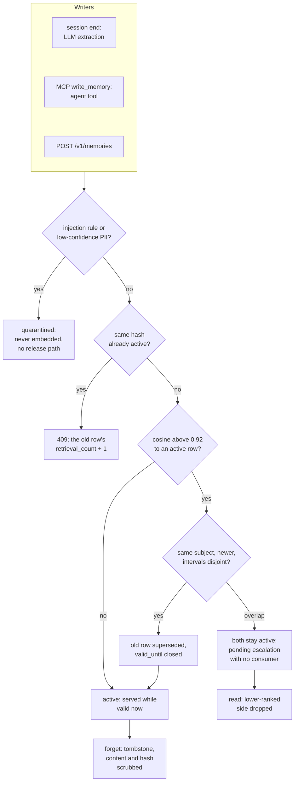

## 1. Executive Summary

IBEX Harness is a self-hosted platform that sits between an agent and its model
provider. An OpenAI-compatible proxy resolves tenant and agent, asks a context
service for memories, and injects them. When a session ends, a Celery worker has
an LLM extract memories from its turns and posts them to a FastAPI memory service
on PostgreSQL and pgvector. An MCP server gives the agent search, write, feedback
and lineage tools over the same service.

What is notable is the write path's discipline. Every write, from any source,
passes one pipeline: an injection heuristic, Presidio PII handling, exact and
near dedup, and a temporal conflict stage that compares validity intervals. A
newer same-subject memory whose interval does not overlap supersedes the old
one in the same transaction. Forget is revision-fenced, scrubs the content,
erases every child row, fences the source session against in-flight extraction,
and hands the other stores to an erasure worker that must prove absence.

What is weak is everything that waits for a person. A contradiction between two
open-ended memories becomes a `pending` escalation that nothing in the tree
resolves; both stay active and the read path keeps whichever ranks higher.
Quarantined memories are documented as awaiting human review, and no route
releases one. Forget destroys the hash a refusal would key on, so the same value
can be written again.

**Scope of this report.** The memory subsystem is the memory service
(`services/memory/`), the MCP memory server (`services/mcp-memory/`), the context
assembly service (`services/context/`), the worker's extraction and erasure code
(`services/worker/app/extraction/`, `app/tasks/extraction.py`,
`app/tasks/lifecycle_erasure/`) and nineteen PostgreSQL migrations: about 25,400
of the repository's 200,134 non-test lines, roughly 13%. The proxy's injection
and enqueue calls and the operator API's memory routes were read where they
touch memory. Auth, billing, the evidence plane, directives, the console and the
site were not.

**Licence.** MIT, in `LICENSE`, and no manifest in the tree names another;
contributions are under a DCO sign-off (`CONTRIBUTING.md:68-80`). The console's
vendored provider icons are MIT and say so
(`services/console/app/assets/brands/NOTICE.md`). The models the supported
profile runs are not in the tree: `make v1-up` pulls `BAAI/bge-m3` into a
volume (`infra/compose/v1-single-node/compose.yml:514`, `:538`) and the PII
stage loads spaCy's `en_core_web_md`, each under its publisher's terms.

## 2. Mental Model

A memory is one row of text in `ibex_core.memories` scoped to an organization
and an agent. It carries up to five category labels, a confidence, a world-time
interval `[valid_from, valid_until)`, a `lifecycle_revision` advanced by a
trigger on every lifecycle change, and a terminal `tombstoned` flag
(`infra/migrations/postgres/000014_create_memories_temporal.up.sql:6-70`,
`000045_memory_lifecycle.up.sql:3-6`, `:41-80`).

`status` is the epistemic field. It holds `active`, `quarantined`,
`superseded` or `deleted`; the CHECK also allows `merged_into` and `archived`,
and nothing writes either. Every read filters `status = 'active'`, a validity
window that contains now, and `tombstoned = FALSE`, so a row is believed only
while all three hold.

A row becomes `quarantined` at write time when the injection heuristic matches
or Presidio finds PII below the redaction confidence
(`services/memory/app/pipeline/stages.py:67-118`,
`services/memory/app/pii/service.py:75-84`). It becomes `superseded` when a
newer memory arrives with the same spaCy subject key, a cosine above 0.92 and
an interval that starts after the old one ends
(`services/memory/app/conflict/service.py:71-109`). When the intervals overlap,
which they always do for two open-ended memories, the stage writes a `pending`
row in `memory_conflict_escalations` and leaves both active
(`services/memory/app/conflict/service.py:125-145`).

A row dies by forget, which tombstones it in place, or by organization purge,
which deletes it. There is no edit, no merge, no decay and no expiry event.

## 3. Architecture

The supported deployment is the `v1-single-node` Docker Compose profile, with
thirteen long-running services: PostgreSQL with pgvector, Redis, MinIO, the auth
service, the Go proxy, the operator API, the memory service, an embedder in front
of a CPU text-embeddings-inference container serving `BAAI/bge-m3`, the worker,
the context service, the console and a Caddy edge
(`infra/compose/v1-single-node/compose.yml`). The proxy, the operator API, the
context service and the console share the edge container's network namespace,
so the context service's gRPC listens on loopback (`compose.yml:366-373`,
`:623-630`). The MCP memory server is not in that profile; it runs from the
development stack or as a stdio process (`services/mcp-memory/app/stdio_main.py`).

The memory service is the only writer of memory rows. The worker writes through
its HTTP API with a service token (`services/worker/app/extraction/memory_writer.py:83-128`),
and so does the MCP server (`services/mcp-memory/app/tools.py:220-258`). Every
transaction switches to `ibex_app` and sets the org GUC before touching a table,
because the policy is `FORCE ROW LEVEL SECURITY` and a superuser login would
bypass it (`services/memory/app/vectorstore/pgvector_store.py:195-202`).

### Deployment and ergonomics

Nothing stores without PostgreSQL, and nothing becomes vector-searchable without
the embedder; Redis is optional and only feeds the hot path. An LLM key is needed
for extraction (OpenAI or vLLM) and not for an explicit write. The install is
`make v1-secrets && make v1-up` plus a bootstrap token. The store is ordinary
SQL and repairable by hand, though row-level security and column-scoped grants
mean a repair has to run as the owning role.

## 4. Essential Implementation Paths

- **Capture.** The proxy's session-terminate handler posts the buffered turns
  to the worker's `/internal/extraction/enqueue`
  (`services/proxy/internal/http/session_terminate.go:427-436`). The task reads
  the session's `last_extracted_turn` and `lifecycle_revision`, sends the
  unprocessed turns to one batch extraction call, and posts each memory with
  `expected_session_revision` (`services/worker/app/extraction/batch.py:266-274`,
  `:278-316`).
- **Write pipeline.** `build_write_pipeline` chains validate, injection, PII,
  exact dedup, embed, near dedup and conflict
  (`services/memory/app/write/factory.py:35-82`). `MemoryWriteOrchestrator`
  persists inside one transaction that locks the organization, re-checks the
  source session's revision, inserts the row and labels, applies supersession
  and escalations, and writes a lifecycle event
  (`services/memory/app/write/orchestrator.py:181-211`).
- **After commit.** The Redis object cache, the hot sorted set and the vector
  upsert run after commit and only log on failure
  (`services/memory/app/write/after_commit.py:28-61`).
- **Retrieval.** `MemoryReadRepository.find_similar` runs the HNSW search and,
  with hybrid off, a full-text fallback, hydrates with the status and validity
  predicates, ranks, and collapses conflict pairs
  (`services/memory/app/read/repository.py:190-216`).
- **Context.** The context service fans out to a directive lookup, the hot
  route and a search, dedupes, drops conflict pairs, packs under a token budget
  and formats a nonce-delimited block (`services/context/app/pipeline.py:21-38`,
  `services/context/app/formatter.py:1-13`); the proxy places it as the first
  system message (`services/proxy/internal/http/chat_context_assemble.go:159`).
- **Forget.** `POST /v1/memories/{id}/forget` with an agent-scoped token and an
  expected revision (`services/memory/app/routers/memories.py:168-227`) runs
  `forget_memory_session` (`services/memory/app/lifecycle.py:335-367`).
- **Erasure.** The worker claims `forgotten`, `purged` and `expired` outbox rows
  and writes a receipt per store (`services/worker/app/tasks/lifecycle_erasure/`).

## 5. Memory Data Model

`memories` holds content, a SHA-256 `content_hash` of the post-PII text with a
partial unique index on `(org_id, agent_id, content_hash)` among active rows
(`000018_memories_content_hash_unique_active.up.sql:7-9`), the scalar category
a trigger keeps equal to the highest-confidence label, `confidence`,
`usefulness_score`, `retrieval_count`, `source`, PII flags, a JSON `metadata`,
the embedding with its model id, and the temporal and lifecycle columns.

`source` is always written as `user_provided`, including for extraction writes
(`services/memory/app/write/persist.py:112`); the MCP tool marks its writes
with `metadata.mcp_source = "mcp_explicit"` instead. `visibility`, `pinned`
and `tags` are packed into `metadata` (`services/memory/app/write/persist.py:36-42`).

`memory_relationships` allows six edge types and only `supersedes` is written;
the module that reads conflicts says `insert_relationship` *"has no production
caller"* (`services/memory/app/read/conflicts.py:3-8`).
`memory_conflict_escalations` carries `pending`, `resolved` or `dismissed`,
`resolved_at` and `resolved_by` (`000019_create_memory_conflict_escalations.up.sql:5-37`).

The temporal columns are `valid_from` and `valid_until` for world time and
`observed_at`, `created_at` and `updated_at` for record time. `observed_at` has
no writer; it is the insert clock.

## 6. Retrieval Mechanics

The vector search filters by org, agent, active status, tombstone, expiry and
the validity window inside the ANN select, ahead of `LIMIT`, so a filtered row
does not consume a slot (`services/memory/app/vectorstore/pgvector_store.py:27-51`).
The full-text query applies the same predicates to a generated `tsvector`
(`services/memory/app/read/full_text.py:15-34`). Hybrid RRF and a cross-encoder
rerank are implemented and default off (`services/memory/app/config.py:268-283`).

Hydration re-applies every predicate and attaches the set of pending escalation
ids per row (`services/memory/app/read/repository.py:45-77`). Composite scoring
weights relevance 0.40, recency 0.25, usefulness 0.20, confidence 0.10 and
access frequency 0.05, with a category-dependent half-life
(`services/memory/app/scoring/composite.py`). A regex guard then drops rows
whose content still matches structured PII patterns
(`services/memory/app/read/pii_guard.py:18-37`).

`collapse_conflict_pairs` keeps the first hit of each pending escalation and
drops the rest (`services/memory/app/read/conflicts.py:38-55`). The decision is
rank order: of two contradicting open-ended memories, the one with the higher
composite score is served and the other is withheld, and nothing in the returned
page says a conflict was suppressed. `IBEX_MEMORY_CONFLICT_SUPPRESSION_ENABLED`
turns this off for search; the context service collapses independently
(`services/memory/app/config.py:259-267`).

Context assembly asks for 20 hot and 10 cold hits by default
(`services/context/app/retrieval.py:110-111`), packs them under the model's
usable budget, and frames them as data with a per-assembly nonce. The block goes
first among system messages (`packages/injection/injector.go:15-17`), so any
change in it changes the head of the prompt.

## 7. Write Mechanics

Writes are synchronous through the memory service. The pipeline embeds before
the transaction and the vector is written after it, so a committed memory is
full-text searchable at once and vector searchable once the after-commit upsert
lands; if the upsert fails the row stays active without an embedding.

Extraction happens once per terminated session, in the background, with one
batch LLM call over the unprocessed turns (`services/worker/app/extraction/prompt_v2.py:52-72`).
The agent never blocks on it. A memory from a session is retrievable after the
session ends, the task is dequeued, the model answers and the HTTP write commits.
No background pass rereads or rewrites the store.

The prompt asks the model to set `valid_until` for time-bounded facts and to
*"Omit valid_from to let the caller default it to the turn timestamp"*
(`services/worker/app/extraction/prompt_v2.py:40-46`). The worker forwards the
field only when the model sets it (`services/worker/app/extraction/memory_writer.py:124-127`),
and the orchestrator fills a missing one with the write clock
(`services/memory/app/write/orchestrator.py:97-101`). Turns carry no
timestamp, so the default is processing time.

That default also disables a branch. `ConflictStage` escalates with reason
`missing_validity` only when `ctx.valid_from is None`
(`services/memory/app/pipeline/stages.py:222-223`, `:250-270`), and the
orchestrator never passes `None`.

Exact dedup returns 409 and increments the existing row's `retrieval_count`,
which feeds the access-frequency term in ranking
(`services/memory/app/write/orchestrator.py:276-300`). Near dedup only selects
conflict candidates; a near-duplicate that is not a conflict is stored beside
the original.

## 8. Agent Integration

Injection is automatic: the proxy calls `AssembleContext` on every chat request
and falls back to a directive-only prompt when assembly fails
(`services/proxy/internal/http/chat_context_assemble.go:95-160`).

The MCP server registers four tools: `search_memory`, `write_memory`,
`record_feedback` and `get_memory_lineage` (`services/mcp-memory/mcp_tools.json`).
No forget, resolve or release verb is on it. An agent-scoped token cannot name
another agent (`services/mcp-memory/app/tools.py:168-176`); search and write
check through the auth service that the agent is active, and feedback and
lineage do so for an agent-scoped token.

Forget is HTTP-only and needs an agent-scoped token with `memory:write`
(`services/memory/app/routers/memory_write_authz.py:37-44`). The operator API's
memory routes are two `GET`s (`services/api/app/routers/operator_memories.py:32`,
`:58`).

## 9. Reliability, Safety, and Trust

### The review that nothing performs

Two states wait for a resolver that is not in the tree.

- **Conflict escalations.** The default classifier returns `ESCALATE_PENDING`
  for every overlap, and `_escalate` converts a `SUPERSEDES` from any classifier
  into `ESCALATE_PENDING` as well (`services/memory/app/conflict/classifier.py:26-43`,
  `services/memory/app/conflict/service.py:133-134`). The insert counter is
  labelled *"no consumer yet"* (`services/memory/app/write/metrics.py:12-15`).
  No statement in `services/` or `packages/` updates the table, and the
  integration test that shows a `resolved` escalation stops suppressing inserts
  the `resolved` row directly in SQL
  (`services/memory/tests/integration/test_conflict_collapse.py:37-58`).
- **Quarantine.** The injection classifier's docstring says *"Human review is
  the resolution path"* (`services/memory/app/injection/classifier.py:15`), and
  `engineering/SECURITY.md:301-307` lists accept, redact, delete and mark-safe
  for a review UI. Every `status = 'active'` in `services/memory/app` is a
  filter, not an assignment. A low-confidence PII quarantine stores the
  unredacted text (`services/memory/app/pii/service.py:75-84`), and it stays in
  the table until forget or purge.

### What forget erases, and what it does not stop

`_TOMBSTONE_SQL` sets `status = 'deleted'`, `tombstoned = TRUE`, content
`'[forgotten]'` and a random `content_hash`, clears the embedding, and refuses
unless the caller's expected revision is current
(`services/memory/app/lifecycle.py:150-177`). The same transaction deletes the
row's labels, feedback, relationships and escalations, scrubs the stored
idempotent response, records cache addresses, bumps the source session's
revision and writes a `forgotten` event (`:181-207`, `:335-367`). A trigger makes
the tombstone terminal (`000045_memory_lifecycle.up.sql:47-49`). The session
bump makes an extraction job holding the old revision fail its next write with
`ExtractionLifecycleConflict`, which is outside the task's `autoretry_for`
(`services/worker/app/extraction/provider.py:21-22`,
`services/worker/app/tasks/extraction.py:69-77`), so that job's remaining turns
are not extracted.

Nothing is keyed on the forgotten value. An MCP write, a later session or the
HTTP API can store the same text again, and exact dedup cannot match the
tombstone because its hash was randomised.

### Marks

- **`trust_state`** — awarded on `status`. Quarantined, superseded and deleted
  rows are excluded by every read query, and both producers sit on the write
  pipeline every writer uses.
- **`bitemporal`** — awarded. `valid_from` and `valid_until` are world time,
  stated by the extraction model or an HTTP caller, kept beside the insert
  clock, filtered on every read and compared by the conflict stage. Three
  limits: a missing `valid_from` is the write clock; supersession sets
  `valid_until = LEAST(COALESCE(valid_until, now), now)`, so a stated end in the
  future is overwritten with the record time
  (`services/memory/app/conflict/persist.py:111-123`); and there is no as-of
  read.
- **`scope_enforced`** — awarded on `org_id` and `agent_id` predicates in every
  read query plus a forced RLS policy on `org_id`. The `visibility` field
  (`agent`, `org`, `session`) is accepted, stored in `metadata`, returned, and
  never read, so `org` visibility shares nothing.
- **`audit_log`** — awarded on `memory_lifecycle_outbox`: one row per memory
  revision, written in the mutation's transaction, unique on
  `(org_id, memory_id, revision)`. `ibex_app` holds `INSERT` and column-scoped
  `UPDATE` on delivery columns only, no migration grants `DELETE` on it, and
  the table has no foreign key, so purge events outlive the organization row
  (`000045_memory_lifecycle.up.sql:82-120`, `000078_memory_cache_erasure.up.sql:72-73`).
  It records no actor and no content. `content_updated` has one producer,
  `update_memory_pii_flags`, which only tests call, and `expired` has none.
- **`negative_eval`** — awarded; see section 10.
- **`human_review`** — withheld. Both waiting states are written on the product
  path and read on the read path, and nothing drains either.
- **`tombstone`** — withheld. The `tombstoned` flag is keyed on the record, and
  forget deliberately destroys the value a refusal would need.

### Other risks

- **The context service trusts its caller.** Its README states that *"a token
  holder can still assert any principal"*; tenant isolation there is a property
  of the proxy (`services/context/README.md`, *Claim boundary*).
- **Extraction provenance is flattened.** Every row carries
  `source = 'user_provided'`, so an LLM-extracted memory and one a person typed
  through the API are indistinguishable except for the MCP metadata tag.

## 10. Tests, Evals, and Benchmarks

The memory service has 857 unit and 143 integration tests. CI's
`memory-integration` job runs the integration suite against a pinned pgvector
16 image when memory paths change (`.github/workflows/ci.yml:2146-2193`), and
`memory-security-integration` runs on every push to `main` and nightly
(`:2306-2362`), refusing to run with fewer than 12 collected isolation tests
(`infra/scripts/memory-security-integration-test-ci.sh:34-37`). The integration
fixtures skip when Postgres is unreachable, and the count guard does not see a
runtime skip. I ran none of it.

`negative_eval` rests on four populated cases, each with a positive control in
the same assertion block:

- `test_find_similar_excludes_quarantined_and_deleted` returns exactly the
  active row from a corpus of active, quarantined and deleted rows on one topic
  (`services/memory/tests/integration/test_find_similar.py:140-193`).
- `test_superseded_memory_never_enters_the_page` gives the superseded row
  confidence 0.99 against its successor's 0.4 and the same embedding; the
  successor is returned and the superseded row is not
  (`services/memory/tests/integration/test_conflict_collapse.py:152-198`).
- `test_injection_write_is_quarantined_and_never_retrieved` writes through the
  production pipeline, then gives the quarantined row the active row's embedding
  so the exclusion depends on the status filter, on vector and hybrid
  (`services/memory/tests/integration/test_injection_quarantine.py:150-200`).
- `test_memory_iso_1_5_hnsw_no_cross_org_leakage` stores one vector in two
  organizations and asserts the other's row is absent and the caller's present
  at `ef_search` 10, 40 and 100
  (`services/memory/tests/integration/security/test_memory_iso_1_isolation.py:169-206`).

No test asserts that a forgotten value stays out after it is written again,
which section 9 shows it does not.

The ranking benchmark's committed baseline reports nDCG@10 of 0.496 dense-only,
0.829 hybrid and 0.964 with rerank over 150 queries
(`benchmarks/memory/ranking_quality/baseline-modes.json`). The embeddings are
designed profiles and the reranker is a lexical-overlap stub, and the file's own
notes say the numbers *"measure the pipeline's plumbing, not a model's ranking
quality."* The extraction gate's `gpt-4o-mini` baseline is 1.0 on every metric,
from cassettes the file calls *"oracle-aligned"*
(`services/worker/eval/gold_set/v1/baseline_results.json`), so it measures
parsing and matching. No paper is associated with the project.

## 11. For Your Own Build

### Steal

- **Fence extraction against the session, not just the memory.** Carry the
  source session's revision into every extracted write and bump it on forget,
  so an in-flight job cannot recreate what was just erased.
- **Put every predicate inside the ANN select.** Status, tombstone, validity and
  tenant ahead of `LIMIT` keep a filtered row from spending a result slot.
- **Record where the copies are in the forget transaction.** Cache addresses and
  store refs written beside the tombstone let a worker prove erasure after the
  request dies.
- **Make the exclusion test depend on the filter.** Give the excluded row the
  control row's embedding, so a missing vector cannot pass the test.

### Avoid

- **A disposition table with no disposer.** An escalation nobody resolves turns
  a detected contradiction into a ranking tiebreak the user never sees.
- **A review state with no exit.** Quarantine that only forget can leave holds
  the riskiest content longest, and unredacted.
- **Erasure that discards the refusal's key.** Keep a salted hash of a forgotten
  value if the product must not relearn it.
- **A default that disables its own fallback.** Filling `valid_from` before the
  stage that escalates on its absence made that branch dead.

### Fit

This suits a team running agents for many tenants on its own infrastructure,
where isolation, erasure evidence and an auditable lifecycle matter more than
recall quality. It costs thirteen services and an operator who knows PostgreSQL
roles. Walk away if your users correct the agent often: an updated fact without
a stated end date never supersedes the old one, and nothing turns the resulting
escalation into a decision.

## 12. Open Questions

- Whether a consumer for `memory_conflict_escalations` and a quarantine review
  route are planned, and whether either would be reachable from the MCP server.
- Whether the turn timestamp the extraction prompt promises was meant to come
  from the proxy's buffer.
- How often two open-ended memories about one subject clear the 0.92 cosine
  floor with `bge-m3`, which decides how many contradictions reach the
  escalation table at all.

## Appendix: File Index

- Schema: `infra/migrations/postgres/000014_create_memories_temporal.up.sql`,
  `000016_create_memory_relationships.up.sql`, `000017_memory_schema_v2_expand.up.sql`,
  `000019_create_memory_conflict_escalations.up.sql`, `000045_memory_lifecycle.up.sql`,
  `000074_memory_lifecycle_erasure_state.up.sql`, `000078_memory_cache_erasure.up.sql`
- Write: `services/memory/app/write/factory.py`, `write/orchestrator.py`,
  `write/persist.py`, `write/after_commit.py`, `pipeline/stages.py`,
  `injection/classifier.py`, `pii/service.py`, `dedup/`
- Conflict: `services/memory/app/conflict/service.py`, `conflict/classifier.py`,
  `conflict/persist.py`, `read/conflicts.py`
- Lifecycle: `services/memory/app/lifecycle.py`,
  `services/memory/app/routers/memories.py`, `services/worker/app/tasks/lifecycle_erasure/`
- Read: `services/memory/app/vectorstore/pgvector_store.py`,
  `read/repository.py`, `read/full_text.py`, `read/hot_cache.py`, `scoring/composite.py`
- Extraction: `services/worker/app/extraction/prompt_v2.py`,
  `extraction/batch.py`, `extraction/memory_writer.py`,
  `services/proxy/internal/http/session_terminate.go`
- Context and MCP: `services/context/app/`, `services/proxy/internal/http/chat_context_assemble.go`,
  `services/mcp-memory/app/tools.py`, `services/mcp-memory/mcp_tools.json`
- Tests: `services/memory/tests/integration/test_find_similar.py`,
  `test_conflict_collapse.py`, `test_injection_quarantine.py`,
  `test_lifecycle_fences.py`, `security/test_memory_iso_1_isolation.py`

### Recorded searches

Run from the repository root at the pinned commit with `/usr/bin/git grep`.

- **No statement resolves an escalation.**
  `git grep -n -E 'UPDATE ibex_core\.memory_conflict_escalations' -- services packages`
  returns nothing; `git grep -n -E 'INSERT INTO ibex_core\.memory_conflict_escalations' -- services/memory/app`
  matches `services/memory/app/write/persist.py:215`.
- **No path sets a memory active after insert.**
  `git grep -n -E 'status[[:space:]]*=[[:space:]]*.active.' -- services/memory/app`
  matches nine lines: eight `AND status = 'active'` filters and the
  `status="active"` a new write's PII result carries at
  `services/memory/app/pii/service.py:96`.
- **The operator memory API is read-only.**
  `git grep -n -E '@router\.(post|put|patch|delete)' -- services/api/app/routers/operator_memories.py`
  returns nothing; `git grep -c -E '@router\.get' -- services/api/app/routers/operator_memories.py`
  counts 2.
- **`content_updated` and `expired` have no product producer.**
  `git grep -n 'update_memory_pii_flags(' -- services ':!services/memory/tests'`
  matches only the definition at `services/memory/app/pii/persist.py:30`;
  `git grep -n -E 'event_type="expired"' -- services` returns nothing, and
  `git grep -n -E 'event_type="superseded"' -- services` matches
  `services/memory/app/conflict/persist.py:168`.
- **`insert_relationship` has no production caller.**
  `git grep -n 'insert_relationship(' -- services ':!services/memory/tests'`
  matches only its definition at `services/memory/app/conflict/persist.py:182`.
- **`visibility` is never read.**
  `git grep -n visibility -- services/memory/app/read services/memory/app/vectorstore services/context/app`
  returns nothing; `git grep -n visibility -- services/memory/app/write/persist.py`
  matches lines 38 and 49.
- **The write path reads the tombstone only to skip it.**
  `git grep -n -i tombstone -- services/memory/app/dedup services/memory/app/pipeline services/worker/app/extraction`
  matches the two `AND tombstoned = FALSE` predicates at
  `services/memory/app/dedup/persist.py:45` and `:88`.
- **`merged_into` and `archived` have no writer.**
  `git grep -n -E "'merged_into'|'archived'" -- services packages` matches two
  lines in an auth test about agents; `git grep -n -E "'superseded'" -- services/memory/app`
  matches the writer at `services/memory/app/conflict/persist.py:112`.
- **No product code deletes outbox rows.**
  `git grep -n -E 'DELETE FROM ibex_core\.memory_lifecycle_outbox' -- services packages infra ':!*/tests/*'`
  returns nothing; without the exclusion it matches three test fixtures.
- **Nothing supplies a turn timestamp as `valid_from`.**
  `git grep -n -E 'valid_from' -- services/worker/app services/proxy services/mcp-memory/app`
  matches only the extraction prompt, schema and `memory_writer.py:124-125`.
- **No paper.** `git grep -n -i -E 'arxiv|bibtex|CITATION' -- README.md`
  returns nothing, and the tree has no `CITATION.cff`.

## History

**2026-11-20** — [`ce41c6f495c664b59e8c6763941b1bbd66a40294`](https://github.com/Rick1330/ibex-harness/commit/ce41c6f495c664b59e8c6763941b1bbd66a40294) — first reading, from a full clone of `main` 68 commits after release `v0.1.10`, scoped to the memory service, the MCP memory server, the context service, the worker's extraction and erasure code, the memory migrations and their tests, and the proxy and operator API where they touch memory. Screened first: agent-context bundles under `.cursor/rules/`, `.github/copilot-instructions.md` and `.opencode/` that act only if a harness opens the directory, read as data; twelve build-time execution points, eleven `conftest.py` files and a Makefile; manifests and lockfiles changed inside the seven-day cooldown. MIT, no rider. Nothing installed, built or run. Five marks: `trust_state`, `bitemporal`, `scope_enforced`, `audit_log`, `negative_eval`.
