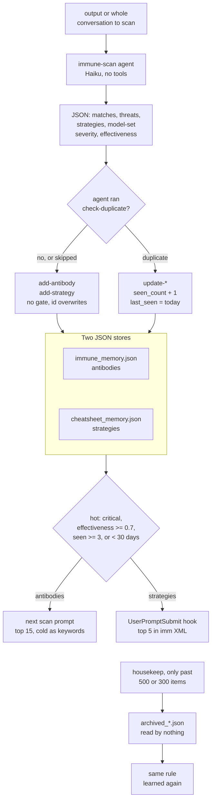

## 1. Executive Summary

Immune is a Claude Code skill that turns a cheap model's review of agent output
into two local rule stores: antibodies, defects to look for after generation,
and strategies, practices injected before it. The prompt hook is small, local
and model-free, and the v5.3.4 store refuses to overwrite itself after a failed
read. The weak side is the learning loop: whatever the scan proposes and the
duplicate check does not match is written with model-chosen severity and
effectiveness, no stored rule is ever deleted, and the archive housekeeping
writes is read by no path.

The "Immune" half is not a rejected-value tombstone. An antibody describes a
mistake in generated *content*, phrased as the safe action, and reaches only the
scan agent's prompt; it never blocks a memory write. Duplicate checks compare a
new rule against live rules of its own type only. The hybrid vector and FTS4
search the README leads with is a CLI command the skill's own workflow never
calls. No capability mark is earned.

## 2. Mental Model

A memory is a **rule**. An antibody holds `pattern`, `correction`, `severity`
(`critical`, `warning`, `info`) and `domains`. A strategy holds `pattern`,
`example`, `effectiveness` in 0 to 1, and `domains`. Both carry `seen_count`,
`first_seen` and `last_seen` (`immune-adapter.js:548-559`). The scan agent is
told to write both fields of an antibody as the desired action, never the
harmful one, because a rule naming a destructive command tends to be reproduced
when injected (`agents/immune-scan.md:105-116`).

Beside the rules sit session logs, one short summary per scan, and a running
score baseline per domain set (`cmdLogSession`, `cmdScore`,
`immune-adapter.js:1148-1176`, `:1292-1345`).

The lifecycle has three states, all derived except the last:

- **hot** — an antibody that is `critical`, seen three times, or seen in the
  last 30 days; a strategy with `effectiveness >= 0.7` or the same counts
  (`isHotAntibody`, `isHotStrategy`, `immune-adapter.js:490-502`);
- **cold** — anything else, summarised to the scan agent as keywords;
- **archived** — moved by `housekeep` to `archived_antibodies.json` or
  `archived_strategies.json`.

Every input to hot follows from a model's report. The scan agent reports severity and
a strategy's effectiveness, and the main agent increments `seen_count` and sets
`last_seen` when the scan reports a match (`skill.md:190-194`, `:232-235`). A
`critical` antibody is hot forever, and housekeep skips it
(`immune-adapter.js:1861`).

Nothing is treated as candidate or verified. A rule is written and applied, and
it leaves the live set only when housekeep archives it. There is no correction
verb, no supersession and no delete. A write with an existing id replaces the
whole object (`cmdAddAntibody`, `immune-adapter.js:748-749`).

Time is adjustable. `freeze` and `unfreeze` accumulate `total_frozen_days`,
which `daysDiffAdjusted` subtracts from the age of every item
(`immune-adapter.js:137-150`, `:1800-1819`). The offset is global, so a rule
first seen after a 60-day freeze reads as zero days old for its first 60 days.
The prompt hook computes hot from raw dates and ignores the freeze
(`immune-inject.js:20-32`).

## 3. Architecture

`immune init` copies six files and the `agents/` directory into
`~/.claude/skills/immune/` (`bin/immune.js:18-26`). They are
`immune-adapter.js`, a CLI with 28 commands; `immune-inject.js`, the prompt
hook; `sanitizer.js`; `config.yaml`; `package.json`; and the `skill.md` and
`agents/immune-scan.md` prompts. Every
adapter command is a fresh Node process, so each loads sql.js, reads the whole
SQLite image into memory and, for a vector command, loads the embedding model
(`getDB`, `immune-adapter.js:533-545`).

**Storage.** The JSON files are primary and every rule write writes them first.
Since v5.3.4, `writeJSON` writes a temporary file and renames it, and
`readJSON` returns null only for a missing file. A file that exists and does not
parse is copied aside and the command aborts, so a transient read failure
cannot produce an empty store that the next save would persist
(`immune-adapter.js:92-113`). The SQLite image holds mirror tables, an FTS4
table with the porter tokenizer, the embedding cache, `session_logs` and
`stats` (`initSchema`, `:547-582`). The last two exist only there.

**Vectors.** With no daemon the engine is in-process `Xenova/all-MiniLM-L6-v2`
through `@xenova/transformers`. If `GET /health` on `127.0.0.1:8091` answers,
the adapter uses that daemon's 2048-dimension encoder with asymmetric
`query:`/`passage:` roles and a cross-encoder (`resolveEmbedEngine`,
`:1504-1528`). Once a process has used the daemon, a daemon failure disables
the vector stage rather than falling back to MiniLM. Cache rows carry the engine
tag and are reused only on a match, so 384- and 2048-dimension vectors are
never compared (`readCachedEmbedding`, `:1599-1610`). The daemon is not in this
repository.

**Model.** Only the scan calls a model: the skill spawns `immune-scan` with
`model: haiku` and `tools: []` (`agents/immune-scan.md:1-5`), resolved through
Claude Code's model aliases.

### Deployment and ergonomics

Nothing has to run. `npm install -g @mnemoclaw/immune && immune init` copies the
runtime files into the skill directory and runs `npm install --omit=dev` there
(`bin/immune.js:181-251`). The three dependencies float and no lockfile is
committed or published. If `@xenova/transformers` fails to import at runtime,
the adapter runs `npm install @xenova/transformers@2.17.2` itself
(`immune-adapter.js:1435-1456`). The first vector call downloads about 22 MB of
model. Search, dedup and the hook work offline; the scan needs a model endpoint.
The JSON stores are readable and editable by hand, and editing them is the only
way to delete a rule.

## 4. Essential Implementation Paths

- **Scan and learn.** `/immune` runs `skill.md`: `get-context`, then
  `get-strategies` and `get-antibodies` for hot and cold tiers with no query
  (`skill.md:72`, `:87-95`, `:132-140`). It builds a `<scan_request>` and
  spawns the scan agent (`:150-176`). For each reported match it runs
  `update-antibody --increment_seen`. For each new threat it runs
  `check-duplicate`, then either `update-antibody` or, with
  `auto_add_threats: true`, `add-antibody` (`:196-213`). Strategies follow the
  same shape, with an effectiveness the agent computes as `old*0.8 + new*0.2`
  (`:226-240`). The session ends with `score` and `log-session`.
- **Direct writes.** `cmdAddAntibody` and `cmdAddStrategy` check only required
  fields, fill defaults, upsert by id into JSON and SQLite
  (`immune-adapter.js:736-787`). `cmdImport` does the same for a pack file
  (`:789-839`). `cmdUpdateStrategy` accepts any float for effectiveness
  (`:865`).
- **Gated write.** `cmdFlushPending` applies `qualityGate` (id, a pattern of 20
  characters or more, severity and correction for antibodies), then
  `findBestDuplicate` against the live items of the same type, sets
  `quality_gate = 1` and writes (`:1349-1428`). The skill calls it only near
  compaction (`skill.md:305-309`).
- **Dedup.** `findBestDuplicate` uses embeddings when any engine is up and
  Jaccard plus longest common word run plus a domain bonus otherwise
  (`:1786-1796`, `:1752-1784`). On the daemon, cosine proposes up to eight
  candidates above 0.40 and the cross-encoder decides at 0.45 (`:1672-1702`).
- **Retrieval.** `cmdGetAntibodies` and `cmdGetStrategies` (`:642-734`);
  `cmdSearch` with `fts4Search`, `embeddingSearch` and
  `reciprocalRankFusion` (`:880-1061`); `cmdGetContext` (`:1178-1209`).
- **Prompt hook.** `immune-inject.js` reads the prompt from stdin, sanitizes it,
  matches `domain_keywords` from `config.yaml`, and prints up to five hot
  strategies (`:132-177`).
- **Housekeeping.** `cmdHousekeep` (`immune-adapter.js:1821-1948`),
  `cmdRetentionCleanup` (`:1271-1288`), `cmdFreeze`, `cmdUnfreeze`.
- **Concurrency.** Eleven commands take a `proper-lockfile` lock with a
  10-second stale window (`:2174-2186`). `import`, `freeze`, `unfreeze`,
  `retention-cleanup`, `search`, `check-duplicate` and the `get-*` commands do
  not.

## 5. Memory Data Model

The two JSON documents are `{version, antibodies|strategies, stats}`. The SQLite
mirror tables add `quality_gate INTEGER DEFAULT 0`, which `cmdFlushPending` sets
to 1 and no query reads (`immune-adapter.js:552`, `:1365`). The migration state
carries a `phase` that `migrate-advance` increments and no branch reads
(`:1125-1133`).

**Scope.** The store lives in the adapter's own directory (`IMMUNE_DIR =
__dirname`, `:10`), so one installation serves every project the user opens.
`domains` is a topic tag from a fixed keyword list — `code`, `writing`,
`travel` and others in `config.yaml:60-67`. `domainMatch` admits any item
tagged `_global` (`:504-507`), and since v5.2.2 an absent domain list means no
filter (`:643-655`).

**Time.** `first_seen` and `last_seen` are dates the agent may pass explicitly;
the skill passes today (`skill.md:211`). There is no validity time.

**Session memory.** `log-session` appends a markdown block to
`context/YYYY-MM-DD.md`, inserts a `session_logs` row, and inserts a sanitized
copy of the summary into FTS4 (`:1155-1173`). `index-context` chunks
`MEMORY.md`, `USER.md` and `context/*.md` into FTS4 at 1,600 characters
(`:1211-1253`). Its `MEMORY_MD` is `~/.claude/skills/MEMORY.md`, and the
comment's environment override has no reader (`:17`).

**Archive.** `housekeep` writes each archived item with an `archived_at` entry
of id, date and reason (`:1873-1880`). Nothing reads either archive file.

## 6. Retrieval Mechanics

The skill's own reads take **no query**. `get-antibodies --tier hot --limit 15`
filters by domain and hot, then sorts by severity and `seen_count` and keeps 15
(`immune-adapter.js:677-686`). Model-labelled `critical` antibodies therefore
fill the scan's slots ahead of any warning, however relevant the warning. Cold
items go to the scan as comma-separated keywords. `get-strategies` sorts by
effectiveness.

**With `--query`**, the same commands rerank by `0.6 × text similarity + 0.4 ×
heat`, where heat weighs severity or effectiveness, recency over 90 days and
frequency (`heatScore`, `:295-301`). Similarity is daemon or MiniLM cosine, with
TF-IDF and trigram Jaccard as fallback. `finalizeResults` drops scores below
0.08 except criticals and guarantees the top three criticals a place
(`:432-453`). At 200 items or more, an FTS4 prefilter narrows the candidates
first.

**`search`** runs the vector and FTS4 engines in parallel and fuses them by RRF
at k = 60 (`cmdSearch`, `:1024-1061`). It is the README's headline feature and
is reached from the CLI and the benchmark scripts only. FTS4 queries quote each
token after stripping `"^()*`, so a stored or queried term cannot inject MATCH
syntax (`:458-468`).

**`get-context`** searches FTS4 session chunks and returns the most recent
`session_logs` rows within 90 days (`:1178-1209`).

**The prompt hook** scores domains by keyword hits, keeps the top one or two,
adds `_global`, and injects up to five hot strategies by effectiveness
(`immune-inject.js:60-115`). It injects nothing when no domain keyword matches.

## 7. Write Mechanics

Writes happen in the skill's flow, synchronously, after the scan returns. Each
is one CLI call composed by the main agent as a shell command with the JSON
payload in single quotes (`skill.md:211`, `:238`). A scanned pattern containing
an apostrophe ends that argument unless the agent escapes it.

The admission rules depend on which verb the agent runs:

- `add-*`: required fields only; an existing id is replaced. The skill names
  ids `AB-{next_number}`, a counter the agent computes.
- `flush-pending`: the quality gate and the duplicate check.
- `check-duplicate` followed by `add-*`: the duplicate check, if the agent runs
  it first, which `skill.md` asks for.
- `import`: required fields only, without the lock.

A duplicate is reactivated rather than refused: its count and date are bumped,
which also makes it hot. The scan agent is told to report a threat even when it
overlaps a cold pattern, because "the orchestrator handles deduplication"
(`agents/immune-scan.md:30`).

### Operational cost

A scan is one Haiku call and about a dozen adapter processes, each paying the
sql.js load. `check-duplicate` embeds the new pattern and every existing item
missing from the cache. A local-engine cache miss writes the whole SQLite image
once per item (`storeCachedEmbedding`, `immune-adapter.js:1612-1618`). Scoring
an item reads `migration_state.json` through `getFrozenDays`, so filtering and
reranking N items reads it up to 2N times. A new rule is retrievable as soon as its
command returns. No background pass runs. The hook adds at most five strategy
lines to the submitted prompt, below any cached prefix.

## 8. Agent Integration

The agent is the orchestrator. `skill.md` is a procedure the main model follows,
and every write is a Bash call it composes; the adapter takes whatever it is
given. The hook reads `config.yaml` for domain keywords, and the skill's
conditions name its `auto_add_*` flags. The adapter reads no configuration, so
its dedup thresholds are constants (`immune-adapter.js:28-47`). The config gives
the daemon threshold as 0.75 in one section and 0.80 in another
(`config.yaml:119`, `:162`), `daemon-status` reports 0.80
(`immune-adapter.js:1116`), and the code uses 0.75 (`:37`).

**Hooks the screen cannot see.** The README asks the user to add a
`UserPromptSubmit` hook to `~/.claude/settings.json` running
`node …/immune-inject.js` with a 10-second timeout (`README.md:272-290`). It
reads stdin, `config.yaml` and `cheatsheet_memory.json`, writes XML to stdout,
and makes no network call. No hook runs `immune-adapter.js`. The `immune` bin
runs `npm install` in the skill directory and `node immune-adapter.js stats`,
and during `immune init` at most once a day `npm view @mnemoclaw/immune version`
(`bin/immune.js:158-179`, `:318-343`). Nothing in the tree writes
`settings.json`.

The skill mentions a host called Chimera that receives the cheatsheet as XML
for its own prompts (`skill.md:123-124`). Chimera is not in this repository.

## 9. Reliability, Safety, and Trust

### Scanned content becomes standing instructions

The scan reads arbitrary output, or with `/immune scan` the whole conversation.
Its `new_strategies_detected` are written with `auto_add_strategies: true`, and
a hot strategy is printed into every later prompt whose keywords match its
domain. The hook escapes `<`, `>` and `&` in the pattern and frames nothing as
untrusted data; the `id` attribute is not escaped
(`immune-inject.js:121-127`). A scanned web page that reads like a best practice
can become a rule applied to the next month of prompts. The scan agent having
no tools limits what it can do, not what it can propose.

### What the sanitizer covers

`sanitizer.js` replaces seven patterns with `[REDACTED]`: UUIDs, `sk-` keys,
bearer tokens, GitHub tokens, Wrangler SQL commands, `ANTHROPIC_API_KEY=` and
quoted password literals. It runs on the FTS copy of a session summary, on
files `index-context` reads, and on the hook's prompt, which is used only for
keyword matching. It never runs on an antibody or strategy, on the
`session_logs` row, or on the markdown log. The README describes it as
stripping secrets before storage (`README.md:302`). It does nothing about
instructions in stored text.

### What v5.3.3 changed

The commit titled *"les fichiers de memoire sont reconnus comme donnees
utilisateur"* adds the two JSON stores to `USER_PRESERVED_GLOBS` in the
installer (`bin/immune.js:41-48`). `hasUserData` then reports a prior install
correctly; every branch copies the same runtime files and never touches the
stores (`:194-217`). It changes a log line. It is not prompt-injection handling.

### Data loss

- **The FTS index forgets sessions.** `rebuildFTS` deletes every row and
  re-indexes antibodies and strategies only (`immune-adapter.js:614-638`). It
  runs on every `flush-pending`, `index`, archiving `housekeep`, and on a
  search over an empty index. `get-context` searches rows of type `session`,
  which only `log-session` writes, so after a rebuild its text search finds no
  session logged before it. `index-context` re-adds the same text as `context` rows,
  which `get-context` does not search; its `session_logs` list is unaffected.
- **Unlocked commands write back stale images.** `saveDB` writes the
  process's in-memory image over the file, not atomically (`:584-588`). A
  `search` or `check-duplicate` that loaded the image before a locked
  `log-session` or `score` finished overwrites that row on its next cache
  write. `session_logs` and the baselines have no other copy.
- **Overwrite by id.** A miscounted `AB-{n}` replaces an existing antibody.

### The score normalizes itself

`score` deducts 20, 10 and 5 points per reported critical, warning and info,
updates a Welford mean per domain set, and passes anything at or above one
standard deviation below the running mean (`:1292-1345`). A domain that always
scores badly therefore passes.

### Marks

None is carried.

- **`tombstone`** — an antibody is a defect to look for in output, keyed on an
  agent-chosen id, and it reaches only the scan prompt. No write consults it as
  a refusal. Duplicate checks compare a new item against live items of its own
  type, so a strategy recommending what an antibody forbids is admitted, and an
  archived rule is relearned as new.
- **`trust_state`** — hot and cold are derived from model-set severity,
  effectiveness and counts; `quality_gate` is written and read by nothing.
- **`bitemporal`** — `first_seen` and `last_seen` are record dates.
- **`scope_enforced`** — one store per installation; domains are topics.
- **`audit_log`** — writes overwrite in place; `archived_at` records archival
  only, in a file nothing reads.
- **`human_review`** — auto-add is on; the one review step is the instruction
  to "note it for manual review" (`skill.md:242-243`). The dashboard renders
  HTML and changes nothing.
- **`negative_eval`** — no case asserts that material stays out of a result;
  see section 10.

## 10. Tests, Evals, and Benchmarks

There is no test suite. `package.json` has no `test` script and the one
workflow publishes to npm (`.github/workflows/publish.yml`). I ran nothing.

Two adapter commands check themselves. `similarity-test` scores six fixed
pairs, four expected duplicates and two not, against the Jaccard and embedding
thresholds (`immune-adapter.js:1972-2023`). Its not-duplicate cases are write
decisions, not retrieval. `retrieval-test` runs eight queries whose expected ids
are null unless a gitignored `immune_test_ids.json` supplies them, and reports
`NO_EXPECTATION` otherwise (`:2027-2099`). Nothing runs either one.

`benchmark/BENCHMARKS.md` publishes retrieval, generalization, learning-curve
and housekeep-safety figures over 121 antibodies and 121 strategies of the
author's production data. No figure from it is reproduced here. The corpus is
not committed, `benchmark/results/` is gitignored (`.gitignore:27`), and two of
the three case files `run-blind.js` reads are absent
(`benchmark/run-blind.js:124`, `:171`).

The scripts also show what the figures measure:

- `run-blind.js` prints its empty-memory pass as a constant and never writes
  the learned patterns to the store. It counts an error as detected when a
  quarter of its description's words appear in the code snippet, whatever the
  store holds (`:182`, `:194-211`).
- `run-learning.js` keeps its antibodies in an in-memory array seeded with the
  answer key's own error patterns, and matches those back (`:47-48`,
  `:225-238`). Its housekeep is an in-script filter on critical or seen twice
  (`:116-127`), not `cmdHousekeep`.
- The committed `cases-learning-blind.json` has 12 cases and 19 errors and no
  difficulty field, which the published by-difficulty table needs.

`BENCHMARKS.md` itself says there is no end-to-end quality test and that the
blind agents were instructed by the author (`:177-181`). No paper is
associated with the project; the README cites Cormack et al. for RRF.

## 11. For Your Own Build

### Steal

- **Fail loudly on an unreadable store.** Return empty only for a missing file;
  copy a present-but-unparseable one aside and abort, so the next save cannot
  persist an empty load. Pair it with write-temp-and-rename.
- **Tag cached embeddings with the engine that made them** and reuse a row only
  on a match. Switching models then re-embeds instead of comparing vectors from
  two spaces.
- **Let a cross-encoder decide dedup, with cosine only proposing.** When the
  same-rule and different-rule cosine bands overlap, a threshold cannot
  separate them and a pairwise judge can.
- **Phrase injected rules as the desired action.** A rule that names the
  harmful command puts that command in the prompt.

### Avoid

- **An archive the write path never reads.** Archiving as cleanup, then
  deduplicating against the live set only, guarantees the archived rule
  returns.
- **Model-reported fields as the retention key.** If the writer sets severity,
  it decides what is permanent.
- **A derived index rebuilt from a subset of its sources.** Rebuilding from the
  primary tables silently drops rows that exist only in the index.
- **Whole-file database images written by unlocked readers.** A cache write
  from a read command is a write.

### Fit

This suits one developer who wants the agent's review habits to accumulate
across projects with no service to run, and who reads the JSON files from time
to time. The store is small, local and editable. Walk away if several people or
projects must not share rules, if scanned material is untrusted, or if a rule
must be removable and stay removed. The project is one author's, the tests are
self-checks, and the benchmark scripts do not exercise the shipped paths.

## 12. Open Questions

- How Chimera and the MnemoClaw stack call the adapter, and whether antibodies
  reach a generation prompt there, as the scan agent's phrasing rule assumes.
- How often scan output carrying an apostrophe breaks the agent's shell call in
  practice, given French domain keywords.
- Whether any user reaches the 500-antibody cap that housekeep needs before it
  archives anything.
- The embed daemon's behaviour, which is outside this repository.

## Appendix: File Index

- Storage, schema, I/O: `immune-adapter.js` (`readJSON`, `writeJSON`,
  `initSchema`, `saveDB`, `syncToSQLite`, `rebuildFTS`)
- Write path: `immune-adapter.js` (`cmdAddAntibody`, `cmdAddStrategy`,
  `cmdImport`, `cmdUpdate*`, `cmdFlushPending`, `findBestDuplicate*`)
- Retrieval: `immune-adapter.js` (`cmdGet*`, `rerankItems`, `cmdSearch`,
  `cmdGetContext`)
- Context assembly: `immune-inject.js`, `skill.md`, `agents/immune-scan.md`
- Maintenance: `immune-adapter.js` (`cmdHousekeep`, `cmdFreeze`,
  `cmdRetentionCleanup`, `cmdIndexContext`)
- Install and update: `bin/immune.js`, `package.json`, `config.yaml`
- Privacy: `sanitizer.js`
- Benchmarks and self-checks: `benchmark/`, `cmdSimilarityTest`,
  `cmdRetrievalTest`
- Dashboard: `tools/viz/immune-viz.js`

### Recorded searches

Run from the repository root at the pinned commit with `/usr/bin/git`.

- **No delete, forget or reject verb.**
  `git grep -n -i -E "'(delete|remove|forget|reject|prune|purge)[a-z-]*'" -- '*.js'`
  returns one keyword string in `benchmark/run-blind.js:41` only.
- **The archives have no reader.**
  `git grep -n -E 'ARCHIVE_AB|ARCHIVE_CS' -- '*.js'` returns the constants and
  `cmdHousekeep`'s writes; `git grep -n -i 'archiv' -- tools/viz/immune-viz.js`
  returns nothing.
- **`quality_gate` is never read.** `git grep -n 'quality_gate' -- '*.js'`
  returns the schema, the two upserts and the two assignments in
  `cmdFlushPending`.
- **`phase` has no reader.**
  `git grep -n -E '\.phase|sessions_in_phase|parity' -- '*.js'` returns
  `getMigrationState`, `cmdMigrateAdvance` and the benchmark's own `phase`.
- **The adapter reads no configuration.**
  `git grep -n -E 'config\.yaml|yaml' -- '*.js'` returns `bin/immune.js:22`
  and `immune-inject.js` only.
- **The sanitizer never touches a rule.** `git grep -n 'sanitize(' -- '*.js'`
  returns `immune-adapter.js:1169`, `:1218`, `:1229`, `:1241` and
  `immune-inject.js:159`.
- **The skill never calls search.**
  `git grep -n -E 'immune-adapter\.js (search|index|import|housekeep|retention-cleanup|index-context)' -- skill.md`
  returns nothing; the same pattern with `get-context` added matches line 72.
- **The hook never reads antibodies.**
  `git grep -n -i 'antibod' -- immune-inject.js` returns nothing.
- **No `MEMORY_MD` override.** `git grep -n 'process.env.MEMORY_MD'` returns
  nothing; `git grep -n 'process.env.EMBED_PORT'` matches once.
- **No scheduler.**
  `git grep -n -E 'setInterval|setTimeout|cron|schedule' -- '*.js' ':!benchmark'`
  returns nothing.
- **No validity time.**
  `git grep -n -i -E 'valid_?(from|to|until)|validfrom|event_time|occurred_at|expires?_?at' -- '*.js'`
  returns nothing.
- **No test files.** `git ls-files | grep -i -E 'test|spec'` returns nothing.
- **Missing benchmark inputs.**
  `git ls-files | grep -E 'generalization|learning-curve'` returns nothing.
- **No hook registration in code.**
  `git grep -n -i -E 'settings\.json|UserPromptSubmit|hooks' -- .` returns the
  README's instructions and a comment in `immune-inject.js:5`.
- **No paper.** `git grep -n -i -E 'arxiv|bibtex|@article|@misc|doi\.org|citation'`
  returns nothing.

## History

**2026-11-05** — [`28248347372d027bd711b605dddda84481f17109`](https://github.com/Mnemoclaw/immune/commit/28248347372d027bd711b605dddda84481f17109). First reading, from a full clone at tag v5.3.4. Screened first: no auto-run surface, nothing in the cooldown, and one unpinned surface, `package.json` with three floating ranges and no lockfile. The README asks users to register `immune-inject.js` as a `UserPromptSubmit` hook by hand. MIT, no rider. Nothing installed, built or run. No marks: the negative-pattern store is advice to a scan prompt, not a refusal on any write path, and every status-like field is model-set or unread ([section 9](#9-reliability-safety-and-trust)).
