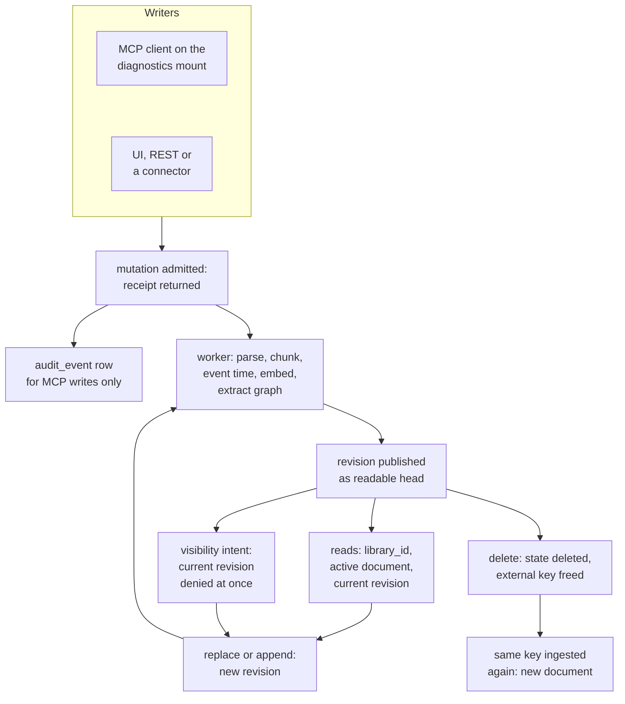

## 1. Executive Summary

IronRAG is a self-hosted document search and grounded-answer service in Rust.
An Axum API and workers over PostgreSQL with pgvector, Redis and a React UI
ingest documents into libraries, build chunks, embeddings, technical facts and
a typed entity graph, and answer with citations. For an agent, memory is a
library. An MCP client holding a write grant creates documents, appends to or
replaces one while keeping its id, and deletes it. Every client reads back
through `search_documents`, `read_document` and `grounded_answer`, and the
server names itself `ironrag-mcp-memory`
(`apps/api/src/interfaces/http/mcp.rs:90`).

What is notable is how a correction lands. A replacement is a new revision,
and every search statement joins to the document's current readable revision
and `document_state = 'active'`, so a superseded or deleted text leaves search,
read and answer context together. Retrieval filters by `library_id` in every
statement, with the library set drawn from token grants. Agent writes sit on a
separate diagnostics MCP mount that the built-in assistant never receives.

What is weak is everything above the document. Nothing records what an agent
concluded, believed or rejected: a document is `active` or `deleted`, and a
deletion releases its external key so the same source can come straight back.
The audit of agent writes is appended after admission and dropped on failure,
and the integration suite that proves the read paths runs only by hand.

**Licence.** MIT, in `LICENSE`, `Cargo.toml`, `apps/api/Cargo.toml` and
`connectors/pyproject.toml`, which agree. The Wikipedia text vendored as a
benchmark corpus is CC BY-SA 4.0
(`apps/api/benchmarks/semantic_rerank/corpus.json:7`), so a copy of that corpus
carries share-alike. The public repository is a release export of a private
one (`.public-release.json` names a source commit and a pipeline), so the
history behind each release is not inspectable.

## 2. Mental Model

The unit is a **document in a library**. It has a stable id, an external key
unique among active documents, and numbered revisions. A revision is admitted,
processed by a worker, and published as the document's readable revision; only
then does it appear anywhere a reader looks. Knowledge built from it (chunks,
vectors, facts, graph evidence) is keyed by revision, so derived state follows
the published revision rather than the latest write.

There is no belief layer. A document is never a candidate, never verified and
never disputed: `content_document_state` has two values, `active` and
`deleted` (`apps/api/migrations/0001_init.sql:300-303`). What an answer claims
is checked per execution by a semantic verifier whose report is stored with
that execution, and nothing about it flows back to the stored text.

A text stops being served in four ways:

- **Replace** publishes a new revision under the same id, and the old one drops
  out of every read path.
- **Append** adds text to a named base revision, producing a new revision.
- **A visibility intent** withdraws the current revision from every read the
  moment it is accepted, before its bound replacement has been processed.
- **Delete** sets `document_state = 'deleted'` and `deleted_at`, cancels jobs,
  and frees the external key for reuse.

Agent-written and human-written documents are the same object. The append
tool's own schema calls it *"Good for small incremental notes"*
(`apps/api/src/interfaces/http/mcp/tools/documents.rs:213`), which is the
closest the tree comes to a note an agent keeps for itself.

## 3. Architecture

The deployment is a Docker Compose stack or a Helm chart: PostgreSQL with
pgvector, Redis, a startup job, the backend, a worker and the frontend
(`docker-compose.yml:288`, `:334`, `:385`, `:416`, `:458`, `:498`). PostgreSQL
holds content, the knowledge plane, the runtime graph, IAM, billing and audit
in one schema of 9,345 lines (`apps/api/migrations/0001_init.sql`). Vectors
live in per-dimension shard tables, because the embedding dimension is a
property of each library's binding. Source bytes go to a filesystem volume or
S3 (`apps/api/src/services/content/storage.rs:31-34`).

Nothing works without a model. Ingest needs bindings for text extraction,
graph extraction and chunk embedding, and answers need query compilation,
reranking and an answer model; the README lists eight binding purposes across
OpenAI-compatible providers and Ollama. The README also says the API and
workers refuse to start without a credential master key, which encrypts stored
provider credentials.

The MCP server is Streamable HTTP on `/v1/mcp` and `/v1/mcp/diagnostics`, with
session state in Redis so a termination reaches every API replica. The
registry holds 35 tools: 15 on both mounts and 20 only on diagnostics,
including every document mutation
(`apps/api/src/interfaces/http/mcp/tools.rs:248-467`). The README says 32.

Running it means a PostgreSQL with the extensions, Redis, provider keys and an
ingest queue to watch. The store is inspectable by SQL, and the README
describes a streaming `tar.zst` backup and restore, but it is not repairable by
hand in any practical sense.

## 4. Essential Implementation Paths

- **Agent write.** `create_documents`, `create_document_revision` and
  `delete_document` dispatch from
  `apps/api/src/interfaces/http/mcp/tools/documents.rs:586-727` into
  `services::mcp::mutations` and `management::delete_document`
  (`apps/api/src/services/mcp/access/documents/management.rs:114-160`). Each
  authorizes `POLICY_DOCUMENTS_WRITE` on the document and admits a mutation
  with `request_surface: "mcp"`.
- **Append.** Requires `baseRevisionId` and non-empty text, rejects replacement
  fields, and hashes base and text into the idempotency key
  (`apps/api/src/services/mcp/mutations.rs:141-166`).
- **Ingest.** The worker prepares chunks and, for each, extracts event-time
  bounds from its text before insert
  (`apps/api/src/services/content/service/revision/preparation.rs:319-349`).
- **Delete.** `persist_document_deletion` takes the library lock, cancels the
  document's jobs, sets the state, rewrites the head with no active revision,
  enqueues the `document.deleted` webhook and materializes the knowledge
  projection in one transaction
  (`apps/api/src/services/content/service/document/deletion.rs:143-298`).
  Technical-fact and graph convergence run after commit, and a failure there is
  logged (`:98-141`).
- **Search.** `resolve_search_libraries` authorizes each named library or
  filters the visible ones by grant
  (`apps/api/src/services/mcp/access/documents/resolution.rs:3-35`); lexical
  and vector statements filter `library_id`, active state and current revision
  (`apps/api/src/infra/postgres/pg_search_store/lexical.rs:82`, `:151-152`,
  `apps/api/src/infra/postgres/pg_search_store/vector_support.rs:45-63`).
- **Answer.** The built-in assistant is an agent loop over the answer surface
  only (`apps/api/src/services/query/agent_loop/state_machine.rs:14`).
  `grounded_answer` compiles the question to a typed IR, retrieves with the
  IR's date range on every chunk lane, and filters the assembled bundle again
  (`apps/api/src/services/query/execution/retrieve/retrieval_execution.rs:47-51`,
  `apps/api/src/services/query/execution/answer_pipeline/preflight/mod.rs:113-155`).
- **Audit.** `record_mcp_audit` appends through the audit service and logs a
  failure (`apps/api/src/interfaces/http/mcp/audit.rs:20-47`).

## 5. Memory Data Model

`content_document` carries workspace, library, external key, state,
`created_by_principal_id`, `created_at`, `deleted_at`, a parent link and a
revision sequence (`apps/api/migrations/0001_init.sql:2437-2453`).
`content_revision` carries the revision number, parent revision, source kind
(`upload`, `append`, `replace`, `edit`, `connector_sync` and others), checksum,
storage key, creator and `created_at` (`:2526-2547`). `content_document_head`
points at the active and readable revisions and the latest mutation
(`:2461-2475`). `content_mutation` records each admitted operation with the
requester and a state that moves from `accepted` to a terminal value
(`:2481-2496`).

`content_chunk` carries `occurred_at` and `occurred_until`, with a check that
the end is not before the start (`:2425-2428`). The knowledge plane mirrors
documents, revisions and chunks with its own state columns, and holds
entities, relations, evidence and candidates keyed by revision. Entities carry
a float `confidence` and an `entity_state` that search filters to `active`.

Scope is workspace and library on every row, enforced through `iam_grant` rows
naming a principal, a resource kind and id, a permission and an optional expiry
(`:2986-2995`). A token can be granted a single document, which lets it read
that document and not search its library.

## 6. Retrieval Mechanics

`search_documents` runs a metadata lane, a structured-block lane, lexical chunk
search over query variants and vector chunk search per authorized library, and
revalidates its hits against each document's current revision; the suite names
the case `search_revalidates_primary_hits_after_all_later_library_awaits`.
`list_documents` fails with a retry when a source changed during the call
(`apps/api/src/services/mcp/access/documents/management.rs:60-76`).

`grounded_answer` is the heavier path. An LLM compiles the question into an IR
with acts, focus and temporal constraints; lexical, vector, graph and
technical-fact lanes run; a reranker orders the bundle; and a verifier checks
the answer against the evidence it was given. When the IR resolves a date
range, every chunk lane binds it to `occurred_at`, and the bundle is filtered
again after source-context augmentation. The comment there records why: image
chunks with no event time were leaking into a dated question through a
companion path
(`apps/api/src/services/query/execution/answer_pipeline/preflight/mod.rs:438-447`).
`search_documents` applies no time bounds
(`apps/api/src/services/mcp/access/documents/search.rs:902-903`).

The answer cache folds the library's readable-content fingerprint into its key
(`apps/api/src/services/query/result_cache.rs:641`), so a replacement or
deletion changes the key rather than serving a cached answer built on the old
text.

## 7. Write Mechanics

Writes do not block on a model. An MCP mutation returns a receipt once
admitted, and the client polls `get_operation`; the tool description warns
that read and search visibility can arrive slightly before or after the
terminal state (`apps/api/src/interfaces/http/mcp/tools/documents.rs:273`).
The lag before a document is searchable is the ingest pipeline: parsing,
chunking, embedding and, for graph-backed answers, LLM graph extraction. I did
not measure it.

Event time is extracted, not supplied. Record JSONL rendering takes *"the
earliest value-shaped timestamp found anywhere in the record (any depth, under
any key)"* and writes it into a `[unit_ordinal=N occurred_at=ISO]` header
(`apps/api/src/shared/extraction/record_jsonl/rendering.rs:263-266`). Chunk
preparation then parses `occurred_at=` tokens out of every chunk's text,
whatever the source type
(`apps/api/src/services/content/service/revision/preparation.rs:319-331`,
`apps/api/src/shared/extraction/record_jsonl/projection.rs:20-26`). From that
code, a document of another type whose text contains the token would acquire
bounds; I did not run it.

Deletion is soft at the document and frees the key. The test file covering it
states the reason: a knowledge projection left holding the key made every later
ingest of that key fail, *"and a periodic connector loses the same pages on
every pass"* (`apps/api/tests/it/document_external_key_reclaim.rs:1-16`). That
is correct for a mirror. For memory it means a deletion is not a refusal. No
background pass rewrites the store; graph re-extraction for a whole library
runs on request (`apps/api/src/interfaces/http/knowledge.rs:157`).

## 8. Agent Integration

The answer mount at `/v1/mcp` exposes discovery, search, read, graph, runtime
trace and web-run reads, plus `grounded_answer`, which the registry calls *"a durable-side-effect
query that must stay on the answer surface"*, the one mutating tool allowed
there (`apps/api/src/interfaces/http/mcp/tools.rs:178-186`). The diagnostics mount
adds workspace and library administration, document create, revise and
delete, web crawl submission, ingest job control and IAM token management,
each visible only when the token's grants allow it (`:342-465`).

The built-in UI assistant is a tool-using agent over the answer surface's tool
contract, so it can read and answer and cannot write
(`apps/api/src/services/query/agent_loop/state_machine.rs:8-20`). An external
agent that should maintain a library needs a write grant and the diagnostics
URL. Conversation history on MCP is supplied by the client as
`conversationTurns` (`apps/api/src/interfaces/http/mcp/tools/grounded/args.rs:39`);
the UI keeps its own conversations in `query_conversation` and `query_turn`.

Adapting it for another agent is a configuration step: any Streamable HTTP MCP
client works, and the MCP guide says a token scoped to one library lets the
tools infer the library argument (`docs/en/MCP.md`).

## 9. Reliability, Safety, and Trust

### What a correction reaches

A replacement leaves every search and read path at once, because each
statement joins to the document's current revision and the active document.
The visibility intent goes further. It denies the current revision from the
moment it is accepted, before the replacement has been parsed, and the
replacement bound to it must match its metadata and bytes exactly
(`apps/api/src/interfaces/http/mcp/tools/documents.rs:251`). That is a
withdrawal for text that must stop being served now. Creating an intent is a
REST route (`apps/api/src/interfaces/http/content/revisions.rs:3-45`); the MCP
replace tool can bind to an accepted intent and cannot create one.

Deletion reaches the content plane and the knowledge projection in one
transaction. The graph and technical facts converge after commit, and a failure
there is a log line
(`apps/api/src/services/content/service/document/deletion.rs:98-141`).

### What the audit holds

`audit_event` has no update or delete anywhere outside tests, carries actor,
surface, action, request and trace ids, and links subjects by workspace,
library and document. MCP writes record `agent.memory.upload`,
`agent.memory.update` and `agent.memory.delete_document`. The row is appended
after admission and outside the mutation's transaction, and a failed append is
dropped with a warning (`apps/api/src/interfaces/http/mcp/audit.rs:20-47`). The
delete row is written with no subjects, so the document appears only inside
its message text (`apps/api/src/interfaces/http/mcp/tools/documents.rs:704-720`).
REST and UI document mutations write `content_mutation` rows and no audit
event.

### Marks

- **`scope_enforced`** — awarded on `library_id` in every search statement,
  with libraries authorized from grants before a statement runs.
- **`audit_log`** — awarded on `audit_event` for agent writes, with the
  best-effort append and the REST gap stated above.
- **`bitemporal`** — awarded on chunk event time beside revision record time,
  hard-filtered by `grounded_answer`. Only record JSONL gets event time, and
  nothing reads the store as of a past record time.
- **`negative_eval`** — awarded; see section 10.
- **`trust_state`** — withheld. `document_state` is a deletion flag,
  `entity_state = 'active'` is lifecycle, entity `confidence` is a float, and
  the visibility intent withdraws a revision without judging it. No field says
  a stored text is unverified or disputed.
- **`tombstone`** — withheld. Every refusal is keyed on a document, revision or
  session, and deletion frees the key so the same content can return.
- **`human_review`** — withheld. A written revision publishes when its ingest
  finishes; no state waits for a person.

### Other risks

- **Injected content** is stored and served like any document. A write grant
  on one library is enough for an agent to change what every reader of that
  library is answered from.
- **Event time is a heuristic.** The earliest timestamp under any key becomes
  the record's time, so a birth date or a creation date inside a record would
  outrank the message time.

## 10. Tests, Evals, and Benchmarks

The tree has 4,569 Rust test functions in `apps/api/src` and `crates/`, and
672 in `apps/api/tests`, 630 marked `#[ignore]` until PostgreSQL and Redis are
available. The Makefile lists the required suites and runs them with
`--ignored` (`Makefile:219`, `:296-299`). The only workflow builds and pushes
Docker images, so no committed automation runs the integration suite. I ran
none of it.

`negative_eval` rests on three populated cases:

- `apps/api/tests/it/canonical_read_visibility.rs:568-899` publishes A, admits
  an edit B and a visibility intent, then publishes C. Before C, every read the
  test makes fails or comes back empty, and MCP read must not contain A's
  bytes. After C, MCP read returns C and must not contain A, `list_chunks`
  holds C and not A, and metadata search misses A's file name while C's
  returns one row.
- `apps/api/tests/it/mcp_memory_search.rs:1763-1849` seeds a healthy and a
  stale document, retires the stale one in the knowledge plane by direct SQL,
  and asserts the healthy one is returned and the retired one is not.
- `apps/api/tests/it/knowledge_search.rs:4370-4390` searches a document with a
  superseded and a current revision inside an event-time window and asserts
  exactly the current chunk comes back, with the superseded chunk absent.

The scope tests are rejection-shaped: naming a foreign library fails the whole
search as unauthorized, and the error body must not carry the foreign ids
(`apps/api/tests/it/mcp_memory_search.rs:1615-1650`,
`apps/api/tests/it/mcp_memory_permissions.rs:522-570`). No case searches an
allowed library while a foreign one holds a better match and asserts it absent.

`apps/api/benchmarks/grounded_query/` holds 13 suite files with required and
forbidden answer matchers, a live runner and an offline replay of captured MCP
exchanges. No result file is committed, and no paper is associated with the
project.

## 11. For Your Own Build

### Steal

- **Read through one current-revision join.** Put the current readable revision
  and the live-document predicate into every statement that serves text, and a
  correction reaches search, read and answer context in the same commit.
- **Withdraw before you replace.** An accepted intent that denies the current
  revision immediately, bound to the exact replacement, separates "stop serving
  this" from "here is the new text".
- **Put agent writes on another mount.** Keep mutation tools off the surface
  the answering agent holds, and pin that with a test that fails when a
  mutating tool appears there.
- **Key the answer cache on the content fingerprint.** A cached answer then
  cannot outlive the text it was built from.

### Avoid

- **Freeing a deleted key with no record of the deletion.** It is right for a
  mirror and wrong for memory: the next sync restores what an agent removed.
- **An audit appended after the fact and dropped on failure.** Write the row in
  the mutation's transaction, or accept that the log can miss writes.
- **Event time from the first timestamp-shaped value.** Name the field, or
  record which one was chosen.

### Fit

This fits a team that wants agents to answer from a shared, governed document
corpus and occasionally to maintain it, with per-library grants, citations and
an operator who can stand up PostgreSQL, Redis and model bindings. It is
infrastructure, not an agent's memory of its own work. Walk away if you need
an agent to record conclusions, preferences or corrections with a status, or a
person to approve what an agent wrote before others read it.

## 12. Open Questions

- What happens when an append names a base revision that is no longer current;
  the admission keys on it, and I did not trace the conflict outcome.
- Whether graph reads still surface a deleted document's entities when the
  post-commit convergence fails.
- Whether a connector-synced page deleted by an agent returns on the next poll;
  the key reclaim suggests it does.
- What the benchmark suites score; no run is committed.

## Appendix: File Index

- Schema: `apps/api/migrations/0001_init.sql`
- MCP surface: `apps/api/src/interfaces/http/mcp.rs`,
  `apps/api/src/interfaces/http/mcp/tools.rs`,
  `apps/api/src/interfaces/http/mcp/tools/documents.rs`,
  `apps/api/src/interfaces/http/mcp/audit.rs`
- MCP services: `apps/api/src/services/mcp/mutations.rs`,
  `apps/api/src/services/mcp/access/documents/management.rs`,
  `apps/api/src/services/mcp/access/documents/search.rs`,
  `apps/api/src/services/mcp/access/documents/resolution.rs`
- Content lifecycle: `apps/api/src/services/content/service/document/deletion.rs`,
  `apps/api/src/services/content/service/revision/preparation.rs`,
  `apps/api/src/interfaces/http/content/revisions.rs`
- Event time: `apps/api/src/shared/extraction/record_jsonl/rendering.rs`,
  `apps/api/src/shared/extraction/record_jsonl/projection.rs`,
  `apps/api/src/domains/query_ir.rs`
- Search: `apps/api/src/infra/postgres/pg_search_store/lexical.rs`,
  `apps/api/src/infra/postgres/pg_search_store/vector_support.rs`,
  `apps/api/src/services/query/execution/retrieve/retrieval_execution.rs`,
  `apps/api/src/services/query/execution/answer_pipeline/preflight/mod.rs`,
  `apps/api/src/services/query/result_cache.rs`
- Audit: `apps/api/src/infra/repositories/audit_repository.rs`,
  `apps/api/src/interfaces/http/router_support/audit_event.rs`
- Agent loop: `apps/api/src/services/query/agent_loop/state_machine.rs`
- Tests: `apps/api/tests/it/canonical_read_visibility.rs`,
  `apps/api/tests/it/mcp_memory_search.rs`,
  `apps/api/tests/it/knowledge_search.rs`,
  `apps/api/tests/it/mcp_memory_permissions.rs`,
  `apps/api/tests/it/document_external_key_reclaim.rs`

### Recorded searches

Run from the repository root at the pinned commit with `/usr/bin/git grep`.

- **No product code updates or deletes audit rows.**
  `git grep -n -i -E 'delete[[:space:]]+from[[:space:]]+(public\.)?audit_event|truncate.*audit_event|update[[:space:]]+(public\.)?audit_event' -- . ':!apps/api/tests'`
  returns nothing; the delete half of the pattern over `apps/api/tests`
  matches `apps/api/tests/it/catalog_repository.rs:479`.
- **REST and UI document mutations write no audit event.**
  `git grep -n -E '^[[:space:]]*\.audit$|append_event\(|record_rest_audit_event\(' -- apps/api/src/services/content apps/api/src/services/ingest apps/api/src/interfaces/http/content.rs apps/api/src/interfaces/http/content`
  returns nothing; the same pattern counts 4 in
  `apps/api/src/interfaces/http/catalog/deletion.rs` and 2 in
  `apps/api/src/interfaces/http/mcp/audit.rs`.
- **No review or approval state on memory.**
  `git grep -n -i -w -E 'approve|approved|approval|pending_review|needs_review|awaiting_review|moderation' -- apps/api/src apps/api/migrations`
  matches only an operator-approved policy string, maintenance plan approval,
  an OIDC mock code and graph-summary test fixtures, none on a document or
  revision.
- **No value-keyed refusal.**
  `git grep -n -i -w -E 'tombstone|rejected_value|blocklist|denylist|suppress(ed|ion)?' -- apps/api/src apps/api/migrations`
  matches vector deletion markers, document-head suppression, an IAM identity
  tombstone, MCP session tombstones and provider refusal codes; every one is
  keyed on a record, a revision or a session.
- **search_documents passes no time bounds.**
  `git grep -n temporal -- apps/api/src/services/mcp/access/documents/search.rs`
  matches lines 902 and 903, both `None`; the vector call in that file takes no
  temporal field.
- **No as-of-record-time read.**
  `git grep -n -i -E 'as_of|asof|known_at|recorded_before' -- apps/api/src/infra/postgres/pg_search_store apps/api/src/services/query`
  returns nothing; `git grep -c occurred_at -- apps/api/src/infra/postgres/pg_search_store/vector_support.rs`
  counts 7.
- **No workflow runs the tests.**
  `git grep -n -E 'cargo test|make test|make backend' -- .github` returns
  nothing; `git grep -c docker/build-push-action -- .github` counts 1.
- **No committed benchmark result.**
  `git ls-files | grep -i -E 'results?/|_results?\.json'` returns nothing;
  `git ls-files apps/api/benchmarks | grep -c suite.json` counts 13.
- **No paper.**
  `git grep -n -i -E 'arxiv|bibtex|@article|@misc|doi\.org' -- README.md docs`
  returns nothing, and `git ls-files | grep -i citation` returns nothing;
  `git grep -c -i github.com/mlimarenko -- README.md` counts 3.

## History

**2026-11-21** — [`e10997a4e45e529a5789acf23e606ccd703a3532`](https://github.com/mlimarenko/IronRAG/commit/e10997a4e45e529a5789acf23e606ccd703a3532) — first reading, from a full clone of `master` at release 0.6.3, scoped to the MCP surface, the content revision and deletion lifecycle, the search statements, event-time extraction, the audit writers and their tests; extraction, graph and billing code read only where it writes what those paths read. Screened first: no auto-run surface; four build-time execution points, the Makefile, `apps/api/build.rs` and two connector `conftest.py` files; one unpinned surface, `apps/web/package.json` with 50 floating ranges under a lockfile; nothing inside the cooldown. MIT, no rider. Nothing installed, built or run. Four marks: `bitemporal`, `scope_enforced`, `audit_log`, `negative_eval`.
