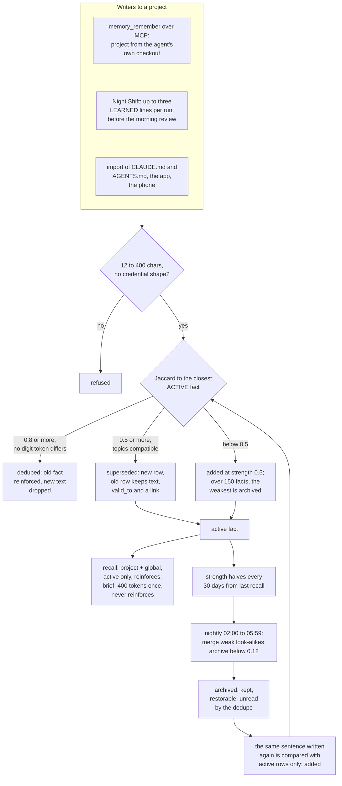

## 1. Executive Summary

JoeBro is a local macOS workspace for coding agents and chat models, a
Swift app with a Python standard-library backend, whose **Shared Memory**
is one SQLite table of short facts that Claude Code, Codex, OpenCode and
Antigravity read and write through an MCP server. Notable: no model runs
anywhere in that store's write or upkeep path. Deduplication, supersession,
decay and the nightly merge are token-set arithmetic. Weak: the arithmetic
decides too much. A new fact that shares half its words with a different
one retires it, and the wall around the personal scope stands on one route
of three.

A fact is one sentence keyed to a project, the normalised git remote or the
checkout path, or to the reserved `global` and `user` scopes. A coding agent
gets at most 400 tokens of its project's strongest facts at session start
and pulls the rest with `memory_recall`. Recall raises a fact's strength.
Strength halves every 30 days from the last recall, and a nightly pass merges
and archives what has faded. Nothing is hard-deleted: supersede keeps the old
row with a link both ways, and archive is a status.

The `user` scope holds the person's own facts, migrated from two older stores
(the desktop "Brain" table and the phone agent's Markdown files). It is
withheld from callers the backend classifies as agents on
`/api/shared-memory`, with populated tests. The same rows are returned with
no classification by `GET /api/memory` and `GET /api/muse`. The
classification itself falls back to the User-Agent header, because nothing
in the app sets the token that would replace it.

The rest of the app (chats, email, calendar, documents, Night Shift's
overnight coding runs, the iPhone companion) is context here and carries no
mark. The MCP server and the agents' hooks are in the separate
`joebro-plugins` repository, read through the GitHub API at `9fd43bb` for
the surface only.

**Licence.** GPL-3.0, the stock text in `LICENSE`; no source file carries a
notice choosing "only" or "or later", and the README says "GPLv3". The MCP
server and hooks that make the memory reachable by an agent are MIT, in
another repository.

Three marks: `scope_enforced` on the project key and the user-scope gate,
`audit_log` on `shared_log`, and `negative_eval` on the user-scope tests.
[Section 9](#9-reliability-safety-and-trust) gives the reason for each of the
four withheld.

## 2. Mental Model

A memory is **one durable sentence an agent learned while working**: a
decision and why, a gotcha, something tried that failed. `_clean` refuses
text under 12 or over 400 characters and anything a credential regex matches
(`JoeBro/Backend/jb_sharedmem.py:43`, `:50-51`, `:207-215`). The row carries
a topic, a kind from eight values, a pin flag, a strength from 0 to 1 and the
caller's provenance (`:82-87`).

A sentence becomes a fact by **comparison with the project's active facts**,
never by a model's judgement (`remember`, `:245-269`). Both sides are reduced
to word sets: lowercased tokens longer than one character, a trailing `s`
stripped, a stop list removed (`:63-71`). Jaccard similarity picks the
closest active fact.

- **At 0.8 or more, or an identical lowercased text**, the new sentence is
  dropped and the old fact reinforced, unless the two differ in a token
  containing a digit (`:255-260`).
- **At 0.5 or more**, when either topic is empty or the topics match, the
  old fact is **superseded**: a new row is inserted with at least the old
  strength, and the old one becomes `superseded` with `valid_to` and a
  forward link (`:262-263`, `:272-282`). An import never takes this branch
  (`:261`).
- **Otherwise** the sentence is added at strength 0.5, and the 150-fact cap
  archives the weakest unpinned facts of the project (`:264-268`,
  `:321-330`).

A fact lives by being recalled. `reinforce` moves strength a quarter of the
way to 1.0 and stamps `last_used`; `effective` halves it every 30 days since
then, and a pin freezes it (`:180-185`, `:239-242`). Of the reads, only
`POST /recall` reinforces, and a deduplicated write does too. The session
brief deliberately does not (`:371-374`).

A fact stops counting three ways, and all three are status changes on the
row (`:285-300`):

- **superseded**, by a later sentence or an explicit `memory_supersede`;
- **archived**, by an agent's `memory_forget`, the person's archive button,
  the cap, a nightly merge into a stronger fact, or fading below 0.12 in the
  nightly pass;
- and either can be **restored** to active by `restore`.

Only `active` rows reach recall, the brief or the dedupe comparison
(`:235-236`, `:341`). An archived sentence is therefore invisible to the
next write of the same sentence.

The `user` scope is the same table with a different set of writers. The
desktop chat extracts up to three facts per turn with a model and
**overwrites** a matching fact's text in place
(`JoeBro/Backend/jb_memory.py:126-153`); the phone agent keeps a fact only
when its supporting quote is a substring of the user's message
(`JoeBro/Backend/jb_muse.py:344-345`).

## 3. Architecture

The backend is one Python process, `joebro_backend.py`, started by the Swift
app with the system `python3` and bound to `127.0.0.1:8765`
(`JoeBro/JoeBroApp.swift:33-38`, `JoeBro/Backend/joebro_backend.py:1140-1166`).
It uses only the standard library: `ThreadingHTTPServer`, `sqlite3`,
`subprocess` for git. The store is `joebro.sqlite3` in
`~/Library/Application Support/JoeBro`, chmod 0600, shared by every feature
of the app (`JoeBro/Backend/jb_core.py:1459-1473`). `Store.exec` opens a
connection per statement under one process-wide `RLock` and commits each
statement alone (`:1903-1922`).

- **`jb_sharedmem.py`** holds the shared store, its HTTP routes under
  `/api/shared-memory`, the caller classification, the nightly consolidation,
  the import and the Markdown mirror.
- **`jb_usermem.py`** maps the older Brain and muse surfaces onto the `user`
  scope and migrates their data once at boot
  (`JoeBro/Backend/joebro_backend.py:1192-1197`).
- **`jb_memory.py`** and **`jb_muse.py`** are the user-scope readers and
  writers for the desktop chat and the phone agent.
- **`jb_nightshift.py`** writes facts from overnight runs; **`jb_coding.py`**
  records one summary per coding session and runs the nightly pass from its
  loop (`JoeBro/Backend/jb_coding.py:200-209`, `:1029-1033`).
- **`jb_janitor.py`** deletes artifacts and scratch files and never touches
  the database's content (`JoeBro/Backend/jb_janitor.py:2-10`).

Outside this tree:

- **joebro-plugins** carries `bin/joebro-agents`, a stdio MCP server whose
  five memory tools are thin HTTP calls to the backend, and the hooks that
  inject the brief at `SessionStart` and nudge a session that did work and
  saved nothing (read at `9fd43bb`: `bin/joebro-agents:861-884`,
  `:1198-1208`, `:679-685`, `:810-834`; `claude-code/hooks/hooks.json`).
- **JoeBro-Mobile** is the iPhone app. It reaches the same store through the
  second listener in `jb_mobile.py` and was not read.

### Deployment and ergonomics

Nothing has to run beyond the app: no database server, no vector service, no
model for the shared store. A model endpoint is needed only for the user
scope's automatic extraction. It runs offline. The store is a SQLite file a
person can open; the mirror writes each project's live and archived facts as
Markdown, regenerated on every write and never read back
(`JoeBro/Backend/jb_sharedmem.py:541-580`). Install is a signed DMG or a
`curl | bash` script hosted outside the tree; the agents are linked by
installing joebro-plugins. Shared Memory needs macOS 26 for the app,
though the backend is plain Python.

## 4. Essential Implementation Paths

- **Agent write.** `memory_remember` posts `project_ctx()` (path and
  origin remote of the main checkout) and `provenance()` from the MCP
  process's environment to `POST /api/shared-memory`
  (`joebro-plugins bin/joebro-agents:750-757`, `:764-768`, `:861-865`).
  `_dispatch_inner` resolves the key and calls `remember`
  (`JoeBro/Backend/jb_sharedmem.py:684-687`), which logs, enforces the cap
  and rewrites the mirror.
- **Project key.** `resolve_project` takes an explicit key, then a
  registered path, then the git toplevel (the main checkout for a worktree),
  and keys on the normalised remote when there is one, the path otherwise
  (`:120-155`). `norm_remote` strips scheme, user and `.git` and lowercases
  (`:105-109`), so `git@github.com:Acme/API.git` becomes
  `github.com/acme/api`.
- **Night Shift.** The overnight runner parses up to three `LEARNED:` lines
  from the agent's final output and `remember`s each into the repository's
  project when the run ends, before the task is reviewed
  (`JoeBro/Backend/jb_nightworker.py:175`,
  `JoeBro/Backend/jb_nightshift.py:439-444`, `:593-598`).
- **Import.** `split_facts` turns headings into topics and paragraphs,
  bullets and short code blocks into facts; `import_files` remembers each
  with source `import`, which dedupes and never supersedes, and returns a
  token comparison and the pointer block for CLAUDE.md (`:455-537`).
- **Recall.** `POST /recall` searches the key and `global`, active only
  unless `include_archived`, and reinforces each returned active fact
  (`:688-696`, `:338-357`).
- **Brief.** `GET /brief` ranks pinned first, then by decayed strength,
  takes the project's facts and five global ones, skips faded unpinned ones
  and stops at 400 tokens (`:371-396`). The SessionStart hook prepends a
  guide and returns it as additional context
  (`joebro-plugins bin/joebro-agents:679-685`, `:786-789`).
- **Correction.** `memory_supersede` and `memory_forget` post to
  `/<id>/supersede` and `/<id>/archive` (`:706-715`); the app's edit of a
  fact's text is a supersede with the app as author (`:303-318`).
- **Maintenance.** `nightly` runs `consolidate` once a day in the 02:00 to
  05:59 window (`:440-451`, `:400-437`).
- **User scope.** Desktop chat injects pinned and top-scoring user facts
  into every turn and extracts after it (`JoeBro/Backend/jb_chat.py:700`,
  `:263-268`, `JoeBro/Backend/jb_assistant.py:260-292`); the phone chat
  injects `about-me` always and matching lines per message
  (`JoeBro/Backend/jb_muse.py:240-264`).
- **Tests.** `JoeBro/Backend/test_sharedmem.py`,
  `JoeBro/Backend/test_usermem.py`, and one Night Shift case at
  `JoeBro/Backend/test_nightshift.py:348`.

## 5. Memory Data Model

`shared_facts` is the only fact table (`JoeBro/Backend/jb_sharedmem.py:82-88`).
`project` holds the key; `status` is `active`, `superseded` or `archived`;
`supersedes`, `superseded_by` and `merged_from` link rows; `created`,
`updated`, `last_used` and `valid_to` are epoch seconds. `jb_usermem` adds
an `extra` JSON column for the Brain's entity labels
(`JoeBro/Backend/jb_usermem.py:41-47`). `shared_projects` maps a key to a
name, a remote and the last eight checkout paths. `shared_log` is the event
table. `shared_sessions` keeps the ten newest session summaries per project,
240 characters each with a credential check, as records that are never in a
brief or decayed (`JoeBro/Backend/jb_sharedmem.py:740-772`).

**Scopes are values of one column, not separate stores.** The README's "one
store per project" is a stored key applied on reads: `_active`, `search`,
`brief` and `browse` all put `project` in the SQL predicate
(`:235-236`, `:342-343`, `:384-386`, `:363-365`). `global` joins every
project's recall and brief; `user` is read only as itself (`_scopes`,
`:333-335`).

**Times.** `fact_out` reports `valid_from` as the row's `created`
(`:194`). `valid_to` is stamped at supersede or archive with the current
time and cleared by restore (`:278`, `:289`, `:297`). Both are record times.

**Provenance** is five strings the caller sends, clipped (`_prov`,
`:218-221`). When an agent sends its harness and host without a model,
`_fill_provenance` copies the model and session from the newest live
coding-agent row on that host (`:584-595`).

## 6. Retrieval Mechanics

Recall is lexical and in Python. `search` loads every active row of the
allowed keys and scores one point per query word found in the fact's word
set, half a point for a substring match between words over three
characters. It divides by the query's word count, multiplies by `0.6 + 0.4 x
effective strength` and by 0.6 for a non-active row, and returns the top
`limit`, 5 by default and at most 20 (`:338-357`). The MCP tool caps it at 10
(`joebro-plugins bin/joebro-agents:868-871`). Each recall reads the project's
and global's rows, bounded by the 150-fact cap per key; the only index is on
`(project, status)` (`:88`).

The brief is the main delivery path and is fixed per session: injected once
at `SessionStart`, ranked by strength rather than by the task, capped at 400
tokens by a four-characters-per-token estimate, with lines over 200
characters cut (`JoeBro/Backend/jb_sharedmem.py:54-56`, `:376-396`).
Because the brief does not reinforce, a fact an agent reads in every
session's brief and never recalls decays like an unused one: from 0.5 it
falls below 0.3 after about 22 days and below 0.12 after about 62, when the
nightly pass archives it unless a merge took it first (`:388`, `:429-433`).

The user scope has its own scorers. Desktop chat's `_score_memories` weights
shared words by rarity, doubles topic and entity labels and requires two
distinctive words or one of eight characters, then injects every pinned fact
(up to six) plus the top three (`JoeBro/Backend/jb_memory.py:69-116`). The
phone agent's `about-me` file is injected whole on every turn, fenced as
data (`JoeBro/Backend/jb_muse.py:240-253`).

## 7. Write Mechanics

The supersession rule acts on similarity alone. A copy of `_words` and the
thresholds, run outside the tree on example sentences, gives these results:

| First fact | Second fact | Jaccard | Outcome |
| --- | --- | --- | --- |
| Module 3 owns the billing code. | Module 4 owns the billing code. | 1.0 | deduped: the second is dropped |
| The staging deploy uses the release script in scripts/release.sh. | The production deploy uses the release script in scripts/release.sh. | 0.667 | staging fact superseded |
| The billing service retries failed charges three times. | The billing service retries failed webhooks five times. | 0.556 | charges fact superseded |
| Tests run with make test against Postgres on port 5432. | Tests run with make test against Postgres on port 5433. | 0.75 | superseded, as intended |

The comment on the digit guard names "module 3" and "module 4" as different
facts (`JoeBro/Backend/jb_sharedmem.py:255`). Single characters are dropped
from the word set before the guard looks, so those two have identical sets
(`:69`). The guard also applies only to the dedupe branch; supersession
needs a compatible topic, and `memory_remember` usually sends none, which
counts as compatible (`:262`). The two rows in the middle are distinct facts,
and the first is retired with no model or person consulted.

Consolidation merges without merging text. Weak facts under 0.3 of one
topic at Jaccard 0.4 or more are grouped; the strongest keeps its text and
gains the group's strength, and the rest are archived with a pointer to it
(`:408-428`). What the archived ones said that the survivor does not is out
of recall.

The user-scope Brain path does the opposite of the shared store's rule. A
model-extracted fact at Jaccard 0.6 to an active fact on the same topic, or
whose words are a subset or superset of it, **replaces its text in place**,
with no superseded row and no log entry (`JoeBro/Backend/jb_memory.py:141-150`,
`JoeBro/Backend/jb_usermem.py:134-141`). `mem_write` also sets
`status='active'`, so a `manage_memory` edit or a `PUT /api/memory/<id>`
naming an archived id brings it back (`:140`). That path has no credential
check: `_SECRET` is used in `jb_sharedmem.py` and `_SECRET_RE` in `jb_muse.py`,
and neither is reached from `retain_memory` or `upsert_memory`.

### Operational cost

Writes are synchronous HTTP calls with no model: a read of the project's
active rows, a few inserts and a mirror rewrite. A fact is recallable when
the call returns. The user-scope extraction is one model call per desktop
chat turn on a background thread, after the reply. The nightly pass reads
every active row of every project once a day. A session's injection is
bounded at 400 tokens plus the guide, once, at session start; a recall
returns five short facts.

## 8. Agent Integration

The agent's surface is five MCP tools: `memory_recall`, `memory_remember`
(with `scope` of `project` or `global`), `memory_supersede`,
`memory_forget` and `memory_project_brief` (`joebro-plugins
bin/joebro-agents:1198-1208`). The model never names a project. The tool
descriptions ask it to save as soon as it learns something durable, and a
Stop hook blocks the end of a session once, after three or more editing or
shell tool calls with no save, asking for facts (`:793-834`).

The SessionStart hook injects the guide and brief for Claude Code, Codex and
Antigravity; OpenCode's integration is a separate plugin file not read here.
`joebro-agents memory import --write` moves Claude Code's learned memory
into the store and adds a pointer block to CLAUDE.md and AGENTS.md
(`JoeBro/Backend/jb_sharedmem.py:501-506`, `CHANGELOG.md:7`).

The person's surface is the Shared Memory panel in the Mac app: browse by
project, search, edit (a supersede), pin, archive, restore and view a fact's
chain and log (`JoeBro/FeatureModels.swift:154-174`). A
`GET /api/shared-memory/review` route lists unpinned facts below strength
0.2 and has no caller in the Swift tree (`JoeBro/Backend/jb_sharedmem.py:655-657`).

The phone reaches memory through a second listener, off until switched on,
that requires a bearer token on every request, compares it with
`hmac.compare_digest` and sleeps 0.3 seconds on a failure
(`JoeBro/Backend/jb_mobile.py:165-180`,
`JoeBro/Backend/joebro_backend.py:172-182`). It binds the Tailscale address
by default and can bind the Wi-Fi address or all interfaces, over plain
HTTP (`JoeBro/Backend/jb_mobile.py:115-128`). Its requests are classified as
the app, so the phone reads and writes every scope; `lan_denied` blocks MCP,
plugin, tool, model-endpoint, email and calendar connection and
secret-preference writes, and nothing under `/api/shared-memory` (`:213-230`).

## 9. Reliability, Safety, and Trust

### The personal wall has a side door

`caller_of` is the only place the backend distinguishes a coding agent from
the person, and only `jb_sharedmem.route` calls it
(`JoeBro/Backend/jb_sharedmem.py:598-613`, `:731`). With no
`JOEBRO_APP_TOKEN` in the environment, a User-Agent containing `CFNetwork`
or starting `JoeBro` is the app; the test suite asserts exactly that
(`JoeBro/Backend/test_usermem.py:134-136`). The Swift app starts the backend
with its own environment plus `PYTHONUNBUFFERED`, and nothing in the tree
sets the token (`JoeBro/JoeBroApp.swift:36-38`). A coding agent with a shell
can therefore reach the user scope through `/api/shared-memory` by setting a
header.

It does not need to. `GET /api/memory` returns every active non-muse user fact,
`GET /api/muse` and `/api/muse/<file>` the phone's, and `PUT /api/memory/<id>`
rewrites one, all without a caller check
(`JoeBro/Backend/joebro_backend.py:422-423`, `:218-222`, `:999-1000`). The
main listener has no authentication by default; its guard refuses browser
requests by `Origin` and `Sec-Fetch-Site` and checks the `Host` header
against DNS rebinding (`:155-189`). The MCP server's own tools never touch
those routes, so the README's "your personal facts never reach a repo or a
coding agent" holds for what the tools expose and the mirror writes, and not
for an agent that can run `curl` against the loopback port. The SQLite file
is also readable by the same user.

### Correction does not hold

Every correction is a status on a row, and `remember` compares a new
sentence with active rows only (`JoeBro/Backend/jb_sharedmem.py:251`). A fact
an agent archived as wrong comes back as a new active fact the next time any
agent, a Night Shift run or an import writes the same words. The phone
agent's reflection skips a turn that mentions forgetting, which keeps that
turn's text out and does not stop the next one (`JoeBro/Backend/jb_muse.py:327`).

Night Shift's facts are written when the run ends and the task enters
review; rejecting the task discards its worktree and branch and leaves the
facts (`JoeBro/Backend/jb_nightshift.py:436-444`, `:634-636`).

### Scope by id

Supersede, archive, pin, edit and DELETE take a fact id and check neither the
caller's project nor the fact's, only that an agent caller is not touching a
user fact (`JoeBro/Backend/jb_sharedmem.py:622-635`, `:678-719`). A `GET`
with `q` and no project searches every non-user project
(`:669-672`). `memory_remember` with `scope: global` writes a fact that the
next brief of every project on the machine carries (`:385-386`).

### Atomicity

`supersede` inserts the new row, then updates the old one, then logs, as
three separate commits (`:272-282`, `JoeBro/Backend/jb_core.py:1918-1922`).
The `RLock` serialises them within the process, and a crash between the
first two leaves both facts active.

### Marks

- **`scope_enforced`: earned.** `project` is stored on every fact and is a
  SQL predicate on recall, the brief and browse; the MCP server derives it
  from its checkout with git rather than from a tool argument, and the
  `user` value is refused or filtered for agent callers on every
  shared-memory route, with populated tests. The limits are above: the
  User-Agent fallback, the Brain and muse routes, unscoped id verbs and the
  unscoped `q` search.
- **`audit_log`: earned.** `shared_log` gets one inserted row from each of
  remember, dedupe, supersede, archive, restore, edit and consolidate, and no
  statement in the tree updates or deletes it
  (`JoeBro/Backend/jb_sharedmem.py:99-101`). The Brain and muse paths write
  user facts through `_put`, `mem_write` and `mem_pin` without it, and the
  actor field is whatever the request said.
- **`negative_eval`: earned** on `test_usermem.py:145-163` and
  `test_sharedmem.py:158-171`, which seed user, global and project facts and
  require user facts absent from agent recall, lists and the brief beside a
  required project or global hit.
- **`trust_state`: withheld.** The three statuses filter every read, and
  they are lifecycle values: replaced, removed, live. Every write lands
  `active`, including a Night Shift line and a model's extraction, and no
  state says "on record, not yet believed".
- **`tombstone`: withheld.** Archive and supersede are keyed on the row id,
  and the write path's comparison skips them, so a retired sentence is
  stored again.
- **`bitemporal`: withheld.** `valid_from` is `created`, and `valid_to` is
  the moment of supersession or archive.
- **`human_review`: withheld.** Nothing waits for a person. The panel edits
  and archives after the write; the review route lists weak facts and has no
  caller; the Night Shift review is of the diff, and its facts are already
  stored.

## 10. Tests, Evals, and Benchmarks

The two memory suites are plain `unittest` against a temporary `Store`, no
network and no model. `test_sharedmem.py` covers supersede links and
history, dedupe and supersede thresholds on one pair each, credential and
length refusal, decay and pinning, a dry-run and real consolidation, the
cap, the brief's hard 400-token budget and that reading it does not
reinforce, import dedupe across CLAUDE.md and AGENTS.md, the opt-in repo
mirror, and session records. `test_usermem.py` covers the one-time
migration, the Brain and muse aliases, and the caller gate.

The caller-gate tests are the strongest cases in the tree: each negative is
beside a positive on the same store (`JoeBro/Backend/test_usermem.py:145-152`).
`test_user_scope_never_reaches_projects_but_agent_can_recall_across` uses
`all(...)` over a search for words no project fact contains, which passes on
an empty result (`:111`).

What is not tested: a distinct fact superseding another (the threshold
tests use one deliberately similar pair each, `test_sharedmem.py:58-66`); a
single-digit difference; an archived fact written again; one project's fact
absent from another's recall; the Brain and muse routes' exposure; any row
of `shared_log`. The CHANGELOG reports a 1,460-token CLAUDE.md becoming 454
tokens per session "in testing"; the import test asserts only that the
fixture shrinks by more than 2.5 times and prints its numbers, and no
committed output records the figure (`test_sharedmem.py:138-156`,
`CHANGELOG.md:14`).
No paper is cited, no benchmark is committed, and there is no CI workflow.
I ran none of the 119 test functions.

## 11. For Your Own Build

### Steal

- **Derive the scope key from where the agent is, not from what it says.**
  The MCP server computes the project from its own working directory and
  origin remote, and a worktree maps to its main checkout, so the model has
  no argument to get wrong.
- **A session brief with a hard token cap that does not count as use.**
  Reading the brief leaves strength alone, so the brief does not feed back
  into what it shows next time. Pair it with a recall path that does.
- **Supersede by inserting, never by updating.** The old row keeps its text,
  gets `valid_to` and a forward link, and the chain is one query away.
- **A Stop-hook nudge counted on real work.** Ask once per session, only
  after editing or shell calls, and only if nothing was saved.

### Avoid

- **Retiring a fact on similarity alone.** Word-set Jaccard cannot tell a
  restatement from a sibling fact about a different environment or field;
  a supersede needs a shared subject that is a key, or a person, or the
  explicit verb.
- **A digit guard on a tokenizer that drops single characters.** Check the
  guard against the tokens it will actually see.
- **A privacy boundary implemented at one router.** If the boundary is a
  scope, put it in the read function every route calls, and authenticate the
  caller rather than read its User-Agent.
- **Dedupe against live rows only.** Without a check against what was
  retired, "forget that" lasts until the next write.

### Fit

This suits one developer on one Mac who runs several coding agents across a
few repositories and wants their notes to converge without running a model
or a server for it. The cost is that the arithmetic, not anyone's judgement,
decides which of two facts survives, and the 150-fact cap and 30-day
half-life suit a small, active project memory, not a long-lived reference.
Anyone who needs the personal scope kept from agents that hold a shell
should not rely on the current boundary. Anyone sharing the Mac with other
accounts, or a team, is outside the design: there is one person, and every
agent on the machine is trusted with every project.

## 12. Open Questions

- Whether the Brain and muse routes are meant to be app-only, and whether
  the app is meant to set `JOEBRO_APP_TOKEN` when it starts the backend.
- Whether automatic supersession is meant to fire on an empty topic, which
  is what `memory_remember` usually sends.
- Whether Night Shift's facts are meant to wait for the review, or be
  archived on reject.
- How the OpenCode plugin and the iPhone app call the memory routes; neither
  was read.

## Appendix: File Index

- Shared store, routes, caller gate, consolidation, import, mirror:
  `JoeBro/Backend/jb_sharedmem.py`
- User scope and migration: `JoeBro/Backend/jb_usermem.py`,
  `JoeBro/Backend/jb_memory.py`, `JoeBro/Backend/jb_muse.py`
- Extraction and injection for chat: `JoeBro/Backend/jb_assistant.py`,
  `JoeBro/Backend/jb_chat.py`
- Night Shift and the coding loop: `JoeBro/Backend/jb_nightshift.py`,
  `JoeBro/Backend/jb_nightworker.py`, `JoeBro/Backend/jb_coding.py`
- Server, guard and routes: `JoeBro/Backend/joebro_backend.py`,
  `JoeBro/Backend/jb_core.py`
- Phone listener: `JoeBro/Backend/jb_mobile.py`
- App: `JoeBro/JoeBroApp.swift`, `JoeBro/FeatureModels.swift`,
  `JoeBro/SharedMemoryPanel.swift`
- Tests: `JoeBro/Backend/test_sharedmem.py`, `JoeBro/Backend/test_usermem.py`,
  `JoeBro/Backend/test_nightshift.py`
- Outside the tree, joebro-plugins at
  `9fd43bb3d645bbeeeeb7a1a9811e79ff6769888e`: `bin/joebro-agents`,
  `claude-code/hooks/hooks.json`, `claude-code/.mcp.json`

### Recorded searches

Run from the repository root at the pinned commit with `/usr/bin/git grep`.

- **Nothing sets the app token.**
  `git grep -n -E 'JOEBRO_APP_TOKEN' -- . ':!JoeBro/Backend/test_usermem.py'`
  returns `JoeBro/Backend/jb_sharedmem.py:600` and `:608`, the docstring and
  the read.
- **Only the shared-memory router classifies the caller.**
  `git grep -n -E 'caller_of' -- . ':!JoeBro/Backend/test_usermem.py'`
  returns the definition at `jb_sharedmem.py:598` and the call at `:731`.
- **No caller of the review route in the app.**
  `git grep -n -E 'shared-memory/review|/review"' -- JoeBro ':!JoeBro/Backend'`
  returns nothing; the control
  `git grep -n -E 'shared-memory/sessions' -- JoeBro ':!JoeBro/Backend'`
  matches `JoeBro/NewCodingAgentSheet.swift:204`.
- **The log is insert-only.**
  `git grep -n -i -E 'DROP TABLE|DELETE FROM shared|UPDATE shared_log' -- .`
  returns only the session trim at `jb_sharedmem.py:770`;
  `git grep -n -E 'INSERT INTO shared_log' -- .` returns `:100`.
- **No other writer bypasses jb_sharedmem except jb_usermem.**
  `git grep -n -E 'shared_log|shared_facts' -- .` outside `jb_sharedmem.py`
  returns `jb_usermem.py` and the two test files.
- **No candidate or verified status.**
  `git grep -n -o -E "status='[a-z]+'" -- JoeBro/Backend/jb_sharedmem.py JoeBro/Backend/jb_usermem.py`
  returns `active`, `superseded` and `archived`.
- **No value-keyed refusal.**
  `git grep -n -i -E 'tombstone|blocklist|denylist|do_not_remember|never_again' -- .`
  returns nothing; `git grep -n -i -E 'tombstone|archive' -- JoeBro/Backend/jb_sharedmem.py`
  matches the docstring, so the pattern can match.
- **No credential check on the Brain path.**
  `git grep -n -i -E 'secret' -- JoeBro/Backend/jb_memory.py JoeBro/Backend/jb_usermem.py`
  returns nothing; the same pattern counts 5 lines in `jb_sharedmem.py`.
- **valid_from has no writer.** `git grep -n -E 'valid_from' -- .` returns
  only `jb_sharedmem.py:194`, the output mapping.
- **No submodules, no CI.** `.gitmodules` is absent;
  `git ls-files | grep -i -E 'workflow|\.github'` returns nothing.
- **No paper reference.**
  `git grep -n -i -E 'arxiv|bibtex|@article|@misc|doi\.org|zenodo' -- .`
  returns one line, `JoeBro/Backend/jb_tools.py:56`, a research-query
  classifier pattern; `CITATION.cff` is absent.

## History

**2026-11-28** — [`2f50631bfef6d5922c4cfba6b60e7d8f73a102fc`](https://github.com/joexk1/JoeBro/commit/2f50631bfef6d5922c4cfba6b60e7d8f73a102fc). First reading, read at the user's request, from a full clone at the head of `main`, read only. The screen could not parse the tree and reported nothing scanned, so the surfaces were checked by hand. No shell-script build phase in `JoeBro.xcodeproj/project.pbxproj`. One Swift package, Sparkle, up to next major from 2.6.0, resolved to 2.9.3 at `d46d456` in `Package.resolved`, unchanged since 19 June 2026. No Python requirements or pyproject file; `scripts/release.sh` is a release script; `Config/Secrets.xcconfig.example`; `Resources/BackdropSkill/SKILL.md` read as data. The joebro-plugins MCP server and hooks were read through the GitHub API at `9fd43bb`. Nothing was installed, built or run, and the 119 test functions were not run. Three marks: `scope_enforced`, `audit_log` and `negative_eval` ([section 9](#9-reliability-safety-and-trust)).
