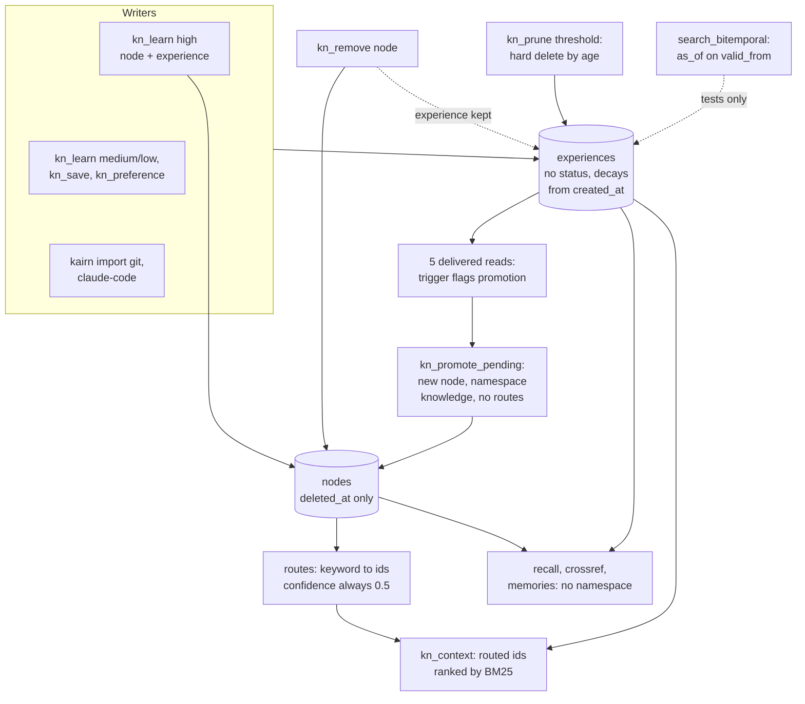

## 1. Executive Summary

Kairn is a local MCP server for coding assistants that keeps two kinds of
memory in one SQLite file per workspace: permanent graph nodes and
experiences that decay on a half-life per type, both searched by FTS5 BM25.
What is notable is the ranking work: the reported score is the sort key,
access is credited only to rows the caller received, and the code records
each defect it fixed and the test that pins it. What is weak is correction:
`kn_remove` soft-deletes a node and leaves the experience written beside it,
and no tool deletes one experience, so a wrong fact keeps being recalled.

The headline mechanisms are smaller than the README's words for them. The
"context router" is a keyword-to-node-ids table whose every row carries the
constant confidence 0.5, so ranking happens afterwards, by BM25 over the
routed ids (`src/kairn/core/router.py:110-127`,
`src/kairn/core/intelligence.py:1072-1171`). "Progressive disclosure" is a
`detail` argument of `summary` or `full`. The graph edges are mostly
`auto_related`, up to three per new node, found by an FTS query over its own
text (`src/kairn/core/graph.py:250-296`).

Several declared mechanisms have no producer or no consumer. The bi-temporal
search, `search_bitemporal`, has no caller outside tests, which
`BENCHMARKS.md` reports as a measured decision. The RBAC module's docstring
says no execution path consults it, and a tripwire test keeps that true
(`src/kairn/auth/permissions.py:1-9`,
`tests/test_weakness_audit_wave3.py:204-227`). The event bus says every
emission is a no-op until something subscribes (`src/kairn/events/bus.py:1-8`).
Namespace is written on every row and applied by none of the recall
surfaces.

**Licence.** MIT, in `LICENSE` and an identical `plugin/LICENSE`, and named
the same way in `pyproject.toml`, both plugin manifests and the bundle
manifest. The copyright holder is *Kairn Contributors*. Nothing restricts
use. The LongMemEval dataset and harness are not in the tree.

One mark is earned: `negative_eval`, on populated tests that require a
removed node and a below-floor node to be absent from `kn_context` and
recall. Section 9 gives the reason for each of the six withheld.

## 2. Mental Model

A memory is either a **node**, a named thing with a description that never
decays, or an **experience**, a sentence of content with a type and a
confidence whose relevance falls as `exp(-decay_rate × days)` from
`created_at` (`src/kairn/models/experience.py:50-57`). Nothing judges whether
either is true. Both are served the moment they are written.

`kn_learn` decides which kind by the confidence the model passes. At `high`
it writes a node and an experience with the same text; at `medium` or `low`
an experience only, decaying at twice or four times the type's rate
(`src/kairn/core/intelligence.py:460-484`,
`src/kairn/core/experience.py:64-69`, `:365-368`). The half-lives were
calibrated on 13 June 2026 against the access tail of a 6,483-experience
store: solution 120 days, pattern 90, decision 100, workaround 40, gotcha
70, and preference 180 as a stated estimate
(`src/kairn/core/experience.py:31-55`).

An experience becomes a node by being read. Each recall, crossref or context
call increments `access_count` on the experiences it returned, a trigger
sets `needs_promotion` at five, and `kn_promote_pending` or an explicit
`access` creates a `promoted_experience` node in namespace `knowledge`
(`src/kairn/schema/triggers.sql:53-58`,
`src/kairn/core/experience.py:1021-1074`). A high-confidence fact that is
recalled five times therefore exists three times: the learned node, the
experience and the promoted node.

Memories stop being served three ways, none of them a judgement. A node is
soft-deleted by `kn_remove`; its experience and any promoted copy stay. An
experience is hard-deleted by `kn_prune` once its decay falls below a
threshold. And an old experience drops out of `kn_context`, `kn_crossref`,
the `kn://memories` resource and the `kn_bootup` prompt, which gate on decay
at 0.1, 0.1, 0.1 and 0.3, while `kn_recall` and `kn_memories` gate at 0.0 by
default (`src/kairn/core/intelligence.py:970`, `:1247`,
`src/kairn/server.py:1274-1277`, `:1316`). A high-confidence decision
reaches 0.1 at 332 days and 0.3 at 174; a low-confidence workaround reaches
0.1 at 33 days.

`kn_judge` lets the model record that one node `supersedes` or
`conflicts_with` another, as an edge with a reason and a weight. Nothing
reads the edge type except `kn_related`'s optional filter, so a superseded
node is recalled exactly as before.

## 3. Architecture

One Python package, `kairn-ai`, whose `kairn serve <path>` starts a FastMCP
server over stdio against `<path>/kairn.db`, created by `kairn init` or by
`serve --init`. The engines are thin: `GraphEngine`, `ContextRouter`,
`ExperienceEngine`, `ProjectMemory`, `IdeaEngine` and an `IntelligenceLayer`
that composes them, all over one `SQLiteStore` opened lazily on the first
tool call (`src/kairn/server.py:118-172`). The store sets WAL,
`foreign_keys` and a five-second `busy_timeout`, then applies the schema,
the triggers and idempotent column migrations
(`src/kairn/storage/sqlite_store.py:114-246`).

Concurrency is left to SQLite. The server's lock covers only lazy start and
teardown, and the docstring of `_migrate_schema` states the assumption of one
process per workspace (`src/kairn/server.py:81-86`,
`src/kairn/storage/sqlite_store.py:151-164`). Promotion is the one
multi-statement write wrapped in a transaction with a compare-and-swap
(`src/kairn/storage/sqlite_store.py:918-987`).

Team mode is a second database, `metadata.db`, holding users, organisations,
workspaces and members with roles, written by `kairn workspace create` and
`join`, the latter after verifying an HS256 JWT against `KAIRN_JWT_SECRET`
(`src/kairn/schema/metadata.sql:7-46`, `src/kairn/cli.py:301-363`). A team
workspace is another `ws_<id>` SQLite file. No tool reads the roles.

Semantic recall is opt-in through `config.yaml`. With it on, each node write
embeds name and description through a local Ollama server over `urllib` and
stores a float32 blob with the model name, and recall reranks the FTS node
candidates by cosine (`src/kairn/storage/sqlite_store.py:275-314`,
`src/kairn/core/intelligence.py:665-750`). Experiences are never embedded.
Nothing in the package calls a language model; the `ai` extra in
`pyproject.toml` names `anthropic` and no source file imports it.

### Deployment and ergonomics

Nothing has to be running but the MCP client. `pip install kairn-ai` and
`kairn serve --init ~/brain` is the whole install, and the plugin's
`.mcp.json` runs `uvx --from kairn-ai==0.3.2 kairn serve --init`, a pinned
release fetched at first start. It runs fully offline; semantic recall needs
a local Ollama with `bge-m3`. No API key is needed to store anything. The
store is one SQLite file a person can open with `sqlite3`, and `kn_doctor`
runs five read-only checks on it, including FTS parity and orphan edges
(`src/kairn/diagnostic/checks.py`).

## 4. Essential Implementation Paths

- **Schema.** `src/kairn/schema/workspace.sql`: nodes `:8-29`, edges `:32-41`,
  experiences `:44-66`, projects and progress `:69-92`, ideas `:95-106`,
  routes `:109-113`, activity log `:116-124`.
  `src/kairn/schema/triggers.sql`: FTS sync `:5-49`, the promotion flag
  `:53-58`.
- **Write.** `src/kairn/server.py`: `kn_add` `:174-223`, `kn_save` `:664-709`,
  `kn_preference` `:711-772`, `kn_learn` `:1024-1078`.
  `src/kairn/core/intelligence.py`: `learn` `:417-523`, `_scan_candidates`
  `:525-589`. `src/kairn/core/experience.py`: `save` `:319-400`.
  `src/kairn/core/graph.py`: `add_node` `:28-54`, `_auto_link` `:250-296`.
  `src/kairn/core/router.py`: `update_routes_for_node` `:110-127`.
- **Import.** `src/kairn/importers/git.py:156-209`;
  `src/kairn/importers/claude_code.py:303-370`; `redact.py` for both.
- **Retrieval.** `src/kairn/core/intelligence.py`: `_node_relevance`
  `:115-138`, `_allocate_across_sources` `:301-345`, `_keyword_node_recall`
  `:614-663`, `_semantic_node_recall` `:665-750`, `recall` `:752-891`,
  `crossref` `:893-1030`, `context` `:1032-1284`.
  `src/kairn/core/experience.py`: `_match_strength` `:286-317`, `search`
  `:416-553`. `src/kairn/core/fts.py`: `bm25_match` `:170-187`,
  `term_coverage` `:190-212`, `blend_match_and_recency` `:219-237`.
  `src/kairn/storage/sqlite_store.py`: `_query_nodes_fts` `:456-515`,
  `_query_nodes_fts_by_ids` `:517-616`, `query_experiences` `:735-768`.
- **Correction and deletion.** `src/kairn/server.py`: `kn_judge` `:266-344`,
  `kn_remove` `:421-490`, `kn_prune` `:849-873`. `src/kairn/core/experience.py`:
  `prune` `:903-939`. `src/kairn/storage/sqlite_store.py`: `soft_delete_node`
  `:370-376`, `restore_node` `:378-384`, `delete_experience` `:863-866`,
  `delete_experiences_by_namespace` `:868-873`.
- **Promotion.** `src/kairn/core/experience.py`: `touch_accessed` `:839-861`,
  `access` `:863-901`, `promote_pending` `:941-1019`, `_promote` `:1021-1074`.
- **Session context.** `src/kairn/server.py`: `kn://memories` `:1270-1293`,
  `kn_bootup` `:1297-1344`, `kn_review` `:1346-1398`.
- **Unwired.** `search_bitemporal` and `group_by_entity` in
  `src/kairn/core/experience.py:555-689`, `:825-837`;
  `src/kairn/auth/permissions.py`; `ContextRouter.context`
  `src/kairn/core/router.py:129-172`, whose docstring says it has no caller.

## 5. Memory Data Model

A **node** row carries `namespace` (default `knowledge`), `type`, `name`,
`description`, JSON `properties` and `tags`, `created_by`, `visibility`
(default `workspace`), `source_type`, `source_ref`, `created_at`,
`updated_at`, `deleted_at`, and the optional `embedding` and
`embedding_model` (`src/kairn/schema/workspace.sql:8-29`). No tool sets
`created_by` or `visibility` on a node, and no tool passes `visibility` to a
query; the column is indexed and filters nothing.

An **experience** row carries `namespace`, `type`, `content`, `context`,
`confidence`, `score` (always 1.0), `decay_rate`, `tags`, `properties`,
`access_count`, `promoted_to_node_id`, `created_at`, `last_accessed`,
`valid_from`, `valid_to` and `entity_key`, the first tag lowercased
(`src/kairn/schema/workspace.sql:44-66`,
`src/kairn/core/experience.py:128-147`). A comment records that `score`,
`access_count` and `last_accessed` do not reach relevance, kept inert because
the benchmark could not measure them (`src/kairn/core/experience.py:57-62`).

An **edge** is keyed on source, target and type, with a weight, JSON
properties and `created_by`, which `kn_connect` takes from the caller
(`src/kairn/schema/workspace.sql:32-41`, `src/kairn/server.py:238-241`).
`kn_judge` writes one of five verbs with its reason in
`properties.reason` and its confidence as the weight.

**Routes** map a keyword to a JSON array of node ids and a confidence; every
route is written at 0.5, and soft-deleted ids stay in the arrays so a
restore would keep them routable (`src/kairn/storage/sqlite_store.py:1183-1224`,
`src/kairn/core/router.py:70-99`).

**Temporal fields.** `created_at` is record time for both kinds and the decay
origin. The importers set `created_at` to the commit or session time and
`valid_from` to the same value (`src/kairn/importers/git.py:175`, `:198`;
`src/kairn/importers/claude_code.py:315`, `:357`). `ExperienceEngine.save`
accepts `valid_from` and `valid_to`, and no MCP tool or CLI command passes
either. The only read that filters on `valid_from` is `search_bitemporal`,
which no product path calls.

**Identity.** Node and experience ids are the first eight characters of a
UUID4; the importers instead hash the source reference to sixteen hex
characters, which makes a re-import skip rows already present
(`src/kairn/importers/git.py:173-209`). A row that `kn_prune` has deleted is
no longer present, so the next import writes it again.

**The activity log** receives one row per node returned by recall, crossref
and context, with `activity_type` `node_recall`, `node_crossref` or
`node_context` and a null user (`src/kairn/core/intelligence.py:388-415`).
It records reads, not changes, and no code reads it.

## 6. Retrieval Mechanics

Free text is shaped by `to_fts_query` into an OR of quoted keywords with
stop words removed, so any one word matches, and BM25 is saturated as
`s / (s + 5)` (`src/kairn/core/fts.py:120-187`). Because an OR match cannot
tell one term from six, the score is multiplied by the share of query terms
present. **That share has two implementations.** The node path of
`kn_recall` and `kn_crossref`, and every experience score, use
`core.fts.term_coverage`, a substring test (`src/kairn/core/fts.py:190-212`,
`src/kairn/core/intelligence.py:136`, `src/kairn/core/experience.py:315`).
`kn_context` ranks nodes with `intelligence._term_coverage`, which folds
diacritics, splits on underscores and compares token sets, and whose own
docstring describes the substring test's false positives and negatives
(`src/kairn/core/intelligence.py:231-300`, `:1159`). The module binds
`_term_coverage` to the substring version at `:173` and redefines it at
`:231`, so the name means different functions above and below that line.

**Nodes in recall.** `_keyword_node_recall` fetches `max(30, 4 × limit)` FTS
candidates, scores each by saturated BM25 times coverage, filters on
`min_relevance`, sorts on that score and truncates
(`src/kairn/core/intelligence.py:106-112`, `:614-663`). With semantic recall
on, the FTS pool is reranked by cosine and anything under
`max(min_relevance, 0.5)` is dropped; an embedder failure falls back to the
keyword path (`:665-750`).

**Experiences.** `ExperienceEngine.search` loads every FTS match, up to
100,000 rows, into Python, gates each on decay against `min_relevance` and
optionally on match strength against `experience_min_match`, and sorts on
match strength times a factor between 0.9 and 1.1 set by decay
(`src/kairn/core/experience.py:478-553`, `src/kairn/core/fts.py:219-237`).
Without text it sorts on decay alone. It takes no namespace, and neither
does `SQLiteStore.query_experiences` (`src/kairn/storage/sqlite_store.py:735-768`).

**Recall** returns nodes and experiences as two ranked lists interleaved one
from each, nodes first, up to `limit`; the comment gives the measurement
that made the allocation necessary, `limit=6` returning 72 nodes and no
experience across twelve queries (`src/kairn/core/intelligence.py:839-865`,
`:301-345`). Only the rows returned are then credited with an access.
**Crossref** sorts the union on relevance before the same allocation, and
gates experiences at decay 0.1 (`:970`, `:1001-1006`).

**Context** takes every node id the router finds for the keywords, scores
exactly that set by BM25 restricted with an `IN (...)` list chunked at 900
bind variables, and tops up with unscored routed nodes at 0.0; experiences
come from `search` at decay 0.1 (`src/kairn/core/intelligence.py:1123-1250`,
`src/kairn/storage/sqlite_store.py:517-616`). The comment records the cost:
median 203 ms and 402 ms on a 3,350-candidate pool on a 12.9k-node store.
`promoted_experience` nodes get no routes, so context reaches them only
through its FTS fallback when the router finds nothing.

**Nothing in recall is scoped.** No recall surface takes a namespace, so
imported commits, session summaries and every namespace the model has named
compete in one pool. The `namespace` field is returned on every row, and the
comments say it is there for *downstream namespace-based access filters*
(`src/kairn/server.py:404-407`); no such filter is in this tree.

**Budget.** Results are capped by `limit` (at most 50 on the tools), with
`kn_context` truncating experience content to 200 characters in summary
mode. `kn_bootup` injects the active project, five progress lines, five
experiences above decay 0.3 cut to 80 characters, and three ideas in the
`implementing` state, when the client requests the prompt
(`src/kairn/server.py:1297-1344`).

## 7. Write Mechanics

Every write is a synchronous tool call. `kn_learn` at high confidence
inserts a node and commits, then runs `_auto_link`: an FTS query of the
node's own words and up to three `auto_related` edges at weight 0.5. It
merges the node id into the route of each of up to twenty keywords, one
statement and one commit per keyword. It then inserts the experience and
scans for five FTS-matched nodes in the same namespace for the model to
judge (`src/kairn/core/intelligence.py:460-523`,
`src/kairn/core/graph.py:250-296`, `src/kairn/core/router.py:110-127`). With semantic recall on, the node write
also blocks on an Ollama embedding; a failure leaves the vector null and the
write in place (`src/kairn/storage/sqlite_store.py:275-314`). A memory is
retrievable when the call returns.

There is no extraction model. The calling model writes the sentence;
`kn_preference`'s field description tells it so: *"You, the calling model,
are the extractor"* (`src/kairn/server.py:716-720`). There is no
deduplication: a repeated `kn_learn` writes another node and another
experience. Conflict handling is the candidate list and `kn_judge`, which
records an edge and changes no read.

**Update.** No tool edits a node or an experience. `GraphEngine.update_node`
exists with no caller. `kn_project` and `kn_idea` update their own rows,
ideas through a status workflow with a compare-and-set
(`src/kairn/core/ideas.py:20-33`, `src/kairn/storage/sqlite_store.py:1103-1141`).

**Delete.** `kn_remove` soft-deletes a node or hard-deletes an edge. Its
docstring says *"Supports undo"*; `restore_node` has no caller on any
surface (`src/kairn/server.py:448`). `kn_prune` hard-deletes every
experience whose decay is below `threshold`, default 0.01, over the whole
store; its docstring says *"archive first"* and the code writes a log line
before the delete (`src/kairn/server.py:864`,
`src/kairn/core/experience.py:920-928`). At the default a high-confidence
decision is deleted at 664 days, a workaround at 266. No tool deletes one
experience by id.

**Import.** `kairn import git` writes one experience per non-merge commit,
typed by its conventional-commit prefix, and `kairn import claude-code` one
per session from its title and first prompt. Both redact secrets first and
offer `--dry-run`, and the second asks for confirmation unless `--yes` is
passed (`src/kairn/importers/git.py:156-209`,
`src/kairn/importers/claude_code.py:303-370`, `src/kairn/cli.py:1691-1777`).
Both write into their own namespace, and the package docstring says a bad
import *"is always reversible via a namespace-scoped delete"*
(`src/kairn/importers/__init__.py:5-7`). That delete is
`delete_experiences_by_namespace`, which no command or tool calls. Because
decay starts at the commit date, a repository's older history is already
below the 0.1 that context and crossref require.

### Operational cost

A write blocks on several SQLite commits and, with semantic recall, one local
embedding call. No background pass exists; promotion and pruning run when a
tool is called. Each experience search reads every FTS match up to 100,000
rows into Python and scores it there, and a browse reads every experience,
so `kn_bootup` and `kn://memories` scan the whole table. Injection is bounded
by `limit` and by the client's choice to call a prompt; nothing is injected
automatically.

## 8. Agent Integration

The MCP surface is 22 tools, three resources and the `kn_bootup` and
`kn_review` prompts (`src/kairn/server.py:174-1398`):

- graph: `kn_add`, `kn_connect`, `kn_judge`, `kn_query`, `kn_remove`,
  `kn_status`;
- projects: `kn_project`, `kn_projects`, `kn_log`;
- experiences: `kn_save`, `kn_preference`, `kn_memories`, `kn_prune`,
  `kn_promote_pending`;
- ideas: `kn_idea`, `kn_ideas`;
- intelligence: `kn_learn`, `kn_recall`, `kn_crossref`, `kn_context`,
  `kn_related`; and `kn_doctor`.

The module's first line still reads
*"Gate 3: 18 tools"*.

The model holds every verb, destructive ones included: `kn_prune` with
`threshold=1.0` deletes every experience in the store, and its description
warns that raising it deletes older rows. `kn_crossref`'s description tells the model it finds *"similar
solutions from other workspaces"*; the code searches the current one and
labels every row `"workspace": "default"` (`src/kairn/server.py:1128`,
`src/kairn/core/intelligence.py:899-902`, `:931`).

The plugin under `plugin/` registers the MCP server through `uvx` and one
skill, `kairn-memory`, which asks the model to call `kn_recall` before
starting work and `kn_learn` after a fix or decision, and never to save
secrets (`plugin/.mcp.json`, `plugin/skills/kairn-memory/SKILL.md`). It ships
no hooks, so every read and write is the model's choice. The `.mcpb` bundle
contains an entry point that resolves `KAIRN_WORKSPACE` and runs the PyPI
release, refusing unsubstituted host placeholders and relative paths
(`packaging/mcpb/src/server.py:22-73`).

Adapting it to another agent is a matter of pointing an MCP client at
`kairn serve`. The CLI mirrors the tools, so a hook or script can recall
without MCP.

## 9. Reliability, Safety, and Trust

### Correction does not reach the copies

A fact learned at high confidence is a node and an experience with the same
text, and after five delivered reads a second node. `kn_remove` reaches the
first. The experience is still recalled, crossref still finds it, and its
promoted node is a live node in `knowledge` with no route. The only way to
remove the experience is `kn_prune` at a threshold above its current decay,
which deletes every experience at least as old. A wrong preference, stored
with the longest half-life, has no removal short of that or of deleting the
file, which is what `plugin/PRIVACY.md` advises for removing everything.

### Provenance

Nodes record `source_type` (`learn`, `manual`) and importers record
`properties.source_ref`, the commit or transcript path. Nothing records which
agent, session or user wrote a row: `created_by` is null on every node and
experience the tools write, and on edges it is the caller's string.

### Injection and privacy

Writes are the calling model's words, unscreened. The importers redact API
keys, bearer headers, `password=`-style assignments, vendor key shapes,
private-key blocks and URL credentials before both the preview and the
insert, and the transcript importer reads the user's prompts and not tool
output, with a test for each (`src/kairn/importers/redact.py`,
`tests/test_importers_claude_code.py:135-141`). The tool path applies no
redaction; the skill asks the model not to save secrets.

### Auth and scope

The store has no authentication: whoever can start `kairn serve` on a path
reads and writes it. The README's *"JWT auth and role-based access control
(owner / maintainer / contributor / reader) ship for team deployments"*
describes a membership table and token check used by `kairn workspace join`;
no read or write consults a role, as `permissions.py` itself says. Isolation
between projects is a choice of database path.

### Concurrency

WAL, a five-second busy timeout, single-statement route merges and a
compare-and-swap promotion cover the races the code names. The chunked
id-restricted query documents that a writer between chunks can produce a
merged result no snapshot held (`src/kairn/storage/sqlite_store.py:572-577`).

### Marks

- **`negative_eval` — earned.** Populated cases on the `kn_context` path,
  the router and the semantic recall path each require a removed or
  below-floor node to be absent while a live one is present; section 10
  lists them.
- **`tombstone` — withheld.** Deletion is a soft-delete stamp on a node row
  or a hard delete of an experience. The importers' hashed ids skip a row
  that is present and not one that was deleted, so a pruned commit returns on
  the next import, and a repeated `kn_learn` stores the same text again.
- **`trust_state` — withheld.** No memory has a status. `confidence` sets
  the decay multiplier and whether a node is written; `supersedes` and
  `conflicts_with` edges are read by no recall path. Ideas have a workflow
  status that `kn_bootup` filters on, and an idea is the agent's plan, not a
  belief.
- **`bitemporal` — withheld.** `valid_from` and `valid_to` are columns
  whose only product writers, the importers, copy the record time into
  `valid_from`; the only reader that filters on them, `search_bitemporal`'s
  `as_of`, has no caller. Declared and unwired, by a decision the project
  records with its measurement (section 10).
- **`scope_enforced` — withheld.** Namespace is stored on every row and
  applied only by `kn_query` and the learn candidate scan when the caller
  names one. Recall, memories, crossref and context take no namespace, and
  no read carries a user or agent key. The workspace file is a physical
  partition.
- **`audit_log` — withheld.** `activity_log` records node reads, nothing
  reads it, and no write or delete appends to it. The event bus has no
  subscriber.
- **`human_review` — withheld.** Nothing waits. The import confirmation is a
  yes-or-no over a whole batch at the CLI, skipped by `--yes`, and the
  imported rows are served at once.

## 10. Tests, Evals, and Benchmarks

I ran none of the suites. The counts are from reading: 849 test functions
under `tests/` and 16 under `packaging/mcpb/tests`. CI runs `pytest tests/`
on Ubuntu, macOS and Windows for Python 3.11, 3.12 and 3.13, and the bundle
tests with a `mcpb pack` in a separate job (`.github/workflows/ci.yml`).
`tests/conftest.py` only builds a temporary store.

The suite is largest where the code comments are longest: ranking,
abstention floors, coverage and allocation, in files named for the review
round that found each defect (`test_p5_review_*`, `test_weakness_audit_wave3`,
`test_experience_floor_*`). Several tests check the code's own claims rather
than behaviour: a tripwire that fails if anything calls the RBAC module, a
census that fails if a new site reports pure decay, and tests that the
README's CLI lines match `--help` (`tests/test_weakness_audit_wave3.py:204-227`,
`tests/test_readme_matches_cli.py`).

The negative assertions that earn the mark:

- `test_soft_deleted_candidates_do_not_reach_the_caller` writes a live and a
  dead node with the same text, soft-deletes one, routes both under one
  keyword and requires `context()` to return exactly `["live"]`
  (`tests/test_context_node_ranking.py:369-380`).
- `test_soft_deleted_nodes_do_not_starve_route_limit` writes eight routed
  nodes, removes four and requires the four live ids, no more and no fewer
  (`tests/test_weakness_audit_wave3.py:91-121`).
- `test_weak_match_below_floor_is_dropped` seeds two nodes under a mapped
  stub embedder and requires recall to return the aligned one and not the
  orthogonal one (`tests/test_semantic_recall.py:126-138`).

`tests/test_bitemporal.py:258-271` requires a future-dated experience absent
from an `as_of` search beside a present earlier one; it tests a function
with no product caller. `test_kn_remove_node` requires an empty `kn_query`
after removing the only node, which a query returning nothing would pass
(`tests/test_server.py:198-206`).

No test removes a learned node and then asks whether its experience is
recalled, imports after a prune, or runs recall with two namespaces in the
store. No test pins `kn_recall`'s node coverage to the token semantics that
`kn_context` uses.

**LongMemEval-S.** The README reports 56.2% on 500 questions, a GPT-4o reader
and judge, one run on 12 June 2026, with per-category accuracies. No
per-question rows are committed, on this branch or in the history of any
fetched branch, and `BENCHMARKS.md` says the harness lives in a separate
research tree. The six category accuracies times their counts give 281 correct
answers in 500, which is the headline; that checks the table against itself and
nothing more. The run predates every tag: it was published in commit
`d546f65`, whose `pyproject.toml` reads version 0.1.0, and the README says it
has not been re-measured on 0.3.0. The measured path is
`ExperienceEngine.search`, experiences only, with each turn truncated to
about 1,800 characters; it is not `kn_recall`, which interleaves nodes.

`BENCHMARKS.md` publishes a negative result: the bi-temporal mode regressed a
50-question pilot from 0.54 to 0.38, and the density-preserving diversifier
lost one multi-session question in thirteen, so both shipped library-only.
The pilot rows are not committed either. `scripts/kairn-recall-adversarial.py`
runs 30 externally written abstain-or-return queries against a store the
user points it at, labelled for the author's own corpus; it is a harness,
not a committed result. There is no paper.

## 11. For Your Own Build

### Steal

- **Make the reported score the sort key.** Kairn sorts on the number it
  returns, after the coverage scaling, and records the case where raw BM25
  order put a one-word note above a four-of-four match.
- **Credit only what the caller received.** Increment access counts after
  truncation, or promotion rewards rows nobody saw; the comment measured five
  unseen experiences pushed toward promotion per call at `limit=10`.
- **Score a candidate set as a set.** Restricting the FTS `MATCH` to the
  routed ids makes coverage complete; intersecting with a global top-K makes
  the result a function of K, which the code measured from 12.5% to 100%.
- **Allocate a mixed result budget.** Two ranked lists of different kinds
  need interleaving, not concatenation, or the first eats the limit.
- **Refuse an impossible floor when the store opens.** A match floor above
  1.0 is rejected with the reachable range in the message, because an empty
  result is answer-shaped.
- **Hash the source reference into the id** for idempotent imports, with a
  dry run that shows post-redaction text.

### Avoid

- **Writing one fact as two records with no shared identity.** If a node and
  an experience carry the same sentence, removal has to reach both, and
  promotion should find the node it would duplicate.
- **A destructive verb whose description promises a safety it lacks.**
  "Archive first" and "Supports undo" are read by the model as facts.
- **A decay gate per surface.** One fact visible to recall and invisible to
  context and crossref after 332 days is a retrieval difference the user
  cannot see.
- **Two implementations of one score.** The coverage in `kn_context` and in
  `kn_recall` disagree on accents, underscores and substrings.
- **A scope label returned for someone else to enforce.** If the server
  writes the key, the server's reads should apply it.

### Fit

Kairn fits one developer who wants a local, dependency-light store their
coding agent writes to by tool call, and who will rarely need to take
something back. For that reader the value is in the ranking code and its
comments, which document a long sequence of measured defects in BM25-based
recall and the fix for each. It does not fit anyone who needs to correct
memory, separate projects inside one store, or share a store between people:
the deletion surface is a node stamp and an age threshold, scope is a path,
and the team features stop at a membership table.

## 12. Open Questions

- Which downstream component applies the *"namespace-based access filters"*
  the comments name? None is in this tree.
- Was the 56.2% run's ingestion namespaced, and would it change if run
  through `kn_recall`, which interleaves nodes?
- Is the promotion of a high-confidence experience into a second node
  intended, given that the learned node already exists?
- Does a deployment sync two workspaces through `kairn query --since`, which
  the store's docstring says powers bidirectional sync? No sync script is in
  the tree.

## Appendix: File Index

| Path | Role |
| --- | --- |
| `src/kairn/schema/workspace.sql` | Node, edge, experience, route, project, idea and activity tables |
| `src/kairn/schema/triggers.sql` | FTS5 sync triggers and the promotion flag |
| `src/kairn/storage/sqlite_store.py` | All SQL: queries, chunked id restriction, soft delete, atomic promotion, route merge |
| `src/kairn/core/experience.py` | Half-lives, save, decay-gated search, bi-temporal search, prune, promotion |
| `src/kairn/core/intelligence.py` | learn, recall, crossref, context, coverage and allocation |
| `src/kairn/core/fts.py` | Query shaping, BM25 saturation, substring coverage, recency blend |
| `src/kairn/core/router.py` | Keyword routes and live-node collection |
| `src/kairn/core/graph.py` | Node and edge CRUD, auto-link, BFS |
| `src/kairn/server.py` | The 22 MCP tools, resources and prompts |
| `src/kairn/cli.py` | CLI mirror, workspace team commands, importers |
| `src/kairn/importers/git.py`, `claude_code.py`, `redact.py` | Zero-LLM import and secret redaction |
| `src/kairn/auth/permissions.py` | RBAC helpers marked unwired |
| `plugin/.mcp.json`, `plugin/skills/kairn-memory/SKILL.md` | Plugin launch and the recall-and-save skill |
| `BENCHMARKS.md` | LongMemEval-S result, diagnoses and the bi-temporal negative result |
| `tests/test_context_node_ranking.py` | Restricted ranking and the soft-delete exclusion |
| `tests/test_semantic_recall.py` | Cosine rerank and floor |
| `tests/test_bitemporal.py` | Tests of the unwired bi-temporal search |

### Recorded searches

Run from the repository root at the pinned commit with `/usr/bin/git grep`.

- **The bi-temporal search has no product caller.**
  `git grep -n -E 'search_bitemporal|group_by_entity' -- src scripts packaging`
  returns a docstring at `src/kairn/core/experience.py:307` and the two
  definitions at `:555` and `:825`; the same pattern over `tests` matches 37
  lines in four files.
- **No surface passes a validity time.**
  `git grep -n -E 'as.of|valid.from|valid_to|KAIRN_BITEMPORAL' -- src/kairn/cli.py src/kairn/server.py packaging`
  returns nothing; `git grep -n -E 'valid_from|valid_to' -- src/kairn/importers`
  matches the two importers.
- **The experience engine reads no namespace.**
  `git grep -n -w namespace -- src/kairn/core/experience.py` returns the
  `save` parameter at `:327`, its docstring, the model field at `:372` and the
  promoted node's `"knowledge"` at `:1042`.
- **Nothing reads a judgement edge type.**
  `git grep -n -E 'supersedes|conflicts_with' -- src` returns the vocabulary
  in `src/kairn/models/edge.py`, the CLI choice list, a docstring in
  `intelligence.py` and the `kn_judge` description.
- **The activity log has one writer and no reader.**
  `git grep -n -E 'log_activit|get_activity_log' -- src` returns the
  interface and SQLite definitions and one call, `intelligence.py:413`.
- **Nothing restores a node.**
  `git grep -n restore_node -- src packaging` returns the definitions in
  `graph.py`, `base.py` and `sqlite_store.py` and a comment in `router.py`.
- **One experience delete, by age.**
  `git grep -n -E 'delete_experience(s_by_namespace)?\(' -- src packaging`
  returns the call in `prune` at `experience.py:928` and the definitions.
- **The RBAC helpers have no caller.**
  `git grep -n -E 'check_permission|can_read|can_write|can_admin' -- src`
  returns only `src/kairn/auth/permissions.py`.
- **The promotion threshold in config is unread.**
  `git grep -n -w promotion_access_count -- src` returns `config.py:65`; the
  trigger hardcodes 5 at `triggers.sql:54`.
- **No tool passes node visibility.**
  `git grep -n visibility -- src/kairn/server.py src/kairn/cli.py` returns
  nothing; `git grep -n 'visibility=' -- src` matches the engine and store.
- **No hooks or submodules.**
  `git ls-files | grep -i -E 'hook|\.gitmodules'` returns nothing.
- **No language-model client.**
  `git grep -n -i -E 'import anthropic|from anthropic|openai' -- src` returns
  two redaction rule names in `redact.py`.
- **No committed benchmark rows.**
  `git ls-files | grep -i -E 'result|runs/|jsonl'` returns nothing, and
  `git log --all --diff-filter=A --format=%h -- '*longmemeval*' '*runs/*' '*.jsonl'`
  returns nothing; `git log -S full-500-s-fixed --format=%h` matches.
- **No paper reference.**
  `git grep -n -i -E 'arxiv|bibtex|@article|@misc|doi\.org' -- .` returns
  nothing; `git grep -n -i longmemeval -- BENCHMARKS.md` matches.

## History

**2026-11-27** — [`435753e5926475026ae5e00fb2ba9f4d240365ad`](https://github.com/primeline-ai/kairn/commit/435753e5926475026ae5e00fb2ba9f4d240365ad). First reading at 435753e, read only, from a full clone at the head of `main`, the commit triage selected. Screened first: four auto-run surfaces (`.claude-plugin/`, `plugin/.claude-plugin/plugin.json`, `plugin/.mcp.json`, which launches the pinned `kairn-ai==0.3.2` through `uvx`, and `server.json`); nothing inside the seven-day cooldown; one build-time execution point, `tests/conftest.py`; `pyproject.toml` unpinned, with `packaging/mcpb/uv.lock` unchanged for 20 days. Manifests and the skill were read as data. Nothing was installed, built or run, and the 849 and 16 test functions were not run. One mark: `negative_eval` ([section 9](#9-reliability-safety-and-trust)).
