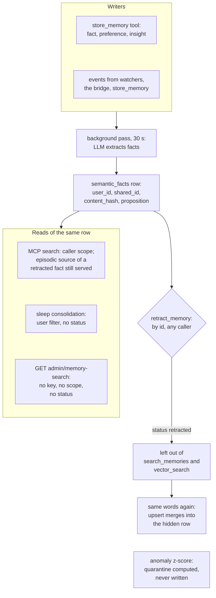

## 1. Executive Summary

Katra is a self-hosted memory appliance for long-running agents: a Node
server in a Docker stack with MongoDB, Redis and MinIO, reached over MCP and
REST, holding episodic events, semantic facts, a knowledge graph, working
memory and LLM-written reflections. Its notable part is identity. Every MCP
call resolves its caller from the presented key and pins `user_id` to it,
and the scope filter rides into both the text and the vector pass. Its weak
part is everything beside that path. A dashboard search route needs no key
and returns every identity's memories, any authenticated caller can rewrite
the scope configuration, and a retraction is honoured by two tools only.

The design is brain-modelled. Messages land as episodic events, a background
pass distils them into facts and graph edges through an LLM, and a nightly
sleep consolidation writes a journal, emotional reflection nodes and
philosophical insights. The README calls the result a cognitive layer, and
much of the code under `services/processing/` computes drives, salience and
a self-model around the store.

Correction is one verb. `retract_memory` sets `status: 'retracted'` on a
semantic fact by id, and `search_memories` and `vector_search` leave it out
by default. For an extracted fact the source event stays searchable, sleep
consolidation reads the retracted fact, and an exact restatement merges into
the retracted row and stays hidden without saying so.

The suite has 780 vitest cases, and CI runs none of them. 226 of them, in 11
files, test functions defined inside the test file rather than the server's
own.

**Licence.** The Additional Use Grant bars offering Katra *"on a hosted or
embedded basis in order to compete with kolegadev's paid version(s)"*, and
measures competition by overlap *"with the capabilities of kolegadev's paid
version(s)"*, paid support included. The tree does not define that product:
its only description is a hosted tier at `api.katra.ai`, "Availability TBA"
(`docs/ARCHITECTURE.md:357-374`), and every mechanism that tier lists, per-tenant
databases and free, pro and enterprise plans included, is already here
(`server/src/services/integration/tenant-service.ts:20`, `:91`). What is barred
therefore moves with what the licensor later sells. The manifests disagree
with the file: `server/package.json:50` and both SDK manifests say MIT, and
both SDK READMEs call it MIT while linking the root BSL `LICENSE`.

One mark is earned, `scope_enforced`, on the MCP read tools. Section 9 gives
the reason for each of the six withheld.

## 2. Mental Model

A memory is one of several kinds of record, each in its own collection.

- **An episodic event** is one message or one stored event, with a session,
  a user and a content hash. Events of distilled types (goal, plan,
  decision) merge by proposition key, so a repeat increments `occurrences`
  and keeps up to five variants
  (`server/src/services/memory/proposition-merge.ts:45-119`).
- **A semantic fact** is a sentence with a category, a confidence the
  writer supplies, tags, and `user_id` and `shared_id`
  (`server/src/types/memory.ts:70-89`). It is the unit the correction verb
  acts on.
- **Graph nodes and edges** come out of extraction and the code-graph
  scanner.
- **Reflections** are LLM output: a journal per period, entity nodes with an
  emotional signature, typed emotional edges such as `feels_frustrated_by`,
  and philosophical insights whose status climbs from `emerging` to `stable`
  as observations accumulate (`server/src/types/memory.ts:133-224`,
  `server/src/services/infrastructure/reflection-store.ts:236-237`).

A statement becomes a fact two ways. An agent calls `store_memory`, which
upserts on a hash of user and trimmed content
(`server/src/services/infrastructure/content-hash-utils.ts:41-44`). Or a
watcher or the bridge writes an event, and the background pass asks an LLM
to extract facts from it, which `add_semantic_fact` merges into any fact with
the same proposition key in the same user and shared scope
(`server/src/services/memory/memory-manager.ts:357-462`). Everything is
treated as true on arrival. Confidence is a number the writer chooses and
retrieval prints.

A fact stops counting in one way: `retract_memory` writes `status`,
`retracted_at`, `retracted_reason` and an optional `superseded_by`
(`server/src/mcp-server.ts:1743-1754`). Two reads honour it. Nothing deletes
or edits a fact through a tool.

## 3. Architecture

One container runs both servers. `node build/index.js` starts the REST API
on port 9002 and the MCP server on 3100, then the background processor, the
sleep-consolidation scheduler and the autonomous executive
(`Dockerfile:58`, `server/src/index.ts:120-142`, `:212`). The compose file
publishes them as 3112 and 9012 on every host interface; Redis alone is bound
to `127.0.0.1` (`docker-compose.yml:53`, `:89-90`).

- **`mcp-server.ts`** registers 81 tools and implements most of their
  handlers in one 4,248-line file. The README and `docs/MCP-TOOLS.md` say 66.
- **`routes/`** holds the REST API: memory, recall, ingestion, reflection,
  graph, assets, tenants, vault and an admin router the dashboard uses.
- **`services/memory/`** holds the stores, the scope service and the
  write-scope policy.
- **`services/processing/`** holds extraction, dispatch, sleep consolidation,
  decay, anomaly detection, salience, motivation and the executive.
- **`services/vault/`** is an encrypted secret store with approvals and its
  own audit collection.
- **`services/code-graph/`** scans repositories with tree-sitter into the
  knowledge graph.

Embeddings come from `Xenova/all-MiniLM-L6-v2`, 384 dimensions, run in
process (`server/src/services/infrastructure/embedding-service.ts:27`).
Extraction, journalling and summaries call an LLM, DeepSeek by default, with
a provider list and a fallback to Ollama
(`server/src/services/infrastructure/llm-service.ts:176-221`).

### Deployment and ergonomics

`install.sh` clones the source, generates credentials and runs
`docker compose up --build`. Storage needs no API key; extraction of longer
messages and consolidation need an LLM provider, local through Ollama or
hosted. Without one, the extractor catches the failure and falls back to
pattern matching (`server/src/services/processing/extraction-service.ts:178-181`,
`:600-612`).

The store is MongoDB, readable with `mongosh` and repairable by hand. The
first boot prints an admin key; per-agent client keys exist only when
`KATRA_EXTRA_IDENTITIES` names them
(`server/src/utils/api-key-manager.ts:472-570`). A one-agent install
therefore hands that agent the admin key, which resolves as a trusted caller.

Multi-tenant mode puts each tenant in its own MongoDB database and resolves
the tenant from its key (`server/src/middleware/caller-auth.ts:91-115`). That
boundary is a physical partition, separate from the `user_id` scope inside a
database.

## 4. Essential Implementation Paths

- **Caller resolution.** `resolveCallerIdentity` returns a trusted local
  identity for a loopback socket or the admin key in a header, an untrusted
  identity for a key in `client_keys`, and null otherwise
  (`server/src/utils/api-key-manager.ts:586-620`). The MCP dispatcher runs
  each call inside that identity and overwrites `user_id` with
  `resolveUserId` before any handler sees it
  (`server/src/mcp-server.ts:3668-3683`, `:97-105`).
- **Store.** `handleStoreMemory` resolves `{user_id, shared_id}` through
  `resolveWriteScope`, routes `category: 'event'` to `createEvent` with an
  embedding and an anomaly score, and upserts everything else into
  `semantic_facts` on `content_hash`, then embeds it
  (`server/src/mcp-server.ts:1567-1724`).
- **Extraction.** `BackgroundProcessor.processUnprocessedEvents` takes
  unprocessed events every 30 seconds, triages system and derived types, and
  calls `extraction_service.extractStructuredData` and
  `dispatch_service.dispatchToMemory`, which writes facts through
  `add_semantic_fact` (`server/src/services/processing/background-processor.ts:77-114`,
  `:413`, `:492`; `server/src/services/processing/dispatch-service.ts:237`,
  `:563`, `:857`).
- **Search.** `handleSearchMemories` builds the scope filter, runs a vector
  pass over semantic facts through `gatherVectorCandidates`, then a `$text`
  or regex pass over eleven collections, and touches `last_accessed`
  (`server/src/mcp-server.ts:1803-2050`).
- **Vector search.** `handleVectorSearch` uses the same candidate gatherer,
  scores by best window cosine blended with recency, and collapses near
  duplicates (`server/src/mcp-server.ts:2093-2171`).
- **Retract.** `handleRetractMemory` updates one `semantic_facts` row by
  `_id` (`server/src/mcp-server.ts:1726-1767`).
- **Consolidation.** `SleepConsolidationService.schedule` fires daily at
  02:00, weekly and monthly, and `runConsolidation` gathers the period's
  events and facts for `DEFAULT_USER_ID` and writes a journal, nodes, edges
  and insights (`server/src/index.ts:133-138`,
  `server/src/services/processing/sleep-consolidation-service.ts:253-269`,
  `:409-447`).
- **Bridge.** The Kolega Code hook calls `vector_search`,
  `get_temporal_context`, `temporal_recall`, working memory and the daily
  reflection, and injects the formatted result
  (`integrations/kolega-code/kolega_katra_bridge/config.py:20-23`,
  `integrations/kolega-code/kolega_katra_bridge/katra_client.py:164-294`).
- **Dashboard search.** `GET /api/v1/admin/memory-search` searches four
  collections by regex and by embedding
  (`server/src/routes/admin-routes.ts:369-429`).

## 5. Memory Data Model

**Facts.** A `semantic_facts` document carries `user_id`, `content`,
`content_hash`, `category`, `confidence`, `source`, `timestamp`, `tags`,
`shared_id`, `metadata.extraction_context`, the embedding fields, and from
extraction `proposition_key`, `proposition_norm`, `variants`,
`extraction_count` and `source_event_timestamp`
(`server/src/mcp-server.ts:1662-1679`,
`server/src/services/memory/memory-manager.ts:404-416`). A retraction adds
`status`, `retracted_at`, `retracted_reason` and `superseded_by`.

**Two hashes for one fact.** `store_memory` upserts on `content_hash` alone,
while extraction upserts on `content_hash` and `shared_id` together and
first looks for the proposition key within the same user and shared scope
(`server/src/mcp-server.ts:1681-1689`,
`server/src/services/memory/memory-manager.ts:390-398`, `:420-428`,
`server/src/services/memory/proposition-merge.ts:131-144`). The two writers
can therefore land one statement on one row or on two.

**Scope.** `user_id` is the writer. `shared_id` is `my-team` for every write
that is not private and not a personal kind (`journal`, `reflection`,
`emotional`, `insight`), which never carry one
(`server/src/services/memory/write-scope-policy.ts:21-29`, `:58-84`). The
reflection store strips `shared_id` from journals, insights, nodes and edges,
and a test pins each.

**Time.** `timestamp`, `created_at`, `updated_at` and `last_accessed` are
record times. `source_event_timestamp` is the time of the message a fact was
extracted from (`server/src/services/processing/background-processor.ts:486`).
No field says when a fact held.

**Decay.** Events and facts carry `retrieval_strength`, `decay_exponent` and
`access_count`, boosted on recall
(`server/src/services/memory/memory-manager.ts:464-503`). Ranking uses cosine
and age through `blendedScore` and does not read them
(`server/src/services/memory/vector-ranking.ts:47-53`).

**Anomaly.** `classifyAtIngestion` keeps a running centroid per user and
memory type, returns a z-score and `shouldQuarantine` at z ≥ 3, and
`store_memory` writes the score and class onto the event
(`server/src/services/processing/anomaly-detection-service.ts:83-105`,
`server/src/mcp-server.ts:1617-1641`). The `quarantined_memories` and
`anomaly_records` collections have readers and no writer.

## 6. Retrieval Mechanics

**The vector pass gathers before it scores.** `selectVectorCandidates` takes
the newest facts in scope (1,500 by default, 400 from `search_memories`) and
a keyword-matched set (500, or 200), and `vectorIndexService.search` adds up
to 200 from an int8 index built per scope filter and rebuilt every ten
minutes (`server/src/services/memory/vector-candidate-selector.ts:37-67`,
`server/src/services/memory/vector-index-service.ts:48`, `:106-139`). The
extra ids are re-read through the same filter, so the index cannot widen the
scope or revive a retracted fact (`server/src/mcp-server.ts:2082-2085`).

**Scoring.** The best cosine over the pooled vector and any window vectors is
multiplied by a recency factor floored at 0.6
(`server/src/services/memory/vector-ranking.ts:27-53`). `search_memories`
drops hits below cosine 0.3; `vector_search` applies no floor and collapses
near-duplicates by an 80-character prefix
(`server/src/mcp-server.ts:1902`, `:2137`,
`server/src/services/memory/result-dedupe.ts:29-50`).

**The text pass spans the store.** `search_memories` queries episodic events,
facts, both journals, knowledge nodes and relationships, memory nodes and
edges, missions, assets and working-memory sessions, each with the scope
filter nested under `$and` so a hybrid `$or` survives
(`server/src/mcp-server.ts:1836-1848`, `:1792-1801`). Results are grouped by
source and deduplicated by an 80-character prefix; text hits get a fixed
score of 0.5.

**Context injection** is the bridge's job, not the server's. The Kolega Code
hook defaults to a 5,000-token budget over five sources, weighted by a
personality profile the dashboard can set
(`integrations/kolega-code/kolega_katra_bridge/config.py:20-29`).

**Failure modes.** Retracted facts reach the model through every read other
than the two MCP search tools. The episodic event a retracted fact came from
is returned by the text pass of `search_memories`. A newly stored fact
enters the semantic tier only at the next index rebuild, though the recency
tier finds it at once.

## 7. Write Mechanics

**`store_memory` blocks on the embedding, not on a model.** The handler
awaits the upsert and the local MiniLM encode before it replies
(`server/src/mcp-server.ts:1681-1717`). The fact is retrievable by text
immediately and by vector once the call returns.

**Extraction is deferred.** Events wait for the next 30-second cycle. A
message under 50 characters goes through regex patterns for URLs, paths and
commands or is skipped; a longer one always goes to the LLM
(`server/src/services/processing/extraction-service.ts:103-136`). A fact from
a conversation appears within a minute or so when the provider answers. Fan-out per event is capped
(`server/src/services/processing/background-processor.ts:434`, `server/src/services/processing/extraction-fanout.ts:28`). No pass rewrites the
whole store; consolidation reads at most 100 events and 100 facts of one
period for one user (`server/src/services/processing/sleep-consolidation-service.ts:409-447`).

**Deduplication by proposition.** `propositionKeyOf` lowercases, strips
punctuation and a short stopword list and keeps negations and numerals, so
"did not fail" and "did fail" stay apart
(`server/src/services/memory/proposition-key.ts:1-60`). A repeat raises
`extraction_count`, keeps the higher confidence and adds the wording to
`variants` (`server/src/services/memory/proposition-merge.ts:147-173`).
Contradictions are not detected: a statement and its negation are two live
facts.

**The upsert keeps a retraction.** Neither upsert names `status`, so a fact
restated with the same content hash, or the same proposition key in the same
scope, merges into the retracted row and stays hidden, while `store_memory`
replies *"Memory stored"*. This holds by omission, not by a check, and no
test covers it. Writers that use `insertOne` or `insertMany` (time-block
summaries, reflection-store facts, learning feedback) bypass it
(`server/src/services/processing/time-block-summarizer.ts:379`,
`server/src/services/infrastructure/reflection-store.ts:395`,
`server/src/services/processing/learning-feedback-service.ts:742`).

**Agent-generated content is stored as given.** No quote check, no
provenance requirement and no injection filter sits on `store_memory`. The
anomaly score is written onto events and read by nothing.

### Operational cost

Each event of 50 characters or more costs one LLM call. Each
`vector_search` loads up to about 2,200 candidate documents with embeddings
from MongoDB and scores them in Node. The bridge injects up to 5,000 tokens
per prompt behind a 30-second cache
(`integrations/kolega-code/kolega_katra_bridge/config.py:20-21`).

## 8. Agent Integration

The model holds all 81 tools. Writing (`store_memory`, `store_journal`,
missions, working memory), retracting, scope configuration
(`set_memory_scope`), LLM configuration (`configure_llm`), reflection
triggers and the vault verbs are all on one surface. `set_memory_scope` and
`configure_llm` check only that an admin key exists, not that the caller
presented it (`server/src/mcp-server.ts:3009-3013`, `:3090-3094`); four vault
and auth handlers do check `caller.trusted` (`:3438`, `:3519`, `:3535`,
`:3604`).

Inter-agent messaging is memory. An agent stores a fact beginning
`Attention:` with `shared_id: my-team`, and other agents find it through
`search_memories`. In the seeded `personal` mode reads ignore `shared_id`, so
the bus works only after someone switches to `hybrid` or `shared`
(`server/src/database/migrations.ts:28-40`). The README describes hybrid as
the default.

The bridge for Kolega Code injects context on session start, on every user
prompt and after a session clear, and writes back through `store_memory`
with `private: true` for session-derived content, a rule its docstring dates
to a leak of whole session histories across agents
(`integrations/kolega-code/kolega_katra_bridge/katra_client.py:440-470`).

## 9. Reliability, Safety, and Trust

### The dashboard search reads every identity

`GET /api/v1/admin/memory-search` is exempt from the REST key check and from
the admin router's own gate (`server/src/middleware/caller-auth.ts:31-41`,
`:86-89`, `server/src/routes/admin-routes.ts:98-110`). With no `user_id` it
applies no filter to episodic events and semantic facts, and for knowledge
nodes and reflective journals it never applies one
(`server/src/routes/admin-routes.ts:50-63`, `:381`). It returns up to 100
items per collection, 300 characters each, including the personal journals
the write policy keeps private and retracted facts. Port 9012 is published
on all interfaces and CORS allows any origin (`docker-compose.yml:90`,
`server/src/index.ts:154-155`), so a page open in any browser on the network
can read it. A committed test asserts the unscoped behaviour as the contract
(`server/tests/unit/admin-memory-search.test.ts:137-143`).

### Scope is server-wide and any caller may rewrite it

`set_memory_scope` writes `mode`, `shared_id` and `hybrid_visible_user_ids`
into `system_settings` for every caller once an admin key is configured
(`server/src/mcp-server.ts:3009-3047`). An agent on a client key can set
hybrid mode with every other identity listed and then read their private
facts through its own scoped search. The boot-time reset of the visible list
runs only at start (`server/src/services/memory/write-scope-policy.ts:104-115`).

### Retraction is partial and unguarded

`retract_memory` matches `{ _id }` with no scope, so any authenticated caller
can hide another identity's fact by id (`server/src/mcp-server.ts:1743-1754`).
The reason is a field on the row, overwritten by a second retraction. Sleep
consolidation reads facts by user and time with no status filter, so a
retracted fact still shapes the night's journal and insights
(`server/src/services/processing/sleep-consolidation-service.ts:441-447`).
The REST recall routes search as `DEFAULT_USER_ID` whatever the caller, with
no status filter (`server/src/routes/recall-routes.ts:392`,
`server/src/services/memory/memory-manager.ts:464-473`).

### Declared and unwired: quarantine

The tool description of `get_quarantined_memories` says anomalous memories
are *"excluded from retrieval and reflection until corroborated"*
(`server/src/mcp-server.ts:795-797`). `classifyAtIngestion` computes
`shouldQuarantine`, and its one caller writes the class onto the event and
drops the flag (`server/src/mcp-server.ts:1620-1639`). No code inserts into
`quarantined_memories` or `anomaly_records`, and `rehabilitateMemory`,
`recordCorroboration` and `shouldAutoRehabilitate` have no caller. No read
filters on `anomaly_classification`.

### Marks

One is earned.

- **`scope_enforced` — earned.** Facts, events, journals and missions store
  `user_id` and `shared_id`. `buildScopeFilter` applies the stored mode on
  `search_memories`, `vector_search`, the temporal tools and conversation
  history, and the value comes from the caller's key: a client key is pinned
  to its own id. The admin key and loopback may name any user, the scope mode
  is writable by every caller, and the dashboard search bypasses it; the
  scoping matrix row says so.
- **`trust_state` — withheld.** `retracted` is a second value beside none,
  set by the writer's own tool on any row, honoured by two reads and by no
  consolidation; it has no candidate state. Quarantine has no writer. Insight
  status is derived from observation counts, and `getIdentityKernel` filters
  on it (`server/src/services/processing/self-model-service.ts:74-77`), which
  makes it a threshold rather than a status anyone sets. Skill status filters
  only when the caller passes one.
- **`tombstone` — withheld.** The retracted row does refuse an exact
  restatement on the two upsert writers, but nothing reads the status on
  write; the effect follows from `$set` not naming it. A restatement in
  another `shared_id` inserts a live row on the extraction path, the
  insert-only writers bypass it, the episodic source stays searchable, and no
  test pins it.
- **`audit_log` — withheld.** No collection records memory mutations.
  `vault_audit` records secret operations, and secrets are not memory;
  `agent_transaction_log` records the executive's actions; `processing_log`
  is updated in place and purged
  (`server/src/services/processing/background-processor.ts:1027`).
- **`bitemporal` — withheld.** Only record times and the source message time.
- **`human_review` — withheld.** No memory waits for a person. The dashboard
  approves or rejects pending autonomous tasks, not memory content, and the
  background processor auto-triages that queue
  (`server/src/routes/admin-routes.ts:714-723`,
  `server/src/services/processing/background-processor.ts:628-640`). Vault
  approvals gate secret use.
- **`negative_eval` — withheld.** No committed case seeds two identities'
  memories and requires one absent from a read. The scope tests pin filter
  shapes, source text or copies of the function (section 10). The admin
  search test's scope case cannot fail on scope, because the only fixture
  matching `hello` belongs to the user it filters for
  (`server/tests/unit/admin-memory-search.test.ts:18-21`, `:159-164`).

## 10. Tests, Evals, and Benchmarks

CI installs, typechecks and builds, and has no test step
(`.github/workflows/ci.yml:33-39`); the pull-request template asks for
`npm test` by hand. I ran nothing from the repository.

**Tests of copies.** Eleven unit and security files, 226 cases, import
nothing from `server/src` and define the function under test in the test
file: `memory-scope.test.ts` re-implements `buildScopeFilter`
(`server/tests/unit/memory-scope.test.ts:10-43`), `user-id-scoping.test.ts`
builds each filter it checks (`server/tests/security/user-id-scoping.test.ts:9-22`),
and `anomaly-detection-service.test.ts` defines its own `cosineDistance` and
`classifyZScore` (`server/tests/unit/anomaly-detection-service.test.ts:8-36`).
The same holds for decay, salience, motivation, self-model, decision-action,
working memory, the episodic manager and the API key manager. These cannot
fail when the server's code changes.

**A comment in place of the assertion.** *"set_memory_scope rejects with MCP
key only"* checks that `/api/v1/health` returns 200
(`server/tests/integration/pipeline-auth.test.ts:70-77`).

**What does exercise server code:**

- `resolveUserId` keeping an untrusted caller to its own id
  (`server/tests/unit/resolve-user-id.test.ts:35-43`);
- the exported vector and text filter builders keeping scope and the
  retraction predicate (`server/tests/unit/semantic-vector-filter.test.ts:12-59`);
- a source-text guard that every scoped handler calls `resolveUserId`
  (`server/tests/unit/read-tools-caller-pinning.test.ts:48-82`);
- forced-private writes in the reflection store
  (`server/tests/unit/journal-forced-private.test.ts:41-120`);
- proposition keys, merges, the candidate selector, the vector index and
  ranking;
- the vault, in 343 cases with the code graph, including a containment run
  against real MongoDB that skips without one
  (`server/tests/security/vault-denylist.test.ts:398`).

**Missing.** No case stores facts for two identities and reads as one. None
retracts a fact and checks consolidation, the episodic source or a
restatement. None calls `retract_memory` or `set_memory_scope` as an
untrusted caller.

No benchmark, retrieval evaluation or paper is committed. The `research/`
directory holds literature surveys that cite arXiv papers; none describes
this code. The README's account of emergent inter-agent behaviour is an
observation with no artifact.

## 11. For Your Own Build

### Steal

- **Resolve the caller from the key and overwrite the argument.** Replacing
  `user_id` in the dispatcher, before any handler runs, closes every tool at
  once, including ones added later.
- **Nest the scope under `$and`.** A hybrid scope is an `$or`, and a content
  `$or` set beside it overwrites it; nesting both under `$and` is a one-line
  rule with a test.
- **Re-read index hits through the filter.** An in-process index keyed by
  filter can go stale; fetching its ids back through the same query keeps a
  retracted or foreign row out.
- **A proposition key that keeps negations.** Normalising wording while
  keeping `not` and numerals merges paraphrases without merging opposites.

### Avoid

- **A read-only exemption on a route that reads memory.** "Read-only" is not
  "harmless" when the route returns private content; an exempt path list
  belongs to health checks.
- **Scope configuration on the agent's tool surface.** If one tool can widen
  who sees what, the per-call pinning beside it protects nothing.
- **A status two readers honour.** Put the predicate in one function every
  read path calls, consolidation included.
- **Tests that re-implement the code.** A copy of `buildScopeFilter` in a test
  file passes after the real one is deleted.

### Fit

This is for an operator who wants a brain-shaped memory around one or a few
cooperating agents on a home server, accepts an LLM bill per event, and will
read the code before exposing a port. The identity separation, whose code
comments date its cutover to 21 August 2026, is careful on the MCP path, and
the rest of the server has not caught up:
anyone needing identities that cannot read each other should treat the REST
port as open and the scope setting as shared. The licence rules out building
a paid hosted service on it until 2030. Walk away if corrections must hold
across every read, or if the store will hold anything a LAN neighbour should
not see.

## 12. Open Questions

- Whether `/api/v1/admin/memory-search` is meant to be public on a published
  port, or assumes the dashboard is only reachable locally.
- Whether `set_memory_scope` is meant to be restricted to trusted callers,
  as the vault approval handlers are.
- What the "paid version(s)" in the licence contain beyond this tree.
- Whether the upsert keeping a retraction is intended.
- Whether quarantine is meant to be written by `store_memory` or by
  extraction.

## Appendix: File Index

- Storage and schema: `server/src/types/memory.ts`,
  `server/src/database/migrations.ts`, `server/src/database/index-management.ts`,
  `server/src/database/tenant-context.ts`
- Write path: `server/src/mcp-server.ts` (`handleStoreMemory`),
  `server/src/services/memory/memory-manager.ts`,
  `server/src/services/memory/episodic-event-manager.ts`,
  `server/src/services/memory/proposition-key.ts`,
  `server/src/services/memory/proposition-merge.ts`,
  `server/src/services/infrastructure/content-hash-utils.ts`
- Extraction: `server/src/services/processing/background-processor.ts`,
  `server/src/services/processing/extraction-service.ts`,
  `server/src/services/processing/dispatch-service.ts`
- Retrieval: `server/src/mcp-server.ts` (`handleSearchMemories`,
  `handleVectorSearch`), `server/src/services/memory/vector-candidate-selector.ts`,
  `server/src/services/memory/vector-index-service.ts`,
  `server/src/services/memory/vector-ranking.ts`,
  `server/src/services/memory/result-dedupe.ts`
- Scope and identity: `server/src/services/memory/memory-scope-service.ts`,
  `server/src/services/memory/write-scope-policy.ts`,
  `server/src/utils/caller-identity.ts`, `server/src/utils/api-key-manager.ts`,
  `server/src/middleware/caller-auth.ts`
- Correction: `server/src/mcp-server.ts` (`handleRetractMemory`)
- Background: `server/src/services/processing/sleep-consolidation-service.ts`,
  `server/src/services/infrastructure/reflection-store.ts`,
  `server/src/services/processing/anomaly-detection-service.ts`,
  `server/src/services/processing/memory-decay-service.ts`
- REST and dashboard: `server/src/routes/admin-routes.ts`,
  `server/src/routes/recall-routes.ts`, `server/src/index.ts`,
  `dashboard/index.html`
- Integration: `integrations/kolega-code/kolega_katra_bridge/`, `watcher/`,
  `sdks/`
- Deployment: `Dockerfile`, `docker-compose.yml`, `install.sh`,
  `helm/katra/`, `terraform/aws/`
- Tests: `server/tests/unit/`, `server/tests/security/`,
  `server/tests/integration/`, `.github/workflows/ci.yml`
- Licence: `LICENSE`, `docs/ARCHITECTURE.md`,
  `server/src/services/integration/tenant-service.ts`

### Recorded searches

Run from the repository root at the pinned commit with `/usr/local/bin/git grep`.

- **Nothing writes the quarantine collections.**
  `git grep -n -E "collection\('(quarantined_memories|anomaly_records)'\)\.(insertOne|insertMany|bulkWrite|replaceOne)" -- .`
  returns nothing, and `git grep -n upsert -- server/src/services/processing/anomaly-detection-service.ts`
  returns nothing; the control
  `git grep -n -E "collection\('anomaly_stats'\)\.(insertOne)" -- server/src`
  matches `anomaly-detection-service.ts:117`.
- **The rehabilitation methods have no caller.**
  `git grep -n -E "recordCorroboration|rehabilitateMemory|shouldAutoRehabilitate|classifyAtIngestion" -- server/src scripts watcher integrations`
  returns the three definitions and one call of `classifyAtIngestion` at
  `server/src/mcp-server.ts:1620`.
- **No read of the anomaly class.**
  `git grep -n -w anomaly_classification -- server/src` returns the two type
  fields and the write at `server/src/mcp-server.ts:1638`.
- **The retracted status is read in one file.**
  `git grep -n "'retracted'" -- server/src` returns
  `server/src/mcp-server.ts:1747`, `:1779` and `:1930`.
- **No validity-time field.**
  `git grep -n -i -E "valid_from|valid_to|valid_until|invalid_at|t_valid" -- server/src`
  returns one false match, `ingest_validate` at
  `server/src/routes/ingestion-routes.ts:332`; the control
  `git grep -c source_event_timestamp -- server/src` counts matches in four
  files.
- **No memory review state.**
  `git grep -n -E "pending_review|needs_review" -- server/src` returns
  nothing; `git grep -n -c pending_approval -- server/src/routes/admin-routes.ts`
  counts four, all on autonomous tasks.
- **No memory mutation log.**
  `git grep -n -i -E "memory_(history|audit|log)|fact_history|mutation_log|change_log" -- server/src`
  returns nothing.
- **No retraction outside the MCP tool.**
  `git grep -n -i retract -- server/src/routes dashboard` returns nothing.
- **The admin-only tools check no caller.**
  `git grep -n "caller.trusted" -- server/src/mcp-server.ts` returns `:103`
  and four vault and auth handlers at `:3438`, `:3519`, `:3535`, `:3604`,
  none in `handleSetMemoryScope` or `handleConfigureLLM`.
- **CI runs no tests.**
  `git grep -n -E "npm test|vitest|npm run test" -- .github/workflows`
  returns nothing; the control `git grep -n "npm test" -- .github` matches
  `.github/PULL_REQUEST_TEMPLATE.md:21`.
- **No paper or benchmark.**
  `git grep -n -i -E "arxiv|bibtex|@article|doi\.org" -- . ':!research' ':!*package-lock.json'`
  returns nothing, while `git grep -c -i arxiv -- research` counts seven in
  `research/brain-gap-analysis/memory-poisoning-defense.md`;
  `git grep -n -i -E "locomo|longmemeval|recall@" -- .` returns nothing.
- **No import of code absent from the tree.** Every relative import in
  `server/src` resolves to a tracked file except
  `./memory_synthesis_service.js` in a commented-out line at
  `server/src/services/processing/learning-feedback-service.ts:12`.
- **Test files that import no server code.** A loop over
  `git ls-files 'server/tests/*.test.ts' ':!server/tests/fixtures'` printing
  files with no import from `src/` and no `readFileSync` lists eleven unit
  and security files (226 cases) and three integration files that call a
  running server over HTTP.

## History

**2026-11-26** — [`62cba09a81e4e083b38e68eaca572f2d8acee940`](https://github.com/kolegadev/Katra-Agentic-Memory/commit/62cba09a81e4e083b38e68eaca572f2d8acee940). First reading, read only, from a full clone at the head of `main`, the commit triage selected. Screened first: no auto-run surface, nothing inside the cooldown, one build-time execution point (the `prepublishOnly` script in `sdks/typescript/package.json`), four unpinned surfaces (`server/package.json` and `sdks/typescript/package.json` with lockfiles beside them, `sdks/python/pyproject.toml` and `integrations/kolega-code/pyproject.toml` without). `AGENTS.md` and the skill files were read as data. Nothing was installed, built or run, and no test count comes from a run. One mark, `scope_enforced` ([section 9](#9-reliability-safety-and-trust)); the dashboard search reads every identity without a key.
