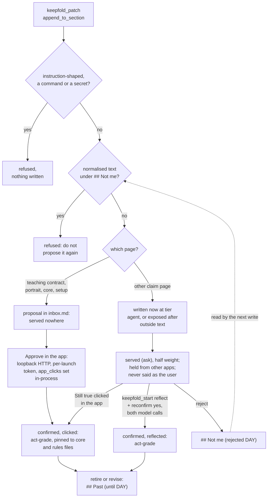

## 1. Executive Summary

Keepfold is a local-first memory that several AI apps share: Claude
Desktop, Claude Code, Cursor, VS Code, Codex and Gemini CLI read it and add
to it over one MCP server. It started as a learner model for students,
which is why concepts, grades and a teaching contract sit beside notes,
decisions and imported chats. Everything is plain Markdown in a folder the
person picks, plus an append-only JSONL event log. Notable: every line
about the person carries a server-stamped authorship tier. A model's guess,
a guess written after the chat read outside text, a yes the model relayed
and a click the person made are four different things, and each is served
differently. Weak: the most trusted tier a model can reach on its own is one
level too high.

A **claim** is one list line on one of seven `me/` pages: personality,
preferences, goals, profile, voice, core and setup. It has an id like
`^c-ab2cd` and optional stamps. A model writes one with `keepfold_patch`;
on most pages it lands at once at tier `agent` and is served with an
`(ask)` label. Lines bound for the pages Keepfold copies into other apps'
rules files, `me/core` and `me/setup`, wait in `inbox.md` instead, as do
the portrait and the teaching contract. Retiring a line moves it under
`## Past` with an `until` day. Rejecting one moves it under `## Not me`,
and later proposals of the same normalised text are refused.

The repository is eleven days old at the pin, with 887 commits and 2,891
test functions. The suite is unusually specific about provenance: one test
proves that a `confirm: clicked` sent by the model is ignored, and another
that a contract rule sent twice with `user_confirmed=true` still waits.
The gap is beside those tests. `keepfold_start(mode="reflect")` is an
argument the model passes, and a reconfirm yes inside that session promotes
an `agent` line to `confirmed` with no check that a person asked for the
reflect.

All seven marks are present, each with a stated limit
([section 9](#9-reliability-safety-and-trust)).

## 2. Mental Model

A claim line is text plus an id, and its standing comes from two places.

**The section it sits under** is stored in the page. `parse` gives each
line the status `live`, `past` or `not_me` from its `## ` heading
(`src/keepfold/claims.py:21`, `:324-343`). Only live lines reach a model
through the serving paths; Past and Not me lines stay on the page as
history and as the rejection list.

**Its authorship tier** is stored in the event log. Each claim write
appends a change event stamped by the server with `tier` and, for a yes,
`confirm` (`src/keepfold/mcp_server.py:3471-3481`). `tiers` replays the
events and takes the latest per claim id (`claims.py:518-576`).

- `typed` and `legacy`: the line has no event writing it, so the person
  typed it into the file, now or before the baseline was taken.
- `confirmed`, with a `confirm` of `clicked` (Keepfold's own elicitation
  dialog or the app), `reflected` (a yes in a reflect session), `tagged` (a
  `//pref` the person typed), or `relayed` (the model said the user agreed).
- `agent`: the model wrote it unasked.
- `exposed`: written in a chat that had read outside text, a web page, a
  raw source or another MCP tool's output, which a PostToolUse hook marks.

A line is **act-grade**, allowed to be said as the person, when it is
`typed` or `confirmed` and not labelled `(ask)` (`claims.py:23`,
`:513-515`). A `confirmed` line whose yes was relayed on or after
17 November 2026 is a late relay and gets `(ask)` (`:26`, `:507-510`).
`served_claims` labels agent, exposed and late-relayed lines `(ask)` at
half weight (`src/keepfold/prime.py:180-190`).

On top of the tier, `held` mutes three kinds of line on every serving path
until a person keeps them in the app: the older line of a recorded update
pair, a line that holds a command to run, and a line on `me/core`,
`me/setup` or the contract that Keepfold did not write (`prime.py:193-215`).
`cross_app` holds an `agent` or `exposed` line from every AI app except the
one whose session wrote it (`:223-239`).



## 3. Architecture

Keepfold is one Python 3.12 package with three front ends over one vault:

- **`keepfold mcp`**, a stdio MCP server built on the `mcp` 2.x SDK, that
  registers fifteen `keepfold_*` methods as tools, plus
  `keepfold_browse_search` under `--private` for local models
  (`mcp_server.py:3984`, `:4186-4227`);
- **the desktop app**, a standard-library HTTP server on `127.0.0.1` with one
  page, a per-launch token and a webview on Windows (`src/keepfold/app/`);
- **the CLI**, a Typer app of several dozen commands (`src/keepfold/cli.py`).

Each process builds its own in-memory SQLite FTS5 index over the vault at
start, off the MCP handshake's path, from a snapshot when one is current
(`src/keepfold/index.py:276`). Vectors live in `.keepfold/vectors.db`; the
embedder and the reranker are fastembed ONNX models that only
`keepfold model download` fetches, so a tool call never reaches the network
for them.

Every vault mutation goes through `keepfold.vault`, which takes a file lock,
writes a temp file and `os.replace`s it with retries, and scans for secrets
first (`src/keepfold/vault.py:740-757` for the field writer). A session's
close can commit the vault to git when the vault is a repository.

### Deployment and ergonomics

The installer puts the app and the `keepfold` command on the machine; the
app connects each AI app in one click by writing its MCP config, with a
backup, and for Claude Code installs the plugin's hooks. The person never
runs a server by hand. The cost is process count: each AI app spawns its
own `keepfold mcp`, each with its own index, and they share the vault
through the file lock, with writes waiting up to five seconds.

## 4. Essential Implementation Paths

**A model saves a preference.** `keepfold_patch(id="me/preferences",
op="append_to_section", target="Coding", text="Prefers tabs")`:

1. A `<private>` span is dropped and the text is checked for
   instruction-shaped phrases, hidden characters, credential paths and
   commands to run (`mcp_server.py:2933`, `:2951-2952`;
   `claims.py:173-248`).
2. If the chat read outside text, a write to the contract or profile is
   refused (`mcp_server.py:2955-2960`).
3. A relayed `user_confirmed` is downgraded unless one logged user turn in
   this chat holds at least 60% of the line's content words
   (`:2962-2981`, `:845-869`).
4. The text is compared with `## Not me` and refused on a match
   (`:3068-3072`).
5. `_settle_new` retires near-copies or the line this one updates, and the
   line is appended with a fresh id under the vault lock (`:3074-3099`).
6. The change event records tool, page, op, target, claim id and tier
   (`:3122-3137`).

**A rule for the teaching contract.** The same call with
`id="me/teaching-contract"` reaches `contract and not self.app_clicks`, which
refuses anything but an append and forces `user_confirmed` to false
(`:2987-2993`). The propose branch writes it to `inbox.md` under
`## About me (unconfirmed)` and returns `queued: true` (`:3019-3058`). The
app's `review_approve` replays the same `keepfold_patch` call with
`user_confirmed=True` on an instance whose `app_clicks` it set itself
(`src/keepfold/app/server.py:1036-1053`, `:1109-1129`).

**A prompt in Claude Code.** The UserPromptSubmit hook runs
`keepfold prime-hook`, which builds the prime from the vault and the event
log without importing the MCP SDK, the embedder or the index
(`src/keepfold/prime.py:1-10`, `:562-630`). It serves the pinned core, the
profile, the contract's core, preferences ranked by the prompt, and the
related pages, under a 2,000-character cap, all wrapped in
`<untrusted_note>`.

**A forget.** `keepfold forget me/preferences^c-ab2cd` drops the line and
the Past lines that led to it, sweeps every event, cache, kept transcript
and Keepfold page for its text, prunes vectors, runs `VACUUM` on the SQLite
stores, rewrites the AI apps' rules files, and prints a receipt
(`src/keepfold/forget.py:133-153`, `:344-388`, `:589-640`).

## 5. Memory Data Model

The vault holds Markdown pages under one folder per kind, with YAML
frontmatter; `catalog.yaml` holds the concept tree; `inbox.md` holds
proposals; `Today.md`, `index.md` and `log.md` are pages Keepfold writes
itself. The memory this report reads is the seven claim pages in `me/`
(`claims.py:20`) and the event log.

A claim page is ordinary Markdown:

```text
## Coding
- Neovim (confirmed 2026-11-28) (since 2026-11-28) ^c-q3kxa
## Past
- Vim (confirmed 2026-01-01) (until 2026-11-28 → ^c-q3kxa) ^c-7mbzd
## Not me
- Night owl (rejected 2026-11-28)
```

The id is server-written: `add_ids` strips any id the caller wrote and
mints one from page, text and day (`claims.py:311-360`). A line without an
id, typed by hand, gets a derived one on parse.

An event is one JSON line in `events/YYYY/MM/<session>.jsonl` with
server-stamped `id`, `ts`, `day`, `session`, `kind`, `mode`, `source`,
`predicted_p` and `grader`, which tool input can never set
(`src/keepfold/events.py:38-39`). Ten kinds exist; claim writes are `change`
events and confirmations are `log` events of kind `reconfirm`
(`:23-24`).

## 6. Retrieval Mechanics

There are two read surfaces, and they treat claims differently.

**Search over pages.** `keepfold_recall` scores 0.7 × cosine over
`BAAI/bge-small-en-v1.5` chunks, with a 0.62 floor, plus 0.3 × BM25 scaled
to the best hit; a keyword hit under the cosine floor must cover half the
query's terms (`src/keepfold/semantic.py:57`, `:72`, `:79-80`,
`:1125-1145`). Weights then multiply in: 0.6 for imported chats, 0.5 for a
superseded or retired decision, an archived project or a dropped loop, and
a recency boost of up to 12%, or 30% when the query asks how things stand
now (`:84-98`). A MiniLM cross-encoder reranks the top 30 when installed,
and link hops add neighbours at half weight per hop (`:58-59`, `:82`).
Superseded decisions are ranked down here, not removed.

**Serving about-me lines.** `keepfold_prime`, `keepfold_context`, the
prompt hooks, the packs and the rules files read claims through
`claims.tiers`, keep only live lines not past their own `until` day, drop
`held` and `cross_app` lines, and label the rest by tier
(`prime.py:180-239`, `:457-476`, `:581`). `keepfold_as_me`, which drafts
text in the person's voice, uses only act-grade lines and counts the rest
as unconfirmed (`mcp_server.py:1930-1945`).

**What the second path does not cover.** The claim pages are also pages,
and for a client whose profile is `all` they are in the index. `Index.read`
returns a page's body sliced by offset or section with no reference to
claim status (`src/keepfold/index.py:656-700`), so `keepfold_read
me/preferences` returns the Past and Not me lines and any held line. They
arrive under their headings and inside `<untrusted_note>`, so a careful
model can tell them apart; nothing makes it.

## 7. Write Mechanics

Writers, by how far each is trusted:

- **The person in the app.** Approve, Dismiss, Still true, Retire and Keep
  run through `_click`, which sets `app_clicks` on its own instance, so
  each write is stamped `confirm: clicked`.
- **The person in a prompt.** `//pref`, `//fact`, `//tag` and `//forget` are
  parsed by the prompt hook and written at tier `tagged`; a `//forget`
  retires the line and queues a sweep the app runs later
  (`src/keepfold/tags.py:1-30`).
- **The model.** `keepfold_patch` and `keepfold_add`, with the checks in
  section 4; its unasked lines are `agent`, or `exposed` after outside text.
- **The fact harvester.** A loaded local model names up to three facts per
  recent public chat; code keeps one only if its quote is verbatim, first
  person and not a question, and saves it through the same inferred path,
  in a `harvest` session the app can undo as one
  (`src/keepfold/fact_harvest.py:57`, `:445`). A producer whose passes are
  mostly undone pauses itself.
- **Importers.** Chat exports, browser history behind a privacy filter,
  Zotero, watched folders, Anki and voice memos write pages, not claims.

A write's change event is appended **after** the write, and `_persist`
swallows a failure to append with a warning so that the write it records
never fails (`src/keepfold/session.py:247-258`). A crash or a full disk
between the two leaves a line with no event, which then folds to `typed`.

### Operational cost

Nothing runs a cloud model unless the person turns one on. Embedding is
local ONNX on CPU, budgeted at about a second per recall for missing
chunks (`semantic.py:69-71`); the reranker and embedder unload after ten
idle minutes (`:194`). The harvester and the safety net need a local model
in Ollama or LM Studio and run in the app's periodic pass, or right after a
local Chat turn under a time budget.

## 8. Agent Integration

The Claude Code plugin registers `keepfold mcp` and five hooks
(`plugin/hooks/hooks.json`). UserPromptSubmit serves the prime once per
chat; SessionStart serves it again after compaction, resume or clear, and
PreCompact asks for durable items to be recorded first. SessionEnd closes
Keepfold sessions whose server has exited. PostToolUse runs `keepfold taint`
after WebFetch, WebSearch or any MCP tool not on an allowlist, which writes
a marker the server reads as exposure.

Codex and Gemini CLI get the prime through their own hook entries, and
Cursor, VS Code and Codex's `AGENTS.md` get a Keepfold block in their
rules files holding the approved core, rewritten by the app when it
changes. Every other MCP client gets the context only by calling tools.

Which pages a client sees depends on its profile, chosen by the client name
the MCP handshake declares (`mcp_server.py:673-676`). The defaults give
names containing `claude` or `lmstudio` everything, the coding apps the
core, coding, projects and environment scopes, and any other name the core
alone (`src/keepfold/profiles.py:21-41`).

## 9. Reliability, Safety, and Trust

### The model can vouch for its own guess

`_log_reconfirm` stamps `promote: true` on a yes when the session's mode is
`reflect` and the chat is not exposed (`mcp_server.py:2465-2481`). The
docstring calls it "a reflect the user started". The mode is set by
`keepfold_start(mode=...)`, an ordinary argument on a tool the model holds
(`:974-986`), and nothing checks who chose it. A model that saved
"Prefers tables over prose" unasked can end the session, start a reflect,
and log a reconfirm yes on its own line in three calls.

`tiers` then folds the line to `confirmed`, `reflected`, which is not a late
relay (`claims.py:507-510`, `:543-548`). The line is served plain, is
act-grade for `keepfold_as_me`, and leaves `cross_app`, so other apps get it
too. The committed test performs exactly this sequence from one MCP client
and asserts the promotion (`tests/test_claims.py:282-310`). The defence it
does have is real: a reflect in an exposed chat does not promote.

### What the file system can write

A line with no change event folds to `typed`, the person's own and
act-grade (`claims.py:568-571`). That is right for a person editing the page
in Obsidian, and it is also what happens when any agent with file access
appends to `me/preferences.md` directly. The outside-edit guard catches
this only on `me/core`, `me/setup` and the contract
(`src/keepfold/review.py:625`). Since Claude Code and Codex edit files as
a matter of course, the other five claim pages accept unprovenanced lines
at the top tier.

### The scope is a declared name

The profile is matched as a substring of a normalised client name, and the
first match wins (`profiles.py:88-92`). The name comes from the MCP
`initialize` request, or from a request's `_meta` envelope in stateless
MCP. Any client can claim to be `claude` and get every non-private page.
An unknown name failing closed to the core is the right default. What the
profile protects against is one well-behaved app reading another's slice,
not a hostile one.

### Forget and the tombstone are different verbs

A forget is the most thorough in its family: page, Past chain, every event
string, caches, transcripts, vectors, compacted SQLite, rules files, and a
receipt that names git history, backups, raw exports, sync folders and the
AI apps' own copies as left behind (`forget.py:1-43`, `:600-640`). It
writes no Not me line, and it deletes the dismiss and line hashes of what it
forgot (`:146-150`). The harvester's next pass over a new chat that says
the same thing will save it again. Reject keeps the text and blocks it, and
forget erases the text and blocks nothing; nothing does both.

### Marks

- **`tombstone`: earned.** `## Not me` holds the rejected line's text, keyed
  by `norm`, and the inferred write path and the proposal path both refuse a
  match (`mcp_server.py:3030-3036`, `:3068-3072`). The harvester writes
  through that path. The key is exact after folding, a confirmed write
  passes it, and forget writes none.
- **`trust_state`: earned.** The tier is a stored, server-stamped field on
  each claim's events, moved only by later events; `agent` and `exposed`
  keep a line from being said as the person and from other apps, and Past
  and Not me keep it from every serving path. The reflect promotion is the
  defect above.
- **`bitemporal`: earned, narrowly.** A Past line's `until` is the day the
  fact stopped holding, which the caller may set to any past day, while the
  event keeps the record time; a replacement's `since` is the day the new
  fact started, kept across restatements; and the change timeline reads the
  stamps rather than the event times. No read asks what held on a day.
- **`scope_enforced`: earned.** Pages and sections map to stored scopes and
  `scope:` fields, `private:` and `share:` are stored keys, and the index
  every read uses withholds what the client's profile lacks
  (`mcp_server.py:608-646`). The client name choosing the profile is
  self-declared.
- **`audit_log`: earned.** The event log is append-only for every writer
  but forget, which redacts in place, keeping every row and its ids and
  saying so in the receipt. Change events carry no text, can be lost when
  the append fails, and forgets outside the queued sweep write none.
- **`human_review`: earned on the teaching contract.** The proposal waits
  in `inbox.md`, which nothing serves; only `review_approve` on the app's
  token-guarded loopback server applies it, with `app_clicks` set
  in-process; no MCP tool approves; a repeated `user_confirmed=true` still
  waits (`tests/test_review.py:110-128`). The portrait and core proposals
  can be written directly on the model's word, and the token file is
  readable by any process of the user's, the general-shell case.
- **`negative_eval`: earned** on four committed cases that require a
  retired, rejected, out-of-scope or other app's line absent beside a
  required present line ([section 10](#10-tests-evals-and-benchmarks)).

## 10. Tests, Evals, and Benchmarks

The suite is pytest with `anyio` and an in-process MCP `Client`, run in CI
with `-m "not slow"` on every push to main. A fake embedder and a fake
Ollama replace the models, so no network is needed.

The provenance cases are the strongest in the tree:

- `test_a_model_sent_confirm_is_ignored` sends `confirm: "clicked"` and a
  `click` argument from the model and requires every resulting row to be a
  late relay (`tests/test_review.py:86-108`).
- `test_a_contract_rule_over_mcp_waits_for_approve` sends a rule twice with
  `user_confirmed=true`, requires it absent from the page and present once
  in the Review, then approves and requires `confirm: clicked`
  (`:110-128`).
- `test_revise_retire_reject_and_not_me` requires the context to carry the
  revision and omit the old, retired and rejected lines, and requires a
  re-proposal of the rejected line in different case and spacing to be
  refused (`tests/test_claims.py:117-168`).
- `test_each_apps_hook_serves_its_own_guesses_not_another_apps` requires a
  Codex guess in Codex's hook and absent from Gemini's and Claude Code's
  (`tests/test_app_hooks.py:201-219`).
- `test_canary_leaves_every_store` plants a canary in a page, claims, a chat
  and a browse page and requires it gone from every file under the vault
  and the temporary home after the forgets (`tests/test_forget.py:55-133`).

What is not covered: `keepfold_read` or `keepfold_recall` of a claim page
with Past, Not me or held lines; a reflect started by the same caller that
wrote the line, which the promotion test treats as the user's; a
paraphrased Not me line; a line appended to a claim page file by another
process. `keepfold eval recall` and `keepfold eval harvest-facts` measure
retrieval and extraction on the person's own usage log; no result is
committed. I ran none of the 2,891 test functions.

## 11. For Your Own Build

### Steal

- **Stamp authorship on the server and fold it from events.** The tier is
  never a tool argument, a relayed yes is a different value from a click,
  and a yes relayed after a fixed day is downgraded unless the user's own
  logged words carry the line.
- **Hold a model's guess from every app but its writer.** `cross_app` keeps
  one app's inference from becoming another app's fact until a person says
  so.
- **A Not me section in the page itself.** The rejection list is visible to
  the person, editable by hand, and read by every inferred write.
- **A forget receipt that lists what it could not reach.** Git history,
  backups, sync folders and the other apps' own memory, named with the
  command to finish the job.

### Avoid

- **A promotion gate keyed on a mode the model chooses.** If a session type
  means "the person asked", take it from the person's own message or the
  app, not from `keepfold_start`.
- **Treating "no event" as "the person typed it".** Where agents can edit
  files, an absent record is the weakest provenance, not the strongest.
- **Two read surfaces with two filters.** Serving paths drop Past, Not me
  and held lines; `keepfold_read` does not. Put the status filter where the
  page is read.
- **Forget that clears the rejection.** Write the value's key to the
  rejection list when the text goes, or the harvester brings it back.

### Fit

This suits one person who uses several AI apps on one computer and wants
them to share what they know, kept in files the person can read and edit,
with no account and no server. The tiering is the reason to study it:
a model's guess, a relayed yes and a click stay distinguishable all the way
to the prompt. It is not a multi-tenant store, the per-app scope is a
courtesy between cooperating apps, and anyone whose agents write files
should guard every claim page, not three.

## 12. Open Questions

- Whether a reflect is meant to promote only when the person typed
  `/keepfold reflect`, and whether the prompt hook could stamp that.
- Whether `keepfold_read` is meant to show Past and Not me lines to every
  client whose profile is `all`.
- Whether forget is meant to leave a hash in Not me when it removes a claim.
- How the macOS and Ubuntu apps start the server and where they keep the
  token; only the shared Python server was read.

## Appendix: File Index

- Claims, tiers, Past and Not me: `src/keepfold/claims.py`
- The tools, the write checks, tiers and the reflect promotion:
  `src/keepfold/mcp_server.py`
- Serving, held and cross-app lines, the prime: `src/keepfold/prime.py`,
  `src/keepfold/prime_hook.py`, `src/keepfold/export_context.py`
- Review cards, pairs, the outside-edit guard: `src/keepfold/review.py`
- Scopes and profiles: `src/keepfold/access.py`, `src/keepfold/profiles.py`,
  `src/keepfold/share.py`
- Event log and sessions: `src/keepfold/events.py`, `src/keepfold/session.py`
- Forget: `src/keepfold/forget.py`, `src/keepfold/browse/forget.py`
- Search: `src/keepfold/index.py`, `src/keepfold/semantic.py`,
  `src/keepfold/vecstore.py`
- Harvesting and tags: `src/keepfold/fact_harvest.py`,
  `src/keepfold/tags.py`, `src/keepfold/taint.py`
- The app server and its Review routes: `src/keepfold/app/server.py`
- Plugin: `plugin/hooks/hooks.json`, `plugin/.mcp.json`
- Tests: `tests/test_claims.py`, `tests/test_review.py`,
  `tests/test_app_hooks.py`, `tests/test_agent_context.py`,
  `tests/test_forget.py`

### Recorded searches

Run from the repository root at the pinned commit with `/usr/bin/git grep`.

- **Forget writes no Not me line.**
  `git grep -n -E 'add_not_me' -- src` returns the definition at
  `src/keepfold/claims.py:447` and one caller, the reject branch at
  `src/keepfold/mcp_server.py:3596`.
- **No MCP-side path reaches the Review routes.**
  `git grep -n -E 'review_approve|api/review' -- src/keepfold/mcp_server.py src/keepfold/prime_hook.py src/keepfold/tags.py`
  returns nothing; the control
  `git grep -c -E 'api/review' -- src/keepfold/app/server.py` counts 19.
- **The page reader and the search apply no claim status.**
  `git grep -n -E 'not_me|claims\.held|prime\.held|is_live' -- src/keepfold/index.py src/keepfold/semantic.py`
  returns nothing; the control `git grep -c -E 'is_live' -- src/keepfold/prime.py`
  counts 1.
- **Three pages are guarded against outside edits.**
  `git grep -n -E '^GUARDED' -- src/keepfold/review.py` returns
  `review.py:625`, core, setup and teaching-contract.
- **The promotion reads only the mode.**
  `git grep -n -E 'session\.mode == "reflect"' -- src` returns
  `mcp_server.py:2473`.
- **No submodules, no paper.** `.gitmodules` is absent;
  `git grep -n -i -E 'arxiv|doi\.org|bibtex|@article|@misc' -- . ':!uv.lock'`
  returns one line, a domain list in `src/keepfold/browse/lists.py:224`;
  `CITATION.cff` is absent.

## History

**2026-11-28** — [`a54acc5dcdb65ccb1121dcb148644c392b34b891`](https://github.com/alenissacsam-2/keepfold/commit/a54acc5dcdb65ccb1121dcb148644c392b34b891). First reading, read at the user's request, from a blobless clone at the head of `main`, read only. Screened: six auto-run surfaces (`.claude-plugin/`, `plugin/.claude-plugin/plugin.json`, `plugin/.mcp.json`, `plugin/hooks/` and its `hooks.json`, and `server.json`, which launches the package through `uvx`), `pyproject.toml` and `uv.lock` inside the cooldown, two pytest `conftest.py` files, and `CLAUDE.md` read as data. Nothing was installed, built or run, and the 2,891 test functions were not run. Seven marks ([section 9](#9-reliability-safety-and-trust)).
