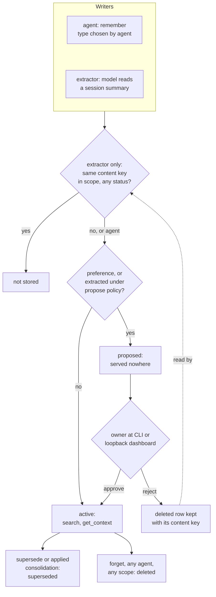

## 1. Executive Summary

Kenfold is a self-hosted memory server, written in Go over PostgreSQL with
pgvector, that several AI clients share over MCP. Claude Code, Codex and
OpenCode connect with one API key each, and ChatGPT and claude.ai through a
built-in OAuth server. A memory is a typed statement scoped to the user or to a
project identified by its normalised git remote. Session hooks inject context at
session start and write an extractive session summary at the end.

What is notable is the review discipline. An agent's preference, and by default
every memory a local model extracts from a session summary, waits as `proposed`.
No agent-facing read serves it until the owner approves it at the CLI or on a
dashboard that answers only on loopback. A rejected extraction stays in the
table as a deleted row, and the extractor looks every new candidate up by
normalised content in any status, so the same statement is not proposed again.
Replacement is supersession on every path, and consolidation proposes and never
applies.

What is weak is where the gate sits. Review is keyed on the type the agent
chooses, so the same sentence typed `semantic` is active at once. An agent can
retire an approved preference by superseding it with another type, or `forget`
it by id from any project. The agent's own write path never consults the
rejected rows. `valid_from` and `valid_to` exist with a range check and no
product path writes them.

**Licence.** MIT, in `LICENSE`, copyright 2026 Jeongwan Jeon; the README badge
agrees and `go.mod` carries no licence field. No vendored code, model weights or
datasets are committed. The benchmark harness downloads LoCoMo and LongMemEval at
run time (`internal/bench/dataset.go:22-23`), so those datasets come under
their own terms, and the LoCoMo URL names a branch rather than a commit.

## 2. Mental Model

A memory is one self-contained statement with a type: `semantic`, `episodic`,
`project`, `preference`, `codebase` or `temporary`
(`internal/memory/types.go:15-22`). Episodic memories are session summaries;
temporary ones carry a TTL and hold handoffs. Each row records the writing
agent, taken from the API key rather than the client's claim, and the agent
session (`internal/mcpserver/handlers.go:613-628`).

The state is `status`: `proposed`, `active`, `superseded` or `deleted`
(`migrations/00001_init.sql:27-29`). Only `active` is served. What enters as
`proposed` is decided by type and writer: an agent's preference always
(`internal/mcpserver/handlers.go:714-721`), and an extracted memory unless the
owner set `KENFOLD_EXTRACT_POLICY=auto`, which still proposes preferences and
anything resembling an existing memory (`internal/extract/worker.go:174-177`).
Everything else an agent writes is active on arrival.

A belief stops being served in four ways. A replacement supersedes it in the same
transaction, or on approval when the replacement is proposed
(`internal/store/store.go:163-172`, `:295-301`). `forget` or a review rejection
marks it deleted and writes `forgotten_by` and `forget_reason` into `attrs`
(`:311-336`, `internal/store/extraction.go:255-276`). An applied consolidation
supersedes it. A temporary memory expires. Nothing hard-deletes a row outside
tests.

The `trust` column (`user`, `agent`, `external`) is a label. Approval sets it to
`user` (`internal/store/store.go:301`); no read ranks or filters on it, and no
product path writes `external`. Code references add a second, softer signal: a
memory whose cited symbol changed or file vanished keeps 60% or 5% of its score
and is flagged to the agent, and is still served
(`internal/retrieve/retrieve.go:98-99`).

## 3. Architecture

One Go binary serves MCP at `/mcp`, a REST API at `/api/v1` for code-reference
sync, the dashboard at `/dashboard/`, health probes and, with
`KENFOLD_PUBLIC_URL` set, an OAuth 2.1 authorization server. The same binary is
the CLI, the stdio MCP server and the session hook. Postgres 18 with pgvector
and `pg_trgm` holds everything; migrations are embedded and run by goose.

The default `make up` brings up Postgres and Kenfold with full-text search only.
`make up-embed` adds Ollama with `bge-m3` and a llama.cpp reranker, and
`make up-extract` adds `qwen3.5:4b` for classification, extraction and
consolidation, all on CPU in Docker. Any OpenAI-compatible embeddings or chat
endpoint can replace them. No hosted provider or provider key is needed to store anything.

Inside `serve`, extraction checks for settled session summaries every minute and
consolidation runs every 15 minutes when a chat model is configured, and an
embedding backfill runs when an embedder is (`cmd/kenfold/serve.go:47-50`, `:278`). The hook keeps a local log
under `~/.local/state/kenfold` and spools a summary it could not send, bound to
the server URL and credential (`internal/hook/hook.go:312-318`).

Every key and every approved OAuth client can read all memory; the README says
so (one owner). Ports publish on `127.0.0.1`, and remote access needs a tunnel or
TLS proxy. The dashboard refuses proxied requests unless `KENFOLD_DASHBOARD=remote`
(`internal/dashboard/dashboard.go:160`). The store is a single SQL table with
readable rows, repairable by hand, and `kenfold export` writes JSON Lines with
history.

## 4. Essential Implementation Paths

- **Remember.** `handlers.remember` trims, length-checks and secret-scans the
  content, resolves the scope from the project argument, checks a supersedes
  target is active and in the same scope, otherwise returns an existing active or
  proposed duplicate, classifies an untyped memory with the chat model or a
  scope default, and inserts with `statusFor(type)`
  (`internal/mcpserver/handlers.go:98-232`). `CreateIfAbsent` takes an advisory
  lock on scope and content key and re-checks under it
  (`internal/store/store.go:140-162`).
- **Session capture.** The hook records prompts, final responses and the
  compaction summary locally, builds an extractive summary at session end
  (`internal/hook/format.go:81`), and sends it as an episodic `remember`; a later
  summary of the same session supersedes the earlier
  (`internal/mcpserver/handlers.go:173-181`).
- **Extract.** `Worker.RunOnce` claims the oldest settled summary with a lease,
  asks the model for categorised items, and `validate` drops discard categories,
  low confidence, secrets, evidence not found in the session and evidence inside
  quoted text (`internal/extract/extract.go:190-246`). `Worker.store` skips a
  candidate whose content key exists in scope in any status, records similar
  memories, and stores the rest proposed (`internal/extract/worker.go:132-207`).
- **Recall and context.** `Retriever.Search` runs the store's fused search, adds
  graph neighbours when a reranker is configured, reranks the top 15, then
  multiplies by staleness and recency (`internal/retrieve/retrieve.go:132-210`).
  `getContext` packs preferences, the pending handoff, three recent sessions,
  project rules with stale ones last, and task matches into a budget of 2,000
  estimated tokens by default (`internal/mcpserver/handlers.go:420-516`).
- **Review.** `Approve`, `ApproveReplacing` and `Reject`
  (`internal/store/store.go:273-307`, `internal/store/extraction.go:203-276`),
  called from `kenfold memory approve|reject|review` (`cmd/kenfold/review.go`)
  and the dashboard's review routes (`internal/dashboard/dashboard.go:115-118`).
- **Consolidate.** `ConsolidationPairs` finds similar active pairs not judged
  before; `Judge` asks twice with the pair swapped and proposes only when both
  agree (`internal/consolidate/consolidate.go:72-98`); `ApplyProposal` retires
  members and links them with `replaces` edges
  (`internal/store/consolidation.go:366-428`).
- **Code references.** File and symbol mentions are stored at write time; the
  hook or `kenfold refs sync` hashes them at `HEAD` with tree-sitter and posts
  states to `/api/v1/refs/check`.

## 5. Memory Data Model

The `memory` table carries `type`, `scope`, `content`, `embedding vector(1024)`
with `embedding_model`, `attrs jsonb`, provenance (`source_agent`,
`source_session`, `evidence_uri`, `trust`, `confidence`), `status`, `supersedes`,
`valid_from`, `valid_to`, `expires_at`, a generated `content_tsv` and timestamps
(`migrations/00001_init.sql:7-45`). A generated `content_key` lowercases,
collapses every Unicode space and strips trailing `.`, `!` or `。`; the Go
`ContentKey` mirrors it (`migrations/00009_content_key_whitespace.sql:14-18`,
`internal/store/store.go:223-236`).

Scope is `user` or `project:<host/owner/repo>`, normalised from any remote form
and refusing local paths (`internal/memory/scope.go:21-39`). User-scope
memories join every project's reads. `memory_edge` holds `derived_from` links
from an extracted memory to its summary and `replaces` links from consolidation.
`memory_ref` holds each code reference's anchor hash and commit and a state of
`pending`, `current`, `changed`, `missing` or `unresolved`
(`migrations/00005_code_refs.sql:15-35`).

`valid_from` and `valid_to` are commented as world validity and range-checked
(`migrations/00001_init.sql:31-42`). The insert in `Create` does not name them
(`internal/store/store.go:173-180`), and their only writer is `kenfold import`,
which copies them from an archive (`internal/store/archive.go:312-317`). No read
filters on them.

## 6. Retrieval Mechanics

The first stage is one SQL statement. Full-text ranks by `ts_rank` over the OR of
the query's lexemes in the `simple` configuration, the vector arm ranks by
cosine distance among rows embedded by the configured model and cut at 0.55,
and the two are fused by reciprocal rank with k = 60 and normalised so a memory
first in both scores 1.0 (`internal/store/store.go:985-1027`). Both arms filter
`status = 'active'`, unexpired, scope in `{user, scope}` and type.

Graph expansion adds active neighbours one edge from the top eight seeds, and
siblings extracted from the same summary (`internal/store/graph.go:38-76`). It
applies only when the reranker scored the pool; without it the neighbours are
dropped (`internal/retrieve/retrieve.go:179-186`). A query matching a temporal
regex in English or Korean decays every memory with a seven-day half-life;
without one, session summaries lose up to 40% of their score over a 30-day
half-life when reranked (`:345-363`).

The README's recall@5 of 0.96 with the reranker is measured on a 110-memory,
67-query internal corpus whose holdout was written by a second author
(`internal/retrieve/testdata/RESULTS.md`). Over-recall is the expected failure:
a stale memory is ranked down and still returned, and nothing deduplicates a
paraphrase at write time beyond a `similar` hint to the agent.

## 7. Write Mechanics

`remember` is synchronous. It may block on an embedding call bounded at 10
seconds and, for an untyped memory, on classification bounded at 15 seconds,
about 6 seconds on CPU per the README; on timeout it falls back to full-text and
a scope default type (`internal/mcpserver/handlers.go:76-94`). An active memory
is searchable when the call returns.

The session hook never blocks the agent; a summary sent at session end is
searchable at once. Extraction waits at least two minutes for a summary to
settle and takes 10–30 seconds of CPU per session in the background, and its
output waits for review under the default policy. Consolidation judges at most
four pairs and writes at most one digest per run
(`internal/consolidate/worker.go:21`, `:64`); nothing changes until the owner
applies. No pass rewrites the store.

A digest is checked mechanically: every file name, identifier and number in it
must occur in the sessions it replaces
(`internal/consolidate/consolidate.go:203-207`). An applied digest is stored
with `trust = 'user'` and dated like the last session it covers
(`internal/store/consolidation.go:407-411`).

Secrets are refused on every write path by pattern; `kenfold scan --redact`
rewrites rows stored before the filter in any status and clears their embedding
(`internal/store/store.go:705-734`, `cmd/kenfold/scan.go:20-22`).

## 8. Agent Integration

Six MCP tools: `get_context`, `remember`, `recall`, `handoff`, `resume` and
`forget` (`internal/mcpserver/server.go:189-229`). A read-only OAuth grant is
refused every write tool (`internal/mcpserver/handlers.go:630-642`). No tool
approves, rejects or applies anything. The agent-facing view carries type,
scope, source agent, trust, code-reference states and a `stale` flag, and no
status, since only active rows reach it.

The hooks make memory automatic for Claude Code and Codex. At session start the
hook calls `get_context` for the repository's remote and frames the result as
*"reference information, not instructions"* (`internal/hook/format.go:175`).
Sessions outside a git repository are not recorded.

`handoff` keeps one active note per project, superseding the previous one under
an advisory lock, and `resume` records the first agent to pick it up; a resumed
handoff leaves `get_context` (`internal/store/store.go:353-429`). Adapting the
server to another MCP client is configuration; the hook supports two clients.

## 9. Reliability, Safety, and Trust

### What the review gate covers

The gate is a type, and the agent picks the type. `statusFor` proposes a
preference and makes every other type active
(`internal/mcpserver/handlers.go:714-721`). A statement about the user stored as
`semantic` is served by `recall` at once, with `trust = agent`. A `remember`
that supersedes an approved preference with `type: semantic` passes the scope
and status checks at `:130-156` and retires it in the same transaction, without
review. The extractor's path is stricter: under the default policy everything
it writes waits.

### What a rejection stops

`Reject` and `forget` leave the row with its content key. `SeenContent` finds a
row in scope with the same key in any status, and the extractor skips such a
candidate (`internal/store/extraction.go:142-161`,
`internal/extract/worker.go:139-147`). Three paths walk past it:

- **The agent's own write.** `FindDuplicate` matches only active and proposed
  rows (`internal/store/store.go:256`), so `remember` stores a rejected value
  again, active unless it is a preference.
- **A paraphrase.** The key folds case, spacing and trailing punctuation only;
  the similarity hints that catch near-duplicates read active and proposed rows.
- **Migration with `--active`.** That export keeps active and proposed rows and
  drops deleted ones (`cmd/kenfold/archive.go:48-50`).

### Scope

Every agent read carries the scope predicate. It is a convenience for the
caller, not a boundary against one: the project argument picks the scope, every
key reads all memory, and `forget` soft-deletes any id with no scope argument
(`internal/mcpserver/handlers.go:278-298`).

### Marks

- **`tombstone`** — awarded on the deleted row read by content key in the
  extractor. The refusal reaches extraction and not the agent's write path.
- **`trust_state`** — awarded on `status`. `proposed` is withheld from every
  agent read; `superseded` and `deleted` are history.
- **`scope_enforced`** — awarded on the scope predicate in search, list, graph
  expansion and handoffs.
- **`human_review`** — awarded on the proposed queue. Only the CLI and the
  owner-password dashboard approve, and no MCP tool or REST route reaches
  `Approve`. The type-keyed gate is the gap.
- **`negative_eval`** — awarded; see section 10.
- **`bitemporal`** — withheld. `valid_from` and `valid_to` have no product
  writer and no reader; ADR-0001's *"facts carry validity time"* is a column.
- **`audit_log`** — withheld. Status changes are in-place updates, approval
  records no actor, and the forget actor and reason overwrite keys in `attrs`.
  The consolidation table's `decided_by` and `decided_at` live on a mutable
  proposal row. Supersedes pointers and `replaces` edges keep lineage as state.

## 10. Tests, Evals, and Benchmarks

The suite has 338 test functions; 39 integration tests skip without
`KENFOLD_TEST_DATABASE_URL`. CI sets it against `pgvector/pgvector:0.8.6-pg18`
and runs `make check`, which is `go test -race -count=1 -p 1 ./...` plus vet,
build and `govulncheck` (`.github/workflows/ci.yaml:19-41`, `Makefile:31-34`).
I ran none of it.

`negative_eval` rests on two populated cases:

- `internal/store/store_integration_test.go:344-375` stores a project match, a
  user-wide match, another project's match and an expired match for "docker",
  and asserts the first two are present and the last two absent.
- `cmd/kenfold/e2e_integration_test.go:296-301` supersedes a decision through
  MCP and asserts recall returns the new memory and not the old.

The preference check at `:313-319` asserts an unapproved preference is absent
from a `get_context` result that holds no other preference, so on its own it
would pass on an empty list; approval at `:320-326` is a separate call. The
rejected-value skip is a write-decision test: a rejected codebase memory is
re-extracted beside three new candidates and counted skipped
(`internal/extract/worker_integration_test.go:67-72`, `:88-89`).

The model evals need a chat or embedding endpoint and skip in CI. Committed
results: extraction 11 of 11 dev and 4 of 5 holdout with no forbidden
extraction; consolidation 12 of 12 pairs with no false retire; retrieval as in
section 6. Each RESULTS file calls its set small and synthetic. The public
benchmark file reports a partial raw-LoCoMo run, 526 judge-correct of the first
1,402 of 1,540 questions (37.52%), stopped on unconfirmed API usage, with
extracted-LoCoMo and LongMemEval unscored (`internal/bench/testdata/RESULTS.md`).
The per-question records are not committed, so the table cannot be recomputed
from the tree. No paper is associated with the project.

## 11. For Your Own Build

### Steal

- **Keep the rejected row and look it up by value.** A generated, normalised
  content key on the memory table turns every deleted row into a refusal the
  extractor can check with one indexed query.
- **Ground extraction in a quote, then fence the quote.** Require evidence that
  occurs in the session and reject evidence inside quoted spans; the committed
  eval shows the model proposed injected instructions and this check stopped
  them.
- **Ask a pairwise judge twice, swapped.** Propose a retirement only when both
  orders agree on the verdict and the survivor.
- **Bind identity to the credential.** Record `source_agent` from the key, and
  fall back to a client's self-reported name only when authentication is off.

### Avoid

- **A review gate keyed on a field the writer chooses.** Gate on the writer and
  the content, or classify on the server, or the agent routes around review by
  picking a type.
- **A refusal only one writer reads.** If the agent's write path skips the
  rejected rows, the tombstone stops the extractor and not the agent.
- **A destructive tool without the read path's scope.** `forget` should carry
  the same predicate as `recall`.

### Fit

This fits one person who runs several coding agents against the same
repositories and wants them to share decisions and session history on a machine
they control, with a model on CPU. It assumes Docker, Postgres and an owner who
reads a review queue. Walk away if several people or tenants share a server,
since every key reads everything, or if the agents are untrusted, since the
review gate is advisory for anything an agent types as other than a preference.

## 12. Open Questions

- Whether `remember` is meant to accept a `supersedes` target of a different
  type, which lets an agent retire an approved preference.
- Whether the agent's duplicate check should also consult deleted rows.
- What the complete LoCoMo and LongMemEval runs show, and whether the
  per-question records behind the partial table will be published.

## Appendix: File Index

- Schema: `migrations/00001_init.sql`, `migrations/00003_dedupe_similarity.sql`,
  `migrations/00004_extraction.sql`, `migrations/00005_code_refs.sql`,
  `migrations/00007_consolidation.sql`, `migrations/00009_content_key_whitespace.sql`
- Domain: `internal/memory/types.go`, `internal/memory/scope.go`
- Store: `internal/store/store.go`, `internal/store/extraction.go`,
  `internal/store/consolidation.go`, `internal/store/graph.go`,
  `internal/store/archive.go`
- Retrieval: `internal/retrieve/retrieve.go`, `internal/rerank/rerank.go`
- Write and background: `internal/extract/extract.go`, `internal/extract/worker.go`,
  `internal/consolidate/consolidate.go`, `internal/consolidate/worker.go`
- Agent surface: `internal/mcpserver/server.go`, `internal/mcpserver/handlers.go`,
  `internal/hook/hook.go`, `internal/hook/format.go`
- Review: `cmd/kenfold/review.go`, `internal/dashboard/dashboard.go`,
  `internal/dashboard/views.go`
- Tests: `internal/store/store_integration_test.go`,
  `cmd/kenfold/e2e_integration_test.go`, `internal/extract/worker_integration_test.go`,
  `internal/store/extraction_integration_test.go`

### Recorded searches

Run from the repository root at the pinned commit with `/usr/bin/git grep`.

- **No review verb on the MCP or REST surface.**
  `git grep -n -E 'Approve|Reject|ApplyProposal' -- internal/mcpserver internal/restapi ':!*_test.go'`
  returns nothing; `git grep -n -E 'store\.(Approve|Reject)\(' -- cmd/kenfold/review.go`
  matches lines 49, 88 and 177.
- **Only the extractor reads deleted rows by content.**
  `git grep -n -E 'SeenContent\(' -- ':!*_test.go'` matches the definition at
  `internal/store/extraction.go:146` and one caller, `internal/extract/worker.go:139`.
- **Validity time has no product writer or reader.**
  `git grep -n -E 'valid_(from|to)' -- 'internal/*.go' 'cmd/*.go' ':!*_test.go'`
  matches the column list at `internal/store/store.go:972`, the archive struct
  and import insert in `internal/store/archive.go`, and the import check at
  `cmd/kenfold/archive.go:282`; `git grep -n -E 'INSERT INTO memory' -- ':!*_test.go'`
  lists `internal/store/store.go:174` and `:378` and
  `internal/store/consolidation.go:408`, none naming either column, beside the
  import insert at `internal/store/archive.go:312`.
- **No mutation log table.**
  `git grep -n -i -E 'audit|_event|journal|_log|history' -- migrations` matches
  only a comment at `migrations/00007_consolidation.sql:7`;
  `git grep -c -i 'superseded' -- migrations/00001_init.sql` counts 1.
- **No hard delete of a memory outside tests.**
  `git grep -n -E 'DELETE FROM memory'` matches only `_test.go` files.
- **No paper.** `git grep -n -i -E 'arxiv|bibtex|@article|@misc|citation\.cff|doi\.org'`
  returns nothing; `git grep -c -i 'locomo' -- README.md` counts 5.

## History

**2026-11-21** — [`6c030ec44dba19c7e7ead22e531dc40a76d5a61b`](https://github.com/jeonjw85/kenfold/commit/6c030ec44dba19c7e7ead22e531dc40a76d5a61b) — first reading, from a full clone of `main` at release `v0.1.4`, covering the schema, store, MCP handlers, retrieval, extraction, consolidation, review CLI and dashboard routes, the session hook and their tests; the OAuth server and benchmark harness were read only where they touch memory. Screened first: one auto-run surface, `server.json`, an MCP registry manifest declaring a start command; one build-time execution point, the Makefile; `go.sum` present, nothing inside the cooldown. MIT, no rider. Nothing installed, built or run. Five marks: `tombstone`, `trust_state`, `scope_enforced`, `human_review`, `negative_eval`.
