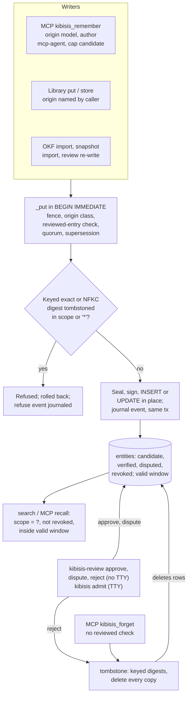

## 1. Executive Summary

Kibisis is a local memory vault for agents. Its Python `SQLiteMemoryVault`
seals each entry with AES-256-GCM, signs it over its scope, category and key,
and serves it through a five-tool stdio MCP server. Its strength is what it
refuses. A tombstoned value is matched by keyed digests of its exact and
NFKC-folded forms under any key in its scope, and every copy is deleted. A
model's write lands as a `candidate` that cannot overwrite or retire an entry
a person verified. The weak side is review and forgetting: the review CLI checks no terminal and
counts free-text names toward a default quorum of two, and the agent's own
forget tool can tombstone what a person verified.

It is a separate codebase from [Perseus Vault](../perseus-vault/), published by
the same company. Its history starts at a commit titled *"initial clean-room
scaffold"* on 8 October 2026, no file in it is byte-identical to one in Perseus
Vault's pinned tree, and the shared names are a table name,
`rejected_value_tombstones`, and a column name, `epistemic_state`. The schemas
behind both differ, and the state vocabularies differ.

All seven marks are earned. The code is written with this atlas's rubric in
view: three model fields carry the comment *"Atlas Rubric Mark"*
(`src/kibisis/models.py:31`, `:37`, `:47`), and
`tests/test_atlas_acceptance.py` names its cases after the atlas's acceptance
tests. Each mark was tested against the code rather than against those names.
The two limits that matter most are behaviour the suite asserts as intended:
`tests/test_mcp_server.py:136-160` forgets a person's verified entry through
the MCP tool, and `:280-282` approves through the review CLI with no
terminal.

## 2. Mental Model

A memory is an entry at `(scope, category, key)`, one row per key
(`vault.py:524`). What the vault believes about it is `epistemic_state` —
`candidate`, `verified`, `disputed` or `revoked` (`models.py:11-16`) — and
that state is a function of the write path, not of the payload.

- **A model's write is a candidate.** The MCP server writes with
  `origin="model"` and `trust_ceiling="candidate"` (`mcp_server.py:446-459`),
  and `_put` caps any state the gate or caller asked for (`vault.py:767-769`,
  `:808-824`). The origin also fixes an `origin_class` — `principal`, `agent`
  or `external` — that a lower class cannot overwrite (`vault.py:890-900`).
- **A person's `verified` is an attestation, not a state.** A `user` or
  `import` write asking for `verified`, and each person's `verified` review,
  adds a name to `attestations`. The entry turns `verified` only when the
  count reaches `verification_quorum`, which defaults to 2
  (`vault.py:108`, `:935-956`; `_vault_review.py:456-469`).
- **Retirement is an explicit edge.** A write naming `supersedes_key` revokes
  the target and closes its `valid_until`, or, when the writer is outranked or
  the target was reviewed, records a proposal that a person's approval applies
  (`vault.py:967-1061`). Entries `derived_from` a retired one become `disputed`
  (`_vault_review.py:205-241`).
- **Rejection is a tombstone.** A review verdict of `revoked`, and the MCP
  forget tool, delete the entry and every copy of its value in the scope, and
  refuse the value afterwards (`_vault_review.py:428-451`,
  `_vault_tombstone.py:111-176`).



## 3. Architecture

A Python package over one SQLite file, with an optional SQLCipher driver
(`vault.py:11-14`). The vault is one class composed of six mixins split by
concern: journal (`_vault_audit.py`), sealing and digests (`_vault_crypto.py`),
admission and review (`_vault_review.py`), search (`_vault_search.py`),
tombstones (`_vault_tombstone.py`) and snapshots (`_vault_snapshot.py`).
`vault.py` keeps the schema, the write lock, fencing and the put family.

Keys come from a passphrase, from `KIBISIS_PASSPHRASE_FILE` or
`KIBISIS_PASSPHRASE`, stretched with PBKDF2-HMAC-SHA256 into separate signing,
digest and term keys (`vault.py:354-360`). An on-disk vault refuses to open
without one unless `allow_plaintext=True` (`vault.py:279-283`). When SQLCipher
loads, the whole file is encrypted. When it does not, entry text is still
sealed, but categories, keys and metadata are plain, and a warning says so
(`vault.py:305-310`).

The Rust crate is a second, smaller thing. `InMemoryMemoryVault` keeps entries
in a `Mutex<HashMap>` and persists nothing (`src/lib.rs:583-1133`). The Python
package reaches the crate only through `kibisis_native`, which exports the file
lease coordinator and the format-3 journal hash and head MAC
(`bindings/python/src/lib.rs:223-231`). No Python path runs the Rust vault.

### Deployment and ergonomics

`pip install kibisis`, create a key file with `python -m kibisis.keys`, and run
`python -m kibisis.mcp_server`. The server opens its vault in the per-user data
directory and serves one scope: `KIBISIS_SCOPE` if set, else a scope derived
from the git checkout it runs in, else `default` (`config.py:51-57`,
`:113-127`). No service, no model, no network code in the vault.

Leases with fencing tokens coordinate writers across processes through a lock
directory (`src/file_lease.rs`, `src/kibisis/lease.py`). They are opt-in: a
vault checks tokens only with `enforce_fencing=True` or when a call passes one,
and the MCP server opens its vault without a coordinator (`config.py:136-149`).

## 4. Essential Implementation Paths

### One write path, with the tombstone inside its transaction

Every entity write reaches `_put`. The only `INSERT INTO entities` in the tree
is `vault.py:1099`, and the other `UPDATE entities` statements change state or
metadata, never content. `_put` opens `BEGIN IMMEDIATE` before its first read
(`vault.py:435-459`, `:838`), so the tombstone check and the insert cannot be
separated by another connection's commit. The check runs on every write
against the database, not a cached flag (`vault.py:1063-1077`).

`_find_tombstone` keys on the value alone: `(scope = ? OR scope = '*') AND
(value_sha256 = ? OR canonical_sha256 = ?)` (`_vault_tombstone.py:56-64`).
The canonical form is NFKC, then `casefold`, then Unicode format and control
characters dropped, punctuation and symbols turned into spaces, whitespace
collapsed (`_vault_crypto.py:45-71`). With a passphrase, both digests are
stored as HMACs under a key derived from it, so a tombstone on a four-digit PIN
does not reveal the PIN (`_vault_crypto.py:246-252`). A refused write is
journaled as a `refuse` event in its own transaction after the rollback
(`vault.py:1272-1283`).

Tombstoning also deletes. `_purge_value_copies` opens every entry in the scope,
or in every scope for `'*'`, compares digests and deletes each match with its
own `purge` event (`_vault_tombstone.py:67-109`). `import_snapshot` imports
tombstones first and refuses any entity whose value matches
(`_vault_snapshot.py:264-275`), and the OKF importer reports a tombstoned
concept as a conflict before writing (`okf/importer.py:385`, `:465`).

### Trust from the path, not the payload

The MCP server decides what a model may claim. `_check_args` refuses, and
journals, any of nine authority arguments — `epistemic_state`, `auto_gate`,
`trust_ceiling`, `author_id`, `reviewer_id`, `tenant_id`, `principal_id`,
`include_unverified`, `verdict` (`mcp_server.py:179-191`, `:407-415`). Model
metadata is stored under `agent_metadata`, and `_put` drops reserved keys such
as `human_reviews` and `origin_class` from any caller's metadata
(`vault.py:95-100`, `:772-779`).

Inside `_put`, a write with `origin="model"` is capped at candidate. A capped
write that targets a verified or reviewed entry raises `ReviewedEntryError`
(`vault.py:959-965`). A non-principal entry takes the lowest class along its
`supersedes` and `derived_from` links, so trust is not laundered through a
rewrite (`vault.py:902-926`). An `act` class, meaning the entry may drive an
action, is capped at `inform` unless the writer is a principal
(`vault.py:928-933`).

### The two review commands

`kibisis-review` lists candidates in the current scope and approves, disputes
or rejects one by calling `review_entity` with `reviewer_origin` left at its
default, `"user"` (`review.py:74-83`, `_vault_review.py:373`). It checks no
terminal. The reviewer recorded is `--reviewer` or the login name.

`python -m kibisis admit --by user` is the stricter door. `_require_tty`
refuses when stdin is not a terminal, with no environment escape
(`__main__.py:24-33`), and `admit` refuses any `--by` other than `user`
(`_vault_review.py:320-327`). The `--by user` value is an argparse choice the
caller types, so the terminal check is the guard. The command's defaults
differ from the server's: `--db` defaults to `~/.hermes/kibisis/vault.sqlite`
(`__main__.py:17`, `:199`) and `--scope` to `default` (`:202`), while the MCP
server writes to the per-user data directory under a scope derived from the
git checkout (`config.py:51-57`, `:113-127`). Run without both flags, `admit`
opens a different file.

## 5. Memory Data Model

`entities` holds one row per `(category, key, scope)` with `content`, the
envelope, `metadata_json`, `version`, `archived`, `created_at`, `updated_at`,
`epistemic_state`, `valid_from`, `valid_until`, `tenant_sig`, `supersedes`,
`superseded_by`, `origin` (CHECK-constrained to five values), `source_ref` and
`confidence` (`vault.py:500-527`). The trust facts the vault sets itself —
`origin_class`, `act_class`, `attestations`, `verification_pending`,
`human_reviews`, `conflicts_with` — live in `metadata_json`.

An update is an `UPDATE` of that row with the version incremented
(`vault.py:1125-1142`). No table keeps the earlier text. The journal keeps the
digest of each version and the action, so the history of *which* value held is
recoverable as digests, and the value itself is not.

`rejected_value_tombstones` carries both digests, reason, author, scope, time
and the plain digests sealed for transport in a snapshot (`vault.py:620-643`).
`audit_journal` and the one-row `audit_head` are the journal
(`vault.py:670-705`).

## 6. Retrieval Mechanics

`search` ranks by BM25 through one of three indexes: FTS5 over the entities
table for a plaintext vault, an FTS5 index inside the encrypted file under
SQLCipher, or, without SQLCipher, an index of HMAC tokens of each word under a
per-scope key that reproduces FTS5's BM25 without writing any word to disk
(`_vault_search.py:401-435`, `:530-623`). The filters are SQL in every mode:
`archived = 0`, `scope = ?`, a state predicate and the validity window
(`_vault_search.py:438-472`). An entry whose signature fails is skipped rather
than returned (`_vault_search.py:194-196`).

The state predicate is `IN ('verified', 'disputed', 'candidate')` unless a
caller names one state, and `include_unverified` is accepted and ignored
(`_vault_search.py:459-465`). The README's *"Search returns verified memories
unless you ask for more"* holds for `list_entities`, whose default is
`IN ('verified', 'disputed')` (`vault.py:1576-1580`), and not for `search`.

`recall` — *"Model-facing recall"* in its docstring — wraps `search` in three
withholding rules: a verified pair in conflict is withheld from both sides, a
hit below a coverage or z-score gate is withheld, and an entry older than a
per-class TTL is withheld; each call gets a receipt (`_vault_search.py:202-358`).
No code in `src/` calls it. The MCP recall tool calls `search`
(`mcp_server.py:502-511`), so none of the three rules reaches the model.

The keyed term index computes each word's document frequency over every
indexed entry in every scope (`_vault_search.py:567-594`). Content does not
cross scopes. Scores do: how common a word is in another tenant's entries
shifts the ranking in this one.

## 7. Write Mechanics

Writes are synchronous and block the caller until the transaction commits. A
written entry is searchable at once: triggers maintain the FTS5 table, and
under SQLCipher a queue of changed rows is drained before the next search
(`_vault_search.py:509-516`). No background pass rewrites the store. The one
scheduled deletion is in the leaderboard adapter, which removes whole per-user
vault files idle past `--retention-days` (`aml_adapter.py:260-285`).

A write that names no state runs `MemoryAdmissionGate`, a set of regular
expressions that routes hedged text to candidate and gives text matching a
transient pattern a 24-hour `valid_until` (`admission.py:50-68`,
`vault.py:790-802`). Whatever it routes, the cap and quorum rules apply after
it, so the gate never mints `verified` on its own.

### Operational cost

PBKDF2 at 600,000 iterations runs once per open. Each write seals and signs
one entry and appends one journal row. A vault without SQLCipher and with
`term_index=False` opens every entry on every search, at a cost the docstring
states grows with the vault (`vault.py:254-257`).

## 8. Agent Integration

The MCP server offers `kibisis_remember`, `kibisis_recall`, `kibisis_forget`,
`kibisis_verify_ledger` and `kibisis_health` (`mcp_server.py:56-173`).
Recall returns a `<kibisis-recall>` envelope with each entry's text
XML-escaped and its state, author and reviewer as attributes, under a notice
that stored text is data, not instructions (`mcp_server.py:234-259`).
`include_candidates` defaults to true, with the reason in a comment: every MCP
write is a candidate, so leaving them out would hide the agent's own memories
until a person reviewed them (`mcp_server.py:494-496`).

`python -m kibisis okf-export` and `okf-import` move rows to and from Open
Knowledge Format bundles; an import writes model-origin candidates through
`put` (`okf/importer.py:398-424`). `python -m kibisis aml-serve` serves the
Agent Memory Leaderboard's Add/Search contract over one vault file per
`user_id`. A Hermes plugin with its own `kibisis_admit` tool is exercised by
`tests/test_plugin_integration.py`, which skips unless a path to the plugin is
set; the plugin is not in this repository.

## 9. Reliability, Safety, and Trust

### The agent can forget what a person verified

`kibisis_forget` calls `tombstone` on the named entry in the server's scope
(`mcp_server.py:525-544`). `tombstone` checks the fence and nothing else
(`_vault_tombstone.py:111-176`); `_is_reviewed`, the check that stops a model
overwriting a verified entry, is called only from `_put` (`vault.py:961`,
`:989`). So the agent cannot replace a person's verified entry, and it can
delete it, purge every copy of its value in the scope and leave a tombstone.

After that, the person's own `put` of the same value raises
`TombstonedValueError`, because the tombstone check does not look at origin,
and no method removes a tombstone: the table is only ever inserted into or
re-keyed (`_vault_tombstone.py:150`, `_vault_snapshot.py:216`,
`_vault_crypto.py:376`).
The journal records the deletion under `mcp-agent`. The suite asserts this as
intended: `tests/test_mcp_server.py:136-160` has a person verify an entry,
forgets it through the MCP tool, and expects the deletion and a refused
re-write.

### Review is guarded on one door and not the other

`admit` refuses without a terminal; `kibisis-review` does not
(`__main__.py:24-33`, `review.py:74-83`). The README states the second
plainly: the reviewer name *"is not an authentication boundary: anything that
can run commands as that user can run it."* An agent whose host gives it a
shell, running as the user with the key file in its environment, can approve
its own candidates. Nothing points it there: the MCP surface has no review
verb, and a model's attempt to send one is refused and journaled.

### The quorum counts names

With the default quorum of two, one `kibisis-review approve` of an MCP
candidate leaves it a candidate with `verification_pending: {have: 1, need: 2}`
(`_vault_review.py:456-469`). A second approval under another `--reviewer`
string mints `verified`. `test_same_principal_twice_is_not_independent`
asserts that the same name twice does not count
(`tests/test_origin_bound_admission.py:90-94`); a different name from the same
person does. Most of the suite opens its vaults with `verification_quorum=1`,
and the CLI tests set `KIBISIS_VERIFICATION_QUORUM=1`
(`tests/test_mcp_server.py:269`, `tests/test_provenance.py:163`). The README's
*"Approving stores the entry as verified"* holds at quorum one.

### Candidates are served, labelled

Library search and MCP recall return candidates by default. The label is in the
envelope, and the decision about what an unreviewed entry is worth sits with
the model reading it. What a candidate cannot do is overwrite or retire a
reviewed entry, be raised to `act`, or appear in `list_entities` without
asking. A disputed entry, including one disputed by a cascade, is returned by
default too.

### Validity is set by the writer, and an update erases the old one

The MCP remember tool takes `valid_from` and `valid_until` from the model, and
a library caller may pass both. That is valid time from a source other than the
write clock. Three things narrow it. Supersession closes the target's interval
at the write time (`vault.py:1031-1045`) and opens the replacement at it unless
given one (`:832-833`). An update of the same key writes whatever interval the
call passed, `None` included, over the old one (`vault.py:1125-1142`). And
there is no read by record time: the one reader of `updated_at` is `recall`'s
staleness rule (`_vault_search.py:312-320`), which has no caller in `src/`.

### Rust and Python fold text differently

The README says the Rust vault *"matches values the same way"*. Its
`canonicalize_text` maps fullwidth ASCII and drops a fixed list of invisible
code points, then lower-cases (`src/lib.rs:195-233`); Python applies NFKC and
`casefold` (`_vault_crypto.py:57`). A ligature such as `fi`, or `ß` against
`ss`, folds in Python and not in Rust. The two vaults share no store, so this
is a difference in what each refuses, not a gap between them.

### Marks

All seven are awarded, each record naming its limit. `tombstone` rests on
the single write path and the in-transaction check, with the forget gap above.
`trust_state` rests on `revoked` being filtered from every search path and
candidates from `list_entities`; it is the weaker polarity, a default that
admits unreviewed entries. `bitemporal` rests on writer-supplied valid time
reaching the MCP tool. `scope_enforced` holds on every read. `audit_log` holds
with a signed head; its one rewrite is the 0.1.0a5 key upgrade, which records
the old head. `human_review` passes because the agent's tool surface cannot
reach review; the shell and the quorum are its limits. `negative_eval` rests
on cases with positive controls in the same result.

## 10. Tests, Evals, and Benchmarks

411 Python test functions in 35 files and 31 Rust `#[test]` functions. CI runs
`pytest tests` on Ubuntu and macOS and `cargo test`, clippy and a Miri run of
the lease test (`.github/workflows/ci.yml`). I read the suites named below and
ran none of them: the screen found every dependency manifest and lockfile
inside the seven-day cooldown, so nothing was installed.

`tests/test_atlas_acceptance.py` is the strongest file. Its docstring states
the rule: cases asserting that material must not come back *"carry a positive
control, so an empty or broken store cannot pass them"*. They do. The scope
case asserts scope B's text absent from scope A's MCP recall and A's present
(`:365-383`). The deletion case restores a backup taken before the tombstone,
twice, and asserts the value absent while a neighbour returns and an archived
entry comes back archived (`:182-204`). The tombstone case refuses ten
variants of a rejected value across keys and categories, then stores and
recalls a paraphrase (`:60-85`). The journal case installs a trigger that
makes the journal unwritable and asserts five mutations change nothing
(`:210-252`).

What is not covered: a single person meeting the quorum under two names, and
`recall`'s withholding rules on the path the MCP server uses, which is
`search`. The review CLI's absent
terminal check is exercised rather than tested against:
`tests/test_mcp_server.py:280-282` calls `kibisis-review approve` from the test
process and expects it to succeed. The deprecated `evaluate_epistemic_abstention` case asserts
abstention on unanswerable probes alone (`tests/test_negative_probe_abstention.py:16-48`);
its replacement, `evaluate_abstention`, refuses to call an empty store or a
probe set with nothing answerable `perfect` (`_vault_review.py:518-594`).

The README's measured table covers lease coordination only, from a separate
repository, `telarch-benchmarks`, whose `reports/` directory holds the JSON. I
did not recompute those figures, and no committed artifact here measures
recall. There is no paper. Two module docstrings cite arXiv preprints as design
sources for the admission gate and the post-retrieval bounds
(`admission.py:5-6`, `_vault_search.py:108`); they were not followed.

## 11. For Your Own Build

### Steal

- **One insert, and the tombstone inside its transaction.** Route every write
  through one function, take the write lock before its first read, and check
  the rejection there. Then "every write path" is a fact about one line.
- **Key the tombstone's digests.** An HMAC under a vault key keeps a rejected
  PIN or phone number from being recovered from the rejection record.
- **Purge the copies when you tombstone.** Refusing the value going forward
  leaves every existing copy under other keys retrievable unless the same act
  deletes them.
- **Set trust from the write path.** The MCP server stamps origin and author
  and refuses authority arguments by name, so nothing in the payload can raise
  the state.
- **Turn a model's supersession of a reviewed entry into a proposal** that the
  person's approval applies, rather than refusing it or letting it land.
- **Write the positive control into every must-not test.** This suite's
  docstring states the rule and its cases follow it.

### Avoid

- **A delete verb with weaker checks than the write verb.** Protecting a
  verified entry from overwrite and leaving it open to forget gives the model
  the destructive half of the operation.
- **Two review doors with different guards.** If one approval command checks
  for a terminal, the other should, or the check protects nothing.
- **A quorum that counts strings.** Two `--reviewer` values from one person are
  two attestations. Count something the caller cannot type.
- **A gated recall the agent never calls.** The withholding rules are written,
  tested and documented as model-facing, and the MCP tool calls the ungated
  search.

### Fit

Kibisis suits one person, or a small team on one machine, who wants an agent's
memory encrypted at rest, scoped per project, and unable to override what a
person confirmed. It is small enough to read in an afternoon and the trust
rules are in two files. It does not suit memory whose history must be
readable as text, since updates overwrite; multi-machine use, since leases are
local and there is no sync; or a deployment where the agent has a general
shell and review must mean a person, until the review CLI checks for a
terminal. The Rust crate is a reference and a lease library, not a second
store.

## 12. Open Questions

- Should `kibisis_forget` refuse a verified or reviewed entry, or turn the
  request into a proposal the way supersession does?
- Is `recall` meant to back the MCP recall tool, and if so, which of its
  withholding rules should apply to candidates?
- Is the default quorum of two meant to require two people, and if so, what
  identifies a person to the review CLI?
- Should `admit` read its database path and scope from `kibisis.config` like
  the server and `kibisis-review` do?

## Appendix: File Index

- `src/kibisis/vault.py` — schema, write lock, fencing, `_put`, `get`,
  `archive`, `list_entities`, persona slot.
- `src/kibisis/_vault_tombstone.py` — `tombstone`, `_find_tombstone`, copy
  purge, `scrub`.
- `src/kibisis/_vault_crypto.py` — `canonicalize_text`, digests, sealing,
  signing, the integrity upgrade.
- `src/kibisis/_vault_review.py` — origin classes, `admit`, `review_entity`,
  cascade, abstention evaluation.
- `src/kibisis/_vault_search.py` — `search`, `recall`, `search_keys`, the three
  indexes.
- `src/kibisis/_vault_audit.py` — journal append, head MAC, verification.
- `src/kibisis/_vault_snapshot.py` — export and import.
- `src/kibisis/mcp_server.py`, `config.py`, `review.py`, `__main__.py` — the MCP
  server, settings, the review CLI and the admit, OKF and AML commands.
- `src/kibisis/admission.py` — the regex admission gate.
- `src/lib.rs`, `src/journal.rs`, `src/file_lease.rs`,
  `bindings/python/src/lib.rs` — the Rust crate and its Python extension.
- `tests/test_atlas_acceptance.py`, `tests/test_origin_bound_admission.py`,
  `tests/test_provenance.py`, `tests/test_negative_probe_abstention.py`,
  `tests/test_mcp_server.py`, `tests/test_review_2026_10_28.py`.

### Recorded searches

Run at the pin, from the repository root.

```sh
# the only INSERT into entities is vault.py:1099; the other UPDATEs set state or metadata
git grep -n -E 'INSERT( OR [A-Z]+)? INTO entities[[:space:](]|UPDATE entities' -- src

# _is_reviewed is read only inside _put; tombstone and the MCP forget never consult it
git grep -n -w '_is_reviewed' -- src

# only the admit command checks for a terminal; the one test of the review CLI calls it in-process
git grep -n -E 'isatty' -- src
git grep -n -E 'kibisis\.review|review_main' -- tests

# the MCP forget calls in the suite; tests/test_mcp_server.py:147 forgets an entry verified at :136
git grep -n -E 'kibisis_forget' -- tests

# the MCP server registers five tools and no review verb
git grep -n -E '"name": "kibisis_' -- src/kibisis/mcp_server.py

# recall() has no caller in src; the MCP recall calls search()
git grep -n -E '\.recall\(' -- src

# nothing removes a tombstone: the table is inserted into, re-keyed, never deleted from or overridden
git grep -n -E 'rejected_value_tombstones' -- src | grep -v -E 'SELECT|CREATE|INDEX|PRAGMA|ALTER'
git grep -n -i -E 'allow_rejected|untombstone|remove_tombstone|delete_tombstone' -- src

# nothing deletes journal rows (positive control: the INSERT matches)
git grep -n -E 'DELETE FROM audit_journal' -- src
git grep -n -E 'INSERT INTO audit_journal' -- src

# no table keeps earlier entry versions
git grep -h -o -E 'CREATE (VIRTUAL )?TABLE (IF NOT EXISTS )?[a-z_]+' -- src/kibisis | sort -u

# no read by record time
git grep -n -i -E 'as_of_record|recorded_at|transaction_time|system_time' -- src/kibisis

# callers that pass valid_from
git grep -n -E 'valid_from=' -- src/kibisis ':!src/kibisis/vault.py'

# the Rust fold has no NFKC (positive control: the Python one does)
git grep -n -i -E 'nfkc|unicode_normalization|unicode-normalization' -- src/lib.rs Cargo.toml
git grep -n -i 'nfkc' -- src/kibisis

# the Python extension exports leases and journal hashing, no vault
git grep -n -E 'add_class|add_function' -- bindings/python/src/lib.rs

# the Rust vault does no file I/O (positive control: the file lease does)
git grep -n -E 'std::fs|File::|OpenOptions' -- src/lib.rs
git grep -n -E 'std::fs|File::|OpenOptions' -- src/file_lease.rs

# the Hermes plugin is not shipped, and no benchmark artifact is committed
git ls-files | grep -i -E 'plugin|bench|result|report'

# most tests lower the quorum to one
git grep -n -E 'verification_quorum=1|VERIFICATION_QUORUM' -- tests

# no paper of the project's own; two docstrings cite preprints
git grep -n -i -E 'arxiv|bibtex|@article|@misc|citation|doi\.org' -- . ':!uv.lock' ':!*.lock'

# no Perseus Vault identifiers in this tree, and one root commit
git grep -n -E 'normalize_rejected_value|workspace_hash|valid_from_unix_ms|admission_decide|remember_impl|entity_history' -- .
git rev-list --max-parents=0 HEAD
```

## History

**2026-11-05** — [`e9ddf6112a3dd39478d762bf291645e6833952bf`](https://github.com/Perseus-Computing-LLC/kibisis/commit/e9ddf6112a3dd39478d762bf291645e6833952bf) — first report, at the head of `main`, six commits past the v0.1.0-alpha.14 tag; those six add the leaderboard adapter and change the CLIs' default reviewer name; no vault module moved. Screened before reading: no auto-run surface, one execution point on pytest collection (`tests/conftest.py`), and seven manifests and lockfiles inside the seven-day cooldown. MIT. Nothing was installed, built or run, and no test was run. All seven marks, each with its limit in its record and in section 9; the forget gap and the review CLI are the two that matter. Compared against Perseus Vault's pinned tree from the atlas archive: no shared history or file, so this is a new report rather than a rename.
