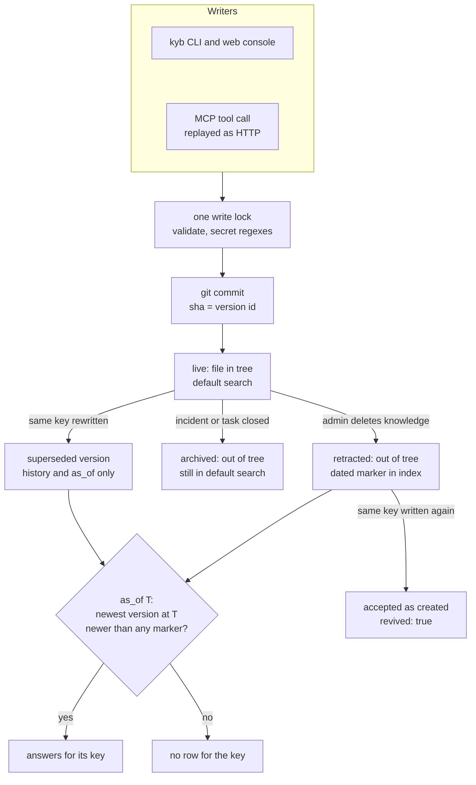

## 1. Executive Summary

KYB (Know Your Business) is a single Rust server that keeps a fleet's shared
operational memory — which hosts and services exist, what broke, what is
pending — as Markdown files in one git repository. It serves that memory over
HTTP, a stateless MCP endpoint and a web console. Its strength is time: every
write is a commit, and a point-in-time query picks each key's version current
at that instant before it matches a word, with retractions dated in the index.
Its weakness is the write side: one flat key space, any writer overwrites any
key with no version check, and whatever an agent writes is current.

There is no model on the write path and no scope on the read path. A token
grants a role, never a subset of entries. One mark is earned, `negative_eval`,
on the snapshot search's retraction tests. A retracted key that is written
again is reported as `revived` and accepted, which is the nearest thing to a
tombstone in the tree.

## 2. Mental Model

A memory is an **entry**: a key, a title, a Markdown body and frontmatter,
stored at `<kind>/<key>.md`. The key's prefix fixes the kind — `inc-` for an
incident report, `task-` for a task, anything else knowledge
(`src/store.rs:22-30`, `src/model.rs:305-330`). A write with identical content
is a no-op (`same_content`, `src/model.rs:250-274`). Any other write replaces
the file and commits it, so the commit sha is the version id
(`Store::upsert`, `src/store.rs:305-321`).

An entry is in one of four positions, all derived from git rather than stored
as a field:

- **live** — the file is in the tree; default search, `GET` and listings see it.
- **superseded** — an older commit's blob; only `history=true`, `as_of`,
  `changed_between` and `GET ?at=<sha>` see it.
- **archived** — an incident resolved or a task done or dropped; the file leaves
  the tree in the same locked write, and its last version stays in default
  search (`archive_locked`, `src/main.rs:719-744`).
- **retracted** — knowledge deleted by an admin; it leaves default search and
  `GET`, history keeps it, and the index records the instant.

A retracted key can always be written again. The create then answers
`revived: true` with a hint to read the history first (`src/main.rs:488-536`).
Nothing in the system judges whether an entry is true. The MCP instructions and
the skill ask the agent to write back what it verified (`src/mcp.rs:65-71`), so
belief is whatever the last writer of a key said.

## 3. Architecture

`kyb-server` is one axum binary. `build_app` merges the HTTP router with an
`/mcp` router that replays tool calls through the same router
(`src/main.rs:290-327`). Writes are serialised by one `tokio::Mutex` around the
tantivy `IndexWriter`; reads take no lock (`src/main.rs:43-50`).

- **Canon.** A git repository opened per operation through `git2`, initialised
  on first start; flat pre-v2 layouts migrate on open
  (`Store::open`, `src/store.rs:114-122`). There is no remote and no push.
- **Index.** Tantivy, rebuilt from the whole history on every start, with a
  head document per live key and a history document per version
  (`SearchIndex::reindex`, `src/index.rs:474-521`). Retraction markers and
  documents are published together as one generation (`:451-470`).
- **Vectors.** `multilingual-e5-small` int8 through ONNX Runtime, one vector
  per live or archived key, held in memory and cached on disk by a hash of the
  embedded text and the model fingerprint (`src/embed.rs:190-310`). With no
  model directory the server runs lexical-only.
- **Auth and audit.** A token book of SHA-256 hashes outside the canon, re-read
  when its mtime changes (`src/auth.rs:499-519`), and an append-only JSONL
  request log (`src/audit.rs`).

### Deployment and ergonomics

Nothing else has to run. `cargo install knowyourbusiness --locked` or
`docker compose up -d` gives a server on `127.0.0.1:9310`. The container binds
`0.0.0.0` inside, and compose publishes it on `KYB_PUBLISH_ADDR`, default
`127.0.0.1` (`docker-compose.yml:12`, `Dockerfile:37`). It works offline with
no API key. The image downloads the model from Hugging Face's `resolve/main`
with no checksum at build time (`Dockerfile:6-11`). The canon is plain Markdown
in git and can be read, edited and reverted by hand. An uncommitted hand edit is
served as the head version (`src/store.rs:938-945`).

## 4. Essential Implementation Paths

- **Write.** `POST /knowledge` → `upsert` → `locked_write`
  (`src/main.rs:545-559`, `:439-474`). Under the lock `commit_locked`
  validates, writes and commits, upserts the head document and reloads the
  index, then reports near-twin keys and `revived` (`:476-543`). The embedding
  is recomputed after the lock is released, behind a generation ticket
  (`:459-472`).
- **Incidents and tasks.** `upsert_incident` stamps the timeline and returns
  structure `hints` (`src/main.rs:642-717`); `close_entry` requires a
  resolution and archives in the same section (`:746-793`);
  `transition_task` is a partial update read under the lock (`:978-1104`).
- **Search.** `search` parses filters and the temporal options, chooses hybrid
  only for a current-state text query (`src/main.rs:1575-1687`), and calls
  `SearchIndex::search_in` (`src/index.rs:540-680`); `hybrid` fuses
  (`src/main.rs:1689-1750`).
- **Snapshot.** `current_version_per_key` picks each key's newest version at T
  and drops keys retracted after it (`src/index.rs:685-745`);
  `collapse_to_latest_per_key` keeps only those rows (`:753-800`).
- **Read one.** `get_one` serves the tree, an archived version or `?at=<sha>`;
  retracted knowledge is a 404 at head (`src/main.rs:1305-1335`). History,
  diff and related are `:1489`, `:1349` and `:1503`; export is `src/export.rs`.
- **Retract or archive.** `remove` requires admin for knowledge, then
  `remove_committed` deletes the file, the head document and the vector and
  dates the marker (`src/main.rs:1771-1843`).
- **MCP.** `mcp_post` → `call_tool` → `plan` → `forward`, which builds an HTTP
  request carrying the caller's `Authorization` header and runs it through the
  API router (`src/mcp.rs:112-167`, `:244-281`, `:349-392`).
- **Auth.** `auth_mw` → `Auth::decide` → `need` (`src/auth.rs:636-655`,
  `:522-550`, `:419-434`).

## 5. Memory Data Model

`Entry` carries key, title, kind, body, tags, refs and `updated_at` for every
kind (`src/model.rs:117-168`). Incidents add service, hosts, severity, status
(`open`, `mitigated`, `resolved`), linked knowledge keys, `resolution`,
`detection`, `affected` windows of `{scope, from, to}` and four timeline
stamps. Tasks add status (`open`, `in_progress`, `blocked`, `done`, `dropped`),
priority, `blocked_reason`, `assignee`, `parent_task` and deadline fields
(`src/model.rs:17-40`). These statuses are work lifecycle, not belief.

**Time.** The read path queries one clock, the commit time. `committed_at` is
paired with a walk sequence that breaks one-second ties
(`src/index.rs:580-605`). The incident timeline and `affected` windows are
world time the writer supplies. They are stored on the hit and returned, and no
query filters or ranks on them; `affected` is stored-only
(`src/index.rs:68-69`, `:226`).

**Scope.** None on any read. The trace:

- `need` maps a method and path to a role, and `decide` resolves a token to a
  principal and that role (`src/auth.rs:419-434`, `:522-550`). Nothing else
  about the principal reaches a handler except `remove`'s admin check
  (`src/main.rs:1785`) and the commit signature.
- `SearchOpts` has tags, kind, status, service, priority, assignee and parent
  task, all taken from the query string (`src/index.rs:171-195`).
- The MCP bridge forwards the caller's `Authorization` header to every replayed
  request, so a tool reads what the token reads over REST
  (`src/mcp.rs:376-378`).
- The web console calls the same routes with the same token
  (`src/web/js/00-core.js:126-140`).
- `X-Kyb-Workspace`, `_ctx` and client `_meta` become commit trailers and the
  `by` field of history (`src/mcp.rs:283-347`, `src/auth.rs:145-175`). No read
  path consults them.

So every token, the anonymous `KYB_ANON=read` role and every caller under the
default `KYB_AUTH=off` read the whole base. The boundary is the server: one
`KYB_DATA` repository per process.

## 6. Retrieval Mechanics

**Lexical.** Tantivy BM25 runs over key, title, body, tags, a metadata field,
resolution and detection. Title is boosted 2.0, and tags, key and metadata 1.5
(`src/index.rs:545-564`). Every text field uses tantivy's Russian Snowball
stemmer (`:30`, `:272-276`). The code comment says bodies are mostly Russian and
Latin identifiers pass through unstemmed, while the skill asks for English
entries. Query syntax errors are parsed leniently. Default search reads head
documents only; `history=true` reads every version.

**Hybrid.** Only a non-empty, current-state, relevance-sorted query with a model
loaded goes hybrid (`src/main.rs:1647-1654`). The lexical side fetches at least
24, and the vector side scores every stored vector by cosine and keeps 24
(`src/embed.rs:494-502`). `fuse_lists` sums weighted reciprocal ranks with
k = 60 and weight 0.6 on the vector side (`:509-525`). A vector-only candidate
is admitted only if its live document passes the same filters
(`src/main.rs:1710-1734`). A model failure leaves the lexical order.

**Time.** `as_of` and `changed_between` read the history world and collapse to
one row per key. For `as_of`, the snapshot is computed first and only that
version may match, so a superseded version that still contains the word does
not answer (`src/index.rs:659-670`, `:685-745`). Both stay lexical by an
explicit guard, because vectors exist for head versions only
(`src/main.rs:1635-1646`).

**Budget.** Default 10 hits, 100 at most, 1,000 for a tag listing with no text
(`src/main.rs:1583-1584`). Hits carry full bodies. A read answer gains a
`deadlines` block of up to five late or nearly due tasks
(`src/deadline_api.rs:86`). Nothing is injected into a session unless the
operator adds the optional SessionStart hook that prints deadlines
(`skills/kyb/SKILL.md:435-445`).

## 7. Write Mechanics

Writes are explicit. An agent calls `kyb_add`, `kyb_incident`, `kyb_task` or
their siblings, or the CLI, or a person uses the console. No extraction, no
summarisation and no model call happens anywhere on a write.

Deduplication is the key. Identical content is a no-op; a different body under
the same key is a new version. A create reports existing keys at 0.85
similarity or above, retracted ones included, so `nats-stream` beside
`nats-streams` is flagged and accepted (`src/main.rs:516-529`,
`src/model.rs:1379-1447`). There is no conflict detection between entries.

Two concurrent writes to one key are serialised and the second wins. The
knowledge upsert takes no expected version, so a writer that never read the
first version replaces it; both stay in history. Task transitions and closes
re-read the stored version under the lock, so partial updates do not lose each
other (`src/main.rs:427-438`).

Every field is scanned against seven regexes for GitHub, Slack, OpenAI and AWS
tokens, private keys and `password:` pairs (`src/model.rs:499-520`). A secret
they miss is committed, and a retraction removes it from the tree and not from
git history.

### Operational cost

A write blocks on a git commit, a tantivy commit and reader reload, then one
embedding of title plus the first 1,200 characters (`src/main.rs:190-197`). It
is searchable lexically when the request returns. Every start walks the whole
history to rebuild the index. A history index of every key's versions is built
once and extended by new commits (`src/main.rs:148-165`). No pass rewrites the
canon.

## 8. Agent Integration

The MCP endpoint is stateless: `GET` and `DELETE` answer 405, batches work,
and `tools/list` is built from the routes in the binary
(`src/mcp.rs:86-106`, `:757-998`). It registers fifteen tools, six of them
writes. `rm` and `reindex` are deliberately absent (`:73-77`), so an agent over
MCP can archive by closing an incident or task but cannot retract knowledge.
`?readonly=1` drops the write tools, and the module's own comment calls it a
guard rail rather than a boundary (`:39-43`).

`skills/install.sh` copies the CLI and hook to `~/.local/bin` and installs
`SKILL.md` for Claude Code, Codex and Antigravity. It appends a pointer section
to each agent's global `CLAUDE.md`, `AGENTS.md` or `GEMINI.md`, and registers a
PreToolUse hook in `~/.claude/settings.json` (`skills/install.sh:24-132`). The
hook adds `_ctx` with agent, session and workspace to every kyb tool call and
makes no permission decision (`skills/kyb/bin/kyb-hook:56-80`). The CLI checks
`/healthz` capabilities before a temporal query and refuses rather than let an
older server answer with today's data (`src/main.rs:1865-1878`).

## 9. Reliability, Safety, and Trust

### The default is admin for everyone

`KYB_AUTH` defaults to `off`, and under it `decide` returns the admin role for
every request (`src/auth.rs:457-472`, `:523-525`). `compat` gives a caller who
sends no token admin too. Only `required` refuses a caller without one. The startup line states the
mode in force (`:483-497`), and the README says plainly that `off` trusts the
network. On the default bind that network is loopback. A bind to a LAN address
without `required` lets any host on it retract knowledge.

### Attribution is a claim

With tokens on, the commit author is the token's principal
(`src/store.rs:128-133`). The `Kyb-Agent`, `Kyb-Session` and `Kyb-Workspace`
trailers come from client headers, from `_ctx` in the tool arguments, or from
client metadata (`src/mcp.rs:283-347`). A model can put any `_ctx` in its own
arguments. The code calls this forensics rather than identity, and it grants
nothing.

### Mutation record

The request log records timestamp, client address, method, path, query,
status, duration, actor and attribution for every request outside a polling
list (`src/audit.rs:32-73`). For `POST /knowledge`, `/incidents` and `/tasks`
the key is in the body, so the line names no entry. The record of what changed,
by whom, is the git log.

### Marks

- **`tombstone`** — withheld. A retraction marker is keyed on the entry's key and
  dated, and it governs only what a snapshot sees. Writing the retracted key
  again is accepted with `revived: true`; the same statement under another key
  is a new entry. The index code calls these markers tombstones
  (`src/index.rs:107-118`); they suppress a record and do not refuse a value.
- **`trust_state`** — withheld. Live, archived and retracted are derived from
  the tree and the kind, not a field, and nothing marks an entry unverified.
- **`bitemporal`** — withheld. `as_of` reads commit time; the incident timeline
  and `affected` windows are world-time payload that no query reads.
- **`scope_enforced`** — withheld. There is no stored scope key; a token is a
  role, and the server process is the partition (section 5).
- **`audit_log`** — withheld. The request log cannot name the entry a body-keyed
  write changed, and the git history that can is not credited.
- **`human_review`** — withheld. No entry waits in a state; the console and the
  agent write through the same routes with the same roles.
- **`negative_eval`** — earned, on the snapshot search; see section 10.

## 10. Tests, Evals, and Benchmarks

The suite is 230 Rust test functions in `#[cfg(test)]` modules and three test
files, and CI adds fourteen scripts. Those scripts drive the CLI, the MCP
endpoint against a release build, the web console in a browser at 100%
coverage, compose binding and citation metadata (`.github/workflows/ci.yml`).
I did not run any of them.

`negative_eval` rests on two index tests over a populated result:

- `as_of_pairs_documents_with_the_tombstones_of_their_own_generation` writes
  and retracts `a` and `b`, both saying *"a fact that was retracted"*, keeps
  `kept`, and asserts the search for `fact` returns exactly `["kept"]`. It
  checks this from a generation held before a reindex, across the reindex and
  after it, having first asserted the markers were renumbered
  (`src/index.rs:1324-1362`).
- `as_of_collapses_a_busy_key_to_one_row` writes eight versions of `busy` and
  one `other`, all matching, and asserts two rows whose `busy` body is revision
  7 (`src/index.rs:1212-1237`).

The head search's retraction checks are weaker.
`archived_entries_live_in_default_search` asserts an empty result for the
retracted note's words, with the archived incident shown present by a
different query (`src/index.rs:1137-1140`). `api_full_flow` asserts
`count == 0` after the delete of the only entry (`src/main.rs:2150-2154`).
Both pass against a search that returns nothing.

`published_claims` pairs sentences in the README and the blog post with the
behaviour they describe, failing when the sentence or the behaviour moves
(`src/main.rs:4016-4201`). The vector tests run without a model, and
`golden_vector_is_stable` skips without one; CI downloads the model for it
(`src/embed.rs:578-600`).

`scripts/eval-search.sh` holds 14 paraphrase questions with expected keys
written for a different base. The README's table — 1/14 and 2/14 lexical, 3/14
and 4/14 hybrid, on a 643-entry base — comes from no committed artifact and
cannot be recomputed. The README states the ceiling problem itself. There is no
paper; the citation is a Zenodo software deposit of the v0.3.3 source, and a
separate Zenodo slide deck reports no evaluation.

## 11. For Your Own Build

### Steal

- **Choose the snapshot before matching the query.** Pick each key's version
  current at T, then let only that version answer, so an old wording or an old
  status cannot stand in for a key whose current version no longer says it.
- **Date the deletion where the snapshot can read it**, and publish the markers
  with the documents as one generation, so a search that started before a
  rebuild judges its documents by its own markers.
- **Tell a writer when a key it creates was deliberately removed**, and compare
  new keys against every key that ever existed, not just the live ones.
- **Gate a client on the server's advertised capabilities** before asking a
  question an older server would silently answer with current data.

### Avoid

- **An upsert with no expected version on shared memory.** Two agents that never
  read each other's write leave the second as truth with nothing to say a
  conflict happened.
- **A default auth mode that grants admin.** A loopback default limits who
  reaches it, and the first LAN bind turns every caller into an admin.
- **A request log as the audit of body-keyed writes.** It records that a write
  happened and not to what.
- **A stemmer chosen for one language** when the entries' convention is another.

### Fit

KYB suits a small operations team running several coding agents against one
network, who want what those agents learn about hosts, deploys and incidents in
one place they can read in git and revert by hand. It is one binary with no
service dependency, and its maintenance budget is low. It assumes trusted
writers: anything an agent writes is current, and two agents disagreeing about
a key resolve by write order. Walk away if tenants, projects or customers must
not read each other's memory. Walk away too if an agent's claim must be checked
before others act on it.

## 12. Open Questions

- How often two agents overwrite the same key in practice, and whether the
  `similar` and `revived` hints change what they do.
- How a startup reindex behaves on a history of tens of thousands of commits.
- How lexical recall fares on English entries under the Russian stemmer,
  measured on a committed base.
- Whether the 14-question evaluation will be committed with its base and raw
  results.

## Appendix: File Index

- Storage: `src/store.rs`, `src/model.rs`
- Index and retrieval: `src/index.rs`, `src/embed.rs`, `src/main.rs`
  (`search`, `hybrid`)
- Writes and lifecycle: `src/main.rs` (`locked_write`, `commit_locked`,
  `close_entry`, `transition_task`, `remove`), `src/deadline.rs`
- Relations and export: `src/links.rs`, `src/export.rs`
- Auth and audit: `src/auth.rs`, `src/audit.rs`, `src/config.rs`
- MCP, web, CLI, install: `src/mcp.rs`, `src/web.rs`, `src/web/`,
  `skills/kyb/bin/kyb`, `skills/kyb/bin/kyb-hook`, `skills/install.sh`,
  `skills/kyb/SKILL.md`
- Tests and eval: the `#[cfg(test)]` modules, `src/deadline_tests.rs`,
  `src/deadline_api_tests.rs`, `src/tag_regressions.rs`, `scripts/test-*`,
  `scripts/eval-search.sh`

### Recorded searches

Run from the repository root at the pinned commit with `/usr/bin/git grep`.

- **No scope key on a read module.**
  `git grep -n -i -E 'workspace|namespace|tenant|owner' -- src/index.rs src/export.rs src/links.rs src/deadline_api.rs src/web.rs`
  returns a comment on task ownership filters (`src/index.rs:54`) and one test
  line.
- **The principal reaches one handler.**
  `git grep -n -E 'auth::role\(|SESSION\.try_with|auth::signature|auth::by\(' -- 'src/*.rs'`
  returns the admin check in `remove` (`src/main.rs:1785`), the commit
  signature and trailers (`src/store.rs:131`, `:216`, `:299`), `whoami` and
  the `role()` accessor in `src/auth.rs`.
- **No model call anywhere.**
  `git grep -n -i -E 'reqwest|hyper::client|openai|anthropic|ollama|llm|completion' -- 'src/*.rs' Cargo.toml`
  returns nothing.
- **No injection hook installed.**
  `git grep -n -E 'SessionStart|UserPromptSubmit|PostToolUse' -- skills/install.sh skills/kyb/bin/`
  returns nothing; the SessionStart recipe is text in `skills/kyb/SKILL.md`.
- **No committed evaluation result.**
  `git ls-files | /usr/bin/grep -i -E 'eval|result|bench|\.jsonl'` returns
  `scripts/eval-search.sh` only.
- **No validity time.**
  `git grep -n -i -E 'valid_?(from|to|until)|validity|event_time|occurred_at' -- 'src/*.rs'`
  returns nothing; `git grep -c -E 'committed_at' -- src/index.rs` returns 29.
- **No expected-version write.**
  `git grep -n -i -w -E 'if_match|expected_sha|base_sha|etag' -- 'src/*.rs' 'src/web/js/*.js' skills/`
  returns nothing.
- **No review or verification state.**
  `git grep -n -i -E 'verified|candidate|quarantin|pending_review|approved' -- 'src/*.rs'`
  returns fusion comments, the incident root-cause hint and two prompt strings.
- **No git remote.**
  `git grep -n -E 'remote|push\(|fetch' -- src/store.rs` returns `Vec::push`
  calls and a revwalk push only.
- **No paper.**
  `git grep -n -i -E 'arxiv|@article|doi\.org' -- . ':!Cargo.lock'` returns the
  Zenodo software DOIs in `README.md` and `docs/index.html`.

## History

**2026-11-05** — [`0934013b8d15ce0e9041a9fc5d41374995779c2a`](https://github.com/alex09x/kyb/commit/0934013b8d15ce0e9041a9fc5d41374995779c2a). First reading, from a full clone. Screened first: one auto-run surface, `server.json`, an MCP Registry manifest, and one build-time execution point, `build.rs`, which concatenates the web console's files; nothing inside the seven-day cooldown and no unpinned surface. MIT, no rider. Nothing installed, built or run. One mark, `negative_eval`, on the snapshot search's retraction tests; `scope_enforced` is withheld because a token grants a role and no read takes a scope ([section 5](#5-memory-data-model)).
