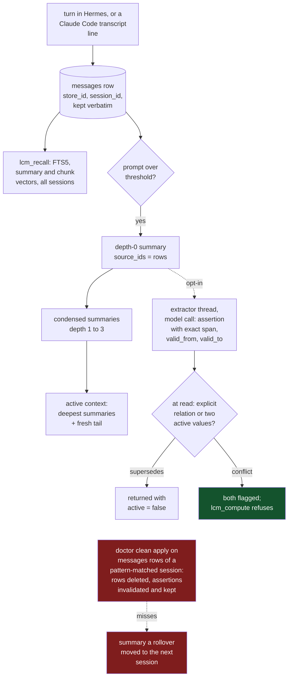

## 1. Executive Summary

LCM-X replaces Hermes Agent's built-in context compressor. Its engine
writes every message to a local SQLite store, compacts older turns into a
hierarchy of summaries that point back at their sources, and gives the agent
tools to search and page through everything it has kept, across sessions.
What is notable is the discipline around derived data: summaries list their
sources, and an opt-in assertion layer checks every quoted span against the
source row in SQL and keeps conflicting values visible. What is weak is
correction: nothing on any surface forgets a fact or a message, and two
large subsystems built for isolation and for entity memory have no producer.

It carries `bitemporal` and `negative_eval`.

**Licence.** MIT. `LICENSE` names Stephen Schoettler as the copyright holder;
`plugin.yaml:4` names the author as *Voltropy / Hermes Community*, and the
two adapter manifests (`adapters/claude-code/.claude-plugin/plugin.json:8`,
`.grok-plugin/plugin.json:10`) declare `MIT`. Judge prompts copied into
`bench/fmp` are attributed, and `bench/fmp/licenses/` carries the Mem0,
OmniMemEval and LongMemEval licence texts. No rider, no contributor
agreement.

**It is memory, not only context management.** A raw row keeps its `store_id`
after the session ends, `lcm_recall` searches every session in the profile by
default, and `lcm_load_session` pages any session's transcript by id. What the
store can be asked to correct is narrower: raw rows are what was said, and the
claims extracted from them live in an assertion sidecar that is off by default.

**Two subsystems are built and not connected.** The entity memory layer has six
tables, an append-only event log enforced by triggers, 740 lines of operations
and 169 test functions, and no caller on any product path. The Teams
per-principal policy is described in its own header as a draft, and nothing in
the engine sets the flag that would select it.

## 2. Mental Model

The unit is the message. Ingest writes each one verbatim to `messages`, and it
is never edited except to swap an oversized tool output for a reference to a
file. When the prompt crosses the threshold, the oldest rows outside a
protected tail become a depth-0 summary whose `source_ids` name them;
summaries at one depth condense into the next, up to depth 3 by default. The
active context is the system prompt, the deepest summaries, and the fresh
tail. Summaries are treated as cues: the bundled recall policy tells the agent
to verify against the source rows.

Belief appears only in the assertion sidecar. With two flags set, each user or
assistant row about to be compacted is sent to a model that returns
subject–predicate–object claims with exact character offsets, and relations to
up to 20 earlier claims. State is computed at read: a claim targeted by
`supersedes`, `reverses`, `cancels` or `fulfills` is inactive, and two active
values for one subject, predicate, scope and kind are both flagged as an
unresolved conflict.

A row dies only through an operator's cleanup of a pattern-matched session.

## 3. Architecture

LCM-X is a Python package loaded into the Hermes process as a plugin with two
names: the manifest `hermes-lcm-x` (`plugin.yaml:1`) and the context engine
`lcm-x`. `LCMEngine` in `engine.py` owns ingest, compaction,
assembly and storage handles; `tools.py` and `evidence_tools.py` hold the tool
handlers; `command.py` holds the `/lcm` operator command.

| Store | Holds |
| --- | --- |
| `HERMES_HOME/lcm.db` | `messages`, `summary_nodes`, provenance, FTS5 tables, lifecycle state, rollups, embedding and chunk-vector tables, ingest ledger; opt-in assertion, entity and query-view tables |
| `lcm-large-outputs/` | Externalized tool outputs, each replaced in its row by a reference (`externalize.py:30`) |
| `~/.hermes/lcm-extractions/` | Opt-in daily decision files, appended and read by nothing (`extraction.py:350`) |
| `~/.lcm-x/claude-code/lcm.db` | The Claude Code adapter's store: every session of every project (`docs/claude-code-adapter.md:217-219`) |

Summarisation uses the host's auxiliary model. Embeddings default to local
FastEmbed (`BAAI/bge-small-en-v1.5`) installed through a companion plugin;
Voyage, OpenAI-compatible and Ollama providers are opt-in. A privacy pass
redacts sensitive patterns from the copy sent to a cloud provider while the
stored row stays raw.

### Deployment and ergonomics

Two Hermes commands install and select it; no API key is needed for the local
path. Python 3.11, no required third-party dependency (`tiktoken`, `regex` and
`fastembed` are optional). Everything is one SQLite file and one payload
directory, readable with any SQLite client; `/lcm backup` snapshots the
database. On hosts with two or fewer CPUs, recall stays full-text while vector
catch-up runs in the background. The Claude Code adapter needs Python 3.11 in a
venv and starts capture from hooks. Its MCP launcher executes a command named
in `reader-override.json` after checking that every folder on the path is
writable only by the user (`adapters/claude-code/bin/lcmx_mcp.py:188-281`).

## 4. Essential Implementation Paths

| Path | Location |
| --- | --- |
| Message schema | `store.py:870-888` |
| Ingest transaction | `engine.py:2867`, `:8879` |
| Compaction entry and leaf loop | `compaction.py:733`, `:3036-3061` |
| Condensation | `engine.py:10702`, `compaction.py:2353`, `:2845` |
| Context assembly | `engine.py:11287-11330` |
| Summary schema and provenance | `dag.py:208-236` |
| Rollover carry-over of summaries | `engine.py:4495-4509`, `dag.py:459-471` |
| `lcm_recall` | `tools.py:4885`, fusion `retrieval_core.py:721-830` |
| Session exclusion whitelist | `tools.py:378-492` |
| `lcm_grep` session scope | `tools.py:1409-1471` |
| Assertion schema and triggers | `db_bootstrap.py:2107-2310` |
| Assertion extraction prompt and validation | `assertion_extraction.py:184-270`, `:680-730` |
| Extraction scheduling | `engine.py:10096-10230` |
| Assertion read and state | `assertion_store.py:780-1036`, `assertion_state.py:88-209` |
| `lcm_query_state` | `evidence_tools.py:81-200` |
| `lcm_compute` latest-fact refusal | `reasoning.py:740-800`, `:1495-1520` |
| Doctor clean scan, apply, delete | `command.py:539-584`, `:1546-1612`, `:1396-1490` |
| Session purge registry | `store.py:454-466`, `claude_code_store.py:100-111` |
| Entity layer (unwired) | `db_bootstrap.py:3853-3895`, `entity_store.py`, `entity_ops.py` |
| Teams policy seam (unwired) | `access_policy/resolution.py:36-90`, `scope_storage.py:148-157` |

## 5. Memory Data Model

**`messages`** (`store.py:870-888`): `store_id`, `session_id`,
`conversation_id`, `source`, `role`, `content`, tool fields, `timestamp`,
`pinned`, `ingested_at`, `observed_at` with its source, and a sender id.
Delegated subagent sessions are linked through `session_lineage`.

**`summary_nodes`** (`dag.py:208-221`): `session_id`, `depth`, `summary`,
token counts, `source_ids` (a JSON array of store ids or child node ids),
`source_type`, `earliest_at`, `latest_at` and an expand hint. A sidecar,
`summary_node_provenance`, records the escalation level and model.

**`lcm_assertions`** (`db_bootstrap.py:2134-2165`): a 64-character id,
`subject_key`, `predicate_key`, `object_json`, `value_text`, one of eight
kinds, polarity, strength, `scope_key`, `speaker_role`, `observed_at`,
`event_at`, `valid_from`, `valid_to`, the source span and its quote, and a
confidence. `lcm_assertion_relations` holds nine relation types between two
assertion ids, each with its own quoted span. `lcm_assertion_sources` is a
per-row receipt with `invalidated_at` and a reason.

Three triggers make the provenance hold in SQL. An assertion insert aborts
unless the quoted span equals the stored message's substring at those offsets
(`db_bootstrap.py:2208-2228`). An update of a message's content or a deletion
of the message marks its receipts invalidated, with reason `source_updated`
or `source_deleted` (`:2273-2292`).

**`bitemporal` is earned on the assertion sidecar.** `valid_from` and
`valid_to` are what the extractor model read in the source, with the prompt
telling it to use null rather than substitute `observed_at`
(`assertion_extraction.py:260`). They are stored apart from `observed_at`,
when the source was said, and `created_at`, when the row was written. An
`as_of` on `lcm_query_state` keeps only assertions observed by then whose
validity contains the instant (`assertion_store.py:832-839`). The producer is
reachable only with two default-off flags; with them off, no row exists.

**`trust_state` is withheld.** The lifecycle that `assertion_state.py`
reports — active, superseded, cancelled, reversed, fulfilled, conflicting —
is computed per read from relation rows and attached to each returned row; no
column holds it. `lcm_compute` does refuse a latest-fact answer when an
operand group carries an unresolved active conflict or omits an active
candidate (`reasoning.py:1503-1515`). That is the filtering use the mark asks
for, on a derived state.

The entity tables (`lcm_entities` with `active`, `merged` and `forgotten`;
`lcm_memory_notes` with seven note kinds including `retraction`; and the
append-only `lcm_memory_events`) are created when `LCM_ENTITIES_ENABLED` is
set. `EntityOps`, which writes them, is called from tests alone,
and the `lcm_memory` tool reads assertions and messages, not these tables
(`memory_tools.py:52-74`).

## 6. Retrieval Mechanics

**`lcm_recall`** (`tools.py:4885`) is the cross-session tool. Three arms run
over the whole profile: FTS5 over raw messages, KNN over summary embeddings,
and KNN over chunk embeddings of raw messages. Reciprocal rank fusion with `k`
60 merges them (`retrieval_core.py:721`), then a soft prior boosts the current
conversation (`scope_bias` 0.5 by default) and recent hits, and an optional
Voyage cross-encoder reranks. The default limit is 8 and the cap 25. With
embeddings unavailable or still warming, the FTS arm answers alone and the
response says so with `degraded` and a reason.

Exclusions are the one hard filter. `exclude_session_ids` and
`exclude_current_session` are turned into a whitelist of every other session,
enumerated by a skip-scan over both tables, and the vector arms take it before
their candidate caps. A deadline that lapses during enumeration drops the
vector arms rather than the filter (`tools.py:423-492`).

**`lcm_grep`** defaults to the current session, its rotation predecessors and
its delegated descendants; `session_scope='all'` or `'session'` widens it to
raw rows across the archive (`tools.py:1409-1471`).

Other reads: `lcm_load_session` pages one session by `store_id` cursor;
`lcm_expand` pages a node's sources or an externalized payload; `lcm_recent`
reads day, week and month rollups. `lcm_evidence_pack`, `lcm_compile_evidence`
and `lcm_compute` validate exact `store_id` and span references and compute
dates, counts, sums and latest values over them without a model.

**`scope_enforced` is withheld.** The boundary is physical: one database per
Hermes profile, and for Claude Code one per harness holding every project.
Inside a store, session is a default on `lcm_grep` that the caller widens with
one argument, and `lcm_recall` spans every conversation by design. The
assertion `scope_key` is a model-written string and an optional filter. The
predicate that would bind reads to a principal is in `access_policy/`, and
section 9 covers why it never runs.

## 7. Write Mechanics

Every message is written at ingest, synchronously, before the turn continues;
it is searchable by FTS on the next call and by vector after background
embedding. There is no extraction on the default path and no write tool: the
agent cannot store, edit or delete anything.

Compaction is the second write. When the prompt passes the threshold (75% of
the window by default), a bounded sweep summarises the oldest rows outside a
fresh tail (24 messages by default) with the auxiliary model, then condenses. It runs
on the turn thread, so the user waits; an opt-in background preparation of
leaves exists and is off by default. A summary that comes back too long is
escalated from detailed to bullets to deterministic truncation.

Assertion extraction (`engine.py:10164-10230`) is scheduled from the leaf
loop (`compaction.py:3054-3061`) for at most eight source rows per pass, on a
daemon thread with a process-wide slot. Each row's prompt carries its exact
content and the 20 most recent assertions in the profile, unfiltered by
scope (`assertion_extraction.py:184-199`). Validation rejects any offset whose
substring differs from the quote, any state-changing relation whose quoted
span lacks a cue word from an English regex (`:66-83`), and any whose source
precedes its target.

### Forgetting

- **No forget verb.** `VISION.md:27` lists forgetting a memory on request as
  not yet shipped.
- **Doctor clean apply.** Requires `LCM_ENABLE_SLASH_COMMAND` and
  `LCM_DOCTOR_CLEAN_APPLY_ENABLED`, and selects only sessions whose id
  matches an ignore or stateless pattern (`command.py:539-584`). It backs up
  the whole database, then deletes messages, ledger rows, chunks, the
  session's summary nodes and their embeddings in one transaction.
- **Redaction.** `LCM_SENSITIVE_PATTERNS_ENABLED` rewrites sensitive patterns
  before storage; off by default.

### Operational cost

The write path is one SQLite transaction per turn. Compaction costs one model
call per leaf and per condensation, inside the turn. Extraction adds one model
call per source row in the background. No pass rewrites the whole store.
Injection is the assembled context itself, bounded by the threshold, and the
README states that LCM is not fully cache-aware.

## 8. Agent Integration

In Hermes, LCM-X is the context engine rather than a memory provider: it
decides what the model sees on every turn. It registers five hooks
(`pre_llm_call`, `pre_api_request`, `post_llm_call`, `subagent_start`,
`subagent_stop`) and 13 tools by default. Three flags add `lcm_query_state`,
`lcm_retrieve` and `lcm_memory`. Every tool is a read or a computation.

The recall policy ships as a bundled skill rather than injected text, because
Hermes persists hook output in the user's turn and replays it as
user-authored history (`README.md`, *Recall skill and policy*).

The Claude Code plugin registers capture hooks on nine events. Each records
which transcript changed and starts a worker that projects user and assistant
entries into the store, keeping every raw line in `capture_events`. Its MCP
server serves five read tools. A separate read-only server,
`scripts/lcm_x_mcp.py`, lets Claude Code read a Hermes profile's store.
[Claude Self-Reflect](../claude-self-reflect/) also indexes Claude Code's
transcripts; this adapter differs in keeping the summary DAG and exact row
references beside them.

**`human_review` is withheld.** No write waits for anyone: messages and
summaries are written by the engine, assertions by the extractor model, and
no state column exists for a person to resolve.

## 9. Reliability, Safety, and Trust

### Deletion leaves derived text behind

Doctor clean apply selects summary nodes by their current `session_id`
(`dag.py:385-392`). At a compression rollover, the engine moves the
predecessor session's nodes to the new session while raw rows stay where they
were (`engine.py:4495-4501`). A deleted session's summaries that were carried
forward therefore stay, and stay recallable.

Its extracted assertions stay too. The delete trigger marks their receipts
`source_deleted`, default reads exclude them, and the rows keep `source_quote`
verbatim; a committed test asserts they remain readable with
`include_invalidated` (`tests/test_assertion_store.py:642-645`). The backup
taken before every apply holds everything deleted.

The Claude Code store writes `capture:forgotten:<session>` into `metadata`
when a session is purged, so the capture worker never re-reads that
transcript (`claude_code_store.py:100-108`).

**`tombstone` is withheld.** That marker is keyed on the session id and blocks
re-capture of one transcript; the same text in another session is captured.
No record keyed on a rejected value exists.

### Two built subsystems with no producer

**Teams.** `access_policy/`, `access_context/`, `teams/` and
`scope_storage.py` hold 5,083 lines: a fail-closed policy resolver and a
catalog with tenants, principals and an audit table, covered by 21 test
modules. `policy_for_engine` returns the permissive policy unless the engine
carries `lcm_teams_enabled` (`access_policy/resolution.py:51-58`). Its only
setter, `mark_teams_enabled` (`scope_storage.py:154-157`), and
`setup_teams_scope` have no caller outside tests. `ROADMAP.md:207` lists teams
as parked.

**Entity memory.** `lcm_memory_events` refuses `UPDATE` and `DELETE` by
trigger and records actor and operation for every entity mutation
(`db_bootstrap.py:3879-3895`). Its writers are `EntityOps` methods, which
nothing outside `tests/` calls.

**`audit_log` is withheld** on that. The table is append-only and has no
producer on any path a user, operator or agent can reach. Doctor clean apply,
the one delete that runs, writes a backup file and a text report, not an
event.

### What holds up

- Assertion provenance is enforced in SQL, not only in Python, and a source
  edit invalidates every derived assertion in the same transaction.
- Supersession must quote an explicit update word and point forward in time;
  silence and recency never supersede (`assertion_extraction.py:260-265`).
- Two active values are flagged, not resolved by recency, and the
  computation tool refuses rather than picks.
- Session exclusions are applied before candidate caps and fail closed on a
  timeout.
- Assistant output that looks degenerate is quarantined to a placeholder in
  replay and in summary input (`ingest_protection.py:923-963`).

## 10. Tests, Evals, and Benchmarks

11,345 test functions in 849 files, run in four shards on every push and pull
request (`.github/workflows/ci.yml:68-206`). I ran none of them.

**`negative_eval` is earned on recall exclusions and on assertion
invalidation.** `test_recall_excludes_sessions_from_lexical_summary_and_chunk_candidates`
seeds identical text, a summary vector and a chunk vector in three sessions,
excludes two, and asserts that the hits are non-empty, all from the third,
and drawn from all three arms (`tests/test_lcm_recall.py:1046-1079`). Two
more show fifty crowding candidates from an excluded session leaving the one
eligible hit in place on each vector arm (`:1107-1167`). The assertion tests
assert absence by `as_of` with the present case as control
(`tests/test_assertion_store.py:587-610`), and absence after source deletion
following a read that returned the row (`:613-645`).

The Teams suites probe isolation against a policy no product path selects,
and the entity suites run property-based sequences against operations no
product path calls. Both test what the code would do if wired.

**A paper exists.** *LCM: Lossless Context Management* (Ehrlich and Blackman,
Voltropy PBC, [arXiv:2605.04050](https://arxiv.org/abs/2605.04050), submitted
14 February 2026) describes two mechanisms: a hierarchical summary DAG with
lossless pointers, and engine-managed parallel primitives such as LLM-Map. Its
OOLONG results are for the authors' agent Volt. This tree implements the DAG
half; a search for `llm_map` or `OOLONG` finds nothing.

**The public placements recompute from the committed snapshot.**
`benchmarks/results/public-results.json` copies the OmniMemEval summary table
at upstream commit `8d1ff33`, and its LCM-X row matches the upstream file at
that commit. Ranking each column gives the README's placements: first among
12 scored backends on BEAM 100K (71.84) and BEAM 10M (63.32), second among 13
on LongMemEval (87.00), fifth among 15 on LoCoMo (78.83). Each is one
contributor-run; BEAM 10M is reported with a per-question standard deviation, 40.02.
No per-question output is committed.

`benchmarks/results/longmemeval-v3-500q-fastembed-metrics.json` records
`rerank.mode` as `placeholder-cosine` with `real_count` 0 for all 470 scored
questions. Its `hybrid_rerank` arm equals the summary arm field for field, so
the table rows and the v2 note that rerank shows no lift
(`longmemeval-v2-500q-fastembed.md:28`) measured no reranker. The
`bench/results/reach-hermes-*` studies, built on Continual-ARC run records
([arXiv:2611.14505](https://arxiv.org/abs/2611.14505)), publish summaries
only; their trial rows are kept private and cited by digest.

[Severian](../severian/)'s benchmark write-up compares its own context size
per LoCoMo question with LCM-X's published figure.

## 11. For Your Own Build

### Steal

**Check provenance in the database.** A trigger that refuses a derived row
whose quoted span differs from the source substring, and another that
invalidates derived rows when the source changes, hold whichever code path
writes.

**Require an explicit cue for supersession.** A model-proposed `supersedes`
is accepted only if its own quoted span contains an update word and its
source is not older than its target. Recency alone never retires a claim.

**Keep conflicts visible and refuse to compute over them.** Two active values
are both flagged; the calculator falls back instead of choosing the newest.

**Apply exclusions before truncation.** An exclusion applied after a top-k cut
returns too few results; one applied before returns the right ones.

**Mark a deleted capture source as forgotten.** A re-ingesting capture
pipeline needs a key that stops it from reading the source again.

### Avoid

**Do not select derived rows for deletion by a key another path rewrites.**
Rollover moves summary nodes to the next session; deletion by session then
misses them.

**Do not keep verbatim quotes in a derived table after their source is
deleted.** Invalidating the receipt hides the row; it does not remove the
text.

**Do not let a cue list decide what can be corrected.** An English regex
gates every supersession, so a correction in another language stays a
conflict.

**Do not ship an isolation seam whose enabling flag has no setter.** The
policy is permissive until the flag is set, and nothing sets it.

**Do not label a placeholder arm with the mechanism it stands in for.**

### Fit

It fits a single Hermes user who wants every turn kept, wants to stop losing
detail at compaction, and accepts that memory means transcripts plus summaries
the agent searches. The cost is a model call per compaction on the turn path,
and a store that grows without bound by design.

It does not fit a deployment that must honour "forget this", that serves more
than one person from one store, or that needs facts it can correct by default.
Correction lives in the assertion layer, which is opt-in, model-driven and
per message. Adopting it also means following a 120,000-line dependency
that took 8,145 commits in seven months; a fork that diverges will not be
maintainable by a small team.

## 12. Open Questions

- **Should a deleted session's carried-forward summaries go with it?** The
  rollover and the cleanup each behave as their comments say; no test covers
  them together.
- **Is `include_invalidated` meant to stay reachable?** No product caller passes
  it; a test asserts deleted quotes come back through it.
- **When does the entity layer get a writer?** The README's `lcm_memory` row
  says there is no registry until a stage it calls E2; the event log is ready
  for it.
- **Will Teams be enabled through a host path or the connector?**
  `teams/connector.py` describes an external control plane that drives
  membership; no host binding exists in the tree.
- **What does the reranker add?** The committed metrics measured a
  placeholder.

## Appendix: File Index

| File | Role |
| --- | --- |
| `engine.py` | Engine: ingest, compaction scheduling, assembly, rollover, storage |
| `compaction.py`, `dag.py` | Leaf and condensation sweep; summary schema and node deletion |
| `store.py`, `db_bootstrap.py` | Message store, purge registry; schemas, assertion and entity DDL and triggers |
| `tools.py`, `retrieval_core.py` | `lcm_grep`, `lcm_recall`, expansion, paging; fusion |
| `assertion_extraction.py`, `assertion_store.py`, `assertion_state.py` | Extractor prompt and validation; storage and reads; derived state |
| `evidence_tools.py`, `reasoning.py`, `memory_tools.py` | `lcm_query_state`, `lcm_compute`, `lcm_memory` |
| `command.py`, `command_router.py` | `/lcm` doctor, clean, backup, assertions rebuild |
| `entity_store.py`, `entity_ops.py` | Entity layer, unwired |
| `access_policy/`, `access_context/`, `teams/`, `scope_storage.py` | Teams policy seam, unwired |
| `claude_code_store.py`, `claude_code_capture.py`, `adapters/claude-code/` | Claude Code capture, forgotten marker, hooks, MCP launcher |
| `tests/test_lcm_recall.py`, `tests/test_assertion_store.py` | The cases behind `negative_eval` and `bitemporal` |
| `benchmarks/results/` | Public placements snapshot; LongMemEval arm metrics |

### Recorded searches

Run with `/usr/bin/git` in a shallow clone at the pinned commit.

- `git ls-files '*.py' | grep -v / | xargs cat | wc -l` — 115,450 in 130 root files; with `access_context`, `access_policy`, `teams`, `companions` and `adapters`, 120,259 in 150.
- `git grep -E '^[[:space:]]*(async )?def test_' -- 'tests/*.py' | wc -l` — 11,345 in 849 files.
- `git grep -n -E 'EntityOps|entity_ops' -- ':!tests' ':!bench'` — the class, one internal use at `entity_ops.py:703`, a maintainability list and a history document; no caller in the engine, tools or commands. Control: `git grep -l EntityOps -- tests` lists nine files.
- `git grep -n -E 'lcm_memory_events|lcm_memory_notes' -- '*.py' ':!tests' ':!bench'` — the DDL, `entity_store.py`, `entity_ops.py`, `cloud_view.py` and a schema-family list.
- `git grep -n -E 'lcm_teams_enabled' -- . ':!tests'` — the constant and a comment. `git grep -n -E 'mark_teams_enabled\(|setup_teams_scope|resolve_startup_teams_state' -- '*.py' ':!tests' ':!bench'` — definitions and comments only.
- `git grep -n -E 'delete_session_messages|_delete_clean_candidates_atomically|doctor_clean_apply' -- ':!tests' ':!docs' ':!*.md'` — the doctor clean apply route is the one reachable caller of a session delete.
- `git grep -n -i -E 'def .*(forget|purge|erase|redact)' -- '*.py' ':!tests' ':!bench' ':!benchmarking'` — no forget tool or command.
- `git grep -n 'include_invalidated=True' -- '*.py' ':!tests'` — nothing. Control: the same pattern over `tests` matches.
- `git grep -n 'invalidate_source' -- ':!tests' ':!scripts/maintainability'` — the definition only; triggers do the invalidation.
- `git grep -n -E 'UPDATE summary_nodes SET session_id' -- '*.py' ':!tests'` — `dag.py:467`, called from the rollover.
- `git grep -n -E 'lcm-extractions|extraction_output_path' -- '*.py' ':!tests' ':!bench'` — config and the engine's writer; no reader.
- `git grep -n -i -E 'llm.?map|OOLONG' -- '*.py' '*.md' ':!tests'` — nothing. Control: `git grep -c -i 'summary dag' -- README.md` matches.
- `git grep -n -i -E 'arxiv|bibtex|@article|@misc|doi\.org|CITATION' -- ':!tests' ':!bench/fmp/licenses'` — benchmark papers cited under `bench/` and in `benchmarks/README.md`, none of them the LCM paper; the root README links the paper's publisher URL, and the arXiv API returns 2605.04050 for its title.
- `git ls-files | grep -i -E '(^|/)(licen[sc]e|copying|notice|contributing|third.party)'` — `LICENSE`, `CONTRIBUTING.md` and three files under `bench/fmp/licenses/`.
- `python3 -I recompute_placements.py benchmarks/results/public-results.json` (a separate script over the JSON) — placements as stated; the upstream `docs/user_memory/results.md` at `8d1ff33` carries the same LCM-X row.
- `gh api 'repos/electricsheephq/lcm-x/commits?per_page=1&sha=<pin>' -i` — 8,145 pages; the last is dated 7 April 2026.

## History

**2026-11-17** — [`9f7f0bd3c666479c983b294a147525bfc46270dd`](https://github.com/electricsheephq/lcm-x/commit/9f7f0bd3c666479c983b294a147525bfc46270dd) — first reading, of the product modules, the Claude Code adapter, the assertion and entity layers and the committed benchmark results, from a shallow clone with history counts from the GitHub API. The screen found a Claude Code adapter (`adapters/claude-code/`) with a plugin manifest, an `.mcp.json` server and hook registrations (SessionStart, UserPromptSubmit, Stop), six pytest `conftest.py` files, and `requirements-semantic.txt` changed inside the seven-day cooldown with a floating `fastembed` range; `AGENTS.md` and `CLAUDE.md` were treated as data, and nothing was installed or run. The benchmark placements were recomputed from the committed JSON in a separate script. Marks: `bitemporal` and `negative_eval`.
