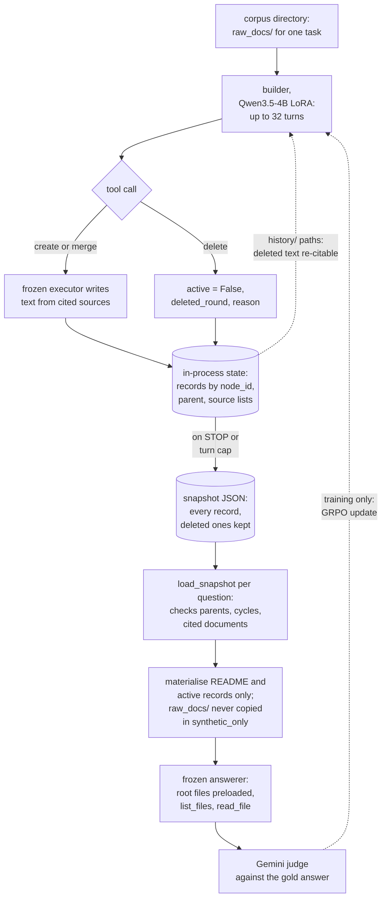

## 1. Executive Summary

Librarian Agents is the code for a paper that trains a builder model to turn a
document corpus into a hierarchical workspace of synthetic files before any
question is known. A frozen answering agent then browses that workspace,
read-only, for every question asked about the corpus. The workspace is the
memory this report is about: model-written files with source lists, persisted as
one snapshot per corpus and read by many later questions.

What is notable is the shape of a file and the shape of a delete. Every
synthetic file names the raw documents and synthetic files it was built from,
and a delete keeps the record with its round and a reason. Loading a snapshot
refuses broken parent chains and citations to documents outside the corpus.
What is weak is everything after construction. Nothing writes to a snapshot once
the builder stops, and no committed run lets the answerer reach the raw corpus
the source lists point to.

Five findings shape the rest of this report.

- **The workspace is written once.** `save_snapshot` has one caller, at the
  builder's terminal step, and the answerer's tool class has two methods,
  `list_files` and `read_file` (`environments/synthetic_fs/reward.py:665-666`;
  `environments/synthetic_fs/workspace.py:1184-1236`).
- **A delete hides a file from the answerer and not from the builder.** The
  record stays under `history/`, and `create_cluster` accepts `history/` paths
  as inputs, so deleted content can be cited into a new active file
  (`workspace.py:1067-1097`, `:619-651`, `:1575`).
- **The raw-document fallback is off in every committed run.** The paper's
  *Faithful Fallback* desideratum and its Figure 7 recovery need
  `synthetic_plus_raw`. Every config, build script and evaluation runner sets
  `synthetic_only`, and the raw-read count is 0.0 in all 100 rows of the
  committed reuse ledger (`configs/paper_browsecomp.json:65`).
- **The headline numbers have different footing.** The reuse, BRIGHT and
  hierarchy tables recompute from committed rows, and I recomputed them. The
  33-point BrowseComp-Plus headline comes from a stored aggregate with no
  per-question rows (`results/browsecomp_cross_answerer.json`).
- **The dense reward is gated on structure.** The paper probes answerability
  every eight turns with no structure shaping. The code also skips a probe
  unless that step built something and a filesystem-maturity score reaches
  0.45 (`environments/synthetic_fs/message_env.py:560-564`).

No marks. Section 9 names each one and the reason it is withheld.

## 2. Mental Model

A memory is a synthetic file the builder asked for and an executor model wrote.
It comes into being during one construction episode per corpus, and the episode
is the only time anything can change it.

1. **Browse.** The builder sees `raw_docs/`, `synthetic_fs/` and `history/`
   through `list_files`, `read_file` and `read_many`. The question the episode
   is scored on sits in a privileged directory the builder never lists
   (`environments/synthetic_fs/prompts.py:11-60`; `workspace.py:100-115`).
2. **Create.** `create_cluster` takes a title, input paths and short
   instructions. The executor, `Qwen/Qwen3.5-35B-A3B` in the paper config,
   writes the text from up to 16,000 characters of the cited sources, and the
   record stores those sources as `direct_raw_doc_paths` and
   `direct_synthetic_ids` (`workspace.py:1287-1328`, `:981-1013`, `:1572-1601`;
   `scripts/train_browsecomp_plus.sh:73`).
3. **Merge.** `merge_clusters` writes a summary record over active children and
   reassigns each child's `parent_id` in place (`workspace.py:1015-1065`).
4. **Delete.** `delete` sets `active = False`, `deleted_round` and an optional
   `delete_reason`; a deleted merge's children move up to its parent
   (`workspace.py:1067-1097`).
5. **Stop.** At `STOP`, a reply with no tool call, or turn 32, the terminal
   reward runs and the state is saved as a snapshot (`reward.py:413-666`).
6. **Read.** Each later question loads the snapshot, materialises the active
   records into a temporary directory and runs the answerer over it
   (`experiments/inference/browsecomp_hierarchy_ablation.py:145-165`).

**Nothing is doubted after the builder stops.** `active` is the only status, and
only `delete` changes it, inside the episode. Executor text is admitted when it
is not an empty or placeholder string; nothing compares it with the sources
listed in its header (`workspace.py:906-910`, `:1326`, `:1368`). A wrong summary
stays in the workspace for every question that reaches it.

## 3. Architecture

The repository is a Python package with shell launchers and no service. The
builder is trained through Tinker, a hosted post-training API, as a rank-32
LoRA on `Qwen/Qwen3.5-4B`. The executor runs behind an OpenAI-compatible
endpoint, which the README hosts on Modal. The answerer, the judge and the
builder-history compactor are `gemini-3.1-flash-lite-preview`
(`configs/paper_browsecomp.json`; `experiments/training/train.py`).

The workspace lives in one object, `SyntheticFilesystemState`, while an episode
runs. Its snapshot goes to
`<filesystem_snapshot_dir>/<question_id>/trajectory_NN.json`, one per corpus and
trajectory (`environments/synthetic_fs/dataset.py:259-264`). The snapshot
deliberately leaves the corpus out: the docstring says the caller supplies
`raw_doc_root` again at load, so one workspace can be reused without copying
source text into result artifacts (`workspace.py:225-244`). The evaluation
runners hash each snapshot into the input fingerprint of every answer they
record (`browsecomp_hierarchy_ablation.py:135-143`).

### Deployment and ergonomics

Reproducing a construction needs three model services, set by
`TINKER_API_KEY`, `GEMINI_API_KEY` and the executor's base URL
(`scripts/build_browsecomp_filesystems.sh`). The baselines need a CUDA machine
for vLLM, FAISS and PyLate. The trained checkpoints are named by step in
`CHECKPOINTS.md` and supplied by environment variable; no weights are in the
tree. The workspace format itself needs only a filesystem. A snapshot is
readable JSON, and a materialised workspace is plain text files a person can
open.

## 4. Essential Implementation Paths

- **Construction.** `experiments/training/train.py` drives episodes, with
  `eval_only=true` and `learning_rate=0.0` for the evaluation builds
  (`scripts/build_browsecomp_filesystems.sh`). `message_env.py` runs the turns,
  the compaction and the probe schedule. `BuilderFilesystemTools` exposes the
  builder's tools (`workspace.py:1373-1760`).
- **Write.** `SyntheticFilesystemState.create_cluster`, `merge_clusters` and
  `delete` (`workspace.py:981-1097`); the executor's two prompts
  (`workspace.py:1287-1370`).
- **Persist.** `to_snapshot`, `from_snapshot`, `save_snapshot`, `load_snapshot`
  (`workspace.py:225-322`); the one save site (`reward.py:665-666`).
- **Read.** `materialize_final_workspace`, `answerer_bootstrap_entries` and
  `ReadOnlyAnswererWorkspaceTools` (`workspace.py:1141-1236`);
  `SyntheticFilesystemReward._run_answerer` (`reward.py:1021-1280`); the
  answerer prompts (`prompts.py:206-268`).
- **Reward.** `answerability_progress_probe` and `__call__`
  (`reward.py:340-666`); the judge (`reward.py:878-930`).
- **Ablation.** `flatten_snapshot` and `shuffle_snapshot` with
  `validate_transforms` (`analysis/hierarchy_ablation.py:221-296`).

## 5. Memory Data Model

A `SyntheticFileRecord` has twelve fields: `node_id`, `kind` (`cluster` or
`merge_summary`), `title`, `slug`, `content`, `created_round`, `parent_id`,
`direct_raw_doc_paths`, `direct_synthetic_ids`, `active`, `deleted_round` and
`delete_reason` (`workspace.py:118-131`). Ids are `cluster_NNNN` and
`merge_NNNN` from per-state counters. `created_round` and `deleted_round` count
operations, not time.

A cluster renders at `synthetic_fs/<ancestors>/<node_id>__<slug>.txt` and a merge
as a directory holding `summary.txt`; every record also has a flat
`history/` path (`workspace.py:370-413`). The rendered file opens with `TITLE`,
`KIND`, `DIRECT_SOURCE_RAW_DOCS` and `DIRECT_SOURCE_SYNTHETIC_FILES`, then the
body under `CLUSTER_TEXT` or `MERGE_SUMMARY` (`workspace.py:653-679`).

The snapshot is schema version 1: the corpus id, the visible raw paths, both
counters, the operation round and every record sorted by id
(`workspace.py:205-244`). `from_snapshot` is strict. It rejects a missing field,
an unknown kind, a duplicate id, an unknown parent or synthetic source, a raw
path that is absolute or contains `..`, a raw path outside the visible set, and
a parent cycle (`workspace.py:218-305`).

## 6. Retrieval Mechanics

There is no search. `materialize_final_workspace` writes a fixed `README.md` and
one file per active record into a temporary directory, and copies `raw_docs/`
only when the mode is `synthetic_plus_raw` (`workspace.py:1141-1164`). The
root-level records are preloaded into the answerer's first message, and from
there it emits one JSON action per turn, `list_files` or `read_file`, for up to
32 turns (`workspace.py:1172-1182`; `prompts.py:206-255`). The tool class
refuses any path that resolves outside the workspace root
(`workspace.py:1188-1195`).

In `synthetic_only` the system prompt drops the raw-document line and the user
prompt says *"Answer using only the synthetic workspace."* The file headers
still list `raw_docs/` paths, which do not exist in that workspace
(`prompts.py:215-226`, `:257-268`). The builder's own prompt tells it the
answerer will *"use raw_docs/ only as fallback"* (`prompts.py:20`).

What the hierarchy buys is measured. On 435 questions over 49 completed
workspaces, flattening every parent edge leaves accuracy at 57.70% against
55.86% for the original and costs 1,862 more navigation tokens per question.
Shuffling placement while keeping the depth profile drops accuracy by 4.14
points at the same cost (`RESULTS.md`; `results/hierarchy_per_question.jsonl`).
Hierarchy reduces navigation cost; placement carries the accuracy.

## 7. Write Mechanics

Construction is synchronous and offline. Each `create_cluster` or
`merge_clusters` call blocks the builder's turn on an executor request, run
through `asyncio.to_thread` (`workspace.py:1378-1410`). A file is visible to the
answerer only after the snapshot is saved at the terminal step, so the lag is
the whole episode. In training, a probe materialises the partial state to score
it. No background pass touches a workspace, and a snapshot is never reopened
for writing.

The budget is 32 builder turns, 1,024 tokens a turn and 60,000 a trajectory
(`configs/paper_browsecomp.json`). In the committed reuse ledger the trained
builder spends a mean of 147,634 tokens per corpus and the base builder 126,012.
Fourteen of the base builder's 50 corpora end as `max_token_capped_failure` and
score zero; none of the trained builder's do (`results/browsecomp_per_corpus.jsonl`).

The reward is GRPO over groups of four with batch size 8. The terminal score is
the judge's correctness on a hidden training question, averaged over four
answerer runs. A probe adds the change in that score since the last probe,
with deltas under 0.25 set to zero, at most four times an episode
(`reward.py:340-411`; `configs/paper_browsecomp.json:42-62`). Every structure,
cost and penalty scale in the paper config is 0.0.

The probe is not periodic in the sense the paper states. `message_env.py` skips
it unless eight turns have passed, the step made a construction call, and the
maturity score reaches 0.45 (`message_env.py:545-590`). That score is a weighted
mix of raw-document coverage, file count, branching and merges
(`reward.py:679-740`). It earns no reward of its own and decides when the
answerability reward can be paid.

## 8. Agent Integration

The memory has no surface outside the method. The builder's tools are
`tinker-cookbook` `@tool` functions bound to one state object, and the
answerer's are a JSON action protocol parsed by the reward class
(`workspace.py:1373-1760`; `reward.py:1294-1313`). The snapshot is the
integration point a builder of another system would use. It is a self-describing
JSON file with a validating loader and a materialiser that writes a browsable
directory any file-reading agent can be pointed at.

The intended reuse is many questions over one fixed corpus. The BRIGHT
evaluation builds one workspace per domain and serves all 50 of that domain's
questions from it; the reuse evaluation serves 443 questions from 50 workspaces
(`data_processing/prepare_bright_frozen_construction.py`;
`data/splits/browsecomp_amortized50.jsonl`). A corpus that changes means a new
construction episode, since no path adds a document to an existing snapshot.

## 9. Reliability, Safety, and Trust

**No marks.** Each is withheld for a stated reason.

- **Tombstone — withheld.** A delete is keyed on a `node_id`, and it does not
  reject anything. `resolve_synthetic_node` returns an inactive record for a
  `history/` path, `_partition_input_paths` accepts it, and the executor reads
  its text, so a deleted file can be cited into a new active one within the
  same episode (`workspace.py:619-651`, `:951-979`, `:681-713`).
- **Trust state — withheld.** `active` is a lifecycle flag that removes a record
  from the answerer's view, which the rubric classes with archival. There is no
  candidate or verified state, and the executor's text enters on a
  non-placeholder check.
- **Bi-temporal — withheld.** The only ordering fields are operation counters;
  no timestamp exists in `workspace.py` (appendix search).
- **Scope enforced — withheld.** One snapshot per corpus is a physical
  partition. The loader checks that cited documents are in the visible set of
  the directory it was given, which guards integrity, not a scope key.
- **Audit log — withheld, and it is close.** The snapshot keeps every deleted
  record with its round and reason, which answers *what was removed and why*.
  It does not record mutations: a merge rewrites each child's `parent_id` in
  place and leaves no trace of the old parent (`workspace.py:1054-1055`).
- **Human review — withheld.** No surface lets a person inspect or approve a
  file before the answerer reads it.
- **Negative eval — withheld.** `test_raw_documents_are_materialized_only_in_fallback_mode`
  asserts `raw_docs/` is absent in `synthetic_only`, with the fallback mode as a
  positive control. It guards the user's corpus rather than a memory, and no
  test exercises `delete` (`tests/test_synthetic_fs.py:190-200`).

The contamination guards point the right way. The builder never sees an
evaluation question, and a test checks that the BRIGHT construction prompt
contains none of them (`tests/test_bright_construction.py:8-36`). Snapshot paths
are validated against traversal at load, and the answerer cannot read outside
its workspace.

## 10. Tests, Evals, and Benchmarks

I read the tests and did not run them. There are 33 pytest functions in 9
files. The 14 in `tests/test_synthetic_fs.py`, which hold every test of the
workspace itself, open with `pytest.importorskip("tinker_cookbook")`. A run
without the `builder` extra skips them and reports green. No CI configuration
is committed.

- `test_snapshot_round_trip_preserves_materialized_filesystem` asserts that a
  saved and reloaded workspace materialises to identical files
  (`tests/test_synthetic_fs.py:133-155`).
- Two merge tests assert that a child or descendant cannot become its parent
  and that the state is unchanged after the refusal (`:54-97`).
- `test_bundled_ledger_reproduces_report` and
  `test_bundled_scores_reproduce_paper_table` pin 107 and 282 correct of 443 and
  a BRIGHT macro pass@1 of 0.52 from the committed rows
  (`tests/test_browsecomp_analysis.py:59-68`; `tests/test_bright_qa.py:81-100`).
- `check_reported_aggregates` asserts that the stored aggregate files equal
  constants written in the same script, which checks a file against itself
  (`analysis/reproduce_results.py:136-156`).

**What recomputes.** I wrote my own script over the committed JSONL, imported
nothing from the repository, and ran it with `python3 -I`. The reuse ledger
gives 107 correct answers (24.15%) for the base builder and 282 (63.66%) for the
trained one, over 443 questions, with 14 capped base corpora. The BRIGHT rows give every cell of the
`RESULTS.md` table for all nine methods. The hierarchy rows give 55.86%, 57.70%
and 51.72% with the stated token means.

**What does not.** The paper's abstract claims a 33-point gain on
BrowseComp-Plus over the strongest baseline. That is the mean of 0.75 − 0.44 for
the Qwen answerer and 0.77 − 0.42 for Gemini, in a JSON file of rounded values
with no per-question rows. Its Table 1 and Tables 4–6 are stored the same way,
which `results/README.md` says.

The 31-point BRIGHT average recomputes: 0.520 against the dense baseline's
0.208. By domain it is uneven. Against each domain's best baseline the gain is
3.0 points on AOPS, 15.0 on Biology and 74.0 on Stack Overflow, where the
Librarian scores 0.855 and no baseline passes 0.115. Each BRIGHT domain corpus
holds every selected question's gold documents plus distractors, up to 50
documents in all, shared by every method (`REPRODUCING.md`).

The paper is [arXiv:2610.22273](https://arxiv.org/abs/2610.22273), submitted 15
October 2026. Its description matches the code on the action space, with batch
variants added in code; on a delete that never touches raw documents; and on the
executor, the compactor and the GRPO settings. It differs on the fallback, on the
probe gate, and on its training curve: `results/training_reward.csv` covers steps
0 to 53, while the reported checkpoints are steps 55 and 89 (`CHECKPOINTS.md`).

**Related reports.** [Agent Memory Distillation](../../systems/agent-memory-distillation/)
is the nearest shape in the atlas: a store built offline from a corpus of
trajectories and frozen at inference. A source-grounded wiki that is maintained
rather than built once is [LWC](../../systems/llm-wiki-cli/). The boundary on
the other side is an index with no agent-written content, which the
[known limitations](../../appendix/#known-limitations) record for
`FastBuilderAI/memory`. The Librarian's files are model-written claims that can
be wrong, so they fall inside it.

## 11. For Your Own Build

### Steal

- **A source list in every derived file's header.** `DIRECT_SOURCE_RAW_DOCS`
  and `DIRECT_SOURCE_SYNTHETIC_FILES` make each summary traceable to what it was
  written from, and a transitive walk gives coverage for free.
- **A delete that keeps the record and its reason.** Serve the active view to
  the reader and the full history to the writer, and the store can explain what
  it removed.
- **Validate a persisted derived store against its source set at load.** Refuse
  unknown parents, cycles and citations outside the corpus before anything is
  served.
- **Price structure with a content-preserving ablation.** Flatten and shuffle
  the same payloads, check the payloads are unchanged, and measure accuracy and
  navigation separately.

### Avoid

- **A fallback the reader is never given.** Provenance that points at files the
  answering workspace does not contain is a citation nobody can follow.
- **A delete the writer can undo by citation.** If a removed file was wrong,
  keep it out of the inputs as well as the output view.
- **A derived memory with no refresh path.** Once construction ends, a wrong
  summary can only be fixed by rebuilding the whole workspace.
- **A reproduction check that compares a file with constants.** It confirms the
  file was not edited, not that the number was computed.

### Fit

Librarian Agents is a research instrument for one question: whether a trained
policy can build a better reading surface for a fixed corpus than retrieval
can. It suits a reader with a stable corpus, many questions per corpus, and the
budget to train or host a builder and an executor. It does not suit anyone
whose memory must accumulate from use, absorb new documents, or be corrected
after a wrong answer. Nothing here does any of that. The part that transfers
without the training stack is the workspace format and its loader.

## 12. Open Questions

- Which configuration produced the paper's Figure 7 recovery through
  provenance links, given that every committed run sets `synthetic_only`?
- Are the per-question rows behind the cross-answerer table, the source of the
  33-point headline, to be released?
- How were checkpoints 55 and 89 selected, and what does the reward curve look
  like past step 53?
- Is a workspace meant to be extended when its corpus grows, or always rebuilt?
- Should `history/` paths be valid inputs to `create_cluster` after a delete?

## Appendix: File Index

- **Workspace and snapshot:** `environments/synthetic_fs/workspace.py`
  (`SyntheticFileRecord`, `SyntheticFilesystemState`,
  `ReadOnlyAnswererWorkspaceTools`, `FrozenSyntheticFileExecutor`,
  `BuilderFilesystemTools`).
- **Episode and reward:** `environments/synthetic_fs/message_env.py`,
  `environments/synthetic_fs/reward.py`, `environments/synthetic_fs/dataset.py`,
  `environments/synthetic_fs/coverage.py`.
- **Prompts:** `environments/synthetic_fs/prompts.py`.
- **Training and builds:** `experiments/training/train.py`,
  `scripts/train_browsecomp_plus.sh`, `scripts/build_browsecomp_filesystems.sh`,
  `scripts/build_bright_filesystems.sh`, `configs/paper_browsecomp.json`.
- **Evaluation:** `experiments/inference/browsecomp_hierarchy_ablation.py`,
  `experiments/inference/bright_frozen_filesystem.py`,
  `analysis/hierarchy_ablation.py`, `analysis/reproduce_results.py`.
- **Results:** `results/`, `RESULTS.md`, `REPRODUCING.md`, `CHECKPOINTS.md`.
- **Tests:** `tests/test_synthetic_fs.py`, `tests/test_bright_construction.py`,
  `tests/test_browsecomp_analysis.py`, `tests/test_bright_qa.py`,
  `tests/test_hierarchy_ablation.py`.

### Recorded searches

Run with `/usr/bin/git grep` in the clone, `PIN=27c9d86391b5da9c04e88b920076fa3867782bb9`, from the tree root.

- `git grep -n -E 'save_snapshot\(' ${PIN} -- .` — the definition, `reward.py:666` and one test; no other writer of a snapshot.
- `git grep -n -E '    def [a-z_]+\(' ${PIN} -- environments/synthetic_fs/workspace.py`, lines 1184–1237 — `__init__`, `_resolve`, `list_files`, `read_file`; the answerer has no write method.
- `git grep -n -E 'synthetic_plus_raw' ${PIN} -- configs scripts experiments/inference analysis` — no match; no committed run enables the raw-document fallback.
- `git grep -n -E 'datetime|created_at|valid_from|valid_until|timestamp' ${PIN} -- environments/synthetic_fs/workspace.py` — no match.
- `git grep -n -i -E 'audit|event_log|mutation_log|journal' ${PIN} -- environments experiments` — no match.
- `git grep -n -i -E 'tombstone|blocklist|denylist|rejected_value' ${PIN} -- .` — no match.
- `git grep -n -E 'history/' ${PIN} -- environments/synthetic_fs/workspace.py` — `:1575`, `create_cluster` accepts `history/` inputs; `:1747`, only `delete` refuses them.
- `git grep -n -i -E 'approve|human|reviewer' ${PIN} -- environments experiments analysis` — no match.
- `git grep -n -E '\.delete\(' ${PIN} -- tests` — no match; no test exercises a delete.
- `git grep -n -E 'importorskip|skipif|pytest.skip' ${PIN} -- tests` — `test_synthetic_fs.py:11` only.
- `git ls-files | grep -E '^\.github|\.gitlab|ci\.yml'` — no match; no CI configuration.
- `git grep -n -E 'cross_answerer|reported_aggregates' ${PIN} -- . ':!results'` — `RESULTS.md` and `analysis/reproduce_results.py:138-140` only; nothing generates the stored aggregates.
- `git grep -n -i -E 'arxiv|bibtex|@article|CITATION' ${PIN} -- README.md` — the badge and citation block for [arXiv:2610.22273](https://arxiv.org/abs/2610.22273); no `CITATION.cff`.

## History

**2026-11-01** — [`27c9d86391b5da9c04e88b920076fa3867782bb9`](https://github.com/teresaz05/librarian-agents/commit/27c9d86391b5da9c04e88b920076fa3867782bb9) — first reading, at the head of `main`, 16 October 2026, from a shallow clone; history from the GitHub API. No marks. LICENSE read in full: MIT with no rider. Screened before reading: no auto-run surface, no build-time execution, nothing inside the cooldown, one unpinned surface, `pyproject.toml` with no lockfile; no `.gitmodules` and no agent-instruction file. The paper's method, appendix and tables were read from the arXiv PDF. The committed result rows were recomputed with a script of my own; the repository's code was not installed, built or run.
