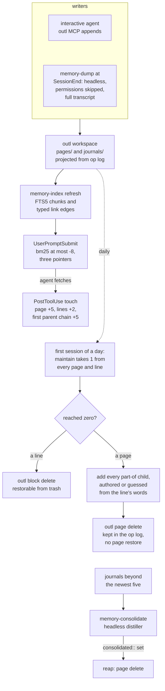

## 1. Executive Summary

llm-harness-memory is MIT-licensed cross-session memory for three coding-agent
harnesses, Claude Code, omp and pi, built on an
[outl](https://github.com/outlmd/outl) markdown graph at
`~/.llm-harness-memory`. One shell hook receives every harness's lifecycle
events. At session start it injects the root TOC page and recent journals. On
each prompt it searches a standard-library SQLite index and injects up to three
pointers. At session end it starts a headless agent that writes the session's
durable facts into today's journal.

What is notable is the retention model. Every page and every content line
carries an integer frecency, seeded at 30 and capped at 60. A fetch credits the
page +5 and each ancestor TOC +5. The first session of each day takes one point
from everything, and anything at zero is deleted with no prompt. Forgetting is
the default here, applied mechanically, and the credit that climbs the parent
chain is what lets a TOC outlive the leaves beneath it.

What is weak is the machinery that makes that deletion safe. A dead TOC takes
its whole subtree, and the subtree is built from `part-of` edges guessed from a
line's wording. A hub whose entry for a leaf says "parent" or "under " becomes
that leaf's descendant and is deleted with it. The session journaler runs
`claude -p --dangerously-skip-permissions` over the full transcript in the
project directory. The README describes tag expansion and a `normalize` command
that exist only on an unmerged branch. No marks.

## 2. Mental Model

A memory is a journal bullet or a knowledge page. It becomes durable by being
written, and it stops being a belief only by being forgotten. Nothing holds a
state between those two.

1. **Capture.** The interactive agent appends bullets under the day's journal
   sections through outl MCP tools at each checkpoint. At `SessionEnd`,
   `memory-dump` starts a headless agent on the transcript that adds what the
   journal lacks. A fact it judges impactful is also merged into a knowledge
   leaf, and its journal bullet is marked `#in-deep [[leaf]]`.
2. **Distillation.** The five newest dated journals stay. An older one is
   pending until a headless distiller merges its clusters into leaves and sets
   `distilled-into::` and `consolidated::` on it. The reap then deletes every
   aged journal whose `consolidated::` holds a date, without checking
   `distilled-into::` (`memory-index:1396-1416`).
3. **Use.** A `PostToolUse` hook on `outl_page_get` runs `memory-index touch`.
   The page gains +5, each of its content lines +2 in the ledger, and each
   ancestor up the first `part-of` edge +5 (`memory-index:1314-1352`). A
   pushed search hit credits matched lines +1 and never the page (`:594-616`).
4. **Decay and eviction.** On the first interactive session of a calendar day,
   `maintain` takes one point from every page and line not seen today. A line
   at zero is deleted with `outl block delete`. A page at zero is deleted with
   `outl page delete`, together with every page reachable through its `part-of`
   children, and inbound `[[links]]` to it are scrubbed (`:1179-1293`).
5. **Supersession.** A `supersedes` edge keeps its target out of graph-walk
   results (`:533`). A keyword hit still returns it.

Decay counts active days. `maintain` runs once on a day that has a session and
subtracts one point whatever the gap, so a month without sessions costs one
point. The README's "effective frecency = `frecency − days_since(seen)`" is
the lazy decay of the unmerged `performance-improvements` branch.

## 3. Architecture

Three things must be installed: the outl CLI and MCP server (Homebrew
`outl-beta`, unpinned, installed by the user), Python 3.9 or later, and one
harness. `install.sh` copies the scripts to `~/.local/bin`, wires the hooks,
appends a `## Persistent memory` section to the harness's user instructions and
builds the index. It assumes macOS and outl at `/opt/homebrew/bin`, with
`OUTL_BIN` as the override.

The store is the outl workspace. `pages/*.md` and `journals/*.md` are rendered
projections of outl's CRDT op log under `ops/`, and every mutation goes through
the outl CLI or MCP tools so block ids and the log stay consistent. Beside them
sit `.outl/index.sqlite`, which is derived and rebuilt on any schema change, the
line ledger `.frecency/sections.json`, and dotfiles for the daily marker,
consolidation attempts, the push cache and the model choice.

outl was read at [`97aa72bd002b57cc22f5a67b20dbf2ad6775f920`](https://github.com/outlmd/outl/commit/97aa72bd002b57cc22f5a67b20dbf2ad6775f920),
its last commit before the pin. There a delete is a `Move` to a trash root,
and the op *"stays in the log forever"* (`crates/outl-actions/src/page.rs:400-406`).
`outl trash restore` puts a block back and refuses a page root
(`crates/outl-actions/src/trash.rs`). So an evicted line can be restored by
hand and an evicted page cannot with the commands outl ships. AGENTS.md calls
eviction *"intentional and unrecoverable"*; `maintain`'s docstring calls it
soft-trash. Each is right about one of the two.

No service runs. The operator's cost is model runs. Every session end with at
least eight transcript lines starts one, and a daily sweep with a backlog starts
another. The sweep itself shells out to outl three times per page: two property
writes and one `page get --json` for the line ledger. It runs detached, so
`SessionStart` does not wait for it.

## 4. Essential Implementation Paths

- **Hook dispatch:** `memory-hook:34-59` parses the event and answers
  `PreCompact` through `systemMessage`; `:64-138` push retrieval; `:143-158` the
  fetch credit; `:163-177` the session-end journaler; `:180-315` the
  `SessionStart` injection, consolidation and daily sweep.
- **Indexing:** `memory-index:229-251` `parse_md`; `:282-309` `chunk_body`;
  `:316-365` edge typing and `links_in`; `:446-485` `_index_files`.
- **Search:** `:552-565` `_keyword_hits`; `:495-537` `_graph_expand`;
  `:568-631` `cmd_search`.
- **Credit, decay and eviction:** `:1104-1131` page and line bumps;
  `:1179-1311` `cmd_maintain` with the cascade at `:1258-1266`; `:1314-1366`
  `cmd_touch`.
- **Journals:** `:1382-1454` aged-journal selection and the reap.
- **Headless agents:** `memory-agent:164-197` builds each harness's command
  line; `memory-dump:52-72`; `memory-consolidate:79-98`.
- **Adapters and install:** `omp/llm-harness-memory.ts`,
  `pi/llm-harness-memory.ts`; `install.sh:262-329` writes hooks and allow rules.

## 5. Memory Data Model

A page is outl markdown. Four keys are hoisted to column 0: `frecency`, `seen`,
`title` and `icon` (`memory-index:104`). Everything else is a body bullet by
design: `type:: knowledge` or `type:: moc`, `parent:: [[toc]]`, `project::`,
`updated::`, `summary::`, and optionally `supersedes::` or `contradicts::`. A
journal is `journals/YYYY-MM-DD.md` with five template sections, Focus, Key
Decisions, Discoveries, Action Items and Session Notes, plus `distilled-into::`
and `consolidated::` once processed.

The index holds `pages` (slug, kind, path, hash, title, summary, updated,
frecency), one `chunks` row per `## heading` plus a synthetic title-and-summary
chunk, an external-content FTS5 table with Porter stemming, and `edges` (src,
dst, type, weight) with one row per source and target (`:124-163`). The line
ledger maps slug to outl block id to `{f, seen}`.

Edge types come from two paths, and only one of them runs on a canonical page.
The authored path reads `supersedes`, `contradicts` and `parent` from
`parse_md`'s column-0 dictionary (`:361-363`), which by design holds only the
four hoisted keys. So `- parent:: [[x]]` is typed by the fallback, which tests
the lowercased line for substrings (`:316-332`). It matches `part-of` because
the key's own name contains "parent". The same test types any line containing
"parent", including "apparent", or "under ", "part of", "belongs to",
"child of" or "subpage".

## 6. Retrieval Mechanics

**Injected at session start.** The hook exports the `index` page through outl,
falling back to the raw file. It adds today's journal in full under 6,000 bytes
or only its Focus subtree above that, the Focus subtrees of the four previous
journals, and a notice that search is active once the graph reaches 150 nodes.

**Pushed on each prompt.** A prompt that does not start with `/` or `!` and
keeps at least two terms after stopwords runs `memory-index search --json
--credit -k 3`. Keyword hits with bm25 at or below −8.0 are kept, best per slug,
and deduplicated per session in `.push-cache/<session>`. Each is injected as
`slug › heading — snippet`, a pointer the agent must fetch. Graph rows are
never pushed.

**Pulled by the agent.** `memory-index search` ORs the query's non-stopword
terms as prefix tokens and ranks chunks by bm25 with weights 10, 4 and 1 for
title, heading and body. A recursive CTE then walks the undirected edges from
the hit pages, one hop below 450 pages, two from 450, three from 1,500 at the
default threshold. It keeps each reached page's nearest and strongest arrival
(`:495-537`). Hits are listed first and link rows after, with no fusion. The
`memory-recall` subagent, Sonnet with read-only outl tools, walks the graph in
its own context and returns a conclusion and slugs.

The superseded filter sits only on the walk. `_keyword_hits` has no predicate
(`:552-565`), so a superseded page that matches the query comes back as a hit
and can be pushed.

## 7. Write Mechanics

Writes are the agent's own outl MCP calls, made at checkpoints the protocol
names, with a `PreCompact` reminder and the session-end journaler as backstops.
Nothing blocks the agent. A page written mid-session reaches the index at the
next `refresh`: the next `SessionStart`, or the next fetch, since `touch`
refreshes after crediting (`:1355-1356`). Push retrieval opens the index
without refreshing it, so until then a new page cannot be pushed.

The daily sweep rewrites the whole store. `maintain` writes `frecency` and
`seen` to every page not seen today through two `outl page prop set` calls each
(`:1223-1229`). Every page's markdown therefore changes daily, every hash
changes, and the next refresh reindexes everything. The op log gains two
property ops per page per active day.

Deduplication and contradiction are prompt instructions. The journaler is told
to compare against today's journal, and to merge into a leaf any fact that
*"reverses or supersedes a prior durable decision"*. The same prompt says
*"NEVER delete, rewrite, or reword an existing journal entry or existing leaf
content"* (`memory-dump:65-68`), so a reversal is appended beside the decision
it reverses. Nothing asks for a `supersedes::` edge.

The distiller's prompt contradicts itself. Its opening line says *"Do NOT
prune, delete, or bump the frecency of any page or section"*
(`memory-consolidate:91`). Its journal task says to *"touch frecency (new leaf
seeds frecency:: 30; a merge is +5 capped 60)"* (`:84`). The script's header
still describes a prune task that the script no longer gives (`:10-11`).

## 8. Agent Integration

For Claude Code, `install.sh` adds five hooks to `~/.claude/settings.json`:
`SessionStart`, `PreCompact`, `SessionEnd`, `UserPromptSubmit`, and
`PostToolUse` matched to `mcp__outl__outl_page_get`. It allows the whole
`mcp__outl` server, `Task(memory-recall)`, `memory-index` subcommands, and
`outl … page delete --confirm` and `block delete --confirm` on the memory
workspace (`install.sh:310-329`). Every outl write and delete therefore runs
without a prompt in the main session.

The omp and pi adapters translate their events into the same hook protocol and
set `MEMORY_HARNESS`, so background agents run on the harness that fired them.
On omp, injection and the journaler are main-session only, and by the README
subagents receive every MCP tool whatever their declared tools. pi has no subagents, so
recall runs in the main thread. All harnesses share one workspace, which is the
point: a fact written in one is recalled in the others.

## 9. Reliability, Safety, and Trust

### The cascade walks guessed edges

`_part_of_maps` builds `children_of` from every `part-of` edge, authored or
guessed (`memory-index:1080-1088`). When a page reaches zero, the sweep adds
that page's children, then theirs, and deletes them all (`:1258-1266`). The
docstring's guarantee is that *"a page only reaches 0 once its entire subtree
is cold"*, because credit climbs the parent chain.

That holds only for edges the credit path also climbs, and two kinds escape it.
Suppose a TOC `proj-alpha` lists `- [[alpha-notes]] — notes on the parent
project`. That line types an edge from `proj-alpha` to `alpha-notes` as
`part-of`, so `proj-alpha` becomes a child of `alpha-notes`. When `alpha-notes`
goes unread to zero, the sweep deletes `proj-alpha` and, through it, every
other leaf under it, whatever their frecency. The second kind is a page with two
`part-of` edges. `parent_of` keeps only the first (`setdefault`), so a fetch
credits one parent, and the page is deleted when the other dies.

This was worked from the code; nothing was run. The fixture's TOC entries carry
none of the trigger words, and `verify.sh` scenario 4 exercises only the
authored chain.

### A permission-skipping agent reads the transcript

`memory-dump` calls `memory-agent` without `--ws` (`memory-dump:72`). For
Claude Code that becomes `claude -p PROMPT --model M
--dangerously-skip-permissions`, with no `--mcp-config` and no
`--strict-mcp-config` (`memory-agent:166-172`). The agent inherits the hook's
working directory, which is the session's project, and every MCP server the user
has configured. omp runs with `--approval-mode yolo` and pi with `--approve`.

Its input is the session transcript, which holds every tool result of the
session: pages fetched from the web, files read, command output. *"Do NOT touch
code, git, or anything outside the memory graph"* is prompt text, not a
boundary. `memory-consolidate` does pass `--ws`, which limits MCP to outl, but
its shell and file tools are still unprompted, and its input is journals the
first agent wrote. This is the surface to fix first.

### Forgetting without a record

Deletion is silent by design: no prompt, no candidate list, no message. Nothing
the system writes records what was evicted or why. The reap trusts
`consolidated::` alone; an `unverified` bucket is declared and never filled
(`memory-index:1409`). A failed distillation is retried twice, then handed to
the interactive session with a warning (`memory-hook:257-286`). That bound stops
a silent re-billing loop.

### The README describes code that is not on the branch

The README's tag expansion in search, `memory-index normalize`, the
`.standard-version` marker, `doctor`'s tag-noise report and lazy decay are
absent from `champion` at the pin. They are in `memory-index` on
`performance-improvements`, three commits ahead of and twelve behind
`champion`. The README text arrived with
[`e19192fa1b9becd244355492742a19b2b83c18b7`](https://github.com/waldnzwrld/llm-harness-memory/commit/e19192fa1b9becd244355492742a19b2b83c18b7),
1 November 2026. `install.sh` at the pin does not call `normalize`.

### Marks

None is carried.

- **`tombstone`** — an evicted page leaves nothing keyed on its content, and a
  distiller may write the same fact again.
- **`trust_state`** — there is no status field. `supersedes` is an edge, and it
  filters the walk but not keyword hits.
- **`bitemporal`** — `updated::` and `seen::` are record times.
- **`scope_enforced`** — one workspace serves every project; `project::` is
  never read by `memory-index`.
- **`audit_log`** — outl's op log is append-only and holds every mutation with
  an actor and a clock. It is the engine's replication log, which this system
  neither writes as a record of its decisions nor reads, so it is git history
  under another name.
- **`human_review`** — none; eviction removed its review step on purpose.
- **`negative_eval`** — no test asserts that anything stays out of a result.

## 10. Tests, Evals, and Benchmarks

`tests/verify.sh` runs ten scenarios against a fresh copy of a committed
fixture workspace: edge building, touch propagation, leaf eviction with
reference scrubbing, the TOC cascade, line eviction, pins not exempt, split
detection, the journal reap, a healthy graph evicting nothing, and body-bullet
summaries reaching FTS. It needs the outl binary. `verify-model.sh` covers model
selection offline with stub CLIs. `verify-agent.sh` launches a real agent
against the fixture for two scenarios: a fetch propagating credit, and a
headless distiller consuming one journal.

I ran none of them. outl is not installed on this machine, and installing an
unpinned Homebrew beta is outside this reading's read-only posture.

The assertions I read can fail. Scenario 9 compares an eviction count parsed
from `maintain`'s JSON, and a sweep that crashed would produce no JSON and fail
the parse. What is untested is the retrieval side: no case checks that a
superseded page stays out of a search, and none ranks a result. The cascade is
tested on authored edges only. No benchmark, evaluation result or paper is in
the repository.

## 11. For Your Own Build

### Steal

- **Credit that climbs the access path.** A fetch warms the page and every TOC
  above it, so an index node lives exactly as long as something reached through
  it is used. That is the right shape for any decaying hierarchy.
- **Line-level decay keyed on stable block ids,** in a ledger outside the
  rebuildable index, so a stale line inside a live page ages out alone.
- **Pointers, not content, on each prompt.** Gated on a bm25 ceiling, capped at
  three, deduplicated per session, and only a fetch reads the page and credits
  it.
- **Decay per active day.** A month without sessions does not empty the store.
- **A bounded retry before handing back.** Two failed background distillations,
  then the interactive session is told to do it, which ends a silent re-billing
  loop.

### Avoid

- **Cascading deletion over inferred edges.** If deletion walks a graph, walk
  only edges someone authored, and type a `parent::` bullet by its key rather
  than by the word inside it.
- **A permission-skipping agent over a transcript.** Give the journaler the
  memory MCP server and nothing else; the transcript carries whatever the
  session read.
- **Bookkeeping in the source of truth.** Writing counters into every page daily
  makes the op log mostly counters and reindexes the store every day; keep
  frecency in the ledger beside the line scores.
- **A README ahead of its branch.**

### Fit

This suits one developer on macOS who already uses outl and wants memory that
stays small without curating it. The price is that a fact unread for about
thirty active days is gone, with no record saying it existed. Below 150 pages it
runs on TOC descent alone, which is cheap and works.

Walk away if a deletion must be explainable, if projects must not see each
other's memory, or if sessions read untrusted content such as web pages, given
what the journaler may do with it. Two fixes would change that verdict: running
the journaler with only the outl server, and building the cascade from authored
edges only.

## 12. Open Questions

- Will `performance-improvements` merge, and does its lazy decay change when a
  TOC can reach zero before its children?
- How often do real TOC entries contain a trigger word? The fixture has none,
  and the cascade's reach depends on it.
- Does a later outl make page roots restorable? That would turn page eviction
  from final into undoable without a change here.

## Appendix: File Index

- Hook and agents: `memory-hook`, `memory-agent`, `memory-dump`,
  `memory-consolidate`
- Index: `memory-index`
- Protocol: `AGENTS.md`, `MEMORY_TEMPLATE.md`, `agents/memory-recall.md`,
  `skills/memory-model/SKILL.md`, `templates-journal.md`
- Adapters: `omp/llm-harness-memory.ts`, `pi/llm-harness-memory.ts`
- Install: `install.sh`, `upgrade.sh`, `uninstall.sh`, `lib.sh`
- Tests: `tests/verify.sh`, `tests/verify-model.sh`, `tests/verify-agent.sh`,
  `tests/build-fixture.sh`, `tests/fixture/`
- Engine, read at outl `97aa72b`: `crates/outl-actions/src/page.rs`,
  `crates/outl-actions/src/trash.rs`, `docs/cli.md`

### Recorded searches

Run from the repository root at the pinned commit with `/usr/bin/git grep`.

- **No value-keyed rejection record.**
  `git grep -n -i -E 'tombstone|reject|blocklist|suppress' -- . ':!tests/fixture'`
  returns model-name validation and a fixture-builder line only.
- **No status on a page.**
  `git grep -n -i -E 'status|verified|candidate|confidence' -- memory-index`
  returns comments, split candidates and the never-filled `unverified` list.
- **No validity time.**
  `git grep -n -i -E 'valid_from|valid_until|valid_to|validfrom|event_time|occurred_at' -- .`
  returns nothing.
- **`project` is not read.** `git grep -n -E 'project' -- memory-index` returns
  three comments and the word "projection".
- **Tag expansion and `normalize` are absent.**
  `git grep -n -E 'normalize|_tag|#topic|standard-version|tag-noise' -- memory-index install.sh memory-hook`
  returns one SQL comment containing "denormalized".
- **The superseded filter is on the walk only.**
  `git grep -n -E "type='supersedes'" -- memory-index` returns the walk at
  `:533`, two `medic` heals and the `doctor` report.
- **The journaler gets no workspace scope.**
  `git grep -n -E '"\$AGENT"' -- memory-dump memory-consolidate memory-hook`
  shows `--ws` on the distiller's call and not on the journaler's.
- **Search credit never touches page frecency.**
  `git grep -n -E '_bump_page\(|_bump_blocks\(' -- memory-index` shows
  `_bump_page` called only from `cmd_touch`.
- **No retrieval-absence test.**
  `git grep -n -i -E 'supersed|contradict' -- tests/verify.sh tests/verify-agent.sh`
  returns nothing.
- **No mutation record of its own.**
  `git grep -n -i -E 'audit|history' -- memory-index memory-hook memory-consolidate memory-dump`
  returns nothing.
- **No paper.**
  `git grep -n -i -E 'arxiv|bibtex|@article|@misc|citation|doi\.org' -- .`
  returns nothing.

## History

**2026-11-03** — [`f60469fc05379dc056359e28adfcc27f25899bd4`](https://github.com/waldnzwrld/llm-harness-memory/commit/f60469fc05379dc056359e28adfcc27f25899bd4). First reading, with outl read at [`97aa72bd002b57cc22f5a67b20dbf2ad6775f920`](https://github.com/outlmd/outl/commit/97aa72bd002b57cc22f5a67b20dbf2ad6775f920). Screened first: one file scanned, an `AGENTS.md` read as data, and no auto-run, build-time or unpinned surface in the checkout; the hooks it installs are written by `install.sh` into the user's harness configuration. Nothing installed, built or run. No marks: deletion is mechanical and unrecorded, and nothing carries a status ([section 9](#9-reliability-safety-and-trust)).
