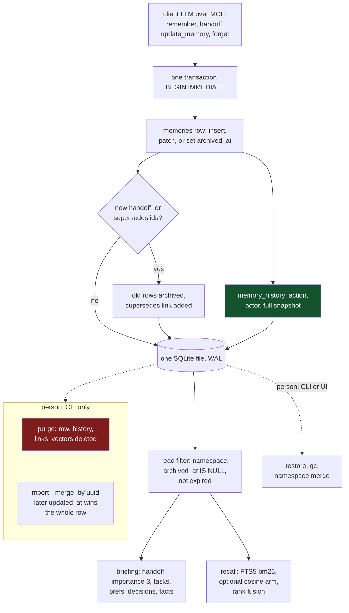

## 1. Executive Summary

llm-memory is a single Go binary that several LLM clients launch as an MCP
server against one SQLite file. A client writes typed memories with explicit
tool calls, and the next client reads a briefing assembled from them: the
latest handoff, essential items, open tasks, preferences, recent decisions and
facts. What is notable is how little the model is allowed to destroy. Its
tools archive and patch, every mutation leaves a snapshot in a history table,
and restore and hard delete exist only at the CLI and the web UI. What is weak
is what a single write reaches: one importance-3 row in the shared `global`
namespace opens every project's briefing. A CLI merge joins two machines'
files by uuid, whole row against whole row on wall-clock `updated_at`; a
rename leaves that timestamp alone, so the merge decides it by which
namespace name sorts later.

It carries `scope_enforced`, `audit_log` and `negative_eval`.

**Licence.** `LICENSE` is the MIT text with the line
`Copyright (c) 2026 mordicus`. `README.md:376-378` names the same licence.
`go.mod` carries no licence field and the tree has no NOTICE file and no
rider.

**The tool surface has no delete.** The MCP server registers eight tools:
`get_context`, `recall`, `get_memory`, `list_namespaces`, `remember`,
`update_memory`, `forget` and `handoff`
(`internal/server/server.go:175-241`). `forget` sets `archived_at`.
`Store.Purge`, the one statement that deletes a memory, is called from the
CLI's `purge` verb and nowhere else (`internal/store/maintenance.go:40-52`,
`cmd/llm-memory/admin.go:438`). `Store.Restore` is called from the CLI and the
web UI, and `Store.Merge` from the CLI's `import --merge` only
(`admin.go:538`). One row type is deletable by the model: `update_memory`
takes `remove_links`, which deletes a `relates_to` or `depends_on` link and
writes a history row. A `supersedes` link is refused at the store, so no
surface can remove one (`internal/store/links.go:71-95`).

**Every mutation writes history in its own transaction.** Create, update,
archive and restore each end in `writeHistory`, which re-reads the row inside
the transaction and stores the action, the actor and a JSON snapshot of the
whole memory (`internal/store/memories.go:86-101`). A namespace rename or merge
writes an update row for every memory it moves, and a link change writes one
on the source memory (`internal/store/namespaces.go:130-138`,
`internal/store/links.go:50-53`). Neither touches `updated_at` or
`updated_by`, so a move or a link edit leaves a row's place in the briefing
and its printed author as they were.

**One archive predicate serves every read.** Full-text search, the recent
list, the vector arm and the duplicate check all take their filter from
`filterSQL` (`internal/store/search.go:128-156`), and the briefing reads
through `List`, whose default adds the same two conditions
(`internal/store/memories.go:493-495`). An archived or expired row is absent
from all of them.

**The handoff is one slot per namespace.** Writing a handoff archives the
previous one in the same transaction and links the new row to it
(`memories.go:217-224`, `:396-413`). Nothing records whether a handoff was
read, so a second client that writes one replaces the first whether or not
anyone saw it.

**Two machines meet through a file.** Every memory carries a random uuid
beside its local integer id, and each database an instance id
(`internal/store/migrations/0005_uuid.sql`). `export` writes the uuids, the
links between exported rows and the origin; `import --merge` matches rows by
uuid and keeps, whole, the version with the later `updated_at`
(`internal/store/merge.go:64-205`). [§9](#9-reliability-safety-and-trust)
carries what that rule does to a rename, a forget and a purge.

## 2. Mental Model

A memory is believed from the moment it is written and until someone archives
it. There is no candidate state and no confidence. Correction has three
forms, all explicit: patch the row, archive it, or write a replacement that
names what it supersedes.

## 3. Architecture

Six packages, with SQL confined to one of them.

| Package | Role |
| --- | --- |
| `internal/store` | Schema, migrations, every query; no MCP dependency |
| `internal/briefing` | Renders the text of `get_context`; `render` does no I/O |
| `internal/semantic` | Embeddings client and the hybrid search; optional |
| `internal/server` | MCP tools, resources and prompts; no SQL |
| `internal/ui` | A JSON API and one static page |
| `cmd/llm-memory` | The binary: `serve`, the admin CLI, client setup, hooks |

Each client launches its own process over stdio, and all of them open the same
file, by default `~/.llm-memory/memory.db`, created with a 0700 directory and
a 0600 file (`internal/store/db.go:45`, `:66`). `serve --listen` serves the
same tools over Streamable HTTP, and `--read-only` registers the four read
tools only (`cmd/llm-memory/main.go:246-310`, `server.go:209`).

The connection string sets WAL, a five-second busy timeout, foreign keys and
`_txlock=immediate`, and each process holds one connection
(`db.go:55-57`, `:84-90`). Migrations are embedded SQL files applied in a
transaction each, with the version in `PRAGMA user_version`; a file written
by a newer binary is refused (`db.go:154-186`). The fifth migration backfills
a uuid on every existing row in SQL and adds a trigger that fills one on any
insert that omits it.

Several machines are joined by hand: export on one, `import --merge` on the
other, then the reverse. There is no sync service and no transport but the
file.

The SQLite driver is `modernc.org/sqlite`, pure Go, so the binary has no C
dependency. The memory data model is in this tree. Of the MCP SDK, only the
Streamable HTTP handler's request checks at the version `go.mod` names,
v1.8.0, were read; the driver was not opened.

### Deployment and ergonomics

`setup` prints or writes the MCP entry for six clients, and `setup --hooks`
installs lifecycle hooks for three of them
(`cmd/llm-memory/admin.go:1707-1872`, `hooks.go:29-32`). The README states
that an instruction block must also be pasted into each client, because
without it the model does not call the memory reliably
(`examples/instructions_client.md`).

## 4. Essential Implementation Paths

| Path | Location |
| --- | --- |
| Schema: memories, history, FTS5 and its triggers | `internal/store/migrations/0001_initial.sql:9-51` |
| Embeddings table and the invalidation trigger | `migrations/0002_embeddings.sql:3-15` |
| Connection pragmas and transaction mode | `internal/store/db.go:77-92` |
| History writer | `internal/store/memories.go:86-101` |
| Create, with supersedes and the handoff slot | `memories.go:129-231` |
| Update and the archived-row refusal | `memories.go:257-353` |
| Archive, restore, the single-handoff rule | `memories.go:357-441` |
| Shared read filter | `internal/store/search.go:128-156` |
| Full-text search and duplicate detection | `search.go:100-124`, `:247-290` |
| Missing-embedding scan, guarded vector store, vector load | `internal/store/embeddings.go:50-107`, `:121-148`, `:173-205` |
| Hybrid search and fusion | `internal/semantic/engine.go:131-177`, `:222-264` |
| Briefing assembly and budget | `internal/briefing/briefing.go:42-98`, `:111-217` |
| Hard delete | `internal/store/maintenance.go:40-52` |
| Namespace rename, merge, archive | `internal/store/namespaces.go:130-282` |
| Links and their history | `internal/store/links.go:21-95` |
| uuid column, trigger and instance id | `internal/store/migrations/0005_uuid.sql:6-35` |
| Export and import | `internal/store/transfer.go:77-285`, `:385-421` |
| Merge by uuid, tie-break, history union | `internal/store/merge.go:64-340` |
| Tool registration and author | `internal/server/server.go:131-269` |
| Web UI routes and request checks | `internal/ui/ui.go:51-509` |
| Hook entry point | `cmd/llm-memory/hooks.go:143-298` |

## 5. Memory Data Model

One table holds every memory (`0001_initial.sql:9-22`,
`0003_expires_at.sql:2`).

- **`kind`**: `preference`, `fact`, `decision`, `task_state`, `handoff`,
  `note`, under a `CHECK`. The `remember` schema omits `handoff`, so a handoff
  is written only by its own tool (`tools.go:619-627`).
- **`content`**: 1 to 8,000 characters. **`title`**: one line, up to 200.
- **`tags`**: a space-joined string of lowercased words.
- **`importance`**: 1, 2 or 3, chosen by the writer. 3 means the row is
  always in the briefing.
- **`source`** and **`updated_by`**: the first and the latest author.
- **`created_at`**, **`updated_at`**: record time; `updated_at` overwrites.
- **`archived_at`**: null while active. This is the only lifecycle column.
- **`expires_at`**: an optional deadline set from `expires_in` or
  `expires_at`.
- **`uuid`**: a random version-4 identifier, unique-indexed, generated in Go
  on create and by a trigger on any insert without one. It is the identity a
  merge matches on; the integer id stays the key of links, history, vectors
  and the FTS row.

`meta` holds one row, `instance_id`, which an export writes as its `origin`.
A file copied with `backup` carries the same instance id, which the README
warns against.

`memory_history` holds `memory_id`, an `action` under a four-value `CHECK`
(`create`, `update`, `archive`, `restore`), `snapshot`, `changed_by` and
`changed_at`. The snapshot is the whole row after the action, uuid included,
with a `reason` key on an archive (`memories.go:78-83`). `History` reads it
in `(changed_at, id)` order, so lines a merge inserts sort by the timestamp
the dump gives them (`internal/store/history.go:26`).

`memory_links` holds directed `supersedes`, `relates_to` and `depends_on`
edges with a composite primary key (`0004_links.sql:2-9`). They are returned
by `get_memory`, the CLI's `show` and the UI, each with the target's archived
flag. No retrieval path follows them. Adding or removing one writes an update
row on the source memory whose reason names the kind and the target; the
snapshot itself carries no links.

`memory_embeddings` is keyed on memory and model, one float32 blob each
(`0002_embeddings.sql:3-10`).

**`trust_state` is withheld.** Active and archived are one bit, and the same
bit carries a wrong memory, an expired one, a replaced handoff and a whole
archived namespace. The reason is a free-text key inside the history snapshot
that no read consults. [Lerim](../lerim/) is withheld the mark on the same
shape.

**`bitemporal` is withheld.** `created_at`, `updated_at` and `archived_at`
are all record time, and `expires_at` is a deadline the writer sets for
retention. A merge carries the exporting machine's record times across and
settles `created_at` on the earlier of the two; both are record time. No
column says when a fact was true.

## 6. Retrieval Mechanics

### The briefing

`briefing.Build` runs up to five reads and renders them
(`briefing.go:42-98`): the namespace's active memories, its row with the latest
write for the header's date and author, an optional focus search, the
active memories of `global`, and the namespace list. The reads are separate
statements, not one snapshot.

`render` writes sections in a fixed order inside a character budget, 6,000 by
default and 400 at least (`briefing.go:111-217`):

1. The latest active handoff, in full, with its headings demoted two levels.
2. Every importance-3 memory, from the namespace and then from `global`.
3. Focus results, when a focus was given.
4. Task states, then project preferences, then global preferences.
5. The ten most recent decisions and the ten most recent facts.
6. A count of notes, a count of what the budget cut, the other namespaces.

A decision or an importance-3 line is cut at 1,000 characters and any other
line at 240, each cut ending in `(get_memory #id)`. A section that does not
fit ends in a line counting what was left out and naming the `recall` filter
that reaches it (`briefing.go:302-330`). The header is written outside the
budget and the handoff is truncated to what remains.

### Search

`Store.Search` splits the query into letter and digit runs, so no input
reaches FTS5 as syntax, and quotes each term as a prefix
(`search.go:47-84`). It tries all terms with AND and, with no result, with OR.
Ranking is bm25 with the title weighted double, multiplied by 1.25 for
importance 3 and 0.85 for importance 1; bm25 is negative, so the larger
factor ranks higher (`search.go:163-169`). An empty query returns the most
recent rows.

With an embeddings endpoint configured, `Engine.Search` loads every stored
vector that passes the same filter, ranks by cosine above a 0.3 floor in Go,
and fuses the two lists by reciprocal rank with k = 60
(`engine.go:131-177`, `:222-264`). If the endpoint fails, the full-text
result is returned and a warning is logged.

### Scope

**`scope_enforced` rests on the namespace**, applied as an equality
predicate by the briefing, by both search arms and by the duplicate check.
The session-start hook resolves it from the client's working directory: a
`.llm-memory` marker file, or the name of the directory holding `.git`
(`internal/config/config.go:133-143`, `:216-241`).

Its limits are these. `recall` with no namespace searches every namespace,
and the tool description says so (`tools.go:181`, `:208-210`). `get_memory`
reads any id. `global` is included in every briefing by design. And over MCP
the namespace is an argument the model chooses; there is one user and no
principal.

## 7. Write Mechanics

A write is one tool call and one transaction, synchronous to the caller. The
row is in the FTS index when the transaction commits, through three triggers
(`0001_initial.sql:42-51`), so the next read sees it. No model is called and
no background pass rewrites anything.

**Create.** `CreateDetailed` validates, refuses text that matches a secret
pattern, inserts, writes history, archives each id in `supersedes` with the
reason `superseded by #N` and a link, and, for a handoff, archives the
namespace's other active handoffs (`memories.go:129-231`).

**Duplicates are reported, not blocked.** `remember` searches active rows of
the namespace with an OR query over the new text's significant words and
keeps those sharing at least half of the smaller word set
(`search.go:232`, `:247-290`). The memory is created regardless, and the
result carries `possible_duplicates` and a hint to forget the new row or fix
the old one (`tools.go:153-171`).

**Update.** A patch changes only the fields supplied. An archived row is
refused with a message naming `restore` (`memories.go:322-324`). There is no
revision check: two clients patching the same field leave the later value in
the row and both versions in history.

**Attribution.** The author is the server's `--source` flag, or the name the
client sent in the MCP handshake, or `unknown`. No tool takes it as an
argument (`server.go:257-269`).

**Secrets.** Eleven patterns and a URL-credentials rule run over content and
title on create and update (`internal/store/secrets.go:14-28`, `:49-70`).
Tags, namespace descriptions and imported or merged rows are not checked.

**Merge.** `Store.Merge` takes a format 2 dump and, in one transaction,
creates its namespaces, then for each memory finds the local row by uuid
(`internal/store/merge.go:64-205`). An unknown uuid is inserted with its
timestamps and authors. A known one is compared as a canonical string that
starts with `updated_at` and continues through namespace, kind, title,
content, tags, importance, authors, archive and expiry; the larger replaces
the other whole, archive state included, and writes an update row reading
`merged: newer version from <origin>` (`merge.go:138-161`, `:268-287`).
History lines of the dump are added when no line with the same action,
actor, time and snapshot exists, and links are added as a union with no
history row (`merge.go:167-195`, `:305-340`). Nothing on this path bumps
`updated_at`, so a repeated merge is a no-op.

Before inserting a memory unknown by uuid, the merge pairs it with a local
row of the same namespace, kind and content that the dump does not describe,
archived or not, and both machines settle on the smaller uuid
(`merge.go:209-241`). The uuid adoption and the earlier `created_at` write
no history row of their own (`merge.go:128`, `:134`); when the two versions
otherwise agree, nothing records them.

### Forgetting

- **`forget`** archives with an optional reason kept in the history snapshot.
- **Expiry** is a read-time filter. `gc` turns expired rows into archived ones
  with the reason `expired (TTL)`; it runs when a person calls it from the CLI
  or the UI (`memories.go:550-573`).
- **`purge --archived-before DATE`** deletes archived rows. The foreign keys
  cascade to history, links and embeddings, and the delete trigger removes the
  FTS entry (`maintenance.go:40-52`). It asks for confirmation unless `--yes`
  is passed. The file is not vacuumed, earlier `backup` and `export` outputs
  are untouched, and a merge from a machine that still holds the row inserts
  it again, which the README states.

**`tombstone` is withheld.** Archiving is keyed on the row. The duplicate
check reads active rows only, and a committed test asserts that an archived
memory is not reported as a duplicate
(`internal/store/search_test.go:281-285`), so a forgotten statement can be
remembered again with no signal. The places an archived row blocks a repeat
are on the CLI's import path. A plain `import` skips a row whose namespace,
kind and content equal an existing one, archived or not
(`transfer.go:390-396`). A merge pairs such a row as a twin, and a twin whose
local archive is the later write stays archived and carries its archive to
the other machine. Both are keyed on content equality at import, not on a
rejected value that `remember` consults, and the design note lists
tombstones as later work (`docs/design/multi-machine.md:206`).

### Operational cost

Nothing but the file. The vector arm loads and scores every matching vector in
process on each search, which the README bounds at a few thousand memories.

## 8. Agent Integration

The server's instructions tell the model to call `get_context` first, to
`recall` before asking the user, and to `handoff` when the user stops
(`server.go:24-30`). Two resources and two prompts expose the same briefing
(`internal/server/resources_prompts.go:20-60`).

Hooks make the read automatic. On session start the client runs
`llm-memory hook <client> --namespace auto`, which prints the briefing in the
client's hook format: `additionalContext` for Claude Code and Codex, a
`systemMessage` step for Antigravity (`hooks.go:217-298`). The text is
prefixed with one sentence saying it came from the shared memory. Stored
content is otherwise inserted as written, with no delimiter around it. The
pre-compaction and stop hooks print a fixed reminder and up to five open task
states.

**`human_review` is withheld.** Nothing waits. A `remember` is live in the
next briefing, and the model can archive, patch and supersede on its own. The
direction that needs a person is the reverse one: un-archiving and hard delete
have no MCP verb. That keeps a model from undoing a person's removal; it does
not put a person in front of a write.

## 9. Reliability, Safety, and Trust

### The web UI keeps browsers out, not other clients

`llm-memory ui` listens on `127.0.0.1:8765` by default and serves 19 routes;
twelve mutate (`ui.go:51-428`). Every request passes one middleware
(`ui.go:431-458`): a `Host` that is not loopback is refused, an `Origin` that
differs from `Host` is refused, a `Sec-Fetch-Site` other than `same-origin`
or `none` is refused on the API, and a mutating request must carry an
`X-CSRF-Token` equal to 32 random bytes generated at start-up and embedded in
the page. `decodeJSON` refuses any `Content-Type` but `application/json`
(`ui.go:497-509`). A page in another origin cannot read the token, and a
rebinding name fails the `Host` check.

The token is a browser defence and nothing else. Any process that can reach
the port can `GET /` and read it. Binding `--addr` to a non-loopback address
turns the `Host` check off and logs a warning
(`cmd/llm-memory/admin.go:1901-1904`); a committed case then accepts a
matching non-loopback `Host` and `Origin` with the token
(`internal/ui/ui_test.go:327-337`), which is also what a rebinding page
presents.

The UI's create route accepts any kind and any importance and records the
author as `ui` (`ui.go:236-282`). `serve --listen` adds no authentication of
its own and warns on a non-loopback bind (`main.go:289-291`). The SDK it
uses refuses a non-loopback `Host` on a loopback listener and a `POST` whose
`Content-Type` is not `application/json`; no origin check is configured
(`server.go:103-119`; go-sdk v1.8.0 `mcp/streamable.go:317-333`, `:388`).

### An importance-3 row in `global` reaches every project

The briefing places every importance-3 memory of the namespace and of
`global` directly after the handoff, at up to 1,000 characters a line and
with no count cap (`briefing.go:151-163`). Importance is a field the writer
sets. One `remember` with `namespace: global` and `importance: 3`, from any
client or from the UI, is in the opening context of every later session in
every project until someone archives it. With hooks installed it arrives
without the model asking.

### A namespace move keeps each row's recency and author

A rename moves rows through the foreign key's `ON UPDATE CASCADE`, and a
namespace merge sets only `namespace` on the rows it moves
(`namespaces.go:174`, `:219-221`); a link added or removed writes history
and nothing else (`links.go:50-53`). The briefing ranks a namespace's
memories by `updated_at` descending and prints `updated_by` as the handoff's
author and the header's last activity (`memories.go:503`,
`briefing.go:125`, `:334`), so neither moves under a bookkeeping operation.
The namespace merge then keeps the destination's active handoff with the
latest `updated_at` and archives the rest (`namespaces.go:231-233`).

Two committed cases assert the outcome in both directions. One writes the
destination's handoff after the source's and requires that it stays active
with its own author and the source's is archived; the other writes the
source's handoff last and requires the reverse, and checks the fact order
after the rename and after the merge (`namespaces_test.go:164`, `:213`,
`:240`, `:249`). The link case asserts `updated_at` and `updated_by`
unchanged after an add and a remove (`links_test.go:71`, `:87`). No
briefing is rendered after a move; the cases assert the `List` order the
briefing reads.

### Merging two machines' files

The merge is last-writer-wins per row on wall-clock `updated_at`, and every
consequence below follows from that rule and from a namespace move leaving
`updated_at` alone.

- **A namespace move reaches the other machine only when the new name sorts
  after the old.** A rename leaves `updated_at` equal on both sides, so the
  canonical string decides on the namespace field next. Renaming `zeta` to
  `alpha` loses on the other machine, and the reverse merge then moves the
  rows back to `zeta` on the machine that renamed them, recreating the
  namespace and writing a line that calls the old name the newer version
  (`merge.go:142-157`, `:268-287`). A namespace merge into a
  destination whose name sorts first is undone the same way. The design note
  names the tie-break fallback and not the reversal
  (`docs/design/multi-machine.md:184-186`). I re-derived the comparison in a
  separate script; no test renames before a merge.
- **A later edit on one machine un-archives a row forgotten on the other**,
  because the edited version carries the later `updated_at` and replaces the
  row whole, `archived_at` included. A row archived by `supersedes` returns
  to the briefing beside its replacement, with the `supersedes` link kept by
  the union. The convergence test archives on one side and edits a different
  row on the other.
- **A machine whose clock runs ahead wins every merge** for the rows it
  wrote, and those rows rank above every later local write in the briefing
  until local time passes them. A dump's `updated_at` is accepted as given;
  only a zero one is replaced (`transfer.go:318-324`). The design note
  leaves clock skew as an open question.
- **A purge and a removed `relates_to` or `depends_on` link come back** from
  a machine that still has them. The README states both.
- **Two active handoffs can share a namespace** when each machine wrote one,
  since the merge applies no single-handoff rule. The briefing shows the one
  with the later `updated_at`; the other stays active in `recall` until the
  next handoff archives both.

A merge is reachable only from the CLI, by a person naming a file. Its
convergence test diverges two databases by an edit, an archive, two creates
and two links, merges three times and compares namespaces, memories and
links; history is compared by line count on two memories in the idempotence
case (`internal/store/merge_test.go:66-74`, `:91-112`, `:125-168`).

### What the history does not record

- **A purge.** History goes with the row and nothing records that it
  happened. [Membrane](../membrane/) has the same cascade under its revision
  table.
- **Import provenance.** Import and merge insert the dump's history rows with
  their actors and timestamps after checking only that the action is known
  and the snapshot is valid JSON (`transfer.go:361-380`). A memory that
  arrives with history gets no local line saying it arrived, and since
  `History` sorts by `changed_at`, a dump line can sort before the local
  create.
- **A merge's quieter writes.** The uuid a twin adopts, the earlier
  `created_at` a merge settles on, and the links it adds write no history
  row. A plain import that adds a link to an existing memory does write one
  (`transfer.go:270-274`).

### Several processes on one file

Every write path is a single transaction that takes the write lock at
`BEGIN` and re-reads the row inside it, so a read-modify-write cannot
interleave (`db.go:88-90`, `memories.go:317-349`). A writer that waits longer
than five seconds fails, and the tool returns an internal error asking the
model to retry once (`tools.go:593-595`). A merge is one transaction too,
dry run included, which rolls back after computing the report.

Two things sit outside a transaction. The duplicate search in `remember`
runs before the insert. And `update_memory` applies the field patch, then
each link change, as separate transactions: a link that fails leaves the
patch committed and the call reporting an error (`tools.go:379-412`).

No committed test holds two stores open on one file at once; the two-client
test closes the first before opening the second
(`internal/server/server_test.go:275-278`).

### What the embeddings path sends

With an endpoint configured, the request body is a model name and a list of
texts (`internal/semantic/client.go:101-115`). The texts are:

- **Memories missing a vector, in the search's scope**, title, content and
  tags, 64 per search. The backfill takes the search's namespace and archive
  filter (`engine.go:148-157`, `embeddings.go:70-107`), so a scoped `recall`
  sends only its namespace's active rows, and one with `include_archived`
  sends that namespace's archived rows too. A `recall` with no namespace
  sends the active rows of every namespace.
- **Every memory in the file, archived included**, on `llm-memory reindex`
  (`engine.go:80-82`). `README.md:293-307` states both scopes.
- **Each search query**, including a briefing's focus string.
- **The text of each new memory**, when the target namespace already holds a
  vector. `remember` calls the engine's `FindSimilar`, which embeds the text
  only after finding vectors in that namespace and ignores an endpoint
  failure (`tools.go:131-137`, `engine.go:281-321`).

A trigger deletes a memory's vectors when its title, content or tags change
(`0002_embeddings.sql:13-15`), and archiving leaves them in place behind the
read filter. A vector is stored only if the row still holds the title,
content and tags it was computed from, checked inside the storing
transaction (`embeddings.go:121-148`), so an edit committed by another
process during the endpoint call leaves the row without a vector until the
next backfill. Committed cases cover the store-level check and the
interleaving through `Index` (`internal/store/embeddings_test.go:169`,
`internal/semantic/engine_test.go:425`).

### Two smaller reads

`recall` with `include_archived` drops the expiry condition together with the
archive one. An expired row not yet collected by `gc` comes back with
`archived` false, and the result view has no expiry field
(`search.go:146-148`, `tools.go:189-199`).

`list_namespaces` and the briefing footer count rows with `archived_at` null,
so an expired row is counted as active while every listing omits it
(`namespaces.go:92`).

## 10. Tests, Evals, and Benchmarks

143 test functions in 18 files, 6,382 lines, with 13 golden files.
`.github/workflows/ci.yml` runs `go vet`, the suite and a lint job on push and
pull request; the race detector is on for Linux and macOS. I ran none of
them.

**The suite asserts absence against populated results.**
`TestContentOrderAndDedup` builds a namespace of twenty active memories with
one archived handoff and asserts that `Old handoff` is not in the briefing
while the active handoff's last line is
(`internal/briefing/briefing_test.go:186-189`). `TestHandoffBetweenClients`
writes two handoffs from one client, opens a second, and asserts that the
first handoff's text is absent from a briefing that must contain five other
strings (`internal/server/server_test.go:281-288`).
`TestSearchFiltersAndLimits` searches a term present in two namespaces and
requires exactly the row from the named one
(`internal/store/search_test.go:193-196`). `negative_eval` rests on these.

Two further cases assert an empty result after an archive, each paired with
an include-archived read that must return the row
(`search_test.go:209-218`, `internal/semantic/engine_test.go:126-134`).
`TestSearchCatchUpScoped` runs a scoped search over three namespaces' rows
and asserts that only the active row of the searched namespace was embedded,
then that `include_archived` adds the archived one and still not the other
namespace's (`engine_test.go:331-366`). `TestUISecurityGuards` sends six
refused requests, cross-origin, bad token, wrong content type, `Origin: null`,
cross-site and a rebinding `Host`, and asserts the store still holds zero
memories (`internal/ui/ui_test.go:250-326`).

History cases: one row per write with actor and content
(`internal/store/memories_test.go:106-158`), and one per rename, merge and
link change with its reason, with `updated_at` and `updated_by` asserted
unchanged and the kept handoff asserted by id in both directions
(`namespaces_test.go`, `links_test.go`). A vector
is refused when the row's text changed during the endpoint call
(`internal/store/embeddings_test.go:169`, `engine_test.go:425`). Other cases:
the single-handoff rule through create, restore, a kind change and a
namespace move (`memories_test.go:342-398`); no orphan
history or FTS rows after a purge (`internal/store/transfer_test.go:216-227`);
the tool list and the read-only tool list
(`server_test.go:121-170`, `:523-552`); and `remember` refusing the kind
`handoff` (`:337`).

Merge cases (`internal/store/merge_test.go`):

- a merge into an empty file reproduces the source, and a second merge
  reports every row unchanged;
- a merge leaves `updated_at`, `updated_by` and the uuid as the source had
  them, and two diverged files converge after three merges;
- the later of two conflicting edits wins, its history holds the replaced
  version and the merge line, and an older incoming version leaves the local
  one in place;
- the tie-break gives the same row in both directions, and content twins
  settle on the smaller uuid unless `--no-content-match`;
- a dry run and a failed merge leave the file empty, and a repeated history
  union adds nothing.

The uuid cases
cover the v4 backfill of a schema-4 file, distinct uuids, and the trigger on
a raw insert (`internal/store/uuid_test.go`).

The golden files pin text: six briefings at different budgets and the output
of seven CLI invocations, with dates masked. `loaded_demo.golden` shows the full
section order.

Not covered: two processes writing at once, a briefing rendered after a
rename, merge or link change, an expired row under `include_archived`, and,
on the merge path, a rename, a forget against a later edit, a purge, or two
handoffs in one namespace.

No paper, DOI or benchmark is cited in the tree, and no retrieval quality
measure is committed.

## 11. For Your Own Build

### Steal

**Write the history row in the mutating transaction, as a snapshot.** A
snapshot of the row after each action makes a history readable without
replaying diffs, and re-reading inside the transaction means it records what
was committed.

**Build the archive and expiry conditions once.** One function that returns
the filter fragment for every search arm is why the vector arm, the recent
list and the duplicate check cannot disagree about what is hidden.

**Keep restore and hard delete off the tool surface.** The model can retire a
memory and cannot bring one back or erase one.

**Take the author from the transport.** The handshake's client name, with a
server-side override, is harder to forge than a tool argument and costs
nothing.

**Invalidate embeddings with a trigger on the text columns, and store a
vector only against the text it was computed from.** The trigger covers every
writer; the guarded insert covers the edit that lands while the endpoint is
answering.

**Refuse to remove a provenance link in the store, not in the UI.** Every
surface then inherits the refusal.

**Make the session briefing a deterministic render with a budget and explicit
omission lines.** Each cut names how many items were left out and the query
that reaches them.

### Avoid

**Do not let a writer-chosen number decide what enters every project's
opening context.** Importance 3 in a shared namespace is a broadcast.

**Do not let a whole-row last-writer-wins merge stand in for deletion and
renaming.** A forget, a purge and a namespace move are intents, and a rule
that compares timestamps sees only rows: the purge comes back, the forget is
undone by an edit on the other machine, and a rename with no timestamp falls through to
string order.

**Do not keep one handoff slot without a read marker** where two clients can
be open at once.

### Fit

It fits one person moving between several assistants on one machine, with a
few hundred to a few thousand deliberately written memories and no wish to run
a service. It asks for discipline from the model and a pasted instruction
block per client, and it gives back a store a person can read, export and
repair with a CLI. A second machine works if that person merges by hand,
keeps the clocks honest, and treats a purge or a rename as local. It does not
fit a team, a network deployment, or any
setting where the writing model is not trusted to choose importance and
namespace. A reader who needs a memory to wait for approval, or a rejected
statement to stay rejected, is not served by it.

## 12. Open Questions

- **Should a namespace move carry its own timestamp for the merge to
  compare?** Leaving `updated_at` alone keeps the briefing's order; it also
  leaves the merge nothing but the namespace's spelling to decide by.
- **What should happen to an unread handoff when a second client writes
  one?**
- **Should a purge leave a receipt?** Every other removal does.

## Appendix: File Index

| File | Role |
| --- | --- |
| `internal/store/migrations/0001_initial.sql` to `0005_uuid.sql` | Schema, FTS triggers, embeddings trigger, uuid and instance id |
| `internal/store/memories.go` | Create, update, archive, restore, list, history writer |
| `internal/store/search.go` | FTS5 search, shared filter, duplicate detection |
| `internal/store/embeddings.go` | Vector storage, missing scan, filtered vector load |
| `internal/store/namespaces.go` | Namespace list, rename, merge, archive, move history |
| `internal/store/links.go` | Links, link history, the supersedes refusal |
| `internal/store/maintenance.go` | Purge, stats, integrity check, backup |
| `internal/store/transfer.go` | JSON export (formats 1 and 2) and import |
| `internal/store/merge.go`, `uuid.go` | Merge by uuid, tie-break, history union; uuid generation |
| `docs/design/multi-machine.md` | Design note for identity and merge, with the `updated_at` audit |
| `internal/store/secrets.go` | Secret patterns |
| `internal/semantic/engine.go`, `client.go` | Hybrid search, fusion, embeddings client |
| `internal/briefing/briefing.go` | Briefing assembly and budgeted writer |
| `internal/server/server.go`, `tools.go`, `resources_prompts.go` | MCP surface |
| `internal/ui/ui.go` | Web UI routes, CSRF token, request checks |
| `cmd/llm-memory/main.go`, `admin.go`, `hooks.go` | Binary, CLI verbs, hooks |
| `internal/store/memories_test.go`, `search_test.go` | History, handoff slot, filters |
| `internal/briefing/briefing_test.go`, `internal/server/server_test.go` | Briefing and end-to-end tool cases |
| `internal/store/embeddings_test.go`, `internal/semantic/engine_test.go`, `internal/ui/ui_test.go` | Backfill scope, stale-vector guard, UI refusals |

### Recorded searches

Run with `/usr/bin/git` in a full clone at the pinned commit.

- `git ls-files '*.go' | grep -v _test.go | xargs cat | wc -l` — 9,348 lines in 24 files; `git ls-files '*_test.go' | xargs cat | wc -l` — 6,382 in 18. The same commands give 8,730 in 22 and 5,522 in 16 at `38d1578`.
- `git grep -c -E '^func Test' -- '*_test.go'`, summed — 143 (120 at `38d1578`).
- `git grep -n -E 'DELETE FROM|DROP TABLE' -- '*.go' '*.sql' ':!*_test.go'` — five: the embeddings reset, the link removal, the purge, the embeddings trigger and the merged namespace's own row. None names `memory_history`.
- `git grep -n -E 'memory_history' -- '*.go' '*.sql' ':!*_test.go'` — the table, its index, two reads (`history.go:26`, the merge's dedup read at `merge.go:313`), three comments and two inserts (`memories.go:96`, `transfer.go:375`); no `UPDATE` or `DELETE` names it.
- `git grep -n -i -E 'read_at|acknowledg|seen_at|consumed' -- '*.go' '*.sql' ':!*_test.go'` — nothing: no column or field records that a handoff was read.
- `git grep -n -E 'UPDATE memories|UPDATE namespaces SET name' -- '*.go' ':!*_test.go'` — the patch, the archive, the restore, the rename at `namespaces.go:174`, the namespace merge at `:220`, and three in `merge.go`: the uuid adoption at `:128`, the earlier `created_at` at `:134` and the whole-row replacement at `:147`. Every one but `merge.go:128` and `:134` is followed in its transaction by `writeHistory` or `recordNamespaceHistory`; none outside `merge.go` sets `updated_at` other than the patch, the archive and the restore.
- `git grep -n -E 'ArchiveExpired|\.Purge\(|\.Restore\(|MergeNamespace\(|RenameNamespace\(|\.Merge\(' -- ':!*_test.go'` — callers in `cmd/llm-memory/admin.go` and `internal/ui/ui.go` only; `Purge` at `admin.go:438` and `Merge` at `admin.go:538` only.
- `git grep -n -E 'Merge\(|Import\(|Export\(' -- internal/server internal/ui` — nothing: no MCP tool or UI route imports or merges.
- `git grep -n -E 'restore|purge' -- internal/server` — message strings and a schema description; no tool.
- `git grep -n -i -E 'Authorization|Bearer|BasicAuth' -- internal/ui internal/server cmd` — nothing: the UI's checks are the CSRF token and header tests in `ui.go:431-486`, and neither HTTP surface authenticates a user. Control: `git grep -n 'Authorization' -- internal/semantic` matches `client.go:114`.
- `git grep -n -E 'updated_at DESC' -- internal/store` — the index at `0001_initial.sql:24`, `List` at `memories.go:503`, the recent search at `search.go:207` and the namespace merge's handoff pick at `namespaces.go:232`.
- `git grep -n -E 'MergeNamespace|RenameNamespace|AddLink|RemoveLink' -- internal/briefing` — nothing: no briefing case follows a move or a link change.
- `git grep -n -E 'Rename|Purge|KindHandoff|RemoveLink' -- internal/store/merge_test.go` — nothing: no merge case renames, purges, removes a link or holds a handoff. Control: `git grep -c -E 'Rename|Purge|KindHandoff|RemoveLink' -- internal/store/namespaces_test.go` — 14.
- `git grep -n -i 'handoff' -- internal/store/merge.go internal/store/transfer.go` — nothing: neither import path applies the single-handoff rule. Control: `git grep -c -i 'handoff' -- internal/store/namespaces.go` — 4.
- `git grep -n -E 'After\(|Before\(|Since\(|time\.Now' -- internal/store/transfer.go internal/store/merge.go` — the export's own time, the zero-`created_at` default at `transfer.go:320` and the `created_at` comparison at `merge.go:133`: nothing bounds a dump's `updated_at`.
- `git grep -n -i 'tombstone' -- '*.go' '*.sql'` — nothing. Control: the same search over `docs` matches `multi-machine.md:128` and `:156`.
- `git grep -n -i -E 'secure_delete|VACUUM|wal_checkpoint' -- '*.go' '*.sql'` — `VACUUM INTO` in the backup only.
- `git grep -n -E 'WaitGroup|go func|t\.Parallel|errgroup' -- '*_test.go'` — one goroutine driving `serve` through pipes; no concurrent-writer test.
- `git grep -n -i -E 'valid_from|valid_to|valid_at|valid_until|event_time|observed_at|as_of' -- .` — nothing.
- `git grep -n -i -E 'pending|approve|review|confidence|trust|verified|status' -- '*.sql' internal/store/models.go` — nothing. Control: `git grep -c -i 'archived_at' -- internal/store/models.go` matches.
- `git grep -n -i -E 'arxiv|bibtex|@article|@misc|doi\.org|CITATION' -- . ':!go.sum'` — nothing.
- `git ls-files | grep -i -E '(^|/)(licen[sc]e|copying|notice|contributing|third.party)'` — `LICENSE` only.

## History

**2026-11-18** — [`3e9efef63a3b3ad436ad827c5217db626b875ff4`](https://github.com/Morditux/llm-memory/commit/3e9efef63a3b3ad436ad827c5217db626b875ff4) — six untagged commits past v1.3.3. `3e9efef` closes [issue #5](https://github.com/Morditux/llm-memory/issues/5): a rename, a namespace merge and a link change no longer set `updated_at` or `updated_by`, and committed cases assert the kept handoff by id in both directions and the `List` order after each move. The re-stamp criticisms were removed. Also new: a uuid per memory, export format 2 and `import --merge`, read in full ([§9](#9-reliability-safety-and-trust)). Since moves leave `updated_at` alone, a merged rename reaches the other machine only when the new name sorts later; a forget is undone by a later edit on the other machine. The audit evidence and the recorded `UPDATE memories` search now cover the merge's two writes without history. The licence anchor was wrong at `38d1578`: 347-349, not 338-340. Marks unchanged. Screened: no auto-run surface, `go.mod` and `go.sum` inside the cooldown; nothing run; one tie-break re-derived in a script.

**2026-11-17** — [`38d157868f67e01f32cca3fc082606b2da37bbfb`](https://github.com/Morditux/llm-memory/commit/38d157868f67e01f32cca3fc082606b2da37bbfb) — v1.3.3, four commits closing upstream issues #1 to #4, each filed against the previous pin. The web UI gained a start-up CSRF token, `Host`, `Origin`, `Sec-Fetch-Site` and `Content-Type` checks; a namespace rename, a merge and a link change write history, and a `supersedes` link cannot be removed; the embedding backfill follows the search's scope; a vector is stored only against unchanged text. Four criticisms were removed. The history fix re-stamps `updated_at` and `updated_by`, which the briefing ranks by and prints, and a merge then keeps the source's handoff ([§9](#9-reliability-safety-and-trust)); filed as [issue #5](https://github.com/Morditux/llm-memory/issues/5). The recorded `memory_history` search counted two comments where there are three at both pins. Marks unchanged. Screened: no auto-run surface, `go.mod` and `go.sum` inside the cooldown; nothing run. The go-sdk v1.8.0 HTTP handler's request checks were read.

**2026-11-17** — [`93974b5e9caaae71b9b61c1c1eec3cc4ed73abed`](https://github.com/Morditux/llm-memory/commit/93974b5e9caaae71b9b61c1c1eec3cc4ed73abed) — first reading, of the whole tree. Screened before reading: no auto-run surface; a `Makefile`, and `go.mod` and `go.sum` changed inside the seven-day cooldown; nothing was installed, built or run. No test was executed and no finding was re-derived outside the tree; the MCP SDK and the SQLite driver were not opened. Three marks: `scope_enforced`, `audit_log` and `negative_eval`. `trust_state` is withheld because active and archived are one bit shared by every reason for removal, `tombstone` because archiving is keyed on the row and the duplicate check reads active rows only, `bitemporal` because every timestamp is record time, and `human_review` because no write waits for anyone.
