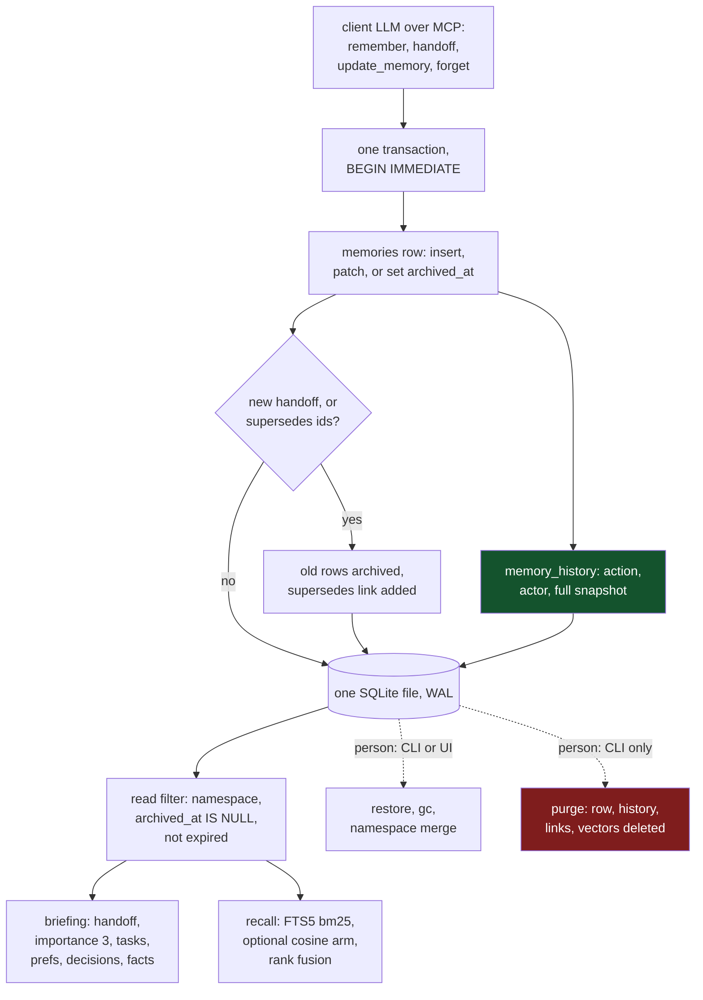

## 1. Executive Summary

llm-memory is a single Go binary that several LLM clients launch as an MCP
server against one SQLite file. A client writes typed memories with explicit
tool calls, and the next client reads a briefing assembled from them: the
latest handoff, essential items, open tasks, preferences, recent decisions and
facts. What is notable is how little the model is allowed to destroy. Its
tools archive and patch, every mutation leaves a snapshot in a history table,
and restore and hard delete exist only at the CLI and the web UI. What is weak
is the edge of that boundary: the web UI has no authentication, and a
namespace merge moves rows without a history entry.

It carries `scope_enforced`, `audit_log` and `negative_eval`.

**Licence.** `LICENSE` is the MIT text with the line
`Copyright (c) 2026 mordicus`. `README.md:338-340` names the same licence.
`go.mod` carries no licence field and the tree has no NOTICE file and no
rider.

**The tool surface has no delete.** The MCP server registers eight tools:
`get_context`, `recall`, `get_memory`, `list_namespaces`, `remember`,
`update_memory`, `forget` and `handoff`
(`internal/server/server.go:175-241`). `forget` sets `archived_at`.
`Store.Purge`, the one statement that deletes a memory, is called from the
CLI's `purge` verb and nowhere else (`internal/store/maintenance.go:40-52`,
`cmd/llm-memory/admin.go:438`). `Store.Restore` is called from the CLI and the
web UI. One row type is deletable by the model: `update_memory` takes
`remove_links`, which deletes a link row
(`internal/server/tools.go:393-397`).

**Every mutation writes history in its own transaction.** Create, update,
archive and restore each end in `writeHistory`, which re-reads the row inside
the transaction and stores the action, the actor and a JSON snapshot of the
whole memory (`internal/store/memories.go:84-99`).

**One archive predicate serves every read.** Full-text search, the recent
list, the vector arm and the duplicate check all take their filter from
`filterSQL` (`internal/store/search.go:128-156`), and the briefing reads
through `List`, whose default adds the same two conditions
(`internal/store/memories.go:487-489`). An archived or expired row is absent
from all of them.

**The handoff is one slot per namespace.** Writing a handoff archives the
previous one in the same transaction and links the new row to it
(`memories.go:211-218`, `:390-407`). Nothing records whether a handoff was
read, so a second client that writes one replaces the first whether or not
anyone saw it.

## 2. Mental Model

A memory is believed from the moment it is written and until someone archives
it. There is no candidate state and no confidence. Correction has three
forms, all explicit: patch the row, archive it, or write a replacement that
names what it supersedes.

## 3. Architecture

Six packages, with SQL confined to one of them.

| Package | Role |
| --- | --- |
| `internal/store` | Schema, migrations, every query; no MCP dependency |
| `internal/briefing` | Renders the text of `get_context`; `render` does no I/O |
| `internal/semantic` | Embeddings client and the hybrid search; optional |
| `internal/server` | MCP tools, resources and prompts; no SQL |
| `internal/ui` | A JSON API and one static page |
| `cmd/llm-memory` | The binary: `serve`, the admin CLI, client setup, hooks |

Each client launches its own process over stdio, and all of them open the same
file, by default `~/.llm-memory/memory.db`, created with a 0700 directory and
a 0600 file (`internal/store/db.go:45`, `:66`). `serve --listen` serves the
same tools over Streamable HTTP, and `--read-only` registers the four read
tools only (`cmd/llm-memory/main.go:246-307`, `server.go:209`).

The connection string sets WAL, a five-second busy timeout, foreign keys and
`_txlock=immediate`, and each process holds one connection
(`db.go:55-57`, `:84-90`). Migrations are embedded SQL files applied in a
transaction each, with the version in `PRAGMA user_version`; a file written
by a newer binary is refused (`db.go:154-186`).

The SQLite driver is `modernc.org/sqlite`, pure Go, so the binary has no C
dependency. The memory data model is in this tree; the MCP SDK and the driver
were not opened.

### Deployment and ergonomics

`setup` prints or writes the MCP entry for six clients, and `setup --hooks`
installs lifecycle hooks for three of them
(`cmd/llm-memory/admin.go:1675-1840`, `hooks.go:29-32`). The README states
that an instruction block must also be pasted into each client, because
without it the model does not call the memory reliably
(`examples/instructions_client.md`).

## 4. Essential Implementation Paths

| Path | Location |
| --- | --- |
| Schema: memories, history, FTS5 and its triggers | `internal/store/migrations/0001_initial.sql:9-51` |
| Embeddings table and the invalidation trigger | `migrations/0002_embeddings.sql:3-15` |
| Connection pragmas and transaction mode | `internal/store/db.go:77-92` |
| History writer | `internal/store/memories.go:84-99` |
| Create, with supersedes and the handoff slot | `memories.go:127-225` |
| Update and the archived-row refusal | `memories.go:251-347` |
| Archive, restore, the single-handoff rule | `memories.go:351-435` |
| Shared read filter | `internal/store/search.go:128-156` |
| Full-text search and duplicate detection | `search.go:100-124`, `:247-290` |
| Vector load, missing-embedding scan | `internal/store/embeddings.go:47-78`, `:135-167` |
| Hybrid search and fusion | `internal/semantic/engine.go:127-164`, `:214-256` |
| Briefing assembly and budget | `internal/briefing/briefing.go:42-98`, `:111-217` |
| Hard delete | `internal/store/maintenance.go:40-52` |
| Namespace rename, merge, archive | `internal/store/namespaces.go:132-252` |
| Export and import | `internal/store/transfer.go:53-268` |
| Tool registration and author | `internal/server/server.go:131-269` |
| Web UI routes | `internal/ui/ui.go:33-397` |
| Hook entry point | `cmd/llm-memory/hooks.go:143-298` |

## 5. Memory Data Model

One table holds every memory (`0001_initial.sql:9-22`,
`0003_expires_at.sql:2`).

- **`kind`**: `preference`, `fact`, `decision`, `task_state`, `handoff`,
  `note`, under a `CHECK`. The `remember` schema omits `handoff`, so a handoff
  is written only by its own tool (`tools.go:619-627`).
- **`content`**: 1 to 8,000 characters. **`title`**: one line, up to 200.
- **`tags`**: a space-joined string of lowercased words.
- **`importance`**: 1, 2 or 3, chosen by the writer. 3 means the row is
  always in the briefing.
- **`source`** and **`updated_by`**: the first and the latest author.
- **`created_at`**, **`updated_at`**: record time; `updated_at` overwrites.
- **`archived_at`**: null while active. This is the only lifecycle column.
- **`expires_at`**: an optional deadline set from `expires_in` or
  `expires_at`.

`memory_history` holds `memory_id`, an `action` under a four-value `CHECK`
(`create`, `update`, `archive`, `restore`), `snapshot`, `changed_by` and
`changed_at`. The snapshot is the whole row after the action, with a `reason`
key on an archive (`memories.go:76-81`).

`memory_links` holds directed `supersedes`, `relates_to` and `depends_on`
edges with a composite primary key (`0004_links.sql:2-9`). They are returned
by `get_memory`, the CLI's `show` and the UI, each with the target's archived
flag. No retrieval path follows them.

`memory_embeddings` is keyed on memory and model, one float32 blob each
(`0002_embeddings.sql:3-10`).

**`trust_state` is withheld.** Active and archived are one bit, and the same
bit carries a wrong memory, an expired one, a replaced handoff and a whole
archived namespace. The reason is a free-text key inside the history snapshot
that no read consults. [Lerim](../lerim/) is withheld the mark on the same
shape.

**`bitemporal` is withheld.** `created_at`, `updated_at` and `archived_at`
are all record time, and `expires_at` is a deadline the writer sets for
retention. No column says when a fact was true.

## 6. Retrieval Mechanics

### The briefing

`briefing.Build` runs up to five reads and renders them
(`briefing.go:42-98`): the namespace's active memories, its row with the latest
write for the header's date and author, an optional focus search, the
active memories of `global`, and the namespace list. The reads are separate
statements, not one snapshot.

`render` writes sections in a fixed order inside a character budget, 6,000 by
default and 400 at least (`briefing.go:111-217`):

1. The latest active handoff, in full, with its headings demoted two levels.
2. Every importance-3 memory, from the namespace and then from `global`.
3. Focus results, when a focus was given.
4. Task states, then project preferences, then global preferences.
5. The ten most recent decisions and the ten most recent facts.
6. A count of notes, a count of what the budget cut, the other namespaces.

A decision or an importance-3 line is cut at 1,000 characters and any other
line at 240, each cut ending in `(get_memory #id)`. A section that does not
fit ends in a line counting what was left out and naming the `recall` filter
that reaches it (`briefing.go:302-330`). The header is written outside the
budget and the handoff is truncated to what remains.

### Search

`Store.Search` splits the query into letter and digit runs, so no input
reaches FTS5 as syntax, and quotes each term as a prefix
(`search.go:47-84`). It tries all terms with AND and, with no result, with OR.
Ranking is bm25 with the title weighted double, multiplied by 1.25 for
importance 3 and 0.85 for importance 1; bm25 is negative, so the larger
factor ranks higher (`search.go:163-169`). An empty query returns the most
recent rows.

With an embeddings endpoint configured, `Engine.Search` loads every stored
vector that passes the same filter, ranks by cosine above a 0.3 floor in Go,
and fuses the two lists by reciprocal rank with k = 60
(`engine.go:127-164`, `:214-256`). If the endpoint fails, the full-text
result is returned and a warning is logged.

### Scope

**`scope_enforced` rests on the namespace**, applied as an equality
predicate by the briefing, by both search arms and by the duplicate check.
The session-start hook resolves it from the client's working directory: a
`.llm-memory` marker file, or the name of the directory holding `.git`
(`internal/config/config.go:133-143`, `:216-241`).

Its limits are these. `recall` with no namespace searches every namespace,
and the tool description says so (`tools.go:181`, `:208-210`). `get_memory`
reads any id. `global` is included in every briefing by design. And over MCP
the namespace is an argument the model chooses; there is one user and no
principal.

## 7. Write Mechanics

A write is one tool call and one transaction, synchronous to the caller. The
row is in the FTS index when the transaction commits, through three triggers
(`0001_initial.sql:42-51`), so the next read sees it. No model is called and
no background pass rewrites anything.

**Create.** `CreateDetailed` validates, refuses text that matches a secret
pattern, inserts, writes history, archives each id in `supersedes` with the
reason `superseded by #N` and a link, and, for a handoff, archives the
namespace's other active handoffs (`memories.go:127-225`).

**Duplicates are reported, not blocked.** `remember` searches active rows of
the namespace with an OR query over the new text's significant words and
keeps those sharing at least half of the smaller word set
(`search.go:232`, `:247-290`). The memory is created regardless, and the
result carries `possible_duplicates` and a hint to forget the new row or fix
the old one (`tools.go:153-171`).

**Update.** A patch changes only the fields supplied. An archived row is
refused with a message naming `restore` (`memories.go:316-318`). There is no
revision check: two clients patching the same field leave the later value in
the row and both versions in history.

**Attribution.** The author is the server's `--source` flag, or the name the
client sent in the MCP handshake, or `unknown`. No tool takes it as an
argument (`server.go:257-269`).

**Secrets.** Eleven patterns and a URL-credentials rule run over content and
title on create and update (`internal/store/secrets.go:14-28`, `:49-70`).
Tags, namespace descriptions and imported rows are not checked.

### Forgetting

- **`forget`** archives with an optional reason kept in the history snapshot.
- **Expiry** is a read-time filter. `gc` turns expired rows into archived ones
  with the reason `expired (TTL)`; it runs when a person calls it from the CLI
  or the UI (`memories.go:544-567`).
- **`purge --archived-before DATE`** deletes archived rows. The foreign keys
  cascade to history, links and embeddings, and the delete trigger removes the
  FTS entry (`maintenance.go:40-52`). It asks for confirmation unless `--yes`
  is passed. The file is not vacuumed, and earlier `backup` and `export`
  outputs are untouched.

**`tombstone` is withheld.** Archiving is keyed on the row. The duplicate
check reads active rows only, and a committed test asserts that an archived
memory is not reported as a duplicate
(`internal/store/search_test.go:281-285`), so a forgotten statement can be
remembered again with no signal. The one place an archived row blocks a
repeat is `import`, which skips a row whose namespace, kind and content equal
an existing one, archived or not (`transfer.go:208-217`).

### Operational cost

Nothing but the file. The vector arm loads and scores every matching vector in
process on each search, which the README bounds at a few thousand memories.

## 8. Agent Integration

The server's instructions tell the model to call `get_context` first, to
`recall` before asking the user, and to `handoff` when the user stops
(`server.go:24-30`). Two resources and two prompts expose the same briefing
(`internal/server/resources_prompts.go:20-60`).

Hooks make the read automatic. On session start the client runs
`llm-memory hook <client> --namespace auto`, which prints the briefing in the
client's hook format: `additionalContext` for Claude Code and Codex, a
`systemMessage` step for Antigravity (`hooks.go:217-298`). The text is
prefixed with one sentence saying it came from the shared memory. Stored
content is otherwise inserted as written, with no delimiter around it. The
pre-compaction and stop hooks print a fixed reminder and up to five open task
states.

**`human_review` is withheld.** Nothing waits. A `remember` is live in the
next briefing, and the model can archive, patch and supersede on its own. The
direction that needs a person is the reverse one: un-archiving and hard delete
have no MCP verb. That keeps a model from undoing a person's removal; it does
not put a person in front of a write.

## 9. Reliability, Safety, and Trust

### The web UI accepts writes from anything that can reach its port

`llm-memory ui` listens on `127.0.0.1:8765` by default and serves 19 routes;
twelve mutate (`ui.go:33-397`). The handler checks no token and no `Origin`
or `Host` header, and `decodeJSON` reads the body without looking at
`Content-Type` (`ui.go:408-415`). A cross-origin `POST` with a plain-text
body needs no preflight, so a page open in the same browser can address
`POST /api/memories` and the archive, restore, supersede, merge and gc
routes. Whether the request is delivered depends on the browser's
local-network policy. The `PUT` routes are preflighted.

The UI's create route accepts any kind and any importance and records the
author as `ui` (`ui.go:204-250`). `serve --listen` likewise adds no
authentication in this tree (`server.go:103-119`).

### An importance-3 row in `global` reaches every project

The briefing places every importance-3 memory of the namespace and of
`global` directly after the handoff, at up to 1,000 characters a line and
with no count cap (`briefing.go:151-163`). Importance is a field the writer
sets. One `remember` with `namespace: global` and `importance: 3`, from any
client or from the UI, is in the opening context of every later session in
every project until someone archives it. With hooks installed it arrives
without the model asking.

### What the history does not record

- **A namespace merge.** `MergeNamespace` runs
  `UPDATE memories SET namespace = ?` over the source namespace and writes no
  history row; the last snapshot of each moved memory still names the old
  namespace (`namespaces.go:194`). A rename cascades the same way.
- **Links.** `AddLink` and `RemoveLink` write no history, and the model can
  remove a `supersedes` link. The archive reason in the superseded row's
  snapshot still names its replacement.
- **A purge.** History goes with the row and nothing records that it
  happened. [Membrane](../membrane/) has the same cascade under its revision
  table.
- **Import provenance.** An import inserts the dump's history rows with their
  actors and timestamps after checking only that the action is known and the
  snapshot is valid JSON (`transfer.go:252-266`).

### Several processes on one file

Every write path is a single transaction that takes the write lock at
`BEGIN` and re-reads the row inside it, so a read-modify-write cannot
interleave (`db.go:88-90`, `memories.go:311-343`). A writer that waits longer
than five seconds fails, and the tool returns an internal error asking the
model to retry once (`tools.go:580-582`).

Two things sit outside a transaction. The duplicate search in `remember`
runs before the insert. And `update_memory` applies the field patch, then
each link change, as separate transactions: a link that fails leaves the
patch committed and the call reporting an error (`tools.go:373-397`).

No committed test holds two stores open on one file at once; the two-client
test closes the first before opening the second
(`internal/server/server_test.go:275-278`).

### What the embeddings path sends

With an endpoint configured, the request body is a model name and a list of
texts (`internal/semantic/client.go:101-115`). The texts are:

- **Every memory in the file**, title, content and tags, 64 per search until
  none is missing. The scan has no namespace filter and orders active rows
  before archived ones, so archived memories are sent too
  (`embeddings.go:47-53`, `engine.go:144-150`).
- **Each search query**, including a briefing's focus string.
- **The text of each new memory.** `remember` calls the engine's
  `FindSimilar` when semantic search is on (`tools.go:131-137`,
  `engine.go:273-285`). `README.md:296` says duplicate detection stays
  full-text and that writing never depends on the API; the second half holds,
  since a failure is logged and ignored.

A trigger deletes a memory's vectors when its title, content or tags change
(`0002_embeddings.sql:13-15`), and archiving leaves them in place behind the
read filter. One window remains: `Index` reads the text, calls the endpoint,
then stores the vector if the row still exists (`engine.go:80-110`,
`embeddings.go:101-104`). An edit committed by another process during the
call fires the trigger before the vector exists, and the vector of the old
text is then stored and kept until the next edit or a `reindex --all`.

### Two smaller reads

`recall` with `include_archived` drops the expiry condition together with the
archive one. An expired row not yet collected by `gc` comes back with
`archived` false, and the result view has no expiry field
(`search.go:146-148`, `tools.go:189-199`).

`list_namespaces` and the briefing footer count rows with `archived_at` null,
so an expired row is counted as active while every listing omits it
(`namespaces.go:92`).

## 10. Tests, Evals, and Benchmarks

114 test functions in 15 files, 5,102 lines, with 13 golden files.
`.github/workflows/ci.yml` runs `go vet`, the suite and a lint job on push and
pull request; the race detector is on for Linux and macOS. I ran none of
them.

**The suite asserts absence against populated results.**
`TestContentOrderAndDedup` builds a namespace of twenty active memories with
one archived handoff and asserts that `Old handoff` is not in the briefing
while the active handoff's last line is
(`internal/briefing/briefing_test.go:186-189`). `TestHandoffBetweenClients`
writes two handoffs from one client, opens a second, and asserts that the
first handoff's text is absent from a briefing that must contain five other
strings (`internal/server/server_test.go:281-288`).
`TestSearchFiltersAndLimits` searches a term present in two namespaces and
requires exactly the row from the named one
(`internal/store/search_test.go:193-196`). `negative_eval` rests on these.

Two further cases assert an empty result after an archive, each paired with
an include-archived read that must return the row
(`search_test.go:209-218`, `internal/semantic/engine_test.go:126-134`).

Other cases: one history row per write with actor and content
(`internal/store/memories_test.go:106-158`); the single-handoff rule through
create, restore, a kind change and a namespace move (`:342-398`); no orphan
history or FTS rows after a purge (`internal/store/transfer_test.go:207-218`);
the tool list and the read-only tool list
(`server_test.go:121-170`, `:523-552`); and `remember` refusing the kind
`handoff` (`:337`).

The golden files pin text: six briefings at different budgets and the output
of seven CLI invocations, with dates masked. `loaded_demo.golden` shows the full
section order.

Not covered: two processes writing at once, the history of a merged or
renamed namespace, any header check on the UI, the embedding-store window, and
an expired row under `include_archived`.

No paper, DOI or benchmark is cited in the tree, and no retrieval quality
measure is committed.

## 11. For Your Own Build

### Steal

**Write the history row in the mutating transaction, as a snapshot.** A
snapshot of the row after each action makes a history readable without
replaying diffs, and re-reading inside the transaction means it records what
was committed.

**Build the archive and expiry conditions once.** One function that returns
the filter fragment for every search arm is why the vector arm, the recent
list and the duplicate check cannot disagree about what is hidden.

**Keep restore and hard delete off the tool surface.** The model can retire a
memory and cannot bring one back or erase one.

**Take the author from the transport.** The handshake's client name, with a
server-side override, is harder to forge than a tool argument and costs
nothing.

**Invalidate embeddings with a trigger on the text columns.** The store does
not depend on every writer remembering.

**Make the session briefing a deterministic render with a budget and explicit
omission lines.** Each cut names how many items were left out and the query
that reaches them.

### Avoid

**Do not serve a write API on localhost without an origin check or a token.**

**Do not let a writer-chosen number decide what enters every project's
opening context.** Importance 3 in a shared namespace is a broadcast.

**Do not move rows between scopes outside the mutation log.**

**Do not scan the whole store for an embeddings backfill when the search was
scoped.** Archived rows and other projects' rows leave the machine on a query
that named neither.

**Do not keep one handoff slot without a read marker** where two clients can
be open at once.

### Fit

It fits one person moving between several assistants on one machine, with a
few hundred to a few thousand deliberately written memories and no wish to run
a service. It asks for discipline from the model and a pasted instruction
block per client, and it gives back a store a person can read, export and
repair with a CLI. It does not fit a team, a network deployment, or any
setting where the writing model is not trusted to choose importance and
namespace. A reader who needs a memory to wait for approval, or a rejected
statement to stay rejected, is not served by it.

## 12. Open Questions

- **Is the UI meant to be reachable only by its own page?** Nothing in the
  handler says so.
- **Should a merge or a rename write history?** The archive of displaced
  handoffs inside the same merge does.
- **Is the semantic duplicate check in `remember` intended?** The README
  describes the opposite.
- **Should the embedding backfill follow the search's namespace and archive
  filter?**
- **What should happen to an unread handoff when a second client writes
  one?**

## Appendix: File Index

| File | Role |
| --- | --- |
| `internal/store/migrations/0001_initial.sql` to `0004_links.sql` | Schema, FTS triggers, embeddings trigger |
| `internal/store/memories.go` | Create, update, archive, restore, list, history writer |
| `internal/store/search.go` | FTS5 search, shared filter, duplicate detection |
| `internal/store/embeddings.go` | Vector storage, missing scan, filtered vector load |
| `internal/store/namespaces.go` | Namespace list, rename, merge, archive |
| `internal/store/maintenance.go` | Purge, stats, integrity check, backup |
| `internal/store/transfer.go` | JSON export and import |
| `internal/store/secrets.go` | Secret patterns |
| `internal/semantic/engine.go`, `client.go` | Hybrid search, fusion, embeddings client |
| `internal/briefing/briefing.go` | Briefing assembly and budgeted writer |
| `internal/server/server.go`, `tools.go`, `resources_prompts.go` | MCP surface |
| `internal/ui/ui.go` | Web UI routes |
| `cmd/llm-memory/main.go`, `admin.go`, `hooks.go` | Binary, CLI verbs, hooks |
| `internal/store/memories_test.go`, `search_test.go` | History, handoff slot, filters |
| `internal/briefing/briefing_test.go`, `internal/server/server_test.go` | Briefing and end-to-end tool cases |

### Recorded searches

Run with `/usr/bin/git` in a full clone at the pinned commit.

- `git ls-files '*.go' | grep -v _test.go | xargs cat | wc -l` — 8,485 lines in 22 files; `git ls-files '*_test.go' | xargs cat | wc -l` — 5,102 in 15.
- `git grep -c -E '^func Test' -- '*_test.go'`, summed — 114.
- `git grep -n -E 'DELETE FROM|DROP TABLE' -- '*.go' '*.sql' ':!*_test.go'` — five: the embeddings reset, the link removal, the purge, the embeddings trigger and the merged namespace's own row. None names `memory_history`.
- `git grep -n -E 'memory_history' -- '*.go' '*.sql' ':!*_test.go'` — the table, its index, one read, two comments and two inserts (`memories.go:94`, `transfer.go:262`).
- `git grep -n -E 'UPDATE memories|UPDATE namespaces SET name' -- '*.go' ':!*_test.go'` — the patch, the archive, the restore, the rename and the merge at `namespaces.go:194`.
- `git grep -n -E 'ArchiveExpired|\.Purge\(|\.Restore\(|MergeNamespace\(|RenameNamespace\(' -- ':!*_test.go'` — callers in `cmd/llm-memory/admin.go` and `internal/ui/ui.go` only; `Purge` at `admin.go:438` only.
- `git grep -n -E 'restore|purge' -- internal/server` — message strings and a schema description; no tool.
- `git grep -n -i -E 'Origin|Sec-Fetch|csrf|r\.Host|Authorization|token' -- internal/ui internal/server/server.go` — one line of instruction prose in `server.go`; nothing in `internal/ui`. Control: `git grep -n 'Authorization' -- internal/semantic` matches `client.go:114`.
- `git grep -n -i -E 'secure_delete|VACUUM|wal_checkpoint' -- '*.go' '*.sql'` — `VACUUM INTO` in the backup only.
- `git grep -n -E 'WaitGroup|go func|t\.Parallel|errgroup' -- '*_test.go'` — one goroutine driving `serve` through pipes; no concurrent-writer test.
- `git grep -n -i -E 'valid_from|valid_to|valid_at|valid_until|event_time|observed_at|as_of' -- .` — nothing.
- `git grep -n -i -E 'pending|approve|review|confidence|trust|verified|status' -- '*.sql' internal/store/models.go` — nothing. Control: `git grep -c -i 'archived_at' -- internal/store/models.go` matches.
- `git grep -n -i -E 'arxiv|bibtex|@article|@misc|doi\.org|CITATION' -- . ':!go.sum'` — nothing.
- `git ls-files | grep -i -E '(^|/)(licen[sc]e|copying|notice|contributing|third.party)'` — `LICENSE` only.

## History

**2026-11-17** — [`93974b5e9caaae71b9b61c1c1eec3cc4ed73abed`](https://github.com/Morditux/llm-memory/commit/93974b5e9caaae71b9b61c1c1eec3cc4ed73abed) — first reading, of the whole tree. Screened before reading: no auto-run surface; a `Makefile`, and `go.mod` and `go.sum` changed inside the seven-day cooldown; nothing was installed, built or run. No test was executed and no finding was re-derived outside the tree; the MCP SDK and the SQLite driver were not opened. Three marks: `scope_enforced`, `audit_log` and `negative_eval`. `trust_state` is withheld because active and archived are one bit shared by every reason for removal, `tombstone` because archiving is keyed on the row and the duplicate check reads active rows only, `bitemporal` because every timestamp is record time, and `human_review` because no write waits for anyone.
