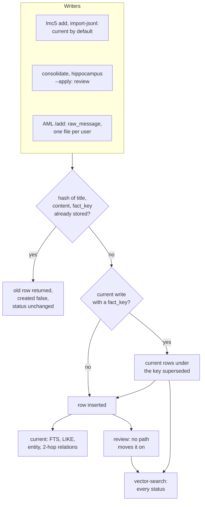

## 1. Executive Summary

LMC-5 is a Python memory for agents that keeps memories in one SQLite file
and recalls them in a later session. Its README leads with that. A write under
a `fact_key` supersedes the current row for that key and keeps the old one. A
PostgreSQL toolkit in `extras/` supplies recall hooks for Claude Code, and
`extras/aml` is an HTTP Add/Search service built on the SQLite core for an
evaluation.

What is notable is the discipline of the SQLite read path. Every recall arm
applies one live-row predicate: FTS, the LIKE fallback, the entity index and
two-hop relation expansion. A test with six populated rows proves it. Rows
written by the automatic consolidation and hippocampus passes land as `review`
and stay out of recall.

What is weak is correction. Content deduplication runs before supersession, so
rewriting a value the store already holds returns the old row. After
Alice → Sam → Alice under one key, Sam stays current. Nothing moves a `review`
row anywhere. The documented human gate on fact supersession, the conflict
verdicts and the validity columns have no writer in the tree. Vector search
ignores status in both stores.

**Licence.** The contribution term is the finding. `CONTRIBUTING.md` says a
pull request grants rights *"only under the repository's public AGPL
license"*. It says third-party code will not be merged into a release intended
for dual licensing without *"a separate explicit written grant"* to the holder.
A contributor therefore gives the holder proprietary relicensing rights and
receives AGPL terms back, and no contributor agreement is in the tree.
`COMMERCIAL-LICENSE.md` names the holder only as the GitHub handle
`wuxuyun0606-collab` and states that it is not itself a grant. It also says
ownership of the covered code must be verified before any commercial agreement.
All but 16 of the commits carry the author name `LMC-5 contributors`. Releases
through `v0.2.0` stay MIT.

## 2. Mental Model

A memory is a row with a title, content, a thread (the "X" axis), tags, an
optional `fact_key`, and a `status` drawn from `current`, `review`,
`superseded`, `historical`, `archived` and `candidate_thread`
(`src/lmc5/models.py:8`). Typed relations form the "Y" axis. Fact keys and
status form "Z". Emotion fields with a mandatory author and initial priority
form "E", and the recall gate forms "M".

A row becomes a belief by being written as `current`. That is the default for
`lmc5 add` and `import-jsonl`, and any caller may pass another status
(`src/lmc5/cli.py:430`). It stops being one in one way. A later `current`
write under the same `fact_key` sets `status = 'superseded'` and
`active_fact = 0` on every current row for that key
(`src/lmc5/store.py:874-886`). No other path changes a row's status, and no
path deletes a memory.

Rows from the two automatic passes are written `review`: consolidation
observations (`src/lmc5/consolidation.py:195-207`) and hippocampus atoms
(`src/lmc5/hippocampus.py:500-513`). `review` is withheld from every recall
arm. The patrol reports *"memories are waiting for review"*
(`src/lmc5/metabolism.py:114-125`), and nothing in the tree takes them out of
that state. In the SQLite core the state records which writer produced a row.

Deduplication decides before supersession does. `add_memory` hashes title,
content and fact key, and if that hash exists it returns the stored row with
`created = False` before reaching the supersede step
(`src/lmc5/store.py:865-872`). Re-asserting an older value finds the
superseded row and changes nothing, and the newer value stays current. The CLI
prints the returned row with its `superseded` status. The same holds when a
user writes, as `current`, text that a hippocampus atom already stored as
`review`.

## 3. Architecture

The core is a zero-dependency Python package with a `lmc5` CLI
(`pyproject.toml`). `MemoryStore.init` creates the SQLite schema: `memories`
with an FTS5 mirror, `relations`, `memory_entities`, `events` with its own FTS5
table, `vectors` stored as JSON, `event_chunks`, `z_conflict_audits`,
`recall_runs` with trace items, and the `current_state_*` pack
(`src/lmc5/store.py:462-702`). SQLite triggers abort any insert carrying E-axis
content without an author and initial priority, and any later change to those
fields (`src/lmc5/store.py:719-756`).

`extras/pgvector_backend` is a toolkit, not a store with its own writers. It
ships a PostgreSQL schema (`schema.sql`), a `RecallPipeline` with channel
adapters, a pgvector store, embedder and reranker adapters, and three Claude
Code hooks. Curated memories enter only through callbacks the host supplies to
`NightDream` (`extras/pgvector_backend/night_dream.py:275-320`), and the
installed CLI always opens SQLite (`extras/pgvector_backend/README.md`).

`extras/aml` is a threaded HTTP server with bearer auth. It stores each user's
messages in a separate SQLite file named by a hash of `user_id`
(`extras/aml/shell/server.py:558-559`). It embeds through DashScope and
reranks through the TypeSafe JEV API under a local budget ledger.

### Deployment and ergonomics

The SQLite core needs Python 3.9 with FTS5 and nothing else, runs offline, and
needs no API key. JEV reranking is opt-in and sends redacted query and memory
text to `api.typesafe.ai` (`src/lmc5/jev.py:46-90`). The database is a plain
SQLite file a person can open and repair by hand. The PostgreSQL path needs a
server with pgvector 0.7 or later, `psycopg2`, an embedder key or a local
sentence-transformers model for the vector channel, and a scheduler for the
nightly passes. The AML service needs a DashScope key, a JEV key and an
initialised ledger.

## 4. Essential Implementation Paths

- **Write.** `MemoryStore.add_memory` validates enums and E-axis ranges,
  dedups on the content hash, supersedes same-key current rows, inserts the
  row and its FTS mirror, and re-indexes entities
  (`src/lmc5/store.py:805-940`).
- **Raw events.** `log_event` dedups on a hash of role, content, channel and
  metadata (`src/lmc5/store.py:1047-1088`). `consolidate_events` groups
  unchunked events into windows of 20 and writes one `review` observation per
  window (`src/lmc5/consolidation.py:124-227`).
- **Hippocampus.** `run_hippocampus` builds one candidate per non-tool event,
  rejects low importance, non-normal risk and secret-looking text, and on
  `--apply` writes up to ten `review` rows with safe relations
  (`src/lmc5/hippocampus.py:441-585`). `contradicts`, `cause_effect` and
  `supports` hints are returned as plans and not written (`:397-415`).
- **Recall.** `recall_hits` gathers FTS and LIKE candidates, adds entity
  matches and two-hop relation neighbours, scores them, applies the M gate,
  increments `hit_count`, and writes a trace (`src/lmc5/store.py:2045-2169`).
- **Conflict audit.** `run_z_audit` finds same-key `current`/`review` pairs and
  live `contradicts` edges, and with `--apply` inserts `pending` rows
  (`src/lmc5/fact_evolution.py:73-235`).
- **Current state.** `refresh_current_state` deletes and rebuilds a TTL-bound
  pack of current facts, active threads, pending audits and recent events
  (`src/lmc5/store.py:1239-1431`).
- **Hooks.** SessionEnd archives a Claude Code transcript into
  `lmc5_raw_events` (`extras/pgvector_backend/hooks/session_end.py:20-84`).
  SessionStart injects identity rows, current facts, narrative and open
  threads (`hooks/session_start.py:24-144`). UserPromptSubmit runs the pipeline
  and prints its injection text (`hooks/user_prompt_submit.py:109-278`).

## 5. Memory Data Model

The `memories` table carries `fact_key`, `active_fact`, `status`,
`risk_level`, `urgency`, the E-axis fields, `confidence`, `source`,
`created_at`, `updated_at`, `hit_count`, `last_hit_at` and a unique
`content_hash` (`src/lmc5/store.py:465-493`). `updated_at` is overwritten on
supersession. There is no `superseded_by` link in SQLite; the chain is
recoverable only by `fact_key` and timestamps.

No memory column names a user, project or agent. Events carry a `channel`.
`z_conflict_audits` has `status`, `verdict` and `reviewer` columns, all
defaulting to `pending` or empty (`src/lmc5/store.py:614-629`).

The PostgreSQL schema adds `version_status`, `superseded_by`, `superseded_at`,
`valid_at`, `invalid_at`, `protected` and `trust_level` to curated memories
(`extras/pgvector_backend/schema.sql:42-55`), an `lmc5_z_audit` table whose
comment says supersession runs only after a human `--approve` (`:180-197`), and
an `lmc5_e_axis_proposals` queue (`:116-131`). Raw events carry `session_id`.

## 6. Retrieval Mechanics

In SQLite, `LIVE_MEMORY_SQL` is `status = 'current' AND (fact_key IS NULL OR
active_fact = 1)` (`src/lmc5/store.py:263`). The recent fallback, the FTS
query, the LIKE fallback and the entity join all apply it
(`:1770-1873`). Relation expansion requires both endpoints live and the
relation type in the safe set, with a strength above 0.4 at one hop and 0.7 at
two (`:1875-1937`). `metabolic_gate` then drops any non-current row, noise
sources and categories, and in surface mode anything not in the `retain`
bucket (`src/lmc5/scoring.py:119-226`).

The score is a transparent sum of priority, match, relation, entity and
recency terms times the gate factor. Priority adds 0.1 per past hit up to 1.0
(`src/lmc5/scoring.py:92-116`), and every recall increments `hit_count` on what
it returns (`src/lmc5/store.py:2137-2147`). Results that are retrieved
therefore rank higher next time.

`search_vectors` is separate. It scans every vector of the requested model,
loads each owner, and applies no status filter (`src/lmc5/store.py:1724-1768`).
It is reached from `lmc5 vector-search` and from the AML search, which fuses
it with lexical recall by RRF (`extras/aml/shell/server.py:731-737`).

The PostgreSQL pipeline fuses vector, curated FTS, raw-event FTS, a literal
raw-event search, graph expansion, emotion resonance and a perception cache.
The FTS, graph and emotion adapters filter `version_status = 'current'`
(`extras/pgvector_backend/recall_pipeline.py:1218-1243`, `:1471-1580`,
`:1583-1672`). The vector adapter passes only `owner_type` to
`PgvectorStore.search_vectors`, which filters by model and dimension
(`extras/pgvector_backend/vector_pgvector.py:195-224`). The quarantine
migration deletes vectors for that reason, *"because vector recall may not be
able to see version_status"*
(`extras/pgvector_backend/migrations/20260620_quarantine_heartbeat_detector_pollution.sql:13-14`).

## 7. Write Mechanics

Writes are synchronous SQLite statements with a commit per call, and a row is
recallable as soon as `add_memory` returns. No LLM is on the core write path.
Consolidation and the hippocampus pass are deterministic and run only when
invoked. Neither rewrites existing rows. `refresh_current_state` deletes and
rebuilds its pack on each run, bounded by its four limits.

Supersession is automatic and immediate for any `current` write with a
`fact_key`. That contradicts `docs/Z_FACT_EVOLUTION.md:42`, *"never
auto-supersede without review"*. The conflict audit can only find a same-key pair
when at least one row was written as `review` or inactive, and the tests set it
up by writing both as `review` (`tests/test_fact_evolution.py:6-31`). The same
document says a superseded row *"gets a `superseded_at` timestamp"* (`:35`),
and the SQLite table has no such column.

The pgvector toolkit writes raw events from SessionEnd and E-axis proposals
from `e_axis_trigger.py:196`, and its patrol expires duplicate, orphaned and dead `contradicts` edges by
setting `valid_until` (`extras/pgvector_backend/patrol.py:195-211`). Curated
rows, relations and audits are written by callbacks the host supplies. The express-dream step at session end returns
`{"status": "skipped"}` (`hooks/session_end.py:87-106`). The AML Add endpoint
stores each message as a `current` `raw_message` row with its timestamp in
`source`, embeds it in the same request, and caches the response by
`request_id` (`extras/aml/shell/server.py:647-711`).

## 8. Agent Integration

The core has no agent-facing tool surface. An agent reaches it through the
CLI or the Python API. The Claude Code hooks inject context automatically at
session start and on each non-trivial prompt, skipping messages such as `ok`
(`hooks/user_prompt_submit.py:28-32`). A file-backed injection history
prevents the same memory being injected twice in one session
(`extras/pgvector_backend/recall_history.py`). The prompt hook excludes the
active session's raw events from both raw-event channels
(`hooks/user_prompt_submit.py:185-196`, `:220-227`).

`extras/claude_code/refined_session_carryover.py` trims a transcript for
resume. It is stated not to be a memory writer and writes nothing to either
store.

## 9. Reliability, Safety, and Trust

### Correction that cannot reverse

The content hash covers title, content and fact key and is unique. A value
that was ever stored under a key cannot be written again, so a correction back
to an earlier value is absorbed by the superseded row while the wrong value
stays current. No test covers the case. There is no delete either, so the only
way out is SQL.

### Gates without a hand

- **`review` rows** have no exit. Recall withholds them and nothing promotes,
  rejects or archives them.
- **`z_conflict_audits`** rows are inserted `pending`. The current-state pack
  and the patrol report them, and no code writes `verdict` or `reviewer`.
- **The PostgreSQL `lmc5_z_audit`** names an `--approve` step in a schema
  comment and in `docs/DEEPSEEK_INTEGRATION.md:70`. No such command or function
  exists, and only the quarantine migration writes the table.
- **E-axis proposals** are inserted `pending`, read back only to avoid
  duplicates, and nothing resolves them.

### What holds

The E-axis rule is enforced in the database, not in Python. An insert with
emotion fields and no author or priority aborts. An update to any of them
aborts with *"create a successor record"*, and the PostgreSQL schema carries
the same trigger (`extras/pgvector_backend/schema.sql:90-113`). The author is
a caller-supplied string. Output redaction masks bearer tokens, keys, DSNs and
IP addresses (`src/lmc5/redact.py:9-25`). The CLI's `recall` applies it, and
the Python `recall` defaults to `redact=False`. The hippocampus rejects
candidates matching secret patterns (`src/lmc5/hippocampus.py:27-30`).

### Marks

- **`negative_eval`** — awarded; see section 10.
- **`trust_state`** — withheld. The `status` field filters every SQLite recall
  arm, and `review` withholds a row, which is the shape the mark asks for. But
  `review`, `historical`, `archived` and `candidate_thread` are set at write
  and never change. The one transition the code makes is `current` to
  `superseded` on a same-key write, which is versioning. No state is reached by
  judgement.
- **`tombstone`** — withheld. The unique content hash does stop a superseded
  value being re-asserted, but as deduplication keyed on the whole row. It
  records no rejection, blocks legitimate reversals equally, and a one-word
  change to the title passes it.
- **`bitemporal`** — withheld. SQLite keeps `created_at` and `updated_at`.
  The PostgreSQL `valid_at` and `invalid_at` columns have no writer in Python,
  the migration sets `invalid_at` to `NOW()`, and relation `valid_until` is
  stamped `NOW()` by the patrol. AML keeps each message's
  timestamp in `source` and uses it only to order results.
- **`scope_enforced`** — withheld. Memories carry no scope key. Event `channel`
  is a source label applied only when a caller passes it. AML's per-user files
  are a physical partition. Excluding the active session's raw events keeps the
  current conversation out, the reverse of a scope.
- **`audit_log`** — withheld. Supersession is an in-place `UPDATE` with no
  event. `recall_runs`, `consolidation_runs` and `current_state_runs` log reads
  and runs, not mutations of memory.
- **`human_review`** — withheld. Every queue above is filled and none is
  drained.

### Other risks

- **Vector search ignores status** in both stores, so a superseded or `review`
  row with a vector is returned by `vector-search` and the AML search.
- **Recall writes.** Every recall commits `hit_count` updates and, by default,
  a trace row, so a read-only consumer still mutates the store.

## 10. Tests, Evals, and Benchmarks

The suite has 152 pytest functions under `tests/` and 8 under
`extras/aml/tests`. CI runs both on push and pull request
(`.github/workflows/ci.yml:8-21`). I ran none of it.

`negative_eval` rests on `tests/test_store.py:41-85`. It writes six memories
that all match "endpoint": a current fact, the fact it superseded, an inactive
fact, and `review`, `historical` and `archived` rows. It asserts the current
fact is returned and the other five are not, so the case fails if recall
returns nothing. `:376-415` asserts that relation expansion does not reach
archived, superseded or inactive targets. That case has no positive
assertion.

`test_raw_event_session_exclusion.py` checks the active-session predicate
against fake cursors. `test_auth_health_and_user_isolation` writes three
messages for one user and asserts another user's search is empty
(`extras/aml/tests/test_serving.py:128-147`). That user has no file, so the
search returns before opening any store.

No test re-asserts a superseded value, searches vectors after supersession, or
resolves a conflict audit. No paper is associated with the project. The
fusion A/B in `docs/archive/RECALL_FUSION_AB_20260706.md` reports channel
composition over 726 private traces with no relevance labels. Its data is not
committed. The 67% false-positive figure for automatic supersession is
attributed to a private deployment. The AML README states its tests do not
establish benchmark scores, and no score is published in the tree.

## 11. For Your Own Build

### Steal

- **One live-row predicate, applied on every arm.** Define the predicate once
  as SQL and splice it into FTS, the fallback, the entity join and both ends of
  a relation hop. Then test it with one query that matches a row in every
  excluded state.
- **Enforce authorship in the database.** A trigger that refuses emotion fields
  without an author and refuses any later edit makes the immutability survive
  raw SQL.
- **Keep model-proposed relation types out of the graph.** Write only a safe
  set automatically and return `contradicts` and `supports` as plans.

### Avoid

- **Deduplicating before versioning.** Check the content hash only against the
  current row for the key, or a correction back to an earlier value is
  swallowed.
- **A review state with no exit.** A status that withholds rows needs a verb
  that releases or rejects them, or the automatic writers produce rows nobody
  reads.
- **A vector arm outside the status predicate.** If vectors live in a separate
  table, join the owner's status on every query.

### Fit

This suits one person or one agent wanting a small, local, inspectable store
of facts and notes, where values move forward and rarely back. The PostgreSQL
toolkit suits someone already running a Claude Code companion who will write
the curation callbacks and the review tooling the docs describe. Walk away if
you need multi-user isolation inside one store, corrections that can return to
an earlier value, or a review gate that works as shipped.

## 12. Open Questions

- Whether the private deployment behind the toolkit has the `--approve` and
  verdict writers the docs describe, and whether they will be published.
- Whether the content-hash dedup ahead of supersession is intended for fact
  keys, given the README's Alice/Sam example.
- What the AML evaluation measured, and on what data.

## Appendix: File Index

- Storage and schema: `src/lmc5/store.py`, `src/lmc5/models.py`,
  `extras/pgvector_backend/schema.sql`, `extras/pgvector_backend/migrations/`
- Write path: `src/lmc5/store.py` (`add_memory`, `log_event`),
  `src/lmc5/consolidation.py`, `src/lmc5/hippocampus.py`,
  `extras/pgvector_backend/night_dream.py`
- Retrieval: `src/lmc5/store.py` (`recall_hits`, `search_vectors`),
  `src/lmc5/scoring.py`, `extras/pgvector_backend/recall_pipeline.py`,
  `extras/pgvector_backend/vector_pgvector.py`
- Correction and patrol: `src/lmc5/fact_evolution.py`, `src/lmc5/metabolism.py`
- Integration: `src/lmc5/cli.py`, `extras/pgvector_backend/hooks/`,
  `extras/aml/shell/server.py`, `src/lmc5/jev.py`
- Tests: `tests/test_store.py`, `tests/test_fact_evolution.py`,
  `tests/test_hippocampus.py`, `tests/test_raw_event_session_exclusion.py`,
  `extras/aml/tests/test_serving.py`

### Recorded searches

Run from the repository root at the pinned commit with `/usr/bin/git grep`.

- **Only supersession and hit counting update a memory.**
  `git grep -n -E "UPDATE memories" -- src extras` matches
  `src/lmc5/store.py:877` (supersede) and `:2141` (`hit_count`).
- **Nothing resolves a conflict audit.**
  `git grep -n -E "UPDATE z_conflict_audits|reviewer *=" -- src extras`
  returns nothing; `git grep -c "z_conflict_audits" -- src/lmc5/fact_evolution.py`
  counts 3.
- **No validity-time writer.**
  `git grep -n -E "valid_at|invalid_at|superseded_at" -- '*.py'` returns
  nothing; the same pattern over `extras/pgvector_backend/schema.sql` matches
  lines 46 and 47.
- **No approve verb.** `git grep -n -i "approve" -- '*.py'` returns nothing;
  over `extras/pgvector_backend/schema.sql` it matches line 182.
- **No memory delete.**
  `git grep -n -E "DELETE FROM memories([^_a-z]|$)" -- src extras` returns
  nothing; `git grep -n -E "DELETE FROM memories" -- src` matches the FTS
  rebuild at `src/lmc5/store.py:759`.
- **The pgvector vector search reads no status.**
  `git grep -n -E "status" -- extras/pgvector_backend/vector_pgvector.py`
  returns nothing; `git grep -c "version_status" -- extras/pgvector_backend/recall_pipeline.py`
  counts 6.
- **No scope column in the core.**
  `git grep -n -w -E "user_id|project_id|agent_id|tenant_id" -- src` returns
  nothing; `git grep -n -w "user_id" -- extras/aml/shell/server.py` matches.
- **The proposal queue has no reader that resolves it.**
  `git grep -n "lmc5_e_axis_proposals" -- '*.py'` matches only
  `extras/pgvector_backend/e_axis_trigger.py:188` and `:196`.
- **No curated-memory writer in the toolkit.**
  `git grep -n -i -E "INSERT INTO lmc5_curated" -- '*.py'` returns nothing;
  over `extras/pgvector_backend/README.md` it matches the walkthrough at line 56.
- **No paper.**
  `git grep -n -i -E "arxiv|bibtex|@article|@misc|doi\.org|CITATION"` returns
  nothing; `git grep -n -i -E "agpl|affero" -- LICENSING.md` matches lines 6
  and 7.

## History

**2026-11-20** — [`01b321bf5a89a9d5d7e70fd9dbeefc515d156a10`](https://github.com/wuxuyun0606-collab/lmc-5/commit/01b321bf5a89a9d5d7e70fd9dbeefc515d156a10) — first reading, from a clone of `main` at version 0.3.0, covering the SQLite core in full, the PostgreSQL toolkit's schema, hooks, recall adapters and writers, the AML Add/Search path, and the tests behind each. Screened first: no auto-run surface; two build-time execution points, `setup.py` and a Makefile; `pyproject.toml` inside the seven-day cooldown and unpinned, with no lockfile; floating ranges in `extras/aml/requirements.txt`. AGPL-3.0-or-later with a commercial option, no rider against analysis. Nothing installed, built or run. One mark: `negative_eval`.
