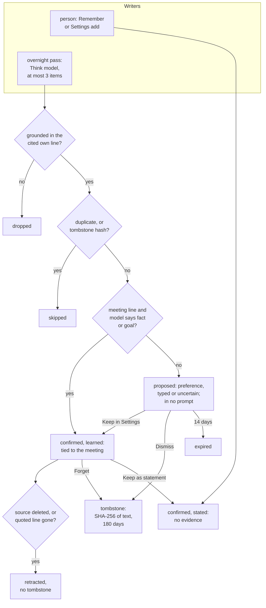

## 1. Executive Summary

LokalBot is a local-first macOS app, with a Rust Windows and Linux port in
alpha, that records meetings without a bot, keeps screen and activity memory,
and answers questions over them with local models. Most of the code is
capture, transcription, search, autocomplete and the agent surfaces. The agent
memory in it is small: **Personal Context**, an encrypted list of at most 300
claims about the person, and the **work memory** the nightly review keeps of
projects and goals. Their services are about 2% of the Swift and 1% of the
Rust. This report is scoped to them; the meeting
library and screen memory appear only as the evidence they are learned from.

What is notable is that a learned claim depends on its source. The overnight
pass reads only the person's own lines and keeps an item only if it is grounded
in the line it cites. A claim learned from a meeting is retracted when that
meeting is deleted, or when a correction removes the quoted line. Forgetting or
dismissing a learned claim leaves a hash of its text that the next night's
writer checks.

What is weak is the routing. For a meeting line the model's own kind label
decides whether an item waits for review: a fact or goal is saved and used at
once. Editing a claim leaves the old value learnable, a restated fact sits
beside the one it contradicts, and tombstones lapse after 180 days.

**Licence.** The AGPL-3.0 network clause reaches the whole app, not only the
code it covers. Cotabby-derived autocomplete parts *"remain under the GNU
Affero General Public License version 3"*, and, as GPL-3.0 section 13
provides, *"AGPL-3.0's section 13 requirements on interaction through a
network apply to the combination as such"* (`THIRD_PARTY_NOTICES.md:44-56`).
Anyone who offers a modified LokalBot to users over a network owes them the
complete source, whichever part was changed. The rest of the tree is
GPL-3.0-only in `LICENSE` and `LinuxWindows/Cargo.toml:9`, and the memory
code is GPL-3.0. Models are downloaded, not bundled. The notices say the LFM
licence carries a commercial-use revenue threshold
(`THIRD_PARTY_NOTICES.md:40-42`), and LFM2.5 is the Lightweight preset's
autocomplete model.

## 2. Mental Model

A **claim** is one sentence about the person, of one of four kinds: fact,
preference, goal or principle (`LokalBot/Services/PersonalModel/PersonalClaim.swift:10-78`).
Each claim carries an origin, a `status` and an `authority`. Status is
`confirmed` (in use) or `proposed` (*"waiting for the person's review; never
used"*). Authority is `stated`, `learned`, or `confirmed` for a learned claim
the person kept (`:46-60`). A learned claim also carries `evidence`, the
meeting or day it came from, and `quote`, the person's own line.

There are two ways in. The person types *Remember …* in Ask, which a parser
recognizes in English and Serbian, or adds a claim in Settings. Either way it
is `confirmed` and `stated`, with no evidence (`:521-557`, `:315-338`). The
second way is the overnight pass. It reads the day's own-speech meeting turns
and typed lines, asks the Think model for at most three items, and keeps only
those grounded in the line they cite (`PersonalLearning.swift:551-570`).
`PersonalModel.learn` then decides where each lands (`PersonalClaim.swift:433-466`):

- a principle is never learned;
- a duplicate, a near-duplicate of a current claim, or a value matching a
  tombstone is skipped;
- a preference, or any item flagged for review, becomes `proposed`;
- anything else, a fact or goal from a meeting line, is `confirmed` with
  authority `learned`.

A claim stops being believed in four ways. **Forget** removes it, and for a
learned claim writes a tombstone keyed on a SHA-256 of its normalized text
(`:369-374`). **Dismiss** does the same to a suggestion (`:489-491`).
**Retraction** removes a learned claim, with no tombstone, when its source
changed and the source no longer holds the quoted line (`:378-380`,
`PersonalModelController.swift:91-111`). **Expiry** drops a suggestion nobody
reviewed after 14 days (`PersonalClaim.swift:506-510`). Saying a learned claim
again, or **Keep as statement**, makes it the person's own. Its evidence is
dropped, so deleting the meeting no longer removes it (`:326-330`, `:496-503`).

The work memory is a second, separate belief store. The nightly review's model
proposes full lists of projects, goals and patterns, and app code merges them
(`LokalBot/Services/Dreaming/DreamModels.swift:336-430`). An entry the model
stops mentioning is kept until it ages out, after 30 days for a project and 45
for a goal (`:279-280`). A goal leaves early only when the day's evidence marks
it completed or abandoned. Every entry carries the provenance of what the
synthesis could read, and a source deletion removes it, pinned or not
(`:452-471`).

## 3. Architecture

The app is the system. Personal Context is one file,
`memory/personal-model.json.enc`, sealed with AES-GCM under the per-install
`chat-key` from the Keychain, written atomically with mode 0600
(`LokalBot/Services/PersonalModel/PersonalModelStore.swift:4-90`). A file that
cannot be opened, or one saved by a newer version, makes every edit fail
rather than be overwritten (`:52-74`, `PersonalModelController.swift:283-301`).
`PersonalModelController` is the single owner. It loads lazily so launch never
touches the Keychain for it.

The work memory is `memory/memory.json` with a rendered `memory.md`, plaintext
at 0600, beside one report per analysed day in `dreams/`
(`LokalBot/Services/Dreaming/DreamStore.swift:32-44`, `:555-574`). An evidence
journal, `memory/evidence-revisions.json`, holds a store revision and the
revision at which each day, meeting or activity day was last invalidated. A
pending-revocation file at the library root blocks every reader while a
retraction is unfinished, and an advisory `flock` makes the revision check and
the commit atomic across the app and the headless runner (`:52-84`, `:499-521`).

Agents never read the encrypted file. While the person's Personal context
grant is on, the app writes `control/personal-context.json`, a plaintext copy
of the claims marked shared. It rewrites the copy on every change and deletes
it on any failure (`LokalBot/Services/PersonalModel/PersonalContextAccessManager.swift:54-79`).
`lokalbot-cli personal-context` and the MCP tool `get_personal_context` read
only that copy (`LokalBot/CLISupport/PersonalContextAccess.swift:293-349`).

The Rust app in `LinuxWindows/` reimplements the same model, controller,
learning pass and projection, and reads the Mac's file format
(`LinuxWindows/crates/lokalbot-core/src/personal/mod.rs`,
`controller.rs`, `LinuxWindows/crates/lokalbot-ai/src/personal_learning.rs`).
An encrypted file opens only on the computer that saved it.

### Deployment and ergonomics

Nothing has to run beside the app. Learning needs the Think model, local by
default; a remote engine needs explicit approval, and an automatic run stops
unless the settings allow automatic Think inference (`LokalBot/AppState.swift:3303`).
Cross-language grounding needs the local EmbeddingGemma embedder. Without
semantic search a translated item is dropped rather than saved
(`:3327-3331`). Storing a claim needs no model and no key. The Personal Context
file is not readable by hand, by design; the work memory is, and Settings
offers per-claim edit, forget and *Forget everything* (`PersonalModelController.swift:257-271`).

## 4. Essential Implementation Paths

- **Remember.** `ChatViewModel.send` matches `RememberIntent.parse` on the
  visible text and saves through `PersonalModelController.remember` with no
  model call, then appends a receipt message
  (`LokalBot/Services/Chat/ChatViewModel.swift:579-586`, `:644-681`).
- **Validate.** `validatedText` sanitizes, refuses empty text, refuses text
  over 280 characters rather than cutting it (*"a cut sentence can drop a
  negation"*), and refuses text the screen-privacy redactor would scrub as a
  secret (`PersonalClaim.swift:294-302`).
- **Learn.** `AppState.learnAboutPerson` runs after each night's review. It
  first promotes long-running work memory, then gathers the day's lines, skips
  a day already read with the same fingerprint, and captures the evidence
  revision before the model call (`LokalBot/AppState.swift:3293-3346`).
  `PersonalLearning.utterances` takes own-microphone turns and skips a meeting
  whose microphone was shared by voices it cannot tell apart, unless one voice
  dominates four to one (`LokalBot/Services/PersonalModel/PersonalLearning.swift:217-249`).
  It keeps only lines with a first-person word, at most 40 lines and 6,000
  characters, of which 15 may be typed (`:62-68`, `:77-126`).
- **Ground.** `proposals` drops items citing no real handle or of an unknown
  kind. `isGrounded` needs a third of the item's content words in the cited
  line. A translated item is compared by embedding: below 0.82 it is dropped,
  and between 0.82 and 0.90 it waits for review unless a word root matches
  (`:379-395`, `:410-415`, `:430-484`).
- **Route.** `candidate` sets `needsReview` for every typed line, whatever kind
  the model chose (`:515-526`). `WorkMemoryPromotion.evaluate` suggests a goal
  or project the review has kept for 14 days and seen in the last 7, always
  for review, and never one built on unattributed context
  (`LokalBot/Services/PersonalModel/WorkMemoryPromotion.swift:20-49`).
- **Retract.** A meeting deletion or correction calls
  `DreamStore.invalidateEvidence`, which writes the pending intent, advances
  the revision, re-filters the work memory and removes invalidated reports
  (`DreamStore.swift:199-283`). The app then calls `retractIfLoaded`
  (`AppState.swift:2663`). Every read of learned claims re-runs
  `retractInvalidated` anyway. It keeps a changed claim whose source still
  holds its quote and removes the rest (`PersonalModelController.swift:91-111`,
  `AppState.swift:3351-3372`).
- **Use.** `PersonalContextBuilder.select` orders the usable claims and packs
  them into 2,000 characters, skipping what does not fit
  (`LokalBot/Services/PersonalModel/PersonalContextBuilder.swift:11-37`).

## 5. Memory Data Model

A `PersonalClaim` has `id`, `kind`, `text`, `origin`, `alwaysUse`, `sharing`,
`status`, `authority`, `evidence`, `quote`, `createdAt`, `updatedAt` and
`lastUsedAt` (`PersonalClaim.swift:62-78`). `origin` says where the words came
from: said in Ask, added in Settings, learned from a meeting, typed to a coding
agent, asked in Ask, dictated, or promoted from work memory (`:13-36`).
`evidence` is a `DreamEvidenceProvenance`: the meeting, screen day or digest
sources plus the store revision captured before they were read
(`DreamModels.swift:81-121`).

The model file also holds `tombstones` (hash and date), `workSightings` (when
each work goal or project was first seen) and `learnedDays` (a day key and a
fingerprint of the lines read) (`PersonalClaim.swift:217-250`). Limits are
300 confirmed claims, 20 open suggestions, 280 characters, and lifetimes of 14
days for suggestions, 180 for tombstones and 60 for learned days (`:187-244`).
A full model refuses new claims and never evicts one (`:334`).

There is no scope key. It is one person's library, and the only partitions are
`sharing` (`lokalBotOnly` or `agents`) and the authority filter scoped
questions apply. There is no validity time: `createdAt` and `updatedAt` are
record times, and a goal's horizon in the work memory is free text, *"never a
normalized date"* (`DreamModels.swift:297-299`).

The design document describes fields the code does not carry. Its claim shape
has `supersedes`, `reviewAfter`, `sensitive` and `domains`, and its tombstone
is kind plus text hash (`Docs/designs/personal-world-model-rfc-2026-10-14.md:112-137`).
The code keys tombstones on text alone. Sensitive topics are excluded by the
learning prompt, not by a flag (`PersonalLearning.swift:307`).

## 6. Retrieval Mechanics

There is no search over claims. `PersonalContextSelection.ordered` puts
*Always use* claims first, then every principle and preference, then facts and
goals sharing content words with the question and the person's last two
messages, then the rest, newest first within each step
(`LokalBot/CLISupport/PersonalContextAccess.swift:29-59`). Content words are
folded, at least three letters long, and not stopwords (`:80-90`). The CLI and
MCP tool use the same ordering over the shared copy, so an agent and Ask rank
alike.

Every block is labelled. A learned claim is rendered as `learned` with its
date. The header says the items *"are not evidence"*, and the footer tells the
model to prefer the newer of two conflicting items and to say so
(`PersonalContextBuilder.swift:39-50`). The work memory is appended whole, up
to 6,000 characters, and only to unscoped questions
(`LokalBot/Services/Chat/ChatAgent.swift:135-138`, `ChatViewModel.swift:1100-1102`).

Two failure modes follow from the ordering. Every preference goes in before
any matching fact, so a large preference list crowds facts out of the budget.
A two-letter token such as *CI* is never a content word, a miss the GBrain
comparison recorded (`Benchmarks/memory/GBrain/2026-11-17/REPORT.md:188-190`).

## 7. Write Mechanics

A *Remember* is synchronous and immediate: one sealed write, no model call. A
learned claim waits for the nightly review. It is retrievable the next
morning, or, as a suggestion, only after the person keeps it. The pass makes
one model call per day read, at temperature 0 with at most 1,024 output
tokens. It does not run again for a day whose own lines are unchanged
(`PersonalLearning.swift:560-570`, `AppState.swift:3317-3321`). Dictated text
is kept only until that pass reads it (`AppState.swift:3334-3337`).

The writer defends the store in five places:

- grounding against the cited line;
- an exact-key and near-duplicate check against current claims, at 70% of the
  shorter item's content words (`PersonalClaim.swift:441-447`, `:470-476`);
- the tombstone check;
- the review routing;
- the known list sent to the model, which includes open suggestions so the
  model does not repeat them (`AppState.swift:3326`).

Nothing detects a contradiction. *I live in Novi Sad*, stated after *I live in
Belgrade*, is a second claim, and both reach the prompt with their dates.

The tombstone is narrower than forgetting:

- **Only forget and dismiss write one.** `update` replaces the text and writes
  none, so a value the person corrected by editing can be learned again from a
  later day's line (`PersonalClaim.swift:340-365`).
- **A stated claim leaves none.** That includes a learned claim the person kept
  as a statement and later forgot (`:369-374`).
- **A source retraction leaves none, by design.** The value may be learned
  again from evidence that still exists (`:376-380`).
- **Forget everything deletes the tombstones** with the file
  (`PersonalModelStore.swift:92-98`).

The work memory is rewritten by every review: the model sees the current memory
and returns full lists, and the merge caps them at 12 projects, 10 goals and 12
patterns (`DreamModels.swift:271-280`). Settings can pin an entry or clear all
of it. A single entry cannot be deleted. Only clearing, a source deletion or
age-out removes it (`DreamStore.swift:350-377`, `:418-434`).

On the read path, Personal Context costs at most 2,000 characters and work
memory at most 6,000 per Ask turn. Both sit in the system prompt and change
with the question, so a cached system-prompt prefix does not survive a new
question.

## 8. Agent Integration

LokalBot's own Ask agent receives Personal Context automatically and has no
tool that writes it. External agents read through `lokalbot-cli` or its stdio
MCP server, which the README describes as read-only. Personal context needs its
own grant on top of the general one, and returns only shared claims
(`LokalBot/CLISupport/PersonalContextAccess.swift:315-318`). The bundled
Claude Code plugin and the Agent Mode skill tell the agent to call
`personal-context` *"before advising on a personal decision"*. They also tell
it never to create or edit files in LokalBot's `control` folder
(`LokalBot/Resources/pi/lokalbot-cli-skill/SKILL.md:23`, `:85`). Agent Mode
runs a general shell, so that last rule is a request to the model.

What agents type is memory input. With *Read coding agent sessions* on, the
person's requests to Claude Code and Codex become typed lines for the
overnight pass. Anything learned from them waits for review, and deleting the
saved sessions retracts it (`PersonalLearning.swift:532-545`). The app also
mirrors the notes Claude Code and Codex keep for themselves into a rebuildable
SQLite index for `search_agent_notes`
(`LokalBot/Services/AgentMemory/AgentMemoryStore.swift:9-14`). That index is
a copy of other agents' memory, not LokalBot's.

## 9. Reliability, Safety, and Trust

### What admits a learned claim

The overnight model cannot write status. It returns `line`, `kind` and `text`
under a JSON schema, and app code sets status, authority, evidence and quote
(`PersonalLearning.swift:338-395`, `PersonalClaim.swift:456-461`). It can
choose `kind`, and for a meeting line that choice decides whether the item
waits: a preference labelled a fact is saved and used at once. Every typed,
dictated and work-memory item waits, whatever the kind. Only the person's
microphone turns are read, so another speaker in a meeting cannot plant a
claim. *"My microphone is me"* is assumed for older transcripts with no
attribution (`PersonalLearning.swift:251-257`).

### What a deletion reaches

Source deletion is the strongest part. The revision is advanced and the intent
written before the memory journal, and a failure blocks every reader in every
process until a retry succeeds (`DreamStore.swift:199-283`). A generation that
started before a deletion cannot commit its output (`:398-413`). Learned claims
are withheld while a revocation is pending, not served stale
(`PersonalModelController.swift:65-73`). Forgetting a claim removes the record
from the sealed file. A plaintext copy of every shared claim sits in
`control/` while the grant is on.

### Marks

- **`tombstone`** — awarded on the value-hash ledger the overnight writer
  checks before saving. It holds no text. It expires, an edit does not write
  one, and a reworded value passes it (section 7).
- **`trust_state`** — awarded on `status`. `proposed` claims are in no prompt
  and no agent projection. `authority` additionally filters scoped questions,
  and pending revocation withholds evidence-backed claims.
- **`human_review`** — awarded on the suggestion queue. Keep and Dismiss exist
  only in Settings on both platforms, and no CLI, MCP or Agent Mode surface
  reaches the personal model. The gap is that the model's kind decides whether
  a meeting-derived item enters the queue.
- **`negative_eval`** — awarded; see section 10.
- **`scope_enforced`** — withheld. There is no user, project or tenant key.
  `sharing` is applied when the app writes the agent copy, a separate file, so
  the agent boundary is a physical partition.
- **`bitemporal`** — withheld. Claims carry record times only.
- **`audit_log`** — withheld. No mutation record exists for claims or work
  memory. The evidence journal holds revision numbers, not changes.

## 10. Tests, Evals, and Benchmarks

The suite has 5,221 XCTest functions and 2,817 Rust test functions. CI runs the
macOS unit tests on pull requests and pushes to `master` and `dev`. It then
fails the run if any test skipped that is not on an opt-in list
(`.github/workflows/build.yml:258-318`). `cargo test --workspace` runs on Linux
and Windows (`.github/workflows/linux-windows.yml:148`, `:265`). I ran none of
it.

`negative_eval` rests on populated read-path cases:

- `LokalBotTests/Services/PersonalModel/PersonalLearningTests.swift:357-378`
  learns two claims from two meetings beside a stated one, invalidates one
  meeting, and asserts the usable claims are exactly the other two. A reopened
  controller must hold two, so the retraction was saved and not just filtered.
- `:380-398` withholds the learned claim while a revocation is pending, keeps
  it in the file, and serves it again afterwards.
- `LinuxWindows/crates/lokalbot-core/src/personal/tests.rs:722-770` marks a
  proposed preference as shared and asserts the agent projection is empty. It
  then confirms the claim and asserts the projection holds one, and blocks
  evidence and asserts the projection is empty again.

Write-side cases cover the tombstone: a forgotten fact and a dismissed
preference are not learned again, and a retraction writes none
(`PersonalLearningTests.swift:268-288`, `tests.rs:350-403`). The Dream store
has 19 retraction tests, including an empty regeneration that must not bring
back deleted memory (`LokalBotTests/Services/Dreaming/DreamMemoryRetractionTests.swift:311-327`).
No test asserts that an edited value stays out of a later night's learning,
and section 7 shows it does not.

Two committed benchmarks touch this memory. No paper is associated with the
project.

- **`Benchmarks/memory/GBrain/2026-11-17/`** compares Ask's meeting retrieval
  and Personal Context corrections with [GBrain](../gbrain/) on QMSum. The
  headline hybrid result, R@1 0.280 against 0.239, does not recompute from the
  tree: the Mac run's per-question files *"stayed on the Mac"*
  (`REPORT.md:247-249`). The keyword run's raw files are committed. From
  `results-cloud/raw.tar.gz`, with my own script, I recomputed R@1 0.193
  against 0.253, R@4 0.335 against 0.412 and MRR 0.274 against 0.325 over 1,576
  questions, as published. The Personal Context counts also recompute:
  current 39/40 after an edit; stale 40/40 after a restatement, current first
  in 28; 0/40 after a forget. The forget case removes stated facts and never
  re-runs learning, so it does not exercise the tombstone.
- **`Benchmarks/think/MemoryRetention/2026-10-23/`** scores four local models
  on the learning prompt over 120 authored cases. Every non-comment line of its
  `PersonalLearning.swift.snapshot` matches the pinned file. The report's
  English table matches `scores.json`: Qwen3.5 9B recalled 37/52 eligible
  items with 5 unwanted proposals and was correct on 40/44 empty cases, and
  Hy-Memory 30B recalled 52/52 with 76 unwanted and 0/44 empty. I did not
  re-score the 480 raw completions. The report states that the assistant
  authored the cases and reviewed outputs with model identity visible.

## 11. For Your Own Build

### Steal

- **Tie learned memory to its evidence, and keep what the person said.**
  Record the source and a store revision on each learned item, and drop it
  when the source is deleted or the quoted line corrected. A claim the person
  states or keeps outlives the source.
- **Withhold while a revocation is unfinished.** A pending-intent file that
  blocks every reader until cleanup succeeds turns a half-finished deletion
  into a refusal rather than a stale answer.
- **Hash the rejected value.** A SHA-256 of the normalized text stops
  re-learning and stores nothing the person asked to forget.
- **Route by source, not by the model's confidence.** Everything learned from
  typing or dictation waits for review regardless of what the model called it.
- **Refuse over-long text instead of truncating it**, because a cut sentence
  can drop the negation.

### Avoid

- **Letting the extractor's label pick the gate.** If one kind is reviewed and
  another is not, the model choosing the kind chooses the review.
- **Treating an edit as anything but a rejection of the old value.** Write the
  tombstone on replacement too, or the corrected value returns the next time
  it is said.
- **An expiring tombstone without saying so to the person.** "Forgotten" that
  lasts 180 days is a different promise.

### Fit

This suits a single-user desktop assistant that learns from a person's own
meetings and typing, where privacy and the right to delete matter more than
recall. Its design argues that a small, reviewed, source-linked profile is
worth more than a large inferred one. It has no notion of a team, a second
user or a shared library, and nothing in it tracks when a fact was true. A
builder who needs contradiction handling, history, or memory shared across
people should take the retraction machinery and build the rest. Compare
[Screenpipe](../screenpipe/), a desktop recorder in the same product class
that remembers only what someone writes down.

## 12. Open Questions

- Whether meeting-derived facts and goals are meant to bypass review when the
  model's kind is wrong, given that the
  [memory-retention benchmark](https://github.com/stevyhacker/LokalBot/tree/dd49d90ad7fc05ad0fa61cc6d776bdf0193c9b41/Benchmarks/think/MemoryRetention/2026-10-23)
  scores kind errors separately.
- Whether `update` should tombstone the replaced value, as the GBrain report's
  third recommendation implies for restatements.
- What the Mac hybrid run's per-question files show; they are not committed.
- How often a person's microphone carries another voice that diarization does
  not split, which the four-to-one dominance rule would then accept.

## Appendix: File Index

- Personal Context model: `LokalBot/Services/PersonalModel/PersonalClaim.swift`,
  `PersonalModelStore.swift`, `PersonalModelController.swift`
- Learning: `LokalBot/Services/PersonalModel/PersonalLearning.swift`,
  `WorkMemoryPromotion.swift`, `DictationLearningLog.swift`,
  `LokalBot/AppState.swift` (`learnAboutPerson`, `learnedClaimSourceStillQuotes`)
- Use: `LokalBot/Services/PersonalModel/PersonalContextBuilder.swift`,
  `LokalBot/Services/Chat/ChatViewModel.swift`, `LokalBot/Services/Chat/ChatAgent.swift`
- Work memory and retraction: `LokalBot/Services/Dreaming/DreamModels.swift`,
  `DreamStore.swift`
- Agent access: `LokalBot/CLISupport/PersonalContextAccess.swift`,
  `LokalBot/Services/PersonalModel/PersonalContextAccessManager.swift`,
  `CLI/Commands/PersonalContextCommand.swift`
- Rust port: `LinuxWindows/crates/lokalbot-core/src/personal/`,
  `LinuxWindows/crates/lokalbot-ai/src/personal_learning.rs`
- Tests: `LokalBotTests/Services/PersonalModel/`,
  `LokalBotTests/Services/Dreaming/DreamMemoryRetractionTests.swift`,
  `LokalBotTests/CLISupport/PersonalContextAccessTests.swift`,
  `LinuxWindows/crates/lokalbot-core/src/personal/tests.rs`
- Benchmarks: `Benchmarks/memory/GBrain/2026-11-17/`,
  `Benchmarks/think/MemoryRetention/2026-10-23/`
- Design: `Docs/designs/personal-world-model-rfc-2026-10-14.md`

### Recorded searches

Run from the repository root at the pinned commit with `/usr/bin/git grep`.

- **No validity time on claims or work memory.**
  `git grep -n -w -E 'validFrom|validTo|validUntil|validAt|valid_from|valid_to|valid_until|valid_at|occurredAt|occurred_at|eventTime|event_time' -- LokalBot/Services/PersonalModel LokalBot/Services/Dreaming LinuxWindows/crates/lokalbot-core/src/personal`
  returns nothing; the control
  `git grep -c -w -E 'createdAt|validFrom|validTo' -- LokalBot/Services/PersonalModel/PersonalClaim.swift`
  counts 14.
- **No mutation log for claims.**
  `git grep -n -i -E 'audit|changelog|history' -- LokalBot/Services/PersonalModel LinuxWindows/crates/lokalbot-core/src/personal`
  returns nothing; `git grep -c -i -E 'audit|history' -- LokalBot/Services/Chat/ChatViewModel.swift`
  counts 45.
- **No scope key on claims.**
  `git grep -n -i -E 'userID|user_id|tenant|accountID|account_id|projectID|project_id' -- LokalBot/Services/PersonalModel LinuxWindows/crates/lokalbot-core/src/personal`
  returns nothing; `git grep -c -E 'sharing' -- LokalBot/Services/PersonalModel/PersonalClaim.swift`
  counts 7.
- **Only `remove` writes a tombstone.**
  `git grep -n 'tombstones.append' -- LokalBot/Services/PersonalModel` matches
  only `PersonalClaim.swift:371`, inside `remove`; `update` at lines 340-365
  contains no `tombstone`.
- **The design document's extra fields are not in the code.**
  `git grep -n -w -E 'supersedes|reviewAfter|review_after|domains|sensitive' -- LokalBot/Services/PersonalModel/PersonalClaim.swift LinuxWindows/crates/lokalbot-core/src/personal/mod.rs`
  returns nothing; `git grep -c -w -E 'alwaysUse|supersedes' -- LokalBot/Services/PersonalModel/PersonalClaim.swift`
  counts 8.
- **No agent surface writes the personal model.**
  `git grep -n -E 'keepAsStatement|keep_as_statement|PersonalModelController|PersonalModelStore|personal\(\)\.(confirm|learn|remember|update|dismiss)' -- CLI LokalBot/CLISupport LinuxWindows/crates/lokalbot-cli LinuxWindows/crates/lokalbot-agent LokalBot/Resources/pi`
  returns nothing; `git grep -c -E 'personal\(\)\.(confirm|update)' -- LinuxWindows/crates/lokalbot-app/src/pages/settings/personal_context.rs`
  counts 3.
- **No paper.** `git grep -n -i -E 'arxiv|bibtex|@article|@misc' -- README.md Docs`
  returns nothing and no `CITATION.cff` is tracked; the pattern counts 7 in
  `Benchmarks/autocomplete/Cotyping/results/2026-10-10-models/RESEARCH.md`.

## History

**2026-11-20** — [`dd49d90ad7fc05ad0fa61cc6d776bdf0193c9b41`](https://github.com/stevyhacker/LokalBot/commit/dd49d90ad7fc05ad0fa61cc6d776bdf0193c9b41) — first reading, from a blobless clone of the default branch at release v0.13.3. Scoped to Personal Context and the nightly work memory on macOS and in the Rust port, their retraction path, agent access and tests, and the two memory benchmarks; the meeting library, screen memory and autocomplete were read only where they feed those. Screened first: two auto-run entries, both Claude Code plugin manifests that act only if a harness installs the plugin; eleven Cargo, bun and npm manifests changed one to six days before the pin; three build-time execution points, two `build.rs` and one `setup.py`; one floating-range manifest. GPL-3.0-only with an AGPL-3.0 portion, no rider. Nothing installed, built or run; I recomputed the GBrain keyword metrics from the committed raw files. Four marks: `tombstone`, `trust_state`, `human_review`, `negative_eval`.
