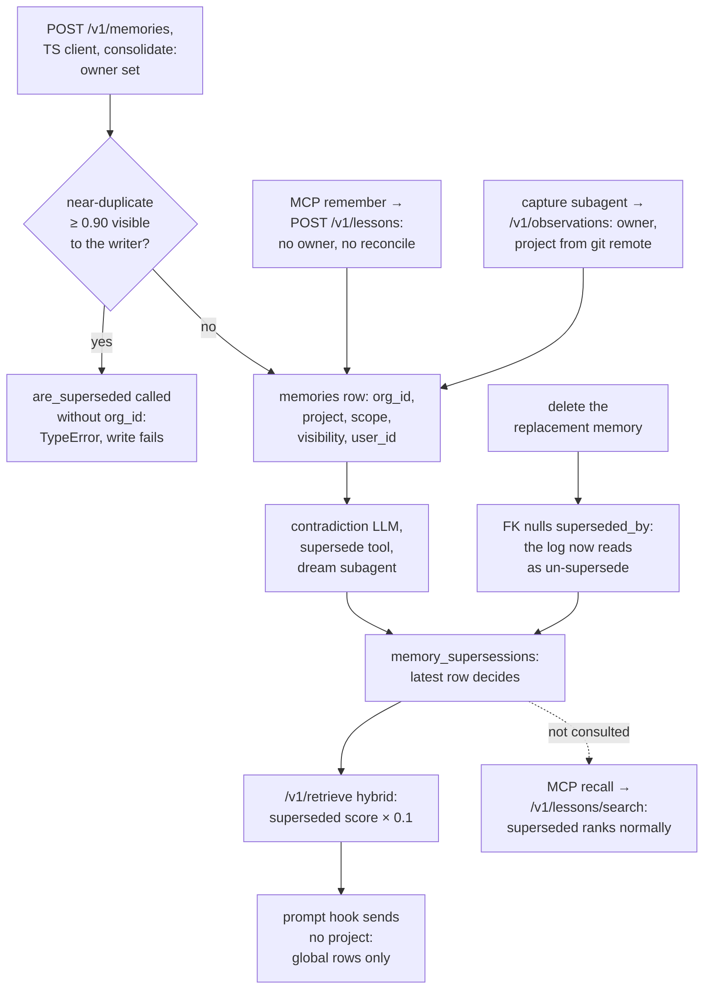

## 1. Executive Summary

Lore is a self-hosted memory server for coding agents and other MCP clients:
a FastAPI service over SQLite or PostgreSQL, an MCP server that starts that
service in-process by default, prompt hooks that inject recalled memories into
Claude Code and other agents, and capture and dream subagents that write and
consolidate memories in the background. Its notable part is the read
boundary: every recall branch applies the org from the credential, a
project-or-global scope and a per-user private-or-shared visibility in SQL.
Its weak part is the distance between the write paths and that boundary: the
MCP `remember` tool reaches a legacy route that stores no owner, the shipped
prompt hook sends no project and so retrieves only global rows, and the
write-time reconciliation step calls `are_superseded` with one argument where
both stores require two.

The README describes bi-temporal facts, an approval queue for graph edges with
rejected patterns remembered, a full audit log of every action and workspace
isolation. The code holds a supersession log with as-of reads, a relationship
validity window stamped from the write clock, a review route over a status
nothing sets to pending, a `rejected_patterns` table nothing reads, an
`audit_log` table nothing writes, and a `workspace_id` column no query uses.

The licence is MIT, in `LICENSE`, `pyproject.toml` and the TypeScript
manifest.

Two marks: `scope_enforced` on the server store's org, scope and owner
predicates, and `negative_eval` on a project-scope case that runs without
Postgres. Section 9 gives the reason for each of the five withheld.

## 2. Mental Model

A memory is one **row of text with a type, an owner and a reach**. The type
(`note`, `lesson`, `fact`, `preference`, `pattern`, `convention`,
`observation` and others, kept in `meta`) decides the default scope: the four
universal types become `global`, everything else `project`
(`src/lore/services/memories.py:36-41`). The owner is the principal that wrote
it, and visibility starts `private` (`migrations/026_visibility.sql`).

A row enters by one of four doors, and they do not do the same things.

- **The MCP `remember` tool** builds a `Memory` in the sync SDK, redacts and
  embeds it client-side and posts it to `POST /v1/lessons`, which inserts it
  with no owner and no reconciliation (`src/lore/store/http.py:233-237`,
  `src/lore/server/routes/lessons.py:83-111`,
  `src/lore/services/lessons.py:62-119`).
- **`POST /v1/memories`**, which the TypeScript client, `AsyncLore` and the
  consolidate route use, stamps the owner, reconciles against near-duplicates,
  and then spawns entity extraction and a contradiction check
  (`src/lore/server/routes/memories.py:94-163`).
- **The capture subagent**, a `claude -p` process the Stop and SessionEnd
  hooks spawn, reads the session buffer and calls `remember_observation`,
  which posts to `/v1/observations` with the project resolved from the git
  remote (`src/lore/cli/commands/capture.py:773`).
- **The dream subagent**, spawned by a Stop hook once 24 hours and five
  sessions have passed, consolidates, supersedes and forgets through the MCP
  tools (`src/lore/cli/commands/dream.py:355-388`).

A memory stops counting in three ways. A **supersession** appends a row to
`memory_supersessions`, and the latest row per memory decides the state: a
non-null `superseded_by` means superseded, a null one means explicitly
restored (`migrations/023_memory_supersessions.sql`). Reconciliation, the
contradiction detector, the `supersede` and `consolidate_memories` tools and
the dream subagent all write it. A **delete** removes the row, its vector, its
mentions and its supersession history. An **expiry** from the `working` (one
hour) or `short` (seven days) tier hides the row, and a retention
pass deletes it.

Nothing in the model distinguishes a believed memory from a doubted one. A
superseded row stays retrievable at a tenth of its hybrid score, and the
`contradiction` label the detector adds is a tag.

## 3. Architecture

The server is one FastAPI process, `lore.server.app`, with 30 routers over a
`Store` protocol that two classes implement: `SqliteStore` on aiosqlite with
sqlite-vec and FTS5, and `PostgresStore` on asyncpg with pgvector
(`src/lore/persistence/factory.py:11-36`). `scripts/check_routes_no_sql.py`
and `scripts/check_migrations_parity.py`, both run in CI, keep SQL out of the
routes and the two migration directories in step.

- **`services/`** holds the logic the routes call: memories, lessons,
  retrieve, temporal, reconciliation, contradiction, graph extraction and
  review, forget, workspaces and the rest.
- **`persistence/`** holds the protocol, the typed rows and both stores.
- **`mcp/server.py`** defines 46 FastMCP tools over the sync `Lore` SDK.
- **`lore.py`, `store/`, `graph/`** are the older sync SDK, whose only stores
  are `HttpStore` and an in-process `MemoryStore`
  (`src/lore/lore.py:214-221`).
- **`async_lore.py`** is an async SDK that opens a `SqliteStore` and calls the
  same services the routes do.
- **`setup.py`** writes the hook scripts for Claude Code, Cursor, Codex and
  OpenClaw.

**Two stacks share one name.** In local mode the MCP server starts the HTTP
server on a loopback port in a daemon thread, reads the solo API key that
bootstrap wrote to `~/.lore/key.txt`, and builds `Lore(store="remote")` over
`HttpStore` (`src/lore/mcp/server.py:179-260`, `:279-301`). The graph, fact,
conflict and review tools then call the SDK's `Store` base class, whose
methods return nothing: `get_relationship` returns `None`,
`list_pending_relationships` returns `[]` and `save_fact` is `pass`
(`src/lore/store/base.py:90-92`, `:155-156`, `:261-263`). The server's own
graph, filled by `graph_extraction`, is reachable over `/v1/graph`, the review
routes and the web UI, and not through those MCP tools.

Background work is in-process: `asyncio.create_task` for enrichment, graph
extraction and contradiction detection on each create, and, on Postgres only,
a retention scheduler and an SLO checker started in the lifespan
(`src/lore/server/app.py:165-203`).

### Deployment and ergonomics

`uvx --from lore-sdk[mcp] lore-memory` is the documented zero-config install:
the first run downloads a MiniLM ONNX model from Hugging Face and creates
`~/.lore/lore.db`. No API key is needed to store. The OpenAI-key-gated
enrichment and contradiction detector switch on when `OPENAI_API_KEY` is set,
and LLM relationship extraction needs `LORE_GRAPH_LLM=true` and the `claude`
CLI on `PATH`. The capture and dream subagents run `claude -p` with
`--permission-mode bypassPermissions` and only `mcp__lore__*` tools
(`src/lore/cli/commands/capture.py:614`,
`src/lore/cli/commands/dream.py:436`). `docker compose up` gives Postgres 16
with pgvector; `fly.toml` and an AWS CDK app under `infra/` are deployment
recipes. The SQLite file is readable with `sqlite3`, and `lore export` writes
JSON or Obsidian-style Markdown.

## 4. Essential Implementation Paths

- **Remember over MCP.** `remember` calls `Lore.remember`, which checks the
  tier, redacts, embeds, sets `expires_at` from `TIER_DEFAULT_TTL`, saves
  through `HttpStore.save` and then runs fact extraction into the base class's
  no-op (`src/lore/mcp/server.py:350-379`, `src/lore/lore.py:375-500`).
- **Create over REST.** `create_memory` in the route embeds, calls
  `services.memories.create_memory` with `user_id=auth.principal_id`, then
  spawns enrichment, `graph_extraction.extract_and_persist` and
  `contradiction.detect_and_flag` (`src/lore/server/routes/memories.py:94-163`).
  The service redacts, derives the scope, calls `reconcile_for_write`, inserts,
  and records a supersession on a `delete` decision
  (`src/lore/services/memories.py:44-185`).
- **Reconcile.** `reconcile_for_write` recalls up to `max_candidates` rows at
  similarity 0.90 or more in the writer's scope and visibility, then calls
  `store.are_superseded({c.id for c in candidates})`
  (`src/lore/services/reconciliation.py:97-174`, `:143`). Both stores declare
  `are_superseded(self, memory_ids, org_id, *, at=None)`
  (`src/lore/persistence/sqlite.py:5925-5930`,
  `src/lore/persistence/postgres.py:4123-4129`).
- **Retrieve for the hooks.** `GET /v1/retrieve` embeds the query, resolves the
  project from the key or the query string, runs `_hybrid_recall` and appends
  up to three recent session snapshots
  (`src/lore/server/routes/retrieve.py:150-320`).
- **Hybrid recall.** `_hybrid_recall` gathers the vector, FTS and graph
  branches, fuses them with `_rrf_fuse`, asks `are_superseded` with the org,
  and multiplies by recency, supersession and an optional anonymous-owner
  weight (`src/lore/services/retrieve.py:319-366`, `:460-612`).
- **Recall over MCP.** `recall` calls `Lore.recall`, which calls
  `HttpStore.search`, which posts to `/v1/lessons/search`; the lessons service
  calls `recall_by_embedding` and re-scores by a type-specific decay
  (`src/lore/store/http.py:355-395`,
  `src/lore/server/routes/lessons.py:117-138`,
  `src/lore/services/lessons.py:122-200`).
- **Supersede.** `POST /v1/memories/{id}/supersede` requires the target in the
  org and owned by the caller or unowned, and appends a row with
  `agent="api"`; `/consolidate` creates the merged memory and supersedes each
  source (`src/lore/server/routes/temporal.py:45-53`, `:120-151`, `:269-336`).
- **Contradiction.** `detect_and_flag` recalls five neighbours at 0.75 or more
  across projects within the writer's visibility, asks a model through
  litellm (`gpt-4o-mini` by default) whether each contradicts, tags the new
  memory and supersedes neighbours the writer owns above 0.75 confidence
  (`src/lore/services/contradiction.py:123-226`).
- **Graph.** `extract_and_persist` runs spaCy NER, or with `LORE_GRAPH_LLM` a
  `claude -p` extraction, and replaces the memory's mentions and edges, each
  edge with `valid_from=now` (`src/lore/services/graph_extraction.py:419-528`,
  `:535-655`).
- **Review.** `POST /v1/review/{id}` sets a relationship to `approved` or
  `rejected` and on rejection upserts `(source_name, target_name, rel_type)`
  into `rejected_patterns` (`src/lore/services/graph/review.py:162-196`).
- **Delete.** `delete_memory` resolves the rowid under the org and owner-only
  predicate and deletes the vector and the row in one transaction
  (`src/lore/persistence/sqlite.py:1249-1286`).
- **Forget with proof.** `forget_with_proof` deletes a subject's rows and
  returns an HMAC-signed certificate; its one caller is `AsyncLore`
  (`src/lore/services/forget.py:105-140`, `src/lore/async_lore.py:475-490`).

## 5. Memory Data Model

**The row.** `memories` carries `id`, `org_id`, `content`, `context`, `tags`,
`source`, `project`, `embedding`, `created_at`, `updated_at`, `expires_at`,
`upvotes`, `downvotes`, `meta`, `access_count`, `last_accessed_at`, `scope`,
`visibility`, `user_id`, `promoted_by` and `promoted_at`, plus `workspace_id`,
`tenant_id`, `reputation_score` and `quality_signals` left by earlier
migrations. The SQLite insert writes eleven columns, and `workspace_id` and
`tenant_id` are not among them (`src/lore/persistence/sqlite.py:1125-1130`).
Migration 025 dropped `importance_score` and `confidence` because no caller
set them.

**Scope keys.** `org_id` is a foreign key to `orgs`. `scope` is
`CHECK (scope IN ('project', 'global'))`, backfilled from the type
(`migrations/024_scope_and_kind.sql`). `visibility` is
`CHECK (visibility IN ('private', 'shared'))`; every row that existed when
migration 026 ran was set to `shared`.

**Supersession.** `memory_supersessions(id, memory_id, superseded_by, reason,
ts, agent)` with `memory_id … ON DELETE CASCADE` and
`superseded_by … ON DELETE SET NULL` (`migrations/023_memory_supersessions.sql:16-17`).
The `agent` column records which door wrote the row: `api`, `reconcile`,
`contradiction` or `auto`.

**The graph.** `entities`, `entity_mentions` and `relationships` carry
`org_id NOT NULL` since migration 028. A relationship has `rel_type`,
`weight`, `source_memory_id`, `valid_from`, `valid_until`, `superseded_by` and
a `status` that defaults to `approved` (`migrations/011_approval_ux.sql`).
`relationship_supersessions` mirrors the memory log with the same foreign-key
actions. `rejected_patterns` is keyed uniquely on
`(source_name, target_name, rel_type)` and carries no `org_id`.

**Time.** `created_at` and `updated_at` are record times.
`list_memories_at_time` reads `created_at <= at` and the supersession rows
with `ts <= at` (`src/lore/persistence/sqlite.py:6029-6085`). A
relationship's `valid_from` is the extraction clock and its `valid_until` is
the clock at expiry or supersession.

**Around the memories.** `api_keys` with an optional bound project and a
role; `users` for OIDC; `workspaces` and `workspace_members`; `audit_log`;
`sharing_audit`; `retrieval_events`; `conversation_jobs`; `dream_runs`;
profiles, policies, SLO and recommendation tables.

## 6. Retrieval Mechanics

**Three recall branches, fused.** The vector branch scores
`(1 − cosine distance) × 0.5^(min(age, time since access) / half-life)` over
sqlite-vec or pgvector; the FTS branch ranks by BM25 or `ts_rank`; the graph
branch finds entity names in the query and returns memories that mention them
or their neighbours. `_rrf_fuse` adds `weight / (60 + rank + 1)` per branch
and divides by the weight total over 61, so a row ranked first everywhere
scores 1.0 (`src/lore/services/retrieve.py:319-366`). Profiles set the branch
weights, the recency bias and `min_score`.

**Supersession is a score, on one path.** The hybrid path multiplies a
superseded row by 0.1 and recency by up to 1.5, so a superseded row tops out
at 0.15, under the shell hooks' `min_score` of 0.3 and the Python hook's
default of 0.5 (`src/lore/services/retrieve.py:556-607`,
`src/lore/setup.py:315`). The `search` tool's own fallback advice is
`min_score=0.1`, and a profile can lower the threshold. The MCP `recall` tool
goes to `/v1/lessons/search`, whose `recall_by_embedding` and re-scoring never
read `memory_supersessions`, so a superseded memory ranks as if current there.

**The predicates.** Every branch begins with `org_id = ?`. With a project
known it adds `(scope = 'global' OR (scope = 'project' AND project = ?))`;
with none it adds `scope = 'global'`; `scope='all'` drops the scope clause and
keeps a named project. `_append_visibility` adds the owner clause when a
principal is known, which on the server is always
(`src/lore/persistence/sqlite.py:374-399`, `:1678-1693`).

**The hook sees only global rows.** The Claude Code `UserPromptSubmit` hook
builds a query from the last four user turns and calls `/v1/retrieve` with
`query`, `format`, `limit` and `min_score` and no project
(`src/lore/setup.py:194-203`, `:315-333`). The solo key is created with
`project=None` (`src/lore/persistence/bootstrap.py:161-170`), so the route's
project is `None` and only `scope = 'global'` rows return. Lessons,
preferences, patterns and conventions are injected; notes, facts and the
observations the capture subagent files under the git-remote project are not.

**Starvation on SQLite.** The vec0 query fetches `k = 4 × limit` neighbours and
applies the org, scope, visibility and expiry predicates after the KNN
(`src/lore/persistence/sqlite.py:1669`, `:1702-1730`). In a shared SQLite
store, other orgs' rows or other users' private rows near the query fill `k`
and the visible result comes back short. Postgres puts the predicates in the
same `WHERE` as the cosine.

**Formatting.** XML, Markdown or raw text; the hook prints a Markdown block
with scores. Each retrieval writes a `retrieval_events` row and bumps
`access_count`, and a recalled row's `last_accessed_at` resets its decay.

## 7. Write Mechanics

The REST create returns after the insert; enrichment, extraction and
contradiction run as unawaited tasks, so a memory is retrievable at once and
its tags and supersessions land a model call later. The capture path is the
slow one: the Stop hook spawns a detached `claude -p` that writes when it
finishes. No pass rewrites the whole store; the dream subagent reads stats,
recent transcripts and candidate memories once a day at most.

**Reconciliation raises on its own success condition.** With
`LORE_RECONCILIATION_ENABLED` on by default, a write through
`services.memories.create_memory` whose recall finds any row at 0.90 or more
calls `store.are_superseded` with no `org_id`. Commit cebdadb on 26 June 2026
added `org_id` to both stores' `are_superseded` and updated the hybrid recall
call; `reconciliation.py` has not changed since its own commit on 23 June
(`src/lore/services/reconciliation.py:143`). Nothing catches the `TypeError`
in the service or the route, so `POST /v1/memories`, the consolidate route and
`AsyncLore.remember` fail for any non-observation write with a near-duplicate
the writer can see. Consolidation, whose merged text is close to its sources
by construction, is the case it hits most. I did not run this; it is read from
the two signatures and the call.

**The legacy route skips all of it.** `lessons_service.create` builds a
`NewMemory` with no `user_id`, no reconciliation, no contradiction and no
graph extraction (`src/lore/services/lessons.py:106-118`). The MCP `remember`
tool is therefore the one door where duplicates accumulate and the one door
whose rows nobody owns.

**Contradiction is an LLM judgement acted on.** Above 0.6 confidence the new
memory is tagged `contradiction` with the conflicting ids in `meta`; above
0.75 each conflicting row the writer owns, or that has no owner, is
superseded with `agent="contradiction"`. Another principal's row is only
flagged (`src/lore/services/contradiction.py:170-216`). Rows from the MCP
`remember` door have no owner, so any principal's contradicting write can
supersede them.

**Redaction.** The sync SDK blocks secrets by default before the network; the
server pass masks secrets, PII and a configurable denylist and tags
`meta.redacted` (`src/lore/redact/write.py`). The capture hook strips
`<private>…</private>` blocks before buffering.

**Deletion.** Delete is hard. The dream prompt tells its subagent to forget
observations older than 30 days with importance under 0.3 and no access, and
to promote observations with importance over 0.7; `importance` was dropped in
migration 025, and the prompt names an `update_memory` tool the MCP server
does not register (`src/lore/cli/commands/dream.py:375-388`).

### Operational cost

A REST create costs one local embedding, one reconciliation KNN, and with an
OpenAI key up to five contradiction calls in the background. A hook retrieval
is one embedding and three recall queries, bounded by `limit` (default five)
and added to the user prompt by the hook. Each capture batch and each dream
is a `claude -p` session; the dream subagent is pinned to Sonnet unless
overridden.

## 8. Agent Integration

The MCP server's instructions tell the model to call `recent_activity` at the
start of every session and to `remember` what is worth keeping
(`src/lore/mcp/server.py:316-326`). The 46 tools include writes (`remember`,
`remember_observation`, `forget`, `supersede`, `consolidate_memories`,
`supersede_fact`, `promote_memory`, `demote_memory`, `upvote_memory`,
`downvote_memory`, `review_connection`) and reads (`recall`, `search`,
`get_memories`, `timeline`, `list_at_time`, `provenance`, graph and topic
tools). The model has full write agency: it can delete, supersede and approve
or reject graph edges with no prompt.

`lore setup claude-code` installs `UserPromptSubmit`, `PostToolUse`, `Stop`
and `SessionEnd` hooks and a dream trigger. Auto-retrieval therefore needs no
model cooperation. Auto-capture runs a second agent, with bypassed
permissions, whose tool surface is the same 46 tools, including `forget`.

The TypeScript client posts to `/v1/memories`, so it gets owners and
reconciliation where the Python MCP path does not.

## 9. Reliability, Safety, and Trust

### Two predicates the writers do not feed

The read predicates are sound. The writers fill them unevenly.

- **Owner.** The MCP `remember` door stores `user_id` as null. The visibility
  clause admits `user_id IS NULL` for every principal, and the owner-only
  write clause admits it too, so in a team deployment with per-user keys
  every memory written through MCP `remember` is readable, editable,
  deletable and supersedable by every key in the org.
  `LORE_RECALL_QUARANTINE_ANON` would drop exactly these rows from hybrid
  recall (`src/lore/services/retrieve.py:296-317`, `:578`).
- **Project.** The capture subagent resolves the project from the git remote;
  the prompt hook resolves none; `LORE_PROJECT` is the MCP server's own
  setting. `resolve_project` has one caller, the capture command. A
  project-scoped memory reaches a prompt only through an MCP `recall` whose
  project string matches the remote-derived one, or through `scope='all'`.

### The supersession log is rewritten by its own schema

`memory_supersessions` is inserted by four producers and no statement updates
or deletes it. Its foreign keys do. Deleting a memory cascades away its whole
history. Deleting the **replacement** sets `superseded_by` to null on every
row that pointed at it, including the latest row of the memory it replaced,
which `is_superseded` and `are_superseded` then read as an explicit
un-supersession. Forgetting a newer memory revives the one it corrected, and
the log afterwards records a restoration that never happened. No test covers
it.

### Declared and unwired

- **`audit_log`.** `write_audit_log` and `fire_audit_log` exist and nothing
  calls them; `lore audit` and `GET /v1/audit` read an empty table
  (`src/lore/server/audit.py:12-50`). `write_audit_log` is also asyncpg-only.
- **The review queue.** Relationships default to `approved`, and no code sets
  `pending`. The listing filters `status = 'pending'` and is empty; no read
  outside it consults `status`, so rejecting an edge leaves it in graph
  traversal and recall (`src/lore/persistence/sqlite.py:5136`, `:5218-5280`).
- **`rejected_patterns`.** Written on every rejection and read by nothing on
  the server; `is_rejected_pattern` is defined in the SDK's base and in-memory
  stores and has no caller.
- **Workspaces.** Creation, members, roles and switching exist; no memory
  query or insert references `workspace_id`, and `AuthContext` has no
  workspace.
- **Facts and conflicts over MCP.** `extract_facts` needs an SDK LLM
  provider, `list_facts` and `conflicts` read the base class's empty lists,
  and `graph_query` and `entity_map` read an SDK graph that `HttpStore` never
  fills.

### Authentication and authorisation

The org comes from the credential: an API key's row, an OIDC token's org
claim, or an HS256 AgentGate token's `tid` claim, defaulting to `default`
(`src/lore/server/auth.py:197-235`). Key roles are `reader`, `writer` and
`admin`; the memory write routes require `writer`. The review routes and the
supersession reads take any authenticated caller, so a `reader` key can
approve or reject edges. The supersede route checks the org and the owner and
not the key's bound project.

### Deletion and privacy

Delete removes the row, its vector, its mentions and its supersession history.
`forget.py` states what it does not reach: relationships, recommendation
feedback and the memory-id lists in `retrieval_events` and
`conversation_jobs`. Exports and snapshots keep whatever they captured.

### Marks

- **`scope_enforced` — earned.** The org is server-resolved and the first
  predicate of every read; the scope and owner clauses sit in the SQL of the
  vector, FTS and graph branches, of get, list, export, session snapshots and
  as-of reads. The limits are the ownerless door and the client-supplied
  project above.
- **`negative_eval` — earned.** `test_recall_with_no_current_project_returns_only_global`
  stores two rows on one embedding, requires the global one and excludes the
  project-scoped one, against a SqliteStore the test opens itself.
- **`audit_log` — withheld.** The one producing log is the supersession table:
  it records supersede and un-supersede and nothing else, its rows are
  deleted with the memory, and its pointer is nulled when the replacement is
  deleted, which changes what the remaining row means. The general
  `audit_log` has no writer.
- **`trust_state` — withheld.** Supersession is a pointer read as a score
  multiplier; relationship `status` is read only by a listing nothing fills;
  the `contradiction` tag filters nothing.
- **`tombstone` — withheld.** `rejected_patterns` is keyed on the value, and
  no extraction path consults it.
- **`bitemporal` — withheld.** Edge validity is the extraction and expiry
  clock; memories have no valid time.
- **`human_review` — withheld.** Nothing enters `pending`, and the approve
  verb is also an MCP tool the agent holds.

## 10. Tests, Evals, and Benchmarks

CI runs `pytest --ignore=tests/server/` on Python 3.10, 3.11 and 3.12 with no
database service, and `pytest tests/server/ -v` in a second job with pgvector
(`.github/workflows/ci.yml:36`, `:70`). I ran nothing.

**The contract suite skips itself in CI.** The parametrized `store` fixture
takes `_pg_pool` as an argument, and `_pg_pool` calls `pytest.skip` when
Postgres is unreachable, so the `postgres` and the `sqlite` parameter both
skip (`tests/persistence/conftest.py:57-71`, `:78`). The first CI job has no
Postgres; the second runs only `tests/server/`. The 621 functions that take
the fixture, in tests/persistence, tests/services and one integration file,
never execute in CI. `tests/services/test_phase6g_scope.py` and
`tests/integration/test_phase6g_e2e.py` both say so in their docstrings. That
is how the reconciliation defect shipped:
`tests/services/test_memories_reconciliation.py` drives the near-duplicate
path through `create_memory`, and at :87 it calls `store.is_superseded(old.id)`
without the `org_id` both stores have required since 26 June.

What the suites that do run cover:

- the project and global scope clause on a SqliteStore, including the
  populated negative case (`tests/services/test_phase6g_scope.py:290-328`);
- RRF normalisation, recency, the supersession multiplier and the
  anonymous-owner quarantine on fakes (`tests/test_hybrid_retrieval.py`,
  `tests/services/test_temporal_supersession.py:345-390`);
- the `AsyncLore` SDK over a temporary SqliteStore
  (`tests/embedded/test_async_lore.py`);
- the MCP tool wrappers against mocked HTTP
  (`tests/test_mcp_provenance_and_recall.py`);
- the sync SDK, graph, facts, conflicts and review against `MemoryStore`.

What is written and does not run in CI: owner isolation on every read and
write (`tests/persistence/test_visibility.py`, 19 cases, populated), graph org
isolation, supersession and as-of reads, contradiction, reconciliation and
forget-with-proof.

Not covered anywhere: a supersession surviving the deletion of its
replacement; a `remember` through MCP being hidden from a second principal;
the hook retrieving a project-scoped memory.

`benchmarks/run_benchmarks.py` measures SDK latency over `MemoryStore`. No
retrieval-quality evaluation is committed, and the tree cites no paper.

## 11. For Your Own Build

### Steal

- **One predicate helper, appended on every branch.** `_append_visibility`
  takes the WHERE list and the bind list and appends both in step, with an
  owner-only variant for writes, so vector, FTS, graph, list and export cannot
  drift apart.
- **Scope derived from the kind of memory.** Universal types default to
  global and everything else to the project, and the read clause collapses to
  global-only when no project is known rather than to everything.
- **A supersession log with explicit restoration.** Latest row wins, and a
  null pointer is a recorded un-supersede, so as-of reads replay the log.
- **Supersede only what the writer owns.** The contradiction detector flags
  another principal's row and leaves it current.

### Avoid

- **A legacy write route beside the governed one.** Every guarantee the new
  route adds (owner, reconciliation, contradiction) is absent from the path
  the MCP tool uses. Retire the old route or send it through the new service.
- **Foreign-key actions on an audit table.** `ON DELETE SET NULL` on the
  replacement pointer turns a deletion into a fabricated restoration. Keep
  ids in an audit as plain text.
- **A test fixture that couples two backends.** One unreachable database
  skipped the other backend's whole suite and hid a signature change for
  months.
- **Writer and reader resolving the project separately.** Derive it once and
  hand it to both, or the hook never sees what capture filed.

### Fit

This suits a team that wants one memory server for several coding agents,
will run Postgres, issue a key per person, and call `/v1/memories` from its
own clients. It does not yet suit the zero-config MCP install its README leads
with: that path writes through the legacy route, injects only global
memories, and runs two subagents with bypassed permissions over a store whose
reconciliation raises on near-duplicates. Walk away if a correction must hold
after the corrected memory is deleted, or if the review queue and audit log in
the README are requirements.

## 12. Open Questions

- Whether the `/v1/lessons` routes are meant to stay as the MCP write path or
  to be retired in favour of `/v1/memories`.
- Whether the hook is meant to send a project, and which resolver it should
  use.
- What is meant to set a relationship to `pending`.
- Whether `ON DELETE SET NULL` on `superseded_by` is intended.
- Whether the persistence suite is run against Postgres anywhere outside CI.

## Appendix: File Index

- Schema: `migrations/` and `migrations_sqlite/` (023, 024, 026, 027, 028
  carry the memory semantics), `src/lore/persistence/types.py`,
  `src/lore/persistence/protocol.py`
- Stores: `src/lore/persistence/sqlite.py`, `src/lore/persistence/postgres.py`,
  `src/lore/persistence/factory.py`, `src/lore/persistence/bootstrap.py`
- Write path: `src/lore/server/routes/memories.py`,
  `src/lore/server/routes/lessons.py`, `src/lore/server/routes/observations.py`,
  `src/lore/services/memories.py`, `src/lore/services/lessons.py`,
  `src/lore/services/reconciliation.py`, `src/lore/services/contradiction.py`,
  `src/lore/services/graph_extraction.py`, `src/lore/redact/write.py`
- Retrieval: `src/lore/server/routes/retrieve.py`,
  `src/lore/services/retrieve.py`, `src/lore/services/lessons.py`
- Supersession and time: `src/lore/server/routes/temporal.py`,
  `src/lore/services/temporal.py`, `src/lore/server/routes/facts.py`
- Review and audit: `src/lore/services/graph/review.py`,
  `src/lore/server/routes/review.py`, `src/lore/server/audit.py`,
  `src/lore/server/routes/audit.py`
- Auth: `src/lore/server/auth.py`
- MCP and SDKs: `src/lore/mcp/server.py`, `src/lore/lore.py`,
  `src/lore/store/http.py`, `src/lore/store/base.py`, `src/lore/async_lore.py`,
  `ts/src/store/remote.ts`
- Hooks and subagents: `src/lore/setup.py`, `hooks/`,
  `src/lore/cli/commands/capture.py`, `src/lore/cli/commands/_project.py`,
  `src/lore/cli/commands/dream.py`
- Forget: `src/lore/services/forget.py`
- Tests: `tests/persistence/conftest.py`, `tests/services/test_phase6g_scope.py`,
  `tests/persistence/test_visibility.py`,
  `tests/services/test_memories_reconciliation.py`,
  `tests/services/test_temporal_supersession.py`, `.github/workflows/ci.yml`

### Recorded searches

Run from the repository root at the pinned commit with `/usr/bin/git grep`.

- **Nothing calls the audit writer.**
  `git grep -n -E 'fire_audit_log|write_audit_log' -- src` returns only the
  three lines of `src/lore/server/audit.py` that define and schedule them.
- **Nothing reads rejected patterns on the server.**
  `git grep -n -E 'is_rejected_pattern|FROM rejected_patterns' -- src` returns
  the two definitions in `src/lore/store/base.py:276` and
  `src/lore/store/memory.py:426`.
- **Nothing sets a relationship to pending.**
  `git grep -n -E "'pending'|\"pending\"" -- src/lore/persistence src/lore/services src/lore/server`
  returns the two listing predicates (`postgres.py:1788`, `sqlite.py:5136`)
  and a docstring in `protocol.py:506`.
- **No read filters on an approved or rejected status.**
  `git grep -n -E "status = 'approved'|status != 'rejected'|status <> 'rejected'|status IN" -- src/lore/persistence`
  returns nothing; `git grep -n -E "status = 'pending'" -- src/lore/persistence`
  matches the two listing predicates.
- **No statement updates or deletes a supersession row.**
  `git grep -n -E 'UPDATE memory_supersessions|DELETE FROM memory_supersessions|UPDATE relationship_supersessions|DELETE FROM relationship_supersessions' -- .`
  returns nothing; `git grep -n -c 'INSERT INTO memory_supersessions' -- src`
  counts one in each store.
- **One relationship constructor, on the write clock.**
  `git grep -n 'NewRelationship(' -- src` returns
  `src/lore/services/graph_extraction.py:643`, whose `valid_from` is `now`.
- **The lessons service sets no owner.**
  `git grep -n -w 'user_id' -- src/lore/services/lessons.py` returns nothing;
  the same file passes `requesting_user_id` on its reads.
- **No workspace in authentication or memory writes.**
  `git grep -n -w -i 'workspace' -- src/lore/server/auth.py` returns nothing;
  `git grep -n -w 'workspace_id' -- src/lore/server/routes/memories.py src/lore/server/routes/lessons.py src/lore/services/memories.py src/lore/services/lessons.py`
  returns nothing.
- **The hook scripts name no project.**
  `git grep -n -i 'project' -- src/lore/setup.py` returns one docstring at
  :1191 about Cursor's project-level hooks directory.
- **The project resolver has one caller.**
  `git grep -n 'resolve_project' -- src` outside `_project.py` returns
  `src/lore/cli/commands/capture.py:80` and `:773`, and a comment in
  `src/lore/cli/__init__.py:688`.
- **The MCP server registers no update tool.**
  `git grep -n -E 'def update_memory' -- src/lore/mcp` returns nothing; the
  same pattern without the path matches the service and the stores.
- **The reconcile call is the only one without an org.**
  `git grep -n -E 'are_superseded\(' -- src` returns the three definitions,
  `src/lore/services/retrieve.py:560` with `params.org_id`, and
  `src/lore/services/reconciliation.py:143` without it.
- **No paper reference.**
  `git grep -n -i -E 'arxiv|bibtex|@article|@misc|doi\.org|zenodo' -- . ':!*package-lock.json'`
  returns nothing.

## History

**2026-11-26** — [`f2fd553a6163fb408c7c842d7445d3b1f5d3da09`](https://github.com/agentkitai/lore/commit/f2fd553a6163fb408c7c842d7445d3b1f5d3da09). First reading, from a full clone at the head of `main`. Screened first: three auto-run surfaces (`.cursorrules`, `hooks/`, and `server.json`, which launches the package through `uvx`), seven build-time execution points (`src/lore/setup.py`, five `conftest.py` files, the TypeScript `prepublishOnly`), four unpinned manifests, nothing inside the seven-day cooldown. `.cursorrules` and `CLAUDE.md` are addressed to agents and were read as data. Nothing was installed, built or run, and the test functions were not run. Two marks, `scope_enforced` and `negative_eval` ([section 9](#9-reliability-safety-and-trust)). The MCP write path stores no owner, the hook retrieves only global rows, reconciliation calls `are_superseded` without its org, and the contract suite skips in CI.
