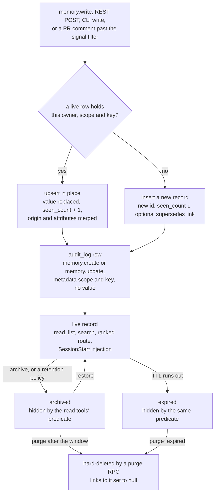

## 1. Executive Summary

LoreKit is **a shared lesson store for coding agents**. It is built as a hosted
product with the whole stack in the repository: a Supabase Postgres schema in 119
migrations, an MCP server as an edge function, a REST API, a Next.js dashboard, a
CLI with lifecycle hooks, and marketplace plugins for Claude Code, Cursor and
Codex. It is MIT licensed and self-hostable, and the CLI carries a second,
offline store of Markdown files.

The unit is a record addressed by `(scope, key)`. It carries a stable id, a
Markdown or JSON value, tags, a `kind` and `host`, the repository, branch,
commit and pull request it was recorded from, an open `attributes` map, and an
optional `supersedes` link to the record it replaces. No model sits on any write
path. A `pgvector` column exists and an opt-in pipeline fills it on REST create,
but no read path queries it, and the project's own `docs/embeddings.md` lists
semantic search as *"Not built"*. Retrieval is scope equality and Postgres
full-text search, ranked on the session-start path by recency, recurrence,
lexical relevance and outcome signals.

What is strong is the infrastructure around the memory:

- **The tenancy boundary is one function.** Agent calls authenticate with an API
  key and run on a service-role client that bypasses RLS. Every read on that path
  passes through `applyTenantScope`, which ANDs the caller's own and member-org
  rows with the key's scope allowlist and tenancy restriction
  (`supabase/functions/_shared/auth/tenant-scope.ts:206-230`). The dashboard's
  JWT path gets RLS as well.
- **The audit log is append-only by construction.** `audit_log` has a SELECT
  policy and an INSERT policy and deliberately no UPDATE or DELETE policy, with a
  CHECK constraint over 29 actions and a spec that fails when that list and the
  TypeScript vocabulary disagree.
- **The session-start read is budgeted and honest about it.** The hook merges the
  scope ladder, ranks across it, caps each loop bucket, diversifies the result,
  renders under a 3,000-character budget, and ends a truncated block with a count
  of what it left out (`packages/cli/src/core/lessons.mjs:214-410`).
- **The migrations are written like design documents.** Each one states the
  problem, the alternatives it rejected and the residue it leaves.

Two things undercut it.

**The audit log records that a value changed and never what it was.** The write
path is an in-place upsert on the live key, and the audit metadata is
`{ scope, key }` (`supabase/functions/mcp/tools.ts:265-276`). LoreKit can prove
a memory was updated, by whom and when, and cannot show what it replaced.

**Correction is a link, not a state.** Archiving frees the address: the unique
index is partial on `archived_at is null`, so the next write to that key inserts
a new record with a new id and `seen_count` 1. That record may name its archived
predecessor in `supersedes`, and no read path consults the link. A lesson a user
removed can be re-learned without any record of the removal reaching a reader.

LoreKit's author published an essay on 7 November 2026, [*Agent memory needs
its OpenTelemetry moment*](https://www.lorekit.io/blog/open-agent-memory-format),
proposing a shared record format for agent memory. The commit that landed the
next morning (`c2676c2`) adds three of the post's fields to LoreKit's own record
(§5). The post's own conformance test, that fields a tool does not know survive a
rewrite, holds on the local store and is committed. It does not hold across
LoreKit's own migration to the hosted store.

## 2. Mental Model

A memory is **a keyed slot with counters**. `(scope, key)` is an address; the
value is whatever was last written there; `seen_count`, `read_count`,
`opened_count` and `cited_count` say how often it was written, surfaced, deliberately
fetched and credited. The id is stable while the slot is live and is replaced
when the slot is vacated and refilled.

The consequence: LoreKit has no notion of a memory being *true*, *candidate*,
*verified* or *rejected*. It has a notion of a memory *existing at an address*,
being *visible*, being *frequent*, or being *gone*. Belief is not modelled;
occupancy and use are.

### How a thing becomes a belief

Three capture paths, none of which involves a model.

**The agent writes it.** `memory.write` calls the `memory_write` RPC, which
upserts on one of three partial unique indexes — org-owned, personal, or
service — each predicated on `archived_at is null`. A conflict is the
second sighting of the lesson, and the RPC answers it with
`seen_count = memories.seen_count + 1` rather than trusting a caller-supplied
count (`supabase/migrations/00119_memory_record_extensions.sql:398-415`;
reasoning in `00059_memory_seen_count.sql`). The RPC is `SECURITY DEFINER` and
sets the actor from `auth.uid()` on any non-service connection
(`00119_memory_record_extensions.sql:268-280`).

**The CLI hooks prompt for it.** The plugins register SessionStart,
UserPromptSubmit, PostToolUseFailure and Stop hooks. The failure hook surfaces
lessons relevant to the error alongside a nudge to write one; the Stop hook runs
the retrospective rule (`packages/cli/src/commands/hook.mjs:291-362`). When to
write is the agent's decision.

**A GitHub webhook writes it.** PR review comments become candidate lessons. The
gate is deterministic: four admitted event/action pairs, then a body filter
rejecting short bodies, bot noise and code-only blocks
(`supabase/functions/mcp/webhook.ts:747-789`). Candidates are keyed by GitHub's
comment id, so a redelivery bumps `seen_count` instead of duplicating, and they
expire on a TTL graded by signal tier: 90 days for a resolved thread, 30 for a
submitted review, 14 for a fresh comment
(`packages/mcp-core/src/limits/ttl-defaults.ts:41-45`). The body is
HMAC-SHA256 verified, and the signature-absent case returns before any crypto
runs.

### How a belief stops being one

*Overwrite.* A second write to the same live address replaces the value in
place. Origin fields and attributes merge, keeping the last known value. No
prior value is retained anywhere, including in the audit log.

*Archive.* `memory.archive`, the dashboard, or a retention policy sets
`archived_at`. The read tools' predicate hides the row; `restore` clears it.

*Expire.* `expires_at`, set from a TTL on the write, is filtered by the same
predicate — `.or('expires_at.is.null,expires_at.gt.now()')` — on every read
tool. A value-only update keeps an existing TTL; a write that re-supplies one
extends it. Defaults differ by surface. The webhook always supplies a TTL. The
CLI's `lorekit write` applies a TTL configured per scope prefix. An MCP
`memory.write` without `ttl_days` is permanent, and the hook's write nudge only
suggests the configured value — *"nothing enforces it"*
(`packages/cli/src/core/lessons.mjs:816-830`).

*Purge.* Two hard-delete RPCs, `purge_archived_memories` (after a retention
window) and `purge_expired_memories`. A purge clears every `supersedes` link
that pointed at the deleted row, by `on delete set null`.

The diagram leaves out one edge because it would cross the chart: from
*archived* back to *insert a new record*. The partial unique index frees the key
on archive, so the next write to it takes the insert branch
(`supabase/migrations/00003_archive.sql:21`, and the `on conflict … where
archived_at is null` arbiters in `00119_memory_record_extensions.sql:398`,
`:446`, `:493`).

## 3. Architecture

An NX monorepo. **Storage** is Supabase Postgres: a `memories` table with a
generated `tsvector` column and a GIN index, a dormant `vector(1536)` column with
a partial HNSW index, per-memory read counters and a `memory_read_daily` rollup,
a citations table, plus orgs, scope bindings, API tokens, webhook secrets,
retention policies, `audit_log`, limits and `usage_events`.

**The MCP surface** is a Supabase edge function (`supabase/functions/mcp/`)
exposing 23 tools. The tool logic is factored into `packages/mcp-core` for a Node
MCP server, and the Deno copy is a mirror kept in step by
`edge-parity.spec.ts`. **A REST API** under `supabase/functions/memories/` serves
the dashboard and the CLI's remote store, including routes the MCP surface does
not have: `GET /memories/relevant`, duplicate clusters, facets and usage.

**The local mode is a second implementation, not a fallback.** The CLI is
dependency-free `.mjs` carrying its own two-tier Markdown store: a per-user tier
at `~/.lorekit/` and an opt-in per-repo tier at `<repo>/.lorekit/`, one file per
`scope+key` under a directory derived from the scope. `migrate` moves entries
between the stores, with the losses in §5.

**Background work is scheduled where the extension exists, and never
destroys.** Migrations register `pg_cron` jobs behind an
`if exists (… extname = 'pg_cron')` guard: a rate-limit reaper every fifteen
minutes and a nightly `lorekit-groom-sweep`. Retention policies are *"scoped,
saved rules that AUTO-ARCHIVE (never hard-delete) matching lessons"*, and one
function, `lorekit_groom_candidates`, answers *what matches* for preview, run-now
and the sweep, so a previewed count equals what a run archives. A `protected`
flag exempts a lesson from every policy.

Hard purge is a deliberate act. `purge.mjs` requires `--yes` where there is
nobody to ask, and the reason is stated: the RPCs return their count only after
deleting, so *"the gate is therefore a confirmation, not a preview"*. That gate
is not `human_review`: it guards destruction rather than admission, and its
non-interactive form is a flag the caller supplies.

### Deployment and ergonomics

The hosted path is a token from lorekit.io and `npx @lorekit/cli install`. The
local path needs no account and no network. Self-hosting is a Supabase plus
Vercel deploy, with a generated `supabase/byod/bootstrap.sql` for an existing
project and a `/lorekit-self-host` skill. A self-hoster inherits the two mirrored
server implementations and must enable `pg_cron` for the sweeps to run.

## 4. Essential Implementation Paths

**Schema** — `supabase/migrations/00001_memories.sql` (table, RLS, FTS),
`00003_archive.sql`, `00010_audit_log.sql`, `00030_memory_ttl.sql`,
`00046_memory_rpc_actor_guard.sql`, `00048_memory_origin.sql`,
`00056_memory_kind_host.sql`, `00059_memory_seen_count.sql`,
`00060_memory_embeddings.sql`, `00084_memory_read_counters.sql`,
`00088_retention_policies.sql`, `00107_memory_citations.sql`,
`00112_relevant_ranking.sql`, `00119_memory_record_extensions.sql` (the current
`memory_write`).

**Write** — `supabase/functions/mcp/tools.ts` `toolWrite` (`:154-302`) → the
`memory_write` RPC; record extensions parsed by
`supabase/functions/_shared/provenance/record-extensions.ts`; then
`recordAuditDeferred` and `recordCitations`.

**Read** — `toolRead` (`:304-415`), `toolReadRefs` (`:440-503`), `toolList`
(`:505-695`), `toolSearch` (`:775-848`), each applying the archive and expiry
predicate and `applyTenantScope`. The ranked route is
`supabase/functions/memories/handlers/relevant.ts` over
`_shared/ranking/lesson-rank.ts`.

**Session start** — `packages/cli/src/commands/hook.mjs:171-213` →
`fetchLessons` and `formatLessons` in `packages/cli/src/core/lessons.mjs`.

**Correction** — `toolArchive`, `toolRestore`, `toolPurge`, `toolPurgeExpired`,
the policy and groom tools in `tools.ts`; `packages/cli/src/commands/purge.mjs`.

**Webhook** — `supabase/functions/mcp/webhook.ts`, with comment-relevance
classification in `packages/mcp-core/src/webhook/comment-relevance.ts`.

**Local store** — `packages/cli/src/store/format.mjs`, `local.mjs`,
`remote.mjs`, composed by `packages/cli/src/shared/stores.mjs`.

## 5. Memory Data Model

`memories` carries `id`, `user_id`, `org_id`, `scope`, `key`, `value` (CHECK
`length <= 65536`), `tags`, `source_agent`, `trigger`, `kind`, `host`, the four
`origin_*` columns, `seen_count`, `read_count`, `last_read_at`, `opened_count`,
`last_opened_at`, `cited_count`, `last_cited_at`, `protected`, `last_seen_at`,
`embedding` and `embedding_model`, `attributes`, `content_type`, `supersedes`,
the generated `fts`, `created_at`, `updated_at`, `created_by`, `updated_by`,
`archived_at` and `expires_at`.

**Scoping is the best-developed part of the model.** Four canonical forms —
`global`, `project::{name}`, `repo::{owner}/{repo}`,
`branch::{owner}/{repo}::{branch}` — validated by `validateScope`, which
normalises to lowercase and rejects the single-colon mistake with an error that
prints the corrected string. Above that sit orgs with roles and invites, and
`org_scope_bindings`, which route a write on a bound scope to the org rather than
the writer, gated by `lorekit_org_can(...)`. API tokens can be restricted to a
scope allowlist and to a tenancy: all, selected orgs, personal only, or
`orgs_only`, which excludes the owner's personal memories.

**Provenance is typed and last-known.** `source_agent` and `trigger` say which
agent wrote a lesson and what prompted it; `kind` (`lesson`, `bus` or `signal`)
and `host` name its family and owning loop; `origin_repo`, `origin_branch`,
`origin_commit` and `origin_pr` say where it was recorded from. Each origin field
merges as *"the newest write wins when it knows the value, and a write that does
NOT know it … never erases what a previous write did know"*
(`00048_memory_origin.sql`). There is no confidence and no status column.

**Use is measured, and the measurements are derived columns.** `read_count`
splits into targeted and bulk reads in a daily rollup; `opened_count` counts
deliberate fetches of a lesson that was surfaced; `cited_count` counts lessons an
agent names in a later write's `cited` field, the one signal that says a lesson
*worked* rather than that it was looked up (`00107_memory_citations.sql`). A
trigger keeps all of them, and the embedding pair, from restamping `updated_at`,
because recency ranking and age-based retention read that column.

**Temporal modelling is record-time only.** Every timestamp describes LoreKit's
own bookkeeping, and the upsert overwrites in place, so a lesson that changed has
no history beyond a `memory.update` audit row saying that it did.

### The record against the proposed open format

The 7 November post sketches a record envelope and says *"the field names aren't
a proposal."* Read against it, LoreKit's record at this pin covers most of the
envelope:

| Proposed field | LoreKit hosted | LoreKit local file |
| --- | --- | --- |
| `spec` | no format version on the record | no format version in the frontmatter |
| `id` | `uuid`, stable across updates, replaced when an archived key is rewritten | minted on first write and kept on rewrite and archive |
| `address` `{level, value}` | the `scope` string; the level is its prefix, and a repo value is `owner/name` with no host | the scope, plus a directory derived from it |
| `key` | `key` | `key` |
| `kind` | `kind`: `lesson`, `bus` or `signal`, closed by the Zod schema | `kind` |
| `written_by` `{type, name}` | `source_agent` and `host` as free text; no field says person, agent or service | the same |
| `content_type` | `text/markdown` or `application/json`, which must parse | the same |
| `lifecycle` `{expires_at, extended_by}` | `expires_at`; a write that re-supplies a TTL extends it, a read never does | `expires_at` |
| `attributes` | `jsonb` of namespaced scalars, merged on update, 32 keys at most | the same, validated alike |

`supersedes`, `seen_count`, the read counters and `origin_*` have no slot in
the sketch.

The post names three conformance tests. **Unknown fields survive a rewrite** on
the local store: `extraFields` carries every frontmatter key outside `FIELDS`
through write, archive and `putEntry`, and
`record-extensions.test.mjs:57` asserts it. The hosted store has fixed columns,
so the property there is that attribute keys a write does not name survive the
merge. **A round trip loses nothing** holds within each store and fails
across them: `RemoteStore.putEntry`, which `migrate` uses, sends value, tags,
`source_agent`, `trigger`, `created_at`, TTL, origin, attributes and
`content_type`, and drops `id`, `supersedes`, `seen_count`, `kind`, `host` and
every unknown frontmatter field (`packages/cli/src/store/remote.mjs:584-603`).
Two of the drops are stated in the code: `supersedes` names a local id the
hosted store cannot resolve, and archived entries are refused outright. **Expiry
behaves as stated** is covered by the TTL suites on both stores.

## 6. Retrieval Mechanics

Five read surfaces, and they differ in what they rank.

**`memory.read`** fetches one address. **An omitted scope widens instead of
failing, and the answer says which scope answered.** The source records the
patch it declined: defaulting a missing scope to `global` *"is worse than the
error — it turns a loud, recoverable failure into a silent `null` for every
repo-scoped lesson"*. Precedence runs over scope *types* — project, branch,
repo, global — then `updated_at` descending, then scope ascending, so the same
call answers the same way twice. The result names the scope that answered and
lists `other_scopes` when the key was ambiguous.

**`memory.list`** returns one exact scope, or every visible scope unmerged, newest
first. **`memory.search`** runs `websearch_to_tsquery` over the generated column
across a list of exact or prefix scopes. Neither ranks by anything but recency
and FTS position.

**`GET /memories/relevant`** is where ranking lives. A candidate RPC returns up
to 200 rows ordered by `ts_rank_cd` when there is a query and by `updated_at`
otherwise. The handler scores each on four factors with equal default weight:

- recency, with a 14-day half-life;
- salience, `seen_count` normalised against the most-recurring candidate;
- lexical relevance, `ts_rank_cd` mapped into [0,1];
- outcome, from the review-outcome bus tags or an origin PR.

It then selects with MMR at λ 0.7 over lexical Jaccard
(`supabase/functions/_shared/ranking/lesson-rank.ts:61-64`, `:288`, `:363`,
`:415`). The handler states its residue. Without a query, the 200-row window is
the newest rows, so on a large store an old lesson with a high `seen_count` can
miss the candidate set. That is the SessionStart question
(`supabase/functions/memories/handlers/relevant.ts:49-73`).

**The SessionStart hook** is what most sessions read. `fetchLessons` lists every
scope in the working directory's read order, resolves one winner per key by
precedence, ranks the winners in one cross-scope order with scope order as the
tiebreak, caps each loop bucket at one lesson by default, and diversifies with
the same MMR. `formatLessons` renders under a 3,000-character budget with a
100-line ceiling and ends a truncated block with the per-scope count of what was
left out and the verbs to fetch it (`packages/cli/src/core/lessons.mjs:214-410`,
`packages/cli/src/shared/control.mjs:134`, `:189`, `:235`). Only general lessons
are injected — `kind` null or `lesson` — so bus and signal records stay out of
the digest. The per-prompt hook then injects only lessons not already shown in
the session.

The scope ladder is therefore implemented on the client: the CLI hook merges
it, and the MCP server leaves the merge to whoever calls `memory.list` per scope.

Failure modes:

- **A superseded lesson keeps competing.** No read path filters on
  `supersedes`, so an old record and the record that replaced it are both live
  until someone archives the old one.
- **Search is lexical only.** A lesson phrased differently from the query is
  found only through its key or shared words.
- **Recurrence resets on revival.** A lesson archived and re-learned starts at
  `seen_count` 1, so the salience it earned stays with the archived row.

## 7. Write Mechanics

Writes are **synchronous, agent-triggered and free of any model**. One RPC round
trip; the lesson is visible to the next read.

`memory_write` handles three routing cases — org-routed (an explicit org or a
scope binding the user can write to), service (`user_id is null`, for CI and the
webhook), and personal — each with its own partial unique index for the
`on conflict` arbiter. It validates the TTL in SQL, checks the key's scope
allowlist, and on update keeps an existing `expires_at` when the TTL is omitted.

**`supersedes` is checked and stored, and nothing more.** The id must name a
record with the same owner — personal to personal, or the same org — and the RPC
answers an invisible target and a missing one with the same error, so the field
cannot probe for other tenants' ids. A `SECURITY INVOKER` trigger applies the
same rule to a direct PostgREST write, because a foreign-key check ignores RLS
and would otherwise act as an existence oracle
(`00119_memory_record_extensions.sql:96-136`, `:355-380`). The care is in the
check; the link has no reader.

Deduplication is the primary key: writing the same live address twice is an
update and a recurrence. Two lessons saying the same thing under different keys
both persist. The duplicate-cluster route groups near-duplicates by token
Jaccard for the dashboard and for `lorekit invariants candidates`, which nominates
a cluster for promotion when its summed `seen_count` reaches 3 or a member
carries a non-`active` `status::` tag
(`packages/cli/src/shared/candidates-pure.mjs:139-152`). Merging is a person's
decision.

Embedding is the one asynchronous write. `embedOnWrite` runs after a REST
`POST /memories` only when `LOREKIT_EMBEDDING_ENABLED` and a key are both set,
through `lorekit_memory_set_embedding`, the one authorised writer of the column.
The MCP `memory.write` does not call it.

### Operational cost

Cheap and bounded. A write is one Postgres round trip plus a deferred audit
insert and a citations RPC; a read is an indexed query. Per-user memory caps are
a DB trigger. The session-start read issues one list per scope in the read order,
each bounded by the line ceiling, and spends at most the configured character
budget of the agent's context.

## 8. Agent Integration

MCP over HTTP with a Bearer token, REST for the CLI's remote store, and a CLI
that scaffolds skills and wires the host. Claude Code gets a marketplace plugin
whose hooks fetch `@lorekit/cli` through `npx` at run time; Cursor gets a rule
plus a `stop` hook; Codex has an `AGENTS.md` fallback. Tokens are read, write or
read-write, so a CI job can inject context without being able to learn.

**The agent decides what is worth remembering, and the server decides what the
agent sees first.** Which lesson to write, which scope and key to use, and
whether to search first are delegated to the skill files. The ranking, the
budget, the bucket cap and the delta between hooks are code.

The `lorekit-setup` skill's self-improvement guidance names self-reinforcing
error as the dominant risk and lists five entrenchment guards. Their mechanisms
at this pin:

1. *Lessons are advisory, never auto-applied.* A behavioural rule for the host.
2. *Recurrence gates promotion* (`seen_count >= 3`). `seen_count` is a column the
   RPC increments, and the candidate ranker applies the threshold to a cluster's
   sum.
3. *Every lesson expires.* The store enforces a TTL a write supplies. The
   webhook and the CLI's configured scope defaults supply one; an MCP write
   without `ttl_days` never expires.
4. *Contradiction is surfaced, not silently overwritten.* The mechanism is the
   agent's own search before writing; the upsert overwrites.
5. *The privacy pre-flight is never bypassed.* A rule for the host's write step.

## 9. Reliability, Safety, and Trust

### Tenancy

The boundary on the agent path is application code applied in one place. API-key
calls use a service-role client, and `applyTenantScope` is the single predicate
every read funnels through: `user_id.eq.<id>` or `org_id.in.(<member orgs>)`,
ANDed with the key's scope allowlist and tenancy
(`supabase/functions/_shared/auth/tenant-scope.ts:206-230`). The project's
architecture document states the invariant in those terms. On the JWT path,
RLS policies gate reads on `auth.uid()` and org membership as well.

The `SECURITY DEFINER` RPCs that act on a user — archive, restore, both purges and
`memory_write` — set the actor from `auth.uid()` unless the connection is the
service role, and execute is revoked from `PUBLIC`. That guard is migration
`00046`, committed on 1 August 2026 in `725f5f3`, whose message says the gap was
*"surfaced by the agent-memory-atlas analysis of LoreKit and an ensuing
per-project security review."* §60 of the migration suite proves
impersonation-denied, self-service, service-role and org branches, and the grant
guard.

### Third-party text

The webhook turns PR review comments into candidates filtered for length and bot
noise, not for author. The record carries the PR, branch and commit as origin
and the comment URL as a `url::` tag, and no field names who wrote the comment.
The comment-relevance classifier is stricter on the same question: only the PR
author's own 👎 counts as a decline, *"otherwise anyone with a GitHub account
could suppress a finding class"* (`supabase/functions/mcp/webhook.ts:459-463`).
Candidates are written null-owned through the service path, and the project's
`docs/decisions.md` records that rows written that way are ones *"no user token
can ever read back"*, which limits who reads them to service-role callers.

### Correction

Overwrite keeps no prior value, archive frees the key, and `supersedes` is a link
nothing filters on. The store can say that a record replaced another; it cannot
keep the replaced one out of a read, and it cannot remember that a value was
rejected. Purge is a hard `DELETE`, and because the audit row holds only
`{ scope, key }`, a purged value is gone everywhere.

### Marks

`scope_enforced`, `audit_log` and `negative_eval` are earned (frontmatter
records). `tombstone` is withheld because archiving vacates the address and a
revived key is a new record. `trust_state` is withheld because no field on a
record decides whether a read returns it: `kind` selects the digest's family,
`protected` exempts from retention, and a `status::` tag is read only by the
cluster tooling. `bitemporal` is withheld because every timestamp is record
time. `human_review` is withheld because nothing waits in a state before it can
be read.

## 10. Tests, Evals, and Benchmarks

**353 test files** across the monorepo, plus a SQL migration suite and
live-endpoint smoke suites, run by `ci.yml` on pull requests. They concentrate
where the risk is: scope validation, tenant predicates, token restrictions, org
permissions, TTL, limits, audit vocabulary, the archive lifecycle, edge/Node
parity, and record extensions.

The negative read-path cases are the reason for `negative_eval`. The local
store's `list is newest-first and filters by tag; archived is hidden` asserts on
a populated read that an archived lesson is absent and a live one present
(`packages/cli/test/store.test.mjs:115-132`). For the hosted tools, §60c of the
migration suite seeds active, archived and expired rows under one owner and
asserts that the tools' predicate keeps only the active one while raw RLS
returns all three (`supabase/tests/migrations.test.sql:2867-2928`); the edge
tool specs assert that the predicate is applied.

`record-extensions.test.mjs` covers the format work: ids kept across rewrite and
archive, unknown fields surviving, attribute merging, JSON content validation,
parity with the hosted validator, and a revived key becoming a new record that
may supersede its archived predecessor.

What is not tested is what the code does not do: no case asserts that a
superseded record is kept out of a read, because no read path excludes one.
Retrieval quality has no evaluation in the committed suites; `packages/evals`
holds live agent-run harnesses that `docs/embeddings.md` says run manually and on
demand. I read these tests; I did not run the suite.

## 11. For Your Own Build

### Steal

**Make the audit log append-only by having no UPDATE or DELETE policy.** RLS
with a SELECT and an INSERT policy and nothing else is immutability enforced by
the database, and a spec that parses the newest CHECK migration keeps the action
vocabulary from drifting into silent holes.

**Put the tenant boundary in one function every read calls.** When a
service-role client bypasses RLS, a single predicate that ANDs ownership, org
membership, the key's scope allowlist and its tenancy is what keeps a scoped key
from seeing rows on a read that names no scope.

**Count recurrence where it happens.** Incrementing `seen_count` in the upsert,
rather than accepting a count from the caller, makes the signal the promotion
rule depends on something nobody can fake by passing a number.

**Budget the injection and say what it dropped.** A character budget with a line
ceiling, a per-bucket cap, MMR diversity, and a closing count of what was left
out per scope is a session-start read that scales with the store and tells the
reader it is partial.

**Answer an invisible id and a missing id with the same error.** The
`supersedes` trigger exists because a foreign-key check ignores RLS. Any field
that names another row by id is a probe unless it is checked as the caller.

**Keep unknown fields on rewrite.** `extraFields` makes the file format lossless
for every tool sharing the directory, and it costs one spread.

### Avoid

**Don't let an append-only audit log stand in for memory history.** A log that
records `memory.update` with `{scope, key}` proves a change happened and cannot
show what changed. Put the old value in the log or keep a version chain.

**Don't add a supersession link without a reader.** A `supersedes` pointer that
no read consults records history for the dashboard and changes nothing an agent
sees; the replaced lesson keeps competing in every ranking.

**Don't free the address when you archive.** Relaxing the unique index so an
archived key can be re-created means a removed lesson can be silently re-learned
by the loop that produced it, starting from a fresh recurrence count.

**Don't let migration between your own stores be lossier than your format.** A
local format that preserves unknown fields and a migration that drops `id`,
`kind`, `host` and `seen_count` give a user two different answers to whether the
format round-trips.

### Fit

This suits **a team that wants one shared, governed lesson store** whose
operators need to answer who changed what. The tenancy model, roles, token
restrictions, audit trail, caps, ranked and budgeted injection, and use counters
are what that requirement needs, and LoreKit has them.

It suits a solo developer through its local mode, which is a complete offline
store with the same hooks and ranking. The parts with the most engineering in
them — orgs, the tenant predicate, audit — are the multi-user parts.

Anyone whose problem is *which* lesson to trust should pair it with a mechanism.
LoreKit measures how often a lesson recurs, is read and is credited, and ranks
on those; it does not hold a lesson out of a read because it was contradicted,
superseded or rejected.

## 12. Open Questions

- **Is `pg_cron` enabled on the hosted instance?** The sweeps are registered
  behind a guard, and whether the nightly groom runs in production is deployment
  state.
- **Will `supersedes` get a reader?** The link is checked with care and consulted
  by nothing; whether it is meant to filter, to demote, or only to annotate is
  not stated in the code or the docs.
- **Will the hosted migration carry the record extensions?** `putEntry` drops
  `id`, `kind`, `host`, `seen_count` and unknown fields, which matters for the
  round-trip property the open-format post proposes.
- **Has the two-implementation split cost anything yet?** `edge-parity.spec.ts`
  and same-commit mirroring rules are the defence; the issue history would show
  whether they have caught a drift or missed one.

## Appendix: File Index

**Schema** — `supabase/migrations/00001_memories.sql`, `00003_archive.sql`,
`00010_audit_log.sql`, `00030_memory_ttl.sql`, `00046_memory_rpc_actor_guard.sql`,
`00048_memory_origin.sql`, `00056_memory_kind_host.sql`,
`00059_memory_seen_count.sql`, `00060_memory_embeddings.sql`,
`00062_memory_embedding_write.sql`, `00084_memory_read_counters.sql`,
`00088_retention_policies.sql`, `00089_audit_log_groom_actions.sql`,
`00107_memory_citations.sql`, `00112_relevant_ranking.sql`,
`00116_api_token_orgs_only_tenancy.sql`, `00119_memory_record_extensions.sql`.

**Hosted tools** — `supabase/functions/mcp/tools.ts`, `mcp-handler.ts`,
`webhook.ts`, `ttl-defaults.ts`; `supabase/functions/_shared/auth/tenant-scope.ts`,
`_shared/provenance/record-extensions.ts`, `_shared/ranking/lesson-rank.ts`,
`_shared/ranking/outcome-signal.ts`, `_shared/embedding/embed-on-write.ts`;
`supabase/functions/memories/handlers/relevant.ts`, `clusters.ts`, `create.ts`.

**Node core** — `packages/mcp-core/src/tools/`, `src/audit/audit.ts`,
`src/limits/ttl-defaults.ts`, `src/webhook/comment-relevance.ts`.

**CLI** — `packages/cli/src/commands/hook.mjs`, `purge.mjs`, `write.mjs`,
`migrate.mjs`; `packages/cli/src/core/lessons.mjs`;
`packages/cli/src/shared/control.mjs`, `candidates-pure.mjs`;
`packages/cli/src/store/format.mjs`, `local.mjs`, `remote.mjs`.

**Agent-facing doctrine** —
`packages/cli/skill/lorekit-setup/rules/self-improvement-loops.md`.

**Tests** — `packages/cli/test/store.test.mjs`, `record-extensions.test.mjs`;
`supabase/tests/migrations.test.sql`;
`packages/mcp-core/src/tools/*.spec.ts`, `src/audit/audit-vocabulary.spec.ts`,
`src/auth/tenant-scope.spec.ts`, `src/edge/edge-parity.spec.ts`.

### Recorded searches

Run from the repository root at the pinned commit with `/usr/bin/git grep`.

- **No read path consults `supersedes`.**
  `git grep -n -w supersedes -- supabase/functions/mcp/tools.ts supabase/functions/memories/handlers/list.ts supabase/functions/memories/handlers/search.ts supabase/functions/memories/handlers/relevant.ts packages/cli/src/core/lessons.mjs`
  returns the write's destructuring and RPC argument (`tools.ts:169`, `:183`,
  `:237`), a span attribute (`:208`), a comment (`:359`) and two row types
  (`:388`, `:475`), and no predicate.
- **Nothing reads the embedding.** `git grep -n -F '<=>' -- supabase packages`
  returns nothing, and `git grep -n -w embedding` over the search, relevant and
  MCP tool handlers returns only a comment in `00112_relevant_ranking.sql:197`
  calling the ranking *"embedding-free"*.
- **No comment author on a webhook record.**
  `git grep -n -E "(comment|review)'\]\?\.user" -- supabase/functions/mcp/webhook.ts`
  returns nothing; the one author read is the PR author at `webhook.ts:463`.
- **The server's default TTLs cover the webhook only.**
  `git grep -n -l WEBHOOK_TTL_DAYS_BY_TIER` returns `ttl-defaults.ts` in both
  runtimes, its spec, the core index and `docs/key-files.md`; the CLI's
  per-scope default is `resolveDefaultTtlDays` in `packages/cli/src/store/ttl.mjs:89`,
  called by `write.mjs:218` and by the hint at `lessons.mjs:826`.
- **`status::` is read by the cluster and candidate tooling.**
  `git grep -l -F 'status::' -- packages/cli/src supabase/functions packages/mcp-core/src`
  outside tests returns `invariants.mjs`, `candidates-pure.mjs`,
  `lessons-view.mjs`, both `duplicate-clusters.ts` copies, `clusters.ts` and the
  REST schema, and no read handler.

## History

**2026-11-09** — re-pinned to [`4a4641ff7b77da6fff82b853c98f1941aa637adf`](https://github.com/mthines/lorekit/commit/4a4641ff7b77da6fff82b853c98f1941aa637adf), 73 commits past `07d2ce8`, with LoreKit's 2026-11-07 open-format post read beside `c2676c2`, which adds `attributes`, `content_type`, `supersedes` and stable ids (§5). `negative_eval` is **added**: the local-store archive test dates from 2026-07-24. Claims already false at `07d2ce8` are corrected:
- `seen_count` (00059), typed origin (00048), read and citation counters, ranking and the session-start budget all existed;
- the `SECURITY DEFINER` actor gap was closed by `725f5f3` on 2026-08-01;
- agent API keys bypass RLS and rely on `applyTenantScope`.

Screened first; nothing was installed or run.

**2026-11-02** — [`07d2ce84baf6b6ba01b1424cc1253a4de4ee144d`](https://github.com/mthines/lorekit/commit/07d2ce84baf6b6ba01b1424cc1253a4de4ee144d) — re-screened at the same pin with plugins below the checkout root followed. The screen had not counted 3 auto-run surfaces, 4 in all: hooks registered in `plugins/lorekit-claude/hooks/hooks.json` on SessionStart, UserPromptSubmit, PostToolUseFailure and Stop, each run through `npx`, which fetches the package at run time. The hook files were read at the pin as data; nothing was installed or run, and no mark changes.

**2026-10-01** — [`07d2ce84baf6b6ba01b1424cc1253a4de4ee144d`](https://github.com/mthines/lorekit/commit/07d2ce84baf6b6ba01b1424cc1253a4de4ee144d) — read again at the same commit; no mark moved. Section 1 said eleven actions were enumerated in the audit CHECK; that was the count in `00010_audit_log.sql`, and the newest redefinition, `00089_audit_log_groom_actions.sql`, lists 29. `scope_enforced` was re-tested against the optional scope argument and holds: every agent-reachable read applies a supplied scope (`supabase/functions/mcp/tools.ts:347, :648, :791-813`), an omitted one is the stated limit, and `applyTenantScope` ANDs a scoped key's allowlist onto every read (`supabase/functions/_shared/auth/tenant-scope.ts:181-198`). Its evidence record now cites the edge tools and states two limits: the edge search skips a malformed scope rather than rejecting it, and the local CLI store is a directory partition.

**2026-09-25** — [`07d2ce84baf6b6ba01b1424cc1253a4de4ee144d`](https://github.com/mthines/lorekit/commit/07d2ce84baf6b6ba01b1424cc1253a4de4ee144d) — census re-measured at the same commit, read and never run. The trees API gives 106 `.sql` files under `supabase/migrations/`, the last `00111`, and 298 `*.spec.*` or `*.test.*` files; the same counts at `08e3065` give 37 and 90, the first reading's figures. `.mjs` under `packages/cli/`, tests included, counts 40,594 lines from a depth-1 fetch, against 13,377 at `08e3065`. The 1,184 cases did not reproduce: a static count of `it` and `test` calls gives 1,144 at `08e3065`, so the figure is dropped rather than re-measured by a different method. No mark moved.

**2026-09-19** — re-pinned to [`07d2ce84baf6b6ba01b1424cc1253a4de4ee144d`](https://github.com/mthines/lorekit/commit/07d2ce84baf6b6ba01b1424cc1253a4de4ee144d). `human_review` is **withdrawn**. The gate it rested on is a confirmation prompt on the destructive purge — the record quoted the source saying exactly that, *"the gate is therefore a confirmation, not a preview"* — and a confirmation is a permission step rather than a state a memory waits in. It also guards destruction rather than admission, and its non-interactive form is `--yes`, a flag the caller supplies. The reasoning that produced it is better than the mark it cannot earn and stays in section 7 in full, including why no dry run is possible and why *"an agent loop must not be able to trigger one by omission."* The tree carries no admission state on a lesson at this pin. `scope_enforced` and `audit_log` stand. Screened again first; nothing was installed and no suite was run.

**2026-09-16** — [`b325977c959ed2d0d58f1168283973bf27a9c451`](https://github.com/mthines/lorekit/commit/b325977c959ed2d0d58f1168283973bf27a9c451) — re-read after 9 commits. `packages/cli/src/commands/purge.mjs` and `supabase/migrations/00010_audit_log.sql` are byte-identical, so `human_review` and `audit_log` rest on unchanged code; `read.ts` moved. All three marks hold. The change is a scope one and is written up in section 6: the scope argument became optional, and an omitted scope widens across the scopes the caller can already see rather than failing — deliberately not defaulting to `global`, which the source argues would convert a loud error into a silent miss. The mark is unaffected because the widening runs over scope types inside the tenant predicate rather than around it, and the evidence record is updated to say so rather than continuing to describe an unconditional equality filter. Re-screened at this commit: one agent-directed file, one build-time execution path, five floating versions, one manifest inside the cooldown. Nothing was installed, built or run.

**2026-09-10** — [`f50830a2a9470c3736cbcde2d963768efde9bc49`](https://github.com/mthines/lorekit/commit/f50830a2a9470c3736cbcde2d963768efde9bc49) — read again, 1,649 commits and 1,355 files past the previous pin, against 214,121 insertions. **The central criticism survives all of it unchanged**: the audit row for a `memory.update` carries `metadata: { scope, key }` and not the value, the `audit_log` columns are untouched, and every migration since has widened the action `CHECK` rather than adding a column. All three marks hold and now carry evidence records; several cited files moved — `scope.ts` into a `scope/` directory, `tenant-scope.ts` under `auth/`, and the webhook signal filter out of `packages/mcp-server` — and the mechanisms they carried survive the moves. One published claim went stale: background work is scheduled, with a rate-limit reaper and a nightly groom sweep registered behind a `pg_cron` guard, and retention policies added as saved rules that auto-archive and are stated never to hard-delete, with one candidate function shared by preview, run-now and the sweep *"so a previewed count always equals what a run archives"*. Two disciplines are worth naming for the first time: `audit-vocabulary.spec.ts` parses the newest action-CHECK migration and fails when it disagrees with the TypeScript action set, because `recordAudit` swallows a rejected action and would otherwise leave *"a silent, permanent hole"*; and the purge command argues its own gate — no honest dry run is possible, so it is a confirmation rather than a preview, requiring `--yes` where there is nobody to ask, because *"an agent loop must not be able to trigger one by omission."* At this diff size the reading was targeted rather than exhaustive: the memory tools, the scope and tenant predicates, the audit schema and its vocabulary test, the retention-policy migration and the CLI's destructive paths were read; the web application, the evals package and the plugin surfaces were not. Screened before reading: one auto-run surface, one manifest inside the seven-day cooldown, one build-time execution path and five unpinned dependency surfaces; nothing was installed, built or run.

**2026-07-31** — [`08e3065b3f77dffa8ec313c25e6b38cbab77b67f`](https://github.com/mthines/lorekit/commit/08e3065b3f77dffa8ec313c25e6b38cbab77b67f) — first reading.
