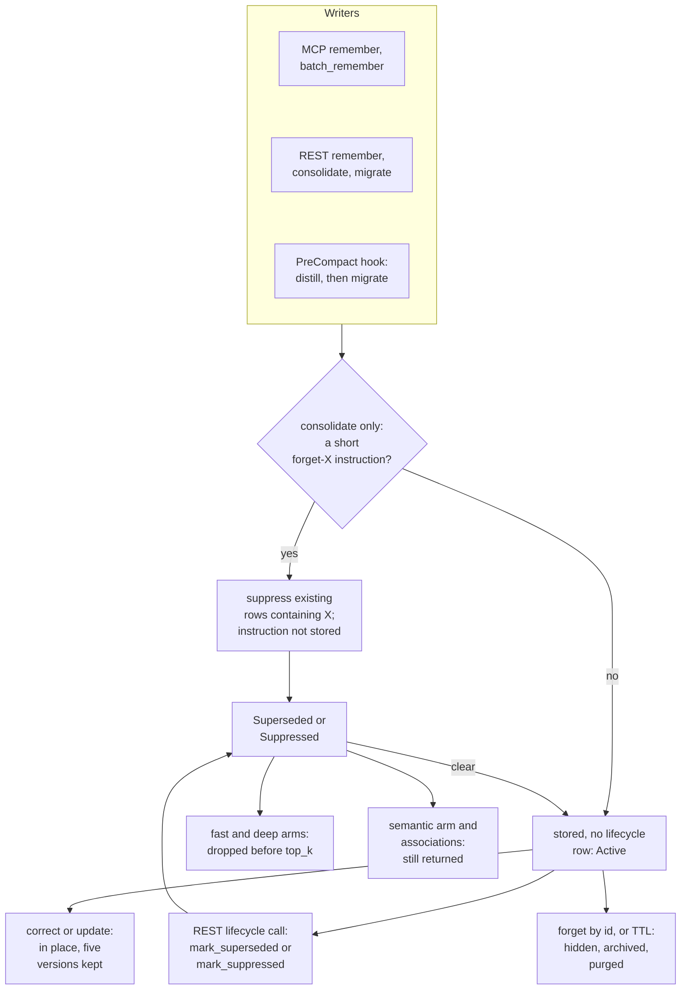

## 1. Executive Summary

LRC (Loong Recall) is a local memory sidecar for AI tools, written in Rust. It
stores typed memories in JSON files under `~/.loong-recall/` and serves them to
coding agents over MCP, a REST API, the `lrc` CLI and a Tauri desktop app. The
same process indexes code for search. Hooks for Claude Code, Cursor and Trae
inject recent memories at session start and migrate a transcript before
compaction.

What is notable is the forgetting path. A memory can be marked `Superseded` or
`Suppressed` in a separate lifecycle table, and the fast and deep recall arms
drop it before the top-k cut. A short "forget X" sent to the consolidate
endpoint suppresses every existing memory containing X, and the instruction
itself is not stored, since its text contains X. A populated test asserts both
exclusions. A synthesis memory takes the strictest privacy of its sources, or
is not written.

What is weak is coverage and visibility. The semantic arm, which the shipped ML
build fuses by default, and association expansion do not read lifecycle state,
so a suppressed memory can still be recalled. A new memory similar to a
suppressed one is merged into it and disappears with it. The encoder, the deep
arm's geometry, rank fusion, synthesis planning, garbage collection and the
audit trail are in `core/lrc-algo`, a submodule pinned at
`7ceba1d548721d6cc7aa6fd316431fdedd5a7ae1` whose repository returns 404. The
public crate does not compile without it (`src/lib.rs:278-283`). This report
covers the public tree only.

**Licence.** The engine is withheld: `LICENSE` states that since 30 October
2026 the protected source *"不再随公开仓库分发"* and that *"公开仓库不构成任何源码授权"*
(`LICENSE:15-24`), so the Apache-2.0 layer is a crate no outside party can
build. The engine's DaoTi Research License bars any commercial use (§1.2(b))
and *"以任何方式尝试提取、推断或重建受保护算法背后的设计原理、架构决策或核心参数"*
(§1.2(f)), and terminates automatically on breach with a duty to destroy every
copy (§5). The two licence files also disagree on scope: `LICENSE` §2.2 puts
everything outside `src/engine/` under Apache-2.0, while the appendix of
`LICENSE_CODE` lists five files (`LICENSE_CODE:193-202`).

## 2. Mental Model

A memory is a stored statement with an owner, not a belief with a status. It
enters through `remember`, `batch_remember`, the consolidate endpoint or a
transcript migration, and it is retrievable as soon as it is written. Nothing
marks it as a candidate, and nothing in the public tree asks whether it is true.

The one epistemic axis is the lifecycle table, kept apart from the memory record
in `lifecycle.json` (`src/lifecycle.rs:1-12`). A memory with no row is `Active`.
`Superseded` records the id of the memory that replaced it, and `Suppressed`
records that a user or rule withdrew it (`src/lifecycle.rs:73-100`). Both are
excluded from the fast and deep arms; `clear` returns a memory to `Active`.

Two things move a memory out of `Active`. A REST call to
`/v1/memories/lifecycle` with `mark_superseded` or `mark_suppressed` does it by
id. A forget instruction sent to `/v1/memories/consolidate` suppresses by
contained text. Nothing in the tree marks supersession automatically: the
route's own comment says the judgement belongs to the caller
(`src/v1_api.rs:7037-7041`).

A memory dies three ways. `forget` deletes it by id. TTL expiry hides it, then
`archive` moves it to cold storage and `purge-archived` deletes it. The
regulator quarantines and purges synthesis memories that the private journal
rates low quality. A correction is not a death: `correct` and `update`
overwrite the content in place and keep the previous five versions on the
record (`src/memory_types.rs:580-608`).

## 3. Architecture

The product is one sidecar process, `code-memory-server`
(`src/bin/server.rs`), shipped inside a Tauri desktop app or beside the `lrc`
CLI. It listens on port 3099 by default and serves MCP at `/mcp` and the REST
API under `/v1`. The CLI is an HTTP client that probes ports 3099 to 3118.

Persistence is JSON files in `~/.loong-recall/`. `JsonPersistence` appends
writes and delete markers to `memories.journal.jsonl` and rewrites the base file
when the journal reaches 64 MB (`src/persistence/json.rs:195-203`, `:247-271`).
Lifecycle state, archive, graph edges, the state machine snapshot and semantic
vectors each have their own file. Postgres, Qdrant and Neo4j backends are
optional Cargo features of the library; the sidecar constructs
`JsonPersistence` only (`src/bin/server.rs:698`). Only the JSON backend
implements `save_lifecycle`. The trait default discards it, so on the other
backends a suppression lasts until restart (`src/persistence/mod.rs:273-278`).

Retrieval has three arms. The fast arm is TF-IDF over a bigram-aware tokenizer
in `MemoryStore::recall_with_cancel`. The deep arm, `trapezoid_focus_recall`,
selects candidates by the engine's nine-value "LuoShu" encoding and eight-way
"bagua" class. The semantic arm, `semantic_recall`, ranks every eligible memory
by sentence-vector cosine from `src/semantic_index.rs`. Fusion weights and
reciprocal rank fusion are `engine::rrf`, in the private submodule.

### Deployment and ergonomics

An adopter installs a desktop package or two binaries; nothing else has to run.
The release workflow builds with `--features server,ml`
(`.github/workflows/release.yml:498-501`), so the shipped sidecar downloads a
sentence-embedding model on first start, 100 to 400 MB from a domestic mirror by
default. Without the model the semantic arm returns nothing and recall falls
back to two arms. No API key is needed to store or recall; an LLM endpoint is
optional and used for query enrichment and synthesis.

The store is human-readable JSON and repairable by hand. Building from source is
not possible outside the project: every module that encodes, fuses or
synthesizes is mounted from `core/lrc-algo` by `#[path]`
(`src/lib.rs:278-283`).

## 4. Essential Implementation Paths

- **Single write.** MCP `remember` (`src/server.rs:2889`) calls
  `MemoryStore::remember`, which splits into `prepare_remember` and
  `commit_remember` (`src/memory_store.rs:5042-5360`). A visible memory in the
  same project with word-set Jaccard at or above 0.5 is merged into instead of
  appended to; `apply_merge` keeps the older `created_at`, the stricter privacy
  and the union of tags and entities (`src/memory_write.rs:155-192`).
- **Batch write and forget instruction.** `/v1/memories/consolidate` separates
  forget instructions with `parse_forget_intent`, writes the rest through
  `remember_batch_preencoded` with no similarity merge, then suppresses matches
  under the same write lock (`src/v1_api.rs:2821-2950`).
- **Fast recall.** `recall_with_cancel` filters expired, type, project, tags,
  importance and privacy, scores, then drops lifecycle-excluded memories before
  the top-k cut (`src/memory_store.rs:6732-6860`, `:7273-7278`).
- **Fused recall.** MCP `recall` defaults to fast plus deep plus semantic,
  fused by `engine::rrf::rrf_fuse_three` (`src/server.rs:2237-2280`). MCP
  `recall_enhanced` fuses the same arms and adds association expansion
  (`src/server.rs:1020-1110`), as REST `/v1/memories/enrich` does.
- **Lifecycle.** `/v1/memories/lifecycle` checks visibility, applies the op and
  flushes `lifecycle.json` (`src/v1_api.rs:7042-7088`).
- **Delete.** `forget` deletes through persistence, removes the memory from the
  candidate index and cache, and removes its graph edges
  (`src/memory_store.rs:7606-7655`).
- **Correct.** `correct_memory` rewrites one record with a reason, sets
  `source` to `corrected: …`, and queues re-encoding
  (`src/memory_store.rs:10506-10534`).

## 5. Memory Data Model

`Memory` carries `id`, `content`, `memory_type`, `project`, `tags`,
`importance` (1 to 10), `ttl_days`, `created_at`, `updated_at`,
`last_accessed`, `source`, `source_ids`, an optional `confidence`, the engine's
nine-value vector and bagua class, `privacy_level`, `session_id`, `user_id`,
`event_id`, typed `entities`, `version` and `version_history`
(`src/memory_types.rs:251-353`). `confidence` and `information_gain` are
optional floats.

Scope is three fields and one rule. `Global` is visible to every context;
`User` needs a matching `user_id`; `Session` needs a matching `session_id`, and
the owner as well when the record has one (`src/memory_store.rs:1778-1816`).
`project` is a separate optional filter the caller supplies.

Time is `created_at`, which a writer may set to the source event's time, and
`updated_at`, which every content change overwrites
(`src/memory_write.rs:102-104`, `src/memory_types.rs:580-593`). When a source
time is given, the ingest time is not kept. The lifecycle row carries its own
`updated_at_ms` and hit counters.

Correction history is the last five `MemoryVersion` entries on the record,
each with content, time and an optional reason; the sixth correction drops the
oldest (`src/memory_types.rs:580-608`).

## 6. Retrieval Mechanics

The fast arm tokenizes CJK text into bigrams and ASCII into words and weights
by TF-IDF. It can widen the query with words from the eight most active memories
in the private state machine, which score only when a candidate shares no word
with the original query (`src/memory_store.rs:6750-6800`). Lifecycle decay, a
30-day half-life multiplier floored at 0.2, is off unless
`LRC_LIFECYCLE_DECAY=1` (`src/lifecycle.rs:45-53`, `:181-195`).

The semantic arm takes every unexpired, visible memory matching the filters and
asks the semantic service for the nearest vectors
(`src/memory_store.rs:6647-6703`). Its filter is the fast arm's minus the
lifecycle check. The fused paths run it on the original query while the lexical
arms use an LLM-enriched one, and drop the deep arm's weight to zero when
semantic results exist (`src/server.rs:1056-1080`).

Association expansion adds memories linked to the fused seeds by shared event,
entity, artifact and graph edge, filtered for expiry and privacy
(`src/memory_store.rs:9064`, `:9155-9185`). Results carry the arm each hit came
from and a score breakdown.

## 7. Write Mechanics

Writes are synchronous and hold the store's write lock. A single `remember`
scans similarity candidates through an index and persists through the journal.
The consolidate endpoint encodes outside the lock in three phases and abandons
the write when encoding outruns its budget, so a timed-out client does not leave
a write behind (`src/v1_api.rs:2868-2893`).

A memory is retrievable by the fast and deep arms on commit. It reaches the
semantic arm when the background index encodes it; `/v1/index/wait` lets a
caller that needs read-your-writes block on that (`src/v1_api.rs:2726-2746`).

`parse_forget_intent` accepts a trigger at the start of a body of at most 60
characters, Chinese or English. It rejects stative uses such as "忘记带钥匙了"
and requires a target of at least two characters (`src/memory_write.rs:226-334`).
The matching memories are suppressed, not deleted, and only within the same
`user_id` and, when given, project (`src/memory_store.rs:7455-7499`). The check
runs on consolidate only; the same sentence sent to MCP `remember` is stored as
a memory.

The PreCompact hook posts a transcript to `/v1/context/distill`, which scores
sentences by decision, negation and conclusion words, and then posts the result
to `/v1/context/migrate`. No person sees the distilled items between the two
calls (`integrations/hooks/claude-code/pre-compact.sh`).

### Operational cost

The write path blocks on encoding but not on an LLM. The consolidation loop
wakes every 300 seconds and clusters new memories into synthesis memories; the
regulator runs every 30 minutes (`src/server.rs:5544-5554`). Journal compaction
rewrites the whole base file when the journal reaches 64 MB, which the code
estimates at about twice a day under its production load
(`src/persistence/json.rs:195-203`). Session-start injection is bounded by the
hook's `limit` on `/v1/memories/recent`.

## 8. Agent Integration

The MCP tool list declares `remember`, `batch_remember`, `recall`,
`recall_enhanced`, `list_memories`, `update_memory`, `correct_memory`,
`forget`, `archive`, `associations`, `association_graph`, `memory_stats`,
`system_health`, `search_code` and `codebase_stats`
(`src/server.rs:465-899`). The agent holds `forget`, `update_memory` and
`correct_memory`, and the `forget` description asks it to delete memories when
a module or file is deleted (`src/server.rs:671-683`). The lifecycle operations
are not on the MCP surface, the CLI or the desktop UI; they are a REST route
only.

Every MCP handler builds its privacy scope from `user_id` and `session_id`
arguments through `crate::privacy::scope_from_args`. Every by-id operation
checks visibility first and answers not-found for an invisible id
(`src/server.rs:2966-3025`).

`integrations/rules/` carries rule files for Cursor, Trae and `AGENTS.md` that
tell the agent when to recall and when to remember.

## 9. Reliability, Safety, and Trust

### Where the exclusion holds and where it does not

`lifecycle_allows` is called on the fast arm, the deep arm and inside
`suppress_matching_memories` (`src/memory_store.rs:6260`, `:7276`, `:7475`).
`semantic_recall` and `expand_associations` do not call it. The release build
enables the semantic arm, and MCP `recall` and REST enrich fuse it by default.
A suppressed or superseded memory close to the query in vector space can
therefore be returned. `list_memories` does not filter lifecycle state either,
which suits a management view.

### A new memory can inherit an exclusion

`scan_candidates`, which finds the merge target for a single `remember`,
filters expiry, privacy and project and not lifecycle state
(`src/memory_store.rs:2018-2072`). The merge keeps the existing record's id and
overwrites its content (`src/memory_store.rs:5182-5215`), and the lifecycle row
is keyed on that id. A new memory whose word set overlaps a suppressed or
superseded one by 0.5 or more therefore becomes that record, and is excluded
from the fast and deep arms with it. A corrected value written as a new memory
can vanish this way. I did not run it; this is read from the code.

### Marks

- **`trust_state`** — awarded on the lifecycle state. It is stored, moved by a
  reachable REST route and by forget instructions, and read as a filter on two
  of three arms. `Superseded` is the case the rubric asks for: on record, not
  served. The semantic arm is the gap.
- **`scope_enforced`** — awarded on `user_id`, `session_id` and
  `privacy_level` through `is_visible`, applied on all three arms, list,
  associations and by-id lookups. Without `LRC_API_TOKEN` a request with no
  scope sees everything, and the README says the multi-tenant mode is one token
  with self-reported users.
- **`negative_eval`** — awarded; see section 10.
- **`tombstone`** — withheld. The forget instruction is keyed on text, but it
  suppresses the rows that exist at that moment and leaves no record. A later
  batch write of the same text is a new `Active` memory, since the batch path
  skips similarity merge (`src/v1_api.rs:2800-2810`). Journal delete markers are
  keyed on id and dropped at compaction.
- **`bitemporal`** — withheld. `created_at` can hold event time, but it
  replaces ingest time rather than sitting beside it, and `updated_at` is
  overwritten.
- **`audit_log`** — withheld. `AuditTrail`, which the README calls a
  hash-chained `audit.jsonl`, is defined in the private engine
  (`src/memory_store.rs:47`), so its append-only property cannot be read. In the
  public tree, `forget`, `update_memory`, `correct_memory` and `remember` record
  no event. The recorded events are GC deletes, quarantine, purge, archive,
  synthesis, retrieval and regulator changes.
- **`human_review`** — withheld. No state holds a memory for a person, and the
  hook runs distill and migrate back to back.

### Other risks

- **Garbage collection.** `regulate` sets `gc_pending`, and
  `run_gc_if_pending` deletes whatever the private collector selects. The
  public tree has no caller of `run_gc_if_pending`; whether the engine calls it
  cannot be checked.
- **Derived privacy.** `inherit_privacy` gives a synthesis memory the strictest
  scope of its sources and returns `None` for sources spanning users or
  sessions, which the caller treats as "do not write"
  (`src/privacy.rs:242-285`, `src/memory_store.rs:4060-4075`).
- **Forget-instruction scope.** Matching requires an exact `user_id` match,
  `None` included, so an instruction with no owner suppresses every unowned
  memory containing the text (`src/memory_store.rs:7478-7480`).

## 10. Tests, Evals, and Benchmarks

The crate has 785 test functions in `src/` and `tests/`; 31 in
`tests/mtr_feasibility.rs` are `#[ignore]`d probes against a local corpus. The
desktop shell adds 92. The eight `[[test]]` targets in `Cargo.toml` point into
`core/lrc-algo/tests/` (`Cargo.toml:135-165`). CI checks out the submodule with
`secrets.CORE_REPO_TOKEN` and runs `cargo test` with and without `ml`
(`.github/workflows/ci.yml:36-39`, `:229-251`). The crate does not compile
without the private submodule (`src/lib.rs:278-283`), so none of its tests can be
built from the public checkout. I ran none of it.

`negative_eval` rests on two populated cases in `src/memory_store_tests.rs`:

- `suppressed_and_superseded_memories_are_excluded_from_recall`
  (`:7547-7586`) stores three memories, suppresses one and supersedes one, and
  asserts that `recall` returns the kept memory and neither excluded one.
- `forget_instruction_suppresses_matching_memories_end_to_end`
  (`:7595-7622`) asserts the suppressed memory is absent and an unrelated one
  present.

Both call `recall`, the fast arm. No case covers `semantic_recall`, the fused
default or association expansion, which is where section 9 finds the gap.

The HTTP cross-user scope test queries as `user-B` with a different project
from the writer's (`src/v1_api_tests.rs:5498-5506`). The project filter alone
returns zero, so that assertion passes with the user predicate removed. The
unit test of `is_visible` does vary one key at a time
(`src/memory_store_tests.rs:34-94`).

`docs/BENCHMARK_v0.10.3.md` reports LongMemEval-S retrieval on a non-ML build:
Session Recall@10 92.24% and Turn Recall@10 83.19% over 232 of the first 250
instances. Both recompute from its three shard rows, as 214/232 and 193/232. The
harness `lrc_fair_eval_v3.py` and the shard logs are on a local `G:\` drive and
are not committed. The ML build was not measured, because encoding at write time
took 404 seconds per instance. No paper is associated with the project.

## 11. For Your Own Build

### Steal

- **Keep a forget instruction out of the store.** An instruction to forget X
  contains X; storing it re-asserts what it withdraws. Detect it, act on it,
  and drop it.
- **Keep lifecycle state outside the record.** A small separate file means a
  retrieval hit never rewrites the store, and an older binary that drops
  unknown fields on rewrite cannot erase a suppression.
- **Derive a summary's scope from its sources, or refuse it.** Take the
  strictest intersection, and treat "spans two owners" as no summary at all.
- **Answer not-found for an invisible id.** A by-id delete or correction that
  checks visibility first leaks nothing through its response.

### Avoid

- **A status filter on some arms of a fusion.** Put the exclusion in the
  candidate filter every arm shares, or after fusion, and test the fused path
  rather than one arm.
- **Merging into an excluded record.** A dedup scan that ignores status hands
  new content an old record's exclusion.
- **A scope test whose two sides differ in more than the scope.** Change one
  key per assertion, or the test cannot fail for the reason it names.

### Fit

This suits one developer who wants a local, offline memory shared by several
coding tools, installs a binary, and is content to read JSON files when
something looks wrong. It does not suit anyone who needs to audit or change how
memories are ranked, fused, synthesized or collected, since that code is not
available to build. Walk away if forgetting must hold on every read path. Walk
away also if several users share one instance, since isolation rests on a
self-reported user id under one token.

## 12. Open Questions

- Whether `engine::rrf` or `engine::navigation` drops lifecycle-excluded
  memories after fusion; the public tree shows no such call.
- What the private collector selects for deletion, and whether anything calls
  `run_gc_if_pending`.
- Whether `AuditTrail` is append-only on disk and what its hash chain covers.
- Whether merging a new memory into a suppressed record is intended.

## Appendix: File Index

- Store and lifecycle: `src/memory_store.rs`, `src/lifecycle.rs`,
  `src/memory_types.rs`, `src/memory_store_types.rs`,
  `src/memory_store_cache.rs`
- Write path: `src/memory_write.rs`, `src/context_distill.rs`,
  `src/consolidation.rs`
- Scope: `src/privacy.rs`
- Persistence: `src/persistence/json.rs`, `src/persistence/mod.rs`
- Retrieval: `src/semantic_index.rs`, `src/graph_store.rs`
- API, MCP and CLI: `src/v1_api.rs`, `src/server.rs`, `src/bin/server.rs`,
  `src/bin/lrc.rs`
- Integrations: `integrations/hooks/claude-code/`, `integrations/rules/`
- Tests: `src/memory_store_tests.rs`, `src/v1_api_tests.rs`, `src/lifecycle.rs`
- Licence and build: `LICENSE`, `LICENSE_CODE`, `Cargo.toml`, `src/lib.rs`,
  `.gitmodules`, `.github/workflows/ci.yml`

### Recorded searches

Run from the repository root at the pinned commit with `/usr/bin/git`. Every
absence below is scoped to the public tree; `core/lrc-algo` was not readable.

- **The lifecycle filter has three call sites.**
  `git grep -n 'lifecycle_allows(' -- src` matches
  `src/memory_store.rs:6260`, `:7276`, `:7475` and the definition at `:7516`;
  none is inside `semantic_recall` (`:6647-6703`) or `expand_associations`
  (`:9064`).
- **The forget instruction is parsed on consolidate only.**
  `git grep -n 'parse_forget_intent(' -- src` matches `src/v1_api.rs:2830`
  beside the definition and its tests in `src/memory_write.rs`.
- **The lifecycle route has no in-tree client.**
  `git grep -n 'memories/lifecycle' -- .` matches `CHANGELOG.md:388` and
  `src/v1_api.rs` only.
- **No MCP handler records an audit event.**
  `git grep -n -E 'record_audit|queue_audit' -- src/server.rs` returns
  nothing; the same pattern over `src/v1_api.rs` matches lines 3770 and 7959,
  and line 4221 writes `AssociationConfirmed` directly.
- **No caller of the GC runner.** `git grep -n 'run_gc_if_pending' -- .`
  matches the definition at `src/memory_store.rs:4760` and a comment at `:4550`.
- **No validity-time field.**
  `git grep -n -i -E 'valid_from|valid_to|valid_until|valid_at|invalid_at|event_time|occurred_at' -- src`
  returns nothing; `git grep -c 'source_timestamp' -- src/memory_write.rs`
  counts 3.
- **No review state.**
  `git grep -n -i -E 'approve|approval|pending_review|needs_review' -- src`
  matches one fixture sentence at `src/memory_store_tests.rs:6248`.
- **Lifecycle persists on the JSON backend only.**
  `git grep -n 'fn save_lifecycle' -- src` matches
  `src/persistence/json.rs:590` and the no-op default at
  `src/persistence/mod.rs:276`.
- **The engine is not in the public history.**
  `git log --oneline -- src/engine` returns nothing;
  `git log --oneline -- .gitmodules` returns `78863f3`, dated 30 October 2026.
- **The benchmark harness is not committed.**
  `git ls-files | grep -i -E 'lrc_fair_eval|longmemeval|run_v0103'` returns
  nothing; `git ls-files docs` lists `docs/BENCHMARK_v0.10.3.md`.
- **No paper.**
  `git grep -n -i -E 'arxiv|bibtex|citation' -- . ':!*.lock' ':!desktop/package-lock.json'`
  returns nothing.

## History

**2026-11-20** — [`3ae886a84578e47981d7e29d2d377c212825e946`](https://github.com/zhibaiYingChuan/LRC/commit/3ae886a84578e47981d7e29d2d377c212825e946) — first reading, from a full clone of `main` four commits past `v0.11.0`, scoped to the public tree: store, lifecycle, privacy, write, persistence, MCP, REST, CLI, hooks and their tests. The submodule `core/lrc-algo`, pinned at `7ceba1d548721d6cc7aa6fd316431fdedd5a7ae1`, returns 404 and was not read; submodules were not initialised. Screened first: a committed pre-commit hook, inert unless `core.hooksPath` points at it; the submodule; two `build.rs` files; six manifests inside the seven-day cooldown. Nothing was installed, built or run. Three marks: `trust_state`, `scope_enforced`, `negative_eval`.
