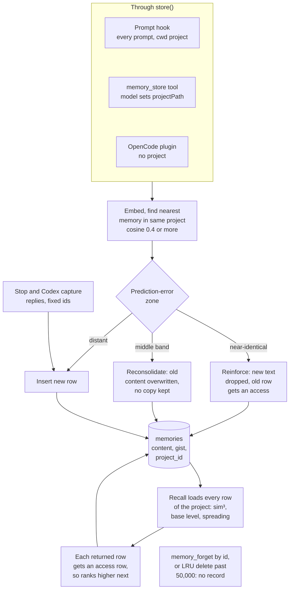

## 1. Executive Summary

Lucid Memory is a local memory server for Claude Code, Codex and OpenCode that
stores every user prompt in SQLite and ranks recall with a cognitive model:
cosine similarity cubed after MINERVA 2, an ACT-R base level from each
memory's access history, and spreading activation over an association graph,
computed in a Rust addon. What is notable is how much of that model is wired
in and running. What is weak is the write path: a new store that resembles an
existing memory either overwrites it in place, keeping no copy, or is
discarded in favour of it, and the README's headline numbers do not come from
anything that measured the product.

The memory model lives in TypeScript. `packages/lucid-server` owns the schema,
every write, delete and background pass, the MCP server, the CLI and the hooks.
The Rust crates hold arithmetic: `lucid-core` scores, spreads and decides
prediction-error zones, and with its `embedding` feature runs BGE-base through
ONNX Runtime. `lucid-perception` extracts video frames and transcribes audio.
Neither crate opens the database.

Capture is automatic. The installer registers a Claude Code `UserPromptSubmit`
hook that stores each prompt and prints a `<lucid-context>` block of gists
within 200 tokens. A `Stop` hook stores the final reply. Codex and OpenCode get
the same through a notifier and a plugin.

**Reconsolidation replaces memories.** Before inserting, `store()` finds the
most similar memory in the same project. Near-identical text is dropped and the
old row reinforced; a middle band overwrites the old row's content with the new
text. Section 7 gives the arithmetic.

**The benchmark claims are simulations.** The "Pinecone" in the README is a
cosine sort over the same synthetic vectors, its latency is a string printed by
the benchmark, and the recall gap is the length of what each strategy returns.
Section 10 has the detail.

**Licence.** The tree ships eight compiled native addons, 124 MB, that the
server loads at run time, and the GPL-3.0 text in `LICENSE` is the only licence
text in the tree. Each addon carries thousands of `onnxruntime` symbol strings,
consistent with the `ORT_STRATEGY: download` build in
`.github/workflows/build-native.yml:91`, and no notice names ONNX Runtime or
any other bundled component. Nothing ties a given binary to the source beside
it; the pinned commit is itself a bot commit that replaced them. The installer
downloads the BGE and Whisper weights from Hugging Face `resolve/main` with a
size check and no revision or checksum (`install.sh:1085-1086`, `:1137`), so
the models the product runs are neither in the tree nor fixed by it. Code built
from the tree carries GPL-3.0 copyleft.

One mark, `scope_enforced`, on the project key of text recall. Section 9 gives
the reasons for the six withheld.

## 2. Mental Model

A memory is **a piece of text with a strength that rises when it is used**.
There is no notion of a memory being true or false. A prompt, an agent's
`memory_store` call and a captured assistant reply all become the same kind of
row, differing only in `type` and tags, and all are served from the moment
they are written.

What changes a memory's standing is use. Every retrieval appends an
`access_history` row for each returned memory, and the ACT-R base level
`ln Σ t^-d` over those times is one of the ranking terms
(`packages/lucid-server/src/storage.ts:862-877`,
`packages/lucid-server/src/retrieval.ts:930-940`). Co-retrieved memories
strengthen their association, and unused associations decay and are pruned.
A memory therefore gets more retrievable by being retrieved.

The documented lifecycle `fresh → consolidating → consolidated`, with
`reconsolidating` after an update, is advanced by the hourly pass on a clock
(`packages/lucid-server/src/consolidation.ts:141-176`). No recall reads it. It
is counted for `memory_consolidation_status` and nothing else, so the
"consolidated — stable, harder to modify" of `HOW_IT_WORKS.md` describes no
gate in the code.

A memory stops existing in three ways, none of which leaves a record: the model
calls `memory_forget` with its id; the hourly pass deletes the least recently
accessed rows once the store exceeds 50,000; or a later, similar store
overwrites its text.

## 3. Architecture

A Bun process per client runs `packages/lucid-server/src/server.ts` as a stdio
MCP server; the hooks invoke the CLI (`src/cli.ts`) as a separate process for
each prompt. Both open the same SQLite file through `bun:sqlite` with WAL and a
five-second busy timeout (`packages/lucid-server/src/storage.ts:354-393`).

The native addon `@lucid-memory/native` is the `lucid-napi` crate compiled for
four platforms and committed under `packages/lucid-native/`. It declares 66 `#[napi]`
items: retrieval, base level, spreading, prediction-error zones, decay and
the BGE embedder. The server falls back to TypeScript implementations when the
addon fails to load. `@lucid-memory/perception` is the same arrangement for
video.

Embeddings come from the first provider that answers: a configured
OpenAI-compatible endpoint, the in-process BGE model, OpenAI with
`OPENAI_API_KEY`, then Ollama. With none, recall ranks by recency alone and
says so in a `warning` field.

The background passes run inside the MCP server only, on `setInterval`
(`packages/lucid-server/src/server.ts:132-242`): pending embeddings every five
seconds, micro-consolidation every five minutes, and full consolidation,
file-familiarity decay and session pruning every hour. A client with the hooks
and no running MCP server gets capture and recall without any of them.

### Deployment and ergonomics

`curl -fsSL https://lucidmemory.dev/install | bash` installs Bun if needed,
copies the server into `~/.lucid`, downloads about 110 MB of BGE weights and a
74 MB Whisper model, and edits the chosen clients' configuration. The README
asks for 5 GB free. Nothing has to be running beyond the client, no API key is
needed, and it works offline once the models are present. The store is one
SQLite file a person can open; the `content` column is plain text. Automatic
updates from published GitHub releases are opt-in at install.

`packages/lucid-server/package.json` declares a `postinstall` running
`scripts/legacy-update.ts`. It returns at once unless the package directory is
the installed `~/.lucid/server`; there, it looks for a v0.6.5 self-update in
progress and, if it finds one, asks GitHub for the latest release and applies
it (`packages/lucid-server/src/upgrade.ts:443-498`).

The repository is large for what it holds. The working tree is 124 MB of the
eight addons and under 1 MB of everything else. History adds 74 revisions of
those addons and a Rust `target/` directory committed in the first commit and
deleted in the second, both on 29 January 2026, which together make up nearly
all of the 279 MiB pack. No model weights are committed.

## 4. Essential Implementation Paths

- **Schema.** `packages/lucid-server/src/storage.ts`: `memories` `:398-409`,
  `associations` `:412-420`, `access_history` `:432-437`, visual memories
  `:519-535`, episodes and temporal links `:567-608`, the embedding caches and
  their invalidation trigger `:624-670`, added columns `:678-705`.
- **Prompt capture and injection.**
  `packages/lucid-server/hooks/user-prompt-submit.sh`: stdin read whole `:35`,
  project from `CLAUDE_PROJECT_PATH` or `pwd` `:46`, background `lucid store`
  `:184`, `lucid context` `:194`. The CLI side is
  `packages/lucid-server/src/cli.ts:263-350`.
- **Reply capture.** `packages/lucid-server/src/claude-stop.ts:5-42`,
  `packages/lucid-server/src/codex-notify.ts:39-45`, both into
  `storeCapturedMessage` (`storage.ts:718-748`), which skips reconsolidation.
- **Store and reconsolidation.** `LucidRetrieval.store`,
  `packages/lucid-server/src/retrieval.ts:1186-1466`: nearest match and zone
  `:1200-1293`, reinforce `:1270-1278`, overwrite `:1280-1289`, insert
  `:1314-1324`, embedding and auto-association `:1351-1373`, episode links
  `:1375-1463`. `findMostSimilarMemory` `storage.ts:1310-1378`;
  `reconsolidateMemory` `storage.ts:833-850`.
- **Recall.** `retrieveTextWithProbe`, `retrieval.ts:618-976`: candidates
  `:629`, recency fallbacks `:645-748`, native scoring `:982-1064`, instance
  noise `:881-904`, episode spreading `:336-428`, session boost `:915-928`,
  access recording `:930-940`, association reinforcement `:943-973`. The Rust
  pipeline is `crates/lucid-core/src/retrieval.rs:109-255`.
- **Context assembly.** `getContextWithVisuals`, `retrieval.ts:2095-2189`.
- **Delete.** `memory_forget`, `packages/lucid-server/src/server.ts:607-656`,
  calling `deleteMemory`, `storage.ts:854-857`.
- **Background.** `packages/lucid-server/src/consolidation.ts:45-226`;
  `pruneOldMemories`, `storage.ts:3086-3120`.
- **MCP tools.** `packages/lucid-server/src/server.ts`, from `:260`.

## 5. Memory Data Model

The `memories` row is `id`, `type` (learning, decision, context, bug,
solution, conversation), `content`, `gist`, `created_at`, `last_accessed`,
`access_count`, `emotional_weight`, `project_id` and JSON `tags`, with
`encoding_strength`, `encoding_context`, `consolidation_state` and
`last_consolidated` added by migration (`storage.ts:398-409`, `:678-705`).

Both `content` and `gist` are stored. The gist is extractive: the first
sentence over 20 characters, plus key terms if they fit in 150 characters
(`packages/lucid-server/src/gist.ts:14-48`). It is what the hook injects.

Embeddings live in their own table keyed by memory, model and vector length,
so several providers' vectors coexist, and a trigger deletes a memory's
vectors whenever its content changes (`storage.ts:649-667`). This is the
careful part of the schema, and the tests for it are the densest in the suite.

The scope key is `project_id`, a UUID from `projects`, which maps a path string
to an id by upsert (`storage.ts:1649-1658`). Every read that takes a
`projectPath` therefore also writes a `projects` row. `store()` passes a
project's id where `getOrCreateProject` expects a path, so each project's
metadata accumulates on a second row whose path is the first one's UUID
(`retrieval.ts:1332`).

The only time is `created_at`. There is no supersession link, no source
reference and no record of who wrote a row beyond the `conversation` type and
the `claude`, `codex`, `assistant` and `user` tags on captured messages. The
ids of captured messages encode their origin (`claude-response:<sha256>`,
`codex-prompt:<key>`); a prompt captured by the Claude Code hook gets a random
UUID like any other stored memory.

Separate stores hold visual memories (a description written by the model, not
the media), file-location familiarity with per-access activity contexts and
pins, episodes, and sessions.

## 6. Retrieval Mechanics

Recall is a full scan. `getAllForRetrieval` selects every row of the project,
or of the database when no project is given, then runs one `access_history`
query per row (`storage.ts:939-957`); `getAllEmbeddings` loads the vectors for
the current model. Rows without a vector in that space are skipped
(`retrieval.ts:767`).

The Rust `retrieve` computes, per memory, cosine similarity cubed, a base level
from the access times with a session-aware decay rate, an emotional weight and
a working-memory boost, then spreads activation from the top seeds through the
association graph to depth 3 and drops candidates whose retrieval probability
is under 0.1 (`crates/lucid-core/src/retrieval.rs:109-255`). TypeScript then
adds episode spreading from the top five, multiplies memories seen in the
current session by 1.5, and slices.

The hook path, `lucid context`, keeps text candidates with similarity 0.3 or
more and fills a budget of 200 tokens, 30% of it reserved for visual
memories, with gists in rank order (`cli.ts:263-325`,
`retrieval.ts:2095-2189`). The output is a `<lucid-context>` block of lines
like `- [conversation] Claude replied: …`. The block is bounded. It is
recomputed for every prompt and printed by the prompt hook, so its content
changes from turn to turn.

Two properties follow from the code and were not run:

- **Recall writes.** Each returned memory gets an access row and its
  `last_accessed` moved, and co-returned memories reinforce their association
  (`retrieval.ts:930-973`). The hook calls recall on every prompt, so what is
  injected today ranks higher tomorrow.
- **Cost grows with the store.** Every query reads every row of the project
  and one history query per row. The 2.7 ms in the README is the Rust kernel
  alone (section 10).

The encoding strength that micro-consolidation raises and decays every five
minutes reaches recall only as an instance-noise probability written onto each
candidate at `retrieval.ts:902`, which no caller reads. Its effect is on the
reconsolidation threshold in section 7.

## 7. Write Mechanics

**Prompts.** The prompt hook stores its whole stdin with
`--type=conversation` in a background subshell and then runs `lucid context`
on the same string (`user-prompt-submit.sh:35`, `:184`, `:194`). Claude Code
delivers hook input as a JSON object, which is how the repository's own `Stop`
handler reads it (`claude-stop.ts:7`). The script does not parse it, so the
stored content and the recall query would be the JSON envelope rather than the
prompt text. This was not run.

**Replies.** `captureStop` keys a reply on a hash of session, prompt id and
text, truncates it to 2,000 characters and inserts it once under that key
(`claude-stop.ts:23-41`, `storage.ts:718-748`). Codex prompts and replies take
the same route. These skip reconsolidation and are excluded from it as targets
(`storage.ts:1333`).

**Everything else goes through `store()`**: the hook's prompt, the model's
`memory_store`, and the OpenCode plugin, which stores user messages as
`conversation` and assistant messages over 50 characters as `learning`
(`packages/lucid-server/plugins/opencode-lucid-memory.ts:78-88`).

`store()` embeds the text, finds the most similar memory in the same project at
cosine 0.4 or more, and computes a surprise. On the native path that is
`(1 − cos) / (0.5 + 0.01·age_days + 0.2·strength)`, capped at 1
(`crates/lucid-core/src/retrieval.rs:291-310`). The zone thresholds start at
0.1 and 0.55, the low one rising by 0.05 a day of age and the high one falling
with access count (`crates/lucid-core/src/activation.rs:673-708`). For a
memory at age 0, one access and strength 0.5, the arithmetic gives:

| Cosine to nearest | Zone | Effect |
| --- | --- | --- |
| above about 0.94 | reinforce | the new text is not stored; the old row gets an access and +0.05 strength |
| about 0.69 to 0.94 | reconsolidate | the old row's `content` and `gist` are replaced by the new text and its vector, state set to `reconsolidating` |
| below about 0.69 | new trace | a new row |

Reconsolidation keeps the old row's id, `type`, tags, emotional weight and
creation time (`storage.ts:833-850`). It writes no copy of the text it
replaces. A user prompt can therefore replace a `decision` the agent stored,
and an OpenCode assistant reply can replace either, with the result still
typed as the original. No test drives `store()` through the overwrite branch.

Within that band, this is the system's only correction mechanism. No tool
edits a memory: `updateMemory` has one caller, `reconsolidateMemory`.

**Delete.** `memory_forget` takes an id and runs `DELETE FROM memories`, which
cascades to embeddings, associations, access history and episode events. The
model needs the id first, and the injected block carries none. A repeated
prompt or reply is stored again as a new row. `lucid backup` copies the main
database file with `copyFileSync` and not its `-wal` file
(`cli.ts:631-665`), so a backup can miss recent writes, and it keeps whatever
is forgotten after it is taken.

**Pruning.** Above 50,000 rows the hourly pass deletes the excess, least
recently accessed first, across all projects and types, with nothing kept
(`storage.ts:3086-3120`).

### Operational cost

The prompt hook blocks the prompt on `lucid context`, a fresh Bun process that
opens the database, detects an embedder with a 3-second budget and scans the
project (`cli.ts:82`). The store runs beside it in the background, and its new
row is retrievable once it commits, with its vector written in the same call.
No model is called on the write path apart from the embedder. The
micro-consolidation pass touches at most one batch of recently accessed and
stale rows every five minutes; nothing rewrites the store wholesale.

## 8. Agent Integration

The MCP server registers 26 tools: `memory_store`, `memory_query`,
`memory_narrative`, `memory_context`, `memory_forget`, `memory_stats` and
`memory_consolidation_status`; four visual and two video tools; and thirteen
`location_*` tools for file familiarity. The `memory_store` description tells
the model to store *"proactively"* when it learns, fixes or decides something.

Automatic capture and injection do not depend on the model: the hook stores
and injects on every prompt. The model's own tools add explicit memories,
search across projects when it omits `projectPath`, and delete by id.

When a prompt names an image or video, the hook prints instructions to spawn a
background task on a small model, describe the media and call `visual_store`
(`user-prompt-submit.sh:137-173`). Visual memory is therefore written by the
agent from a prompt the hook composed.

Adapting this to another agent means a prompt hook and an MCP client. The
CLI's `context` and `store` commands are the whole surface the hooks use.

## 9. Reliability, Safety, and Trust

### What gets injected

The context block mixes the user's prompts, the agent's stored notes and the
agent's own previous replies, each shown as a gist with a type label
(`cli.ts:306-321`). A reply that was wrong is captured, ranked like anything
else, injected into a later prompt and, because recall writes an access, ranked
higher the next time. Nothing marks a captured reply as less reliable than
something the user said.

The README says stored content may include source code or secrets. No code on
either capture path redacts anything.

### Scope

Text recall is scoped by project when a project is given. The hook gives the
working directory. The MCP tools take an optional `projectPath` from the
model, and without it `memory_query` and `memory_context` search every project
in the database (`server.ts:362-378`, `:548-557`). The OpenCode plugin stores
and recalls with no project at all (`opencode-lucid-memory.ts:20`, `:31-32`).

Visual memories carry `project_id` and are never filtered by it:
`getAllVisualsForRetrieval` takes no argument (`storage.ts:2982-2990`),
`retrieveVisualWithProbe` uses the project only for a +0.15 weight
(`retrieval.ts:1878-1886`), and the hook's context call passes `undefined`
for it (`retrieval.ts:2130-2137`). A description of a screenshot from one
project is injected into another.

Database profiles give a stronger boundary: per-client or named files, chosen
in `~/.lucid/config.json` (`packages/lucid-server/src/database-path.ts:30-44`).

### The headline claims

The README's table and the GitHub description (*"13x faster than Pinecone, 5x
leaner than RAG. Finds what RAG misses"*) rest on the benchmark scripts read in
section 10. The 13x figure does not appear in the tree.

### Marks

- **`scope_enforced` — earned.** `project_id` is stored on each text row and
  applied as a SQL predicate on every text recall when given, and the
  automatic path always gives it. It does not cover visual memories, the
  model's unscoped calls or OpenCode.
- **`tombstone` — withheld.** `memory_forget` deletes the row; nothing keyed
  on the value remains, and the next prompt saying the same thing is stored
  again.
- **`trust_state` — withheld.** `consolidation_state` is a discrete field with
  a producer, and no read excludes on it; it is a lifecycle clock, not an
  epistemic status. Nothing else on a row could withhold it.
- **`bitemporal` — withheld.** `created_at` is the only time.
- **`audit_log` — withheld.** `access_history` records retrievals, which the
  rubric excludes. Creation, reconsolidation, forget and pruning write no
  event, and reconsolidation destroys the text it replaces.
- **`human_review` — withheld.** Every write takes effect at once and the agent
  holds the delete verb.
- **`negative_eval` — withheld.** `storage.test.ts:221-229` requires exactly
  the in-project row of two, but through `queryMemories`, which no product path
  calls. `embedding-endpoint.test.ts:204-241` requires a memory whose vector
  is in a stale embedding space to be absent from a populated result and then
  present after re-embedding; that guards index consistency, not a boundary on
  what may be retrieved.

## 10. Tests, Evals, and Benchmarks

I ran none of the suites or benchmarks. The counts are from reading.

**Tests.** 258 `it` or `test` call sites, some inside loops, in 12 files under
`packages/lucid-server/src`, and 95 Rust `#[test]` functions, 74 of them in
`lucid-core`. `ci.yml` runs the server tests and typecheck on Linux, the Codex
configuration tests and an upgrade-recovery script on Windows, a stock-v0.6.5
upgrade test, and `cargo test --features transcription`.

The densest coverage is on embedding spaces (`embedding-endpoint.test.ts`,
`embedding-migration.test.ts`, `embedding-cache.test.ts`, 50 cases): model,
endpoint and width changes, stale vectors skipped and rebuilt, a different
model's identical vector never reinforced. The capture tests run the real
`Stop` handler against a temporary home and check deduplication, truncation
and that replies are excluded from reconsolidation matching
(`claude-stop.test.ts:87-140`).

Not tested: `store()` overwriting a memory through the reconsolidate branch;
the filter in `getAllForRetrieval`; the hook script's handling of its input;
`memory_forget` followed by recall; visual recall across projects.
`location-rust-integration.test.ts` prints `[skipped]` and returns when the
addon does not load, so its cases pass without asserting on a machine without
it.

**Benchmarks.** `benchmarks/quality/` holds six scripts and no output.
`benchmarks/README.md`, the CHANGELOG and the README quote results; none of
them recomputes from a committed artifact.

- **Every vector is synthetic.** Each script builds embeddings from a seeded
  generator or a hand-set pattern with a chosen similarity to the query
  (`benchmarks/quality/realistic-dev.ts:45-69`,
  `benchmarks/quality/rag-comparison.ts:28-58`). No text is embedded, so no
  script measures whether the product finds anything in real prompts.
- **"Pinecone" is a cosine sort in the same process.**
  `retrievePineconeRAG` sorts the same vectors by `cosineSimilarityBatch` and
  returns each memory's content up to 1,024 characters
  (`benchmarks/quality/token-efficiency.ts:312-352`). `ragRetrieve` in the
  other script is the same sort (`rag-comparison.ts:322-330`).
- **The recall gap is text length.** In `token-efficiency.ts` the relevant
  memories are generated at cosine 0.85 to 0.95 and the rest at 0.1 to 0.5
  (`:444`, `:458`), so all three strategies rank the relevant ones first. The
  difference at a fixed token budget is that Lucid's strategy returns a gist of
  at most 150 characters and the others return full content, and the
  "claude-mem" strategy is charged a fixed 250 tokens of index and timeline
  overhead before it returns anything (`:263-268`). The 82.5%, 55.3% and 28.9%
  recall figures measure that. The similarities and relevance labels are
  drawn from unseeded `Math.random()`, so the figures vary between runs.
- **"5x storage compression" is the gist ratio.** The script prints
  "lucid-memory stores gists" (`token-efficiency.ts:690`); the store keeps the
  full content and the gist (`storage.ts:757-770`).
- **The Pinecone latency is a string.** `rag-comparison.ts:543-545` prints
  "10-50ms latency, $70+/month" and "~10-20x faster" as constants. The 2.7 ms
  is a criterion benchmark of `retrieve` over 2,000 random 1,024-dimensional
  vectors held in memory (`crates/lucid-core/benches/retrieval.rs:61-102`). It
  excludes embedding the query, the SQLite scan and the per-row history
  queries, and the shipped BGE model produces 768 dimensions. A local kernel
  is compared with a hosted service's network round trip.
- **The workflow scenarios grade the features they test.** In
  `realistic-dev.ts` the "RAG baseline" is the same cosine sort over the same
  vectors (`:1114-1127`), and scenarios such as episode retrieval define
  relevance by temporal links cosine cannot see. That is an ablation of the
  cognitive terms on authored data, which is what it can show; the README
  presents it as a comparison with RAG systems.

There is no paper; the README cites the cognitive-science literature the model
draws on.

## 11. For Your Own Build

### Steal

- **Key cached vectors on model and width, and invalidate them with a
  trigger.** A unique index on `(memory_id, model, length(vector))` and an
  `AFTER UPDATE OF content` trigger that deletes them make a provider switch
  or an edit safe without a migration step.
- **Keep the injected block small and gist-shaped.** A 200-token budget with a
  similarity floor of 0.3, and nothing printed when nothing clears it.
- **Give captured messages a deterministic id from their content.** A hash of
  session, prompt id and text makes a replayed hook a no-op.
- **Return a `method` and a `warning` with every recall**, so a caller can see
  that it got recency because the embedder was down.

### Avoid

- **Deduplication that edits the matched row.** If a similar write must
  merge, write a new version and supersede the old one; overwriting content in
  place loses the text and leaves the old type, tags and time on new words.
- **Dropping a near-duplicate write.** A restatement is evidence; a counter on
  the old row keeps it, discarding the text does not.
- **A recall that strengthens what it returns, on every prompt.** Automatic
  injection then becomes self-reinforcing, including for wrong memories.
- **Storing a hook's stdin without parsing it.**
- **Benchmarks whose baseline is a simulation of a competitor.** Name the
  arms for what they compute, embed real text, and commit the output.

### Fit

This suits one developer who wants Claude Code or Codex to see snippets of
earlier sessions with no setup beyond an installer, and who treats memory as
a recency-weighted search over their own prompts. The cognitive model is
coherent, and the embedding-space handling is careful.

It does not suit anyone who needs a stored decision to stay as written, who
needs to know why a memory says what it says, or who shares a database across
projects with screenshots in it. A reader weighing it on the README's numbers
should run it on their own prompts instead, because nothing in the tree has.

## 12. Open Questions

- Does the installed Claude Code hook store the JSON envelope? The script
  reads stdin whole; running one prompt would settle it.
- Does the background store in the hook ever commit before `lucid context`
  runs, so that a prompt is recalled as context for itself?
- Do the committed addons correspond to the source at the pin? The pin is the
  bot commit that replaced them; a rebuild would answer it.
- How wide is the overwrite band with BGE-base on real prompts? The arithmetic
  is fixed, and the distribution of BGE similarities between related and
  unrelated prompts decides how often it fires.

## Appendix: File Index

| Path | Role |
| --- | --- |
| `packages/lucid-server/src/storage.ts` | Schema, inserts, reconsolidation update, delete, nearest match, pruning |
| `packages/lucid-server/src/retrieval.ts` | `store()` with prediction-error zones, recall, context assembly |
| `packages/lucid-server/src/server.ts` | MCP tools and background timers |
| `packages/lucid-server/src/cli.ts` | `context`, `store`, `backup` and configuration commands |
| `packages/lucid-server/src/consolidation.ts` | Micro and full consolidation, pruning call |
| `packages/lucid-server/src/claude-stop.ts`, `codex-notify.ts` | Reply capture |
| `packages/lucid-server/hooks/user-prompt-submit.sh` | Prompt capture and injection |
| `packages/lucid-server/plugins/opencode-lucid-memory.ts` | OpenCode capture and injection |
| `packages/lucid-server/src/config.ts` | Every threshold and feature flag |
| `crates/lucid-core/src/retrieval.rs`, `activation.rs`, `spreading.rs` | Scoring, surprise, zones, spreading |
| `crates/lucid-core/src/embedding.rs` | BGE-base through ONNX Runtime |
| `crates/lucid-core/benches/retrieval.rs` | The 2.7 ms benchmark |
| `benchmarks/quality/*.ts` | The quality and token-efficiency scripts |
| `packages/lucid-server/src/upgrade.ts` | Self-update and the `postinstall` legacy path |

### Recorded searches

Run from the repository root at the pinned commit with `git grep`; `-I` skips
the committed binaries.

- **No lexical arm.** `git grep -n -I -i -E 'fts5|bm25' -- packages crates`
  returns nothing; `git grep -n -I -i cosine -- packages/lucid-server/src/storage.ts`
  matches.
- **No value-keyed refusal.**
  `git grep -n -I -i -E 'tombstone|blocklist|denylist' -- packages crates`
  returns nothing; `git grep -n -I -i suppress -- crates` matches two comments.
- **No validity time.**
  `git grep -n -I -i -E 'valid_from|valid_to|validfrom|validuntil|valid_until|invalid_at' -- packages crates`
  returns nothing; `git grep -n -I 'created_at INTEGER' -- packages/lucid-server/src/storage.ts`
  matches.
- **No mutation log.**
  `git grep -n -I -i -E 'audit|journal|mutation|event_log|changelog' -- packages/lucid-server/src ':!*.test.ts'`
  returns an activity keyword list in `storage.ts:1789` and the install
  recovery journal in `upgrade.ts`.
- **No review state.**
  `git grep -n -I -i -E 'approv|pending|review' -- packages/lucid-server/src/storage.ts packages/lucid-server/src/server.ts packages/lucid-server/src/retrieval.ts`
  returns the pending-embedding queue and the `reviewing` activity type.
- **No recall reads the consolidation state.**
  `git grep -n -I -E 'consolidation_state|consolidationState' -- packages/lucid-server/src ':!*.test.ts'`
  returns the column, its setter, the per-state batch query used by the
  consolidation pass, a count, the status tool and the row mapper.
- **The instance-noise probability is not read.**
  `git grep -n '\.probability' -- packages/lucid-server/src ':!*.test.ts'`
  returns the assignment at `retrieval.ts:902` and two constructions.
- **No product caller of the scope-tested query.**
  `git grep -n -I -E 'queryMemories\(' -- packages benchmarks ':!*.test.ts'`
  returns the definition at `storage.ts:895`.
- **No edit path but reconsolidation.**
  `git grep -n -E 'updateMemory\(' -- packages ':!*.test.ts'` returns the
  definition and the call inside `reconsolidateMemory`.
- **No redaction on capture.**
  `git grep -n -I -i -E 'redact|secret|password|api[_-]?key|sanitiz' -- packages/lucid-server/src packages/lucid-server/hooks ':!*.test.ts'`
  returns only the embedding provider's API key handling.
- **No checksum on model downloads.**
  `git grep -n -I -i -E 'sha256sum|shasum|checksum' -- install.sh install.ps1`
  returns nothing; `git grep -n -I huggingface -- install.sh` matches.
- **No benchmark output committed.** `git ls-files benchmarks` lists
  `README.md`, `package.json` and six `.ts` scripts.
- **The 13x figure is not in the tree.** `git grep -n -I -E '13x' -- .`
  returns nothing; `git grep -n -I -E '10-50ms' -- .` matches the README and
  `rag-comparison.ts:543`.
- **No paper.**
  `git grep -n -I -i -E 'arxiv|bibtex|@article|@misc|doi\.org|CITATION' -- .`
  returns nothing; `git grep -n -I Hintzman -- README.md` matches.
- **The Rust crates do not open the database.**
  `git grep -n -I -i -E 'rusqlite|sqlite' -- crates Cargo.toml` returns
  nothing; `git grep -n 'bun:sqlite' -- packages` matches.
- **No model weights in the tree or its history.**
  `git rev-list --objects --all | grep -i -E '\.(onnx|gguf|safetensors)$'`
  returns nothing; `git ls-files | grep -i -E '\.node$'` lists the eight
  addons.
- **No submodules.** `.gitmodules` is absent.

## History

**2026-11-25** — [`8ccb7ff2b9960ccf8432fa3a9e1d0e69761bca2c`](https://github.com/JasonDocton/lucid-memory/commit/8ccb7ff2b9960ccf8432fa3a9e1d0e69761bca2c). First reading, from a full clone at the head of `main`, with no submodules. Screened first: no auto-run surface; nothing inside the seven-day cooldown; four build-time execution points, two `build.rs`, a `prepublishOnly`, and a `postinstall` running `scripts/legacy-update.ts`, which acts only inside an installed `~/.lucid/server` finishing a v0.6.5 self-update; six unpinned surfaces; a `CLAUDE.md` addressed to agents, read as data. Nothing was installed, built or run, and the test suites were not run. One mark: `scope_enforced` ([section 9](#9-reliability-safety-and-trust)). Reconsolidation overwrites a similar memory in place, and the README's benchmark figures come from synthetic vectors and a simulated Pinecone.
