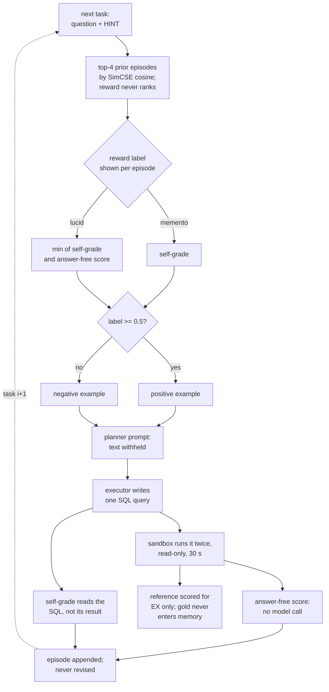

## 1. Executive Summary

This is the experiment code for *Memory Reward Inflation in Self-Improving LLM
Agents*. It has two parts. `bird_agent/` is a Memento-style text-to-SQL agent:
each task retrieves similar past episodes, plans, writes one query, grades it
without the reference, and appends the episode to an unbounded memory.
`factual_bank/` builds self-graded SimpleQA banks and scores them with
verifiers and re-graders. The memory this report is about is the BIRD episode
store, which carries every episode of a run into every later task.

What is notable is the check that caps the stored reward. In the `lucid` arm a
retrieved episode is shown with the minimum of its self-grade and an
answer-free score. That score is computed with no model call, from whether the
query failed, ran non-deterministically, returned nothing, or filtered on a
literal the question does not contain. It cannot share the self-grader's bias,
because it reads what the program did rather than what a model thinks.

What is weak is what the release lets anyone check. The twelve prompt texts of
the planner, executor and self-grader are placeholders, and the runner refuses
to start until they are filled. Most of the paper's tables have no script, no
output is committed, and the README's headline numbers differ from the only
arXiv version.

**Licence.** The tree carries no licence file, the README states no licence,
and GitHub reports none, so nothing in the repository grants a right to
copy, modify or redistribute the code. The data paragraph narrows the paper's availability statement further. The paper says
code, traces, run configurations and result files *"are released at"* a
repository that returns 404. This README withholds every model output instead,
offering it only on request from an academic address, for research use, under
a promise not to redistribute (`README.md:286`).

## 2. Mental Model

A memory is one finished episode: the question with its BIRD hint, the database
id, the plan, the SQL, and two binary scores (`bird_agent/memory.py:76-82`). It
becomes an influence on later work the moment it is written. There is no
candidate state, no review and no expiry, and every episode is written back
whether it was right or wrong (`memory.py:3-5`).

The stored reward is not a filter. Retrieval ranks by similarity alone, and the
reward travels with each retrieved episode as a label (`memory.py:53-74`). The
planner then splits the neighbours into positive examples, reward of at least
0.5, and negative examples otherwise (`bird_agent/planner.py:38-54`). An
episode's trust therefore decides how it is framed, never whether it is seen.

The arms differ only in that label. `memento` shows the self-grade. `lucid`
shows `min(self_score, answer_free_score)`, so a flagged episode moves from the
positive group to the negative one and nothing is ever promoted
(`memory.py:44-51`). `no-memory` retrieves nothing. Both scores are fixed in the
step that writes the episode (`bird_agent/run_bird.py:199-211`), and nothing
afterwards re-reads a stored episode to revise either one. The reference
query's result, the `gold` field, goes to the episode log and the counters and
never into memory (`run_bird.py:181-184`, `:203-211`).

The scope test passes for this store, narrowly. It outlives each task and
survives a restart through its log, it holds claims that turn out false, and
the whole design is about which of them the agent believes. It does not outlive
a run: a new tag or seed starts empty.

## 3. Architecture

Everything runs in one Python process per invocation. `run_bird.py` loads the
BIRD development set, fixes one seeded permutation shared by all arms, and runs
the chosen arms in parallel threads at each step, each arm holding its own
`EpisodeMemory` (`run_bird.py:225-230`, `:262-275`). SimCSE
(`princeton-nlp/sup-simcse-bert-base-uncased`) is loaded once and serialised
behind a lock (`bird_agent/simcse_embedder.py:17`, `:25`). Every model call
goes through the OpenAI client in `common/llm_client.py`.

Persistence is two append-only JSONL files per run. The episode log is one
record per episode, and `load_done_episodes` rebuilds memory from its
contiguous prefix of steps on resume (`bird_agent/call_cache.py:77-101`). The
call cache keys model calls and query executions by
`sha256(operation, payload)` (`call_cache.py:17-21`). A run's configuration is
written beside its log and a resume with different arguments is refused
(`run_bird.py:152-164`).

### Deployment and ergonomics

It needs an OpenAI-compatible endpoint, the BIRD development databases
downloaded by hand, and Torch with Transformers for SimCSE; a GPU is used if
present. The retrieval verifier in `factual_bank/` needs an endpoint offering
the Responses API web-search tool (`common/llm_client.py:53-59`). The episode
log is plain JSONL and readable by hand. The BIRD runner exits with status 2
until all twelve prompt placeholders are replaced, so the released tree cannot
run its own end-to-end experiment (`run_bird.py:218-222`, `:330-334`).

## 4. Essential Implementation Paths

- **One episode.** `_step_arm` retrieves, plans, writes SQL, executes it in the
  sandbox, computes the answer-free score, requests a self-grade (except for
  `no-memory`, which stores `0.0`), scores against the reference, builds the log
  record and appends to memory (`run_bird.py:191-214`).
- **Retrieval.** `EpisodeMemory.retrieve` embeds the task description, scores
  every stored episode by cosine, sorts, and copies task id, question, SQL,
  similarity, the arm's reward and a same-database flag
  (`memory.py:53-74`).
- **Context assembly.** `format_cases` strips the hint from each neighbour's
  question and caps it at 110 characters, flattens the SQL to one line capped at
  300, and fills the positive or negative template by the 0.5 cut
  (`planner.py:38-54`). The executor never sees the neighbours
  (`bird_agent/executor.py:3-4`).
- **Answer-free score.** `answer_free_signal` returns 0.0 on a timeout, an
  execution error, non-determinism, an empty or all-NULL result, or an
  ungrounded literal, in that order, and 1.0 otherwise
  (`bird_agent/answer_free.py:62-78`).
- **Sandbox.** Each query runs in a fresh interpreter against a read-only SQLite
  URI. The candidate runs twice, and non-determinism is a difference between the
  sorted row reprs (`bird_agent/sql_sandbox.py:23-57`, `:94-99`).
- **Resume.** `_resume_arm` checks each logged step against the task order and
  replays `self` and `answer_free` into a fresh memory (`run_bird.py:167-187`).
- **Factual banks.** `build_bank.py` answers, self-grades and gold-grades
  sampled SimpleQA questions; `verifier_bakeoff.py` and `regrade_bank.py` score
  a bank; `reuse_loop.py` simulates score-ranked reuse over it.

## 5. Memory Data Model

An episode in memory is a dict of `task_id`, `task_desc`, `db_id`, `plan`,
`code`, `self_score` and `answer_free_score`, the last `None` when absent
(`memory.py:76-82`). The log record adds `step`, `seed`, `difficulty`, `gold`,
the detector's `note`, sandbox flags and the retrieved neighbours with the label
each was shown (`run_bird.py:204-210`). There are no timestamps; `step` is the
only order.

Scope is physical. Each arm, seed and tag has its own list and its own log
file (`run_bird.py:246-250`). `db_id` is stored on every episode and read once,
to set `_same_db` on a retrieved neighbour (`memory.py:72`); the planner marks
such a neighbour through the withheld `SAME_DB` text (`planner.py:33`, `:47`).

The factual bank's row is `question`, `gold`, `topic`, `answer`, `self_grade`,
`gold_grade`, `exact_match` and both grader replies
(`factual_bank/build_bank.py:117-125`). The further-model banks grade gold by
substring match rather than with a model (`factual_bank/selfgraded_bank.py:36-38`),
which is the difference behind the paper's caveat that its gold-judging setup
is not identical across banks.

## 6. Retrieval Mechanics

Retrieval is dense and exhaustive: one SimCSE vector per task description,
cached per text, cosine against every stored episode in pure Python, top 4
(`memory.py:39-42`, `:61-67`; `run_bird.py:315`). There is no lexical arm, no
threshold, no recency term and no database filter, so a neighbour from an
unrelated database outranks a weaker match from the same one.

Because ranking reads only task descriptions, and every arm sees the same task
order, the `memento` and `lucid` arms retrieve the same neighbour ids at every
step. They differ in the SQL those neighbours carry and the label each is shown
with. The shared call cache then returns one stored reply wherever two arms
build the same prompt (`call_cache.py:46-68`), so the arms diverge only where
their memory does. The log's `retrieved` field records ids, labels and
similarities for every step (`run_bird.py:209-210`).

Injection is bounded by construction: four neighbours, 110 characters of
question and 300 of SQL each, beside a schema capped at 6,000 characters
(`planner.py:44-48`; `bird_agent/loader.py:27`, `:48-49`).

## 7. Write Mechanics

Every task writes exactly one episode, synchronously, after the self-grade
returns and before the next step starts (`run_bird.py:211`, `:262-299`). The
episode is retrievable by the next task. Nothing deduplicates, consolidates,
expires or deletes; the list grows to the length of the task stream.

The self-grader reads the schema, the question and the SQL, and the query is
not executed for the grade (`bird_agent/self_grader.py:3-4`, `:34-37`). Its
reply counts as correct when the first of `correct` and `incorrect` in it is
`correct` (`self_grader.py:28-31`).

The answer-free channels are narrower than their descriptions in two places.
Degeneracy fires on any empty or all-NULL result, while its note says *"for a
question that expects an answer"*; nothing checks that the question expects
one (`answer_free.py:24-29`, `:72-73`). Literal grounding passes a literal when
the lowercased literal or its first token occurs anywhere in the lowercased
question as a substring. It also skips literals under three characters,
literals without a letter, and a fixed list of keywords and coded values
(`answer_free.py:17-21`, `:43-59`).

### Operational cost

Each episode costs three model calls (planner, executor, self-grader) and two
sandboxed executions of the candidate plus one of the reference, all cached.
The answer-free score adds no model call. Retrieval cost grows linearly with
the run. No background pass exists.

## 8. Agent Integration

There is no API, tool or plugin. The agent is the runner's fixed pipeline, and
the model has no agency over memory: it neither chooses to save nor to search.
Memory reaches the model in one place, the planner's user prompt. Adapting it
means replacing `common/llm_client.py`'s three functions and writing the twelve
prompt texts, whose fields the placeholders name (`planner.py:22-35`).

## 9. Reliability, Safety, and Trust

### What the detector can and cannot see

The answer-free score reads the episode's own behaviour. Its error therefore
cannot echo the self-grade's, which is the paper's argument for it. It misses
every wrong query that runs, returns rows and quotes only grounded literals. A
correct query whose true answer is empty is flagged and shown as a negative
example. Recall is low by design, and the paper argues low recall is harmless
because an unflagged wrong episode leaves the `memento` status quo.

### Model-written SQL

Candidate SQL from the model runs in a separate interpreter, against a
read-only SQLite URI, under a 30-second timeout (`sql_sandbox.py:37`,
`:60-78`; `run_bird.py:318`). A failing arm writes nothing for that step, and the
step is recomputed from the cache on resume (`run_bird.py:277-285`).

### Marks

- **`trust_state`** — withheld. The two scores are floats, 0.0 or 1.0, and
  their minimum decides whether a neighbour is framed as positive or negative.
  No read excludes a row: a flagged episode is still retrieved and shown
  (`memory.py:5`, `:67-74`). What the negative frame tells the planner is in
  the withheld `NEGATIVE_CASE` text (`planner.py:32`).
- **`scope_enforced`** — withheld. The boundary is one list per arm, seed and
  tag, a physical partition. `db_id` is a label, never a predicate.
- **`audit_log`** — withheld. The episode log is append-only, and it is the
  store itself rather than a record of changes to one; memory has no
  mutations to record.
- **`tombstone`** — withheld. A flagged episode stays in memory, and nothing is
  keyed on a rejected query.
- **`bitemporal`** — withheld. Episodes carry no time at all.
- **`human_review`** — withheld. No surface exists.
- **`negative_eval`** — withheld. The tree has no tests.

## 10. Tests, Evals, and Benchmarks

The repository has no tests, no CI configuration and no committed output;
`results/` and `data/` are gitignored (`.gitignore:1-5`). I ran nothing.

The paper is [arXiv:2608.00017](https://arxiv.org/abs/2608.00017), submitted 29
June 2026, v1 the only version. The repository does not cite it. The README
names the criterion *Error-Independence Criterion* and reports 57.6% for LUCID,
53.7% for the Memento-style agent and 52.4% without memory
(`README.md:47-55`). The arXiv text names it the *Error-Independence
Assumption* and reports 56.9%, 54.0% and 52.4% (its Table 5). Neither set
recomputes from anything committed. The paper's footnote and Appendix F name
`github.com/MohammadAsadolahi/Reliable-Memory-Agents-in-the-Wild` as the
release; it returned 404 on 20 November 2026.

The mechanism matches the paper where both describe it. Section 6.3 lists the
same three channels as `answer_free.py`. Appendix F's top-4 SimCSE retrieval
by similarity alone, same-database tag, unbounded append-only memory,
30-second timeout and double execution are all in the code. Its "demote 1 to
0" is `min` over binary scores. The arXiv HTML contains no BIRD prompt text
either, so the planner's framing of a demoted episode is in neither artifact.

What each result has behind it in the tree:

| Paper result | Code | Committed output |
| --- | --- | --- |
| Table 2, leniency per bank | `build_bank.py:74-93` prints it; no interval | none |
| Equations 16–17, `Cov(b, n \| U=0)` | `reuse_loop.py:127-137` | none |
| Table 3, verifier correlations | verdicts from `verifier_bakeoff.py` and `regrade_bank.py`; no script computes either correlation; no ensemble or gold-fit aggregator | none |
| Table 4 payoff, Table 7 filtering comparison | no demotion operator over a bank, no random or uncertainty pruning, no budget sweep | none |
| Table 8, calibration maps | none | none |
| Leave-one-seed-out selection | none | none |
| Table 5, BIRD EX | `run_bird.py:128-148` prints EX per arm; prompts withheld; no paired interval | none |
| Precision 0.90 (n = 649); κ ≈ 0.38; corruption 0.42 | fields in the episode log suffice; no script | none |

Table 7's LUCID row, the result set against budget-matched random pruning,
reports +0.59 on the pooled 300-memory factual bank. That is the gain Table 4
gives the retrieval-based verifier on the same bank. The three channels in
`answer_free.py` read SQL execution and have no factual-bank counterpart in the
tree, so the code does not show which signal that row demotes on.

Before trusting the code I would want a fixture-level test of each detector
channel, including a correct empty result and a substring false pass. I would
want a test that `gold` never reaches memory or a prompt, and the analysis
scripts that turn episode logs into the paper's numbers.

## 11. For Your Own Build

### Steal

- **Check a memory with something that fails differently from its author.**
  Execution errors, non-determinism across two runs, empty results and
  ungrounded literals cost no model call and cannot share a grader's bias.
- **Cap, never raise.** Combining the self-grade and the check with `min` means
  the check can only demote, so a noisy detector cannot launder a wrong
  episode into a trusted one.
- **Hold neighbours fixed across arms.** Rank on task text only and share a
  content-addressed cache, and an ablation of the trust signal changes nothing
  but the trust signal.
- **Refuse a resume under a different configuration.** A config file written
  beside the log and compared on restart prevents a run silently mixing two
  settings.

### Avoid

- **A trust signal that only relabels.** A demoted episode still enters
  context; whether that helps depends on how the prompt frames a negative
  example, which here is unpublished.
- **A substring test as grounding.** Matching a literal's first token anywhere
  in the question passes most multi-word entities on a common word.
- **A detector note that claims a condition the code does not check.** The
  degeneracy note says the question expects an answer; nothing asks.

### Fit

Read this to understand the Echo Gap experiment and to lift the detector. Do
not adopt it as memory. It is one list per run, with no correction, deletion or
persistence beyond a resume log. It cannot run its headline experiment without
prompt texts you must write yourself, so any number you get is yours, not the
paper's. And the tree grants no licence to copy any of it.

Read the paper if your own store keeps a score the model gave its own output and reads it back as evidence. That is the failure recorded for [Core Memory](../core-memory/), [NOOA](../nooa-memory/), [Mnemopi](../mnemopi/) and [PowerMem](../powermem/), and [Engram Alpha](../engram-alpha/)'s *"exposure doesn't validate"* is the same argument without the inequality.

## 12. Open Questions

- Which manuscript the README's 57.6%, 53.7% and *Criterion* wording come from,
  given that arXiv carries only v1.
- What signal drives Table 7's LUCID row on the factual bank.
- Whether the planner, executor and self-grader prompt texts will be released.
- Whether the analysis code for Tables 3, 4, 7 and 8 and Appendix G exists
  outside this repository.

## Appendix: File Index

- Memory and retrieval: `bird_agent/memory.py`, `bird_agent/simcse_embedder.py`
- Write path and runner: `bird_agent/run_bird.py`, `bird_agent/call_cache.py`
- Trust signals: `bird_agent/answer_free.py`, `bird_agent/self_grader.py`,
  `bird_agent/sql_sandbox.py`
- Context assembly: `bird_agent/planner.py`, `bird_agent/executor.py`,
  `bird_agent/loader.py`
- Factual banks: `factual_bank/build_bank.py`, `factual_bank/selfgraded_bank.py`,
  `factual_bank/verifier_bakeoff.py`, `factual_bank/regrade_bank.py`,
  `factual_bank/reuse_loop.py`, `factual_bank/graders.py`
- Model client: `common/llm_client.py`

### Recorded searches

Run from the repository root at the pinned commit with `/usr/bin/git`.

- **No licence.** `git ls-files | grep -i -E '(^|/)(licen[sc]e|copying|notice)'`
  and `git grep -n -i -E 'licen[sc]e'` return nothing; the control
  `git grep -n -i 'usage terms'` matches `README.md:286`.
- **No tests or CI.** `git ls-files | grep -i -E '(^|/)tests?(/|_)|_test\.py|conftest|\.github'`
  returns nothing; the control `git ls-files | grep -E 'call_cache'` lists two files.
- **No committed output.** `git ls-files | grep -E '\.jsonl$|^results/|^data/'`
  returns nothing; `git grep -n 'results/' -- .gitignore` matches line 2.
- **No demotion operator or pruning baseline.**
  `git grep -n -i -E 'prune|pruning|demot|budget' -- '*.py'` matches only the
  docstring at `bird_agent/memory.py:10`.
- **No correlation, precision or slope analysis.**
  `git grep -n -i -E 'precision|recall|spearman|isotonic|platt|kappa|slope|bootstrap' -- '*.py'`
  returns nothing; the control `git grep -n '_pearson' -- '*.py'` matches
  `factual_bank/reuse_loop.py:81`, `:131` and `:133`.
- **No ensemble or cross-validation.**
  `git grep -n -i -E 'ensemble|majority|leave.one' -- '*.py'` returns nothing;
  `git grep -n -i 'adversarial' -- factual_bank/verifier_bakeoff.py` matches.
- **No paper reference.** `git grep -n -i -E 'arxiv|2608|bibtex|Reliable-Memory'`
  returns nothing; `git grep -n -i 'memento' -- README.md` matches lines 54, 66
  and 210.
- **Nothing revises or removes a stored episode.**
  `git grep -n -E '\.experiences\.(pop|remove|clear|insert)|experiences\[' -- bird_agent`
  and `git grep -n -w 'del' -- bird_agent` return nothing;
  `git grep -n 'experiences' -- bird_agent` matches `memory.py:36`, `:59`, `:63`,
  `:77` and `run_bird.py:185`.
- **`db_id` is never a predicate.** `git grep -n 'db_id' -- bird_agent/memory.py`
  matches lines 53, 72, 76 and 78; line 72 is the only read.
- **Gold never reaches memory or the planner.**
  `git grep -n 'gold' -- bird_agent/memory.py bird_agent/planner.py` returns
  nothing; `git grep -c 'gold' -- bird_agent/run_bird.py` counts 12.
- **The BIRD prompts are placeholders.** `git grep -c -E '^[A-Z_]+ = "<' -- bird_agent`
  counts 8 in `planner.py`, 2 in `executor.py` and 2 in `self_grader.py`.

## History

**2026-11-20** — [`f563bca784be6feece6cacf1dc3c9f2893c68282`](https://github.com/MohammadAsadolahi/Memory-Reward-Inflation-in-Self-Improving-LLM-Agents/commit/f563bca784be6feece6cacf1dc3c9f2893c68282) — first reading, from a full clone of `main`: all 21 Python files, the README and its history, and the manifests, against [arXiv:2608.00017](https://arxiv.org/abs/2608.00017) v1. Screened first: no auto-run surface and no build-time execution; `requirements.txt` names five unpinned requirements (openai, python-dotenv, requests, torch, transformers). No licence in the tree. Nothing installed, built or run. No marks.

**2026-08-10** — examined from the paper alone, with no commit to pin: the repository it names twice, `MohammadAsadolahi/Reliable-Memory-Agents-in-the-Wild`, returned 404, and the author's account held no other copy. No report; an exclusion bullet in the appendix's Known Limitations, which this reading replaces, and [a note](https://github.com/neoneye/agent-memory-atlas/blob/main/notes/2026-08-10-the-loop-this-atlas-keeps-naming-has-a-number-now.md) on the paper's argument and what its appendices do in place of a limitations section.
