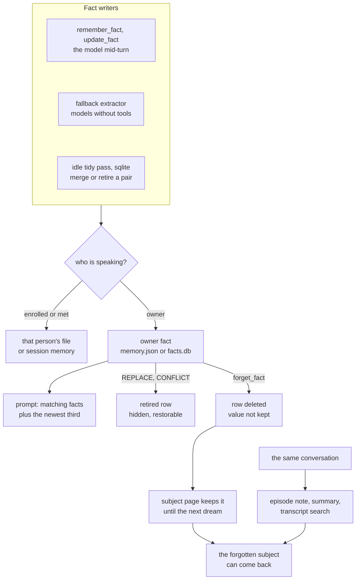

## 1. Executive Summary

Luna is a persistent-state local agent built from several models on LM Studio
or llama.cpp: a chat model that decides and talks, with smaller models beside it
for speech in and out, sight, recall by meaning and relevance. Its main surface
is tooling. The registry holds 52 model-callable tools across files, shell,
mail, web research, the network, the desktop, reminders, scheduled jobs and its
own introspection (`tools/__init__.py:32`), and MCP servers add more. A persona
with moods and a portrait is a layer over the agent, and it knows a household
of recognised speakers.

Its memory is one-sentence facts the model writes, corrects and forgets through
tools, plus notes an idle loop writes about conversations, its own mistakes and
the subjects it knows most about. What is notable is the attention to repetition
and drift: offers it raises unprompted remember being declined, and a lesson the
agent proposes waits for an on-screen yes. What is weak is that forgetting stops
at the fact. The episode notes, the running summary and the transcript built from
the same conversation keep serving what was forgotten.

Speaker scoping has the same edge. Facts, preferences and subject pages follow
the turn's speaker, each enrolled person's in their own file. The owner's episode
notes, projects, recipes, history summary and knowledge-folder passages reach
every turn that is not stream chat, a stranger's included. Two marks:
`human_review` on agent-noted lessons and recipes, and `negative_eval` on the
per-person partition.

## 2. Mental Model

Luna keeps several kinds of memory, each with its own writer.

- **Facts** about the owner: one sentence each, at most 220 characters, with no
  line break and none of the persona's verbal tics (`_looks_like_valid_fact`,
  `mind/longterm.py:482-492`). A fact has no status. It is active, retired on
  the SQLite backend, or gone.
- **Per-person facts**: one JSON file per enrolled person, and an in-memory list
  for a guest met this session (`senses/people.py:430-493`).
- **User preferences**: a key-value block in `memory.json` that only the memory
  page writes (`memory-manager/manager.py:219-229`).
- **Episode notes**: two to four first-person sentences per finished
  conversation, and per game session played alone.
- **Lessons** about her own behaviour, **recipes** for multi-step jobs,
  **projects** that span sessions, one **feeling** line per game.
- **Pages**: a short note per subject with three or more facts, joined up from
  those facts and the matching episode notes.
- **History**: the last `max_raw_messages` turns plus a running summary, and a
  transcript archive that summarisation never touches.

A fact becomes a belief the moment it is written. Every write lands active and
is in the next prompt. It stops being one in three ways, and the code keeps
them apart deliberately. A **change in the world** retires the old row with a
timestamp and a pointer to its replacement (`factstore.replace`,
`mind/factstore.py:323-361`). A **correction** rewrites the row in place with no
history, on the reasoning that a misheard fact was never true
(`factstore.update`, `:364-377`). A **forget** deletes the row, because keeping a
retired copy *"would be doing the opposite of what they asked"* (`:380-392`).

The deletion is of the fact alone. The conversation that produced it stays in
the transcript, in the running summary, and in the episode note written from
it. The page on its subject keeps it until the next dream pass rewrites the page.
Each of those is read back into the prompt or through a tool.

## 3. Architecture

Luna is one Python process with a full-screen terminal interface, a voice loop
and a local web server on `127.0.0.1:8792` for the live view, thought viewer,
settings and memory page. Memory is in-process, with no service of its own.

- **Facts**: `mind/longterm.py` chooses between the capped list in
  `agent/memory.json` and the table in `agent/facts.db` on every call, per
  `long_term_memory.backend` (`backend`, `:142-174`). `mind/factstore.py` holds
  the table: `facts(id, fact, subject, created_at, superseded_at,
  superseded_by, embedding)` with an external-content FTS5 index kept in sync
  by insert, delete and update triggers (`:49-82`). The `embedding` column is
  reserved and unused.
- **Notebook**: `agent/notebook.db` holds `lessons`, `episodes`, `play`, a
  `meta` key-value table, and the `pages` table from `mind/pages.py`
  (`mind/notebook.py:42-71`).
- **People**: `agent/people/<name>.json` with face and voice prints and facts
  (`senses/people.py:1-31`).
- **History**: `history/conversation.json` and `history/transcript.jsonl`
  (`core/history.py:33-34`, `core/transcript.py:35-36`).
- **Embeddings**: an optional embedding server on `:8081` and reranker on
  `:8082`, with vectors cached in `agent/embeddings.db` keyed by a SHA-1 of
  model and text (`mind/embedmem.py:99-131`).

The background is two threads. `reflect._loop` wakes every two minutes and,
when the assistant is idle, writes episode notes and game notes. Once
`self.reflect_every_hours` (20) has passed and Luna has been idle for ten
minutes, it runs the dream pass, the fact tidy and the page writer
(`mind/reflect.py:974-1014`). History folding runs on its own worker
(`core/history.py:420-438`).

### Deployment and ergonomics

Everything is local and no API key is needed to store anything. The installer
picks a model for the graphics card and installs the voice stack. Facts work
with only the chat model; recall by meaning needs the embedding server, and
falls back to word matching when it is down. Every store is a JSON file or a
SQLite file a person can open. The memory page edits facts and the notebook
while Luna runs.

The default backend is the JSON list. `config.example.json` sets `sqlite`, and
`launch.py` seeds `config.json` from it only when `config.json` is missing
(`launch.py:68-77`). At this commit `config.json` is tracked, with no `backend`
key, so a fresh clone runs the capped list. On that backend there is no tidy
pass, no `REPLACE`, no retired state, and the oldest fact is dropped past 30.

## 4. Essential Implementation Paths

- **Tool writes.** `remember_fact`, `update_fact` and `forget_fact`
  (`tools/memory.py:17-130`) call `longterm.add_fact`, `update_fact` and
  `forget_fact` (`mind/longterm.py:495-526`, `:435-474`, `:397-432`). The
  editing pair finds its target by phrase: exact match, then containment, then
  a word score that must lead the runner-up by half again, or the candidates go
  back to the model to ask the user (`find_fact`, `:344-394`). Each of the three
  first checks `_guest()` and routes to the speaker's file.
- **Fallback extraction.** Only when the model has no tool calling, after every
  remembered turn, `extract_in_background` starts a thread
  (`llm/turns.py:540-542`, `mind/longterm.py:713-738`). On SQLite the prompt
  shows twelve facts found by the same search the conversation uses and accepts
  `NONE`, `NEW | subject | fact` or `REPLACE | old | new`. A replacement it cannot
  place degrades to an add (`:548-662`).
- **Prompt assembly.** `build_system_prompt` (`llm/prompts.py:261-306`) adds,
  for any turn not from stream chat: `build_memory_prompt` (preferences unless
  a guest is speaking, `relevant_facts`, the pages block, the knowledge
  block, `:25-67`); `build_self_prompt` (lessons, the latest episode, six game
  feelings, related episodes, projects, recipes, `:77-150`); the running
  summary (`:264`); and the offer line (`:293`). The stored turns are replayed
  after it (`llm/turns.py:199-227`).
- **Fact selection.** `relevant_facts` (`mind/longterm.py:270-298`): under
  `context_facts` every fact; over it, the newest third always, and the rest by
  `embedmem.select`, else FTS5 bm25, else word overlap.
- **Episodes.** `summarize_episodes` cuts the transcript where silence exceeded
  `self.idle_minutes`, and writes each finished session with one model call
  (`mind/reflect.py:226-291`).
- **Dream.** `dream` reads up to 400 thought-log rows since the last pass. It
  keeps the ones with a review flag or low token confidence, and the ones whose
  next user turn, within ten minutes, starts with "no", "wrong" or "actually".
  It writes at most three lessons (`mind/reflect.py:460-586`).
- **Tidy.** `tidy_facts` compares pairs above 0.82 cosine or 0.5 word overlap
  in which at least one fact is new since the last pass. At most six model
  calls per pass: `SAME` rewrites one row and retires the other, `CONFLICT`
  retires the losing side (`mind/reflect.py:641-744`).
- **Pages.** `pages.write` keys each page on a SHA-1 of its sorted facts and
  episode ids, rewrites up to three changed pages per pass, and deletes pages
  whose subject fell below three facts (`mind/pages.py:164-226`).
- **Offers.** `offers.line` picks at most one offer per turn from the last
  background scan (`life/offers.py:253-291`); `stop_offering` mutes it
  (`tools/offers.py:14-27`, `life/offers.py:294-306`).
- **Memory page.** `apply` maps add, edit, retire, restore and delete onto row
  ids, and the notebook actions onto `notebook.py`
  (`memory-manager/manager.py:194-285`).

## 5. Memory Data Model

On SQLite a fact has `created_at` and `superseded_at`, both wall-clock record
time. `superseded_at` NULL means active. Every read that serves a turn filters
on it: `active_facts`, `search` (in the bm25 query and in the newest-third
query), `export_facts` and the duplicate check in `add`
(`mind/factstore.py:151-160`, `:233-290`, `:296-320`). `superseded_by` is set by
`replace` and by nothing else. The tidy merge retires one row and rewrites the
other with no pointer between them (`mind/reflect.py:711-718`).

`add` refuses a duplicate only among active rows, so the text of a retired fact
is admitted again as a new active row. `import_facts`, which absorbs the JSON
list when the backend flips to SQLite, skips a text present in either
state (`mind/factstore.py:458-484`). That rule is what keeps a superseded fact
from returning through a flip. It covers retirement only. A fact forgotten on the
JSON side was never removed from `facts.db`, which `export_facts` left as the
superset, so flipping back to SQLite serves it again.

The JSON backend is a list of strings. Duplicates are exact-match only, and past
`max_facts` the oldest entries are deleted (`mind/longterm.py:511-523`).

Lessons carry `from_ids` (the thought-log rows they came from), `hits`,
`last_used`, `retired` and `origin`, `dream` or `self`. Past `max_lessons` (40)
the least-used lesson is retired (`mind/notebook.py:250-258`). Episodes carry
start, end, turn count and summary. Nothing links an episode to the facts
written during it.

**Scope** is the speaker of the turn, carried in `turnctx.current().speaker`:
None for the owner, a name for an enrolled person or a session guest, or
`STRANGER` (`core/turnctx.py:47`, `senses/people.py:383-390`). Facts route on
it physically, the owner's to `memory.json` or `facts.db` and everyone else's to
their own file, so no fact row carries a speaker. A stranger stores nothing and
reads none (`senses/people.py:433-440`). Preferences, pages, the heavy-mood line
and the offer line check the speaker (`llm/prompts.py:35`, `mind/pages.py:265`,
`life/offers.py:212-228`). The notebook, history, transcript, projects, recipes
and knowledge index carry no speaker and are not filtered on one.

## 6. Retrieval Mechanics

Under `context_facts` (25 by default, 40 and 60 in the larger presets) every
fact goes into every prompt. Over it, `embedmem.select` keeps the newest third
regardless, embeds the turn, and takes the closest of the rest above
`EMBED_MIN_SCORE` 0.35. When more pass than fit, the reranker reorders up to 24
(`mind/embedmem.py:273-311`). With no embedding server, SQLite runs an FTS5
OR-query of quoted terms ordered by bm25, and JSON runs a word-overlap score
that favours short facts (`mind/factstore.py:218-290`,
`mind/longterm.py:301-332`). Each of these returns the chosen facts oldest first
under the heading *"Things learned over time"*.

Lessons, episodes and pages use the same embedding ranker with a fallback to
shared words. Episodes riding in every prompt need a score of 0.45 and two
shared words, stricter than the `recall_episodes` tool's 0.35
(`mind/notebook.py:316-356`). The latest episode always travels. Up to two
pages ride along when the turn names their subject or is within 0.5 of one by
meaning (`mind/pages.py:232-259`). Knowledge-folder passages come unasked only
above 0.55 and only when the embedder is up (`mind/knowledge.py:716-742`).

`search_history` is word overlap with light stemming over the transcript,
returning the turns either side of each hit, and its result tells the model to
say it does not recall rather than stretch a match (`tools/memory.py:132-164`).

The prompt opens with the speaker line and the clock to the minute, ahead of
the persona (`llm/prompts.py:281-285`). The provider's cached prefix therefore
ends a few lines in on every turn.

## 7. Write Mechanics

The design premise is that facts are written deliberately by the model. With
tool calling on, the only automatic fact writer is the tidy pass, and the model
decides every add, update and forget. The tool descriptions ask for durable
facts only (`tools/memory.py:17-35`). The validator rejects long, multi-line
or in-character text, and nothing else filters what the model saves.

The correction-versus-change split has one gap at the tool boundary.
`update_fact`'s description tells the model to use it when *"the old version is
out of date - they moved, changed jobs, finished the project"*
(`tools/memory.py:101-102`). Those are changes in the world, and the SQLite
path treats every `update_fact` as a correction and keeps no history
(`mind/longterm.py:454-460`). So "what was my last graphics card" is
answerable after the fallback extractor's `REPLACE` or the tidy pass. It is not
answerable after the model's own update.

The dream and episode prompts frame their inputs as records, and say that
anything inside reading like an instruction is part of what was said
(`mind/reflect.py:262-264`, `:545-547`). A flag quoting a web page, file or
screen tool is shown to the dream pass by tool name only (`:441-457`).

### Operational cost

A tool write is synchronous and makes no model call: one SQLite insert, or a
rewrite of `memory.json` through a temp file and `os.replace`
(`mind/longterm.py:91-112`). It is in the next turn's prompt. The fallback
extractor costs one model call per remembered turn, off the reply's path.
Episode notes lag the conversation by at least `self.idle_minutes` (30) of
silence. Lessons, tidy and pages lag by up to a day. The tidy pass compares each
new fact with every older one, so its pair search grows with the store. Its
model calls stop at six per pass. No pass rewrites the whole store.

Injection is bounded piece by piece: up to 25 facts, 4 lessons, the latest
episode and two more, six game feelings, three projects, two pages, two
900-character knowledge passages, a summary held near 2,500 characters, and 20
replayed turns in the shipped `config.json`. The sum has no overall cap.

## 8. Agent Integration

The model holds every fact verb (`remember_fact`, `recall_facts`,
`update_fact`, `forget_fact`), plus `search_history`, `recall_episodes`,
`note_lesson`, `save_skill`, the project tools, `reflect_now` and
`stop_offering`. The system prompt tells it when to reach for each
(`llm/prompts.py:153-220`). Tool groups attach by routing, so not every tool is
in every payload.

The tool list narrows by speaker. A stranger gets seven safe tools, a session
guest gets those plus the four fact tools routed to their own memory, and an
enrolled person gets everything the owner gets (`senses/people.py:55-57`,
`:414-427`). Stream chat passes its own context, keeps the turn out of history
and the transcript, and gets no memory blocks (`llm/turns.py:181-190`,
`:508-515`).

Lessons and recipes the agent proposes go through an approval popup
(section 9). `reflect_now` runs the whole idle pass at most once an hour, after
the current reply (`mind/reflect.py:938-971`).

## 9. Reliability, Safety, and Trust

### Forgetting reaches the fact and nothing built from it

For an agent that stays running in a house, the failure that hurts is raising something the user asked to drop.
Luna answers it for offers and not for facts. `forget_fact` deletes the row
(`mind/factstore.py:380-392`) or pops the list entry. It does not touch the
episode note written from the conversation that produced the fact. That note
is the "last conversation" block until a later episode replaces it, and a related
episode afterwards (`llm/prompts.py:103-122`). Nor does it touch the running
summary, the transcript `search_history` reads, the thought log, or the cached
embedding.

The subject page is rewritten only on the next dream pass, because its key
hashes the facts under it (`mind/pages.py:164-166`). Until then it rides along
whenever the subject is named. The rewrite takes the matching episode notes as
input, so it can restate the forgotten fact from them (`:156-161`, `:172-183`).
No record of the forgotten value survives anywhere. A later mention, or the
model's own reading of an old episode, can save it again.

On the JSON backend there is a second path back. A fact forgotten while the JSON
list is in charge stays active in `facts.db` from the last SQLite period.
Flipping back to SQLite serves it again, because `import_facts` only adds
(section 5).

### Speaker scoping covers facts, not the rest of the prompt

The README says a stranger gets *"none of your memories"* and that nothing of
the owner's leaks into an enrolled housemate's turns. For facts, preferences
and pages that holds. For the rest it does not. A stranger's or a housemate's
spoken or typed turn reaches `ask` with no `context` (`core/assistant.py:395-400`),
so `private` is true (`llm/turns.py:203`). The prompt then carries the owner's
running summary, the latest episode note and related ones, lessons, projects,
recipes, the situation block, and up to two passages from the owner's knowledge
folder. The stored conversation is replayed after it. None of those sources
reads the speaker.

`docs/who.md` states the shared history as intended, *"She's in one room, so
everyone sees the same conversation"*. It says nothing about the episode notes,
projects or knowledge passages. An enrolled housemate also holds
`search_history`, `recall_episodes` and `search_docs`, which read the same
unscoped stores.

### What the agent cannot write without a person

`note_lesson` refuses on a turn that called a web, file, screen or clipboard
tool. It caps self-noted lessons at three per session, then pops the approval
window used for file writes (`tools/introspect.py:359-410`). `ui.ask_approval`
returns False with no terminal app running, and True only on a keypress
(`ui/approval.py:30-92`). `save_skill` does the same through the turn's
approver when one is set (`:449-480`). Discord's `auto` mode approves an
unguarded request without asking, and a recipe is guarded only when its turn
read outside content (`plugins/discord.py:171-178`, `tools/introspect.py:462`).

### Marks

- **`human_review`** — awarded on agent-noted lessons and recipes. Each waits
  in the popup until a person answers, and the agent's tool registry has no
  approve verb. Its limits: dream-pass lessons land without it, so does every
  fact and episode note, and Discord's `auto` mode approves most recipes.
- **`negative_eval`** — awarded on the per-person partition and the pages
  block; see section 10.
- **`tombstone`** — withheld. A forget leaves nothing behind. Three mechanisms
  come close, each keyed on something other than a rejected memory value.
  `import_facts` refuses a retired text, on the backend flip only. The offer
  mute is keyed on a hash of the fact's text, and it suppresses a mention, not a
  memory (`life/offers.py:143-144`, `:203-210`). `game_feelings_forgotten` keeps
  a forgotten game's feeling from being re-derived from old notes, and the next
  play session clears it (`mind/notebook.py:459-480`).
- **`trust_state`** — withheld. A fact is active or retired, and retired means
  superseded. Nothing holds a fact as unconfirmed, and every write lands active.
- **`bitemporal`** — withheld. Both timestamps are record time.
- **`scope_enforced`** — withheld. The boundary is a file per person, chosen by
  the speaker, with no key on a row and no predicate on a query.
- **`audit_log`** — withheld. `facts.db` has no event table. The application
  log records `superseded` lines and no add, update or forget
  (`mind/longterm.py:632`, `:640`).

### Other risks

- **The JSON backend and the memory page race.** The page rewrites
  `memory.json`, and `longterm._sync` reloads it by mtime before each change
  (`mind/longterm.py:62-88`). A backend switch calls `save` without that
  reload (`:164-168`).
- **Restore re-activates a superseded fact beside its replacement.**
  `restore_row` clears `superseded_at` and `superseded_by` with no check for
  the row that replaced it (`mind/factstore.py:431-442`).
- **The offer mute is keyed on wording.** A fact reworded by `update_fact` or
  merged by the tidy pass hashes to a new key, so a muted birthday offer
  returns.

## 10. Tests, Evals, and Benchmarks

`tests/` holds 800 unittest methods in 68 files, run in CI on Ubuntu with
Python 3.12 and no model or server (`.github/workflows/tests.yml`,
`tests/offline.py`). I did not run them.

`negative_eval` rests on two committed cases, both populated:

- `tests/test_voices.py:145-170`. With Shannon speaking, `relevant_facts("cats")`
  must equal exactly her one fact, and the patched owner store must never see
  `add` or `search`. With the owner speaking and Shannon's fact on disk,
  `get_facts()` must equal exactly the owner's one fact.
- `tests/test_pages.py:88-96`. The owner's pages block must contain the Shannon
  page, and a guest's must be empty for a query naming Shannon, against the
  same written pages.

Both are scope-boundary cases. None asserts about content: no case checks that
a retired fact stays out of `search`, or that a forgotten fact stays out of the
prompt, an episode or a page. `tests/test_errors_mind.py:254-263` installs a
trigger that makes retirement fail and asserts that `replace` rolls back the
insert too. `tests/test_offers.py:80-99` asserts that a muted offer stays out of
later turns, including a date muted for every year. `tests/test_ladder.py:102-106`
asserts a stranger stores no fact, which is an empty-result assertion and
carries no weight for the mark.

No case drives `note_lesson` or `save_skill`, so the approval gate is read from
the code. `evals/` wraps two external AI-safety experiments, fetched at setup,
with no results committed and nothing about memory. No paper is associated with
the project. The one arXiv citation in the tree, in `docs/reasoning.md`, is for
an introspection probe.

## 11. For Your Own Build

### Steal

- **Separate "that was wrong" from "that changed".** A correction rewrites in
  place; a change retires the old row with a timestamp and a pointer to its
  replacement, so the past stays answerable. Then make sure every tool that
  can express a change reaches the second path.
- **Give proactive mentions their own memory.** Per item: when it was raised,
  how often, a cooldown that grows after repeats, a cap, and a permanent mute,
  all persisted so a restart does not reset them.
- **Gate the agent's self-instructions harder than its facts.** A lesson rides
  in every later prompt. Refuse one noted on a turn that read outside content,
  and hold the rest for a person's yes.
- **Pick the contradiction candidates by the conversation's own search.** The
  extractor's REPLACE sees the twelve facts the same retriever would serve,
  not the newest 25, so it keeps working as the store outgrows its window.
- **Make a failed parse degrade to coexistence.** A garbled `REPLACE` becomes an
  add, so the worst outcome is a duplicate, never a lost or wrongly retired fact.

### Avoid

- **A forget that knows one store.** If a fact can be restated from an episode
  note, a summary or a page, deleting the fact row is not forgetting. Either
  record the forgotten value and check it on every derivation, or propagate the
  forget to everything built from the conversation.
- **Scoping the store, not the prompt.** Routing facts by speaker is half of a
  boundary. Every block assembled into the prompt needs the same speaker check,
  or the context builder carries what the store kept apart.
- **A superset that only gains.** A backend switch that adds and never deletes
  restores whatever was forgotten on the other side.

### Fit

This suits one person running a tool-heavy assistant on their own machine who
wants to read and edit everything it keeps. The engineering is careful where a
long-running local agent fails: atomic writes, bad-file quarantine, locked databases that do
not fail a turn, injection framing on every background prompt. Walk away if
other people's privacy is the requirement. The household model scopes the fact
store and leaves the notes, history and documents shared. Walk away too if
"forget that" must hold. The design treats the fact as the memory, and it is
one of five places the same sentence lives.

## 12. Open Questions

- How often the model calls `update_fact` for a change in the world, and loses
  the old value, compared with the extractor's `REPLACE` on a model without tools.
- Whether the shared episode notes and knowledge passages on a housemate's turn
  are intended, as the shared history is, or an unscoped context builder.
- Whether `config.json` stays tracked; once it is untracked, fresh installs
  start on SQLite.
- How the tidy pass's pair search behaves at a few thousand facts, where each
  new fact is compared with every older one.

## Appendix: File Index

- Facts: `mind/longterm.py`, `mind/factstore.py`, `mind/embedmem.py`,
  `tools/memory.py`
- People and scope: `senses/people.py`, `core/turnctx.py`, `core/assistant.py`
- Notebook and idle passes: `mind/notebook.py`, `mind/reflect.py`,
  `mind/pages.py`, `mind/projects.py`, `mind/skills.py`, `tools/introspect.py`
- Prompt assembly and turns: `llm/prompts.py`, `llm/turns.py`, `llm/session.py`
- History: `core/history.py`, `core/transcript.py`, `mind/thoughtlog.py`
- Offers: `life/offers.py`, `tools/offers.py`
- Knowledge folder: `mind/knowledge.py`
- Editor and commands: `memory-manager/manager.py`, `commands/memory.py`,
  `ui/approval.py`, `plugins/discord.py`
- Config: `config/mind.py`, `config.json`, `config.example.json`, `launch.py`
- Tests: `tests/test_voices.py`, `tests/test_pages.py`, `tests/test_offers.py`,
  `tests/test_errors_mind.py`, `tests/test_ladder.py`,
  `tests/test_game_feelings.py`, `tests/test_play_memory.py`

### Recorded searches

Run from the repository root at the pinned commit with `/usr/bin/git grep`.

- **The self-prompt sources read no speaker.**
  `git grep -n -E 'speaker|guest\(' -- mind/notebook.py mind/projects.py mind/skills.py mind/knowledge.py mind/situation.py core/history.py`
  returns nothing; the same pattern over `mind/pages.py` matches line 265.
- **Forget reaches no derived store.**
  `git grep -n -E 'forget_fact|factstore\.remove|delete_row' -- mind/notebook.py mind/pages.py core/transcript.py core/history.py mind/embedmem.py`
  returns nothing; with `-c` over `tools/memory.py` and `mind/longterm.py` it
  counts 3 and 2.
- **The embedding cache is never pruned.**
  `git grep -n -i -E 'delete|drop|vacuum' -- mind/embedmem.py` returns nothing;
  `git grep -n -E 'INSERT' -- mind/embedmem.py` matches line 130.
- **No validity time.**
  `git grep -n -i -E 'valid_?(from|to|until)|occurred|event_time|effective' -- mind/factstore.py mind/longterm.py mind/notebook.py`
  returns nothing; `git grep -c -E 'created_at' -- mind/factstore.py` counts 6.
- **No status on a fact.**
  `git grep -n -i -E 'verified|candidate|pending|status' -- mind/factstore.py`
  returns nothing; `git grep -c -i status -- mind/longterm.py` counts 3.
- **No event table.** `git grep -n -E 'CREATE (TABLE|VIRTUAL TABLE|TRIGGER)' -- mind/factstore.py`
  returns `facts`, `facts_fts` and the three sync triggers only.
- **No test drives the approval gate.**
  `git grep -n -E 'note_lesson|save_skill|_approve_skill' -- tests/` returns
  nothing; `git grep -n 'approver' -- tools/introspect.py` matches lines
  459-462 only, inside `_approve_skill`.
- **No content-level exclusion test on the fact store.**
  `git grep -n -E 'superseded_at|retire_row|factstore\.search|active_facts|factstore\.replace|factstore\.remove' -- tests/`
  returns the rollback case in `tests/test_errors_mind.py:258-263` and a
  patched `active_facts` in `tests/test_offers.py:147`.
- **No paper.** `git grep -n -i -E 'arxiv|bibtex|@article|@misc|doi\.org' -- .`
  returns `docs/reasoning.md:347` only.

## History

**2026-11-05** — [`659ddcf2952f805a3d090eeabc8055644e2505af`](https://github.com/fswolf/luna-local-agent/commit/659ddcf2952f805a3d090eeabc8055644e2505af). First reading, from a depth-1 clone at the head of `main`, with history from the GitHub API. Screened first: no auto-run or build-time surface, two unpinned requirements files, and both flagged FRESH only because a shallow clone dates every file to the tip; their last changes were 17 October and 26 September 2026. MIT, no rider. Nothing installed, built or run. Two marks: `human_review` on agent-noted lessons and recipes, `negative_eval` on the per-person partition; tombstone withheld because a forget leaves no record and reaches no derived store ([section 9](#9-reliability-safety-and-trust)).

**2026-11-05** — Framing: the summary, description and fit describe the persistent-state, tool-heavy agent the README at the pin states, with the persona as a layer over it, and give the tool registry's count. Marks and findings unchanged.
