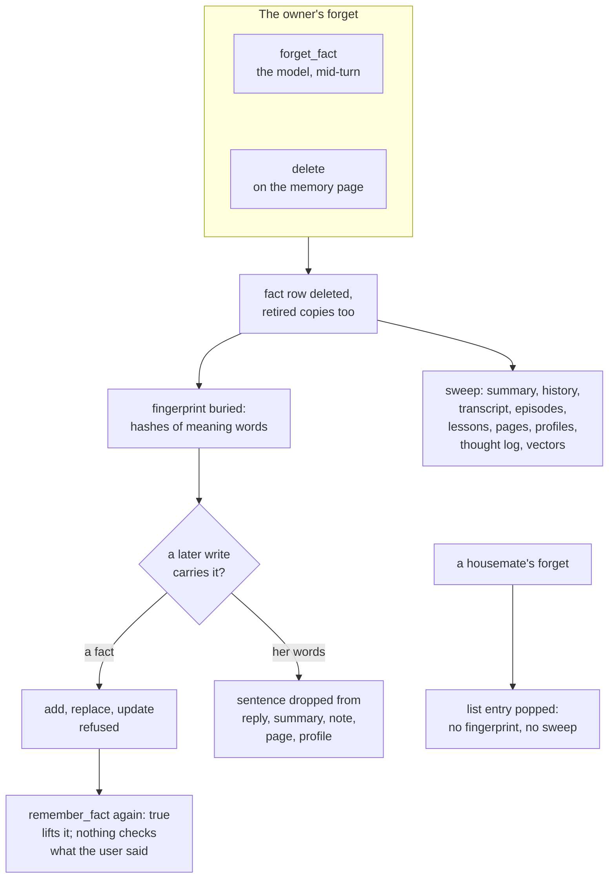

## 1. Executive Summary

Luna is a persistent-state local agent built from several models on LM Studio
or llama.cpp: a chat model that decides and talks, with smaller models beside it
for speech in and out, sight, recall by meaning and relevance. Its main surface
is tooling. The registry holds 53 model-callable tools across files, shell,
mail, web research, the network, the desktop, reminders, scheduled jobs and its
own introspection (`tools/__init__.py:32`), and MCP servers add more. A persona
with moods and a portrait is a layer over the agent, and it knows a household
of recognised speakers.

Its memory is one-sentence facts the model writes, corrects, confirms and
forgets through tools, plus notes an idle loop writes about conversations, its
own mistakes, the subjects it knows most about and each person it knows. What is
notable is the forget. It deletes the fact and buries a fingerprint of its
meaning words. It strips every sentence carrying it from the summary,
transcript, notes, pages, profiles and thought log. It filters everything Luna
writes afterwards while leaving the user's own words alone. Facts also carry a
real date apart from record time, and a guess stays marked until confirmed.

What is weak sits at the edges of that forget. The model that is refused a
forgotten fact can lift the fingerprint with one flag. The fingerprint is a hash
of dictionary words and reverses to them. A housemate's forget gets none of it.
Five marks: `tombstone`, `trust_state`, `bitemporal`, `human_review` and
`negative_eval`.

## 2. Mental Model

Luna keeps several kinds of memory, each with its own writer.

- **Facts** about the owner: one sentence each, at most 220 characters, with no
  line break and none of the persona's verbal tics (`_looks_like_valid_fact`,
  `mind/longterm.py:474-484`). Each row carries a trust state and, when the user
  said when, a real date (`mind/factstore.py:68-80`).
- **Per-person facts**: one JSON file per enrolled person, and an in-memory list
  for a guest met this session (`senses/people.py:428-495`).
- **Episode notes**: two to four first-person sentences per finished
  conversation, and per game session played alone.
- **Lessons** about her own behaviour, **recipes** for multi-step jobs,
  **projects** that span sessions, one **feeling** line per game.
- **Pages**: a short note per subject with three or more confirmed facts, joined
  up from those facts and the matching episode notes. **Profiles**: a few
  sentences per person, written from their confirmed facts.
- **History**: the recent turns plus a running summary, and a transcript archive
  that summarisation never touches.

A fact written deliberately is a belief at once. `remember_fact` and
`update_fact` land confirmed and are in the next prompt. A fact the background
extractor guesses from one exchange lands **unconfirmed**: shown as *(not
sure)*, kept out of pages and profiles, until it is heard again or confirmed
(`mind/factstore.py:495-538`, `:602-621`).

A fact stops being believed in three ways, and the code keeps them apart. A
**change in the world** retires the old row, with the real day it ended when the
user said it (`factstore.replace`, `:556-599`). A **mistake** rewrites in place
with no history, only when the model sets `mistake` (`:641-656`,
`mind/longterm.py:390-396`). A **forget** deletes the row and every retired
copy, buries a fingerprint, and sweeps the derived stores
(`mind/forgetting.py:228-266`).

## 3. Architecture

Luna is one Python process with a full-screen terminal interface, a voice loop
and a local web server on `127.0.0.1:8792` for the live view, thought viewer,
settings and memory page. Memory is in-process, with no service of its own.

- **Facts**: `mind/factstore.py` holds `facts(id, fact, subject, created_at,
  superseded_at, superseded_by, embedding, valid_from, valid_to, trust)`, a
  `forgotten(marks, at)` table of fingerprints and a `meta` table
  (`:68-93`). An external-content FTS5 index is kept in sync by insert, delete
  and update triggers (`:98-121`). The `embedding` column is reserved and
  unused. A Python without FTS5 gets the table and word matching.
- **Notebook**: `agent/notebook.db` holds lessons, episodes, play sessions, a
  key-value table, pages and profiles.
- **People**: `agent/people/<name>.json` with face and voice prints and facts.
- **History**: `history/conversation.json` and `history/transcript.jsonl`.
- **Embeddings**: an optional embedding server on `:8081` and reranker on
  `:8082`, with vectors cached in `agent/embeddings.db` keyed by a SHA-1 of the
  served model's name and the text (`mind/embedmem.py:99-100`).

The background is two threads. `reflect._loop` wakes every two minutes and,
when the assistant is idle, writes episode notes and game notes. Once 20 hours
have passed and Luna has been idle for ten minutes it runs the dream pass, the
fact tidy, the page writer and the profile writer (`mind/reflect.py:795-833`,
`:1006-1025`). History folding runs on its own worker. A forget's sweep runs on
its own thread from the tool, and inline from the memory page.

### Deployment and ergonomics

Everything is local and no API key is needed to store anything. The installer
picks a model for the graphics card and installs the voice stack. Facts work
with only the chat model; recall by meaning needs the embedding server and falls
back to FTS5 or word matching when it is down. Every store is a JSON or SQLite
file a person can open, and the memory page edits facts and the notebook while
Luna runs.

There is one fact backend. An install that kept facts in the older
`memory.json` list has them read into `facts.db` once, recorded in `meta`, and
the list is never written again (`mind/longterm.py:25-70`). The import skips any
fact matching a fingerprint (`mind/factstore.py:808-843`).

## 4. Essential Implementation Paths

- **Tool writes.** `remember_fact`, `update_fact`, `confirm_fact` and
  `forget_fact` (`tools/memory.py:17-231`) call into `mind/longterm.py`. The
  editing tools find their target by phrase: exact match, then containment, then
  a word score that must lead the runner-up by half again, or the candidates go
  back to the model to ask the user (`find_fact`, `:267-318`). Each first checks
  `_guest()` and routes to the speaker's file.
- **Fallback extraction.** When the model has no tool calling, every remembered
  turn starts a background extractor (`llm/turns.py:583-585`). When it has tool
  calling, the extractor runs only if the user's words ask to remember and no
  `remember_fact` ran (`:614-616`, `mind/longterm.py:97-103`). It accepts `NONE`,
  `NEW`, `REPLACE`, `CONFIRM` and a trailing `since` date. A fact it writes is
  unconfirmed unless the user asked (`:531-678`).
- **Forget.** `forget_fact` deletes the row, then `forgetting.forget` buries the
  fingerprint and starts the sweep (`mind/longterm.py:320-348`,
  `mind/forgetting.py:228-266`). The memory page's delete does the same and waits
  for it (`memory-manager/manager.py:163-169`).
- **Write guards.** Every assistant message and tool call stored in history, the
  assistant side of the transcript, each summary chunk, episode note, lesson,
  page and profile passes through `forgetting.clean`
  (`core/history.py:279-290`, `:437`, `core/transcript.py:96-103`,
  `mind/notebook.py:230`, `:299`, `mind/pages.py:218`, `mind/profiles.py:218`).
- **Prompt assembly.** With `llm.stable_prompt` on, the default, the system
  prompt holds who she is, the speaker and their profile, the persona, the tools
  and the summary. Facts, pages, knowledge, lessons, notes, the clock and the
  mood go in a note in front of the latest message, which history never stores
  (`llm/prompts.py:410-445`).
- **Fact selection.** `relevant_facts` (`mind/longterm.py:190-221`): under
  `context_facts` every fact; over it, the newest third always, and the rest by
  `embedmem.select`, else FTS5 bm25, else word overlap. Each fact is shown with
  its real date and *(not sure)* where they apply (`llm/prompts.py:39-49`).
- **Dream and tidy.** `dream` reads thought-log rows since the last pass and
  writes at most three lessons (`mind/reflect.py:494-597`). `tidy_facts`
  compares pairs above 0.82 cosine or 0.5 word overlap, at most six model calls
  a pass; `SAME` merges, `CONFLICT` retires the losing side unless that side is
  confirmed and the winner is a guess (`:599-756`).
- **Pages and profiles.** Each is keyed on a hash of its sources and rewritten
  when they change, from confirmed facts only (`mind/pages.py:110-118`,
  `:195-234`, `mind/profiles.py:110-117`, `:198-234`).
- **Offers.** `offers.line` picks at most one offer per turn from the last
  background scan (`life/offers.py:253-291`); `stop_offering` mutes it
  (`tools/offers.py:14-27`, `life/offers.py:294-306`).
- **Memory page.** `apply` maps add, edit, confirm, retire, restore, delete and
  lift-every-fingerprint onto row ids, and the notebook actions onto
  `notebook.py` (`memory-manager/manager.py:115-172`).

## 5. Memory Data Model

A fact has two clocks. `created_at` and `superseded_at` are record time:
`superseded_at` NULL means active, and every read that serves a turn filters on
it (`mind/factstore.py:271-280`, `:428-489`). `valid_from` and `valid_to` are
real time, filled only from a date the user gave (`:13-19`, `:131-153`).
`replace` writes the date as the new row's `valid_from` and the old row's
`valid_to` (`:586-597`). With no date both stay NULL, and record time stands in.

`trust` is `confirmed` or `unconfirmed`, defaulting to confirmed, so a database
from before the column counts every fact as sure (`:79`, `:189-196`). `add` of
an identical active fact confirms a guess rather than inserting it again
(`:511-529`).

The fingerprint table holds one row per forgotten fact: the sorted set of
12-hex-character SHA-256 hashes of the fact's stemmed words, after stopwords and
the owner's and agent's names are removed, salted with a fixed string
(`mind/forgetting.py:86-101`, `mind/factstore.py:737-747`). A candidate matches
if its set equals the fingerprint, contains it with at most two extra words, or
overlaps a fingerprint of three or more by 0.8 (`mind/forgetting.py:104-114`).
A sentence carries a fingerprint if it holds every word of one up to three
words long, three quarters of a longer one, or the single word of a one-word
fact in a sentence about a person (`:117-136`).

`superseded_by` is set by `replace` only. The tidy merge rewrites one row and
retires the other with no pointer between them (`mind/reflect.py:716-725`).
Lessons carry `from_ids`, `hits`, `last_used`, `retired` and an origin. Episodes
carry start, end, turn count and summary, and nothing links one to the facts
written during it.

**Scope** is the speaker of the turn: None for the owner, a name for an enrolled
person or a session guest, or `STRANGER` (`senses/people.py:383-390`). Facts
route on it physically, the owner's to `facts.db` and everyone else's to their
own file, so no fact row carries a speaker. A stranger stores nothing and reads
none. The prompt builder checks the speaker before adding the owner's
preferences, knowledge passages, summary, episodes, projects, recipes, screen
and reminders, and the profile reader picks the speaker's own
(`llm/prompts.py:35`, `:62`, `:90`, `:305`, `mind/profiles.py:236-253`). The
stores themselves carry no speaker.

## 6. Retrieval Mechanics

Under `context_facts` (25 by default) every fact goes into every prompt. Over
it, `embedmem.select` keeps the newest third regardless, embeds the turn, and
takes the closest of the rest above `EMBED_MIN_SCORE` 0.35, with the reranker
reordering when more pass than fit (`mind/embedmem.py:292-311`). With no
embedding server, FTS5 runs an OR-query of quoted terms ordered by bm25, and the
word fallback scores overlap in favour of short facts
(`mind/factstore.py:428-489`, `mind/longterm.py:224-264`). Unconfirmed facts
are selected like any other and shown with *(not sure)* and the instruction
*"don't state them as true"* (`mind/longterm.py:447-448`).

`recall_facts` with `past` is the one read of retired facts. It returns each
match as NOW or BEFORE, with when it was learned, when it stopped being
believed, and the real dates the user gave (`tools/memory.py:86-121`,
`mind/factstore.py:367-396`). No query selects facts by valid time; the model
reads the dates.

Lessons, episodes and pages use the same embedding ranker with a fallback to
shared words. Episodes riding in every prompt need 0.45 and two shared words,
stricter than the `recall_episodes` tool's 0.35 (`mind/notebook.py:323-364`).
Up to two pages ride along when the turn names their subject or is within 0.5 of
one by meaning (`mind/pages.py:237-265`). Knowledge-folder passages come unasked
only above 0.55 (`mind/knowledge.py:716-742`).

`search_history` is word overlap with light stemming over the transcript. It
returns the turns either side of each hit and tells the model to say it does not
recall rather than stretch a match (`tools/memory.py:234-266`).

## 7. Write Mechanics

The design premise is that facts are written deliberately by the model. On a
tool-calling model the automatic writers are the tidy pass and the extractor's
safety net for an unanswered "remember this". The validator rejects long,
multi-line or in-character text, and `why_not` tells the model the reason so it
can tell the user (`mind/longterm.py:451-471`).

A change and a mistake reach different paths at the tool boundary.
`update_fact`'s description keeps the old version as history, and `mistake` is
for a fact that was never right (`tools/memory.py:180-206`). So "what was my
last graphics card" is answerable after the model's own update.

The extractor's `REPLACE` may retire a confirmed fact with an unconfirmed one,
on the reasoning that this is the exchange where the user said it changed
(`mind/longterm.py:635-663`). The tidy pass may not.

The dream and episode prompts frame their inputs as records, and a flag quoting
a web page, file or screen tool reaches the dream pass by tool name only
(`mind/reflect.py:454-461`).

### Operational cost

A tool write is synchronous and makes no model call: one SQLite statement, after
a fingerprint check that reads every row of `forgotten`. It is in the next
turn's prompt. The fallback extractor costs one model call per remembered turn,
off the reply's path. Episode notes lag the conversation by at least 30 minutes
of silence. Lessons, tidy, pages and profiles lag by up to a day; a first
profile waits only for ten idle minutes.

A forget rewrites the whole transcript file and scans every row of the
summary, history, episodes, lessons, pages, profiles, thought log and fact table
(`mind/forgetting.py:255-421`). It runs off the reply's thread. Each later
write of her own text is checked sentence by sentence against every fingerprint.

## 8. Agent Integration

The model holds every fact verb (`remember_fact`, `recall_facts`,
`update_fact`, `confirm_fact`, `forget_fact`), plus `search_history`,
`recall_episodes`, `note_lesson`, `save_skill`, the project tools,
`reflect_now` and `stop_offering`. Tool groups attach by routing, so not every
tool is in every payload.

The tool list narrows by speaker. A stranger gets seven safe tools, a session
guest gets those plus the four fact tools routed to their own memory, and an
enrolled person gets everything the owner gets (`senses/people.py:55-57`,
`:414-423`). Stream chat gets no memory blocks.

## 9. Reliability, Safety, and Trust

### The forget reaches every store, and the model holds its key

For an agent that stays running in a house, the failure that hurts is raising
something the user asked to drop. Luna closes it for the owner's facts. The row
and every retired copy go, the fingerprint is buried, and the sweep strips the
sentences carrying it from every store built from the conversation (`mind/forgetting.py:255-280`). Everything
Luna writes afterwards is cleaned, and the user's own later words are kept as
said (`core/history.py:279-290`).

The refusal is a tool result, and the model can answer it. `remember_fact` takes
`again`, described as *"Only when the user told you to forget this before and
has now asked for it to be remembered again"*, and passes it to `factstore.add`,
which deletes the matching fingerprint (`tools/memory.py:34-43`,
`mind/factstore.py:541-553`). Nothing checks the user's words. The refusal text
names the flag: *"call remember_fact with again: true"*
(`mind/longterm.py:460-462`). The extractor's own lift is gated on the user's
text matching a remember phrase (`:627`). The memory page's add lifts it too, as
a person's act (`memory-manager/manager.py:149`).

### The fingerprint is readable

The design comment says the fingerprint keeps *"Never the words"*
(`mind/forgetting.py:9-11`). Each hash covers one stemmed dictionary word with a
salt that is a constant in the source, truncated to 48 bits (`:95-96`). I
re-derived `_stem` and `_hash` in a separate script and hashed the 234,454 words
of the system word list. The two marks stored for *"Ryan works at the bakery"*
came back as `bakery` and `work`. A forgotten fact is recoverable as its meaning
words from `facts.db` alone.

### What the forget does not reach

- **A housemate's or guest's facts.** Their `forget_fact` pops the entry from
  their file or session list and returns (`senses/people.py:467-495`). No
  fingerprint is written and nothing is swept, so the shared history, transcript
  and episodes keep it, and an extraction can save it again.
- **Cached vectors when the embedding server is down.** The cache key includes
  the served model's name, which is learned from the server
  (`mind/embedmem.py:61-100`). `drop` asks for it, and with the server down the
  keys are computed with an empty name and match nothing (`:103-118`).
- **The thought log afterwards.** It is swept once at the forget and not
  filtered after (`mind/forgetting.py:18-20`).

### Speaker scoping covers the prompt, not the tools

A stranger's or a housemate's turn gets none of the owner's summary, episodes,
projects, recipes, knowledge passages, screen, reminders or profile
(`llm/prompts.py:80-90`, `:300-305`). The recent turns are replayed to everyone,
which `docs/who.md` states as intended. An enrolled housemate holds the full
tool list, including `search_history`, `recall_episodes` and `search_docs`,
which read the owner's transcript, episodes and documents with no speaker check
(`senses/people.py:414-423`).

### What the agent cannot write without a person

`note_lesson` refuses on a turn that called a web, file, screen or clipboard
tool. It caps self-noted lessons at three per session, then pops the approval
window used for file writes (`tools/introspect.py:359-410`). `ui.ask_approval`
returns False with no terminal app running, and True only on a keypress
(`ui/approval.py:31-95`). `save_skill` does the same through the turn's approver
when one is set (`tools/introspect.py:449-480`). Discord's `auto` mode approves
an unguarded request without asking, and a recipe is guarded only when its turn
read outside content (`plugins/discord.py:171-178`, `tools/introspect.py:462`).

### Marks

- **`tombstone`** — awarded on the fingerprint table. It is keyed on the value's
  words and consulted by every fact writer. Its limits: the model can lift it
  with `again`, it covers the owner's facts only, and it reverses to the words.
- **`trust_state`** — awarded on `confirmed` and `unconfirmed`. The unconfirmed
  state keeps a fact out of pages and profiles, and out of the tidy pass's
  retirements of confirmed facts (`mind/pages.py:118`, `mind/profiles.py:117`,
  `mind/reflect.py:726-731`). Its producer is the background extractor without
  a remember request, which runs only when the model has no tool calling
  (`llm/turns.py:583-585`). On a tool-calling model, the default, every fact
  lands confirmed.
- **`bitemporal`** — awarded on `valid_from` and `valid_to` beside record time,
  written from the user's dates by the tools and the extractor. No read selects
  by valid time.
- **`human_review`** — awarded on agent-noted lessons and recipes. Each waits in
  the popup until a person answers, and the agent's tool registry has no approve
  verb. Dream-pass lessons, every fact and episode note land without it, and
  Discord's `auto` mode approves most recipes.
- **`negative_eval`** — awarded on the per-person partition, the pages block,
  the prompt on someone else's turn and the forget sweep; see section 10.
- **`scope_enforced`** — withheld. The boundary is a file per person and a
  speaker check in the prompt builder, with no key on a row and no predicate on
  a query.
- **`audit_log`** — withheld. `facts.db` has `facts`, `forgotten` and `meta`,
  and none is an event record (`mind/factstore.py:68-93`). `forgotten` is
  replaced on re-bury and emptied by the page's lift-all. The application log
  records supersessions and sweep counts.

### Other risks

- **Restore re-activates a superseded fact beside its replacement.**
  `restore_row` clears `superseded_at`, `superseded_by` and `valid_to` with no
  check for the row that replaced it (`mind/factstore.py:710-721`).
- **The offer mute is keyed on wording.** The key is eight hex digits of a SHA-1
  of the fact's text (`life/offers.py:143`). A fact changed by `update_fact` or
  merged by the tidy pass is a new item, and a muted birthday offer returns.
- **The tidy merge skips the fingerprint check.** It writes the merged text with
  `set_row`, which does not call `_allowed` (`mind/reflect.py:719`,
  `mind/factstore.py:682-693`).

## 10. Tests, Evals, and Benchmarks

`tests/` holds 1,014 unittest methods in 88 files, run in CI on Ubuntu with
Python 3.12 and no model or server (`.github/workflows/tests.yml`,
`tests/offline.py`). I did not run them.

`negative_eval` rests on four committed cases, each against populated data:

- `tests/test_voices.py:144-170`. With Shannon speaking, `relevant_facts("cats")`
  must equal exactly her one fact, and the patched owner store must never see
  `add` or `search`. With the owner speaking and Shannon's fact on disk,
  `get_facts()` must equal exactly the owner's one fact.
- `tests/test_pages.py:88-96`. The owner's pages block must contain the Shannon
  page, and a guest's must be empty for a query naming Shannon.
- `tests/test_guest_prompt.py:42-52`. The owner's prompt holds six markers for
  episodes, summary, projects, recipes and knowledge; Shannon's and a stranger's
  must hold none, and the lesson marker must stay.
- `tests/test_forgetting.py:111-137`. After a forget, the fact table must equal
  `["Ryan has a cat"]` with the reworded copy and its retired history gone, the
  summary must equal *"He likes Zork."*, and the transcript, episodes and thought
  log must each keep their control sentence and lose the rest.

The same file asserts that the forgotten fact is refused on re-add and on
`replace`, that `again="true"` lifts it, that guesses stay out of
`rows(sure_only=True)`, and that later replies and episode notes are cleaned
while the user's words are kept (`:56-84`, `:163-169`, `:211-214`).
`tests/test_valid_time.py` asserts the old fact's end date after a dated change
and the NOW and BEFORE lines of `recall_facts`.

`test_every_store` calls five of the eight sweep functions directly. Lessons,
pages and profiles are swept by code no case drives, and no case drives
`scrub_everywhere` or a housemate's forget. No case drives `note_lesson` or
`save_skill`, so the approval gate is read from the code. `evals/` wraps two
external AI-safety experiments with no results committed and nothing about
memory. No paper is associated with the project. The one arXiv citation in the
tree, in `docs/reasoning.md`, is for an introspection probe.

## 11. For Your Own Build

### Steal

- **Make forget a sweep plus a guard.** Delete the fact, strip the sentences
  carrying it from every store built from the same conversation, and check
  everything the agent writes afterwards. Leave the user's own words alone, so
  bringing it up again is still possible.
- **Match the forgotten fact by its meaning words.** A word-set fingerprint
  catches *"used to work at the bakery"* where an exact-text key would not, and
  a one-word fact taking only sentences about a person keeps the topic usable.
- **Keep a guess out of what is built on it.** An unconfirmed fact can ride in
  the prompt with a label, but pages, profiles and contradiction resolution
  should read only confirmed ones.
- **Separate "that was wrong" from "that changed", and take the date from the
  user.** A change retires the old row with its real end; a mistake rewrites in
  place; a missing date stays missing rather than becoming today.
- **Give proactive mentions their own memory.** Per item: when it was raised,
  how often, a cooldown that grows after repeats, a cap and a permanent mute,
  all persisted so a restart does not reset them.

### Avoid

- **An override the refused caller can set.** If a tombstone can be lifted by a
  flag on the same tool that was refused, the gate is a prompt. Put the lift on
  a surface the model does not hold, or check it against the user's own words.
- **Calling a hash of dictionary words private.** A fixed salt and one word per
  hash reverse in seconds. A keyed hash with a secret outside the store, or the
  plain words with the claim dropped, is honest; this is neither.
- **A forget that covers one household member.** If several people's facts
  live in the same history, every person's forget needs the same sweep.

### Fit

This suits one person running a tool-heavy assistant on their own machine who
wants to read and edit everything it keeps, and wants "forget that" to hold for
the owner: it reaches the summary, the notes and the agent's later writing, not
only the row. The engineering is careful where a long-running local agent fails:
atomic writes, bad-file quarantine, locked databases that do not fail a turn,
injection framing on every background prompt. Walk away if other people's
privacy is the requirement. A housemate's forget is a list pop, and their tools
read the owner's transcript. Walk away too if the forgotten words themselves
must not be recoverable from disk.

## 12. Open Questions

- How often a refused model sets `again` without the user asking, on the small
  local models the installer picks.
- Whether the unconfirmed state is meant to reach tool-calling models; on them
  the only writer that could produce it runs only after an explicit request.
- How the tidy pass's pair search behaves at a few thousand facts, where each
  new fact is compared with every older one.

## Appendix: File Index

- Facts: `mind/factstore.py`, `mind/longterm.py`, `mind/embedmem.py`,
  `tools/memory.py`
- Forgetting: `mind/forgetting.py`
- People and scope: `senses/people.py`, `core/turnctx.py`, `core/assistant.py`,
  `mind/profiles.py`
- Notebook and idle passes: `mind/notebook.py`, `mind/reflect.py`,
  `mind/pages.py`, `mind/projects.py`, `mind/skills.py`, `tools/introspect.py`
- Prompt assembly and turns: `llm/prompts.py`, `llm/turns.py`, `llm/session.py`
- History: `core/history.py`, `core/transcript.py`, `mind/thoughtlog.py`
- Offers: `life/offers.py`, `tools/offers.py`
- Knowledge folder: `mind/knowledge.py`
- Editor and commands: `memory-manager/manager.py`, `commands/memory.py`,
  `ui/approval.py`, `plugins/discord.py`
- Tests: `tests/test_forgetting.py`, `tests/test_valid_time.py`,
  `tests/test_guest_prompt.py`, `tests/test_voices.py`, `tests/test_pages.py`,
  `tests/test_offers.py`, `tests/test_errors_mind.py`

### Recorded searches

Run from the repository root at the pinned commit with `/usr/bin/git grep`.

- **The notebook, history and knowledge sources read no speaker; the prompt
  builder does.**
  `git grep -n -E 'speaker|guest\(' -- mind/notebook.py mind/projects.py mind/skills.py mind/knowledge.py core/history.py`
  returns nothing; `git grep -n -E 'people\.guest\(\)' -- llm/prompts.py` matches
  lines 35, 62, 90 and 305.
- **A housemate's forget writes no fingerprint and sweeps nothing.**
  `git grep -n -E 'bury|forgetting|scrub' -- senses/people.py` returns nothing;
  the same pattern over `mind/longterm.py` matches lines 343-346 in the owner's
  `forget_fact` and 458-460 in `why_not`.
- **Nothing checks the user's words before `again` lifts a fingerprint.**
  `git grep -n -E 'again' -- tools/memory.py` matches the schema at lines 34
  and 37, the handler at 42-43 and an unrelated message at 149; no line in the
  handler reads the turn's text.
- **No event table in the fact store.**
  `git grep -n -E 'CREATE (TABLE|VIRTUAL TABLE|TRIGGER)' -- mind/factstore.py`
  returns `facts`, `forgotten`, `meta`, `facts_fts` and the three sync triggers.
- **No read selects by valid time.**
  `git grep -n -E 'valid_from|valid_to' -- '*.py' ':!tests/*' ':!mind/factstore.py'`
  returns nothing; inside `mind/factstore.py` every use is a write, a projection
  or a NULL test.
- **The unconfirmed state has one producer.**
  `git grep -n -E 'sure=False|sure = again' -- '*.py' ':!tests/*'` returns
  `mind/longterm.py:627` and a docstring at `mind/factstore.py:496`.
- **No test drives the approval gate.**
  `git grep -n -E 'note_lesson|save_skill|_approve_skill' -- tests/` returns
  nothing; `git grep -n 'approver' -- tools/introspect.py` matches lines 459-462
  only.
- **The sweep test leaves three stores undriven.**
  `git grep -n -E 'fg\._(lessons|pages|profiles)|scrub_everywhere' -- tests/`
  returns only `tests/facts_tmp.py:19`, which replaces `scrub_everywhere` with a
  stub; the five sweep functions the case calls are listed at
  `tests/test_forgetting.py:124-125`.
- **No paper.** `git grep -n -i -E 'arxiv|bibtex|@article|@misc|doi\.org' -- . ':!portrait/viewer/vendor/*'`
  returns `docs/reasoning.md:358` only.

## History

**2026-11-18** — [`ed7f047cb583ac808505bd83c3eeb3c48d5921d6`](https://github.com/fswolf/luna-local-agent/commit/ed7f047cb583ac808505bd83c3eeb3c48d5921d6), 28 commits past the previous pin. Forget buries a word-hash fingerprint every fact writer consults and sweeps every derived store; facts gain a real-time pair and a confirmed or unconfirmed state; the JSON backend is read in once and retired; the owner's notes, summary and knowledge stay out of anyone else's prompt; `update_fact` keeps history unless `mistake` is set. Marks added: `tombstone`, `trust_state`, `bitemporal`, with `negative_eval` extended to the guest prompt and the sweep. New findings in [section 9](#9-reliability-safety-and-trust): the model's `again` flag lifts a fingerprint, the fingerprint reverses by dictionary, a housemate's forget is a list pop, and the unconfirmed state has a producer only without tool calling. Screened first: no auto-run or build-time surface, `installer/requirements.txt` changed inside the cooldown; nothing installed, built or run. MIT, unchanged.

**2026-11-05** — [`659ddcf2952f805a3d090eeabc8055644e2505af`](https://github.com/fswolf/luna-local-agent/commit/659ddcf2952f805a3d090eeabc8055644e2505af). First reading, from a depth-1 clone at the head of `main`, with history from the GitHub API. Screened first: no auto-run or build-time surface, two unpinned requirements files, and both flagged FRESH only because a shallow clone dates every file to the tip; their last changes were 17 October and 26 September 2026. MIT, no rider. Nothing installed, built or run. Two marks: `human_review` on agent-noted lessons and recipes, `negative_eval` on the per-person partition; tombstone withheld because a forget leaves no record and reaches no derived store ([section 9](#9-reliability-safety-and-trust)).

**2026-11-05** — Framing: the summary, description and fit describe the persistent-state, tool-heavy agent the README at the pin states, with the persona as a layer over it, and give the tool registry's count. Marks and findings unchanged.
