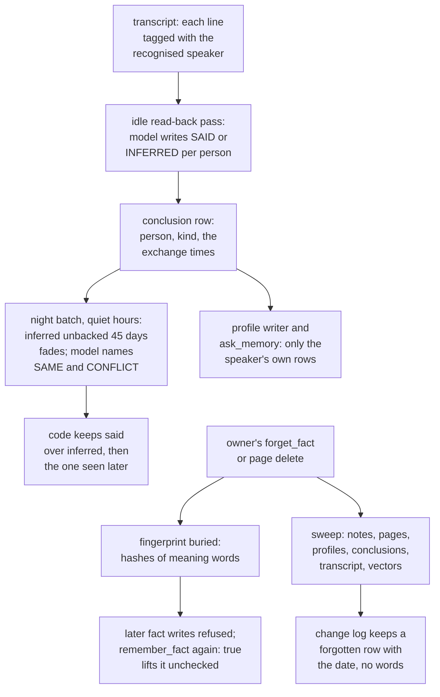

## 1. Executive Summary

Luna is a persistent-state local agent built from several models on LM Studio
or llama.cpp: a chat model that decides and talks, with smaller models beside it
for speech in and out, sight, recall by meaning and relevance. Its main surface
is tooling. The registry holds 56 model-callable tools across files, shell,
mail, web research, the network, the desktop, reminders, scheduled jobs and its
own introspection (`tools/__init__.py:29-32`), and MCP servers add more. A
persona with moods and a portrait is a layer over the agent, and it knows a
household of recognised speakers.

Its memory is one-sentence facts the model writes, corrects, confirms and
forgets through tools. After a fact is saved, idle passes build on the
conversation: notes on each conversation, lessons from her own mistakes, pages
per subject, a profile per person, and conclusions per person read back from
the transcript, each marked said or inferred and pointing at its exchanges. A
night batch merges them, settles contradictions and lets unbacked guesses fade.
`ask_memory` answers one question from all of it, scoped to the speaker. What is
most notable is the forget. It deletes the fact, buries a fingerprint of its
meaning words, strips every sentence carrying it from those derived stores and
the fact's change log, and filters everything Luna writes afterwards.

What is weak sits at the edges. The model that is refused a forgotten fact can
lift the fingerprint with one flag. The fingerprint is a hash of dictionary
words and reverses to them. A housemate's forget gets none of it. A conclusion
is "said" because the reading model wrote SAID, and that label decides every
contradiction. Six marks: `tombstone`, `trust_state`, `bitemporal`,
`scope_enforced`, `human_review` and `negative_eval`.

**Licence.** The licence changed under this pin. Commit `aa8f1e1` on 20
November 2026 replaced the MIT text in `LICENSE` with the unmodified GNU Affero
GPL v3. The README states AGPL-3.0-or-later and that versions released before
that date stay MIT (`README.md:334-345`). MIT let anyone ship the code inside a
closed product or a hosted service; under section 13 a modified version offered
to users over a network must offer them its source, and the copyleft covers any
work built from it. Every commit before `aa8f1e1` remains MIT. The "or any later
version" grant and the copyright line are in the README only: `LICENSE` is the
FSF text with its notice template unfilled, and no source file carries a
header. Secondary: `games/` commits three Infocom story files, Planetfall,
Starcross and The Hitchhiker's Guide to the Galaxy, with no licence; the README
says their rights are Microsoft's (`README.md:347-354`).

## 2. Mental Model

Luna keeps several kinds of memory, each with its own writer.

- **Facts** about the owner: one sentence each, at most 220 characters, with no
  line break and none of the persona's verbal tics (`_looks_like_valid_fact`,
  `mind/longterm.py:475-485`). Each row carries a trust state and, when the user
  said when, a real date (`mind/factstore.py:80-92`). Every change to a row is
  written to a change log beside it.
- **Per-person facts**: one JSON file per enrolled person, and an in-memory list
  for a guest met this session (`senses/people.py:440-500`).
- **Conclusions**: what she has worked out about a person from many exchanges,
  one sentence each, marked `said` or `inferred`, with the transcript times of
  the exchanges behind it (`mind/conclusions.py:69-82`).
- **Episode notes**: two to four first-person sentences per finished
  conversation, and per game session played alone.
- **Lessons** about her own behaviour, **recipes** for multi-step jobs,
  **projects** that span sessions, one **feeling** line per game.
- **Pages**: a short note per subject with three or more confirmed facts, joined
  up from those facts and the matching episode notes. **Profiles**: a few
  sentences per person, written from their confirmed facts and their
  conclusions.
- **History**: the recent turns plus a running summary, and a transcript archive
  that summarisation never touches.

A fact written deliberately is a belief at once. `remember_fact` and
`update_fact` land confirmed and are in the next prompt. A fact the background
extractor guesses from one exchange lands **unconfirmed**: shown as *(not
sure)*, kept out of pages and profiles, until it is heard again or confirmed
(`mind/factstore.py:589-643`, `:714-743`).

A fact stops being believed in three ways, and the code keeps them apart. A
**change in the world** retires the old row, with the real day it ended when the
user said it (`factstore.replace`, `:664-711`). A **mistake** rewrites in place,
leaving only a `corrected` row in the change log, and only when the model sets
`mistake` (`:768-787`, `mind/longterm.py:391-397`). A **forget** deletes the row
and every retired copy, buries a fingerprint, and sweeps the derived stores
(`mind/forgetting.py:228-272`).

A conclusion has its own lifecycle, and none of it involves a person unless one
steps in. The read-back pass writes it, and a later pass that sees it again adds
its exchanges and marks it seen (`mind/conclusions.py:191-201`). It is set aside
four ways: the read-back pass calls it outdated, the night batch merges it into
another or loses it in a contradiction, an inferred one fades after 45 days with
nothing backing it, or a person marks it wrong (`:185-218`, `:527-625`). A
set-aside row stays and can be restored. One marked wrong is shown to every
later read-back as *"don't write these again"*, and any new or merged
conclusion similar to it is dropped.

## 3. Architecture

Luna is one Python process with a full-screen terminal interface, a voice loop
and a local web server on `127.0.0.1:8792` for the chat page, live view, thought
viewer, settings and memory page. Memory is in-process, with no service of its
own.

- **Facts**: `mind/factstore.py` holds `facts(id, fact, subject, created_at,
  superseded_at, superseded_by, embedding, valid_from, valid_to, trust)`, a
  `forgotten(marks, at)` table of fingerprints, a `fact_events` change log and a
  `meta` table (`:80-117`). An external-content FTS5 index is kept in sync by
  insert, delete and update triggers (`:122-145`). The `embedding` column is
  reserved and unused. A Python without FTS5 gets the table and word matching.
- **Notebook**: `agent/notebook.db` holds lessons, episodes, conclusions, play
  sessions, a key-value table, pages and profiles.
- **People**: `agent/people/<name>.json` with face and voice prints and facts.
- **History**: `history/conversation.json` and `history/transcript.jsonl`.
- **Embeddings**: an optional embedding server on `:8081` and reranker on
  `:8082`, with vectors cached in `agent/embeddings.db` keyed by a SHA-1 of the
  served model's name and the text (`mind/embedmem.py:99-100`).

The background is two threads. `reflect._loop` wakes every two minutes and,
when the assistant is idle, writes episode notes and game notes. After ten idle
minutes it either runs the night batch or reads back the conversations of
anyone with six new exchanges, or fewer that have been quiet for a day
(`mind/reflect.py:1180-1193`, `mind/conclusions.py:346-355`). The night batch
runs once a night in her quiet hours, by default the portrait's bedtime of
22:00 to 06:00, or after 36 hours whatever the hour, or every 20 hours when
`self.dream_hours` is `any` (`mind/reflect.py:885-953`). It writes lessons,
tidies facts, reads back and dreams over conclusions, and rewrites pages and
profiles, and is marked done only when the lesson and conclusion calls
succeeded (`:956-972`). History folding runs on its own worker. A forget's sweep runs on
its own thread from the tool, and inline from the memory page.

### Deployment and ergonomics

Everything is local and no API key is needed to store anything. The installer
picks a model for the graphics card and installs the voice stack. Facts work
with only the chat model; recall by meaning needs the embedding server and falls
back to FTS5 or word matching when it is down. Every store is a JSON or SQLite
file a person can open, and the memory page edits facts, marks conclusions
wrong, and shows the change log in a History tab while Luna runs.

There is one fact backend. An install that kept facts in the older
`memory.json` list has them read into `facts.db` once, recorded in `meta` and
logged as `imported`, and the list is never written again
(`mind/longterm.py:25-71`). The import skips any fact matching a fingerprint
(`mind/factstore.py:969-1005`).

## 4. Essential Implementation Paths

- **Tool writes.** `remember_fact`, `update_fact`, `confirm_fact` and
  `forget_fact` (`tools/memory.py:28-246`) call into `mind/longterm.py`. The
  editing tools find their target by phrase: exact match, then containment, then
  a word score that must lead the runner-up by half again, or the candidates go
  back to the model to ask the user (`find_fact`, `:268-319`). Each first checks
  `_guest()` and routes to the speaker's file. Each runs inside
  `factstore.acting("her tools")`, so its change-log rows name her tools
  (`tools/memory.py:16-22`).
- **Fallback extraction.** When the model has no tool calling, every remembered
  turn starts a background extractor (`llm/turns.py:613-615`). When it has tool
  calling, the extractor runs only if the user's words ask to remember and no
  `remember_fact` ran (`:644-646`, `mind/longterm.py:98-104`). It accepts
  `NONE`, `NEW`, `REPLACE`, `CONFIRM` and a trailing `since` date. A fact it
  writes is unconfirmed unless the user asked (`:532-679`).
- **Forget.** `forget_fact` deletes the row, then `forgetting.forget` buries the
  fingerprint and starts the sweep (`mind/longterm.py:321-349`,
  `mind/forgetting.py:228-272`). The memory page's delete does the same and waits
  for it (`memory-manager/manager.py:203-209`).
- **Change log.** Every writer in `mind/factstore.py` inserts a `fact_events`
  row in the same transaction as its change: added, confirmed, dated, replaced,
  retired, restored, corrected, edited, forgotten, imported or unforgotten, with
  the fact's words then and the actor from a context variable
  (`:159-176`). `/facts log` and the memory page read it
  (`commands/memory.py:82-93`, `memory-manager/manager.py:76-78`).
- **Conclusions.** `conclusions.write` splits the transcript into exchanges per
  person, owner and recognised housemates only, and sends batches of 20 with the
  person's current and wrong-marked conclusions; the model answers `SAID`,
  `INFERRED`, `OUTDATED` or `AGAIN` lines ending in exchange numbers
  (`mind/conclusions.py:272-300`, `:383-414`, `:486-521`). `_apply` drops a line
  under 12 or over 220 characters, one carrying a forgotten fact, an `INFERRED`
  line citing fewer than two exchanges, and one similar to a fact or a
  wrong-marked conclusion; one similar to an active conclusion backs it instead
  (`:439-483`).
- **Night dream over conclusions.** `fade` retires inferred rows not seen for 45
  days, or 180 after they were last backed. Then, per person whose set changed,
  one model call names `SAME` groups with a merged sentence and `CONFLICT` pairs
  (`:527-565`, `:628-665`). The code merges, keeping a said row's words when the
  group mixes kinds, and retires the lower of each conflict pair by kind, then
  last-seen time (`:568-625`).
- **Write guards.** Every assistant message and tool call stored in history, the
  assistant side of the transcript, each summary chunk, episode note, lesson,
  page, profile and `ask_memory` answer passes through `forgetting.clean`
  (`core/history.py:294-309`, `:456`, `core/transcript.py:96-103`,
  `mind/notebook.py:230`, `:299`, `mind/pages.py:218`, `mind/profiles.py:236`,
  `mind/recall.py:302`).
- **Prompt assembly.** With `llm.stable_prompt` on, the default, the system
  prompt holds who she is, the speaker and their profile, the persona, the tools
  and the summary. Facts, pages, knowledge, lessons, notes, the clock and the
  mood go in a note in front of the latest message, which history never stores
  (`llm/prompts.py:413-448`). Conclusions ride in no prompt directly; they reach
  one through the profile and through `ask_memory`.
- **Fact selection.** `relevant_facts` (`mind/longterm.py:191-222`): under
  `context_facts` every fact; over it, the newest third always, and the rest by
  `embedmem.select`, else FTS5 bm25, else word overlap. Each fact is shown with
  its real date and *(not sure)* where they apply (`llm/prompts.py:39-49`).
- **Lessons and tidy.** `dream` reads thought-log rows since the last pass —
  review flags, low token confidence, turns the user answered with *"no, ..."* —
  and writes at most three lessons, which `notebook.relevant_lessons` puts in
  later prompts by relevance (`mind/reflect.py:522-625`, `llm/prompts.py:97`).
  `tidy_facts` compares pairs above 0.82 cosine or 0.5 word overlap, at most six
  model calls a pass; `SAME` merges, `CONFLICT` retires the losing side unless
  that side is confirmed and the winner is a guess (`mind/reflect.py:627-792`).
- **Pages and profiles.** Each is keyed on a hash of its sources and rewritten
  when they change, from confirmed facts only, plus the person's conclusions for
  a profile (`mind/pages.py:110-118`, `:195-234`, `mind/profiles.py:112-119`,
  `:215-252`).
- **Ask my memory.** `ask_memory` gathers lines bearing on the question from
  the speaker's facts and conclusions, episode notes and the transcript, then one
  model call answers in one to three sentences, told to say how it knows. A
  count of what was gathered by kind is appended in code
  (`mind/recall.py:198-312`).
- **Offers.** `offers.line` picks at most one offer per turn from the last
  background scan (`life/offers.py:253-291`); `stop_offering` mutes it
  (`tools/offers.py:14-27`, `life/offers.py:294-306`).
- **Memory page.** `apply` maps add, edit, confirm, retire, restore, delete and
  lift-every-fingerprint onto row ids, and the notebook actions, conclusions'
  wrong and restore among them, onto their modules, all under
  `factstore.acting("memory page")` (`memory-manager/manager.py:139-212`).

## 5. Memory Data Model

A fact has two clocks. `created_at` and `superseded_at` are record time:
`superseded_at` NULL means active, and every read that serves a turn filters on
it (`mind/factstore.py:365-374`, `:522-583`). `valid_from` and `valid_to` are
real time, filled only from a date the user gave (`:13-19`, `:225-247`).
`replace` writes the date as the new row's `valid_from` and the old row's
`valid_to` (`:694-705`). With no date both stay NULL, and record time stands in.

`trust` is `confirmed` or `unconfirmed`, defaulting to confirmed, so a database
from before the column counts every fact as sure (`:91`, `:283-290`). `add` of
an identical active fact confirms a guess rather than inserting it again
(`:605-630`).

`fact_events(id, at, action, fact_id, fact, detail, by)` takes one row per
change (`:100-110`). `by` is set by whoever drives the change: her tools, the
extractor, the tidy pass, the memory page, the import or a forget's sweep, and
`unknown` otherwise. A forget empties `fact` and `detail` on every row about
the deleted ids and appends a wordless `forgotten` row (`:179-183`, `:806-811`).
The sweep then empties the words of any other row whose sentence is the
forgotten fact again (`:199-215`). `_trim_events` deletes every row more than
50,000 behind the newest, on each add and replace (`:160`, `:218-219`).

The fingerprint table holds one row per forgotten fact: the sorted set of
12-hex-character SHA-256 hashes of the fact's stemmed words, after stopwords and
the owner's and agent's names are removed, salted with a fixed string
(`mind/forgetting.py:86-101`, `mind/factstore.py:895-905`). A candidate matches
if its set equals the fingerprint, contains it with at most two extra words, or
overlaps a fingerprint of three or more by 0.8 (`mind/forgetting.py:104-114`).
A sentence carries a fingerprint if it holds every word of one up to three
words long, three quarters of a longer one, or the single word of a one-word
fact in a sentence about a person (`:117-136`).

`superseded_by` is set by `replace` only. The tidy merge rewrites one row and
retires the other, and the link survives only as the retired row's change-log
detail, *"merged into #n"* (`mind/reflect.py:752-761`). Lessons carry
`from_ids`, `hits`, `last_used`, `retired` and an origin. Episodes carry start,
end, turn count and summary, and nothing links one to the facts written during
it.

A conclusion is `(id, person, text, kind, sources, created, retired, why,
backed)` (`mind/conclusions.py:69-82`). `kind` is `said` or `inferred`.
`sources` is a JSON list of transcript times, so `/conclusions why` resolves
them against the transcript as it is when asked, and reports how many are no
longer there after a trim or a forget's rewrite (`commands/memory.py:434-462`).
`retired` and `why` hold a set-aside's time and reason: outdated, merged,
contradicted, faded or marked wrong. Every read filters `retired = ''`
(`mind/conclusions.py:141-148`).

**Scope** is the speaker of the turn: None for the owner, a name for an enrolled
person or a session guest, or `STRANGER` (`senses/people.py:390-397`). Facts
route on it physically, the owner's to `facts.db` and everyone else's to their
own file, so no fact row carries a speaker. A stranger stores nothing and reads
none. The conclusions table is the one store with a person column: the
read-back pass takes it from the `[Name]` prefix the turn writer puts on a
recognised speaker's line, and `rows(person)` filters on it
(`llm/turns.py:590-591`, `mind/conclusions.py:272-300`). The prompt builder
checks the speaker before adding the owner's preferences, knowledge passages,
summary, episodes, projects, recipes, screen and reminders, and the profile
reader picks the speaker's own (`llm/prompts.py:35`, `:62`, `:90`, `:308`,
`mind/profiles.py:254-271`).

## 6. Retrieval Mechanics

Under `context_facts` (25 by default) every fact goes into every prompt. Over
it, `embedmem.select` keeps the newest third regardless, embeds the turn, and
takes the closest of the rest above `EMBED_MIN_SCORE` 0.35, with the reranker
reordering when more pass than fit (`mind/embedmem.py:292-311`). With no
embedding server, FTS5 runs an OR-query of quoted terms ordered by bm25, and the
word fallback scores overlap in favour of short facts
(`mind/factstore.py:522-583`, `mind/longterm.py:225-265`). Unconfirmed facts
are selected like any other and shown with *(not sure)* and the instruction
*"don't state them as true"* (`mind/longterm.py:448-449`).

`recall_facts` with `past` is the one read of retired facts. It returns each
match as NOW or BEFORE, with when it was learned, when it stopped being
believed, and the real dates the user gave (`tools/memory.py:98-133`,
`mind/factstore.py:461-490`). No query selects facts by valid time; the model
reads the dates.

`ask_memory` is the one read of conclusions in a turn. On the owner's turn it
gathers up to ten of the owner's facts, eight conclusions, three episode notes
and four transcript lines, plus the facts and conclusions of anyone the question
or the `about` argument names. On a recognised housemate's turn it gathers that
person's facts, their conclusions and the exchanges they were in, and nothing of
the owner's; a session guest gets their facts only, and a stranger or stream
chat nothing (`mind/recall.py:198-237`).

Lines are picked by embedding above
0.35 with names stripped from the query, else by shared words
(`:97-117`). The answering prompt orders what they said over her read and newer
over older, and says to answer *"I don't know"* when nothing fits
(`:243-259`). The `(from: 2 facts, 1 past exchange)` suffix counts what was
gathered, not which lines the answer used (`:279-286`). If the call fails, the
labelled lines go back instead.

Lessons, episodes and pages use the same embedding ranker with a fallback to
shared words. Episodes riding in every prompt need 0.45 and two shared words,
stricter than the `recall_episodes` tool's 0.35 (`mind/notebook.py:323-364`).
Up to two pages ride along when the turn names their subject or is within 0.5 of
one by meaning (`mind/pages.py:237-265`). Knowledge-folder passages come unasked
only above 0.55 (`mind/knowledge.py:716-742`).

`search_history` is word overlap with light stemming over the transcript. It
returns the turns either side of each hit and tells the model to say it does not
recall rather than stretch a match (`tools/memory.py:249-281`).

## 7. Write Mechanics

The design premise is that facts are written deliberately by the model. On a
tool-calling model the automatic fact writers are the tidy pass and the
extractor's safety net for an unanswered "remember this". The validator rejects
long, multi-line or in-character text, and `why_not` tells the model the reason
so it can tell the user (`mind/longterm.py:452-472`).

A change and a mistake reach different paths at the tool boundary.
`update_fact`'s description keeps the old version as history, and `mistake` is
for a fact that was never right (`tools/memory.py:194-220`). So "what was my
last graphics card" is answerable after the model's own update.

The extractor's `REPLACE` may retire a confirmed fact with an unconfirmed one,
on the reasoning that this is the exchange where the user said it changed
(`mind/longterm.py:636-664`). The tidy pass may not.

Conclusions are the second automatic writer, and the one that runs on every
model. The reading model decides the kind. Code checks that a `SAID` line cites
one exchange in the batch and an `INFERRED` line two, and nothing compares the
sentence with what those exchanges say (`mind/conclusions.py:461-466`). A later
`SAID` that matches an inferred row turns it into a said one
(`:191-201`, `:470-473`). A conclusion that duplicates a fact is dropped, while
one that contradicts a fact is stored; the profile prompt tells the writer to
use her read *"lightly, and never against a fact above"*
(`:474`, `mind/profiles.py:196-198`).

The dream, episode, read-back and night prompts frame their inputs as records.
A flag quoting a web page, file or screen tool reaches the dream pass by tool
name only (`mind/reflect.py:482-489`).

### Operational cost

A tool write is synchronous and makes no model call: one SQLite statement and
one change-log row, after a fingerprint check that reads every row of
`forgotten`. It is in the next turn's prompt. The fallback extractor costs one
model call per remembered turn, off the reply's path. `ask_memory` makes one
model call inside the turn, up to 260 tokens with a 90-second timeout
(`mind/recall.py:262-271`).

Episode notes lag the conversation by at least 30 minutes of silence. A
conclusion lags until six exchanges with that person are waiting or a day has
passed, and an idle pass makes at most three read-back calls of 20 exchanges;
the first pass reads back 30 days (`mind/conclusions.py:53-67`). Lessons, tidy,
the conclusions dream, pages and profiles wait for the night batch; a first
profile waits only for ten idle minutes.

A forget rewrites the whole transcript file and scans every row of the
summary, history, episodes, lessons, pages, profiles, conclusions, thought log,
change log and fact table (`mind/forgetting.py:260-443`). It runs off the
reply's thread. Each later write of her own text is checked sentence by
sentence against every fingerprint.

## 8. Agent Integration

The model holds every fact verb (`remember_fact`, `recall_facts`,
`update_fact`, `confirm_fact`, `forget_fact`), plus `ask_memory`,
`search_history`, `recall_episodes`, `note_lesson`, `save_skill`, the project
tools, `reflect_now` and `stop_offering`. Tool groups attach by routing, so not
every tool is in every payload. The prompt sends a question about the person,
or someone they know, to `ask_memory` before *"you don't remember"*, and
word-for-word recall to `search_history` (`llm/prompts.py:216-220`).

The tool list narrows by speaker. A stranger gets seven safe tools, a session
guest gets those plus the five memory tools routed to their own memory,
`ask_memory` among them, and an enrolled person gets everything the owner gets
(`senses/people.py:55-58`, `:421-430`). Stream chat gets no memory blocks.
Conclusions have no tool: `/conclusions` and the memory page list them, show
the exchanges behind one, mark one wrong and restore it
(`commands/memory.py:434-486`).

## 9. Reliability, Safety, and Trust

### The forget reaches every store, and the model holds its key

For an agent that stays running in a house, the failure that hurts is raising
something the user asked to drop. Luna closes it for the owner's facts. The row
and every retired copy go, the fingerprint is buried, and the sweep strips the
sentences carrying it from every store built from the conversation, deletes any
conclusion carrying it, and empties its words from the change log
(`mind/forgetting.py:260-296`, `:417-420`). Everything Luna writes afterwards is
cleaned, and the user's own later words are kept as said
(`core/history.py:294-309`).

Matching is lexical. A note, page, profile, transcript line or conclusion goes
when it holds the fingerprint's stemmed words; no embedding and no model judges
it. A paraphrase with other words survives, as *"Ryan's employer is a bakery"*
would for *"Ryan works at the bakery"*. The fact table and the change log use
the stricter fact match (`mind/forgetting.py:282-283`, `:295-296`), so a stored
fact that holds every forgotten word plus three or more others stays in the
store, the prompt and the log.

The refusal is a tool result, and the model can answer it. `remember_fact` takes
`again`, described as *"Only when the user told you to forget this before and
has now asked for it to be remembered again"*, and passes it to `factstore.add`,
which deletes the matching fingerprint (`tools/memory.py:45-55`,
`mind/factstore.py:646-661`). Nothing checks the user's words. The refusal text
names the flag: *"call remember_fact with again: true"*
(`mind/longterm.py:461-463`). The lift is logged as `unforgotten` by her tools,
with the words. The extractor's own lift is gated on the user's text matching a
remember phrase (`:628`). The memory page's add lifts it too, as a person's act
(`memory-manager/manager.py:189`).

### The fingerprint is readable

The design comment says the fingerprint keeps *"Never the words"*
(`mind/forgetting.py:9-11`). Each hash covers one stemmed dictionary word with a
salt that is a constant in the source, truncated to 48 bits (`:95-96`). I
re-derived `_stem` and `_hash` in a separate script and hashed the 234,454 words
of the system word list. The two marks stored for *"Ryan works at the bakery"*
came back as `bakery` and `work`. A forgotten fact is recoverable as its meaning
words from `facts.db` alone, in the same file whose change log is scrubbed of
them.

### What the forget does not reach

- **A housemate's or guest's facts.** Their `forget_fact` pops the entry from
  their file or session list and returns (`mind/longterm.py:332-337`,
  `senses/people.py:474-500`). No fingerprint is written and nothing is swept,
  so the shared history, transcript, episodes and their conclusions keep it, and
  an extraction can save it again. Forgetting the person, `/people forget`,
  deletes their conclusions (`senses/people.py:134-139`).
- **Cached vectors when the embedding server is down.** The cache key includes
  the served model's name, which is learned from the server
  (`mind/embedmem.py:61-100`). `drop` asks for it, and with the server down the
  keys are computed with an empty name and match nothing (`:103-118`).
- **The thought log afterwards.** It is swept once at the forget and not
  filtered after (`mind/forgetting.py:18-20`).
- **Copies outside the swept list.** A kept training example holds the whole
  prompt, facts included, in `agent/dataset/examples.jsonl`
  (`training/dataset.py:1-8`). The application log under `~/.cache/ai-voice/`
  records each heard line and each supersession's old and new text
  (`core/logbook.py:32-37`, `core/assistant.py:559`, `mind/longterm.py:401`).
  A corrupt history or fact store is set aside as a `.bad-<time>` copy
  (`core/history.py:110-113`, `mind/factstore.py:254`). None of these is in
  `scrub_everywhere`'s list.

### Conclusions: the reading model's label decides

The conclusions design is careful about provenance. Each row keeps the
exchanges it came from and the person they came from; strangers, one-session
guests, her own reminders and touches are never read; a row is checked against
the forgotten facts and the wrong-marked list before it is stored; and a guess
that nothing backs fades while a set-aside row can be restored.

The weak point is the kind. `said` is what the read-back model wrote, and code
checks only the count of exchange numbers (`mind/conclusions.py:461-466`). The
label then does three things on its own: a said row never fades, wins every
contradiction against an inferred one however recent, and is shown in the
profile prompt and in `ask_memory` as *"they told you"* (`:527-539`, `:568-570`,
`:175-179`). A model that writes `SAID` for its own reading turns a guess into
something the user said, and nothing in the store can tell the difference. The
exchanges behind it are kept, so a person can check with `/conclusions why`.

A conclusion is not reviewed before it is used. It lands active and reaches the
next profile rewrite and the next `ask_memory`; `wrong` is editing after the
fact.

### The change log keeps the date of a forget, not the words

`fact_events` answers "what changed, when and by whom" for the owner's facts.
Each mutation writes its row in the same transaction, so a change and its record
land together or not at all, and a forget leaves a dated row with no words. The
log does not cover the per-person fact files, conclusions, lessons or the
notebook: `senses/people.py`, `mind/conclusions.py` and `mind/notebook.py`
never call it. And it is capped. `_trim_events` deletes rows past the newest
50,000, and a committed test asserts the trim (`mind/factstore.py:218-219`,
`tests/test_fact_events.py:119-125`).

### Speaker scoping covers the prompt and ask_memory, not the other tools

A stranger's or a housemate's turn gets none of the owner's summary, episodes,
projects, recipes, knowledge passages, screen, reminders or profile
(`llm/prompts.py:80-90`, `:303-308`). `ask_memory` on their turn reads only
their own conclusions, facts and exchanges, and ignores the `about` argument
(`mind/recall.py:206`, `:218-225`). The recent turns are replayed to everyone,
which `docs/who.md` states as intended. An enrolled housemate holds the full
tool list, including `search_history`, `recall_episodes` and `search_docs`,
which read the owner's transcript, episodes and documents with no speaker check
(`senses/people.py:421-430`).

The person key is read from the transcript text. A typed owner line that begins
with a recognised housemate's name in brackets is filed under that housemate
(`mind/conclusions.py:288-294`).

### What the agent cannot write without a person

`note_lesson` refuses on a turn that called a web, file, screen or clipboard
tool. It caps self-noted lessons at three per session, then pops the approval
window used for file writes (`tools/introspect.py:359-410`). `ui.ask_approval`
returns False with no terminal app running, and True only on a keypress or on
the chat page's answer to that question's number, a localhost POST behind the
monitor's Host and Origin checks (`ui/approval.py:35-117`,
`web/chat_web.py:475-489`). `save_skill` does the same through the turn's
approver when one is set (`tools/introspect.py:449-480`). Discord's `auto` mode
approves an unguarded request without asking, and a recipe is guarded only when
its turn read outside content (`plugins/discord.py:171-178`,
`tools/introspect.py:462`).

### Marks

- **`tombstone`** — awarded on the fingerprint table. It is keyed on the value's
  words and consulted by every fact writer. Its limits: the model can lift it
  with `again`, it covers the owner's facts only, and it reverses to the words.
  Conclusions carry a second suppression keyed on value: a wrong-marked row is
  compared by similarity with every later read-back line and merge.
- **`trust_state`** — awarded on `confirmed` and `unconfirmed`. The unconfirmed
  state keeps a fact out of pages and profiles, and out of the tidy pass's
  retirements of confirmed facts (`mind/pages.py:118`, `mind/profiles.py:119`,
  `mind/reflect.py:762-767`). Its producer is the background extractor without
  a remember request, which runs only when the model has no tool calling
  (`llm/turns.py:613-615`). On a tool-calling model, the default, every fact
  lands confirmed. A conclusion's `said` and `inferred` rank and label; they
  filter nothing.
- **`bitemporal`** — awarded on `valid_from` and `valid_to` beside record time,
  written from the user's dates by the tools and the extractor. No read selects
  by valid time.
- **`scope_enforced`** — awarded on the conclusions table's `person` column,
  applied as `person = ?` when `ask_memory` reads for anyone but the owner,
  with the speaker from recognition rather than from the model. It is one store
  and one read path: facts stay a file per person, and a housemate's history
  tools read the owner's transcript.
- **`human_review`** — awarded on agent-noted lessons and recipes. Each waits in
  the popup until a person answers, and the agent's tool registry has no approve
  verb. Dream-pass lessons, facts, episode notes and conclusions land without
  it, and Discord's `auto` mode approves most recipes.
- **`negative_eval`** — awarded on the per-person partition, the pages block,
  the prompt and `ask_memory` on someone else's turn, and the forget sweep; see
  section 10.
- **`audit_log`** — withheld. `fact_events` is a named mutation record written
  inside each change's transaction, and the forget's redaction keeps every row
  with a dated receipt. The mark fails on the cap: `_trim_events` drops rows past
  the newest 50,000 (`mind/factstore.py:218-219`). It also covers the owner's
  facts and no other store.

### Other risks

- **Restore re-activates a superseded fact beside its replacement.**
  `restore_row` clears `superseded_at`, `superseded_by` and `valid_to` with no
  check for the row that replaced it (`mind/factstore.py:863-878`).
- **The offer mute is keyed on wording.** The key is eight hex digits of a SHA-1
  of the fact's text (`life/offers.py:143`). A fact changed by `update_fact` or
  merged by the tidy pass is a new item, and a muted birthday offer returns.
- **The tidy merge skips the fingerprint check.** It writes the merged text with
  `set_row`, which does not call `_allowed` (`mind/reflect.py:755`,
  `mind/factstore.py:827-844`).

## 10. Tests, Evals, and Benchmarks

`tests/` holds 1,431 unittest methods in 113 files, run in CI on Ubuntu with
Python 3.12 and no model or server (`.github/workflows/tests.yml`,
`tests/offline.py`). I did not run them.

`negative_eval` rests on six committed cases, each against populated data:

- `tests/test_voices.py:144-170`. With Shannon speaking, `relevant_facts("cats")`
  must equal exactly her one fact, and the patched owner store must never see
  `add` or `search`. With the owner speaking and Shannon's fact on disk,
  `get_facts()` must equal exactly the owner's one fact.
- `tests/test_pages.py:88-96`. The owner's pages block must contain the Shannon
  page, and a guest's must be empty for a query naming Shannon.
- `tests/test_guest_prompt.py:42-52`. The owner's prompt holds six markers for
  episodes, summary, projects, recipes and knowledge; Shannon's and a stranger's
  must hold none, and the lesson marker must stay.
- `tests/test_recall.py:74-81`. With Shannon asking, the gathered prompt must
  hold her fact, her conclusion and her line from the transcript, and none of
  four lines taken from the owner's fact, conclusion, note and transcript.
- `tests/test_forgetting.py:111-137`. After a forget, the fact table must equal
  `["Ryan has a cat"]` with the reworded copy and its retired history gone, the
  summary must equal *"He likes Zork."*, and the transcript, episodes and thought
  log must each keep their control sentence and lose the rest.
- `tests/test_conclusions.py:217-221`. A forgotten fact takes the one conclusion
  carrying it, and the other must remain.

The same forgetting file asserts that the forgotten fact is refused on re-add
and on `replace`, that `again="true"` lifts it, that guesses stay out of
`rows(sure_only=True)`, and that later replies and episode notes are cleaned
while the user's words are kept (`:56-84`, `:163-169`, `:211-214`).
`tests/test_valid_time.py` asserts the old fact's end date after a dated change
and the NOW and BEFORE lines of `recall_facts`. `tests/test_fact_events.py`
asserts each kind of change and its actor, that a forget leaves the dated row
and none of the words, that the sweep empties a reworded copy's words and keeps
an unrelated correction, and that the cap trims. `tests/test_conclusions.py` and
`tests/test_conclusions_dream.py` cover attribution, said and inferred with
their exchanges, a wrong-marked conclusion refused again and kept out of a
merge, said over a newer guess, fading, and the quiet hours.

`test_every_store` calls five of the ten sweep functions directly, and the
change log and conclusions sweeps have their own cases. Lessons, pages and
profiles are swept by code no case drives, and no case drives
`scrub_everywhere` or a housemate's forget. No case drives `note_lesson` or
`save_skill`, so the approval gate is read from the code. `evals/` wraps two
external AI-safety experiments with no results committed and nothing about
memory. No paper is associated with the project. The one arXiv citation in the
tree, in `docs/reasoning.md`, is for an introspection probe.

## 11. For Your Own Build

### Steal

- **Make forget a sweep plus a guard.** Delete the fact, strip the sentences
  carrying it from every store built from the same conversation, and check
  everything the agent writes afterwards. Leave the user's own words alone, so
  bringing it up again is still possible.
- **Match the forgotten fact by its meaning words.** A word-set fingerprint
  catches *"used to work at the bakery"* where an exact-text key would not, and
  a one-word fact taking only sentences about a person keeps the topic usable.
- **Log a forget as a dated row with no words.** The change log keeps "a fact
  was forgotten on this date by this actor" and loses the value, so the audit
  trail does not become where the forgotten fact lives on.
- **Give each derived belief its evidence and a way to fade.** A conclusion
  that keeps its exchange times can be shown to a person, and an inference that
  nothing has backed for weeks can be set aside without deleting it.
- **Keep a guess out of what is built on it.** An unconfirmed fact can ride in
  the prompt with a label, but pages, profiles and contradiction resolution
  should read only confirmed ones.
- **Separate "that was wrong" from "that changed", and take the date from the
  user.** A change retires the old row with its real end; a mistake rewrites in
  place; a missing date stays missing rather than becoming today.

### Avoid

- **An override the refused caller can set.** If a tombstone can be lifted by a
  flag on the same tool that was refused, the gate is a prompt. Put the lift on
  a surface the model does not hold, or check it against the user's own words.
- **Letting the extractor's own label settle conflicts.** If "they said it"
  outranks "I inferred it", the code that sets "said" has to look at what was
  said, not at the line the model wrote.
- **Calling a hash of dictionary words private.** A fixed salt and one word per
  hash reverse in seconds. A keyed hash with a secret outside the store, or the
  plain words with the claim dropped, is honest; this is neither.
- **A forget that covers one household member.** If several people's facts
  live in the same history, every person's forget needs the same sweep.

### Fit

This suits one person running a tool-heavy assistant on their own machine who
wants to read and edit everything it keeps, and wants "forget that" to hold for
the owner: it reaches the summary, the notes, the conclusions and the agent's
later writing, not only the row. The engineering is careful where a
long-running local agent fails: atomic writes, bad-file quarantine, locked
databases that do not fail a turn, injection framing on every background prompt.
Walk away if other people's privacy is the requirement. A housemate's forget is
a list pop, and their tools read the owner's transcript. Walk away too if the
forgotten words themselves must not be recoverable from disk, or if a
model-written "they told you" must not outrank a later observation. Building
on this pin means taking the AGPL; the MIT terms stop at the commit before
`aa8f1e1`.

## 12. Open Questions

- How often a refused model sets `again` without the user asking, on the small
  local models the installer picks.
- How often the read-back model labels its own reading `SAID`, and whether a
  check of the cited exchanges for the user's words would catch it.
- Whether the unconfirmed state is meant to reach tool-calling models; on them
  the only writer that could produce it runs only after an explicit request.
- How the tidy pass's pair search behaves at a few thousand facts, where each
  new fact is compared with every older one.

## Appendix: File Index

- Facts: `mind/factstore.py`, `mind/longterm.py`, `mind/embedmem.py`,
  `tools/memory.py`
- Forgetting: `mind/forgetting.py`
- Conclusions and ask_memory: `mind/conclusions.py`, `mind/recall.py`
- People and scope: `senses/people.py`, `core/turnctx.py`, `core/assistant.py`,
  `mind/profiles.py`
- Notebook and idle passes: `mind/notebook.py`, `mind/reflect.py`,
  `mind/pages.py`, `mind/projects.py`, `mind/skills.py`, `tools/introspect.py`
- Prompt assembly and turns: `llm/prompts.py`, `llm/turns.py`, `llm/session.py`
- History: `core/history.py`, `core/transcript.py`, `mind/thoughtlog.py`
- Offers: `life/offers.py`, `tools/offers.py`
- Knowledge folder: `mind/knowledge.py`
- Editor and commands: `memory-manager/manager.py`, `commands/memory.py`,
  `ui/approval.py`, `web/chat_web.py`, `plugins/discord.py`
- Copies outside the sweep: `training/dataset.py`, `core/logbook.py`
- Tests: `tests/test_forgetting.py`, `tests/test_valid_time.py`,
  `tests/test_guest_prompt.py`, `tests/test_voices.py`, `tests/test_pages.py`,
  `tests/test_recall.py`, `tests/test_conclusions.py`,
  `tests/test_conclusions_dream.py`, `tests/test_fact_events.py`,
  `tests/test_offers.py`, `tests/test_errors_mind.py`

### Recorded searches

Run from the repository root at the pinned commit with `/usr/bin/git grep`.

- **The notebook, history and knowledge sources read no speaker; the prompt
  builder does.**
  `git grep -n -E 'speaker|guest\(' -- mind/notebook.py mind/projects.py mind/skills.py mind/knowledge.py core/history.py`
  returns nothing; `git grep -n -E 'people\.guest\(\)' -- llm/prompts.py` matches
  lines 35, 62, 90 and 308.
- **A housemate's forget writes no fingerprint and sweeps nothing.**
  `git grep -n -E 'bury|forgetting|scrub' -- senses/people.py` returns nothing;
  the same pattern over `mind/longterm.py` matches lines 344-347 in the owner's
  `forget_fact` and 459-461 in `why_not`.
- **Nothing checks the user's words before `again` lifts a fingerprint.**
  `git grep -n -E 'again' -- tools/memory.py` matches a comment at line 18, the
  schema at 45 and 48, the handler at 54-55 and an unrelated message at 162; no
  line in the handler reads the turn's text.
- **The fact store's tables.**
  `git grep -n -E 'CREATE (TABLE|VIRTUAL TABLE|TRIGGER)' -- mind/factstore.py`
  returns `facts`, `forgotten`, `fact_events`, `meta`, `facts_fts` and the three
  sync triggers.
- **The change log is written by the fact store alone.**
  `git grep -n -E 'fact_events|_record\(|acting\(' -- senses/people.py mind/conclusions.py mind/notebook.py`
  returns nothing; `git grep -n -E '_trim_events\(' -- mind/factstore.py`
  matches the definition at 218 and the calls at 641 and 709.
- **The prompt's fact block is not cleaned against the fingerprints.**
  `git grep -n -E 'forgetting|clean\(' -- llm/prompts.py` returns nothing; the
  same pattern over `core/history.py` matches the write guards at lines 296-307,
  338-340 and 454-456.
- **No read selects by valid time.**
  `git grep -n -E 'valid_from|valid_to' -- '*.py' ':!tests/*' ':!mind/factstore.py'`
  returns nothing; inside `mind/factstore.py` every use is a write, a projection
  or a NULL test.
- **The unconfirmed state has one producer.**
  `git grep -n -E 'sure=False|sure = again' -- '*.py' ':!tests/*'` returns
  `mind/longterm.py:628` and a docstring at `mind/factstore.py:590`.
- **A conclusion's kind comes from the model's line.**
  `git grep -n -E 'kind = ' -- mind/conclusions.py` returns line 199, which
  upgrades a row on a later `SAID`, and line 462, which reads the parsed line;
  `git grep -n -E 'CREATE (TABLE|TRIGGER)' -- mind/conclusions.py` returns the
  `conclusions` table only.
- **The forget sweep does not reach the training examples or the application
  log.** `git grep -n -E 'dataset|LOG_FILE|logbook\.path|\.bad-' -- mind/forgetting.py`
  returns nothing, and `git grep -n -E 'forgetting\.|tombstone' -- training/ web/dataset_web.py commands/patches.py`
  returns nothing; the control `git grep -n -E 'transcript|TRANSCRIPT_FILE' -- mind/forgetting.py`
  matches line 263, among others.
- **No test drives the approval gate.**
  `git grep -n -E 'note_lesson|save_skill|_approve_skill' -- tests/` returns
  nothing; `git grep -n 'approver' -- tools/introspect.py` matches lines 459-462
  only.
- **The sweep test leaves three stores undriven.**
  `git grep -n -E 'fg\._(lessons|pages|profiles)|scrub_everywhere' -- tests/`
  returns only `tests/facts_tmp.py:19`, which replaces `scrub_everywhere` with a
  stub; the five sweep functions the case calls are listed at
  `tests/test_forgetting.py:124-125`.
- **The tool count.** `git grep -n -E '^[[:space:]]*@(tools\.)?tool\(' -- '*.py' ':!tests/*'`
  returns 56 lines.
- **No paper.** `git grep -n -i -E 'arxiv|bibtex|@article|@misc|doi\.org' -- . ':!portrait/viewer/vendor/*'`
  returns `docs/reasoning.md:367` only.

## History

**2026-11-25** — [`9c48406de17eb2920a83deba393a69296b3e3d12`](https://github.com/fswolf/luna-local-agent/commit/9c48406de17eb2920a83deba393a69296b3e3d12). Upstream rewrote its history: the 18 November pin's tree is commit `681b2540c5ea2b8ed521557158a9baeb9f08bdca`, the old shas no longer resolve upstream and the archive copy keeps them. The rewrite stripped 64 GitHub web-commit signatures and changed nothing else. 55 commits since: a per-fact change log, per-person conclusions with a night merge, settle and fade, and `ask_memory`. `scope_enforced` awarded on the conclusions' person key; `audit_log` still withheld, now on the change log's 50,000-row cap; `negative_eval` extended ([section 9](#9-reliability-safety-and-trust)). Stale: no event table, no scoped store, 53 tools. The dictionary reversal was not re-run; `_stem` and `_hash` are unchanged. Relicensed AGPL-3.0-or-later on 20 November. Screened first: no auto-run or build-time surface, `installer/requirements.txt` changed on 24 November inside the cooldown; nothing installed, built or run.

**2026-11-18** — [`ed7f047cb583ac808505bd83c3eeb3c48d5921d6`](https://github.com/fswolf/luna-local-agent/commit/ed7f047cb583ac808505bd83c3eeb3c48d5921d6), 28 commits past the previous pin. Forget buries a word-hash fingerprint every fact writer consults and sweeps every derived store; facts gain a real-time pair and a confirmed or unconfirmed state; the JSON backend is read in once and retired; the owner's notes, summary and knowledge stay out of anyone else's prompt; `update_fact` keeps history unless `mistake` is set. Marks added: `tombstone`, `trust_state`, `bitemporal`, with `negative_eval` extended to the guest prompt and the sweep. New findings in [section 9](#9-reliability-safety-and-trust): the model's `again` flag lifts a fingerprint, the fingerprint reverses by dictionary, a housemate's forget is a list pop, and the unconfirmed state has a producer only without tool calling. Screened first: no auto-run or build-time surface, `installer/requirements.txt` changed inside the cooldown; nothing installed, built or run. MIT, unchanged.

**2026-11-05** — [`659ddcf2952f805a3d090eeabc8055644e2505af`](https://github.com/fswolf/luna-local-agent/commit/659ddcf2952f805a3d090eeabc8055644e2505af). First reading, from a depth-1 clone at the head of `main`, with history from the GitHub API. Screened first: no auto-run or build-time surface, two unpinned requirements files, and both flagged FRESH only because a shallow clone dates every file to the tip; their last changes were 17 October and 26 September 2026. MIT, no rider. Nothing installed, built or run. Two marks: `human_review` on agent-noted lessons and recipes, `negative_eval` on the per-person partition; tombstone withheld because a forget leaves no record and reaches no derived store ([section 9](#9-reliability-safety-and-trust)).

**2026-11-05** — Framing: the summary, description and fit describe the persistent-state, tool-heavy agent the README at the pin states, with the persona as a layer over it, and give the tool registry's count. Marks and findings unchanged.
