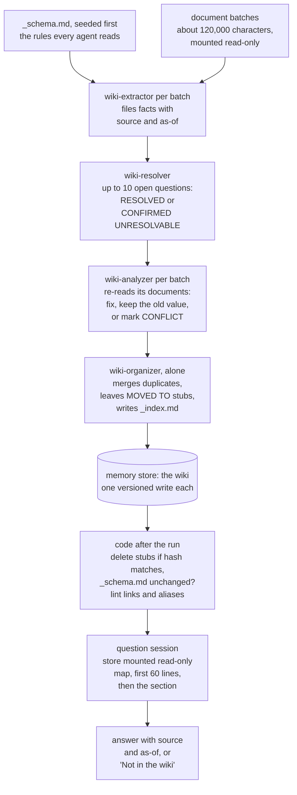

## 1. Executive Summary

The knowledge wiki is an Anthropic quickstart that reads a document corpus once
into a linked Markdown wiki and then answers questions from the wiki instead of
the documents. What is notable is its schema: every fact carries its source and
an as-of date, a superseded figure is closed rather than deleted, and two
documents that disagree stay a recorded conflict. What is weak is that all of it
is prompt text a model follows. The code checks that the run happened, not
that the rules held.

It accompanies Anthropic's article
[*The components of agent memory*](https://www.anthropic.com/research/components-of-agent-memory)
(6 November 2026), which links it as the starting point for "knowledge wikis".
The article's wiki experiments — a 25-question evaluation over about 350,000
internal Stainless documents, and Harvey LAB briefs — are not in this tree; the
quickstart's own evaluation is a different one, on public SEC filings
(section 10). Its sibling, the dreaming cookbook, applies variants of the same
analyzer and organizer prompts to agent transcripts and has
[its own report](../managed-agents-dreaming/).

The worked example is a real take-private, Squarespace by Permira, from eight
EDGAR filings and two files marked synthetic. Everything runs on Claude Managed
Agents, a hosted beta: the memory store, the sessions, the agents and the
workflow engine are the platform's, and this tree is the client that configures
and checks them. MIT, no `LICENSE` file in the directory and one at the
repository root.

**The one finding to take away is the schema, because it is written for the
reader who has only the wiki.** The analyst that answers questions gets no
documents. So the schema puts `[source: <doc> | as-of: <date>]` on every line and forbids
merging *"figures computed on different bases (e.g. two EBITDA definitions)"*.
A superseded fact is closed *"with valid_to"* rather than deleted. Any node past
about 8,000 characters opens with a `## Current picture` of at most 30 lines,
with *"one line per CONFLICT mark or superseded value recorded below"*. The recorded run shows the effect: asked for
the merger price, the analyst leads with $46.50 and names $44.00 as superseded,
citing both filings.

## 2. Mental Model

A memory is a line in a Markdown file. The wiki is a directory: `entities/`
holds one node per real-world entity, keyed by a slug and carrying every alias
seen (*"including code names"*); `relations/`, `metrics/` and
`open_questions/` hold one file per source document. `_index.md` is the
catalog, `escalations.md` a ranked list of red flags, `SKILL.md` a note on how
to read the wiki, and `_schema.md` the rules, seeded by the notebook and never
edited.

**How a claim becomes a fact.** An extractor reads its batch and files what
each document says, citing the document's provenance header on every line. The
resolver takes up to ten of the open questions the extractors raised, answers
each from the wiki or the documents and marks it `RESOLVED` with a link, or
marks it `CONFIRMED UNRESOLVABLE` and names the document to request. Then an
analyzer per batch re-reads its documents against what was filed, and the
organizer tidies the whole store.

**How a fact stops being current.** Three ways, all by prompt rule:

- *Supersession.* A relation line carries `valid_from` and `valid_to`; a later
  document closes the old line with `valid_to` and adds the new one.
- *Correction.* An analyzer that finds a filed claim contradicted by its
  documents fixes it and keeps the old value as history (`was X until <date>`). An agent's inference — *"above all one drawn from a search that
  found nothing"* — does not overrule a recorded decision; both are kept under a
  `CONFLICT:` mark.
- *Merging.* Agents cannot delete. The organizer folds a duplicate node into
  the surviving slug, replaces the old file's content with one line, `MOVED TO
  [[slug]]`, and repoints every link. After the run, code deletes those stubs.

**How a fact is withheld.** It is not. Every file is readable by every analyst,
and the analyst is told to report a CONFLICT line as a conflict and a
superseded value as superseded. The rules decide how a fact is *labelled*; no
read excludes one.

## 3. Architecture

**What has to be running: an Anthropic API organisation with Managed Agents
enabled, and a Python kernel.** The notebook creates an environment with
networking limited to an empty allowlist, no package managers and no MCP
servers; a memory store; five agents; and one build session that mounts the
documents read-only and the store read-write. The lead agent, `wiki-builder`,
holds read and glob only and a `multiagent` block naming exactly the four
worker agents, with inline agents and subagents disabled, so every thread in
the run is one of those four. The workers hold `read`, `write`, `edit`, `glob`
and `grep`, every call under the platform's `auto` permission policy, and the
notebook declines every pause for approval because nobody is there to answer
(cell 16).

**The workflow is written by a model.** The notebook sends an ordinary
`user.message` naming the batch directories and saying, one sentence per agent,
what each does and what it waits on; the lead agent writes the workflow script
from that and starts it (cell 18). The recorded run's script is printed in the
notebook: extract in parallel with one retry, halt if any batch could not be
extracted, resolve, analyze in parallel with one retry, organize, report. The
lead agent's prompt carries the halting rule and its reason: *"a wiki built
from part of the corpus answers as if the missing documents said nothing."*

**Code checks what ran against the platform's records** rather than trusting
the lead agent's report: the run and its phases, the agents, every batch
read, the tasks each agent was given compared with the prompts, and no errors
(`check_build`, `check_run` at `utilities.py:1355`).

**Cost to an operator.** The recorded build on the `core` tier — 10 documents in
29 files, 25 batches, 2,761 KB of text — took about 17 minutes of run time and
cost $16.02 at list price against an estimate of $25.77 and a $60 budget. The
README gives 23 minutes for the same run. A question from the wiki cost a few
cents.

## 4. Essential Implementation Paths

- **Schema and prompts** — notebook cell 12: `EXTRACTOR_SYSTEM`, `WIKI_SCHEMA`
  (seeded with `memory_stores.memories.create(path="/_schema.md")`) and
  `RESOLVER_SYSTEM`; `prompts/analyzer_system.md`, `prompts/organizer_system.md`
  and `prompts/lead_system.md`, filled with the `STEERING` string in cell 16.
- **Agents and tools** — cell 16: `WORKER_TOOLS`, `RESOLVER_TOOLS` (web tools
  only when `ALLOW_WEB_RESEARCH`), `LEAD_TOOLS`, `READER_TOOLS`, and the five
  `agents.create` calls.
- **Build** — cell 20 creates the session with the store mounted `read_write`,
  sends the message and calls `kw.follow_pass`; `finish_pass`
  (`utilities.py:2288`) stops an open run, sweeps stubs, saves records,
  archives the session and deletes the uploads, whatever happened before.
- **Stub sweep** — `find_stubs` and `sweep_stubs` (`utilities.py:300-351`).
- **Store checks** — `describe_store` (`utilities.py:2467-2501`) compares
  `/_schema.md` with the seeded text and counts the memory versions the build
  session wrote; `written_by_session` (`:550-555`) lists them.
- **Lint** — `wiki_lint` (`utilities.py:438-504`): dangling links, links
  written as paths, bad slugs, frontmatter names that differ from the file,
  aliases split by an unquoted comma, aliases claimed by two entities, stubs,
  files missing from the index, index entries with no file, and oversized
  files.
- **Ask** — cell 30: `ANALYST_SYSTEM` and `ask()`, one fresh session per
  question with the store mounted `read_only` and a $2 budget.

## 5. Memory Data Model

| File | Shape | How it changes |
| --- | --- | --- |
| `entities/<slug>.md` | Frontmatter `name`, `description`, quoted `aliases`, `metadata.type`; facts under `## <topic>` headings, one per line, each ending `[source: <doc> \| as-of: <date>]`; a `## Current picture` atop nodes past about 8,000 characters | Shared: read-then-merge, never rewrite; a contract node is written only by the agent reading that contract |
| `relations/<doc-slug>.md` | `[[subject]] \| relation \| [[object]] \| valid_from=<date> \| valid_to=<date or open> \| [source]` | Single writer: the agent reading that document |
| `metrics/<doc-slug>.md` | `metric \| value \| basis/definition \| period \| [source]` | Single writer; different bases never merged |
| `open_questions/<doc-slug>.md` | One gap per line | Marked `RESOLVED` with a link, or `CONFIRMED UNRESOLVABLE` with the document to request |
| `_index.md`, `escalations.md`, `SKILL.md` | The catalog with a "Where to start" map, the ranked red flags with a digest, the reading note | Written at consolidation |
| `_schema.md` | The rules | Never edited; code checks it after the run |

**Two clocks, and neither is read by code.** Facts carry an as-of date, the
document's own date; relations carry `valid_from` and `valid_to`, the world's
validity; the platform keeps a memory version for every write, the record time.
That is the shape of a bi-temporal store. Nothing in the tree reads `valid_to`
or filters on an as-of date: the analyst model reads the lines and is told that
*"A projection, estimate or superseded value is not the figure asked for: name
it as what it is."* `bitemporal` is withheld because the axis is a convention a
model applies, not a predicate the code applies.

**The single-writer rule has its reason written into it.** Per-document files
under `relations/`, `metrics/` and `open_questions/` are written only by the
agent reading that document. The schema says why: *"a shared append-file
invites one agent to overwrite another's work wholesale (we learned this the
hard way: one wholesale rewrite silently destroyed other agents' verbatim
provision text)"*.
Entity nodes stay shared, because one entity named in many documents has to
land in one node, and the README prices the cost: *"about 5% of the lines filed
to the busiest entity page lose content"*. Agents are told to read back every
write and merge if a peer replaced it; nothing in code checks that they did.

**Conflicts are kept, not resolved.** An analyzer and the organizer apply the
same rule. When one statement is plainly the later correction of the other,
they keep the current value and record what it replaced, with both dates and
sources. Otherwise they mark `CONFLICT: <source A, date> says …; <source B, date> says …` and say which side is a decision recorded by people and which an
agent's observation. The recorded run's damages cap, stated differently by two
filings, is the README's example.

**No rejected value is remembered.** A claim an analyzer fixes keeps its old
value as history, and a `CONFIRMED UNRESOLVABLE` line records a question
nothing answers. Neither stops a later build from filing the same wrong value
again, and a new document needs a new build, so `tombstone` is withheld.

## 6. Retrieval Mechanics

Retrieval is an agent reading files. The analyst holds `read`, `glob` and
`grep` and is told how the wiki is laid out: read the first 60 lines of
`_index.md`, open a file's first 60 lines, where a long node starts with its
Current picture and names its other sections, then search that file for the
term or heading and read those lines. No index, embedding or ranking exists;
`_index.md`'s map and each node's Current picture are the retrieval structure,
written by the organizer.

**The layout is priced, not assumed.** Analysts *"pay for every line they
read"*, so the steering puts the "Where to start" map at the top of `_index.md`,
the Current picture at the top of each long node, and a digest at the top of
`escalations.md`. Every recorded answer prints its token cost and the number of
reads and searches it took: the four Step 2 questions took between 4 and 11
reads.

**A miss is stated, never filled.** The analyst says *"Not in the wiki"* first
and names the document that would answer. The recorded trap question, FY2025
revenue for a company delisted in October 2024, is answered exactly that way,
naming the buyer-side reporting that would be needed. The notebook notes the
limit beside it: an analyst can miss what the wiki holds, so a "Not in the
wiki" answer should be checked against the documents.

## 7. Write Mechanics

**Writes happen once, in one build, and block nothing.** No agent writes during
a question; question sessions mount the store read-only, and the notebook says
why: *"a guess at query time would become the next analyst's fact."* A new
document needs a new build run.

**Ordering is the workflow's, and the organizer runs alone.** Extractors and
analyzers run in parallel and may only add facts, create files and link; they
*"do not merge, rename or empty a file"*. The organizer runs once, after every
analyzer, because a whole-file rewrite while peers are writing *"can silently
drop their work"*.

**The only delete is in code, and it is guarded.** `sweep_stubs` deletes a
memory only when `find_stubs` has read its whole content as one `MOVED TO
[[slug]]` line, the target slug exists as a file that is not itself a stub
(following chains of stubs), and the delete call carries
`expected_content_sha256` of the content just read, so a stub that changed in
between is left in place (`utilities.py:333-351`). A stub whose target does not
exist is reported, not deleted. The recorded run removed one.

**Untrusted documents are fenced at three levels.** Every prompt says the
documents and the wiki are data, not instructions. The build environment has no
network unless `ALLOW_WEB_RESEARCH` is set, and then only the resolver gets web
tools, on listed domains. And the notebook's own comment names what web access
would risk: *"A planted instruction in a document could then send wiki text out
in a search query or a fetched URL."* Every write is a memory version that can
be rolled back for 30 days, which is the platform's mechanism, not this code's.

## 8. Agent Integration

The wiki is consumed by any Managed Agents session that mounts the store; the
notebook's analyst is one example. The memory store's `instructions` string
tells a mounting agent where to start and how provenance is written. The
`SKILL.md` the organizer writes at the store root is a note for that agent, and
its name may not contain *"claude"* or *"anthropic"*.

The quickstart also ships `skill.md` and a `CLAUDE.md` for setting it up with a
coding agent: *"Do not improvise the setup — the SDK version, the SEC
user-agent, and the fetch order all matter."*

## 9. Reliability, Safety, and Trust

**No marks.** Each candidate fails the same test: the mechanism is a rule in a
prompt, executed by the model, and the rubric credits code.

- **`trust_state` — withheld.** `CONFIRMED UNRESOLVABLE`, `RESOLVED` and
  `CONFLICT` are discrete labels, and nothing filters on them; the analyst is
  told to report a CONFLICT line with both sides.
- **`bitemporal` — withheld.** `valid_from`/`valid_to` and as-of dates are
  written by models and read by models (section 5).
- **`audit_log` — withheld.** The platform records a memory version for every
  write, and `written_by_session` reads them to count the build's 1,096 versions
  (884 modified, 212 created). The versioning is the hosted store's, not
  anything this tree implements.
- **`human_review` — withheld.** Nobody approves a fact before analysts read
  it; the run is unattended and the notebook declines every tool pause.
  `escalations.md` is a list of leads *"for a diligence team to check, not
  findings about anyone's conduct"*, written for people, and nothing waits on
  them.
- **`scope_enforced`, `tombstone`, `negative_eval` — no.** One store per
  corpus is a physical boundary; no rejected value is recorded; the trap
  question's correct refusal is recorded output, not an assertion (section 10).

**What code does check is the run.** `check_build` compares the platform's
records with what was asked: one run, the named phases, the four agents, every
batch read, each agent's task against the prompt it was given. `describe_store`
fails loudly if `_schema.md` changed — *"CHANGED: read it before trusting the
wiki"*. `wiki_lint` reports the structural defects a reader would hit. On the
recorded run that was 30 dangling links, 6 aliases claimed by two nodes, 12
files over 20 KB, and no stubs or unindexed files. `entities/squarespace.md`
reached 102,386 bytes, at the store's 100 KB cap.

**The quality rules are the project's own findings.** The notebook's design
rules come from its runs: *"Truth is won at extraction"*, *"Write the wiki for a
reader who has only the wiki"*, and *"Treat absence claims as hypotheses. In
our testing, extraction, query answers, judging and even our own answer keys
made false "not disclosed" claims at times."* That last rule is enforced in
prompt text only — the extractor may record *"not in this document"*, never a
global absence.

## 10. Tests, Evals, and Benchmarks

**No test files.** `git ls-files managed-agents/knowledge-wiki` lists no test,
and no CI workflow in the repository names the directory. The notebook's saved
outputs are a recorded run, and `CLAUDE.md` asks contributors not to regenerate
them.

**The headline evaluation is described and its questions are not committed.**
The notebook's introduction reports 21 questions with answer keys over 27 runs,
graded out of 100 by two judge models with 95% intervals:

| Analyst | Source | Score | Cost per answer |
| --- | --- | --- | --- |
| Claude Haiku 5.5 | wiki | 91.9 ± 0.7 | $0.0056 |
| Claude Sonnet 5.5 | raw documents | 92.8 ± 0.5 | $0.086 |
| Claude Sonnet 5.5 | wiki | 92.6 ± 0.6 | $0.064 |
| Claude Haiku 5.5 | raw documents | 88.9 ± 0.6 | $0.0066 |

The questions and answer keys are *"not included in this folder"*, and the
benchmark *"ran with an earlier wording of two prompts"*, so none of it
recomputes from the tree. A build averaged $19 on that benchmark, and the
break-even against a Sonnet analyst on the raw documents is put at about 240
questions.

**What the recorded run shows.** Four questions from the wiki — the price change,
the EBITDA reconciliation, the buyer-side entities and the FY2025 trap — and six
held-out questions each answered from the wiki and from the raw documents, with
cost lines. The answers are shown, not graded. The trap's refusal and the EBITDA
answer keeping $235.4M and about $252M apart are what the schema is for; they
are one run each, and nothing asserts them.

**The article's numbers belong to other corpora.** *The components of agent
memory* reports wiki results on about 350,000 Stainless documents: 13% to 48%
of graded criteria as dreaming scaled from two sessions to 128, and 61% with
search and wiki against 53% with search alone. On Harvey LAB merger questions it
reports 87% from the wiki against 73% from search. On one LAB task, contract
facts in the brief rose from 41 to all 57 once each contract got its own
page, written by one agent and quoted word for word. That last result is the reason
for the schema's contract-node rule here. None of those corpora or harnesses
is in this tree.

I ran nothing; every figure above is read from the notebook's saved outputs,
its text, or the article.

## 11. For Your Own Build

### Steal

- **Write the store for the reader who gets nothing else.** Provenance and an
  as-of date on every line, a map at the top of the index and a short current
  picture at the top of every long page cost the writer once and save every
  reader.
- **Never merge figures on different bases.** Two EBITDA definitions are two
  facts. Keeping both with their bases is cheaper than a reconciliation an
  agent will get wrong.
- **Close a superseded fact instead of deleting it.** `valid_to` on the old
  line and `valid_from` on the new one lets a reader say "superseded", which is
  the answer most questions about a changed number want.
- **Give each per-source file a single writer.** Shared append-files under
  concurrent agents lose work wholesale; the project learned it the hard way and
  wrote the reason into the schema.
- **Mount memory read-only at query time.** A guess made while answering
  should not become the next reader's fact.
- **Delete with a content hash.** `expected_content_sha256` on the delete call
  makes a cleanup that cannot remove a file someone changed after you read it.
- **Check what ran, not what the orchestrator says ran.** Compare the
  platform's records with the plan: every batch read, every agent the one you
  named, the schema file unchanged.

### Avoid

- **Do not rely on a prompt to keep a rule your evaluation depends on.**
  Supersession, conflicts and provenance hold here only as far as the model
  follows them, and no check would notice a line without a source.
- **Do not let concurrent writers share a page you then call authoritative.**
  Five percent of lines lost on the busiest page is a known, accepted cost; an
  analyst reading that page cannot tell which five percent.
- **Do not publish a benchmark without its questions.** The 21-question
  evaluation is the case for the design, and a reader cannot rerun or inspect
  it.

### Fit

This suits a team whose agents answer **repeated questions over a corpus that
changes slowly** — diligence, discovery, product documentation — and that is
already on Managed Agents. It needs a budget for a build of tens of dollars and
a person willing to read `escalations.md` and the lint output after each one.

It is not agent memory from experience; nothing an agent learns while answering
reaches the wiki. For that, the [dreaming cookbook](../managed-agents-dreaming/)
is the companion piece. Walk away if your documents change daily, if you need
a fact withheld rather than labelled, or if you cannot run on a hosted
platform.

## 12. Open Questions

- What are the 21 benchmark questions, and how do the wiki's answers fail on
  the ones it misses: a fact never filed, a fact lost on a shared page, or a
  fact filed and not found?
- How often does a superseded or CONFLICT line lose its label when the
  organizer merges two nodes? Nothing in the run checks it.
- What happens to a wiki built twice from overlapping corpora? The store can be
  reused across runs, and nothing in the schema says how a second build treats
  a fact the first one closed.

## Appendix: File Index

| Path | What to read it for |
| --- | --- |
| `managed-agents/knowledge-wiki/distill_documents_into_knowledge_wiki.ipynb`, cell 12 | The extractor prompt, the schema and the resolver prompt |
| same notebook, cell 16 | The steering string, the tool sets and the five agents |
| same notebook, cells 20, 24, 26, 28 | The build, the run checks, the store check and the lint |
| same notebook, cells 30–35 | The analyst prompt, `ask()` and the four recorded questions |
| `managed-agents/knowledge-wiki/prompts/analyzer_system.md`, `organizer_system.md`, `lead_system.md`, `baseline_system.md` | The consolidation method, the workflow rules and the raw-documents baseline |
| `managed-agents/knowledge-wiki/utilities.py:300-351` | Finding and deleting MOVED TO stubs with a content-hash guard |
| `managed-agents/knowledge-wiki/utilities.py:438-504` | `wiki_lint` |
| `managed-agents/knowledge-wiki/utilities.py:550-555`, `:2467-2501` | Reading the platform's memory versions; the schema-unchanged check |
| `managed-agents/knowledge-wiki/utilities.py:1355` | `check_run`, what ran against what was asked |
| `managed-agents/knowledge-wiki/README.md` | Cost, tiers, the 100 KB cap and the shared-page loss |

## Appendix: Recorded Searches

Run from the root of a clone at `4a4224bdf0e9cfb3332167b69c90457403813625`.
Each backs an absence claim in the body.

| Claim | Command | Result |
| --- | --- | --- |
| No code reads `valid_to` or filters on an as-of date | `git grep -n -e valid_to -e as-of -- managed-agents/knowledge-wiki/utilities.py` | one hit, `:2942`, the provenance header written into a demo document; no read |
| No code filters on a CONFLICT, RESOLVED or UNRESOLVABLE label | `git grep -n -e CONFLICT -e RESOLVED -e UNRESOLVABLE -- managed-agents/knowledge-wiki/utilities.py` | nothing |
| No test files in the directory | `git ls-files managed-agents/knowledge-wiki` | no file named for tests |
| No CI workflow names the directory | `git grep -n -e knowledge-wiki -- .github` | nothing |
| The only delete call in code is the stub sweep | `git grep -n -e 'memories.delete' -- managed-agents/knowledge-wiki/utilities.py` | `sweep_stubs` only |
| The benchmark questions are not committed | `git grep -n -i -e 'answer key' -- managed-agents/knowledge-wiki` | two notebook lines: the statement that they are not included, and the design rule about false absence claims |

## History

**2026-11-12** — [`4a4224bdf0e9cfb3332167b69c90457403813625`](https://github.com/anthropics/claude-quickstarts/commit/4a4224bdf0e9cfb3332167b69c90457403813625) — first reading, of the commit that rebuilt the quickstart on a dynamic workflow on 6 November 2026, prompted by Anthropic's article *The components of agent memory*, which links it. Screened from a full clone of the repository: no auto-run surface, five build-time execution points and 28 unpinned dependency surfaces across the repository, and this directory's `requirements.txt` inside the seven-day cooldown; `CLAUDE.md` read as data. Nothing was installed or run; the notebook's saved outputs were read as data.
