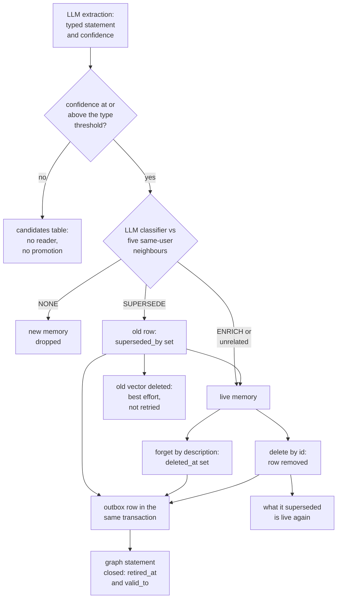

## 1. Executive Summary

Synap Core is the self-hosted, single-tenant edition of Maximem's Synap memory
server: a FastAPI service over Postgres, ChromaDB, Neo4j and Redis that turns
conversations and documents into typed statements with an LLM, resolves the
entities they mention, replaces a statement a newer one contradicts, and serves
context through a vector search and a graph walk. It speaks the API of the hosted
Synap Cloud, so the clients in [Maximem Synap SDK](../maximem-synap-sdk/) work
against it with no key.

What is notable is that the tree is Cloud's own server code run under an edition
switch, not a rewrite. `synap/cloud/shared/edition.py` forces 30 settings into the
environment for Core, refuses 30 Cloud-only switches and two settings at start-up
by name, and declares 45 hooks that Cloud fills from a `synap.cloud.cloud_hooks`
package the tree does not contain. On that base Core runs a graph lifecycle in
which every relationship names the memories that support it and stops being
served when none of them is alive.

What is weak is everything outside the graph. The vector arm relies on a
best-effort vector delete at supersession that nothing retries. Delete by id
writes the deleted text into the changelog and leaves the stored original on
disk. Deleting a correction brings the corrected value back. The guard that would
stop a retired value superseding its replacement is in the code and refused by
Core.

**Licence.** Apache-2.0, in `LICENSE`, with a `NOTICE` that agrees; there is no
package manifest. The grant covers the Core edition only: the engine names a
`synap.cloud.cloud_hooks` package and Cloud modules for privacy, credits,
consolidation and audit that are not in the tree (`synap/cloud/shared/edition.py:417`),
so the Cloud behaviour the README compares against cannot be read or rebuilt
under it. The 23 MB benchmark file quotes conversation sessions from ShareGPT and
UltraChat, which `NOTICE` says *"keep whatever terms those sources carry"*.
Entity resolution is `synap-er==0.4.0` from PyPI (`requirements.txt:50`), MIT by
its PyPI metadata, and its source is not in this tree.

## 2. Mental Model

A memory is one short statement extracted from a user's text by the configured
LLM, typed as a fact, preference, episode, emotion or dated event, with a
confidence and, when the text gives one, a validity period and an event window.
It is stored as a belief. Nothing marks it as a candidate awaiting confirmation.
Extractions under the type's confidence threshold go to a separate `candidates`
table (`synap/cloud/agents/ingestion/pipeline/stage3_extraction.py:1609-1623`),
and no read path, promotion or review in the tree reads that table again; only
forget by description deletes from it.

A memory stops being current in four ways, and each is a lifecycle state rather
than a judgement of truth:

- **Superseded.** Each new memory is compared with at most five same-user
  neighbours above a similarity of 0.55, and an LLM classifier labels the pair
  `SUPERSEDE`, `ENRICH`, `NONE` or unrelated
  (`synap/cloud/agents/ingestion/pipeline/knowledge_update.py:270`, `:826`).
  `SUPERSEDE` sets `superseded_by` and `superseded_at` on the old row.
- **Dropped.** `NONE` drops the new memory as a duplicate of the stored one.
- **Forgotten.** Forget by description sets `deleted_at` on the rows a judge
  picked.
- **Erased.** Delete by id removes the row.

The live predicate is one string, `superseded_by IS NULL AND deprecated_at IS
NULL AND deleted_at IS NULL` (`synap/cloud/shared/memory_liveness.py:33`).

Erasure runs one way back. `memories.superseded_by` is a foreign key `ON DELETE
SET NULL` (`synap/db/baseline.sql:1698`), so deleting the newer memory makes the
one it replaced live again. The delete route reads those ids first so the graph
can reopen what it closed (`synap/cloud/application/sdk_api/sdk_memories.py:1550-1559`,
`synap/db/core_migrations/002_graph_sync_restore.sql`). The migration calls it an
owner decision.

The graph is derived state with its own rule. A relationship or entity node
carries the ids of the memories that support it. It is closed when it once had
support and none is left (T1), or when a supporter was superseded by a memory
that does not itself support it and nothing current was said after (T2).
Closing stamps `retired_at` from the clock and `valid_to` from the superseding
memory's event date (`synap/cloud/agents/ingestion/services/graph_lifecycle_rule.py:199-280`).

## 3. Architecture

One container runs the API and its workers; Compose adds pinned upstream images
for Postgres with pgvector, Redis, ChromaDB and Neo4j, none of which publishes a
port (`deploy/docker-compose.yml`). The first start downloads two embedding models
from Hugging Face and a spaCy model, checked against stored hashes
(`synap/boot/first_start.py`). A model provider is required to store anything:
extraction, classification, compaction and the profile all call the configured
LLM, which may be a local Ollama.

The edition module decides what runs. `_CORE` sets `prompt_pack="core"`,
`retrieval_llm=False`, `engine_uses_jev=False`, `scope_levels=("user",
"customer", "install")` and `forget_default_mode="direct"`
(`synap/cloud/shared/edition.py:135-155`). `apply_environment` writes `CORE_ENV`
into `os.environ` and raises `EditionConflict` if any of those values, a refused
switch or a per-instance list is already set otherwise (`:276-308`). Hook calls
are no-ops in Core because `_load_cloud_hooks` returns early when `is_core`
(`:433-436`).

The import statements in the tree name 38 modules that are not in it, among them
`synap.cloud.privacy.gate`, `synap.cloud.application.consolidation.invalidation`
and the credits workers. `main.py` starts each such service inside a `try`, and
`AbsentServiceFilter` turns the resulting `ModuleNotFoundError` into one INFO line
(`synap/cloud/shared/absent_services.py:1-12`).

The prompts differ from Cloud's. `synap/cloud/core_prompts/README.md:3` says
*"Cloud prompts are not here and never ship"*, and lists which Core prompts were
written new and which are earlier drafts; `prompt_switch.py` maps 27 prompt
modules to `CLOUD_ONLY`. The SQL schema is a `pg_dump` of a larger database: it
creates columns and tables for PII obfuscation, replication, nested scope levels
and dashboard deletion requests, and code comments cite migrations 155, 156 and
163 against a Core runner holding two.

### Deployment and ergonomics

`docker compose -f deploy/docker-compose.yml up -d` from a clone, with a model
line in `.env`, is the whole install; the README budgets 10 to 25 minutes to the
first healthy server. The API binds to `127.0.0.1:8000`. There is no login: an
optional static `SYNAP_API_TOKEN` is the only gate, and the server warns at start
without it. The read-only browser at `/browser` shows memories, entities, the
changelog and the config. Postgres rows are inspectable and repairable with SQL;
the graph has a `graph_reconcile` command that reports until run with `--commit`.

## 4. Essential Implementation Paths

- **Write.** `POST /api/v1/memories/create`, `/batch`, `/upload` and the
  conversation routes enqueue to Redis and return an `ingestion_id`. A router
  feeds `Stage1Worker` (qualification), `Stage23Worker` (extraction) and
  `Stage4Worker` (resolution, classification, persistence)
  (`synap/cloud/agents/ingestion/workers/README.md`). The original text is
  written to the file store (`synap/cloud/application/ingestion/storage_provider.py:53-65`).
- **Extract.** Core runs `hybrid_graph` extraction with graph extraction v2
  (`edition.py:159-161`): one call returns memories, entities and relationships,
  with the date guidance addendum asking for `valid_from`, `valid_until`,
  `event_start` and `event_end` (`synap/cloud/core_prompts/date_guidance/addendum.txt`).
- **Resolve.** `EntityResolutionService` wraps synap-er's `PipelineResolver`
  in adjudicated mode with no adjudicator, so synap-er decides by score
  (`synap/cloud/agents/ingestion/resolution/entity_resolver.py:105-107`).
- **Supersede.** `KnowledgeUpdateDetector.detect_updates`
  (`knowledge_update.py:1854`) produces actions; `StorageCoordinator.execute_supersessions`
  (`synap/cloud/agents/ingestion/storage/coordinator.py:1081`) retires each old
  row through `_retire_and_release` (`:223`), deletes its vectors (`:1169-1182`)
  and queues a graph release.
- **Retire.** `retire_memory_with_audit` updates the row and writes the
  `graph_sync_pending` row and the `memory_actions` row in one transaction
  (`synap/cloud/agents/ingestion/storage/sqlalchemy_rdbms_wrapper.py:737-875`).
- **Release.** `GraphLifecycle.release` moves the ids to `released_memory_ids`,
  evaluates each touched record with the shared rule, writes the state, and on
  erase deletes triple and entity vectors
  (`synap/cloud/agents/ingestion/storage/graph_lifecycle.py:1-30`). The drain
  worker retries pending rows with backoff from 5 seconds to an hour and a
  120-second lease, and leaves an ingestion's rows to Stage 4 for 300 seconds
  (`graph_sync_outbox.py:32-57`).
- **Read.** `RetrievalManager.fetch_context` (`retrieval_manager.py:3437`) runs
  `_fetch_fast` (`:3905`) or `_fetch_accurate` (`:4184`); the graph arm is
  `_neo4j_graph_discovery` (`:7415`), which loads supporter liveness once per
  discovery (`:7615`).
- **Delete and forget.** `delete_memory` (`sdk_memories.py:1477-1731`);
  `POST /api/v1/memories/forget` (`synap/cloud/application/sdk_api/sdk_forget.py`)
  into `memory_forget/service.py` and `soft_delete.py`.

## 5. Memory Data Model

`memories` carries `client_id`, `instance_id`, `customer_id` and `user_id`;
`memory_type`, `content` and a `confidence` constrained to 0..1; `valid_from`,
`valid_until`, `temporal_category` and `temporal_confidence`; `event_start`,
`event_end`, `event_precision` and `event_anchor`; `document_created_at`;
`superseded_by`, `superseded_at`, `deprecated_at`, `deleted_at` and
`deleted_reason`; and a `subject_id` (`synap/db/baseline.sql:375-420`).
`memory_links` holds typed links between memories, and `memory_source_documents`
records which documents contributed to a memory.

`memory_actions` is the changelog: one row per action from a closed vocabulary
of 14 values, with the memory and the replacing memory, the before and after
text, a reason and a correlation id (`synap/db/baseline.sql:424-442`).

Scope has two modes, fixed once the first memory exists. In `equals_customer`
every user is their own customer; in `strict` each request names both. The
install is one client and one instance, seeded at first start
(`synap/cloud/application/sdk_api/core_seed.py`). A request carrying a nested
scope path is refused in Core (`synap/cloud/application/sdk_api/core_identity.py:171`).

In Neo4j, Core sets `SYNAP_GRAPH_PER_SCOPE`, so each user, customer and the
client has a graph namespace of its own, and each node and relationship also
carries the `customer_id` and `user_id` it was written for (`edition.py:162`).

## 6. Retrieval Mechanics

Fast mode embeds the queries and searches the memory vectors with a
where-clause built from the request's customer and user ids and the requested
memory types (`retrieval_manager.py:6275-6278`). The predicate is compiled once
from `legacy_read_predicate` for both Chroma and the Python post-filter
(`synap/cloud/shared/scope_filter.py:251-286`). Cross-user and cross-customer
reads are configuration flags that default to off (`retrieval_manager.py:1482-1483`).
Compound queries are split by rule (`query_decomposition.py`), and Core builds
no retrieval LLM client (`synap/cloud/application/shared/providers.py:194-196`).

Accurate mode adds the graph arm. It walks the reader's own graph, then the
customer's, then the client's, from anchor names, and passes every record
through `_graph_scope_gate` (`retrieval_manager.py:2746-2844`), which refuses a
record stamped with another user even in a namespace the reader may walk. It
then loads the Postgres state of every supporting memory id in one query and
drops any relationship or entity the shared rule closes. A liveness failure drops
all graph statements and keeps the response out of the cache.

The vector arm does no liveness check. A superseded memory leaves fast-mode
results only because its vectors were deleted at supersession, and that delete
is logged as *"non-fatal"* on failure and queued nowhere
(`coordinator.py:1169-1182`). The outbox carries graph releases only.

A Postgres reader with the full live predicate exists,
`_fetch_from_postgres_memories` (`retrieval_manager.py:5119`), and nothing calls
it.

## 7. Write Mechanics

Writes do not block the agent. The create route returns once the job is
queued, and the SDK's `wait_for_completion` polls `/status/{ingestion_id}`. A
memory is retrievable after Stage 4 commits, behind several LLM calls:
extraction, then one classifier call per new memory that has neighbours. The
README says the first memory can take up to a minute while models load, and the
default model read timeout is 5 minutes per call.

Conversation turns are recorded as messages and promoted to ingestion every five
turns, when the conversation goes idle, and at session end, from the raw turns
rather than from a summary (`synap/cloud/application/conversation/promotion.py:1-21`).
Compaction keeps a separate rolling summary per conversation in
`compacted_contexts`. No background pass rereads the whole store. The retention
sweep deletes memories past a configured age through the delete route, in
batches of 200 and at most five batches per instance per hourly cycle
(`synap/cloud/application/retention/sweep.py:32-36`).

Supersession is the classifier's call. A new memory can retire an old one only
among the same user's neighbours, filtered by `_build_dedup_scope_filter`
(`knowledge_update.py:63`). The guard against a re-asserted old value retiring
the current one, `_retired_value_blocks_supersession`, is in the coordinator
(`coordinator.py:1129-1137`). Its switch `SYNAP_KU_RETIRED_VALUE_GUARD` is in
`CORE_REFUSED_SWITCHES` (`edition.py:224`), so a Core server set to use it
refuses to start. The echo guard and the natural-language delete classifier are
refused the same way (`:212`, `:215`).

`PATCH /api/v1/memories/{id}` overwrites `content` in place, re-embeds it,
retires the old graph support and writes an `UPDATE` row carrying the previous
text (`sdk_memories.py:1297-1475`).

## 8. Agent Integration

Core has no MCP server and no agent-facing tool of its own. Integration is the
SDK: an application records messages and fetches context, and the framework
packages in the SDK repository turn that into tools or middleware. Core has no
gRPC stream, so those packages need `SYNAP_AUTO_LISTEN=false`. Every memory verb,
including PATCH, delete and forget, sits on one HTTP surface behind one optional
token, so whatever holds the token holds all of them.

The setup skill under `skills/synap-core/` is an installer for coding agents: it
checks the machine, writes the use-case file and runs a write-and-recall check.
It is not a memory interface.

## 9. Reliability, Safety, and Trust

### What a delete leaves

Delete by id hard-deletes the row and its entity links and commits the graph
outbox row with it. It then deletes the memory and question vectors, purges the
source chunks only when no other memory came from that document, releases the
graph and clears the query cache, reporting any store that failed in
`still_present_in` (`sdk_memories.py:1477-1731`). Two copies are outside that
report:

- **The changelog.** The route writes a `DELETE` row whose `previous_content` is
  the deleted text (`:1592-1606`), beside the `CREATE` row that already holds it.
  Only forget by description nulls changelog text
  (`synap/cloud/application/memory_forget/erase_copies.py:90-101`, `:299`).
- **The original.** The text sent to `create` is written under `originals/`
  (`storage_provider.py:53-65`). The local file store has a `delete` method
  (`synap/providers/file/adapters/local.py:126-129`) and nothing in the engine
  calls it.

The README says `fully_removed` *"is true only when nothing is left anywhere"*.
The field covers the vector, source, graph and cache stores and not these two;
its own comment scopes it to the search index (`sdk_memories.py:163-175`).

### Forget by description

Forget soft-deletes: it sets `deleted_at` and keeps `content` in the row
(`synap/cloud/application/memory_forget/soft_delete.py:98-111`), then erases
copies from vectors, candidates, the profile and the changelog. Matching is done
by Jev, TypeSafe's hosted judge at `api.typesafe.ai`
(`synap/cloud/shared/jev_client.py:16`), which receives the description and the
text of every candidate in a pool of about 100 (`memory_forget/judge.py:54-58`).
It fails closed: with no key or no answer nothing is deleted. Core's default mode
is `direct`. A request for `preview` is honoured and files a `pending` row in
`deletion_requests`; `service.approve` and `service.reject` have no caller in the
tree, so that row stays pending.

### Marks

- **`bitemporal`** — awarded. A closed graph record keeps `retired_at` (when the
  system closed it) and `valid_to` (the superseding memory's event date or
  said-at date) as separate properties (`synap/providers/graph/adapters/neo4j.py:171-190`).
  Memories carry `valid_from` and `valid_until` from the extraction, null when
  the text gives none, beside `created_at` and `superseded_at`
  (`stage3_extraction.py:1653`). Reopening a record clears both.
- **`scope_enforced`** — awarded on the vector where-clause and the graph gate
  (section 6). Get, patch and delete by id filter on the fixed client id only, so
  they check no user.
- **`audit_log`** — awarded on `memory_actions`. Every lifecycle writer adds a
  row, the retirement inside its own transaction; no statement in the tree
  deletes one; the forget path redacts text and keeps the row. The other writers
  log and continue when the insert fails (`sqlalchemy_rdbms_wrapper.py:654-711`).
- **`negative_eval`** — awarded; see section 10.
- **`tombstone`** — withheld. The retired-value guard is keyed on high-entropy
  values a user retired, and Core refuses to start with it on. Nothing keyed on a
  forgotten or deleted value is consulted at extraction, and deleting a
  correction revives the value it replaced.
- **`trust_state`** — withheld. Superseded, deprecated and deleted are lifecycle
  states. The `candidates` table holds low-confidence extractions out of
  retrieval with no state field and no reader. The entity-resolution hold that
  would make a mention wait is off: `SYNAP_ER_HOLD_UNSURE` is pinned to `false`
  (`edition.py:176`), and the applier and `er_held_mentions` table named in
  `holds.py:1-22` are not in the tree.
- **`human_review`** — withheld. The forget preview queue has no approve route in
  Core, and the browser only reads.

### Other risks

- **The README describes Cloud's resolver.** It says an unsure match *"is held
  for review instead of merged"*; in Core the hold is off and synap-er's score
  decides.
- **A restored memory has no vector.** Supersession deleted the old memory's
  vectors, and deleting the newer one reopens graph records without re-embedding
  it, so fast mode cannot find the restored value while accurate mode's graph
  serves it.
- **Single tenant, no auth.** Anyone reaching the port reads and writes every
  memory; the README says so, and the API binds to loopback by default.

## 10. Tests, Evals, and Benchmarks

`synap/tests` holds 2,717 pytest functions in 230 files. CI runs the Compose
checks, an image build and the 52 setup-skill tests, not these
(`.github/workflows/check.yml:62-63`); `CONTRIBUTING.md` says the maintainers run
them. The 19 end-to-end tests drive the real SDK against a Compose stack and need
a model key, so they are run by hand. I ran none of it.

`negative_eval` rests on two unit files that drive the real retrieval code with a
fake graph:

- `synap/tests/unit/graph_lifecycle/test_read_graph_liveness.py:146-167` serves a
  graph holding a superseded-only edge, a deleted-only edge and a stored-retired
  edge beside a live and an unbacked one, and asserts the first three are absent
  and the last two present in the same result.
- `synap/tests/core/test_graph_per_scope_isolation.py:91-134` asserts user A's
  record is absent from user B's read, including when it sits in a graph B may
  walk or in B's own graph, with B's record present each time.

`e2e/test_core_e2e.py:143-154` asserts the user boundary on a running stack:
Alice's reads do not return Bob's vegetarian memory, while Bob's do. No test
asserts that a superseded memory is absent from fast-mode results.

The shared rule, the outbox, the restore and the delete route have 13 test files
under `synap/tests/unit/graph_lifecycle/`. The changelog tests check that
`CREATE` and `SUPERSEDE` rows are emitted, through a mocked RDBMS.

**LongMemEval.** The README claims 83.6% (418/500) for Core and 95.6% for
Cloud. `benchmarks/results/longmemeval/` holds a manifest, the answering prompt
and 500 per-question records with the retrieved context, the generated answer and
the judge's raw output. I recomputed the score from those records with the
stated rule, a `judge_raw` starting with "yes" and no error: 418/500, every
per-type figure in `RESULTS.md`, 390/470 answerable and 28/30 abstentions,
all exact. The one errored question returned no retrieval on four attempts and
counts as wrong. Three qualifications apply:

- The run is dated 2 November 2026 and the manifest names no engine commit. This
  repository's first commit is dated 3 November, and the graph lifecycle and
  liveness read path arrived on 5 November, so the score is for an earlier build
  than the pin.
- Extraction used `gemini-3.1-pro-preview`; the quick start ships no model.
- `benchmarks/METHODOLOGY.md` says Cloud's run *"is a different system"*, with
  memory metadata on and Cloud's prompts. Cloud's records are in another
  repository and were not read here.

No paper is associated with the project.

## 11. For Your Own Build

### Steal

- **Make derived records name their support.** A graph edge that carries the ids
  of the memories behind it can be judged against the store of record at read
  time, and one pure rule shared by writer, repair job and reader keeps them from
  disagreeing.
- **Owe the derived store a release in the same transaction.** A
  `graph_sync_pending` row committed with the retirement, drained inline and by a
  leased worker with backoff, turns "two stores, no transaction" into a retry.
- **Refuse settings you ignore.** An edition that rejects a Cloud-only switch at
  start-up by name tells the operator the switch does nothing, where a silent
  ignore leaves them believing a guard is on.
- **Fail a liveness check closed.** When the support lookup fails, drop the graph
  statements and keep the response out of the cache.

### Avoid

- **A read path that depends on a delete having worked.** If one arm filters by
  liveness and another trusts that a vector was removed, the second needs the
  same outbox or the same check.
- **Deleted text in the receipt of the delete.** Record that a memory was deleted
  and why; keep its text out of the row, or redact on every delete path rather
  than one.
- **A write-only staging table.** Low-confidence extractions that nothing reads,
  promotes or expires are a growing copy of user text with no use.
- **Undo by foreign key.** `ON DELETE SET NULL` on the supersession pointer makes
  deleting a correction restore the error, a policy that should be a decision per
  delete.

### Fit

Core fits a team that wants a self-hosted conversational memory server behind its
own backend, uses or plans to use the Synap SDKs, and can run five containers and
a capable model. It suits single-product, single-tenant use where "remember what
the user said and replace what changed" is the job. Walk away if deletion must be
complete and provable, since originals and changelog text survive delete by id.
Walk away too if a person must review what is stored. Read it as Cloud's code run
with Cloud's guards and judges switched off.

## 12. Open Questions

- Whether a private Cloud repository is the source of truth for `synap/`, and how
  the engine commits made here since 5 November flow back to it.
- What score the pinned build gets on LongMemEval, given the graph liveness read
  path landed after the published run.
- Whether the vector delete at supersession is meant to join the outbox, as the
  coordinator's docstring anticipates with "lifecycle-aware filtering".
- Whether delete by id is meant to purge `originals/` and changelog text, as
  forget by description does for the changelog.

## Appendix: File Index

- Edition: `synap/cloud/shared/edition.py`, `synap/cloud/shared/absent_services.py`,
  `synap/cloud/shared/prompt_switch.py`, `synap/cloud/core_prompts/README.md`
- Schema: `synap/db/baseline.sql`, `synap/db/core_migrations/001_graph_sync_pending.sql`,
  `synap/db/core_migrations/002_graph_sync_restore.sql`
- Write: `synap/cloud/agents/ingestion/pipeline/stage3_extraction.py`,
  `synap/cloud/agents/ingestion/pipeline/stage4_organization.py`,
  `synap/cloud/agents/ingestion/pipeline/knowledge_update.py`,
  `synap/cloud/agents/ingestion/storage/coordinator.py`,
  `synap/cloud/agents/ingestion/storage/sqlalchemy_rdbms_wrapper.py`,
  `synap/cloud/agents/ingestion/resolution/`
- Graph lifecycle: `synap/cloud/agents/ingestion/services/graph_lifecycle_rule.py`,
  `synap/cloud/agents/ingestion/storage/graph_lifecycle.py`,
  `synap/cloud/agents/ingestion/storage/graph_sync_outbox.py`,
  `synap/cloud/shared/memory_liveness.py`, `synap/providers/graph/adapters/neo4j.py`
- Retrieval: `synap/cloud/application/client_api/retrieval_manager.py`,
  `synap/cloud/shared/scope_filter.py`
- Delete and forget: `synap/cloud/application/sdk_api/sdk_memories.py`,
  `synap/cloud/application/sdk_api/sdk_forget.py`,
  `synap/cloud/application/memory_forget/`, `synap/cloud/application/retention/sweep.py`
- Tests: `synap/tests/unit/graph_lifecycle/`, `synap/tests/core/test_graph_per_scope_isolation.py`,
  `synap/tests/agents/ingestion/test_memory_actions_changelog.py`, `e2e/test_core_e2e.py`
- Benchmark: `benchmarks/results/longmemeval/manifest.json`,
  `benchmarks/results/longmemeval/question_records.json`, `benchmarks/METHODOLOGY.md`

### Recorded searches

Run from the repository root at the pinned commit with `/usr/bin/git grep`.

- **Forget approval has no caller.**
  `git grep -n -E 'service\.(approve|reject)' -- synap ':!synap/tests'` returns
  nothing; `git grep -n -E 'service\.(preview|direct)' -- synap/cloud/application/sdk_api/sdk_forget.py`
  matches lines 99 and 106.
- **Nothing promotes or reads candidates outside forget.**
  `git grep -n -i -E 'UPDATE[[:space:]]+candidates|promoted_to_id' -- synap ':!synap/db'`
  returns nothing; `git grep -c 'INSERT INTO candidates' -- synap` counts one in
  each RDBMS wrapper.
- **No statement deletes changelog rows.**
  `git grep -n -i -E 'DELETE[[:space:]]+FROM[[:space:]]+memory_actions' -- synap`
  returns nothing; the same pattern for `memory_entity_links` matches
  `sdk_memories.py`.
- **Nothing deletes an original.**
  `git grep -n -E '(file_store|_file_store|store)\.delete\(' -- synap ':!synap/tests'`
  returns nothing; `git grep -n 'store.write(' -- synap/cloud/application/ingestion/storage_provider.py`
  matches lines 61 and 77.
- **The vector arm loads no liveness.**
  `git grep -n -E 'load_supporter_rows|_GraphLiveness\.load\(' -- synap/cloud/application/client_api/retrieval_manager.py`
  matches line 1055, inside `_GraphLiveness.load`, and line 7615, inside
  `_neo4j_graph_discovery`.
- **The Postgres memory reader has no caller.**
  `git grep -n -E '_fetch_from_postgres_memories\(' -- synap` matches only its
  definition at `retrieval_manager.py:5119`.
- **No held-mention applier or table.** `git ls-files | grep -i review_apply`
  returns nothing; `git grep -n er_held_mentions -- synap/db` returns nothing;
  `git grep -n er_name_equivalents -- synap/db` matches the baseline.
- **Cloud modules named and absent.**
  `git grep -h -o -E '(from|import) synap\.cloud\.(privacy|cloud_hooks|application\.(credits|consolidation|audit|grpc|lifecycle))[a-zA-Z0-9_.]*' -- synap | sort -u`
  lists 18 modules, and `git ls-files synap/cloud/privacy synap/cloud/cloud_hooks synap/cloud/application/credits synap/cloud/application/consolidation`
  returns nothing. Checking every `synap.*` import against the tree finds 38
  absent modules, none imported at the top of a test file.
- **CI runs no engine test.** `grep -n pytest .github/workflows/check.yml`
  matches only the skill-test lines 62 and 63.
- **The benchmark names no commit.**
  `grep -c -E '"(commit|revision|sha)"' benchmarks/results/longmemeval/manifest.json`
  counts 0.
- **No paper.** `git grep -n -i -E 'arxiv|bibtex|CITATION' -- . ':!benchmarks/results'`
  matches only the LongMemEval citation in `NOTICE` and `benchmarks/METHODOLOGY.md`.

## History

**2026-11-20** — [`ecfbb3b01dc00b465afa1c29f451cddaa6ec8e54`](https://github.com/maximem-ai/maximem_synap_core/commit/ecfbb3b01dc00b465afa1c29f451cddaa6ec8e54) — first reading, from a full clone at a commit dated 18 November 2026, after release `v0.1.0`. Scoped to the edition module, schema, ingestion stages 3 and 4, knowledge update, storage coordinator, graph lifecycle and outbox, retrieval scope and liveness, delete, forget, retention and their tests; compaction, profile and the browser read only where they touch those tables; synap-er not read. Screened first: no auto-run surface; twelve build-time execution points, all `conftest.py`; two unpinned surfaces, `requirements.txt` and `e2e/requirements.txt`; `requirements.txt` inside the cooldown; `AGENTS.md` read as data. LongMemEval score recomputed from the committed records. Nothing installed, built or run. Four marks: `bitemporal`, `scope_enforced`, `audit_log`, `negative_eval`.
