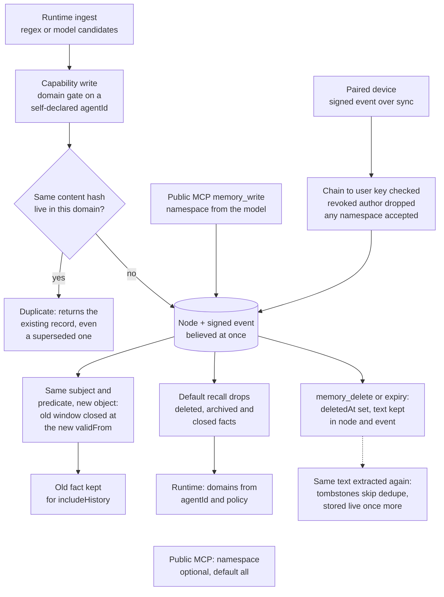

## 1. Executive Summary

Mebular (忆云 in the Chinese docs) is a local daemon that keeps one graph of
memory and tasks for all of a person's AI assistants, replicated directly
between that person's devices. Every change to the graph is an Ed25519-signed,
content-addressed event, and paired devices exchange missing events over
libp2p with no server between them. What is notable is the event
discipline: a correction closes the old fact's validity window rather than
overwriting it, sync verifies each event's certificate chain to the user's
master key, and a populated test keeps the superseded fact out of default
recall. What is weak is removal and isolation. Deleting a memory, or letting a
transcript chunk expire, hides it from reads and leaves its text in the node
and in the creation event on every device that received it, and the agent
identity that partitions memory is the caller's own assertion.

There are two memory surfaces over one store. The 13 public MCP memory tools
write and read the whole graph; the namespace on a record is optional on both
sides and every read spans all namespaces unless the model names one. The
optional memory runtime, off by default, is a loopback sidecar that a host
plugin calls each turn: it extracts candidates, routes them to a domain such as
`user` or `agent:opencode`, and recalls through a capability API that filters
on the domains a per-agent policy allows.

"Decentralized" holds for transport and storage and not for authority. Devices
sync peer to peer, and a device's writes are accepted when its certificate
chains to one user master key. Inside that trust boundary every admitted device
may write, update or delete any memory in any namespace. The project's own
`LIMITATIONS.md` states the boundary in as many words.

**Licence.** MIT in `LICENSE`, in both plugin packages and in every package
manifest. Nothing in the tree restricts use. `THIRD-PARTY.md` registers each
runtime dependency's licence and the one vendored Apache-2.0 skill.

Four marks are earned: `bitemporal`, `scope_enforced`, `audit_log` and
`negative_eval`. Section 9 gives the reason for each of the three withheld.

## 2. Mental Model

A memory is a typed graph node: an entity, a fact triple, an episode
(observations are episodes), a skill or a meta node
(`src/memory/types.ts:10-78`). It is believed from the moment it is written. No
state gates it, and nothing re-reads it later to decide whether it still holds.

A fact stops being current in three ways, and only one of them is about truth:

- **Superseded.** A new fact with the same subject and predicate and a
  different object names the old one in `supersedes`. The old fact's `validTo`
  is set to the new fact's `validFrom`, `supersededBy` and `supersededAt` go
  into its metadata, and a `supersedes` edge links them
  (`src/memory/MemoryService.ts:1622-1663`). It stays in the graph and leaves
  default recall. The runtime finds the old fact itself when one agent restates
  a single-valued key (`packages/memory-runtime/src/sidecar/ingest.ts:1500-1512`).
- **Archived.** `metadata.archivedAt`, reversible, out of default recall
  (`src/memory/MemoryService.ts:810-833`).
- **Deleted.** `deletedAt`, `deletedBy` and `validTo` set to the deletion time
  on the same node (`src/core/GraphStore.ts:165-196`). The content stays.

Between devices, a concurrent edit is settled by rule: a delete beats an
update, a later `validFrom` beats an earlier one, then the later `updatedAt`,
then the larger device id (`src/sync/apply.ts:84-98`). The losing version
remains in the event log and leaves the graph. No conflict is recorded or shown
to anyone. The `conflicts_with` and `conflict_resolved` edge types are declared
(`src/memory/types.ts:140`, `:147`) and nothing creates them.

## 3. Architecture

One process per machine, `mebular serve`, holds the identity, the store, the
network and the sync loop. The console, the Electron app, the CLI and every MCP
client are clients of it (`docs/architecture/ARCHITECT.md`, sections 1-2). The
daemon is `packages/mcp/src/serve.mjs`; the domain code is `src/` and is
published as `@mebular/core`.

- **Store.** A `StorageAdapter` with nodes, edges and events
  (`src/storage/StorageAdapter.ts:8-29`). The default is a JSONL operation log
  replayed into memory at start (`src/storage/JsonFileStorage.ts:59-122`); SQLite
  through `node:sqlite` needs Node 22.5. At-rest encryption wraps each line in an
  `enc:v1:` envelope and is off unless configured
  (`packages/mcp/src/config-schema.mjs:620`).
- **Event log and graph.** `GraphStore` writes the node and appends the event
  (`src/core/GraphStore.ts:34-77`); `EventLog` signs with the device key
  (`src/eventlog/EventLog.ts:62-89`).
- **Sync.** `SyncManager` exchanges missing events per namespace with vector
  clocks, or a snapshot for a peer with nothing (`src/sync/syncmgr/SyncManager.ts`).
  libp2p with Noise and yamux, circuit relay and hole punching are optional
  dependencies; LAN discovery uses `bonjour`.
- **Trust.** A user master key on the first device signs device certificates;
  invited devices get delegated certificates. Subscriptions, removals and the
  security tier are events in a `__policy__` namespace, accepted only when they
  chain to the master key (`src/sync/grantPolicy.ts:1307-1330`).
- **Memory runtime.** A separate sidecar process, `@mebular/memory-runtime`,
  bound to loopback and guarded by one host token
  (`packages/memory-runtime/src/sidecar/server.ts:799-811`). It reaches the
  graph only through the daemon's capability API at `/internal/memory/v1`,
  which needs a second token (`packages/mcp/src/memory-capability.mjs:1-24`).
  It can install and run a local Qwen model through llama.cpp for extraction.
- **Fleet.** Tasks, plans, messages and capability cards are nodes in the same
  graph written through `packages/fleet/src/store/*`. That is coordination, not
  memory, and no mark below rests on it.

### Deployment and ergonomics

`npm install -g @mebular/core` then `mebular serve` starts the daemon and the
console; the desktop builds are unsigned Electron packages. Nothing has to run
beside it: no database server, no API key, no network unless sync is enabled.
Semantic recall needs `@huggingface/transformers` installed by hand, and falls
back to substring matching without it. The store is a plaintext JSONL file by
default, readable and greppable. A corrupt final line is skipped at start; a
corrupt line anywhere else stops the store from opening
(`src/storage/JsonFileStorage.ts:89-101`).
Each device that joins needs an invite token or QR code from an admitted one.

## 4. Essential Implementation Paths

- **Public MCP tools.** `packages/mcp/src/tools.mjs`: input schema `:69-86`, the
  optional namespace filter `:88-89`, `memory_write` `:98-110`, `memory_query`
  `:126-163`, `memory_delete` and `memory_archive` `:335-360`, scopes per tool
  `:19-34`. Registered on stdio and HTTP alike (`:386-400`).
- **Memory service.** `src/memory/MemoryService.ts`: `writeOne` `:1319-1400`,
  `writeRecord` `:1402-1519`, `query` `:519-576`, `search` `:578-635`, `delete`
  `:781-802`, `archive` `:810-833`, `updateRecord` `:1545-1616`,
  `supersedeRecords` `:1622-1663`, `isCurrentlyValidFact` `:2159-2164`.
- **Graph and events.** `src/core/GraphStore.ts` (`createNode` `:34-77`,
  `updateNode` `:79-115`, `updateNodeValidity` `:125-163`, `deleteNode`
  `:165-196`); `src/eventlog/EventLog.ts` (`append` `:62-89`, `appendRemote`
  `:96-105`, `verifyEvent` `:126-161`).
- **Capability API.** `packages/mcp/src/memory-capability.mjs`: write gate
  `assertDomainWrite` `:512-553`, governance `:556-581`, actor parsing
  `:1080-1109`, default domains `:1196-1206`, `resolveDomains` `:1263-1308`,
  dedupe index `:800-815`, write validation `:2712-2810`, write and supersede
  `:2855-2970`, query route `:4904-4949`.
- **Runtime.** `packages/memory-runtime/src/sidecar/`: `ingest.ts` (staging,
  candidates, auto-supersede `:1455-1512`), `heuristic.ts`, `candidates.ts`
  (routing `:401-465`, write item `:632-644`), `recall.ts` (domain resolution
  `:2501-2550`, candidate fan-out `:2556-2676`), `intervention.ts`,
  `domains.ts` (policy `:110-116`, `:206-214`).
- **Sync.** `src/sync/syncmgr/SyncManager.ts`: inbound `applyOffer`
  `:1589-1666`, `verifyEventTrust` `:1676-1685`, outbound filter
  `filterEventsForAllow` `:1461-1466`, snapshot `:1695-1756`;
  `src/sync/apply.ts` for conflict rules; `src/sync/trust.ts:23-44` for the
  chain check.

## 5. Memory Data Model

`BaseNode` carries `id` (a ULID), `type`, `createdBy` and `updatedBy` (device
ids), `createdAt`, `updatedAt`, `deletedAt`, `deletedBy`, `validFrom`,
`validTo`, `tags`, `labels`, `metadata` and `namespace`
(`src/types/node.ts:3-26`). `content` holds the typed payload. A fact is
`{subject, predicate, object, confidence?, source?}`; `memory_write` stores a
plain note as `{subject: 'user', predicate: 'note', object: <text>}`
(`src/memory/MemoryService.ts:1329-1340`).

The namespace is the only scope key. `normalizeNamespace` maps a missing or
blank value to `default` and accepts any other string (`src/core/namespace.ts:20-24`).
The capability layer gives some names meaning: `user`, `default`, `shared`,
`system`, `agent:<id>` and `task:<thread>`, with owner derived from the name
(`packages/mcp/src/memory-capability.mjs:267-290`). Names starting `__` are
internal.

Writes through the capability carry `metadata.provenance`: source, writer type
and id, extractor, model, device, host, thread, agent name, confirmation and
time (`packages/mcp/src/memory-capability.mjs:471-503`). The public MCP path
writes none of it; its only record of who wrote is the device id in
`createdBy`.

Detail records are verbatim chunks of conversation, tool output or document
linked to the records extracted from them, with a retention class of 30, 7 or
90 days, extendable to 365 for conversation, or pinned
(`src/memory/detail.ts:53-62`). Expiry and record deletion tombstone them the
same way a memory is deleted (`src/memory/MemoryService.ts:2054-2062`).

Every mutation is also an event: `{id: sha256 of the canonical payload, type,
timestamp, vectorClock, data, author, signature, namespace}`, plus the author's
certificate chain outside the signed payload (`src/types/event.ts:16-40`).
`node_created` carries the whole node; `node_updated` carries the whole new
version; `node_deleted` carries the id and time
(`src/core/GraphStore.ts:66-70`, `:104-108`, `:185-189`).

## 6. Retrieval Mechanics

**Keyword.** `MemoryStore.search` lowercases the query and keeps nodes whose
text contains it as a substring (`src/memory/MemoryStore.ts:365-390`). No
tokenisation or ranking; results come in type order.

**Vector.** With an embedding provider configured, `query` asks the in-memory
index for up to 200 hits, drops deleted, archived and internal nodes, then
filters type and namespace, and falls back to the keyword path if nothing
survives (`src/memory/MemoryService.ts:527-542`, `src/memory/MemoryStore.ts:406-432`).
The namespace filter runs after the top-k, so in a store dominated by other
domains a scoped query can come back from the keyword fallback rather than the
vector arm.

**Filters.** Every read drops deleted, archived and internal nodes by default,
and drops a fact whose window does not contain now unless `includeHistory` is
set (`src/memory/MemoryService.ts:558-563`). Episodes keep their window as an
occurrence time and are not filtered on it (`:2155-2164`).

**Runtime recall.** For each turn the sidecar extracts a cue, resolves the
readable domains, and calls the capability's query, search, history, profile,
skills and compact routes in parallel
(`packages/memory-runtime/src/sidecar/recall.ts:2556-2676`). It scores and
groups fragments, flags conflicts, and an intervention policy decides whether
to inject nothing, a gist, a detail or a quote. The context block has a fixed
order and a byte and token budget, escapes tags in memory text and marks it as
untrusted data (`recall.ts:1-18`). Explicit confirmation raises a record's
confidence to at least 0.88 (`recall.ts:936-937`); it filters nothing.

**Public MCP.** `memory_query` and `memory_search` read every namespace unless
the model passes `filters.namespace` (`packages/mcp/src/tools.mjs:88-89`,
`:126-198`). `memory_graph` traverses from a node id to depth five.

## 7. Write Mechanics

**Public tool.** `memory_write` takes up to 100 items of type fact, episode,
skill, preference or observation, with optional tags, related ids, an expiry and
a namespace (`packages/mcp/src/tools.mjs:69-86`). The tool description asks the
model to search before writing. There is no deduplication on this path. An
`expiresAt` becomes `validTo`, and `validFrom` is then set to the write time
(`src/memory/MemoryService.ts:1320-1325`).

**Runtime ingest.** A host plugin posts the turn's chunks to the sidecar. With
host or model candidates it validates and routes them; without, a regex
extractor takes explicit preferences, facts and decisions from user chunks only
and stamps them `confirmation: 'explicit'`
(`packages/memory-runtime/src/sidecar/heuristic.ts:1-31`, `:60`, `:81`). The
sidecar checks the agent's write policy; a user-domain candidate without
explicit confirmation is moved to the agent's own domain
(`candidates.ts:401-465`). The capability then checks the same matrix, derives
the owner, writes provenance, and deduplicates on client item id or a content
hash of kind and content within the domain
(`packages/mcp/src/memory-capability.mjs:783-815`, `:2900-2930`). Raw chunks
wait in a local staging directory until settled, and failed capability writes
go to a bounded outbox that is replayed.

**Model extraction.** The sidecar's inference schema and the DSH plugin's
extraction prompt both allow `validFrom` and `validTo` on a fact
(`packages/memory-runtime/src/sidecar/inference-provider.ts:348-356`,
`packages/dsh-plugin/memory-runtime.js:3925`). The prompt tells the model the
transcript is data, not instructions.

**Correction.** When a candidate restates a subject and predicate that the
agent wrote with a different object, ingest attaches `supersedes`; a candidate
whose `validFrom` is earlier than the current value's does not supersede it
(`ingest.ts:1506-1508`). Facts the agent did not write are left alone, and
several current values for one key are not superseded automatically.

**Writes from other devices** arrive as events and are applied by the conflict
rules in section 2.

### Operational cost

A write blocks on one append to the JSONL file per node, one per event and one
per edge, and on embedding the node when semantic recall is on; there is no
model call on the public path. The runtime's model extraction, when enabled,
runs in the sidecar against the turn. A memory is readable as soon as the call
returns, and on another device after the next push-on-write or anti-entropy
exchange. No background pass rewrites memories. The dedupe index on the
capability path is rebuilt by listing every node on each write call
(`memory-capability.mjs:800-815`), which grows with the store.

## 8. Agent Integration

Thirteen memory tools and sixteen task tools are registered from one table on
stdio (`mebular mcp`) and on the daemon's `/mcp` HTTP endpoint
(`packages/mcp/src/tools.mjs:363-400`). `mebular print-config` and the skill
installer write MCP entries for OpenCode, Claude, Cursor, DSH and others
(`packages/skill/mcp/`). The model decides when to save and search; the skill
text says when.

Over HTTP, `auth` defaults to `none`, allowed only on loopback
(`packages/mcp/src/config-schema.mjs:127-130`, `:386-388`). With `none`,
`authenticate` returns success before reading any scope
(`packages/mcp/src/serve.mjs:1740-1741`), so `memory_delete`'s `memory.admin`
scope applies only when bearer or OAuth is configured.

With the runtime enabled, the DSH and OpenCode plugins call the sidecar's
recall before a turn and ingest after it, and a Hermes memory provider in
Python calls the same sidecar routes and exposes no tools
(`integrations/hermes/mebular-memory/__init__.py:1-30`). Recall is automatic for those hosts and tool-mediated for
everyone else.

## 9. Reliability, Safety, and Trust

### Deletion hides; it does not remove

`deleteNode` spreads the existing node into the tombstone, so `content`
survives beside `deletedAt` (`src/core/GraphStore.ts:171-178`). The text also
sits in the `node_created` event, and in every `node_updated` event, on every
device that synced it. The tool description says peers' copies cannot be
recalled; it does not say the local copy keeps the text. Detail expiry calls
the same path (`src/memory/MemoryService.ts:2054-2062`), so a 30-day retention
class on a verbatim transcript chunk removes it from reads and keeps it on
disk. The only physical removal is the namespace hand-off, which drops all of
a namespace's events, nodes and edges from one device after a successor has
them (`src/mebular.ts:1127-1137`).

### A deleted value comes back; a reverted value does not

The capability's dedupe index skips tombstones
(`packages/mcp/src/memory-capability.mjs:803-804`), so the next extraction of a
deleted fact writes it as a new live record. Superseded facts are not
tombstones and stay in the index. A user who changes a value back — 7332, then
7331, then 7332 — produces a candidate whose content hash matches the
superseded 7332 record. The write returns `duplicate` with that record, and
the supersede it carries is computed with the old record's `validFrom`, which
is earlier than 7331's, so `supersedeRecords` skips it
(`:2900-2915`, `src/memory/MemoryService.ts:1640-1644`). 7331 stays current.
This follows from the code and was not run; the supersede tests cover a
correction and its replay, not a revert.

### Agent identity is a label

The capability takes `actor` from the request body and the sidecar takes
`agentId` from the host, under one host token shared by every host
(`packages/mcp/src/memory-capability.mjs:1080-1109`,
`packages/memory-runtime/src/sidecar/server.ts:804-810`). The write matrix and
the read policy are real and tested, and they bind whoever names the agent.
`LIMITATIONS.md:29` says so: agentId is a logical assertion for partitioning,
not an authenticated principal. The `user` domain gate asks for
`confirmation: 'explicit'`, which the caller supplies and the regex extractor
stamps on every match.

### What a device can do to the others

A paired device's events are accepted when their signature verifies against the
direct peer's key or a certificate chain to the user master key
(`src/sync/syncmgr/SyncManager.ts:1676-1685`, `src/sync/trust.ts:23-44`), and
events from a revoked author are neither stored nor applied (`:1621-1624`).
Beyond that:

- Inbound events are not checked against any namespace. The allow list of
  trust, local subscription and peer subscription trims what a device sends
  (`:1461-1466`); `applyOffer` applies what it receives in any namespace.
- The node inside a `node_created` or `node_updated` event is stored as sent.
  Its `createdBy` and `namespace` are not compared with the event's signed
  `author` and `namespace` (`src/sync/apply.ts:126-193`); those two fields are
  used only to build placeholder tombstones (`:448-485`).
- A first sync to an empty device ships a snapshot of nodes and edges, applied
  without per-event verification and without their events
  (`SyncManager.ts:1724-1756`).
- Concurrent edits are settled by `updatedAt`, the writing device's wall clock,
  after the delete and `validFrom` rules (`src/sync/apply.ts:66-98`).

These sit inside the boundary the project documents: any admitted device is
trusted with every namespace (`docs/limitations/LIMITATIONS.md:3-5`). What the
signatures establish is which device wrote an event, not that the write was
within its remit.

### Marks

- **`bitemporal` — earned.** A fact's `validFrom` and `validTo` are stated by
  the writer and kept apart from `createdAt`, `updatedAt` and `supersededAt`;
  the model extraction paths produce them, a correction ends the old window at
  the new fact's start while recording when it was corrected, and reads filter
  on the window. No read asks what was valid at a past instant, `deleteNode`
  writes the deletion time into `validTo`, and the public `memory_write`
  stamps `validFrom` with the write time.
- **`scope_enforced` — earned.** The namespace on each node is applied as a
  filter on every arm of the capability and runtime reads, with defaults
  derived from the actor and a per-agent policy. The actor is asserted, the
  capability lets an explicit domain list reach any known domain, and the
  public MCP tools apply no namespace unless the model asks.
- **`audit_log` — earned.** The event log records every graph mutation,
  signed and content-addressed, append-only on the JSONL store and kept by
  compaction. Its author is a device, not an agent; snapshot-adopted nodes have
  no events on the receiving device; no route exposes the history of a memory.
- **`negative_eval` — earned.** Populated tests require another agent's episode
  to be absent from a default query and from search relations, and a
  superseded fact to be absent from a default query, each with a positive
  control.
- **`tombstone` — withheld.** Deletion is keyed on the record, and the dedupe
  index skips tombstones, so a re-extracted deleted value is stored again. The
  content-hash match against a superseded record is an idempotency key: it
  swallows a deliberate revert the same way.
- **`trust_state` — withheld.** No status field. `confirmation` is
  writer-supplied, routes user-domain writes and raises a score; archive is a
  reversible visibility flag with no claim about truth.
- **`human_review` — withheld.** Every write takes effect at once. The console
  lists, archives and deletes after the fact, and the security approvals route
  handles device removal, admission, subscription and tier, not memories.

## 10. Tests, Evals, and Benchmarks

I ran none of the suites. The counts are from reading.

The suites are large and aimed at the protocol. `tests/sync/` holds 33 files on
trust chains, revocation, snapshots, namespace watermarks, fault injection and
retention. `TrustChain.test.ts` rejects relayed events with tampered content, a
certificate that does not match the author, a foreign master key, or no master
key configured (`tests/sync/TrustChain.test.ts:144-210`).
`tests/eventlog/EventLog.test.ts:26-80` covers content addressing and signature
failure.

The memory-specific cases that matter here run against a real `MemoryService`
behind the capability HTTP server:

- `memory-capability-http.test.mjs:385-405` requires the default query for
  `alpha` as `opencode` to return exactly the user episode, while a Hermes
  episode containing `alpha` is in the store; `:407-422` reads it back with an
  explicit domain, so the fixture is populated. `:508-523` requires the Hermes
  episode and its relation to be absent from a search that returns the user
  and task episodes.
- `memory-capability-write.test.mjs:1248-1327` corrects 7332 to 7331 and
  requires the old fact absent from a default query, present with its closed
  window under `includeHistory`, and the new fact present.
- `acceptance-security.test.ts:301-391` in the sidecar refuses a cross-agent
  read before any capability call and refuses writes to another agent's domain
  and to `system`; it runs against a fake capability.

The sidecar's recall-quality matrix computes precision, detail correctness and
false recall over a fixture against a fake capability with lexical filtering,
and prints them (`packages/memory-runtime/tests/sidecar/acceptance-recall-quality.test.ts:1-8`).
`LIMITATIONS.md:46-61` lists recall@k, omission rate and a real-model
prompt-injection test as not part of the evidence for v0.3.2. `docs/quality/`
holds the project's own acceptance and model-smoke reports, read as claims.

No test deletes a memory and then extracts the same text again, writes a value
back after a correction, or syncs an event whose inner node names a different
namespace or author from the signed envelope. There is no paper.

## 11. For Your Own Build

### Steal

- **Close the window, keep the fact.** A correction that sets the old fact's
  `validTo` to the new fact's `validFrom`, records when it was corrected, and
  hides it from default reads while `includeHistory` still returns it.
- **Refuse a backfill that would supersede the present.** A fact dated earlier
  than the current value must not replace it, whatever order the writes came
  in.
- **Sign the event, address it by content.** An event id that is the hash of
  its canonical payload makes replay idempotent and tampering visible, and a
  revoked author can be quarantined on the inbound side by id.
- **Mark memory text as untrusted in the injected block.** Escape tags, label
  the block as data, and let the recall policy choose silence.

### Avoid

- **A delete that keeps the text.** If the content lives in the materialised
  row and in an immutable event, a tombstone flag is a visibility rule. Decide
  where erasure happens before calling anything retention.
- **A dedupe index that ignores tombstones and honours supersession.** It
  revives exactly what the user removed and swallows exactly what the user
  restated.
- **Trusting the payload's fields over the signed envelope's.** Bind
  `createdBy` and `namespace` inside the data to the signed `author` and
  `namespace`, or check them on apply.
- **Two read surfaces with different defaults.** The scoped one is the opt-in;
  the default MCP tools read everything.

### Fit

This suits one person who wants the same memory in every assistant on every
machine they own, without a server, and who treats every device they pair as
fully trusted. The sync and trust code is the most carefully built part of the
tree and the reason to read it.

It does not suit memory that has to be isolated between agents or people, or
removed on request. Agent domains are labels under a shared token, any
admitted device can rewrite any namespace, and nothing deletes a memory's text.
Anyone who needs a person to approve what is remembered, or a record of
disagreement between devices, will find neither.

## 12. Open Questions

- Is the snapshot path's lack of per-event verification bounded by the
  handshake in practice, given that a snapshot goes only to a device with
  empty watermarks?
- Does any host call `memory_write` with a namespace, or do public-tool writes
  all land in `default`?
- Is erasure of a single memory planned, given that the event log is described
  as the single source of truth?
- What do the `conflicts_with` and `conflict_resolved` edge types record, and
  where?

## Appendix: File Index

| Path | Role |
| --- | --- |
| `src/types/node.ts`, `src/types/event.ts` | Node and event shapes |
| `src/core/GraphStore.ts` | Node and edge writes, each with its event |
| `src/eventlog/EventLog.ts` | Signing, content addressing, verification |
| `src/storage/JsonFileStorage.ts` | Append-only JSONL store and compaction |
| `src/memory/MemoryService.ts` | Write, query, search, delete, archive, supersede |
| `src/memory/MemoryStore.ts` | Substring and vector search |
| `src/core/namespace.ts` | Namespace normalisation and matching |
| `src/sync/syncmgr/SyncManager.ts` | Offers, snapshots, inbound verification |
| `src/sync/apply.ts` | Conflict rules for remote events |
| `src/sync/trust.ts` | Certificate chain check |
| `packages/mcp/src/tools.mjs` | The 13 public memory tools |
| `packages/mcp/src/memory-capability.mjs` | Capability API: domains, write gate, dedupe |
| `packages/memory-runtime/src/sidecar/` | Ingest, heuristic, recall, policy |
| `docs/limitations/LIMITATIONS.md` | The project's stated boundaries |
| `tests/mcp/memory-capability-http.test.mjs` | Domain read tests |
| `tests/mcp/memory-capability-write.test.mjs` | Supersede tests |

### Recorded searches

Run from the repository root at the pinned commit with `/usr/bin/git grep`.

- **Inbound sync applies no namespace filter.**
  `git grep -n -E 'isNamespaceAllowed|filterEventsForAllow' -- src/sync/syncmgr/SyncManager.ts`
  returns the import, two calls building outgoing offers at `:922` and `:1076`,
  the filter at `:1461-1465` and the snapshot builder at `:1697-1704`.
- **Apply does not compare the payload with the envelope.**
  `git grep -n -E 'event\.author|event\.namespace' -- src/sync/apply.ts`
  returns `:454`, `:462`, `:474` and `:482`, all in the placeholder tombstone
  constructors; the same pattern returns 21 lines in `SyncManager.ts`.
- **No conflict edge or listener has a producer.**
  `git grep -n -E 'CONFLICT_RESOLVED|conflict_resolved|CONFLICTS_WITH|conflicts_with' -- src packages ':!*.md'`
  returns only `src/memory/types.ts:140` and `:147`;
  `git grep -n -E "on\(['\"]conflict" -- src packages` returns nothing, while
  `git grep -n "on('sync-completed'" -- src` matches `src/mebular.ts:491` and
  `src/memory/MemoryService.ts:398`.
- **No read at a past valid time.**
  `git grep -n -E '(asOf|as_of|validAt|valid_at)' -- src packages/mcp/src packages/memory-runtime/src`
  returns nothing; `git grep -n isCurrentlyValidFact -- src` returns the
  definition and four calls, each passing the current time.
- **Dedupe skips tombstones.**
  `git grep -n -E 'deletedAt' -- packages/mcp/src/memory-capability.mjs`
  includes `:804` inside `buildDedupeIndex`.
- **Events are deleted only by the namespace purge.**
  `git grep -n -E 'deleteEvent\(' -- . ':!*.md'` returns the purge at
  `src/mebular.ts:1133`, the adapters and one storage test.
- **No trust or review status on a memory.**
  `git grep -n -E "status: '(pending|candidate|rejected|verified|approved|confirmed)'" -- src packages/mcp/src packages/memory-runtime/src`
  returns job states in the sidecar's `ingest.ts` and `internal-objects.ts`,
  none on a memory node.
- **No paper.**
  `git grep -n -i -E 'arxiv|bibtex|@article|doi\.org' -- . ':!package-lock.json'`
  returns nothing; `git grep -n -i citation -- docs` returns 74 lines about recall
  citations.

## History

**2026-11-25** — [`8dfb82bf5f310a74e568868bb7bf7237907099bd`](https://github.com/Windsander/Mebular/commit/8dfb82bf5f310a74e568868bb7bf7237907099bd). First reading, from a full clone at the head of `main`, 12 commits after v0.3.5; triage had selected `5349026d52df`, 34 commits earlier. No submodules. Screened first: one auto-run surface, an `.opencode/` bundle holding one vendored skill; eleven dependency manifests inside the seven-day cooldown; one build-time execution point, the npm `prepare` script `scripts/prepare-install.mjs`; five unpinned surfaces. Docs and skill text were read as data. Nothing was installed, built or run, and the test suites were not run. Read on the memory write and read paths, the event log and sync; the fleet task graph, console and desktop shell were not read beyond where they touch the graph. Four marks: `bitemporal`, `scope_enforced`, `audit_log`, `negative_eval` ([section 9](#9-reliability-safety-and-trust)).
