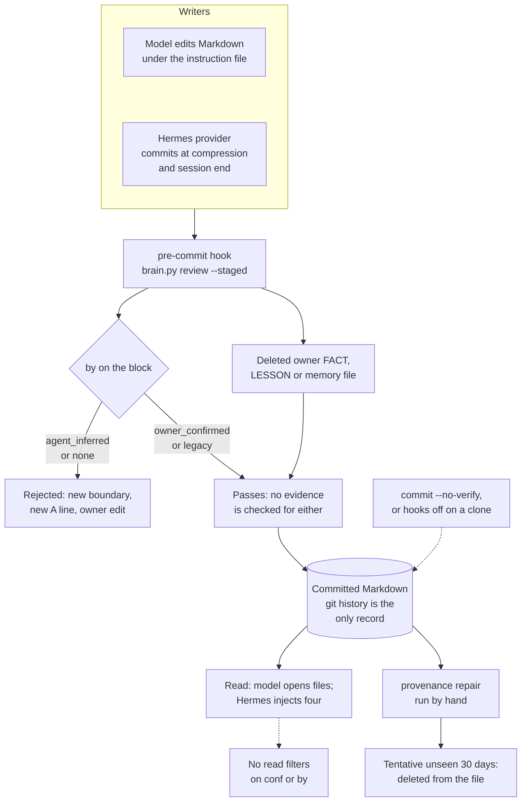

## 1. Executive Summary

Mem-Forever is a template Git repository that an owner copies and keeps
private. Its five instruction files tell any coding agent to keep a
profile, one file of iLang declaration blocks per memory and a hand-off
note, and to commit and push every change. What is notable is
`tools/brain.py`, a standard-library gate installed as the pre-commit hook
that refuses an agent-written boundary or anti-pattern and checks an owner
quote against the user turns of a transcript by hash. What is weak is that
the source it gates on is a string the writer types: `by:owner_confirmed`
and `by:legacy` pass every owner rule with no evidence.

The memory itself is written by the model. Code writes evidence lines, log
entries, imports and the maintenance rewrites, and no code reads memory for
the model except the Hermes provider's session-start injection of four
files, which applies no rule to what it injects.

The README's title claims are bounded by its own engine. *"Forever"* holds
for confirmed blocks with an owner source: `provenance repair` deletes any
tentative fact, lesson or exclusion 30 days after its `last:` date,
whatever its source, with git history as the only record. *"Everything"* excludes code facts by design (§4.5 of the
README: *"Code memory is not kept"*).

**Licence.** MIT, the unmodified text, and every manifest agrees. Nothing
restricts use. Two things the project relies on are not in the tree: the
canonical grammar validator that acceptance check 2 requires lives in the
separate `ilang-spec` repository, and the 3.0 and 3.1 design records are
*"kept by the owner outside this repository"* (`README.md:328`, `:341`).

No marks. Section 9 names the reason for each of the seven.

## 2. Mental Model

A memory is **one declaration line in a Markdown file**:
`::FACT{key|value|conf}`, `::GENE{name|conf|scope}` with `T:` trait and
`A:x⇒y` anti-pattern lines under it, `::BOUNDARY{never|scope}`,
`::DECIDE{@X}{what|why|context}`, `::LESSON{id|type|scope|conf}` plus one
line of prose, `::EXCLUDE{…}` and the hand-off's `::PROGRESS{date|done|next|unverified}`.
The parser recognises any line matching `BLOCK_RE` and identifies a block by
kind and key: a FACT by `key`, a BOUNDARY by its `never` text, a DECIDE by
entity and `what` (`tools/brain.py:1933`, `:1964-2018`).

A block is believed from the moment the model writes it, because the model
reads the raw file. Two fields describe how far to believe it, and both are
written by the writer:

- **`by:`** names whose words the block rests on. `owner_verbatim` with a
  `q:` key, `owner_confirmed`, `owner_claimed`, `agent_inferred`,
  `imported` and `legacy` (`tools/brain.py:2295-2296`). Only the three in
  `OWNER_SOURCES` (`owner_verbatim`, `owner_confirmed`, `legacy`) may keep a
  boundary or an `A:` line, and they are exempt from the 90-day demotion.
  The 30-day deletion of a tentative block ignores the source
  (`tools/brain.py:3714-3718`).
- **`conf:`** is `tentative` or `confirmed`. An `agent_inferred` block may
  go `confirmed` only with `seen:3`.

The code moves a block in four ways, each on a separate command:

- **At commit**, `review` rejects a new agent-sourced boundary or `A:` line,
  a deleted boundary without a retire decision, and an owner block changed
  by a non-owner source; it downgrades an unsupported `confirmed`
  (`tools/brain.py:3848-3905`).
- **On `provenance repair`**, an agent boundary becomes a tentative
  `advice_` fact, an unbacked `owner_verbatim` becomes `owner_claimed`, a
  tentative block unseen for 30 days is deleted, an agent-confirmed block
  unseen for 90 days is demoted (`:3780-3840`).
- **On `evidence confirm`**, a quote is marked backed, or an exclusion's
  `left` value is written as a `by:owner_confirmed` fact (`:3643-3678`).
- **On `import`**, every block is stamped `by:imported`, reset to tentative,
  and boundaries become facts (`:3982-4047`).

A block stops being believed when the model stops reading it: deleted from
the file, by the model or by `repair`. Nothing marks it disbelieved in place.

## 3. Architecture

There is no service. A brain is a Git repository created from the template
(`git clone`, `rm -rf .git`, `git init`, `brain.py init .`, per `README.md`
§2), pushed to a private remote. `brain.py init` writes the skeleton files,
a 32-byte `env/pepper`, the two hooks, and sets `core.hooksPath` to
`tools/hooks` (`tools/brain.py:1520-1587`, `:4265-4283`).

`tools/brain.py` is one file and one argparse CLI of 26 top-level
subcommands (`:4372` onward). The Hermes plugin carries a byte-identical
copy at `hermes/engine/brain.py`, which `tests.yml` checks with `cmp`.

Three host integrations sit on the same files:

- **Instruction files.** `CLAUDE.md`, `AGENTS.md`, `GEMINI.md`,
  `.cursorrules` and `.github/copilot-instructions.md` are each the body of
  `skills/mem-forever/SKILL.md`; `brain.py instructions check` holds them
  identical (`:4147-4182`).
- **A Claude Code plugin.** `.claude-plugin/plugin.json` registers
  `SessionStart`, `Stop` and `PreCompact` hooks, all three `"type": "prompt"`,
  whose text asks the model to read the hand-off, save each lesson as a file,
  update `::PROGRESS` and push (`.claude-plugin/plugin.json:12-48`). The
  prompts name `tools/brain.py` and `handoff/CURRENT.md` as relative paths,
  so they resolve only when the session's working directory is the brain.
- **A Hermes Agent memory provider** (`hermes/__init__.py`), covered in
  section 8.

Two GitHub workflows run in every copy. `tests.yml` runs the suites on
push. `upstream-sync.yml` runs weekly, fetches
`https://github.com/ilang-ai/mem-forever.git` at `main` unpinned, checks out
the instruction files, `tools/brain.py`, both hooks and the test file over
the brain's own, and pushes (`.github/workflows/upstream-sync.yml:4-5`,
`:17`, `:25`, `:34`). `hf-mirror.yml` carries a guard on
`github.repository == 'ilang-ai/Mem-Forever'` (`hf-mirror.yml:15`);
`upstream-sync.yml` carries none.

### Deployment and ergonomics

Git and Python 3.10 are the whole requirement. Nothing needs a key, a model
call or a network connection except `git push`, the push guard's GitHub and
Gitee visibility check (`tools/brain.py:4231-4262`) and `verify --online`.
The store is plain text, diffable and editable by hand, which is the
project's main argument for itself.

The cost is the weekly sync. A brain's pre-commit hook runs the brain's own
`tools/brain.py`, so whatever upstream `main` holds on a Monday is the code
that judges the owner's commits after the next pull.

## 4. Essential Implementation Paths

- **Block grammar.** `BLOCK_RE`, `REQUIRED_KEYS`, `parse_blocks`,
  `_block_id` (`tools/brain.py:1933-2018`).
- **The commit gate.** `tools/hooks/pre-commit:7-8` runs
  `brain.py review --staged` then `brain.py check`. `cmd_review`
  (`tools/brain.py:3908-3969`) reviews staged files under `soul/`,
  `memory/` and `handoff/` against `HEAD` with `review_text`
  (`:3848-3905`), and runs `cmd_handoff_review` on `handoff/CURRENT.md`
  (`:3932-3943`).
- **Provenance.** `provenance_scan` (`:3683-3732`) lists violations and due
  decays; `cmd_provenance` (`:3735-3840`) has `init`, `check` and `repair`.
- **Evidence.** `quote_q` is the first eight hex characters of SHA-256 over
  whitespace-normalised text (`:3528-3530`); `transcript_user_q` reads a
  Claude Code JSONL and keeps only `type: user` turns (`:3571-3603`);
  `cmd_evidence` appends `::EVIDENCE` lines to `soul/evidence.md`
  (`:3606-3681`).
- **Hand-off review.** `cmd_handoff_review` and `overlay_candidate`
  (`:2042-2277`).
- **Import, verify.** `cmd_import` (`:3982-4047`), `cmd_verify`
  (`:4052-4142`).
- **Log and recognition.** `_log_append` (`:3248-3256`), `log_events`
  (`:3279-3309`), `soul_anchors` and `recognize` (`:3345-3413`).
- **Credential ledger.** `load_ledger`, the `enc1` encoding over the
  committed pepper, `cmd_unlock`, `cmd_grant`, `cmd_otp` (`:2279-3175`).
- **Hermes.** `prefetch` (`hermes/__init__.py:267-294`), `sync_turn`
  (`:301-318`), `_save_leftovers` (`:581-597`), the tool dispatch
  (`:361-439`).
- **Tests.** `tools/test_brain.py`, `hermes/test_hermes_plugin.py`,
  `.github/workflows/tests.yml`.

## 5. Memory Data Model

The files are the schema (`README.md` §4.1). `soul/soul.md` is the owner's
profile: `::STATE{@OWNER…}`, one `::GENE` per area, facts and boundaries.
`soul/agent.md` holds a persona and what the agent learned. `memory/*.md`
is one memory per file with a frontmatter `type` of `user`, `feedback`,
`project` or `reference`, indexed one line per file in `memory/MEMORY.md`.
`handoff/CURRENT.md` holds the open task; closed ones move to
`handoff/archive/`. `brain.py check` requires a frontmatter with a
non-empty `type` on every file under the three directories (`:400-422`).

Provenance and time are keys on the block line: `by:`, `q:`, `conf:`,
`seen:`, `last:`. `last:` is the date the block was last seen, set by the
writer; `provenance init` stamps it to the day it runs (`:3737-3770`). No
key records when a fact became true.

`scope:global|project` appears on the GENE, BOUNDARY and LESSON templates.
No code reads it on a memory block. The one `scope` the code reads is on
credential ledger rows and on the hand-off's `::PROGRESS` line, both for
`unlock` (`:2576-2587`, `:2647-2649`).

`soul/evidence.md` and `log/YYYY-MM-DD.md` are the two append-only files.
The first holds quotes, each `::EVIDENCE{q|date|where|by|src|text}`; the
second holds `::EVENT{@OWNER|@AGENT, at, kind}` entries for owner turns,
agent notes, unlocks and grants. Both are appended with `open(..., "ab")`
and neither is edited by code (`:3606-3611`, `:3248-3256`).

The credential ledger (`env/ledger.env`, `env/keys.env`) is a separate data
model: one row per door with `verify`, `last_verified`, `recover`, `scope`,
`top` and `why`, values XOR-encoded with a SHA-256 keystream over the
committed pepper. The README says plainly that this is *"obfuscation
against accidental exposure, not encryption"* (`README.md:287`).

## 6. Retrieval Mechanics

There is no retrieval code for memory. The model reads files by name:
`handoff/CURRENT.md`, `soul/soul.md`, `soul/agent.md` and
`memory/MEMORY.md` at session start, then whichever `memory/*.md` the index
line suggests. Ranking, filtering and recall quality are the model's.

The Hermes provider is the one code reader. Its first `prefetch` of a
session returns those four files, the index cut at 40,000 characters and
the bundle at 90,000; later prefetches return nothing unless
`handoff/CURRENT.md` has changed on disk (`hermes/__init__.py:54`,
`:267-294`). `system_prompt_block` adds `BRAIN.md` (`:251-265`). The
injected text is the raw file, so a `tentative` block, an `owner_claimed`
quote and an `advice_` fact reach the model on the same terms as an owner
boundary.

`brain.py paste` builds the one message for a chat model with no tools: an
opening line, the notation card and the hand-off's declaration region,
plus the ledger's row names without values unless `--with-values`
(`tools/brain.py:1891-1930`). It reads only the hand-off; the soul and
memory files are not in it.

Every grep for `conf` and `OWNER_SOURCES` in the engine lands in
`provenance_scan`, `review_text`, the `review --fix` downgrade and
`soul_anchors`. The last one is the only read that excludes on `by:`:
recognition skips any `T:` or `A:` line not from an owner source
(`:3356-3357`). That read decides whether the owner is speaking; it does
not choose what the model is shown.

## 7. Write Mechanics

**The model writes.** The instruction body tells it to save one memory per
file with a typed frontmatter, add an index line, append or merge rather
than overwrite, fold the oldest entries into a summary paragraph past 200
lines, and commit and push each change on its own
(`skills/mem-forever/SKILL.md:142-176`, `:262-276`). The Claude Code
`Stop` and `PreCompact` hook prompts restate this.

**Code writes around it.**

- `evidence add` appends a quote as `owner_claimed`, or `owner_verbatim`
  when `--transcript` finds the text among a Claude Code JSONL's user turns
  (`tools/brain.py:3621-3642`).
- `evidence confirm <q>` appends the same quote as `owner_confirmed`, or
  turns an exclusion's `left` into a confirmed fact (`:3643-3678`).
- `log owner` and the Hermes `sync_turn` append owner turns verbatim;
  bot-authored turns are skipped (`hermes/__init__.py:301-318`).
- `import` writes `memory/imports/<name>-<date>.md` with every block
  demoted, duplicates of existing identifiers dropped (`:3982-4047`).
- `ledger harvest` and `migrate-cc` replace key-shaped strings under
  `memory/`, `soul/` and `handoff/` with `{{DOOR}}` tokens and move the
  value into the ledger (`:2493-2554`).

**The gate.** Every commit that reaches the pre-commit hook is reviewed
against `HEAD`. A rejection aborts the commit. A `handoff/CURRENT.md`
review that returns 3 (for the owner) is printed as a `NOTE` and the commit
goes through (`:3940-3943`).

**Forgetting.** `provenance repair` is the only code that deletes a block.
It runs when someone runs it: no hook, no plugin hook prompt and no Hermes
path calls it. `check`, which the hook does run, lists due decays as one
warning line (`:481-486`).

### Operational cost

Every write is a commit, synchronous, with the hook parsing every staged
file and `check` walking the whole tree and scanning it for key-shaped
text. A memory is readable by the next session as soon as it is saved, and
by another machine after a push and a pull. No background pass rewrites the
store. The read cost is the four files the session opens, which grow with
the profile and the index; the Hermes path bounds them at 90,000
characters and injects them once, as a prefetch rather than in the system
prompt.

## 8. Agent Integration

**Claude Code, Codex, Cursor, Copilot, Gemini CLI.** The model reads its
instruction file natively and uses its own file and shell tools on the
brain. Every `brain.py` subcommand, including `grant`, `otp issue` and
`evidence confirm`, is reachable from that shell.

**The Claude Code plugin.** Three prompt-type hooks. A prompt-type hook in
Claude Code is evaluated by a model call that returns a decision; whether
the text reaches the working session as an instruction was not checked
here (section 12).

**Hermes.** `MemForeverProvider` injects the brain at session start, logs
each owner turn on a background thread, commits `soul/ memory/ handoff/
log/ log.md` before compression and at session end, and pulls with
`--rebase --autostash` at initialise (`hermes/__init__.py:197-233`,
`:333-351`). It registers one tool, `mem_forever`, with eight actions:
`status`, `check`, `unlock`, `handoff_review`, `recognize`, `log`, `commit`,
`pull` (`:79-110`). `grant`, `otp`, `evidence` and `ledger verify` are not
actions. Subagent and cron contexts may read and not write (`:246-247`).
The model edits memory with Hermes's file tools.

**A chat model with no tools** receives `brain.py paste` and returns blocks
in a fence, which a tool with Git then runs through
`handoff review --overlay` (`README.md` §1, §4.4).

## 9. Reliability, Safety, and Trust

### The source is a field the writer fills in

Every owner rule in the gate keys on `by:`, and two of the three owner
values are accepted on the writer's word:

- `provenance_scan` checks only `owner_verbatim` against evidence
  (`tools/brain.py:3702-3705`). A block saying `by:owner_confirmed` or
  `by:legacy` is never asked for a quote.
- `review_text` admits a new boundary or `A:` line when `by` is in
  `OWNER_SOURCES[:2]`, which includes `owner_confirmed` (`:3883-3890`).
- It accepts a change to an owner block when the new `by` is in
  `OWNER_SOURCES`, which includes `legacy` (`:3892-3896`).
- The retire tombstone that permits a boundary's deletion is accepted with
  `by:owner_confirmed` (`:3864-3866`).

So an agent that writes `by:owner_confirmed` on a new boundary, or
re-stamps an owner fact `by:legacy` while changing its value, passes the
hook and `provenance check`. This follows from the code and was not run.

The skill defines `owner_confirmed` as *"wording the owner approved"*
(`skills/mem-forever/SKILL.md:218`). Nothing records the approval.
`evidence confirm`, described as *"the owner backs it in person"*, is a CLI
command that checks nothing about who runs it (`tools/brain.py:3643-3678`).
The same holds for `grant`, which writes `@OWNER` into the log whoever ran
it (`:3169`), and `otp issue`, which prints the one-time code to whoever ran
it (`:3034-3039`). The tests exercise exactly that path: one process issues
the code and spends it (`tools/test_brain.py:178-192`).

### What the gate does not see

- **Deletion of anything but a boundary.** `review_text` checks base blocks
  only for boundaries (`:3867-3872`); a removed owner FACT, DECIDE or
  LESSON is not looked for. A deleted file under `memory/` is printed and
  skipped; only `soul/` files and `handoff/CURRENT.md` are refused
  (`:3921-3926`). The SKILL's *"Owner-sourced blocks never decay; only a
  tombstone removes one"* holds for boundaries in `soul/` and the hand-off.
- **The tombstone after its commit.** A `DECIDE` retire block is consulted
  only in the commit that removes the boundary, and a later commit may
  delete it unchecked.
- **Commits that skip the hook.** `git commit --no-verify`, or a clone
  where `core.hooksPath` is unset, writes without review. `check` warns
  about the second (`:441-444`) and returns 0 on warnings (`:505`).
  The SKILL's claim that bypassing *"changes nothing, because the same
  rules apply when the brain is read"* (`SKILL.md:274`) rests on the model
  applying them: no code applies them on any read (section 6).
- **Owner verdicts on the hand-off.** A fact value change or a `next` item
  moved to `done` returns 3 from `handoff review`; under the hook that is a
  note and the commit lands (`:3940-3943`). The SKILL's *"Nothing merges
  while the owner has not decided"* (`SKILL.md:197`) is a rule for the
  model.

### Code and documentation disagree on decay

The SKILL says *"Owner-sourced blocks never decay"* (`SKILL.md:252`). The
tentative-expiry rule has no source condition, so `repair` deletes a
`conf:tentative|by:owner_verbatim` fact unseen for 30 days as it would an
agent's (`tools/brain.py:3714-3716`). In the other direction the SKILL says
*"legacy facts and lessons decay as agent-sourced"* (`SKILL.md:288`), while
the code puts `legacy` in `OWNER_SOURCES`, so a confirmed legacy fact is
never demoted (`:3717`). `test_decay_tentative_after_30_days` asserts the
code's version for legacy and has no tentative owner-sourced fixture
(`tools/test_brain.py:316-326`).

### The Hermes engine pin stops at the hook

The provider's docstring says the brain's own `tools/brain.py`, which a
pull or the upstream sync can change, *"is never executed by the
provider"* (`hermes/__init__.py:18-21`). Its tool actions honour that
(`:529-549`), and a test replaces the brain's copy and checks that `check`
still runs the plugin's (`hermes/test_hermes_plugin.py:199-206`). The
provider's commits run `git commit` in the brain (`:588-590`), which fires
`tools/hooks/pre-commit`, which runs the brain's `tools/brain.py`
(`tools/hooks/pre-commit:7-8`). The test restores the original file before
the commit step.

A hook rejection also has a cost on this path. `_save_leftovers` stages
`log/` in the same commit as the memory files, so a rejected memory edit
leaves the owner's logged turns uncommitted, and the next session's first
step retries the same commit (`hermes/__init__.py:226-233`, `:581-597`).

### Privacy

The push guard refuses to push memory paths to a remote that GitHub or
Gitee reports as public, and asks for a one-time `git config` on any other
host (`tools/hooks/pre-push`). `log/` holds every owner turn verbatim and
is exempt from the key scan (`tools/brain.py:2289`). Credentials are
recoverable by anyone holding the repository, by design.

### Marks

- **`tombstone` — withheld.** The `::DECIDE{@OWNER}{what:retire <never>}`
  block is keyed on the boundary's text, and it is read only to permit that
  boundary's removal in the same commit (`:3864-3872`). No write is
  compared against it later. An owner's `A:` line records a rejected
  behaviour for the model to read; no code compares a new trait with it.
- **`trust_state` — withheld.** `conf` and `by` are discrete fields with
  producers, and the gate rejects or rewrites on them. No read that serves
  memory excludes on either; the one exclusion is `soul_anchors`, which
  picks recognition anchors (`:3356`).
- **`bitemporal` — withheld.** `last:` is when the block was last seen and
  `date:` on evidence and progress is the writing date.
- **`scope_enforced` — withheld.** One repository per brain is a physical
  partition, and `scope:` on memory blocks is read by nothing. The scope
  predicate in `cmd_unlock` (`:3118-3126`) guards the release of a
  credential by name against a label the caller passes or the hand-off
  declares; it is an authorisation check on the key ledger, not a filter
  over memory.
- **`audit_log` — withheld.** `log/` is appended and records owner turns,
  agent notes, unlocks and grants. Memory edits made with file tools, and
  `repair`'s deletions, leave no entry there; git history is the record of
  mutations.
- **`human_review` — withheld.** The owner verbs, `evidence confirm`,
  `grant` and `otp issue`, are shell commands the agent can run, and
  `by:owner_confirmed` is text it can type. The hand-off's for-the-owner
  exit blocks nothing under the hook.
- **`negative_eval` — withheld.** The suite's negative assertions keep
  material out of files and outputs: an expired tentative fact absent from
  the file after `repair` (`tools/test_brain.py:316-326`), a key value
  absent from `paste` beside its row name (`:420-435`), a boundary absent
  from an import (`:380-396`). None asserts that a read path the model uses
  leaves out a memory that is present.

## 10. Tests, Evals, and Benchmarks

I ran none of the suites. Counts are from reading.

`tools/test_brain.py` holds 43 unittest methods, each building a brain
with `cmd_init` in a temporary directory and committing it. The gate is
the best-covered part: a boundary removed without a tombstone and with one
(`:332-347`), a new agent boundary and `A:` line (`:349-356`), an owner
fact changed by an agent with a conf downgrade (`:358-368`), and the
pre-commit hook refusing an agent boundary through a real `git commit`
(`:370-378`). Provenance repair and the transcript check have five tests
(`:238-314`), decay one (`:316-326`).

No test writes a `by:owner_confirmed` or `by:legacy` block as an agent,
deletes an owner fact or a memory file, or deletes a tombstone after its
commit, which are the paths section 9 finds open.

`hermes/test_hermes_plugin.py` is one `main()` with 38 `ok(...)` checks
against a stubbed Hermes: registration, injection, logging, commits at
compression and session start, the read-only subagent, and the engine pin
for the `check` action.

`.github/workflows/tests.yml` runs both on every push, plus
`brain.py check` on the template, the instruction-file check, `cmp` of the
two engine copies and `sh -n` on the hooks.

`README.md:264` says the self-test has 37 scenarios; the file has 43, as
the 2.2 line at `:313` says. The README's recognition result, 12 of 12 own
sessions and 1 of 21 other windows, comes from *"scripts and rows in the
owner's work directory, not in this repository"* (`README.md:309`). The
token counts for the card and `BRAIN.md` in §5 have no committed
measurement script.

There is no paper. `CITATION.cff` describes the software, and the README
cites ten DOIs, nine of them classic papers and one the iLang protocol
specification on Zenodo.

## 11. For Your Own Build

### Steal

- **Check an owner quote against the transcript, not the writer.** Hash the
  quoted text and look for it among the host's user turns only; an
  unbacked quote downgrades to the authority of an inference.
- **Gate boundaries and anti-patterns harder than facts.** A rule that
  forbids an action should need the owner's words to exist, and an agent's
  attempt should become advice rather than vanish.
- **Demote on import.** Everything from another store arrives tentative,
  with its boundaries turned into facts, so a migration cannot install
  rules.
- **Review a returned hand-off block by block, with two failure exits.**
  Reject on lost keys, dropped items and weakened boundaries; route value
  changes and completions to a person.

### Avoid

- **A provenance field the writer sets.** If the gate trusts `by:`, the
  only producer of that field must be the code that verified it.
- **A gate that checks edits and not removals.** Deleting a record is the
  strongest edit; review the base blocks missing from the candidate, not
  only the candidate's.
- **An owner verb on the agent's shell.** A grant, a one-time code or a
  confirmation the agent can run is a speed bump.
- **Shipping a scheduled job that replaces the gate's code from upstream**
  in every user's copy.

### Fit

This suits one person who works across several coding tools, wants a
memory they can read in `git log`, and is prepared to be the reviewer: to
read diffs, run `provenance repair`, and treat the hook as a guard against
a careless model rather than a determined one. The design spends its
engineering on keys and on catching an agent that invents a rule, and that
part is well built and tested.

It does not suit anyone who needs the gate to hold against the agent it
governs, because the agent writes the field the gate trusts and holds the
shell that runs every owner command. Nor does it suit a team: one
repository is one owner, and nothing models a second person.

## 12. Open Questions

- Does Claude Code deliver a `"type": "prompt"` hook's text on
  `SessionStart` and `Stop` to the working session, or only to the model
  that evaluates the hook's decision? If the latter, the plugin's capture
  rests on the instruction file alone.
- With the plugin installed in a project other than the brain, which file
  do the hook prompts' relative paths resolve against?
- Does `upstream-sync.yml` succeed in a brain created from the template,
  given that it sets no `permissions:` and depends on the repository's
  default token rights?
- Is anything outside this tree meant to run `provenance repair` on a
  schedule?

## Appendix: File Index

| Path | Role |
| --- | --- |
| `tools/brain.py` | The engine: check, review gate, provenance, evidence, hand-off review, paste, ledger, unlock, log, recognize, import, verify |
| `tools/hooks/pre-commit`, `tools/hooks/pre-push` | The commit gate and the push guard |
| `skills/mem-forever/SKILL.md` | The protocol, mirrored into the five instruction files |
| `.claude-plugin/plugin.json` | Claude Code plugin with three prompt-type hooks |
| `hermes/__init__.py` | The Hermes memory provider and its `mem_forever` tool |
| `hermes/engine/brain.py` | Byte-identical copy of the engine |
| `handoff/CURRENT.md`, `soul/`, `memory/MEMORY.md` | The template's memory files |
| `tools/test_brain.py`, `hermes/test_hermes_plugin.py` | The suites |
| `.github/workflows/tests.yml`, `upstream-sync.yml`, `hf-mirror.yml` | CI, the weekly engine sync, the HuggingFace mirror |

### Recorded searches

Run from the repository root at the pinned commit with `/usr/bin/git grep`.

- **Every use of the owner-source list.**
  `git grep -n -E 'OWNER_SOURCES|BACKED_SOURCES' -- '*.py'` returns the
  definitions at `tools/brain.py:2295` and `:3533`, `soul_anchors` at
  `:3356`, `_evidence_q` at `:3543`, `provenance_scan` at `:3700-3730`,
  `review_text` at `:3866-3898` and the `--fix` downgrade at `:3956`, and
  the same lines in `hermes/engine/brain.py`.
- **Every read of `conf`.** `git grep -n -E 'get\("conf"\)' -- '*.py'`
  returns `:3706`, `:3715`, `:3717`, `:3898` and `:3956`, all in
  provenance and review.
- **The Hermes provider reads no provenance.**
  `git grep -n -i -E 'provenance|conf:|by:' -- hermes/__init__.py` returns
  nothing; `git grep -n 'ENTRY_FILES' -- hermes/__init__.py` matches.
- **Nothing runs repair automatically.**
  `git grep -n -E 'repair' -- tools/hooks .claude-plugin .cursor-plugin hermes/__init__.py`
  returns nothing; the same pattern over `skills/` matches the SKILL text.
- **No validity time.**
  `git grep -n -i -E 'valid_(from|to)|valid_at|as_of' -- '*.py'` returns
  nothing; `git grep -n -c '"last"' -- tools/brain.py` returns 7.
- **Scope is read only for the ledger and the hand-off.**
  `git grep -n -E 'get\("scope"' -- '*.py'` returns `tools/brain.py:2583`,
  `:2648`, `:2804` and the Hermes tool's argument at `hermes/__init__.py:402`.
- **No search index.**
  `git grep -n -i -E 'embedding|vector|bm25|fts5' -- '*.py'` returns
  nothing; `git grep -n -c 'parse_blocks' -- tools/brain.py` returns 22.
- **The retire block is read in one place.**
  `git grep -n -i 'retire' -- '*.py'` returns `tools/brain.py:3865`,
  `:3870`, their copies in `hermes/engine/brain.py`, and
  `tools/test_brain.py:344`, `:347`.
- **The hook runs the brain's engine.**
  `git grep -n 'tools/brain.py' -- tools/hooks/pre-commit` returns `:7`
  and `:8`.
- **Only the mirror workflow is guarded.**
  `git grep -n -E 'if:' -- .github/workflows/upstream-sync.yml .github/workflows/hf-mirror.yml`
  returns `hf-mirror.yml:15`.
- **No paper.** `git grep -n -i -E 'arxiv|bibtex|@article|@misc'` returns
  nothing; `git grep -n -c -i 'doi' -- README.md` returns 14.

## History

**2026-11-25** — [`d8eba3dd6822dd07807e2d38a3858e31ef89238d`](https://github.com/ilang-ai/Mem-Forever/commit/d8eba3dd6822dd07807e2d38a3858e31ef89238d). First reading, from a full clone at the head of `main`; triage selected the same commit; no submodules. Screened first: four auto-run surfaces, the `.claude-plugin` marketplace and `plugin.json` registering `SessionStart`, `Stop` and `PreCompact` prompt hooks inline, and `.cursorrules` and `.github/copilot-instructions.md`, which an agent loads into context; nothing inside the seven-day cooldown, no build-time execution, no unpinned manifest. Instruction files, the skill and docs were read as data. Nothing was installed, built or run, and neither suite was run. No marks ([section 9](#marks)). Any writer can stamp `by:owner_confirmed` or `by:legacy` past the gate, deletions other than a boundary's pass it, and no read consults `conf` or `by`.
